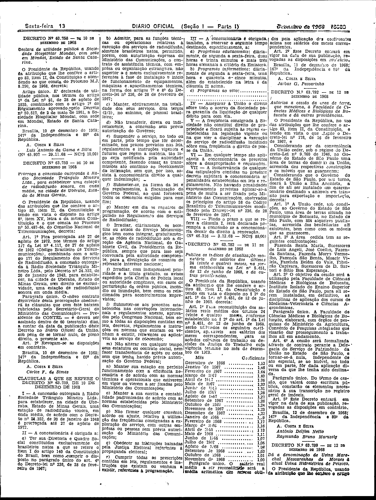

###DEC-063759-0-000-10-12-1968@@@

<strong>DECRETO Nº 63.759, DE 10 DE DEZEMBRO DE 1968.</strong>

<em><strong>Prorroga a concessão outorgada à Rádio Sociedade Triângulo Mineiro Ltda., para estabelecer uma estação de radiodifusão sonora, em onda média, na cidade de Uberaba, Estado de Minas Gerais.</strong></em>

<strong>O PRESIDENTE DA REPÚBLICA</strong>, usando das atribuições que lhe confere o artigo 83, item II, da Constituição, e tendo em vista o disposto no artigo 8º, item XV, letra <em>a</em> da mesma Constituição e o que consta no Processo nº 50.487-64, do Conselho Nacional de Telecomunicações,

<strong>DECRETA:</strong>

<strong>Art</strong>. 1º Fica prorrogada até 27 de agôsto de 1972, nos têrmos do artigo 117 da Lei nº 4.117, de 27 de agôsto de 1962 (Código Brasileiro de Telecomunicações), combinado com o artigo 177 do Regulamento dos Serviços de Radiodifusão, a concessão outorgada à Rádio Sociedade Triângulo Mineiro Ltda. pelo Decreto nº 24.352, de 20 janeiro de 1948, para estabelecer, na cidade de Uberaba, Estado de Minas Gerais, sem direito de exclusividade, uma estação de radiodifusão sonora em onda média.

Parágrafo único. O nôvo contrato decorrente desta prorrogação obedecerá às cláusulas que com êste baixam rubricadas pelo Secretário-Geral do Ministério da Comunicações - Presidente do CONTEL - e deverá ser assinado dentro de 60 (sessenta) dias, a contar da data da publicação dêste Decreto no <em>Diário</em> <em>Oficial</em> da União, sob pena de se tornar nulo, de pleno direito, o presente ato.

<strong>Art</strong>. 2º Revogam-se as disposições em contrário.

Brasília, 10 de dezembro de 1968; 147º da Independência e 80º da República.

<strong>A. COSTA E SILVA</strong>

Carlos F. de Simas

<!-- fac-simile-oficial:inicio -->

## Fac-símile oficial: cláusulas

O texto acima não inclui as cláusulas a que se refere este decreto. A publicação oficial do anexo está em imagem, nas páginas do _Diário Oficial da União_ (Seção I) de 13 de dezembro de 1968: página 3 do PDF (a partir de «CLÁUSULAS A QUE SE REFERE O DECRETO N.º 63.759, DE 10 DE DEZEMBRO DE 1968», até «Nº 46.316 — 3.12.68 — NCr$ 88,00»).

As imagens são as páginas inteiras, tal como digitalizadas pela Imprensa Nacional, sem recorte, sem redesenho e sem transcrição. Cada página traz também outros atos do mesmo dia; a peça deste decreto está apenas no trecho indicado, e o texto do anexo só existe na imagem. Não há OCR validado.

Fonte: Imprensa Nacional, Biblioteca Machado de Assis, arquivo `DO_1_19681213_241.PDF` (SHA-256 `b575816d1d1b5f142def16e348921589aaa4aad06aa1cbb188efae22ec96702d`), páginas 3 do PDF. SHA-256 das imagens, na ordem: `fd02acab6c9c2fbbca337435dfff0b3a251d7bc79689d928a0a4e9d9093f2449`.

<!-- fac-simile-oficial:fim -->
