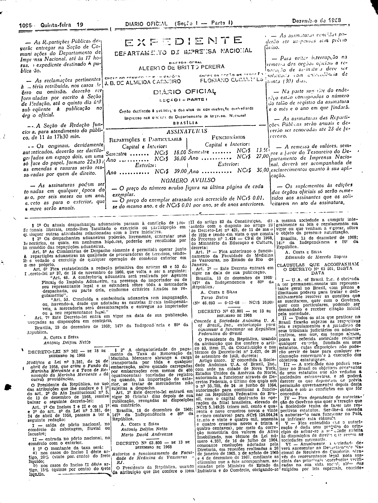
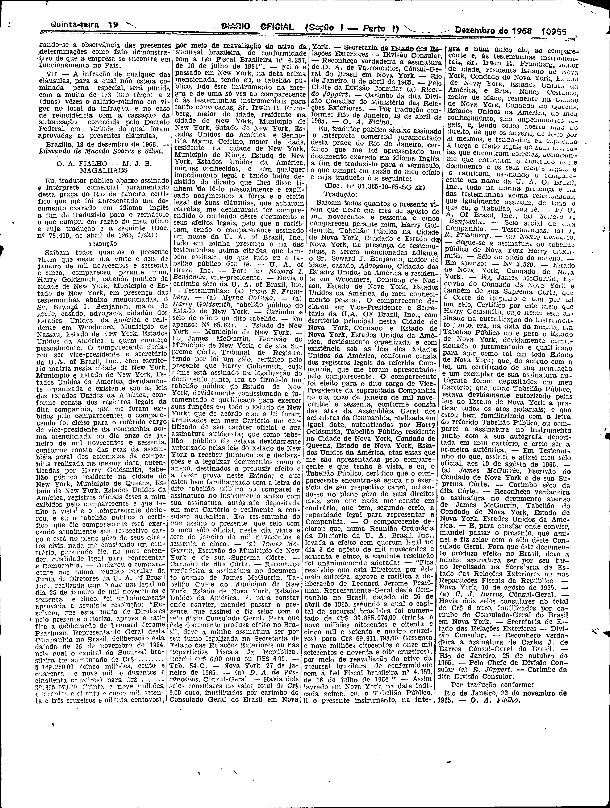

###DEC-063801-0-000-13-12-1968@@@

<strong>DECRETO Nº 63.801, DE 13 DE DEZEMBRO DE 1968.</strong>

<!-- fac-simile-oficial:inicio -->

## Fac-símile oficial do ato inteiro: cláusulas + traduções

Esta norma é reproduzida apenas em imagem. As páginas inteiras do _Diário Oficial da União_ (Seção I) de 19 de dezembro de 1968 trazem o decreto e o instrumento que o acompanha: PDF `DO_1_19681219_245.PDF`, p.2 do PDF (impressa 10954), p.3 do PDF (impressa 10955).

O texto do Senado que antes constava aqui foi retirado para manter uma só versão do ato: não foi colacionado palavra a palavra com o impresso.

**Divergências constatadas entre o texto do Senado e o impresso:** A ementa/corpo do Senado trazia «U.A. of Brazil” Inc.» com aspa solta; o impresso traz «U. A. of Brazil, Inc.».

**Limites lidos nas imagens:** p.10954 (PDF 2): decreto col.3 base–col.4; «CLÁUSULAS QUE ACOMPANHAM O DECRETO Nº 63.801» col.4 base (I–VI, VI cortada). p.10955 (PDF 3): col.1 fim de VI, VII, «Brasília, 13 de dezembro de 1968. — Edmundo de Macedo Soares e Silva.» (assim impresso); traduções (Doc. nº 78.419 e Doc. nº 81.365-10-65) até «Por tradução conforme: Rio de Janeiro, 23 de novembro de 1965. — O. A. Fialho.» (col.4); resto da página em branco.

**Assinatura(s):** Edmundo de Macedo Soares e Silva (como impresso). Traduções: O. A. Fialho e M. J. B. Magalhães (cabeçalho impresso «O. A. FIALHO — M. J. B. MAGALHÃES»); o fim da p.10955 traz «Por tradução conforme… O. A. Fialho».

As imagens são as páginas inteiras, extraídas do PDF com `pdfimages -png` (imagem JBIG2 embutida, uma por página, sem reduzir), sem recorte, sem redesenho e sem transcrição. Cada página traz também outros atos do mesmo dia; a peça está apenas no trecho indicado. O texto do ato só existe na imagem. Não há OCR validado.

Fonte: Imprensa Nacional, Biblioteca Machado de Assis, `DO_1_19681219_245.PDF` (SHA-256 `32e95046ba945f28f8e7247f3af81041a9123b7b9cc590f287b34dea6c240cde`). SHA-256 das imagens, na ordem: `664073a49beb61612e9ea88ecfc1a7bab0fa8663077c230d339645d6fbd1c934`, `cc56c6570d1b9321708df800f0b14017c903bdc16485214ace45966c72c333b0`.

[PDF da edição oficial](https://biblioteca.in.gov.br/documents/271518/541144/DO_1_19681219_245.PDF/e940b611-cefe-768a-ac46-c10637c001af?t=1574886626137&download=true).

<!-- fac-simile-oficial:fim -->
