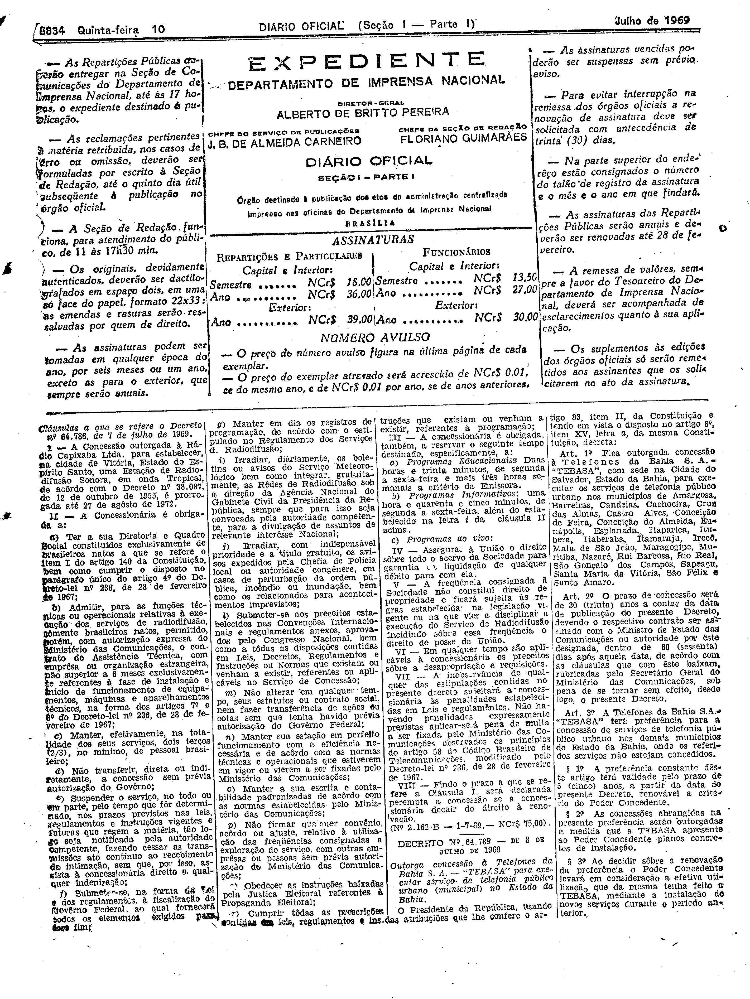

###DEC-064786-0-000-07-07-1969@@@

<strong>DECRETO Nº 64.786, DE 7 DE JULHO DE 1969.</strong>

<em><strong>Prorroga a concessão outorgada à Rádio Capixaba Ltda., para estabelecer na Cidade de Vitória, Estado do Espírito Santo, uma Estação de Radiodifusão Sonora em onda Tropical.</strong></em>

<strong>O PRESIDENTE DA REPÚBLICA</strong>, usando das atribuições que lhe confere o artigo 83, item II, da Constituição e tendo em vista o disposto no artigo 8º item XV, letra <em>a</em> da mesma Constituição e o que consta no Processo nº 5.888-64, do Conselho Nacional de Telecomunicações,

<strong>DECRETA:</strong>

<strong>Art</strong>. 1º Fica prorrogada até 27 de agôsto de 1972, nos têrmos do artigo 117 da Lei nº 4.117, de 27 de agôsto de 1962 (Código Brasileiro de Telecomunicações), combinado com o artigo 177 do regulamento dos Serviços de Radiodifusão, a concessão outorgada à Rádio Capixaba Ltda., pelo Decreto nº 38.087, de 12 de outubro de 1955, para estabelecer, na Cidade de Vitória, Estado do Espírito Santo, sem direito de exclusividade, uma Estação de Radiodifusão Sonora, em onda Tropical.

Parágrafo único. O nôvo contrato decorrente desta prorrogação obedecerá as cláusulas que com êste baixam rubricas pelo Secretário-Geral dos Ministérios das Telecomunicações - Presidente da CONTEL - e deverá ser assinado dentro de 60 (sessenta) dias, a contar da data da publicação dêste Decreto no <em>Diário Oficial</em> da União, sob pena de se tornar nulo, de pleno direito, o presente ato.

<strong>Art</strong>. 2º Revogam-se as disposições em contrário.

Brasília, 7 de julho de 1969; 148º da Independência e 81º da República.

<strong>A. COSTA E SILVA</strong>

João Aristides Wittgem

<!-- fac-simile-oficial:inicio -->

## Fac-símile oficial: cláusulas

O texto acima não inclui as cláusulas a que se refere este decreto. A publicação oficial do anexo está em imagem, nas páginas do _Diário Oficial da União_ (Seção I) de 10 de julho de 1969: página 2 do PDF (a partir de «Cláusulas a que se refere o Decreto nº 64.786, de 7 de julho de 1969», até «Nº 2.162-B — 1-7-69 — NCr$ 75,00»).

As imagens são as páginas inteiras, tal como digitalizadas pela Imprensa Nacional, sem recorte, sem redesenho e sem transcrição. Cada página traz também outros atos do mesmo dia; a peça deste decreto está apenas no trecho indicado, e o texto do anexo só existe na imagem. Não há OCR validado.

Fonte: Imprensa Nacional, Biblioteca Machado de Assis, arquivo `DO_1_19690710_129.PDF` (SHA-256 `d1ed85908e79e640265759695a025a95b4bb228bf81941688b4109c20ef09605`), páginas 2 do PDF. SHA-256 das imagens, na ordem: `929a9d8371f02e0fbe24c9c1a918b55bf99affcef426a235a20fdd40f4be9ba3`.

<!-- fac-simile-oficial:fim -->
