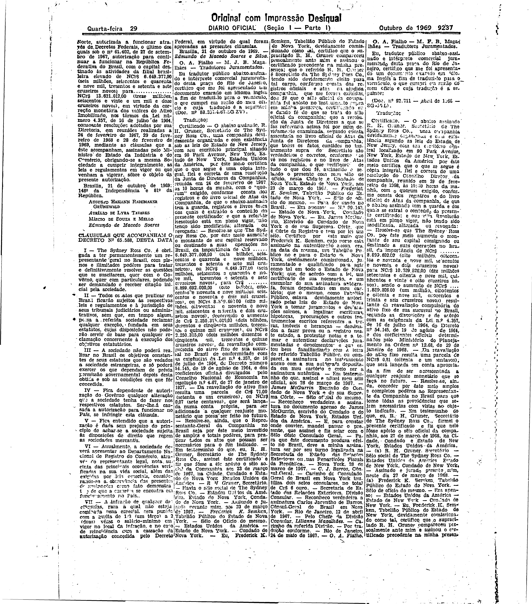

###DEC-065588-0-000-21-10-1969@@@

<strong>DECRETO Nº 65.588, DE 21 DE OUTUBRO DE 1969.</strong>

<em><strong>Concede à Sociedade The Sydney Ross Co. autorização para continuar a funcionar na República Federativa do Brasil.</strong></em>

<strong>OS MINISTROS DA MARINHA DE GUERRA, DO EXÉRCITO E DA AERONÁUTICA MILITAR</strong>, usando das atribuições que lhes confere o artigo 3º do Ato Institucional nº 16, de 14 de outubro de 1969, combinado com o artigo 83, item II da Constituição, e nos têrmos do Decreto-lei nº 2.627, de 26 de setembro de 1940,

<strong>DECRETAM:</strong>

Artigo único. É concedia à Sociedade <em>The Sydney Ross Co</em>., cujo objetivo social é a fabricação de produtos farmacêuticos, com sede na Cidade de <em>New York,</em> Estado de <em>New York,</em> autorizada a funcionar através de Decretos Federais, o ultimo dos quais sob o nº 61.402, de 27 de setembro de 1967, autorização para continuar a funcionar na República Federativa do Brasil, com o capital destinado às atividades da filial brasileira elevado de NCr$6.649.377,00 (seis milhões, seiscentos e quarenta e nove mil, trezentos e setenta e sete cruzeiros novos) para NCr$13.621.012,00 (treze milhões, seiscentos e vinte e um mil e doze cruzeiros novos), em virtude da correção monetária dos valôres do Ativo Imobilizado, nos têrmos da Lei número 4.357, de 16 de julho de 1964, consoante resoluções adotadas por sua Diretoria, em reuniões realizadas a 24 de fevereiro de 1967, 29 de fevereiro de 1968 e 28 de fevereiro de 1969, mediante as cláusulas que a êste acompanham, assinadas pelo Ministro de Estado da Indústria e do Comércio, obrigando-se a mesma Sociedade a cumprir integralmente as leis e regulamentos em vigor ou que venham a vigorar, sôbre o objeto da presente autorização.

Brasília, 21 de outubro de 1969; 148º da Independência e 81º da República.

<strong>AUGUSTO HAMANN RADEMAKER GRÜNEWALD</strong>

Aurélio de Lyra Tavares

Márcio de Souza e Mello

Edmundo de Macedo Soares

<!-- fac-simile-oficial:inicio -->

## Fac-símile oficial: clausulas

A peça vinculada ao Decreto nº 65.588 é reproduzida nas imagens abaixo, a partir da publicação oficial da Imprensa Nacional. A reprodução é em fac-símile, sem transcrição por OCR nem reconstrução do conteúdo.

As imagens mostram páginas inteiras do Diário Oficial da União e podem conter outras matérias. Essas matérias vizinhas não são atribuídas a este decreto. A peça é identificada pelo seu título e pela referência ao ato nas páginas indicadas.

SHA-256 desta imagem: `a4e970aa3eafd7662c751234256543608b1bff64f92c34087b7daada9cacf679`.

Fontes oficiais da publicação:

- [DO_1_19691029_207.PDF](https://biblioteca.in.gov.br/documents/271518/541092/DO_1_19691029_207.PDF/d12bef01-7d99-9d88-dbda-2fde7c2f8009?t=1574886502187&download=true) — SHA-256 do PDF: `4ec3d4e9c80803102068388b934b91edb32239397acda6b443453f00ab6da53b`.

<!-- fac-simile-oficial:fim -->
