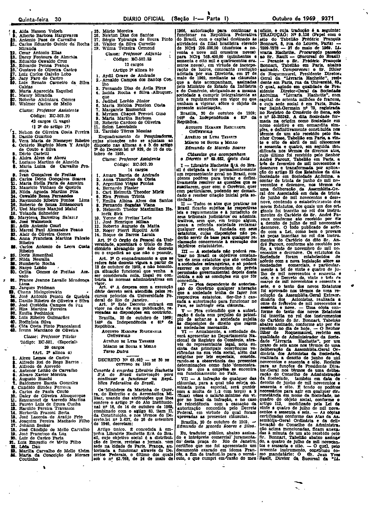

###DEC-065682-0-000-30-10-1969@@@

<strong>DECRETO Nº 65.682, DE 30 DE OUTUBRO DE 1969.</strong>

<em><strong>Concede à emprêsa Librairie Hachette S/A do Brasil autorização para continuar a funcionar na República Federativa do Brasil.</strong></em>

<strong>OS MINISTROS DA MARINHA DE GUERRA, DO EXÉRCITO E DA AERONÁUTICA MILITAR</strong>, usando das atribuições que lhes confere o artigo 3º do Ato Institucional nº 16, de 14 de outubro de 1969, combinado com o artigo 83, item II, da Constituição, nos têrmos do Decreto-lei nº 2.627, de 26 de setembro de 1940,

<strong>DECRETAM:</strong>

Artigo único. É concedida à emprêsa Librairie Hachette S/A do Brasil, cujo objetivo social é a distribuição de livros, revistas e jornais, com sede na cidade de Paris, França, autorizada a funcionar através de Decretos Federais, o último dos quais sob o nº 62.768, de 24 de maio de 1968, autorização para continuar a funcionar na República Federativa do Brasil, com o capital destinado as atividades da filial brasileira elevado de NCr$299.000,00 (duzentos e noventa e nove mil cruzeiros novos) para NCr$568.400,00 (quinhentos e sessenta e oito mil e quatrocentos cruzeiros novos), em virtude de incorporação de lucros, consoante resolução adotada por sua Diretoria, em 27 de maio de 1969, mediante as cláusulas que a êste acompanham, assinadas pelo Ministro de Estado da Indústria e do Comércio, obrigando-se a mesma sociedade a cumprir integralmente as leis e regulamentos em vigor ou que venham a vigorar, sôbre o objeto da presente autorização.

Brasília, 30 de outubro d 1969; 148º da Independência e 81º da República.

<strong>AUGUSTO HAMANN RADEMAKER GRÜNEWALD</strong>

Aurélio de Lyra Tavares

Márcio de Souza e Mello

Edmundo de Macedo Soares

<!-- fac-simile-oficial:inicio -->

## Fac-símile oficial: clausulas

A peça vinculada ao Decreto nº 65.682 é reproduzida nas imagens abaixo, a partir da publicação oficial da Imprensa Nacional. A reprodução é em fac-símile, sem transcrição por OCR nem reconstrução do conteúdo.

As imagens mostram páginas inteiras do Diário Oficial da União e podem conter outras matérias. Essas matérias vizinhas não são atribuídas a este decreto. A peça é identificada pelo seu título e pela referência ao ato nas páginas indicadas.

SHA-256 desta imagem: `c208633b0e937509e3f59d77dca33a19d6b793e1628afc4f473ce37628497c3d`.

Fontes oficiais da publicação:

- [DO_1_19691030_208.PDF](https://biblioteca.in.gov.br/documents/271518/541092/DO_1_19691030_208.PDF/c6da4dd5-dca5-5251-6a42-c80ae03f46c4?t=1574886520607&download=true) — SHA-256 do PDF: `d07925840d5470e3e7f546083bc7bd6da7c7dee27666aa0f48f055ef7f25af0b`.

<!-- fac-simile-oficial:fim -->
