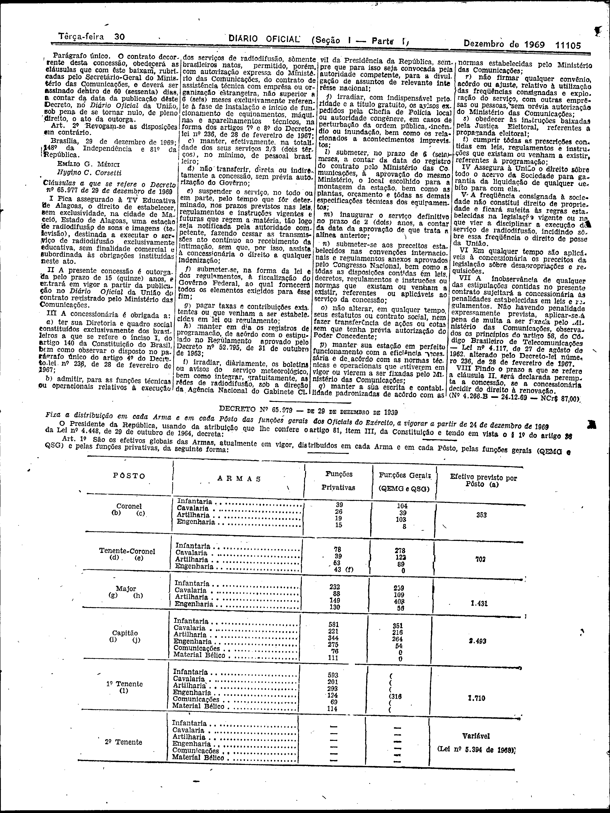

###DEC-065977-0-000-29-12-1969@@@

<strong>DECRETO Nº 65.977, DE 29 DE DEZEMBRO DE 1969.</strong>

<em><strong>Outorga concessão à Fundação TV Educativa de Alagoas, para estabeler, na cidade de Maceió, Estado de Alagoas, uma estação de radiodifusão de sons e imagens (televisão), para fins educativos.</strong></em>

<strong>O PRESIDENTE DA REPÚBLICA</strong>, usando das atribuições que lhe confere o artigo 81, item III, da Constituição e tendo em vista o disposto no artigo 8º, item XV, letra <em>a</em>, da mesma Constituição e o que consta do Processo número 10.928-68, do Conselho Nacional de Telecomunicações - CONTEL

<strong>DECRETA:</strong>

<strong>Art</strong>. 1º Fica outorgada concessão à Fundação TV Educativa de Alagoas, nos têrmos do artigo 14 do Decreto-lei nº 236, de 28 de fevereiro de 1967 e artigo 28 do Regulamento dos Serviços de Radiodifusão, para estabelecer, na cidade de Maceió, Estado de Alagoas, sem direito de exclusividade, uma estação de radiodifusão de sons e imagens (televisão), para fins educativos, sem finalidade comercial, utilizando o canal 3.

Parágrafo único. O contrato decorrente desta concessão obedecerá as cláusulas que com êste baixam, rubricadas pelo Secretário-Geral do Ministério das Comunicações, e deverá ser assinado dentro de 60 (sessenta) dias, a contar da data da publicação dêste Decreto, no <em>Diário Oficial</em> da União, sob pena de se tornar nulo, de pleno direito, o ato de outorga.

<strong>Art</strong>. 2º Revogam-se as disposições em contrário.

Brasília, 29 de dezembro de 1969; 148º da Independência e 81º da República.

<strong>EMÍLIO G. MÉDICI</strong>

Hygino C. Corsetti

<!-- fac-simile-oficial:inicio -->

## Fac-símile oficial: cláusulas

O texto acima não inclui as cláusulas a que se refere este decreto. A publicação oficial do anexo está em imagem, nas páginas do _Diário Oficial da União_ (Seção I) de 30 de dezembro de 1969: página 2 do PDF (a partir de «Cláusulas a que se refere o Decreto nº 65.977 de 29 de dezembro de 1969», até «Nº 4.266-B — 24-12-69 — NCr$ 87,00»).

As imagens são as páginas inteiras, tal como digitalizadas pela Imprensa Nacional, sem recorte, sem redesenho e sem transcrição. Cada página traz também outros atos do mesmo dia; a peça deste decreto está apenas no trecho indicado, e o texto do anexo só existe na imagem. Não há OCR validado.

Fonte: Imprensa Nacional, Biblioteca Machado de Assis, arquivo `DO_1_19691230_249.PDF` (SHA-256 `089d950d914eeb1227c55947b9bd5fe6694f59bb06fcf083067e6ef8ebbce66f`), páginas 2 do PDF. SHA-256 das imagens, na ordem: `257c3f31d40cdafca3d387e70fc7cf6f4b1a5e391fcfd23c3b7b8482e8767ccf`.

<!-- fac-simile-oficial:fim -->
