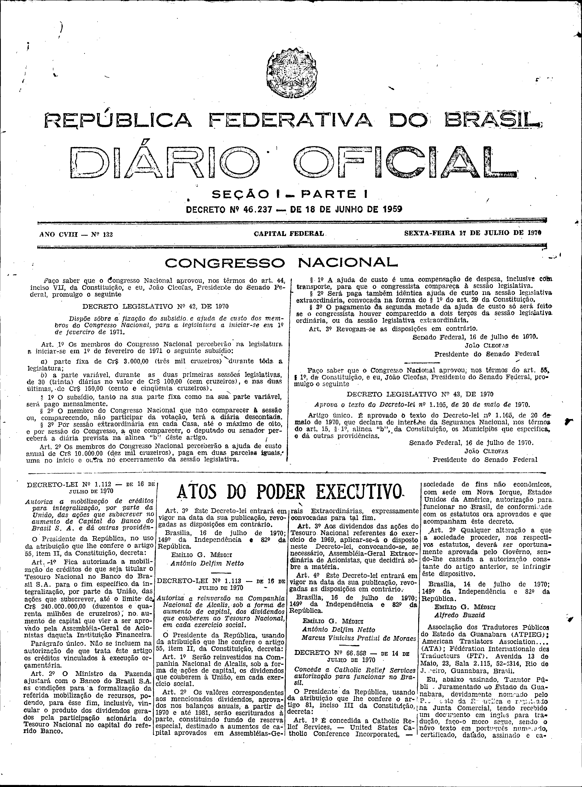
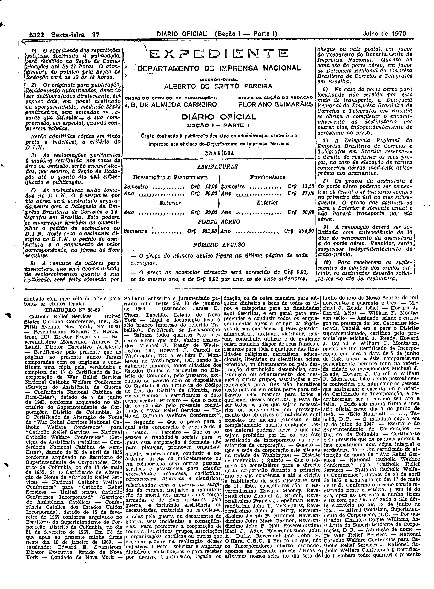
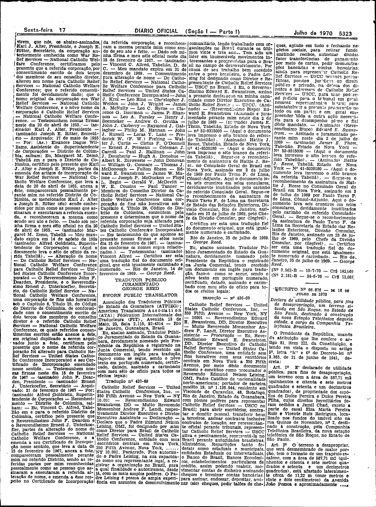

###DEC-066868-0-000-14-07-1970@@@

<strong>DECRETO Nº 66.868, DE 14 DE JULHO DE 1970.</strong>

<em><strong>Concede a</strong></em> <strong>Catholic Relief Services</strong> <em><strong>autorização para funcionar no Brasil.</strong></em>

<strong>O PRESIDENTE DA REPÚBLICA</strong>, usando da atribuição que lhe confere o artigo 81, item III, da Constituição,

<strong>DECRETA:</strong>

<strong>Art</strong>. 1º É concedida a <em>Catholic Relief Services, - United States Catholic Conference Incorporated,</em> \- sociedade de fins não econômicos, com sede em Nova Iorque, Estados Unidos da América, autorização para funcionar no Brasil, de conformidade com os estatutos ora aprovados e que acompanham êste decreto.

<strong>Art</strong>. 2º Qualquer alteração a que a sociedade proceder, nos respectivos estatutos, deverá ser oportunamente aprovada pelo Govêrno, sendo-lhe cassada a autorização constante do artigo anterior, se infringir êste dispositivo.

Brasília, 14 de julho de 1970; 149º da Independência e 82º da República.

<strong>EMÍLIO G. MÉDICI</strong>

Alfredo Buzaid.

<!-- fac-simile-oficial:inicio -->

## Fac-símile oficial: documentos societários traduzidos que acompanham o decreto

A peça vinculada ao Decreto nº 66.868 é reproduzida nas imagens abaixo, a partir da publicação oficial da Imprensa Nacional. A reprodução é em fac-símile, sem transcrição por OCR nem reconstrução do conteúdo.

As imagens mostram páginas inteiras do Diário Oficial da União e podem conter outras matérias. Essas matérias vizinhas não são atribuídas a este decreto. A peça é identificada pelo seu título e pela referência ao ato nas páginas indicadas.

SHA-256 desta imagem: `c7c34bd80e33e3816b8ce25bf8d8a1270a42ab0b6e048cc3c46ceae4006cbda7`.

SHA-256 desta imagem: `de28ea4bd518270dace103602574eb4645294ffa1c7792da10d38338ee3e8c11`.

SHA-256 desta imagem: `9a4c0864f240e71b423708dfdf01d67a94f522a07c8d94b8c30f0efbff055207`.

Fontes oficiais da publicação:

- [DO_1_19700717_132.PDF](https://biblioteca.in.gov.br/documents/271518/495877/DO_1_19700717_132.PDF/40e1cdaf-e92c-1b8d-366b-485b64c68dd6?t=1574883155100&download=true) — SHA-256 do PDF: `a809f11ce65be5893c62488a750b481c4e127eb76cc5e8cfc604339adff5817b`.

<!-- fac-simile-oficial:fim -->
