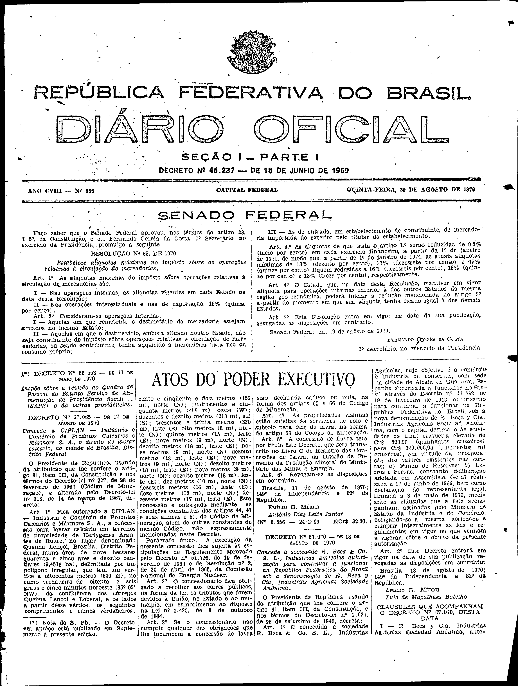
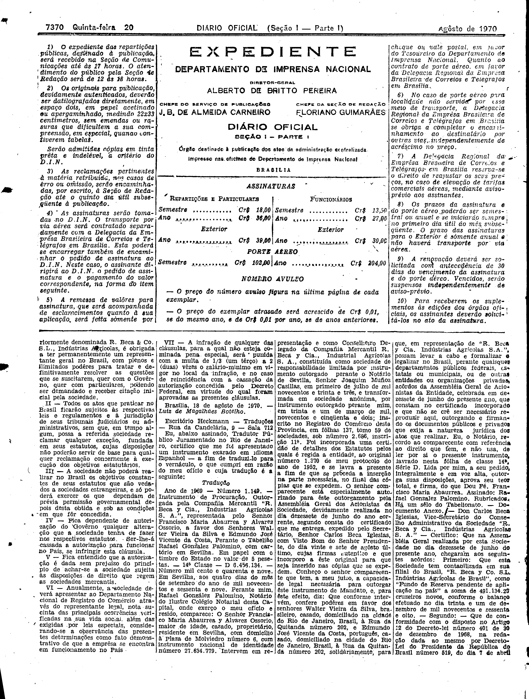

###DEC-067070-0-000-18-08-1970@@@

<strong>DECRETO Nº 67.070, DE 18 DE AGÔSTO DE 1970.</strong>

<em><strong>Concede à sociedade R. Beca & Co. S. L. Indústrias Agrícolas autorização para continuar a funcionar na República Federativa do Brasil sob a denominação de R. Beca y Cia. Indústrias Agrícolas Sociedade Anônima.</strong></em>

<strong>O PRESIDENTE DA REPÚBLICA</strong>, usando da atribuição que lhe confere o artigo 81, item III, da Constituição, e nos têrmos do Decreto-lei nº 2.627, de 26 de setembro de 1940,

<strong>DECRETA:</strong>

<strong>Art</strong>. 1º É concedida à sociedade <em>R. Beca & Co. S. L</em>. Indústrias Agrícolas, cujo objetivo é o comércio e indústria de conservas, com sede na cidade de Alcalá de Guadaira, Espanha, autorizada a funcionar no Brasil através do Decreto nº 24.542, de 19 de fevereiro de 1948, autorização para continuar a funcionar na República Federativa do Brasil, sob a nova denominação de R<em>. Beca y Cia</em>. Indústrias Agrícolas Sociedade Anônima, com o capital destinado às atividades da filial brasileira elevado de Cr$500,00 (quinhentos cruzeiros) para Cr$500.000,00 (quinhentos mil cruzeiros), em virtude da incorporação dos valôres existentes nas contas: a) Fundo de Reservas; b) Lucros e Perdas, consoante deliberação adotada em Assembléia Geral realizada a 17 de junho de 1969, bem como declaração do representante legal, firmada a 8 de maio de 1970, mediante as cláusulas que a êste acompanham, assinadas pelo Ministro de Estado da Indústria e do Comércio, obrigando-se a mesma sociedade a cumprir integralmente as leis e regulamentos em vigor ou que venham a vigorar, sôbre o objeto da presente autorização.

<strong>Art</strong>. 2º Êste Decreto entrará em vigor na data de sua publicação, revogadas as disposições em contrário.

Brasília, 18 de agôsto de 1970; 149º da Independência e 82º da República.

<strong>EMÍLIO G. MÉDICI</strong>

Luiz de Magalhães Botelho

<!-- fac-simile-oficial:inicio -->

## Fac-símile oficial: clausulas

A peça vinculada ao Decreto nº 67.070 é reproduzida nas imagens abaixo, a partir da publicação oficial da Imprensa Nacional. A reprodução é em fac-símile, sem transcrição por OCR nem reconstrução do conteúdo.

As imagens mostram páginas inteiras do Diário Oficial da União e podem conter outras matérias. Essas matérias vizinhas não são atribuídas a este decreto. A peça é identificada pelo seu título e pela referência ao ato nas páginas indicadas.

SHA-256 desta imagem: `899f52f35b4f6e675bc3ebfd49f2b43e149be4831e7bf39a50f91bc853d93f7e`.

SHA-256 desta imagem: `8daf58dde78a8bd5d04718a3013418052fc07ff189403835381524c251e5b97a`.

Fontes oficiais da publicação:

- [DO_1_19700820_156.PDF](https://biblioteca.in.gov.br/documents/271518/495877/DO_1_19700820_156.PDF/2eeb9d7f-a635-99c4-b5c7-cef28cc09ff8?t=1574883284453&download=true) — SHA-256 do PDF: `4f5576d716a1a90c0bb2be935ed4d07134b9f8d79d57040dbef661cb9ea48a33`.

<!-- fac-simile-oficial:fim -->
