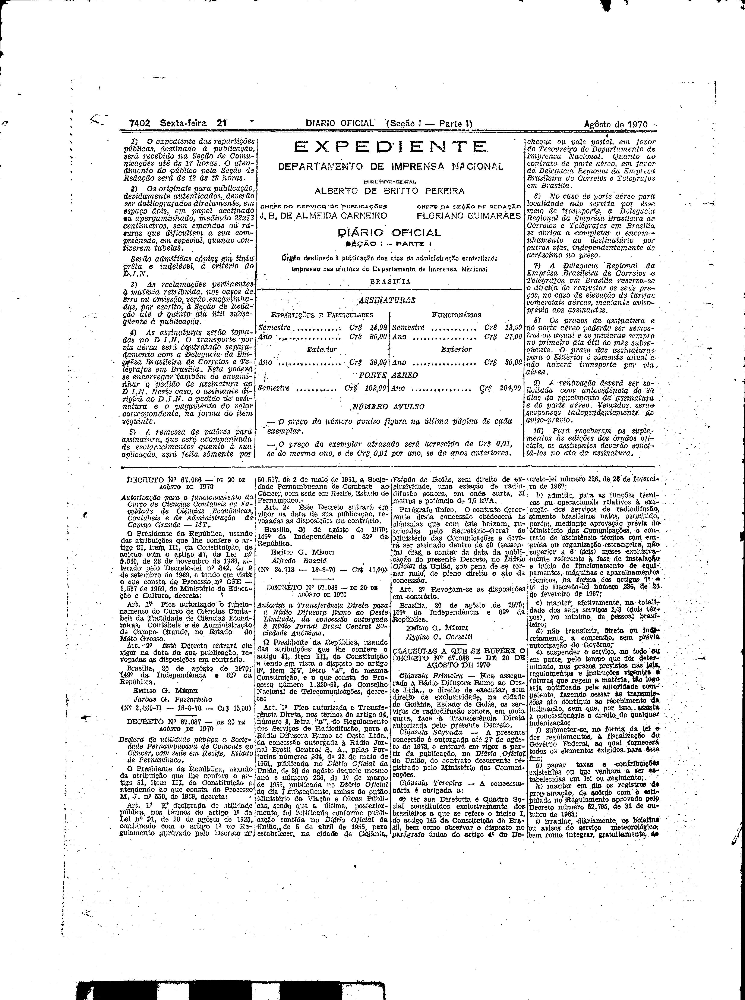
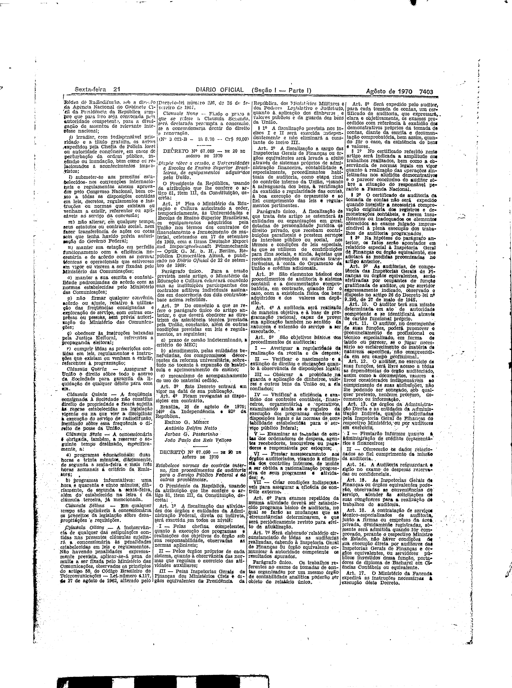

###DEC-067088-0-000-20-08-1970@@@

<strong>DECRETO Nº 67.088, DE 20 DE AGÔSTO DE 1970.</strong>

<em><strong>Auto</strong></em>r<em><strong>iza a Transferência Direta para a Rádio Difusora Rumo ao Oeste Limitada, da concessão outorgada à Rádio Jornal Brasil Central Sociedade Anônima.</strong></em>

<strong>O PRESIDENTE DA REPÚBLICA</strong>, usando das atribuições que lhe confere artigo 81, item III, da Constituição e tendo em vista o disposto no artigo 8º item XV, letra “<em>a</em>” da mesma Constituição, e o que consta do Processo número 1.320-63, do Conselho Nacional de Telecomunicações,

<strong>DECRETA:</strong>

<strong>Art</strong> 1º Fica autorizada a Transferência Direta, nos têrmos do artigo 94, número 3, letra “<em>a</em>”, do Regulamento dos Serviços de Radiodifusão, para a Rádio Difusora Rumo ao Oeste Ltda, da concessão outorgada à Rádio Jornal Brasil Central S. A., pelas Portarias números 504, de 22 de maio de 1951, publicado no <em>Diário Oficial</em> da União, de 30 de agôsto daquele mesmo ano e número 226, de 1º de março de 1955, publicada no <em>Diário Oficial</em> do dia 7 subseqüente ambas do então Ministério da Viação e Obras Públicas, sendo que a última, posteriormente, foi retificada conforme publicação contida no <em>Diário Oficial</em> da União, de 5 de abril de 1955, para estabelecer, na cidade de Goiânia, Estado de Goiás, sem direito de exclusividade, uma estação de radiodifusão sonora, em onda curta, 31 metros e potência de 7,5 kVA.

Parágrafo único. O contrato decorrente desta concessão obedecerá às cláusulas que com êste baixam, rubricadas pelo Secretário-Geral do Ministério das Comunicações e deverá ser assinado dentro de 60 (sessenta ) dias, a contar da data da publicação do presente Decreto, no <em>Diário Oficial</em> da União, sob pena de se tornar nulo, de pleno direito o ato da concessão.

<strong>Art</strong> 2º Revogam-se as disposições em contrário.

Brasília, 20 de agôsto de 1970; 149º da Independência e 82º da República.

<strong>EMÍLIO G MÉDICI</strong>

Hygino C Corsetti

<!-- fac-simile-oficial:inicio -->

## Fac-símile oficial: cláusulas

O texto acima não inclui as cláusulas a que se refere este decreto. A publicação oficial do anexo está em imagem, nas páginas do _Diário Oficial da União_ (Seção I) de 21 de agosto de 1970: página 2 do PDF (a partir de «CLÁUSULAS A QUE SE REFERE O DECRETO Nº 67.088 — DE 20 DE AGOSTO DE 1970»); página 3 do PDF (até «Nº 3.053-B — 18.8.70 — Cr$ 93,00»).

As imagens são as páginas inteiras, tal como digitalizadas pela Imprensa Nacional, sem recorte, sem redesenho e sem transcrição. Cada página traz também outros atos do mesmo dia; a peça deste decreto está apenas no trecho indicado, e o texto do anexo só existe na imagem. Não há OCR validado.

Fonte: Imprensa Nacional, Biblioteca Machado de Assis, arquivo `DO_1_19700821_157.PDF` (SHA-256 `ff4cd713b948dc1991852b71c14f5ff01ee8d8599ddfe0c5c504b10194427ab9`), páginas 2, 3 do PDF. SHA-256 das imagens, na ordem: `96acf75a6856d5cd2f2566ad14bb7c8d3fd884064aebc5efb079bffff5e2ec92`, `76fdff5953e66269952fc2d354655a09ed82bdd84044faf3eb9fea8ced34ade8`.

<!-- fac-simile-oficial:fim -->
