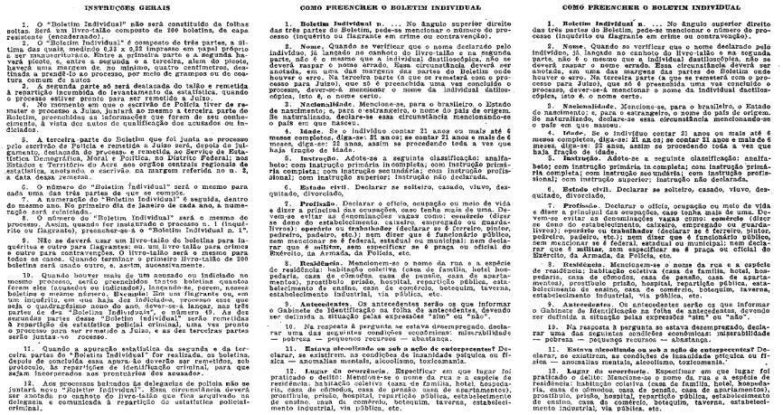

DECRETO-LEI Nº 3.689, DE 3 DE OUTUBRO DE 1941

Código de Processo Penal.

O PRESIDENTE DA REPÚBLICA, usando da atribuição que lhe confere o art. 180 da Constituição, decreta a seguinte Lei:

## LIVRO I

DO PROCESSO EM GERAL

TÍTULO I

DISPOSIÇÕES PRELIMINARES

Art. 1º O processo penal reger-se-á, em todo o território brasileiro, por este Código, ressalvados:

I - os tratados, as convenções e regras de direito internacional;

II - as prerrogativas constitucionais do Presidente da República, dos ministros de Estado, nos crimes conexos com os do Presidente da República, e dos ministros do Supremo Tribunal Federal, nos crimes de responsabilidade (Constituição, arts. 86, 89, § 2º, e 100);

III - os processos da competência da Justiça Militar;

IV - os processos da competência do tribunal especial (Constituição, art. 122, n. 17);

V - os processos por crimes de imprensa. [(Vide ADPF nº 130/2008)](http://portal.stf.jus.br/processos/detalhe.asp?incidente=12837)

Parágrafo único. Aplicar-se-á, entretanto, este Código aos processos referidos nos ns. IV e V, quando as leis especiais que os regulam não dispuserem de modo diverso.

Art. 2º A lei processual penal aplicar-se-á desde logo, sem prejuízo da validade dos atos realizados sob a vigência da lei anterior.

Art. 3º A lei processual penal admitirá interpretação extensiva e aplicação analógica, bem como o suplemento dos princípios gerais de direito.

Juiz das Garantias [(Denominação acrescida pela Lei nº 13.964, de 24/12/2019, publicada na Edição Extra do DOU de 24/12/2019, em vigor 30 dias após a publicação)](https://www2.camara.leg.br/legin/fed/lei/2019/lei-13964-24-dezembro-2019-789639-publicacaooriginal-159754-pl.html)

Art. 3º-A. O processo penal terá estrutura acusatória, vedadas a iniciativa do juiz na fase de investigação e a substituição da atuação probatória do órgão de acusação. [(Artigo acrescido pela Lei nº 13.964, de 24/12/2019, publicada na Edição Extra do DOU de 24/12/2019, em vigor 30 dias após a publicação)](https://www2.camara.leg.br/legin/fed/lei/2019/lei-13964-24-dezembro-2019-789639-publicacaooriginal-159754-pl.html) (Vide ADIs nºs [6.298](https://portal.stf.jus.br/processos/detalhe.asp?incidente=5840274), [6.299](https://portal.stf.jus.br/processos/detalhe.asp?incidente=5840373), [6.300](https://portal.stf.jus.br/processos/detalhe.asp?incidente=5840552) e [6.305](https://portal.stf.jus.br/processos/detalhe.asp?incidente=5844852), cuja Decisão foi publicada no DOU de 4/9/2023)

Art. 3º-B. O juiz das garantias é responsável pelo controle da legalidade da investigação criminal e pela salvaguarda dos direitos individuais cuja franquia tenha sido reservada à autorização prévia do Poder Judiciário, competindo-lhe especialmente: (Vide ADIs nºs [6.298](https://portal.stf.jus.br/processos/detalhe.asp?incidente=5840274), [6.299](https://portal.stf.jus.br/processos/detalhe.asp?incidente=5840373), [6.300](https://portal.stf.jus.br/processos/detalhe.asp?incidente=5840552) e [6.305](https://portal.stf.jus.br/processos/detalhe.asp?incidente=5844852), cuja Decisão foi publicada no DOU de 4/9/2023)

I - receber a comunicação imediata da prisão, nos termos do inciso LXII do caput do art. 5º da Constituição Federal;

II - receber o auto da prisão em flagrante para o controle da legalidade da prisão, observado o disposto no art. 310 deste Código;

III - zelar pela observância dos direitos do preso, podendo determinar que este seja conduzido à sua presença, a qualquer tempo;

IV - ser informado sobre a instauração de qualquer investigação criminal; (Vide ADIs nºs [6.298](https://portal.stf.jus.br/processos/detalhe.asp?incidente=5840274), [6.299](https://portal.stf.jus.br/processos/detalhe.asp?incidente=5840373), [6.300](https://portal.stf.jus.br/processos/detalhe.asp?incidente=5840552) e [6.305](https://portal.stf.jus.br/processos/detalhe.asp?incidente=5844852), cuja Decisão foi publicada no DOU de 4/9/2023)

V - decidir sobre o requerimento de prisão provisória ou outra medida cautelar, observado o disposto no § 1º deste artigo;

VI - prorrogar a prisão provisória ou outra medida cautelar, bem como substituí-las ou revogá-las, assegurado, no primeiro caso, o exercício do contraditório em audiência pública e oral, na forma do disposto neste Código ou em legislação especial pertinente; (Vide ADIs nºs [6.298](https://portal.stf.jus.br/processos/detalhe.asp?incidente=5840274), [6.299](https://portal.stf.jus.br/processos/detalhe.asp?incidente=5840373), [6.300](https://portal.stf.jus.br/processos/detalhe.asp?incidente=5840552) e [6.305](https://portal.stf.jus.br/processos/detalhe.asp?incidente=5844852), cuja Decisão foi publicada no DOU de 4/9/2023)

VII - decidir sobre o requerimento de produção antecipada de provas consideradas urgentes e não repetíveis, assegurados o contraditório e a ampla defesa em audiência pública e oral; (Vide ADIs nºs [6.298](https://portal.stf.jus.br/processos/detalhe.asp?incidente=5840274), [6.299](https://portal.stf.jus.br/processos/detalhe.asp?incidente=5840373), [6.300](https://portal.stf.jus.br/processos/detalhe.asp?incidente=5840552) e [6.305](https://portal.stf.jus.br/processos/detalhe.asp?incidente=5844852), cuja Decisão foi publicada no DOU de 4/9/2023)

VIII - prorrogar o prazo de duração do inquérito, estando o investigado preso, em vista das razões apresentadas pela autoridade policial e observado o disposto no § 2º deste artigo; (Vide ADIs nºs [6.298](https://portal.stf.jus.br/processos/detalhe.asp?incidente=5840274), [6.299](https://portal.stf.jus.br/processos/detalhe.asp?incidente=5840373), [6.300](https://portal.stf.jus.br/processos/detalhe.asp?incidente=5840552) e [6.305](https://portal.stf.jus.br/processos/detalhe.asp?incidente=5844852), cuja Decisão foi publicada no DOU de 4/9/2023)

IX - determinar o trancamento do inquérito policial quando não houver fundamento razoável para sua instauração ou prosseguimento; (Vide ADIs nºs [6.298](https://portal.stf.jus.br/processos/detalhe.asp?incidente=5840274), [6.299](https://portal.stf.jus.br/processos/detalhe.asp?incidente=5840373), [6.300](https://portal.stf.jus.br/processos/detalhe.asp?incidente=5840552) e [6.305](https://portal.stf.jus.br/processos/detalhe.asp?incidente=5844852), cuja Decisão foi publicada no DOU de 4/9/2023)

X - requisitar documentos, laudos e informações ao delegado de polícia sobre o andamento da investigação;

XI - decidir sobre os requerimentos de:

a) interceptação telefônica, do fluxo de comunicações em sistemas de informática e telemática ou de outras formas de comunicação;

b) afastamento dos sigilos fiscal, bancário, de dados e telefônico;

c) busca e apreensão domiciliar;

d) acesso a informações sigilosas;

e) outros meios de obtenção da prova que restrinjam direitos fundamentais do investigado;

XII - julgar o habeas corpus impetrado antes do oferecimento da denúncia;

XIII - determinar a instauração de incidente de insanidade mental;

XIV - decidir sobre o recebimento da denúncia ou queixa, nos termos do art. 399 deste Código; (Vide ADIs nºs [6.298](https://portal.stf.jus.br/processos/detalhe.asp?incidente=5840274), [6.299](https://portal.stf.jus.br/processos/detalhe.asp?incidente=5840373), [6.300](https://portal.stf.jus.br/processos/detalhe.asp?incidente=5840552) e [6.305](https://portal.stf.jus.br/processos/detalhe.asp?incidente=5844852), cuja Decisão foi publicada no DOU de 4/9/2023)

XV - assegurar prontamente, quando se fizer necessário, o direito outorgado ao investigado e ao seu defensor de acesso a todos os elementos informativos e provas produzidos no âmbito da investigação criminal, salvo no que concerne, estritamente, às diligências em andamento;

XVI - deferir pedido de admissão de assistente técnico para acompanhar a produção da perícia;

XVII - decidir sobre a homologação de acordo de não persecução penal ou os de colaboração premiada, quando formalizados durante a investigação;

XVIII - outras matérias inerentes às atribuições definidas no caput deste artigo.

§ 1º O preso em flagrante ou por força de mandado de prisão provisória será encaminhado à presença do juiz competente para celebração da audiência de custódia no prazo de 24 (vinte e quatro) horas, momento em que se realizará, por videoconferência, audiência com a presença do Ministério Público e da Defensoria Pública ou de advogado constituído, na forma estabelecida no art. 310 deste Código. [(Parágrafo vetado pelo Presidente da República na Lei nº 13.964, de 24/12/2019, mantido pelo Congresso Nacional e publicado no DOU de 30/4/2021](https://www2.camara.leg.br/legin/fed/lei/2019/lei-13964-24-dezembro-2019-789639-promulgacaodevetos-162751-pl.html), [e com redação dada pela Lei nº 15.358, de 24/3/2026)](https://www2.camara.leg.br/legin/fed/lei/2026/lei-15358-24-marco-2026-798846-publicacaooriginal-178585-pl.html) (Vide ADIs nºs [6.298](https://portal.stf.jus.br/processos/detalhe.asp?incidente=5840274), [6.299](https://portal.stf.jus.br/processos/detalhe.asp?incidente=5840373), [6.300](https://portal.stf.jus.br/processos/detalhe.asp?incidente=5840552) e [6.305](https://portal.stf.jus.br/processos/detalhe.asp?incidente=5844852), cuja Decisão foi publicada no DOU de 4/9/2023)

§ 2º Se o investigado estiver preso, o juiz das garantias poderá, mediante representação da autoridade policial e ouvido o Ministério Público, prorrogar, uma única vez, a duração do inquérito por até 15 (quinze) dias, após o que, se ainda assim a investigação não for concluída, a prisão será imediatamente relaxada. [(Artigo acrescido pela Lei nº 13.964, de 24/12/2019, publicada na Edição Extra do DOU de 24/12/2019, em vigor 30 dias após a publicação)](https://www2.camara.leg.br/legin/fed/lei/2019/lei-13964-24-dezembro-2019-789639-publicacaooriginal-159754-pl.html) (Vide ADIs nºs [6.298](https://portal.stf.jus.br/processos/detalhe.asp?incidente=5840274), [6.299](https://portal.stf.jus.br/processos/detalhe.asp?incidente=5840373), [6.300](https://portal.stf.jus.br/processos/detalhe.asp?incidente=5840552) e [6.305](https://portal.stf.jus.br/processos/detalhe.asp?incidente=5844852), cuja Decisão foi publicada no DOU de 4/9/2023)

Art. 3º-C. A competência do juiz das garantias abrange todas as infrações penais, exceto as de menor potencial ofensivo, e cessa com o recebimento da denúncia ou queixa na forma do art. 399 deste Código. (Vide ADIs nºs [6.298](https://portal.stf.jus.br/processos/detalhe.asp?incidente=5840274), [6.299](https://portal.stf.jus.br/processos/detalhe.asp?incidente=5840373), [6.300](https://portal.stf.jus.br/processos/detalhe.asp?incidente=5840552) e [6.305](https://portal.stf.jus.br/processos/detalhe.asp?incidente=5844852), cuja Decisão foi publicada no DOU de 4/9/2023)

§ 1º Recebida a denúncia ou queixa, as questões pendentes serão decididas pelo juiz da instrução e julgamento. (Vide ADIs nºs [6.298](https://portal.stf.jus.br/processos/detalhe.asp?incidente=5840274), [6.299](https://portal.stf.jus.br/processos/detalhe.asp?incidente=5840373), [6.300](https://portal.stf.jus.br/processos/detalhe.asp?incidente=5840552) e [6.305](https://portal.stf.jus.br/processos/detalhe.asp?incidente=5844852), cuja Decisão foi publicada no DOU de 4/9/2023)

§ 2º As decisões proferidas pelo juiz das garantias não vinculam o juiz da instrução e julgamento, que, após o recebimento da denúncia ou queixa, deverá reexaminar a necessidade das medidas cautelares em curso, no prazo máximo de 10 (dez) dias. (Vide ADIs nºs [6.298](https://portal.stf.jus.br/processos/detalhe.asp?incidente=5840274), [6.299](https://portal.stf.jus.br/processos/detalhe.asp?incidente=5840373), [6.300](https://portal.stf.jus.br/processos/detalhe.asp?incidente=5840552) e [6.305](https://portal.stf.jus.br/processos/detalhe.asp?incidente=5844852), cuja Decisão foi publicada no DOU de 4/9/2023)

§ 3º Os autos que compõem as matérias de competência do juiz das garantias ficarão acautelados na secretaria desse juízo, à disposição do Ministério Público e da defesa, e não serão apensados aos autos do processo enviados ao juiz da instrução e julgamento, ressalvados os documentos relativos às provas irrepetíveis, medidas de obtenção de provas ou de antecipação de provas, que deverão ser remetidos para apensamento em apartado. (Vide ADIs nºs [6.298](https://portal.stf.jus.br/processos/detalhe.asp?incidente=5840274), [6.299](https://portal.stf.jus.br/processos/detalhe.asp?incidente=5840373), [6.300](https://portal.stf.jus.br/processos/detalhe.asp?incidente=5840552) e [6.305](https://portal.stf.jus.br/processos/detalhe.asp?incidente=5844852), cuja Decisão foi publicada no DOU de 4/9/2023)

§ 4º Fica assegurado às partes o amplo acesso aos autos acautelados na secretaria do juízo das garantias. (Vide ADIs nºs [6.298](https://portal.stf.jus.br/processos/detalhe.asp?incidente=5840274), [6.299](https://portal.stf.jus.br/processos/detalhe.asp?incidente=5840373), [6.300](https://portal.stf.jus.br/processos/detalhe.asp?incidente=5840552) e [6.305](https://portal.stf.jus.br/processos/detalhe.asp?incidente=5844852), cuja Decisão foi publicada no DOU de 4/9/2023) [(Artigo acrescido pela Lei nº 13.964, de 24/12/2019, publicada na Edição Extra do DOU de 24/12/2019, em vigor 30 dias após a publicação)](https://www2.camara.leg.br/legin/fed/lei/2019/lei-13964-24-dezembro-2019-789639-publicacaooriginal-159754-pl.html)

Art. 3º-D. O juiz que, na fase de investigação, praticar qualquer ato incluído nas competências dos arts. 4º e 5º deste Código ficará impedido de funcionar no processo. (“Caput” do artigo declarado inconstitucional, em controle concentrado, pelo Supremo Tribunal Federal, pelas ADIs nºs [6.298](https://portal.stf.jus.br/processos/detalhe.asp?incidente=5840274), [6.299](https://portal.stf.jus.br/processos/detalhe.asp?incidente=5840373), [6.300](https://portal.stf.jus.br/processos/detalhe.asp?incidente=5840552) e [6.305](https://portal.stf.jus.br/processos/detalhe.asp?incidente=5844852), cuja Decisão foi publicada no DOU de 4/9/2023)

Parágrafo único. Nas comarcas em que funcionar apenas um juiz, os tribunais criarão um sistema de rodízio de magistrados, a fim de atender às disposições deste Capítulo. (Parágrafo único declarado formalmente inconstitucional, em controle concentrado, pelo Supremo Tribunal Federal, pelas ADIs nºs [6.298](https://portal.stf.jus.br/processos/detalhe.asp?incidente=5840274), [6.299](https://portal.stf.jus.br/processos/detalhe.asp?incidente=5840373), [6.300](https://portal.stf.jus.br/processos/detalhe.asp?incidente=5840552) e [6.305](https://portal.stf.jus.br/processos/detalhe.asp?incidente=5844852), cuja Decisão foi publicada no DOU de 4/9/2023)[(Artigo acrescido pela Lei nº 13.964, de 24/12/2019, publicada na Edição Extra do DOU de 24/12/2019, em vigor 30 dias após a publicação)](https://www2.camara.leg.br/legin/fed/lei/2019/lei-13964-24-dezembro-2019-789639-publicacaooriginal-159754-pl.html)

Art. 3º-E. O juiz das garantias será designado conforme as normas de organização judiciária da União, dos Estados e do Distrito Federal, observando critérios objetivos a serem periodicamente divulgados pelo respectivo tribunal. [(Artigo acrescido pela Lei nº 13.964, de 24/12/2019, publicada na Edição Extra do DOU de 24/12/2019, em vigor 30 dias após a publicação)](https://www2.camara.leg.br/legin/fed/lei/2019/lei-13964-24-dezembro-2019-789639-publicacaooriginal-159754-pl.html) (Vide ADIs nºs [6.298](https://portal.stf.jus.br/processos/detalhe.asp?incidente=5840274), [6.299](https://portal.stf.jus.br/processos/detalhe.asp?incidente=5840373), [6.300](https://portal.stf.jus.br/processos/detalhe.asp?incidente=5840552) e [6.305](https://portal.stf.jus.br/processos/detalhe.asp?incidente=5844852), cuja Decisão foi publicada no DOU de 4/9/2023)

Art. 3º-F. O juiz das garantias deverá assegurar o cumprimento das regras para o tratamento dos presos, impedindo o acordo ou ajuste de qualquer autoridade com órgãos da imprensa para explorar a imagem da pessoa submetida à prisão, sob pena de responsabilidade civil, administrativa e penal.

Parágrafo único. Por meio de regulamento, as autoridades deverão disciplinar, em 180 (cento e oitenta) dias, o modo pelo qual as informações sobre a realização da prisão e a identidade do preso serão, de modo padronizado e respeitada a programação normativa aludida no caput deste artigo, transmitidas à imprensa, assegurados a efetividade da persecução penal, o direito à informação e a dignidade da pessoa submetida à prisão. (Vide ADIs nºs [6.298](https://portal.stf.jus.br/processos/detalhe.asp?incidente=5840274), [6.299](https://portal.stf.jus.br/processos/detalhe.asp?incidente=5840373), [6.300](https://portal.stf.jus.br/processos/detalhe.asp?incidente=5840552) e [6.305](https://portal.stf.jus.br/processos/detalhe.asp?incidente=5844852), cuja Decisão foi publicada no DOU de 4/9/2023) [(Artigo acrescido pela Lei nº 13.964, de 24/12/2019, publicada na Edição Extra do DOU de 24/12/2019, em vigor 30 dias após a publicação)](https://www2.camara.leg.br/legin/fed/lei/2019/lei-13964-24-dezembro-2019-789639-publicacaooriginal-159754-pl.html)

TÍTULO II

DO INQUÉRITO POLICIAL

Art. 4º A polícia judiciária será exercida pelas autoridades policiais no território de suas respectivas circunscrições e terá por fim a apuração das infrações penais e da sua autoria. [(“Caput” do artigo com redação dada pela Lei nº 9.043, de 9/5/1995)](http://www2.camara.leg.br/legin/fed/lei/1995/lei-9043-9-maio-1995-349801-norma-pl.html)

Parágrafo único. A competência definida neste artigo não excluirá a de autoridades administrativas, a quem por lei seja cometida a mesma função.

Art. 5º Nos crimes de ação pública o inquérito policial será iniciado:

I - de ofício;

II - mediante requisição da autoridade judiciária ou do Ministério Público, ou a requerimento do ofendido ou de quem tiver qualidade para representá-lo.

§ 1º O requerimento a que se refere o n. II conterá sempre que possível: 

a) a narração do fato, com todas as circunstâncias; 

b) a individualização do indiciado ou seus sinais característicos e as razões de convicção ou de presunção de ser ele o autor da infração, ou os motivos de impossibilidade de o fazer; 

c) a nomeação das testemunhas, com indicação de sua profissão e residência. 

§ 2º Do despacho que indeferir o requerimento de abertura de inquérito caberá recurso para o chefe de Polícia.

§ 3º Qualquer pessoa do povo que tiver conhecimento da existência de infração penal em que caiba ação pública poderá, verbalmente ou por escrito, comunicá-la à autoridade policial, e esta, verificada a procedência das informações, mandará instaurar inquérito.

§ 4º O inquérito, nos crimes em que a ação pública depender de representação, não poderá sem ela ser iniciado.

§ 5º Nos crimes de ação privada, a autoridade policial somente poderá proceder a inquérito a requerimento de quem tenha qualidade para intentá-la.

Art. 6º Logo que tiver conhecimento da prática da infração penal, a autoridade policial deverá:

I - dirigir-se ao local, providenciando para que não se alterem o estado e conservação das coisas, até a chegada dos peritos criminais; [(Inciso com redação dada pela Lei nº 8.862, de 28/3/1994,](https://www2.camara.leg.br/legin/fed/lei/1994/lei-8862-28-marco-1994-349764-publicacaooriginal-1-pl.html) [retificada no DOU de 5/8/1994)](https://www2.camara.leg.br/legin/fed/lei/1994/lei-8862-28-marco-1994-349764-retificacao-32183-pl.html)

II - apreender os objetos que tiverem relação com o fato, após liberados pelos peritos criminais. [(Inciso com redação dada pela Lei nº 8.862, de 28/3/1994,](https://www2.camara.leg.br/legin/fed/lei/1994/lei-8862-28-marco-1994-349764-publicacaooriginal-1-pl.html) [retificada no DOU de 5/8/1994)](https://www2.camara.leg.br/legin/fed/lei/1994/lei-8862-28-marco-1994-349764-retificacao-32183-pl.html)

III - colher todas as provas que servirem para o esclarecimento do fato e suas circunstâncias;

IV - ouvir o ofendido;

V - ouvir o indiciado, com observância, no que for aplicável, do disposto no Capítulo III do Título VII, deste Livro, devendo o respectivo termo ser assinado por duas testemunhas que lhe tenham ouvido a leitura;

VI - proceder a reconhecimento de pessoas e coisas e a acareações;

VII - determinar, se for caso, que se proceda a exame de corpo de delito e a quaisquer outras perícias;

VIII - ordenar a identificação do indiciado pelo processo datiloscópico, se possível, e fazer juntar aos autos sua folha de antecedentes;

IX - averiguar a vida pregressa do indiciado, sob o ponto de vista individual, familiar e social, sua condição econômica, sua atitude e estado de ânimo antes e depois do crime e durante ele, e quaisquer outros elementos que contribuírem para a apreciação do seu temperamento e caráter;

X - colher informações sobre a existência de filhos, respectivas idades e se possuem alguma deficiência e o nome e o contato de eventual responsável pelos cuidados dos filhos, indicado pela pessoa presa. [(Inciso acrescido pela Lei nº 13.257, de 8/3/2016)](http://www2.camara.leg.br/legin/fed/lei/2016/lei-13257-8-marco-2016-782483-publicacaooriginal-149635-pl.html)

Art. 7º Para verificar a possibilidade de haver a infração sido praticada de determinado modo, a autoridade policial poderá proceder à reprodução simulada dos fatos, desde que esta não contrarie a moralidade ou a ordem pública.

Art. 8º Havendo prisão em flagrante, será observado o disposto no Capítulo II do Título IX deste Livro.

Art. 9º Todas as peças do inquérito policial serão, num só processado, reduzidas a escrito ou datilografadas e, neste caso, rubricadas pela autoridade.

Art. 10. O inquérito deverá terminar no prazo de 10 dias, se o indiciado tiver sido preso em flagrante, ou estiver preso preventivamente, contado o prazo, nesta hipótese, a partir do dia em que se executar a ordem de prisão, ou no prazo de 30 dias, quando estiver solto, mediante fiança ou sem ela.

§ 1º A autoridade fará minucioso relatório do que tiver sido apurado e enviará os autos ao juiz competente.

§ 2º No relatório poderá a autoridade indicar testemunhas que não tiverem sido inquiridas, mencionando o lugar onde possam ser encontradas.

§ 3º Quando o fato for de difícil elucidação, e o indiciado estiver solto, a autoridade poderá requerer ao juiz a devolução dos autos, para ulteriores diligências, que serão realizadas no prazo marcado pelo juiz.

Art. 11. Os instrumentos do crime, bem como os objetos que interessarem à prova, acompanharão os autos do inquérito.

Art. 12. O inquérito policial acompanhará a denúncia ou queixa, sempre que servir de base a uma ou outra.

Art. 13. Incumbirá ainda à autoridade policial:

I - fornecer às autoridades judiciárias as informações necessárias à instrução e julgamento dos processos;

II - realizar as diligências requisitadas pelo juiz ou pelo Ministério Público;

III - cumprir os mandados de prisão expedidos pelas autoridades judiciárias;

IV - representar acerca da prisão preventiva.

Art. 13-A. Nos crimes previstos nos arts. 148, 149 e 149-A, no § 3º do art. 158 e no art. 159 do Decreto-Lei nº 2.848, de 7 de dezembro de 1940 (Código Penal), e no art. 239 da Lei nº 8.069, de 13 de julho de 1990 (Estatuto da Criança e do Adolescente), o membro do Ministério Público ou o delegado de polícia poderá requisitar, de quaisquer órgãos do poder público ou de empresas da iniciativa privada, dados e informações cadastrais da vítima ou de suspeitos.

Parágrafo único. A requisição, que será atendida no prazo de 24 (vinte e quatro) horas, conterá:

I - o nome da autoridade requisitante;

II - o número do inquérito policial; e

III - a identificação da unidade de polícia judiciária responsável pela investigação. [(Artigo acrescido pela Lei nº 13.344, de 6/10/2016, publicada no DOU de 7/10/2016, em vigor 45 dias após a publicação)](http://www2.camara.leg.br/legin/fed/lei/2016/lei-13344-6-outubro-2016-783708-publicacaooriginal-151187-pl.html)

Art. 13-B. Se necessário à prevenção e à repressão dos crimes relacionados ao tráfico de pessoas, o membro do Ministério Público ou o delegado de polícia poderão requisitar, mediante autorização judicial, às empresas prestadoras de serviço de telecomunicações e/ou telemática que disponibilizem imediatamente os meios técnicos adequados - como sinais, informações e outros - que permitam a localização da vítima ou dos suspeitos do delito em curso.

§ 1º Para os efeitos deste artigo, sinal significa posicionamento da estação de cobertura, setorização e intensidade de radiofrequência.

§ 2º Na hipótese de que trata o caput, o sinal:

I - não permitirá acesso ao conteúdo da comunicação de qualquer natureza, que dependerá de autorização judicial, conforme disposto em lei;

II - deverá ser fornecido pela prestadora de telefonia móvel celular por período não superior a 30 (trinta) dias, renovável por uma única vez, por igual período;

III - para períodos superiores àquele de que trata o inciso II, será necessária a apresentação de ordem judicial.

§ 3º Na hipótese prevista neste artigo, o inquérito policial deverá ser instaurado no prazo máximo de 72 (setenta e duas) horas, contado do registro da respectiva ocorrência policial.

§ 4º Não havendo manifestação judicial no prazo de 12 (doze) horas, a autoridade competente requisitará às empresas prestadoras de serviço de telecomunicações e/ou telemática que disponibilizem imediatamente os meios técnicos adequados - como sinais, informações e outros - que permitam a localização da vítima ou dos suspeitos do delito em curso, com imediata comunicação ao juiz. [(Artigo acrescido pela Lei nº 13.344, de 6/10/2016, publicada no DOU de 7/10/2016, em vigor 45 dias após a publicação)](http://www2.camara.leg.br/legin/fed/lei/2016/lei-13344-6-outubro-2016-783708-publicacaooriginal-151187-pl.html)

Art. 14. O ofendido, ou seu representante legal, e o indiciado poderão requerer qualquer diligência, que será realizada, ou não, a juízo da autoridade.

Art. 14-A. Nos casos em que servidores vinculados às instituições dispostas no art. 144 da Constituição Federal figurarem como investigados em inquéritos policiais, inquéritos policiais militares e demais procedimentos extrajudiciais, cujo objeto for a investigação de fatos relacionados ao uso da força letal praticados no exercício profissional, de forma consumada ou tentada, incluindo as situações dispostas no art. 23 do Decreto-Lei nº 2.848, de 7 de dezembro de 1940 (Código Penal), o indiciado poderá constituir defensor.

§ 1º Para os casos previstos no caput deste artigo, o investigado deverá ser citado da instauração do procedimento investigatório, podendo constituir defensor no prazo de até 48 (quarenta e oito) horas a contar do recebimento da citação.

§ 2º Esgotado o prazo disposto no § 1º deste artigo com ausência de nomeação de defensor pelo investigado, a autoridade responsável pela investigação deverá intimar a instituição a que estava vinculado o investigado à época da ocorrência dos fatos, para que essa, no prazo de 48 (quarenta e oito) horas, indique defensor para a representação do investigado.

§ 3º Havendo necessidade de indicação de defensor nos termos do § 2º deste artigo, a defesa caberá preferencialmente à Defensoria Pública, e, nos locais em que ela não estiver instalada, a União ou a Unidade da Federação correspondente à respectiva competência territorial do procedimento instaurado deverá disponibilizar profissional para acompanhamento e realização de todos os atos relacionados à defesa administrativa do investigado. [(Parágrafo vetado pelo Presidente da República na Lei nº 13.964, de 24/12/2019, mantido pelo Congresso Nacional e publicado no DOU de 30/4/2021)](https://www2.camara.leg.br/legin/fed/lei/2019/lei-13964-24-dezembro-2019-789639-promulgacaodevetos-162751-pl.html)

§ 4º A indicação do profissional a que se refere o § 3º deste artigo deverá ser precedida de manifestação de que não existe defensor público lotado na área territorial onde tramita o inquérito e com atribuição para nele atuar, hipótese em que poderá ser indicado profissional que não integre os quadros próprios da Administração. [(Parágrafo vetado pelo Presidente da República na Lei nº 13.964, de 24/12/2019, mantido pelo Congresso Nacional e publicado no DOU de 30/4/2021)](https://www2.camara.leg.br/legin/fed/lei/2019/lei-13964-24-dezembro-2019-789639-promulgacaodevetos-162751-pl.html)

§ 5º Na hipótese de não atuação da Defensoria Pública, os custos com o patrocínio dos interesses dos investigados nos procedimentos de que trata este artigo correrão por conta do orçamento próprio da instituição a que este esteja vinculado à época da ocorrência dos fatos investigados. [(Parágrafo vetado pelo Presidente da República na Lei nº 13.964, de 24/12/2019, mantido pelo Congresso Nacional e publicado no DOU de 30/4/2021)](https://www2.camara.leg.br/legin/fed/lei/2019/lei-13964-24-dezembro-2019-789639-promulgacaodevetos-162751-pl.html)

§ 6º As disposições constantes deste artigo se aplicam aos servidores militares vinculados às instituições dispostas no art. 142 da Constituição Federal, desde que os fatos investigados digam respeito a missões para a Garantia da Lei e da Ordem. [(Artigo acrescido pela Lei nº 13.964, de 24/12/2019, publicada na Edição Extra do DOU de 24/12/2019, em vigor 30 dias após a publicação)](https://www2.camara.leg.br/legin/fed/lei/2019/lei-13964-24-dezembro-2019-789639-publicacaooriginal-159754-pl.html)

Art. 15. Se o indiciado for menor, ser-lhe-á nomeado curador pela autoridade policial.

Art. 16. O Ministério Público não poderá requerer a devolução do inquérito à autoridade policial, senão para novas diligências, imprescindíveis ao oferecimento da denúncia.

Art. 17. A autoridade policial não poderá mandar arquivar autos de inquérito.

Art. 18. Depois de ordenado o arquivamento do inquérito pela autoridade judiciária, por falta de base para a denúncia, a autoridade policial poderá proceder a novas pesquisas, se de outras provas tiver notícia.

Art. 19. Nos crimes em que não couber ação pública, os autos do inquérito serão remetidos ao juízo competente, onde aguardarão a iniciativa do ofendido ou de seu representante legal, ou serão entregues ao requerente, se o pedir, mediante traslado.

Art. 20. A autoridade assegurará no inquérito o sigilo necessário à elucidação do fato ou exigido pelo interesse da sociedade.

Parágrafo único. Nos atestados de antecedentes que lhe forem solicitados, a autoridade policial não poderá mencionar quaisquer anotações referentes a instauração de inquérito contra os requerentes. [(Parágrafo único acrescido pela Lei nº 6.900, de 14/4/1981,](http://www2.camara.gov.br/legin/fed/lei/1980-1987/lei-6900-14-abril-1981-371580-publicacaooriginal-1-pl.html) e [com redação dada pela Lei nº 12.681, de 4/7/2012)](http://www2.camara.gov.br/legin/fed/lei/2012/lei-12681-4-julho-2012-613516-publicacaooriginal-136913-pl.html)

Art. 21. A incomunicabilidade do indiciado dependerá sempre de despacho nos autos e somente será permitida quando o interesse da sociedade ou a conveniência da investigação o exigir.

Parágrafo único. A incomunicabilidade, que não excederá de três dias, será decretada por despacho fundamentado do Juiz, a requerimento da autoridade policial, ou do órgão do Ministério Público, respeitado, em qualquer hipótese, o disposto no artigo 89, inciso III, do Estatuto da Ordem dos Advogados do Brasil (Lei n. 4.215, de 27 de abril de 1963). [(Parágrafo único com redação dada pela Lei nº 5.010, de 30/5/1966](http://www2.camara.leg.br/legin/fed/lei/1960-1969/lei-5010-30-maio-1966-346750-norma-pl.html))

Art. 22. No Distrito Federal e nas comarcas em que houver mais de uma circunscrição policial, a autoridade com exercício em uma delas poderá, nos inquéritos a que esteja procedendo, ordenar diligências em circunscrição de outra, independentemente de precatórias ou requisições, e bem assim providenciará, até que compareça a autoridade competente, sobre qualquer fato que ocorra em sua presença, noutra circunscrição.

Art. 23. Ao fazer a remessa dos autos do inquérito ao juiz competente, a autoridade policial oficiará ao Instituto de Identificação e Estatística, ou repartição congênere, mencionando o juízo a que tiverem sido distribuídos, e os dados relativos à infração penal e à pessoa do indiciado.

TÍTULO III

DA AÇÃO PENAL

Art. 24. Nos crimes de ação pública, esta será promovida por denúncia do Ministério Público, mas dependerá, quando a lei o exigir, de requisição do Ministro da Justiça, ou de representação do ofendido ou de quem tiver qualidade para representá-lo.

§ 1º No caso de morte do ofendido ou quando declarado ausente por decisão judicial, o direito de representação passará ao cônjuge, ascendente, descendente ou irmão. [(Parágrafo único transformado em § 1º pela Lei nº 8.699, de 27/8/1993)](http://www2.camara.leg.br/legin/fed/lei/1993/lei-8699-27-agosto-1993-363200-norma-pl.html)

§ 2º Seja qual for o crime, quando praticado em detrimento do patrimônio ou interesse da União, Estado e Município, a ação penal será pública. [(Parágrafo acrescido pela Lei nº 8.699, de 27/8/1993)](http://www2.camara.leg.br/legin/fed/lei/1993/lei-8699-27-agosto-1993-363200-norma-pl.html)

 

Art. 25. A representação será irretratável, depois de oferecida a denúncia.

Art. 26. A ação penal, nas contravenções, será iniciada com o auto de prisão em flagrante ou por meio de portaria expedida pela autoridade judiciária ou policial.

Art. 27. Qualquer pessoa do povo poderá provocar a iniciativa do Ministério Público, nos casos em que caiba a ação pública, fornecendo-lhe, por escrito, informações sobre o fato e a autoria e indicando o tempo, o lugar e os elementos de convicção.

Art. 28. Ordenado o arquivamento do inquérito policial ou de quaisquer elementos informativos da mesma natureza, o órgão do Ministério Público comunicará à vítima, ao investigado e à autoridade policial e encaminhará os autos para a instância de revisão ministerial para fins de homologação, na forma da lei. [(“Caput” do artigo com redação dada pela Lei nº 13.964, de 24/12/2019, publicada na Edição Extra do DOU de 24/12/2019, em vigor 30 dias após a publicação)](https://www2.camara.leg.br/legin/fed/lei/2019/lei-13964-24-dezembro-2019-789639-publicacaooriginal-159754-pl.html) (Vide ADIs nºs [6.298](https://portal.stf.jus.br/processos/detalhe.asp?incidente=5840274), [6.299](https://portal.stf.jus.br/processos/detalhe.asp?incidente=5840373), [6.300](https://portal.stf.jus.br/processos/detalhe.asp?incidente=5840552) e [6.305](https://portal.stf.jus.br/processos/detalhe.asp?incidente=5844852), cuja Decisão foi publicada no DOU de 4/9/2023)

§ 1º Se a vítima, ou seu representante legal, não concordar com o arquivamento do inquérito policial, poderá, no prazo de 30 (trinta) dias do recebimento da comunicação, submeter a matéria à revisão da instância competente do órgão ministerial, conforme dispuser a respectiva lei orgânica. [(Parágrafo acrescido pela Lei nº 13.964, de 24/12/2019, publicada na Edição Extra do DOU de 24/12/2019, em vigor 30 dias após a publicação)](https://www2.camara.leg.br/legin/fed/lei/2019/lei-13964-24-dezembro-2019-789639-publicacaooriginal-159754-pl.html) (Vide ADIs nºs [6.298](https://portal.stf.jus.br/processos/detalhe.asp?incidente=5840274), [6.299](https://portal.stf.jus.br/processos/detalhe.asp?incidente=5840373), [6.300](https://portal.stf.jus.br/processos/detalhe.asp?incidente=5840552) e [6.305](https://portal.stf.jus.br/processos/detalhe.asp?incidente=5844852), cuja Decisão foi publicada no DOU de 4/9/2023)

§ 2º Nas ações penais relativas a crimes praticados em detrimento da União, Estados e Municípios, a revisão do arquivamento do inquérito policial poderá ser provocada pela chefia do órgão a quem couber a sua representação judicial. [(Parágrafo acrescido pela Lei nº 13.964, de 24/12/2019, publicada na Edição Extra do DOU de 24/12/2019, em vigor 30 dias após a publicação)](https://www2.camara.leg.br/legin/fed/lei/2019/lei-13964-24-dezembro-2019-789639-publicacaooriginal-159754-pl.html)

Art. 28-A. Não sendo caso de arquivamento e tendo o investigado confessado formal e circunstancialmente a prática de infração penal sem violência ou grave ameaça e com pena mínima inferior a 4 (quatro) anos, o Ministério Público poderá propor acordo de não persecução penal, desde que necessário e suficiente para reprovação e prevenção do crime, mediante as seguintes condições ajustadas cumulativa e alternativamente:

I - reparar o dano ou restituir a coisa à vítima, exceto na impossibilidade de fazê-lo;

II - renunciar voluntariamente a bens e direitos indicados pelo Ministério Público como instrumentos, produto ou proveito do crime;

III - prestar serviço à comunidade ou a entidades públicas por período correspondente à pena mínima cominada ao delito diminuída de um a dois terços, em local a ser indicado pelo juízo da execução, na forma do art. 46 do Decreto-Lei nº 2.848, de 7 de dezembro de 1940 (Código Penal);

IV - pagar prestação pecuniária, a ser estipulada nos termos do art. 45 do Decreto-Lei nº 2.848, de 7 de dezembro de 1940 (Código Penal), a entidade pública ou de interesse social, a ser indicada pelo juízo da execução, que tenha, preferencialmente, como função proteger bens jurídicos iguais ou semelhantes aos aparentemente lesados pelo delito; ou

V - cumprir, por prazo determinado, outra condição indicada pelo Ministério Público, desde que proporcional e compatível com a infração penal imputada.

§ 1º Para aferição da pena mínima cominada ao delito a que se refere o caput deste artigo, serão consideradas as causas de aumento e diminuição aplicáveis ao caso concreto.

§ 2º O disposto no caput deste artigo não se aplica nas seguintes hipóteses:

I - se for cabível transação penal de competência dos Juizados Especiais Criminais, nos termos da lei;

II - se o investigado for reincidente ou se houver elementos probatórios que indiquem conduta criminal habitual, reiterada ou profissional, exceto se insignificantes as infrações penais pretéritas;

III - ter sido o agente beneficiado nos 5 (cinco) anos anteriores ao cometimento da infração, em acordo de não persecução penal, transação penal ou suspensão condicional do processo; e

IV - nos crimes praticados no âmbito de violência doméstica ou familiar, ou praticados contra a mulher por razões da condição de sexo feminino, em favor do agressor.

§ 3º O acordo de não persecução penal será formalizado por escrito e será firmado pelo membro do Ministério Público, pelo investigado e por seu defensor.

§ 4º Para a homologação do acordo de não persecução penal, será realizada audiência na qual o juiz deverá verificar a sua voluntariedade, por meio da oitiva do investigado na presença do seu defensor, e sua legalidade.

§ 5º Se o juiz considerar inadequadas, insuficientes ou abusivas as condições dispostas no acordo de não persecução penal, devolverá os autos ao Ministério Público para que seja reformulada a proposta de acordo, com concordância do investigado e seu defensor.

§ 6º Homologado judicialmente o acordo de não persecução penal, o juiz devolverá os autos ao Ministério Público para que inicie sua execução perante o juízo de execução penal.

§ 7º O juiz poderá recusar homologação à proposta que não atender aos requisitos legais ou quando não for realizada a adequação a que se refere o § 5º deste artigo.

§ 8º Recusada a homologação, o juiz devolverá os autos ao Ministério Público para a análise da necessidade de complementação das investigações ou o oferecimento da denúncia.

§ 9º A vítima será intimada da homologação do acordo de não persecução penal e de seu descumprimento.

§ 10. Descumpridas quaisquer das condições estipuladas no acordo de não persecução penal, o Ministério Público deverá comunicar ao juízo, para fins de sua rescisão e posterior oferecimento de denúncia.

§ 11. O descumprimento do acordo de não persecução penal pelo investigado também poderá ser utilizado pelo Ministério Público como justificativa para o eventual não oferecimento de suspensão condicional do processo.

§ 12. A celebração e o cumprimento do acordo de não persecução penal não constarão de certidão de antecedentes criminais, exceto para os fins previstos no inciso III do § 2º deste artigo.

§ 13. Cumprido integralmente o acordo de não persecução penal, o juízo competente decretará a extinção de punibilidade.

§ 14. No caso de recusa, por parte do Ministério Público, em propor o acordo de não persecução penal, o investigado poderá requerer a remessa dos autos a órgão superior, na forma do art. 28 deste Código. [(Artigo acrescido pela Lei nº 13.964, de 24/12/2019, publicada na Edição Extra do DOU de 24/12/2019, em vigor 30 dias após a publicação)](https://www2.camara.leg.br/legin/fed/lei/2019/lei-13964-24-dezembro-2019-789639-publicacaooriginal-159754-pl.html)

Art. 29. Será admitida ação privada nos crimes de ação pública, se esta não for intentada no prazo legal, cabendo ao Ministério Público aditar a queixa, repudiá-la e oferecer denúncia substitutiva, intervir em todos os termos do processo, fornecer elementos de prova, interpor recurso e, a todo tempo, no caso de negligência do querelante, retomar a ação como parte principal.

Art. 30. Ao ofendido ou a quem tenha qualidade para representá-lo caberá intentar a ação privada.

Art. 31. No caso de morte do ofendido ou quando declarado ausente por decisão judicial, o direito de oferecer queixa ou prosseguir na ação passará ao cônjuge, ascendente, descendente ou irmão.

Art. 32. Nos crimes de ação privada, o juiz, a requerimento da parte que comprovar a sua pobreza, nomeará advogado para promover a ação penal.

§ 1º Considerar-se-á pobre a pessoa que não puder prover às despesas do processo, sem privar-se dos recursos indispensáveis ao próprio sustento ou da família.

§ 2º Será prova suficiente de pobreza o atestado da autoridade policial em cuja circunscrição residir o ofendido.

Art. 33. Se o ofendido for menor de 18 anos, ou mentalmente enfermo, ou retardado mental, e não tiver representante legal, ou colidirem os interesses deste com os daquele, o direito de queixa poderá ser exercido por curador especial, nomeado, de ofício ou a requerimento do Ministério Público, pelo juiz competente para o processo penal.

Art. 34. Se o ofendido for menor de 21 e maior de 18 anos, o direito de queixa poderá ser exercido por ele ou por seu representante legal.

Art. 35. [(Revogado pela Lei nº 9.520, de 27/11/1997)](http://www2.camara.leg.br/legin/fed/lei/1997/lei-9520-27-novembro-1997-349406-norma-pl.html)

Art. 36. Se comparecer mais de uma pessoa com direito de queixa, terá preferência o cônjuge, e, em seguida, o parente mais próximo na ordem de enumeração constante do art. 31, podendo, entretanto, qualquer delas prosseguir na ação, caso o querelante desista da instância ou a abandone.

Art. 37. As fundações, associações ou sociedades legalmente constituídas poderão exercer a ação penal, devendo ser representadas por quem os respectivos contratos ou estatutos designarem ou, no silêncio destes, pelos seus diretores ou sócios-gerentes.

Art. 38. Salvo disposição em contrário, o ofendido, ou seu representante legal, decairá do direito de queixa ou de representação, se não o exercer dentro do prazo de seis meses, contado do dia em que vier a saber quem é o autor do crime, ou, no caso do art. 29, do dia em que se esgotar o prazo para o oferecimento da denúncia.

§ 1º Verificar-se-á a decadência do direito de queixa ou representação, dentro do mesmo prazo, nos casos dos arts. 24, parágrafo único, e 31. [(Parágrafo único transformado em §1º pela Lei nº 15.438, de 18/6/2026)](https://www2.camara.leg.br/legin/fed/lei/2026/lei-15438-18-junho-2026-799371-publicacaooriginal-179994-pl.html)

§ 2º Nos crimes praticados no âmbito de violência doméstica e familiar contra a mulher, a ofendida decairá do direito de queixa ou de representação se não o exercer no prazo de 12 (doze) meses, contado do dia em que vier a saber quem é o autor do crime, ou, no caso do art. 29 deste Código, do dia em que se esgotar o prazo para o oferecimento de denúncia. [(Parágrafo acrescido pela Lei nº 15.438, de 18/6/2026)](https://www2.camara.leg.br/legin/fed/lei/2026/lei-15438-18-junho-2026-799371-publicacaooriginal-179994-pl.html)

Art. 39. O direito de representação poderá ser exercido, pessoalmente ou por procurador com poderes especiais, mediante declaração, escrita ou oral, feita ao juiz, ao órgão do Ministério Público, ou à autoridade policial.

§ 1º A representação feita oralmente ou por escrito, sem assinatura devidamente autenticada do ofendido, de seu representante legal ou procurador, será reduzida a termo, perante o juiz ou autoridade policial, presente o órgão do Ministério Público, quando a este houver sido dirigida.

§ 2º A representação conterá todas as informações que possam servir à apuração do fato e da autoria.

§ 3º Oferecida ou reduzida a termo a representação, a autoridade policial procederá a inquérito, ou, não sendo competente, remetê-lo-á à autoridade que o for.

§ 4º A representação, quando feita ao juiz ou perante este reduzida a termo, será remetida à autoridade policial para que esta proceda a inquérito.

§ 5º O órgão do Ministério Público dispensará o inquérito, se com a representação forem oferecidos elementos que o habilitem a promover a ação penal, e, neste caso, oferecerá a denúncia no prazo de quinze dias.

Art. 40. Quando, em autos ou papéis de que conhecerem, os juízes ou tribunais verificarem a existência de crime de ação pública, remeterão ao Ministério Público as cópias e os documentos necessários ao oferecimento da denúncia.

Art. 41. A denúncia ou queixa conterá a exposição do fato criminoso, com todas as suas circunstâncias, a qualificação do acusado ou esclarecimentos pelos quais se possa identificá-lo, a classificação do crime e, quando necessário, o rol das testemunhas.

Art. 42. O Ministério Público não poderá desistir da ação penal.

Art. 43. [(Revogado pela Lei nº 11.719, de 20/6/2008, publicada no DOU de 23/6/2008, em vigor 60 dias após a publicação)](http://www2.camara.leg.br/legin/fed/lei/2008/lei-11719-20-junho-2008-576878-norma-pl.html)

Art. 44. A queixa poderá ser dada por procurador com poderes especiais, devendo constar do instrumento do mandato o nome do querelante e a menção do fato criminoso, salvo quando tais esclarecimentos dependerem de diligências que devem ser previamente requeridas no juízo criminal.

Art. 45. A queixa, ainda quando a ação penal for privativa do ofendido, poderá ser aditada pelo Ministério Público, a quem caberá intervir em todos os termos subseqüentes do processo.

Art. 46. O prazo para oferecimento da denúncia, estando o réu preso, será de 5 dias, contado da data em que o órgão do Ministério Público receber os autos do inquérito policial, e de 15 dias, se o réu estiver solto ou afiançado. No último caso, se houver devolução do inquérito à autoridade policial (art. 16), contar-se-á o prazo da data em que o órgão do Ministério Público receber novamente os autos.

§ 1º Quando o Ministério Público dispensar o inquérito policial, o prazo para o oferecimento da denúncia contar-se-á da data em que tiver recebido as peças de informação ou a representação.

§ 2º O prazo para o aditamento da queixa será de 3 dias, contado da data em que o órgão do Ministério Público receber os autos, e, se este não se pronunciar dentro do tríduo, entender-se-á que não tem o que aditar, prosseguindo-se nos demais termos do processo.

Art. 47. Se o Ministério Público julgar necessários maiores esclarecimentos e documentos complementares ou novos elementos de convicção, deverá requisitá-los, diretamente, de quaisquer autoridades ou funcionários que devam ou possam fornecê-los.

Art. 48. A queixa contra qualquer dos autores do crime obrigará ao processo de todos, e o Ministério Público velará pela sua indivisibilidade.

Art. 49. A renúncia ao exercício do direito de queixa, em relação a um dos autores do crime, a todos se estenderá.

Art. 50. A renúncia expressa constará de declaração assinada pelo ofendido, por seu representante legal ou procurador com poderes especiais.

Parágrafo único. A renúncia do representante legal do menor que houver completado 18 anos não privará este do direito de queixa, nem a renúncia do último excluirá o direito do primeiro.

Art. 51. O perdão concedido a um dos querelados aproveitará a todos, sem que produza, todavia, efeito em relação ao que o recusar.

Art. 52. Se o querelante for menor de 21 e maior de 18 anos, o direito de perdão poderá ser exercido por ele ou por seu representante legal, mas o perdão concedido por um, havendo oposição do outro, não produzirá efeito.

Art. 53. Se o querelado for mentalmente enfermo ou retardado mental e não tiver representante legal, ou colidirem os interesses deste com os do querelado, a aceitação do perdão caberá ao curador que o juiz lhe nomear.

Art. 54. Se o querelado for menor de 21 anos, observar-se-á, quanto à aceitação do perdão, o disposto no art. 52.

Art. 55. O perdão poderá ser aceito por procurador com poderes especiais.

Art. 56. Aplicar-se-á ao perdão extraprocessual expresso o disposto no art. 50.

Art. 57. A renúncia tácita e o perdão tácito admitirão todos os meios de prova.

Art. 58. Concedido o perdão, mediante declaração expressa nos autos, o querelado será intimado a dizer, dentro de três dias, se o aceita, devendo, ao mesmo tempo, ser cientificado de que o seu silêncio importará aceitação.

Parágrafo único. Aceito o perdão, o juiz julgará extinta a punibilidade.

Art. 59. A aceitação do perdão fora do processo constará de declaração assinada pelo querelado, por seu representante legal ou procurador com poderes especiais.

Art. 60. Nos casos em que somente se procede mediante queixa, considerar-se-á perempta a ação penal:

I - quando, iniciada esta, o querelante deixar de promover o andamento do processo durante 30 dias seguidos;

II - quando, falecendo o querelante, ou sobrevindo sua incapacidade, não comparecer em juízo, para prosseguir no processo, dentro do prazo de 60 dias, qualquer das pessoas a quem couber fazê-lo, ressalvado o disposto no art. 36;

III - quando o querelante deixar de comparecer, sem motivo justificado, a qualquer ato do processo a que deva estar presente, ou deixar de formular o pedido de condenação nas alegações finais;

IV - quando, sendo o querelante pessoa jurídica, esta se extinguir sem deixar sucessor.

Art. 61. Em qualquer fase do processo, o juiz, se reconhecer extinta a punibilidade, deverá declará-lo de ofício.

Parágrafo único. No caso de requerimento do Ministério Público, do querelante ou do réu, o juiz mandará autuá-lo em apartado, ouvirá a parte contrária e, se o julgar conveniente, concederá o prazo de cinco dias para a prova, proferindo a decisão dentro de cinco dias ou reservando-se para apreciar a matéria na sentença final.

Art. 62. No caso de morte do acusado, o juiz somente à vista da certidão de óbito, e depois de ouvido o Ministério Público, declarará extinta a punibilidade.

TÍTULO IV

DA AÇÃO CIVIL

Art. 63. Transitada em julgado a sentença condenatória, poderão promover-lhe a execução, no juízo cível, para o efeito da reparação do dano, o ofendido, seu representante legal ou seus herdeiros.

Parágrafo único. Transitada em julgado a sentença condenatória, a execução poderá ser efetuada pelo valor fixado nos termos do inciso IV do caput do art. 387 deste Código sem prejuízo da liquidação para a apuração do dano efetivamente sofrido. [(Parágrafo único acrescido pela Lei nº 11.719, de 20/6/2008, publicada no DOU de 23/6/2008, em vigor 60 dias após a publicação)](http://www2.camara.leg.br/legin/fed/lei/2008/lei-11719-20-junho-2008-576878-norma-pl.html)

Art. 64. Sem prejuízo do disposto no artigo anterior, a ação para ressarcimento do dano poderá ser proposta no juízo cível, contra o autor do crime e, se for caso, contra o responsável civil.

Parágrafo único. Intentada a ação penal, o juiz da ação civil poderá suspender o curso desta, até o julgamento definitivo daquela.

Art. 65. Faz coisa julgada no cível a sentença penal que reconhecer ter sido o ato praticado em estado de necessidade, em legítima defesa, em estrito cumprimento de dever legal ou no exercício regular de direito. [(Vide ADPF nº 779/2021)](http://portal.stf.jus.br/processos/detalhe.asp?incidente=6081690)

Art. 66. Não obstante a sentença absolutória no juízo criminal, a ação civil poderá ser proposta quando não tiver sido, categoricamente, reconhecida a inexistência material do fato.

Art. 67. Não impedirão igualmente a propositura da ação civil:

I - o despacho de arquivamento do inquérito ou das peças de informação;

II - a decisão que julgar extinta a punibilidade;

III - a sentença absolutória que decidir que o fato imputado não constitui crime.

Art. 68. Quando o titular do direito à reparação do dano for pobre (art. 32, §§ 1º e 2º), a execução da sentença condenatória (art. 63) ou a ação civil (art. 64) será promovida, a seu requerimento, pelo Ministério Público.

TÍTULO V

DA COMPETÊNCIA

Art. 69. Determinará a competência jurisdicional:

I - o lugar da infração:

II - o domicílio ou residência do réu;

III - a natureza da infração;

IV - a distribuição;

V - a conexão ou continência;

VI - a prevenção;

VII - a prerrogativa de função.

CAPÍTULO I

DA COMPETÊNCIA PELO LUGAR DA INFRAÇÃO

Art. 70. A competência será, de regra, determinada pelo lugar em que se consumar a infração, ou, no caso de tentativa, pelo lugar em que for praticado o último ato de execução.

§ 1º Se, iniciada a execução no território nacional, a infração se consumar fora dele, a competência será determinada pelo lugar em que tiver sido praticado, no Brasil, o último ato de execução.

§ 2º Quando o último ato de execução for praticado fora do território nacional, será competente o juiz do lugar em que o crime, embora parcialmente, tenha produzido ou devia produzir seu resultado.

§ 3º Quando incerto o limite territorial entre duas ou mais jurisdições, ou quando incerta a jurisdição por ter sido a infração consumada ou tentada nas divisas de duas ou mais jurisdições, a competência firmar-se-á pela prevenção.

§ 4º Nos crimes previstos no art. 171 do Decreto-Lei nº 2.848, de 7 de dezembro de 1940 (Código Penal), quando praticados mediante depósito, mediante emissão de cheques sem suficiente provisão de fundos em poder do sacado ou com o pagamento frustrado ou mediante transferência de valores, a competência será definida pelo local do domicílio da vítima, e, em caso de pluralidade de vítimas, a competência firmar-se-á pela prevenção. [(Parágrafo acrescido pela Lei nº 14.155, de 27/5/2021)](https://www2.camara.leg.br/legin/fed/lei/2021/lei-14155-27-maio-2021-791396-publicacaooriginal-162901-pl.html)

Art. 71. Tratando-se de infração continuada ou permanente, praticada em território de duas ou mais jurisdições, a competência firmar-se-á pela prevenção.

CAPÍTULO II

DA COMPETÊNCIA PELO DOMICÍLIO OU RESIDÊNCIA DO RÉU

Art. 72. Não sendo conhecido o lugar da infração, a competência regular-se-á pelo domicílio ou residência do réu.

§ 1º Se o réu tiver mais de uma residência, a competência firmar-se-á pela prevenção.

§ 2º Se o réu não tiver residência certa ou for ignorado o seu paradeiro, será competente o juiz que primeiro tomar conhecimento do fato.

Art. 73. Nos casos de exclusiva ação privada, o querelante poderá preferir o foro do domicílio ou da residência do réu, ainda quando conhecido o lugar da infração.

CAPÍTULO III

DA COMPETÊNCIA PELA NATUREZA DA INFRAÇÃO

Art. 74. A competência pela natureza da infração será regulada pelas leis de organização judiciária, salvo a competência privativa do Tribunal do Júri.

§ 1º Compete ao Tribunal do Júri o julgamento dos crimes previstos nos arts. 121, §§ 1º e 2º, 122, parágrafo único, 123, 124, 125, 126 e 127 do Código Penal, consumados ou tentados. [(Parágrafo com redação dada pela Lei nº 263, de 23/2/1948, publicada no DOU de 26/2/1948, em vigor: no Distrito Federal, 3 dias após a publicação; 10 dias nos Estados do Rio de Janeiro, São Paulo e Minas; e, 20 dias, nos demais Estados e Territórios)](http://www2.camara.leg.br/legin/fed/lei/1940-1949/lei-263-23-fevereiro-1948-367239-norma-pl.html)

§ 2º Se, iniciado o processo perante um juiz, houver desclassificação para infração da competência de outro, a este será remetido o processo, salvo se mais graduada for a jurisdição do primeiro, que, em tal caso, terá sua competência prorrogada.

§ 3º Se o juiz da pronúncia desclassificar a infração para outra atribuída à competência de juiz singular, observar-se-á o disposto no art. 410; mas, se a desclassificação for feita pelo próprio Tribunal do Júri, a seu presidente caberá proferir a sentença (art. 492, § 2º).

CAPÍTULO IV

DA COMPETÊNCIA POR DISTRIBUIÇÃO

Art. 75. A precedência da distribuição fixará a competência quando, na mesma circunscrição judiciária, houver mais de um juiz igualmente competente.

Parágrafo único. A distribuição realizada para o efeito da concessão de fiança ou da decretação de prisão preventiva ou de qualquer diligência anterior à denúncia ou queixa prevenirá a da ação penal.

CAPÍTULO V

DA COMPETÊNCIA POR CONEXÃO OU CONTINÊNCIA

Art. 76. A competência será determinada pela conexão:

I - se, ocorrendo duas ou mais infrações, houverem sido praticadas, ao mesmo tempo, por várias pessoas reunidas, ou por várias pessoas em concurso, embora diverso o tempo e o lugar, ou por várias pessoas, umas contra as outras;

II - se, no mesmo caso, houverem sido umas praticadas para facilitar ou ocultar as outras, ou para conseguir impunidade ou vantagem em relação a qualquer delas;

III - quando a prova de uma infração ou de qualquer de suas circunstâncias elementares influir na prova de outra infração.

Art. 77. A competência será determinada pela continência quando:

I - duas ou mais pessoas forem acusadas pela mesma infração;

II - no caso de infração cometida nas condições previstas nos arts. 51, § 1º, 53, segunda parte, e 54 do Código Penal.

Art. 78. Na determinação da competência por conexão ou continência, serão observadas as seguintes regras: [(“Caput” do artigo com redação dada pela Lei nº 263, de 23/2/1948, publicada no DOU de 26/2/1948, em vigor: no Distrito Federal, 3 dias após a publicação; 10 dias nos Estados do Rio de Janeiro, São Paulo e Minas; e, 20 dias, nos demais Estados e Territórios)](http://www2.camara.leg.br/legin/fed/lei/1940-1949/lei-263-23-fevereiro-1948-367239-norma-pl.html)

I - no concurso entre a competência do júri e a de outro órgão da jurisdição comum, prevalecerá a competência do júri, salvo os casos de homicídios cometidos por membros de organizações criminosas ultraviolentas, grupo paramilitar ou milícia privada, ou sua tentativa, na forma do art. 2º da lei que institui o marco legal do combate ao crime organizado no Brasil; [(Inciso com redação dada pela Lei nº 15.358, de 24/3/2026)](https://www2.camara.leg.br/legin/fed/lei/2026/lei-15358-24-marco-2026-798846-publicacaooriginal-178585-pl.html)

II - no concurso de jurisdições da mesma categoria:

a) preponderará a do lugar da infração, à qual for cominada a pena mais grave; 

b) prevalecerá a do lugar em que houver ocorrido o maior número de infrações, se as respectivas penas forem de igual gravidade; 

c) firmar-se-á a competência pela prevenção, nos outros casos; [(Inciso com redação dada pela Lei nº 263, de 23/2/1948, publicada no DOU de 26/2/1948, em vigor: no Distrito Federal, 3 dias após a publicação; 10 dias nos Estados do Rio de Janeiro, São Paulo e Minas; e, 20 dias, nos demais Estados e Territórios)](http://www2.camara.leg.br/legin/fed/lei/1940-1949/lei-263-23-fevereiro-1948-367239-norma-pl.html)

 

III - no concurso de jurisdições de diversas categorias, predominará a de maior graduação; [(Inciso com redação dada pela Lei nº 263, de 23/2/1948, publicada no DOU de 26/2/1948, em vigor: no Distrito Federal, 3 dias após a publicação; 10 dias nos Estados do Rio de Janeiro, São Paulo e Minas; e, 20 dias, nos demais Estados e Territórios)](http://www2.camara.leg.br/legin/fed/lei/1940-1949/lei-263-23-fevereiro-1948-367239-norma-pl.html)

IV - no concurso entre a jurisdição comum e a especial, prevalecerá esta. [(Inciso com redação dada pela Lei nº 263, de 23/2/1948, publicada no DOU de 26/2/1948, em vigor: no Distrito Federal, 3 dias após a publicação; 10 dias nos Estados do Rio de Janeiro, São Paulo e Minas; e, 20 dias, nos demais Estados e Territórios)](http://www2.camara.leg.br/legin/fed/lei/1940-1949/lei-263-23-fevereiro-1948-367239-norma-pl.html)

 

Art. 79. A conexão e a continência importarão unidade de processo e julgamento, salvo:

I - no concurso entre a jurisdição comum e a militar;

II - no concurso entre a jurisdição comum e a do juízo de menores.

§ 1º Cessará, em qualquer caso, a unidade do processo, se, em relação a algum co-réu, sobrevier o caso previsto no art. 152.

§ 2º A unidade do processo não importará a do julgamento, se houver co-réu foragido que não possa ser julgado à revelia, ou ocorrer a hipótese do art. 461.

Art. 80. Será facultativa a separação dos processos quando as infrações tiverem sido praticadas em circunstâncias de tempo ou de lugar diferentes, ou, quando pelo excessivo número de acusados e para não lhes prolongar a prisão provisória, ou por outro motivo relevante, o juiz reputar conveniente a separação.

Art. 81. Verificada a reunião dos processos por conexão ou continência, ainda que no processo da sua competência própria venha o juiz ou tribunal a proferir sentença absolutória ou que desclassifique a infração para outra que não se inclua na sua competência, continuará competente em relação aos demais processos.

Parágrafo único. Reconhecida inicialmente ao júri a competência por conexão ou continência, o juiz, se vier a desclassificar a infração ou impronunciar ou absolver o acusado, de maneira que exclua a competência do júri, remeterá o processo ao juízo competente.

Art. 82. Se, não obstante a conexão ou continência, forem instaurados processos diferentes, a autoridade de jurisdição prevalente deverá avocar os processos que corram perante os outros juízes, salvo se já estiverem com sentença definitiva. Neste caso, a unidade dos processos só se dará, ulteriormente, para o efeito de soma ou de unificação das penas.

CAPÍTULO VI

DA COMPETÊNCIA POR PREVENÇÃO

Art. 83. Verificar-se-á a competência por prevenção toda vez que, concorrendo dois ou mais juízes igualmente competentes ou com jurisdição cumulativa, um deles tiver antecedido aos outros na prática de algum ato do processo ou de medida a este relativa, ainda que anterior ao oferecimento da denúncia ou da queixa (arts. 70, § 3º, 71, 72, § 2º, e 78, II, c).

CAPÍTULO VII

DA COMPETÊNCIA PELA PRERROGATIVA DE FUNÇÃO

Art. 84. A competência pela prerrogativa de função é do Supremo Tribunal Federal, do Superior Tribunal de Justiça, dos Tribunais Regionais Federais e Tribunais de Justiça dos Estados e do Distrito Federal, relativamente às pessoas que devam responder perante eles por crimes comuns e de responsabilidade. [(“Caput” do artigo com redação dada pela Lei nº 10.628, de 24/12/2002)](http://www2.camara.leg.br/legin/fed/lei/2002/lei-10628-24-dezembro-2002-492549-norma-pl.html)

§ 1º [(Parágrafo acrescido pela Lei nº 10.628, de 24/12/2002,](http://www2.camara.leg.br/legin/fed/lei/2002/lei-10628-24-dezembro-2002-492549-norma-pl.html) e [declarado inconstitucional, em controle concentrado, pelo Supremo Tribunal Federal, pela ADI nº 2.797/2002, publicada no DOU de 26/9/2005)](http://portal.stf.jus.br/processos/detalhe.asp?incidente=2082833)

§ 2º [(Parágrafo acrescido pela Lei nº 10.628, de 24/12/2002,](http://www2.camara.leg.br/legin/fed/lei/2002/lei-10628-24-dezembro-2002-492549-norma-pl.html) e [declarado inconstitucional, em controle concentrado, pelo Supremo Tribunal Federal, pela ADI nº 2.797/2002, publicada no DOU de 26/9/2005)](http://portal.stf.jus.br/processos/detalhe.asp?incidente=2082833)

Art. 85. Nos processos por crime contra a honra, em que forem querelantes as pessoas que a Constituição sujeita à jurisdição do Supremo Tribunal Federal e dos Tribunais de Apelação, àquele ou a estes caberá o julgamento, quando oposta e admitida a exceção da verdade.

Art. 86. Ao Supremo Tribunal Federal competirá, privativamente, processar e julgar:

I - os seus ministros, nos crimes comuns;

II - os ministros de Estado, salvo nos crimes conexos com os do Presidente da República;

III - o procurador-geral da República, os desembargadores dos Tribunais de Apelação, os ministros do Tribunal de Contas e os embaixadores e ministros diplomáticos, nos crimes comuns e de responsabilidade.

Art. 87. Competirá, originariamente, aos Tribunais de Apelação o julgamento dos governadores ou interventores nos Estados ou Territórios, e prefeito do Distrito Federal, seus respectivos secretários e chefes de Polícia, juízes de instância inferior e órgãos do Ministério Público. [(Artigo retificado no DOU de 24/10/1941)](https://www2.camara.leg.br/legin/fed/declei/1940-1949/decreto-lei-3689-3-outubro-1941-322206-retificacao-13392-pe.html)

CAPÍTULO VIII

DISPOSIÇÕES ESPECIAIS

Art. 88. No processo por crimes praticados fora do território brasileiro, será competente o juízo da Capital do Estado onde houver por último residido o acusado. Se este nunca tiver residido no Brasil, será competente o juízo da Capital da República.

Art. 89. Os crimes cometidos em qualquer embarcação nas águas territoriais da República, ou nos rios e lagos fronteiriços, bem como a bordo de embarcações nacionais, em alto-mar, serão processados e julgados pela justiça do primeiro porto brasileiro em que tocar a embarcação, após o crime, ou, quando se afastar do País, pela do último em que houver tocado.

Art. 90. Os crimes praticados a bordo de aeronave nacional, dentro do espaço aéreo correspondente ao território brasileiro, ou ao alto-mar, ou a bordo de aeronave estrangeira, dentro do espaço aéreo correspondente ao território nacional, serão processados e julgados pela justiça da comarca em cujo território se verificar o pouso após o crime, ou pela da comarca de onde houver partido a aeronave.

Art. 91. Quando incerta e não se determinar de acordo com as normas estabelecidas nos arts. 89 e 90, a competência se firmará pela prevenção. [(Artigo com redação dada pela Lei nº 4.893, de 9/12/1965)](http://www2.camara.leg.br/legin/fed/lei/1960-1969/lei-4893-9-dezembro-1965-368988-norma-pl.html)

 

# TÍTULO VI

DAS QUESTÕES E PROCESSOS INCIDENTES

CAPÍTULO I

DAS QUESTÕES PREJUDICIAIS

Art. 92. Se a decisão sobre a existência da infração depender da solução de controvérsia, que o juiz repute séria e fundada, sobre o estado civil das pessoas, o curso da ação penal ficará suspenso até que no juízo cível seja a controvérsia dirimida por sentença passada em julgado, sem prejuízo, entretanto, da inquirição das testemunhas e de outras provas de natureza urgente.

Parágrafo único. Se for o crime de ação pública, o Ministério Público, quando necessário, promoverá a ação civil ou prosseguirá na que tiver sido iniciada, com a citação dos interessados.

Art. 93. Se o reconhecimento da existência da infração penal depender de decisão sobre questão diversa da prevista no artigo anterior, da competência do juízo cível, e se neste houver sido proposta ação para resolvê-la, o juiz criminal poderá, desde que essa questão seja de difícil solução e não verse sobre direito cuja prova a lei civil limite, suspender o curso do processo, após a inquirição das testemunhas e realização das outras provas de natureza urgente.

§ 1º O juiz marcará o prazo da suspensão, que poderá ser razoavelmente prorrogado, se a demora não for imputável à parte. Expirado o prazo, sem que o juiz cível tenha proferido decisão, o juiz criminal fará prosseguir o processo, retomando sua competência para resolver, de fato e de direito, toda a matéria da acusação ou da defesa.

§ 2º Do despacho que denegar a suspensão não caberá recurso.

§ 3º Suspenso o processo, e tratando-se de crime de ação pública, incumbirá ao Ministério Público intervir imediatamente na causa cível, para o fim de promover-lhe o rápido andamento.

Art. 94. A suspensão do curso da ação penal, nos casos dos artigos anteriores, será decretada pelo juiz, de ofício ou a requerimento das partes.

CAPÍTULO II

DAS EXCEÇÕES

Art. 95. Poderão ser opostas as exceções de:

I - suspeição;

II - incompetência de juízo;

III - litispendência;

IV - ilegitimidade de parte;

V - coisa julgada.

Art. 96. A argüição de suspeição precederá a qualquer outra, salvo quando fundada em motivo superveniente.

Art. 97. O juiz que espontaneamente afirmar suspeição deverá fazê-lo por escrito, declarando o motivo legal, e remeterá imediatamente o processo ao seu substituto, intimadas as partes.

Art. 98. Quando qualquer das partes pretender recusar o juiz, deverá fazê-lo em petição assinada por ela própria ou por procurador com poderes especiais, aduzindo as suas razões acompanhadas de prova documental ou do rol de testemunhas.

Art. 99. Se reconhecer a suspeição, o juiz sustará a marcha do processo, mandará juntar aos autos a petição do recusante com os documentos que a instruam, e por despacho se declarará suspeito, ordenando a remessa dos autos ao substituto.

Art. 100. Não aceitando a suspeição, o juiz mandará autuar em apartado a petição, dará sua resposta dentro em três dias, podendo instruí-la e oferecer testemunhas, e, em seguida, determinará sejam os autos da exceção remetidos, dentro em vinte e quatro horas, ao juiz ou tribunal a quem competir o julgamento.

§ 1º Reconhecida, preliminarmente, a relevância da argüição, o juiz ou tribunal, com citação das partes, marcará dia e hora para a inquirição das testemunhas, seguindo-se o julgamento, independentemente de mais alegações.

§ 2º Se a suspeição for de manifesta improcedência, o juiz ou relator a rejeitará liminarmente.

Art. 101. Julgada procedente a suspeição, ficarão nulos os atos do processo principal, pagando o juiz as custas, no caso de erro inescusável; rejeitada, e evidenciando-se a malícia do excipiente, a este será imposta a multa de duzentos mil-réis a dois contos de réis.

Art. 102. Quando a parte contrária reconhecer a procedência da argüição, poderá ser sustado, a seu requerimento, o processo principal, até que se julgue o incidente da suspeição.

Art. 103. No Supremo Tribunal Federal e nos Tribunais de Apelação, o juiz que se julgar suspeito deverá declará-lo nos autos e, se for revisor, passar o feito ao seu substituto na ordem da precedência, ou, se for relator, apresentar os autos em mesa para nova distribuição.

§ 1º Se não for relator nem revisor, o juiz que houver de dar-se por suspeito, deverá fazê-lo verbalmente, na sessão de julgamento, registrando-se na ata a declaração.

§ 2º Se o presidente do tribunal se der por suspeito, competirá ao seu substituto designar dia para o julgamento e presidi-lo.

§ 3º Observar-se-á, quanto à argüição de suspeição pela parte, o disposto nos arts. 98 a 101, no que lhe for aplicável, atendido, se o juiz a reconhecer, o que estabelece este artigo.

§ 4º A suspeição, não sendo reconhecida, será julgada pelo tribunal pleno, funcionando como relator o presidente.

§ 5º Se o recusado for o presidente do tribunal, o relator será o vice-presidente.

Art. 104. Se for argüida a suspeição do órgão do Ministério Público, o juiz, depois de ouvi-lo, decidirá, sem recurso, podendo antes admitir a produção de provas no prazo de três dias.

Art. 105. As partes poderão também argüir de suspeitos os peritos, os intérpretes e os serventuários ou funcionários de justiça, decidindo o juiz de plano e sem recurso, à vista da matéria alegada e prova imediata.

Art. 106. A suspeição dos jurados deverá ser argüida oralmente, decidindo de plano o presidente do Tribunal do Júri, que a rejeitará se, negada pelo recusado, não for imediatamente comprovada, o que tudo constará da ata.

Art. 107. Não se poderá opor suspeição às autoridades policiais nos atos do inquérito, mas deverão elas declarar-se suspeitas, quando ocorrer motivo legal.

Art. 108. A exceção de incompetência do juízo poderá ser oposta, verbalmente ou por escrito, no prazo de defesa.

§ 1º Se, ouvido o Ministério Público, for aceita a declinatória, o feito será remetido ao juízo competente, onde, ratificados os atos anteriores, o processo prosseguirá.

§ 2º Recusada a incompetência, o juiz continuará no feito, fazendo tomar por termo a declinatória, se formulada verbalmente.

Art. 109. Se em qualquer fase do processo o juiz reconhecer motivo que o torne incompetente, declará-lo-á nos autos, haja ou não alegação da parte, prosseguindo-se na forma do artigo anterior.

Art. 110. Nas exceções de litispendência, ilegitimidade de parte e coisa julgada, será observado, no que lhes for aplicável, o disposto sobre a exceção de incompetência do juízo.

§ 1º Se a parte houver de opor mais de uma dessas exceções, deverá fazê-lo numa só petição ou articulado.

§ 2º A exceção de coisa julgada somente poderá ser oposta em relação ao fato principal, que tiver sido objeto da sentença.

Art. 111. As exceções serão processadas em autos apartados e não suspenderão, em regra, o andamento da ação penal.

CAPÍTULO III

DAS INCOMPATIBILIDADES E IMPEDIMENTOS

Art. 112. O juiz, o órgão do Ministério Público, os serventuários ou funcionários de justiça e os peritos ou intérpretes abster-se-ão de servir no processo, quando houver incompatibilidade ou impedimento legal, que declararão nos autos. Se não se der a abstenção, a incompatibilidade ou impedimento poderá ser argüido pelas partes, seguindo-se o processo estabelecido para a exceção de suspeição.

# CAPÍTULO IV

DO CONFLITO DE JURISDIÇÃO

Art. 113. As questões atinentes à competência resolver-se-ão não só pela exceção própria, como também pelo conflito positivo ou negativo de jurisdição.

Art. 114. Haverá conflito de jurisdição:

I - quando duas ou mais autoridades judiciárias se considerarem competentes, ou incompetentes, para conhecer do mesmo fato criminoso;

II - quando entre elas surgir controvérsia sobre unidade de juízo, junção ou separação de processos.

Art. 115. O conflito poderá ser suscitado:

I - pela parte interessada;

II - pelo órgão do Ministério Público junto a qualquer dos juízos em dissídio;

III - por qualquer dos juízes ou tribunais em causa.

Art. 116. Os juízes e tribunais, sob a forma de representação, e a parte interessada, sob a de requerimento, darão parte escrita e circunstanciada do conflito, perante o tribunal competente, expondo os fundamentos e juntando os documentos comprobatórios.

§ 1º Quando negativo o conflito, os juízes e tribunais poderão suscitá-lo nos próprios autos do processo.

§ 2º Distribuído o feito, se o conflito for positivo, o relator poderá determinar imediatamente que se suspenda o andamento do processo.

§ 3º Expedida ou não a ordem de suspensão, o relator requisitará informações às autoridades em conflito, remetendo-lhes cópia do requerimento ou representação.

§ 4º As informações serão prestadas no prazo marcado pelo relator.

§ 5º Recebidas as informações, e depois de ouvido o procurador-geral, o conflito será decidido na primeira sessão, salvo se a instrução do feito depender de diligência.

§ 6º Proferida a decisão, as cópias necessárias serão remetidas, para a sua execução, às autoridades contra as quais tiver sido levantado o conflito ou que o houverem suscitado.

Art. 117. O Supremo Tribunal Federal, mediante avocatória, restabelecerá a sua jurisdição, sempre que exercida por qualquer dos juízes ou tribunais inferiores.

CAPÍTULO V

DA RESTITUIÇÃO DAS COISAS APREENDIDAS

Art. 118. Antes de transitar em julgado a sentença final, as coisas apreendidas não poderão ser restituídas enquanto interessarem ao processo.

Art. 119. As coisas a que se referem os arts. 74 e 100 do Código Penal não poderão ser restituídas, mesmo depois de transitar em julgado a sentença final, salvo se pertencerem ao lesado ou a terceiro de boa fé.

Art. 120. A restituição, quando cabível, poderá ser ordenada pela autoridade policial ou juiz, mediante termo nos autos, desde que não exista dúvida quanto ao direito do reclamante.

§ 1º Se duvidoso esse direito, o pedido de restituição autuar-se-á em apartado, assinando-se ao requerente o prazo de 5 dias para a prova. Em tal caso, só o juiz criminal poderá decidir o incidente.

§ 2º O incidente autuar-se-á também em apartado e só a autoridade judicial o resolverá, se as coisas forem apreendidas em poder de terceiro de boa-fé, que será intimado para alegar e provar o seu direito, em prazo igual e sucessivo ao do reclamante, tendo um e outro dois dias para arrazoar.

§ 3º Sobre o pedido de restituição será sempre ouvido o Ministério Público.

§ 4º Em caso de dúvida sobre quem seja o verdadeiro dono, o juiz remeterá as partes para o juízo cível, ordenando o depósito das coisas em mãos de depositário ou do próprio terceiro que as detinha, se for pessoa idônea.

§ 5º Tratando-se de coisas facilmente deterioráveis, serão avaliadas e levadas a leilão público, depositando-se o dinheiro apurado, ou entregues ao terceiro que as detinha, se este for pessoa idônea e assinar termo de responsabilidade.

Art. 121. No caso de apreensão de coisa adquirida com os proventos da infração, aplica-se o disposto no art. 133 e seu parágrafo.

Art. 122. Sem prejuízo do disposto no art. 120, as coisas apreendidas serão alienadas nos termos do disposto no art. 133 deste Código. [(“Caput” do artigo com redação dada pela Lei nº 13.964, de 24/12/2019, publicada na Edição Extra do DOU de 24/12/2019, em vigor 30 dias após a publicação)](https://www2.camara.leg.br/legin/fed/lei/2019/lei-13964-24-dezembro-2019-789639-publicacaooriginal-159754-pl.html)

Parágrafo único. [(Revogado pela Lei nº 13.964, de 24/12/2019, publicada na Edição Extra do DOU de 24/12/2019, em vigor 30 dias após a publicação)](https://www2.camara.leg.br/legin/fed/lei/2019/lei-13964-24-dezembro-2019-789639-publicacaooriginal-159754-pl.html)

Art. 123. Fora dos casos previstos nos artigos anteriores, se dentro no prazo de 90 dias, a contar da data em que transitar em julgado a sentença final, condenatória ou absolutória, os objetos apreendidos não forem reclamados ou não pertencerem ao réu, serão vendidos em leilão, depositando-se o saldo à disposição do juízo de ausentes.

Art. 124. Os instrumentos do crime, cuja perda em favor da União for decretada, e as coisas confiscadas, de acordo com o disposto no artigo 100 do Código Penal, serão inutilizados ou recolhidos a museu criminal, se houver interesse na sua conservação.

Art. 124-A. Na hipótese de decretação de perdimento de obras de arte ou de outros bens de relevante valor cultural ou artístico, se o crime não tiver vítima determinada, poderá haver destinação dos bens a museus públicos. [(Artigo acrescido pela Lei nº 13.964, de 24/12/2019, publicada na Edição Extra do DOU de 24/12/2019, em vigor 30 dias após a publicação)](https://www2.camara.leg.br/legin/fed/lei/2019/lei-13964-24-dezembro-2019-789639-publicacaooriginal-159754-pl.html)

CAPÍTULO VI

DAS MEDIDAS ASSECURATÓRIAS

Art. 125. Caberá o seqüestro dos bens imóveis, adquiridos pelo indiciado com os proventos da infração, ainda que já tenham sido transferidos a terceiro.

Art. 126. Para a decretação do seqüestro, bastará a existência de indícios veementes da proveniência ilícita dos bens.

Art. 127. O juiz, de ofício, a requerimento do Ministério Público ou do ofendido, ou mediante representação da autoridade policial, poderá ordenar o seqüestro, em qualquer fase do processo ou ainda antes de oferecida a denúncia ou queixa.

Art. 128. Realizado o seqüestro, o juiz ordenará a sua inscrição no Registro de Imóveis.

Art. 129. O seqüestro autuar-se-á em apartado e admitirá embargos de terceiro.

Art. 130. O seqüestro poderá, ainda, ser embargado:

I - pelo acusado, sob o fundamento de não terem os bens sido adquiridos com os proventos da infração;

II - pelo terceiro, a quem houverem os bens sido transferidos a título oneroso, sob o fundamento de tê-los adquirido de boa-fé.

Parágrafo único. Não poderá ser pronunciada decisão nesses embargos antes de passar em julgado a sentença condenatória.

Art. 131. O seqüestro será levantado:

I - se a ação penal não for intentada no prazo de sessenta dias, contado da data em que ficar concluída a diligência;

II - se o terceiro, a quem tiverem sido transferidos os bens, prestar caução que assegure a aplicação do disposto no art. 74, II, b, segunda parte, do Código Penal;

III - se for julgada extinta a punibilidade ou absolvido o réu, por sentença transitada em julgado.

Art. 132. Proceder-se-á ao seqüestro dos bens móveis se, verificadas as condições previstas no art. 126, não for cabível a medida regulada no Capítulo XI do Título VII deste Livro.

Art. 133. Transitada em julgado a sentença condenatória, o juiz, de ofício ou a requerimento do interessado ou do Ministério Público, determinará a avaliação e a venda dos bens em leilão público cujo perdimento tenha sido decretado. [(“Caput” do artigo com redação dada pela Lei nº 13.964, de 24/12/2019, publicada na Edição Extra do DOU de 24/12/2019, em vigor 30 dias após a publicação)](https://www2.camara.leg.br/legin/fed/lei/2019/lei-13964-24-dezembro-2019-789639-publicacaooriginal-159754-pl.html)

§ 1º Do dinheiro apurado, será recolhido aos cofres públicos o que não couber ao lesado ou a terceiro de boa-fé. [(Parágrafo único transformado em § 1º e com redação dada pela Lei nº 13.964, de 24/12/2019, publicada na Edição Extra do DOU de 24/12/2019, em vigor 30 dias após a publicação)](https://www2.camara.leg.br/legin/fed/lei/2019/lei-13964-24-dezembro-2019-789639-publicacaooriginal-159754-pl.html)

§ 2º O valor apurado deverá ser recolhido ao Fundo Penitenciário Nacional, exceto se houver previsão diversa em lei especial. [(Parágrafo acrescido pela Lei nº 13.964, de 24/12/2019, publicada na Edição Extra do DOU de 24/12/2019, em vigor 30 dias após a publicação)](https://www2.camara.leg.br/legin/fed/lei/2019/lei-13964-24-dezembro-2019-789639-publicacaooriginal-159754-pl.html)

Art. 133-A. O juiz poderá autorizar, constatado o interesse público, a utilização de bem sequestrado, apreendido ou sujeito a qualquer medida assecuratória pelos órgãos de segurança pública previstos no art. 144 da Constituição Federal, do sistema prisional, do sistema socioeducativo, da Força Nacional de Segurança Pública e do Instituto Geral de Perícia, para o desempenho de suas atividades.

§ 1º O órgão de segurança pública participante das ações de investigação ou repressão da infração penal que ensejou a constrição do bem terá prioridade na sua utilização.

§ 2º Fora das hipóteses anteriores, demonstrado o interesse público, o juiz poderá autorizar o uso do bem pelos demais órgãos públicos.

§ 3º Se o bem a que se refere o caput deste artigo for veículo, embarcação ou aeronave, o juiz ordenará à autoridade de trânsito ou ao órgão de registro e controle a expedição de certificado provisório de registro e licenciamento em favor do órgão público beneficiário, o qual estará isento do pagamento de multas, encargos e tributos anteriores à disponibilização do bem para a sua utilização, que deverão ser cobrados de seu responsável.

§ 4º Transitada em julgado a sentença penal condenatória com a decretação de perdimento dos bens, ressalvado o direito do lesado ou terceiro de boa-fé, o juiz poderá determinar a transferência definitiva da propriedade ao órgão público beneficiário ao qual foi custodiado o bem. [(Artigo acrescido pela Lei nº 13.964, de 24/12/2019, publicada na Edição Extra do DOU de 24/12/2019, em vigor 30 dias após a publicação)](https://www2.camara.leg.br/legin/fed/lei/2019/lei-13964-24-dezembro-2019-789639-publicacaooriginal-159754-pl.html)

Art. 134. A hipoteca legal sobre os imóveis do indiciado poderá ser requerida pelo ofendido em qualquer fase do processo, desde que haja certeza da infração e indícios suficientes da autoria.

Art. 135. Pedida a especialização mediante requerimento, em que a parte estimará o valor da responsabilidade civil, e designará e estimará o imóvel ou imóveis que terão de ficar especialmente hipotecados, o juiz mandará logo proceder ao arbitramento do valor da responsabilidade e à avaliação do imóvel ou imóveis.

§ 1º A petição será instruída com as provas ou indicação das provas em que se fundar a estimação da responsabilidade, com a relação dos imóveis que o responsável possuir, se outros tiver, além dos indicados no requerimento, e com os documentos comprobatórios do domínio.

§ 2º O arbitramento do valor da responsabilidade e a avaliação dos imóveis designados far-se-ão por perito nomeado pelo juiz, onde não houver avaliador judicial, sendo-lhe facultada a consulta dos autos do processo penal respectivo.

§ 3º O juiz, ouvidas as partes no prazo de dois dias, que correrá em cartório, poderá corrigir o arbitramento do valor da responsabilidade, se lhe parecer excessivo ou deficiente.

§ 4º O juiz autorizará somente a inscrição da hipoteca do imóvel ou imóveis necessários à garantia da responsabilidade.

§ 5º O valor da responsabilidade será liquidado definitivamente após a condenação, podendo ser requerido novo arbitramento se qualquer das partes não se conformar com o arbitramento anterior à sentença condenatória.

§ 6º Se o réu oferecer caução suficiente, em dinheiro ou em títulos de dívida pública, pelo valor de sua cotação em Bolsa, o juiz poderá deixar de mandar proceder à inscrição da hipoteca legal.

Art. 136. O arresto do imóvel poderá ser decretado de início, revogando-se, porém, se no prazo de 15 (quinze) dias não for promovido o processo de inscrição da hipoteca legal. [(Artigo com redação dada pela Lei nº 11.435, de 28/12/2006)](http://www2.camara.leg.br/legin/fed/lei/2006/lei-11435-28-dezembro-2006-548870-norma-pl.html)

 

Art. 137. Se o responsável não possuir bens imóveis ou os possuir de valor insuficiente, poderão ser arrestados bens móveis suscetíveis de penhora, nos termos em que é facultada a hipoteca legal dos imóveis. [(“Caput” do artigo com redação dada pela Lei nº 11.435, de 28/12/2006)](http://www2.camara.leg.br/legin/fed/lei/2006/lei-11435-28-dezembro-2006-548870-norma-pl.html)

§ 1º Se esses bens forem coisas fungíveis e facilmente deterioráveis, proceder-se-á na forma do § 5º do art. 120.

§ 2º Das rendas dos bens móveis poderão ser fornecidos recursos arbitrados pelo juiz, para a manutenção do indiciado e de sua família.

Art. 138. O processo de especialização da hipoteca e do arresto correrão em auto apartado. [(Artigo com redação dada pela Lei nº 11.435, de 28/12/2006)](http://www2.camara.leg.br/legin/fed/lei/2006/lei-11435-28-dezembro-2006-548870-norma-pl.html)

 

Art. 139. O depósito e a administração dos bens arrestados ficarão sujeitos ao regime do processo civil. [(Artigo com redação dada pela Lei nº 11.435, de 28/12/2006)](http://www2.camara.leg.br/legin/fed/lei/2006/lei-11435-28-dezembro-2006-548870-norma-pl.html)

 

Art. 140. As garantias do ressarcimento do dano alcançarão também as despesas processuais e as penas pecuniárias, tendo preferência sobre estas a reparação do dano ao ofendido.

Art. 141. O arresto será levantado ou cancelada a hipoteca, se, por sentença irrecorrível, o réu for absolvido ou julgada extinta a punibilidade. [(Artigo com redação dada pela Lei nº 11.435, de 28/12/2006)](http://www2.camara.leg.br/legin/fed/lei/2006/lei-11435-28-dezembro-2006-548870-norma-pl.html)

 

Art. 142. Caberá ao Ministério Público promover as medidas estabelecidas nos arts. 134, 136 e 137, se houver interesse da Fazenda Pública, ou se o ofendido for pobre e o requerer.

Art. 143. Passando em julgado a sentença condenatória, serão os autos de hipoteca ou arresto remetidos ao juiz do cível (art. 63). [(Artigo com redação dada pela Lei nº 11.435, de 28/12/2006](http://www2.camara.leg.br/legin/fed/lei/2006/lei-11435-28-dezembro-2006-548870-norma-pl.html))

Art. 144. Os interessados ou, nos casos do art. 142, o Ministério Público, poderão requerer no juízo cível contra o responsável civil as medidas previstas nos arts. 134, 136 e 137.

Art. 144-A. O juiz determinará a alienação antecipada para preservação do valor dos bens sempre que estiverem sujeitos a qualquer grau de deterioração ou depreciação, ou quando houver dificuldade para sua manutenção.

§ 1º O leilão far-se-á preferencialmente por meio eletrônico.

§ 2º Os bens deverão ser vendidos pelo valor fixado na avaliação judicial ou por valor maior. Não alcançado o valor estipulado pela administração judicial, será realizado novo leilão, em até 10 (dez) dias contados da realização do primeiro, podendo os bens ser alienados por valor não inferior a 80% (oitenta por cento) do estipulado na avaliação judicial.

§ 3º O produto da alienação ficará depositado em conta vinculada ao juízo até a decisão final do processo, procedendo-se à sua conversão em renda para a União, Estado ou Distrito Federal, no caso de condenação, ou, no caso de absolvição, à sua devolução ao acusado.

§ 4º Quando a indisponibilidade recair sobre dinheiro, inclusive moeda estrangeira, títulos, valores mobiliários ou cheques emitidos como ordem de pagamento, o juízo determinará a conversão do numerário apreendido em moeda nacional corrente e o depósito das correspondentes quantias em conta judicial.

§ 5º No caso da alienação de veículos, embarcações ou aeronaves, o juiz ordenará à autoridade de trânsito ou ao equivalente órgão de registro e controle a expedição de certificado de registro e licenciamento em favor do arrematante, ficando este livre do pagamento de multas, encargos e tributos anteriores, sem prejuízo de execução fiscal em relação ao antigo proprietário.

§ 6º O valor dos títulos da dívida pública, das ações das sociedades e dos títulos de crédito negociáveis em bolsa será o da cotação oficial do dia, provada por certidão ou publicação no órgão oficial.

§ 7º (VETADO). [(Artigo acrescido pela Lei nº 12.694, de 24/7/2012, publicada no DOU de 25/7/2012, em vigor 90 dias após a publicação)](http://www2.camara.gov.br/legin/fed/lei/2012/lei-12694-24-julho-2012-773906-publicacaooriginal-137194-pl.html)

CAPÍTULO VII

DO INCIDENTE DE FALSIDADE

Art. 145. Argüida, por escrito, a falsidade de documento constante dos autos, o juiz observará o seguinte processo:

I - mandará autuar em apartado a impugnação, e em seguida ouvirá a parte contrária, que, no prazo de 48 horas, oferecerá resposta;

II - assinará o prazo de três dias, sucessivamente, a cada uma das partes, para prova de suas alegações;

III - conclusos os autos, poderá ordenar as diligências que entender necessárias;

IV - se reconhecida a falsidade por decisão irrecorrível, mandará desentranhar o documento e remetê-lo, com os autos do processo incidente, ao Ministério Público.

Art. 146. A argüição de falsidade, feita por procurador, exige poderes especiais.

Art. 147. O juiz poderá, de ofício, proceder à verificação da falsidade.

Art. 148. Qualquer que seja a decisão, não fará coisa julgada em prejuízo de ulterior processo penal ou civil.

CAPÍTULO VIII

DA INSANIDADE MENTAL DO ACUSADO

Art. 149. Quando houver dúvida sobre a integridade mental do acusado, o juiz ordenará, de ofício ou a requerimento do Ministério Público, do defensor, do curador, do ascendente, descendente, irmão ou cônjuge do acusado, seja este submetido a exame médico-legal.

§ 1º O exame poderá ser ordenado ainda na fase do inquérito, mediante representação da autoridade policial ao juiz competente.

§ 2º O juiz nomeará curador ao acusado, quando determinar o exame, ficando suspenso o processo, se já iniciada a ação penal, salvo quanto às diligências que possam ser prejudicadas pelo adiamento.

Art. 150. Para o efeito do exame, o acusado, se estiver preso, será internado em manicômio judiciário, onde houver, ou, se estiver solto, e o requererem os peritos, em estabelecimento adequado que o juiz designar.

§ 1º O exame não durará mais de quarenta e cinco dias, salvo se os peritos demonstrarem a necessidade de maior prazo.

§ 2º Se não houver prejuízo para a marcha do processo, o juiz poderá autorizar sejam os autos entregues aos peritos, para facilitar o exame.

Art. 151. Se os peritos concluírem que o acusado era, ao tempo da infração, irresponsável nos termos do art. 22 do Código Penal, o processo prosseguirá, com a presença do curador.

Art. 152. Se se verificar que a doença mental sobreveio à infração o processo continuará suspenso até que o acusado se restabeleça, observado o § 2º do art. 149.

§ 1º O juiz poderá, nesse caso, ordenar a internação do acusado em manicômio judiciário ou em outro estabelecimento adequado.

§ 2º O processo retomará o seu curso, desde que se restabeleça o acusado, ficando-lhe assegurada a faculdade de reinquirir as testemunhas que houverem prestado depoimento sem a sua presença.

Art. 153. O incidente da insanidade mental processar-se-á em auto apartado, que só depois da apresentação do laudo será apenso ao processo principal.

Art. 154. Se a insanidade mental sobrevier no curso da execução da pena, observar-se-á o disposto no art. 682.

TÍTULO VII

DA PROVA

CAPÍTULO I

DISPOSIÇÕES GERAIS

Art. 155. O juiz formará sua convicção pela livre apreciação da prova produzida em contraditório judicial, não podendo fundamentar sua decisão exclusivamente nos elementos informativos colhidos na investigação, ressalvadas as provas cautelares, não repetíveis e antecipadas. [(“Caput” do artigo com redação dada pela Lei nº 11.690, de 9/6/2008, publicada no DOU de 10/6/2008, em vigor 60 dias após a publicação)](http://www2.camara.leg.br/legin/fed/lei/2008/lei-11690-9-junho-2008-576211-norma-pl.html)

Parágrafo único. Somente quanto ao estado das pessoas serão observadas as restrições estabelecidas na lei civil. [(Parágrafo único acrescido pela Lei nº 11.690, de 9/6/2008, publicada no DOU de 10/6/2008, em vigor 60 dias após a publicação)](http://www2.camara.leg.br/legin/fed/lei/2008/lei-11690-9-junho-2008-576211-norma-pl.html)

Art. 156. A prova da alegação incumbirá a quem a fizer, sendo, porém, facultado ao juiz de ofício: [(“Caput” do artigo com redação dada pela Lei nº 11.690, de 9/6/2008, publicada no DOU de 10/6/2008, em vigor 60 dias após a publicação)](http://www2.camara.leg.br/legin/fed/lei/2008/lei-11690-9-junho-2008-576211-norma-pl.html)

I - ordenar, mesmo antes de iniciada a ação penal, a produção antecipada de provas consideradas urgentes e relevantes, observando a necessidade, adequação e proporcionalidade da medida; [(Inciso acrescido pela Lei nº 11.690, de 9/6/2008, publicada no DOU de 10/6/2008, em vigor 60 dias após a publicação)](http://www2.camara.leg.br/legin/fed/lei/2008/lei-11690-9-junho-2008-576211-norma-pl.html)

II - determinar, no curso da instrução, ou antes de proferir sentença, a realização de diligências para dirimir dúvida sobre ponto relevante. [(Inciso acrescido pela Lei nº 11.690, de 9/6/2008, publicada no DOU de 10/6/2008, em vigor 60 dias após a publicação)](http://www2.camara.leg.br/legin/fed/lei/2008/lei-11690-9-junho-2008-576211-norma-pl.html)

Art. 157. São inadmissíveis, devendo ser desentranhadas do processo, as provas ilícitas, assim entendidas as obtidas em violação a normas constitucionais ou legais. [(“Caput” do artigo com redação dada pela Lei nº 11.690, de 9/6/200)](http://www2.camara.leg.br/legin/fed/lei/2008/lei-11690-9-junho-2008-576211-norma-pl.html)

§ 1º São também inadmissíveis as provas derivadas das ilícitas, salvo quando não evidenciado o nexo de causalidade entre umas e outras, ou quando as derivadas puderem ser obtidas por uma fonte independente das primeiras. [(Parágrafo acrescido pela Lei nº 11.690, de 9/6/2008, publicada no DOU de 10/6/2008, em vigor 60 dias após a publicação)](http://www2.camara.leg.br/legin/fed/lei/2008/lei-11690-9-junho-2008-576211-norma-pl.html)

§ 2º Considera-se fonte independente aquela que por si só, seguindo os trâmites típicos e de praxe, próprios da investigação ou instrução criminal, seria capaz de conduzir ao fato objeto da prova. [(Parágrafo acrescido pela Lei nº 11.690, de 9/6/2008, publicada no DOU de 10/6/2008, em vigor 60 dias após a publicação)](http://www2.camara.leg.br/legin/fed/lei/2008/lei-11690-9-junho-2008-576211-norma-pl.html)

§ 3º Preclusa a decisão de desentranhamento da prova declarada inadmissível, esta será inutilizada por decisão judicial, facultado às partes acompanhar o incidente. [(Parágrafo acrescido pela Lei nº 11.690, de 9/6/2008, publicada no DOU de 10/6/2008, em vigor 60 dias após a publicação)](http://www2.camara.leg.br/legin/fed/lei/2008/lei-11690-9-junho-2008-576211-norma-pl.html)

§ 4º [(VETADO na Lei nº 11.690, de 9/6/2008)](https://www2.camara.leg.br/legin/fed/lei/2008/lei-11690-9-junho-2008-576211-veto-99463-pl.html)

§ 5º O juiz que conhecer do conteúdo da prova declarada inadmissível não poderá proferir a sentença ou acórdão. [(Parágrafo acrescido pela Lei nº 13.964, de 24/12/2019, publicada na Edição Extra do DOU de 24/12/2019, em vigor 30 dias após a publicação)](https://www2.camara.leg.br/legin/fed/lei/2019/lei-13964-24-dezembro-2019-789639-publicacaooriginal-159754-pl.html) (Parágrafo declarado inconstitucional, em controle concentrado, pelo Supremo Tribunal Federal, pelas ADIs nºs [6.298](https://portal.stf.jus.br/processos/detalhe.asp?incidente=5840274), [6.299](https://portal.stf.jus.br/processos/detalhe.asp?incidente=5840373), [6.300](https://portal.stf.jus.br/processos/detalhe.asp?incidente=5840552) e [6.305](https://portal.stf.jus.br/processos/detalhe.asp?incidente=5844852), cuja Decisão foi publicada no DOU de 4/9/2023)

# CAPÍTULO II

DO EXAME DE CORPO DE DELITO, DA CADEIA DE CUSTÓDIA

E DAS PERÍCIAS EM GERAL

[(Denominação do capítulo com redação dada pela Lei nº 13.964, de 24/12/2019, publicada na Edição Extra do DOU de 24/12/2019, em vigor 30 dias após a publicação)](https://www2.camara.leg.br/legin/fed/lei/2019/lei-13964-24-dezembro-2019-789639-publicacaooriginal-159754-pl.html)

Art. 158. Quando a infração deixar vestígios, será indispensável o exame de corpo de delito, direto ou indireto, não podendo supri-lo a confissão do acusado.

Parágrafo único. Dar-se-á prioridade à realização do exame de corpo de delito quando se tratar de crime que envolva:

I - violência doméstica e familiar contra mulher;

II - violência contra criança, adolescente, idoso ou pessoa com deficiência. [(Parágrafo único acrescido pela Lei nº 13.721, de 2/10/2018)](http://www2.camara.leg.br/legin/fed/lei/2018/lei-13721-2-outubro-2018-787215-publicacaooriginal-156524-pl.html)

Art. 158-A. Considera-se cadeia de custódia o conjunto de todos os procedimentos utilizados para manter e documentar a história cronológica do vestígio coletado em locais ou em vítimas de crimes, para rastrear sua posse e manuseio a partir de seu reconhecimento até o descarte.

§ 1º O início da cadeia de custódia dá-se com a preservação do local de crime ou com procedimentos policiais ou periciais nos quais seja detectada a existência de vestígio.

§ 2º O agente público que reconhecer um elemento como de potencial interesse para a produção da prova pericial fica responsável por sua preservação.

§ 3º Vestígio é todo objeto ou material bruto, visível ou latente, constatado ou recolhido, que se relaciona à infração penal. [(Artigo acrescido pela Lei nº 13.964, de 24/12/2019, publicada na Edição Extra do DOU de 24/12/2019, em vigor 30 dias após a publicação)](https://www2.camara.leg.br/legin/fed/lei/2019/lei-13964-24-dezembro-2019-789639-publicacaooriginal-159754-pl.html)

Art. 158-B. A cadeia de custódia compreende o rastreamento do vestígio nas seguintes etapas:

I - reconhecimento: ato de distinguir um elemento como de potencial interesse para a produção da prova pericial;

II - isolamento: ato de evitar que se altere o estado das coisas, devendo isolar e preservar o ambiente imediato, mediato e relacionado aos vestígios e local de crime;

III - fixação: descrição detalhada do vestígio conforme se encontra no local de crime ou no corpo de delito, e a sua posição na área de exames, podendo ser ilustrada por fotografias, filmagens ou croqui, sendo indispensável a sua descrição no laudo pericial produzido pelo perito responsável pelo atendimento;

IV - coleta: ato de recolher o vestígio que será submetido à análise pericial, respeitando suas características e natureza;

V - acondicionamento: procedimento por meio do qual cada vestígio coletado é embalado de forma individualizada, de acordo com suas características físicas, químicas e biológicas, para posterior análise, com anotação da data, hora e nome de quem realizou a coleta e o acondicionamento;

VI - transporte: ato de transferir o vestígio de um local para o outro, utilizando as condições adequadas (embalagens, veículos, temperatura, entre outras), de modo a garantir a manutenção de suas características originais, bem como o controle de sua posse;

VII - recebimento: ato formal de transferência da posse do vestígio, que deve ser documentado com, no mínimo, informações referentes ao número de procedimento e unidade de polícia judiciária relacionada, local de origem, nome de quem transportou o vestígio, código de rastreamento, natureza do exame, tipo do vestígio, protocolo, assinatura e identificação de quem o recebeu;

VIII - processamento: exame pericial em si, manipulação do vestígio de acordo com a metodologia adequada às suas características biológicas, físicas e químicas, a fim de se obter o resultado desejado, que deverá ser formalizado em laudo produzido por perito;

IX - armazenamento: procedimento referente à guarda, em condições adequadas, do material a ser processado, guardado para realização de contraperícia, descartado ou transportado, com vinculação ao número do laudo correspondente;

X - descarte: procedimento referente à liberação do vestígio, respeitando a legislação vigente e, quando pertinente, mediante autorização judicial. [(Artigo acrescido pela Lei nº 13.964, de 24/12/2019, publicada na Edição Extra do DOU de 24/12/2019, em vigor 30 dias após a publicação)](https://www2.camara.leg.br/legin/fed/lei/2019/lei-13964-24-dezembro-2019-789639-publicacaooriginal-159754-pl.html)

Art. 158-C. A coleta dos vestígios deverá ser realizada preferencialmente por perito oficial, que dará o encaminhamento necessário para a central de custódia, mesmo quando for necessária a realização de exames complementares.

§ 1º Todos vestígios coletados no decurso do inquérito ou processo devem ser tratados como descrito nesta Lei, ficando órgão central de perícia oficial de natureza criminal responsável por detalhar a forma do seu cumprimento.

§ 2º É proibida a entrada em locais isolados bem como a remoção de quaisquer vestígios de locais de crime antes da liberação por parte do perito responsável, sendo tipificada como fraude processual a sua realização. [(Artigo acrescido pela Lei nº 13.964, de 24/12/2019, publicada na Edição Extra do DOU de 24/12/2019, em vigor 30 dias após a publicação)](https://www2.camara.leg.br/legin/fed/lei/2019/lei-13964-24-dezembro-2019-789639-publicacaooriginal-159754-pl.html)

Art. 158-D. O recipiente para acondicionamento do vestígio será determinado pela natureza do material.

§ 1º Todos os recipientes deverão ser selados com lacres, com numeração individualizada, de forma a garantir a inviolabilidade e a idoneidade do vestígio durante o transporte.

§ 2º O recipiente deverá individualizar o vestígio, preservar suas características, impedir contaminação e vazamento, ter grau de resistência adequado e espaço para registro de informações sobre seu conteúdo.

§ 3º O recipiente só poderá ser aberto pelo perito que vai proceder à análise e, motivadamente, por pessoa autorizada.

§ 4º Após cada rompimento de lacre, deve se fazer constar na ficha de acompanhamento de vestígio o nome e a matrícula do responsável, a data, o local, a finalidade, bem como as informações referentes ao novo lacre utilizado.

§ 5º O lacre rompido deverá ser acondicionado no interior do novo recipiente. [(Artigo acrescido pela Lei nº 13.964, de 24/12/2019, publicada na Edição Extra do DOU de 24/12/2019, em vigor 30 dias após a publicação)](https://www2.camara.leg.br/legin/fed/lei/2019/lei-13964-24-dezembro-2019-789639-publicacaooriginal-159754-pl.html)

Art. 158-E. Todos os Institutos de Criminalística deverão ter uma central de custódia destinada à guarda e controle dos vestígios, e sua gestão deve ser vinculada diretamente ao órgão central de perícia oficial de natureza criminal.

§ 1º Toda central de custódia deve possuir os serviços de protocolo, com local para conferência, recepção, devolução de materiais e documentos, possibilitando a seleção, a classificação e a distribuição de materiais, devendo ser um espaço seguro e apresentar condições ambientais que não interfiram nas características do vestígio.

§ 2º Na central de custódia, a entrada e a saída de vestígio deverão ser protocoladas, consignando-se informações sobre a ocorrência no inquérito que a eles se relacionam.

§ 3º Todas as pessoas que tiverem acesso ao vestígio armazenado deverão ser identificadas e deverão ser registradas a data e a hora do acesso.

§ 4º Por ocasião da tramitação do vestígio armazenado, todas as ações deverão ser registradas, consignando-se a identificação do responsável pela tramitação, a destinação, a data e horário da ação. [(Artigo acrescido pela Lei nº 13.964, de 24/12/2019, publicada na Edição Extra do DOU de 24/12/2019, em vigor 30 dias após a publicação)](https://www2.camara.leg.br/legin/fed/lei/2019/lei-13964-24-dezembro-2019-789639-publicacaooriginal-159754-pl.html)

Art. 158-F. Após a realização da perícia, o material deverá ser devolvido à central de custódia, devendo nela permanecer.

Parágrafo único. Caso a central de custódia não possua espaço ou condições de armazenar determinado material, deverá a autoridade policial ou judiciária determinar as condições de depósito do referido material em local diverso, mediante requerimento do diretor do órgão central de perícia oficial de natureza criminal. [(Artigo acrescido pela Lei nº 13.964, de 24/12/2019, publicada na Edição Extra do DOU de 24/12/2019, em vigor 30 dias após a publicação)](https://www2.camara.leg.br/legin/fed/lei/2019/lei-13964-24-dezembro-2019-789639-publicacaooriginal-159754-pl.html)

Art. 159. O exame de corpo de delito e outras perícias serão realizados por perito oficial, portador de diploma de curso superior. [(“Caput” do artigo com redação dada pela Lei nº 11.690, de 9/6/2008, publicada no DOU de 10/6/2008, em vigor 60 dias após a publicação)](http://www2.camara.leg.br/legin/fed/lei/2008/lei-11690-9-junho-2008-576211-norma-pl.html)

§ 1º Na falta de perito oficial, o exame será realizado por 2 (duas) pessoas idôneas, portadoras de diploma de curso superior preferencialmente na área específica, dentre as que tiverem habilitação técnica relacionada com a natureza do exame. [(Parágrafo com redação dada pela Lei nº 11.690, de 9/6/2008, publicada no DOU de 10/6/2008, em vigor 60 dias após a publicação)](http://www2.camara.leg.br/legin/fed/lei/2008/lei-11690-9-junho-2008-576211-norma-pl.html)

§ 2º Os peritos não oficiais prestarão o compromisso de bem e fielmente desempenhar o encargo. [(Parágrafo com redação dada pela Lei nº 11.690, de 9/6/2008, publicada no DOU de 10/6/2008, em vigor 60 dias após a publicação)](http://www2.camara.leg.br/legin/fed/lei/2008/lei-11690-9-junho-2008-576211-norma-pl.html)

§ 3º Serão facultadas ao Ministério Público, ao assistente de acusação, ao ofendido, ao querelante e ao acusado a formulação de quesitos e indicação de assistente técnico. [(Parágrafo acrescido pela Lei nº 11.690, de 9/6/2008, publicada no DOU de 10/6/2008, em vigor 60 dias após a publicação)](http://www2.camara.leg.br/legin/fed/lei/2008/lei-11690-9-junho-2008-576211-norma-pl.html)

§ 4º O assistente técnico atuará a partir de sua admissão pelo juiz e após a conclusão dos exames e elaboração do laudo pelos peritos oficiais, sendo as partes intimadas desta decisão. [(Parágrafo acrescido pela Lei nº 11.690, de 9/6/2008, publicada no DOU de 10/6/2008, em vigor 60 dias após a publicação)](http://www2.camara.leg.br/legin/fed/lei/2008/lei-11690-9-junho-2008-576211-norma-pl.html)

§ 5º Durante o curso do processo judicial, é permitido às partes, quanto à perícia:

I - requerer a oitiva dos peritos para esclarecerem a prova ou para responderem a quesitos, desde que o mandado de intimação e os quesitos ou questões a serem esclarecidas sejam encaminhados com antecedência mínima de 10 (dez) dias, podendo apresentar as respostas em laudo complementar;

II - indicar assistentes técnicos que poderão apresentar pareceres em prazo a ser fixado pelo juiz ou ser inquiridos em audiência. [(Parágrafo acrescido pela Lei nº 11.690, de 9/6/2008, publicada no DOU de 10/6/2008, em vigor 60 dias após a publicação)](http://www2.camara.leg.br/legin/fed/lei/2008/lei-11690-9-junho-2008-576211-norma-pl.html)

§ 6º Havendo requerimento das partes, o material probatório que serviu de base à perícia será disponibilizado no ambiente do órgão oficial, que manterá sempre sua guarda, e na presença de perito oficial, para exame pelos assistentes, salvo se for impossível a sua conservação. [(Parágrafo acrescido pela Lei nº 11.690, de 9/6/2008, publicada no DOU de 10/6/2008, em vigor 60 dias após a publicação)](http://www2.camara.leg.br/legin/fed/lei/2008/lei-11690-9-junho-2008-576211-norma-pl.html)

§ 7º Tratando-se de perícia complexa que abranja mais de uma área de conhecimento especializado, poder-se-á designar a atuação de mais de um perito oficial, e a parte indicar mais de um assistente técnico. [(Parágrafo acrescido pela Lei nº 11.690, de 9/6/2008, publicada no DOU de 10/6/2008, em vigor 60 dias após a publicação)](http://www2.camara.leg.br/legin/fed/lei/2008/lei-11690-9-junho-2008-576211-norma-pl.html)

Art. 160. Os peritos elaborarão o laudo pericial, onde descreverão minuciosamente o que examinarem, e responderão aos quesitos formulados.

Parágrafo único. O laudo pericial será elaborado no prazo máximo de 10 dias, podendo este prazo ser prorrogado, em casos excepcionais, a requerimento dos peritos. [(Artigo com redação dada pela Lei nº 8.862, de 28/3/1994)](http://www2.camara.leg.br/legin/fed/lei/1994/lei-8862-28-marco-1994-349764-norma-pl.html)

 

Art. 161. O exame de corpo de delito poderá ser feito em qualquer dia e a qualquer hora.

Art. 162. A autópsia será feita pelo menos seis horas depois do óbito, salvo se os peritos, pela evidência dos sinais de morte, julgarem que possa ser feita antes daquele prazo, o que declararão no auto.

Parágrafo único. Nos casos de morte violenta, bastará o simples exame externo do cadáver, quando não houver infração penal que apurar, ou quando as lesões externas permitirem precisar a causa da morte e não houver necessidade de exame interno para a verificação de alguma circunstância relevante.

Art. 163. Em caso de exumação para exame cadavérico, a autoridade providenciará para que, em dia e hora previamente marcados, se realize a diligência, da qual se lavrará auto circunstanciado.

Parágrafo único. O administrador de cemitério público ou particular indicará o lugar da sepultura, sob pena de desobediência. No caso de recusa ou de falta de quem indique a sepultura, ou de encontrar-se o cadáver em lugar não destinado a inumações, a autoridade procederá às pesquisas necessárias, o que tudo constará do auto.

Art. 164. Os cadáveres serão sempre fotografados na posição em que forem encontrados, bem como, na medida do possível, todas as lesões externas e vestígios deixados no local do crime. [(Artigo com redação dada pela Lei nº 8.862, de 28/3/1994)](http://www2.camara.leg.br/legin/fed/lei/1994/lei-8862-28-marco-1994-349764-norma-pl.html)

 

Art. 165. Para representar as lesões encontradas no cadáver, os peritos, quando possível, juntarão ao laudo do exame provas fotográficas, esquemas ou desenhos, devidamente rubricados.

Art. 166. Havendo dúvida sobre a identidade do cadáver exumado, proceder-se-á ao reconhecimento pelo Instituto de Identificação e Estatística ou repartição congênere ou pela inquirição de testemunhas, lavrando-se auto de reconhecimento e de identidade, no qual se descreverá o cadáver, com todos os sinais e indicações.

Parágrafo único. Em qualquer caso, serão arrecadados e autenticados todos os objetos encontrados, que possam ser úteis para a identificação do cadáver.

Art. 167. Não sendo possível o exame de corpo de delito, por haverem desaparecido os vestígios, a prova testemunhal poderá suprir-lhe a falta.

Art. 168. Em caso de lesões corporais, se o primeiro exame pericial tiver sido incompleto, proceder-se-á a exame complementar por determinação da autoridade policial ou judiciária, de ofício, ou a requerimento do Ministério Público, do ofendido ou do acusado, ou de seu defensor.

§ 1º No exame complementar, os peritos terão presente o auto de corpo de delito, a fim de suprir-lhe a deficiência ou retificá-lo.

§ 2º Se o exame tiver por fim precisar a classificação do delito no art. 129, § 1º, I, do Código Penal, deverá ser feito logo que decorra o prazo de 30 dias, contado da data do crime.

§ 3º A falta de exame complementar poderá ser suprida pela prova testemunhal.

Art. 169. Para o efeito de exame do local onde houver sido praticada a infração, a autoridade providenciará imediatamente para que não se altere o estado das coisas até a chegada dos peritos, que poderão instruir seus laudos com fotografias, desenhos ou esquemas elucidativos.

Parágrafo único. Os peritos registrarão, no laudo, as alterações do estado das coisas e discutirão, no relatório, as conseqüências dessas alterações na dinâmica dos fatos. [(Parágrafo único acrescido pela Lei nº 8.862, de 28/3/1994)](http://www2.camara.leg.br/legin/fed/lei/1994/lei-8862-28-marco-1994-349764-norma-pl.html)

 

Art. 170. Nas perícias de laboratório, os peritos guardarão material suficiente para a eventualidade de nova perícia. Sempre que conveniente, os laudos serão ilustrados com provas fotográficas, ou microfotográficas, desenhos ou esquemas.

Art. 171. Nos crimes cometidos com destruição ou rompimento de obstáculo à subtração da coisa, ou por meio de escalada, os peritos, além de descrever os vestígios, indicarão com que instrumentos, por que meios e em que época presumem ter sido o fato praticado.

Art. 172. Proceder-se-á, quando necessário, à avaliação de coisas destruídas, deterioradas ou que constituam produto do crime.

Parágrafo único. Se impossível a avaliação direta, os peritos procederão à avaliação por meio dos elementos existentes nos autos e dos que resultarem de diligências.

Art. 173. No caso de incêndio, os peritos verificarão a causa e o lugar em que houver começado, o perigo que dele tiver resultado para a vida ou para o patrimônio alheio, a extensão do dano e o seu valor e as demais circunstâncias que interessarem à elucidação do fato.

Art. 174. No exame para o reconhecimento de escritos, por comparação de letra, observar-se-á o seguinte:

I - a pessoa a quem se atribua ou se possa atribuir o escrito será intimada para o ato, se for encontrada;

II - para a comparação, poderão servir quaisquer documentos que a dita pessoa reconhecer ou já tiverem sido judicialmente reconhecidos como de seu punho, ou sobre cuja autenticidade não houver dúvida;

III - a autoridade, quando necessário, requisitará, para o exame, os documentos que existirem em arquivos ou estabelecimentos públicos, ou nestes realizará a diligência, se daí não puderem ser retirados;

IV - quando não houver escritos para a comparação ou forem insuficientes os exibidos, a autoridade mandará que a pessoa escreva o que lhe for ditado. Se estiver ausente a pessoa, mas em lugar certo, esta última diligência poderá ser feita por precatória, em que se consignarão as palavras que a pessoa será intimada a escrever.

Art. 175. Serão sujeitos a exame os instrumentos empregados para a prática da infração, a fim de se lhes verificar a natureza e a eficiência.

Art. 176. A autoridade e as partes poderão formular quesitos até o ato da diligência.

Art. 177. No exame por precatória, a nomeação dos peritos far-se-á no juízo deprecado. Havendo, porém, no caso de ação privada, acordo das partes, essa nomeação poderá ser feita pelo juiz deprecante.

Parágrafo único. Os quesitos do juiz e das partes serão transcritos na precatória.

Art. 178. No caso do art. 159, o exame será requisitado pela autoridade ao diretor da repartição, juntando-se ao processo o laudo assinado pelos peritos.

Art. 179. No caso do § 1º do art. 159, o escrivão lavrará o auto respectivo, que será assinado pelos peritos e, se presente ao exame, também pela autoridade.

Parágrafo único. No caso do art. 160, parágrafo único, o laudo, que poderá ser datilografado, será subscrito e rubricado em suas folhas por todos os peritos.

Art. 180. Se houver divergência entre os peritos, serão consignadas no auto do exame as declarações e respostas de um e de outro, ou cada um redigirá separadamente o seu laudo, e a autoridade nomeará um terceiro; se este divergir de ambos, a autoridade poderá mandar proceder a novo exame por outros peritos.

Art. 181. No caso de inobservância de formalidades, ou no caso de omissões, obscuridades ou contradições, a autoridade judiciária mandará suprir a formalidade, complementar ou esclarecer o laudo. [(“Caput” do artigo com redação dada pela Lei nº 8.862, de 28/3/1994)](http://www2.camara.leg.br/legin/fed/lei/1994/lei-8862-28-marco-1994-349764-norma-pl.html)

Parágrafo único. A autoridade poderá também ordenar que se proceda a novo exame, por outros peritos, se julgar conveniente.

Art. 182. O juiz não ficará adstrito ao laudo, podendo aceitá-lo ou rejeitá-lo, no todo ou em parte.

Art. 183. Nos crimes em que não couber ação pública, observar-se-á o disposto no art. 19.

Art. 184. Salvo o caso de exame de corpo de delito, o juiz ou a autoridade policial negará a perícia requerida pelas partes, quando não for necessária ao esclarecimento da verdade.

CAPÍTULO III

DO INTERROGATÓRIO DO ACUSADO

Art. 185. O acusado que comparecer perante a autoridade judiciária, no curso do processo penal, será qualificado e interrogado na presença de seu defensor, constituído ou nomeado. [(“Caput” do artigo com redação dada pela Lei nº 10.792, de 1º/12/2003)](http://www2.camara.leg.br/legin/fed/lei/2003/lei-10792-1-dezembro-2003-497216-norma-pl.html)

§ 1º O interrogatório do réu preso será realizado, em sala própria, no estabelecimento em que estiver recolhido, desde que estejam garantidas a segurança do juiz, do membro do Ministério Público e dos auxiliares bem como a presença do defensor e a publicidade do ato. [(Parágrafo acrescido pela Lei nº 10.792, de 1º/12/2003,](http://www2.camara.leg.br/legin/fed/lei/2003/lei-10792-1-dezembro-2003-497216-norma-pl.html) e [com nova redação dada pela Lei nº 11.900, de 8/1/2009)](http://www2.camara.leg.br/legin/fed/lei/2009/lei-11900-8-janeiro-2009-585169-norma-pl.html)

§ 2º Excepcionalmente, o juiz, por decisão fundamentada, de ofício ou a requerimento das partes, poderá realizar o interrogatório do réu preso por sistema de videoconferência ou outro recurso tecnológico de transmissão de sons e imagens em tempo real, desde que a medida seja necessária para atender a uma das seguintes finalidades: [(“Caput” do parágrafo acrescido pela Lei nº 10.792, de 1º/12/2003,](http://www2.camara.leg.br/legin/fed/lei/2003/lei-10792-1-dezembro-2003-497216-norma-pl.html) e [com nova redação dada pela Lei nº 11.900, de 8/1/2009)](http://www2.camara.leg.br/legin/fed/lei/2009/lei-11900-8-janeiro-2009-585169-norma-pl.html)

I - prevenir risco à segurança pública, quando exista fundada suspeita de que o preso integre organização criminosa ou de que, por outra razão, possa fugir durante o deslocamento; [(Inciso acrescido pela Lei nº 11.900, de 8/1/2009)](http://www2.camara.leg.br/legin/fed/lei/2009/lei-11900-8-janeiro-2009-585169-norma-pl.html)

II - viabilizar a participação do réu no referido ato processual, quando haja relevante dificuldade para seu comparecimento em juízo, por enfermidade ou outra circunstância pessoal; [(Inciso acrescido pela Lei nº 11.900, de 8/1/2009)](http://www2.camara.leg.br/legin/fed/lei/2009/lei-11900-8-janeiro-2009-585169-norma-pl.html)

III - impedir a influência do réu no ânimo de testemunha ou da vítima, desde que não seja possível colher o depoimento destas por videoconferência, nos termos do art. 217 deste Código; [(Inciso acrescido pela Lei nº 11.900, de 8/1/2009)](http://www2.camara.leg.br/legin/fed/lei/2009/lei-11900-8-janeiro-2009-585169-norma-pl.html)

IV - responder à gravíssima questão de ordem pública. [(Inciso acrescido pela Lei nº 11.900, de 8/1/2009)](http://www2.camara.leg.br/legin/fed/lei/2009/lei-11900-8-janeiro-2009-585169-norma-pl.html)

§ 3º Da decisão que determinar a realização de interrogatório por videoconferência, as partes serão intimadas com 10 (dez) dias de antecedência. [(Parágrafo acrescido pela Lei nº 11.900, de 8/1/2009)](http://www2.camara.leg.br/legin/fed/lei/2009/lei-11900-8-janeiro-2009-585169-norma-pl.html)

§ 4º Antes do interrogatório por videoconferência, o preso poderá acompanhar, pelo mesmo sistema tecnológico, a realização de todos os atos da audiência única de instrução e julgamento de que tratam os arts. 400, 411 e 531 deste Código. [(Parágrafo acrescido pela Lei nº 11.900, de 8/1/2009)](http://www2.camara.leg.br/legin/fed/lei/2009/lei-11900-8-janeiro-2009-585169-norma-pl.html)

§ 5º Em qualquer modalidade de interrogatório, o juiz garantirá ao réu o direito de entrevista prévia e reservada com o seu defensor; se realizado por videoconferência, fica também garantido o acesso a canais telefônicos reservados para comunicação entre o defensor que esteja no presídio e o advogado presente na sala de audiência do Fórum, e entre este e o preso. [(Parágrafo acrescido pela Lei nº 11.900, de 8/1/2009)](http://www2.camara.leg.br/legin/fed/lei/2009/lei-11900-8-janeiro-2009-585169-norma-pl.html)

§ 6º A sala reservada no estabelecimento prisional para a realização de atos processuais por sistema de videoconferência será fiscalizada pelos corregedores e pelo juiz de cada causa, como também pelo Ministério Público e pela Ordem dos Advogados do Brasil. [(Parágrafo acrescido pela Lei nº 11.900, de 8/1/2009)](http://www2.camara.leg.br/legin/fed/lei/2009/lei-11900-8-janeiro-2009-585169-norma-pl.html)

§ 7º Será requisitada a apresentação do réu preso em juízo nas hipóteses em que o interrogatório não se realizar na forma prevista nos §§ 1º e 2º deste artigo. [(Parágrafo acrescido pela Lei nº 11.900, de 8/1/2009)](http://www2.camara.leg.br/legin/fed/lei/2009/lei-11900-8-janeiro-2009-585169-norma-pl.html)

§ 8º Aplica-se o disposto nos §§ 2º, 3º, 4º e 5º deste artigo, no que couber, à realização de outros atos processuais que dependam da participação de pessoa que esteja presa, como acareação, reconhecimento de pessoas e coisas, e inquirição de testemunha ou tomada de declarações do ofendido. [(Parágrafo acrescido pela Lei nº 11.900, de 8/1/2009)](http://www2.camara.leg.br/legin/fed/lei/2009/lei-11900-8-janeiro-2009-585169-norma-pl.html)

§ 9º Na hipótese do § 8º deste artigo, fica garantido o acompanhamento do ato processual pelo acusado e seu defensor. [(Parágrafo acrescido pela Lei nº 11.900, de 8/1/2009)](http://www2.camara.leg.br/legin/fed/lei/2009/lei-11900-8-janeiro-2009-585169-norma-pl.html)

§ 10. Do interrogatório deverá constar a informação sobre a existência de filhos, respectivas idades e se possuem alguma deficiência e o nome e o contato de eventual responsável pelos cuidados dos filhos, indicado pela pessoa presa. [(Parágrafo acrescido pela Lei nº 13.257, de 8/3/2016)](http://www2.camara.leg.br/legin/fed/lei/2016/lei-13257-8-marco-2016-782483-publicacaooriginal-149635-pl.html)

Art. 186. Depois de devidamente qualificado e cientificado do inteiro teor da acusação, o acusado será informado pelo juiz, antes de iniciar o interrogatório, do seu direito de permanecer calado e de não responder perguntas que lhe forem formuladas. [(“Caput” do artigo com redação dada pela Lei nº 10.792, de 1º/12/2003)](http://www2.camara.leg.br/legin/fed/lei/2003/lei-10792-1-dezembro-2003-497216-norma-pl.html)

Parágrafo único. O silêncio, que não importará em confissão, não poderá ser interpretado em prejuízo da defesa. [(Parágrafo único acrescido pela Lei nº 10.792, de 1º/12/2003)](http://www2.camara.leg.br/legin/fed/lei/2003/lei-10792-1-dezembro-2003-497216-norma-pl.html)

 

Art. 187. O interrogatório será constituído de duas partes: sobre a pessoa do acusado e sobre os fatos. [(“Caput” do artigo com redação dada pela Lei nº 10.792, de 1º/12/2003](http://www2.camara.leg.br/legin/fed/lei/2003/lei-10792-1-dezembro-2003-497216-norma-pl.html))

§ 1º Na primeira parte o interrogando será perguntado sobre a residência, meios de vida ou profissão, oportunidades sociais, lugar onde exerce a sua atividade, vida pregressa, notadamente se foi preso ou processado alguma vez e, em caso afirmativo, qual o juízo do processo, se houve suspensão condicional ou condenação, qual a pena imposta, se a cumpriu e outros dados familiares e sociais. [(Parágrafo acrescido pela Lei nº 10.792, de 1º/12/2003)](http://www2.camara.leg.br/legin/fed/lei/2003/lei-10792-1-dezembro-2003-497216-norma-pl.html)

§ 2º Na segunda parte será perguntado sobre:

I - ser verdadeira a acusação que lhe é feita;

II - não sendo verdadeira a acusação, se tem algum motivo particular a que atribuí-la, se conhece a pessoa ou pessoas a quem deva ser imputada a prática do crime, e quais sejam, e se com elas esteve antes da prática da infração ou depois dela;

III - onde estava ao tempo em que foi cometida a infração e se teve notícia desta;

IV - as provas já apuradas;

V - se conhece as vítimas e testemunhas já inquiridas ou por inquirir, e desde quando, e se tem o que alegar contra elas;

VI - se conhece o instrumento com que foi praticada a infração, ou qualquer objeto que com esta se relacione e tenha sido apreendido;

VII - todos os demais fatos e pormenores que conduzam à elucidação dos antecedentes e circunstâncias da infração;

VIII - se tem algo mais a alegar em sua defesa. [(Parágrafo acrescido pela Lei nº 10.792, de 1º/12/2003)](http://www2.camara.leg.br/legin/fed/lei/2003/lei-10792-1-dezembro-2003-497216-norma-pl.html)

 

Art. 188. Após proceder ao interrogatório, o juiz indagará das partes se restou algum fato para ser esclarecido, formulando as perguntas correspondentes se o entender pertinente e relevante. [(Artigo com redação dada pela Lei nº 10.792, de 1º/12/2003)](http://www2.camara.gov.br/internet/legislacao/legin.html/textos/visualizarTexto.html?ideNorma=497216&seqTexto=1&PalavrasDestaque=)

 

Art. 189. Se o interrogando negar a acusação, no todo ou em parte, poderá prestar esclarecimentos e indicar provas. [(Artigo com redação dada pela Lei nº 10.792, de 1º/12/2003)](http://www2.camara.leg.br/legin/fed/lei/2003/lei-10792-1-dezembro-2003-497216-norma-pl.html)

 

Art. 190. Se confessar a autoria, será perguntado sobre os motivos e circunstâncias do fato e se outras pessoas concorreram para a infração, e quais sejam. [(Artigo com redação dada pela Lei nº 10.792, de 1º/12/2003)](http://www2.camara.leg.br/legin/fed/lei/2003/lei-10792-1-dezembro-2003-497216-norma-pl.html)

 

Art. 191. Havendo mais de um acusado, serão interrogados separadamente. [(Artigo com redação dada pela Lei nº 10.792, de 1º/12/2003)](http://www2.camara.leg.br/legin/fed/lei/2003/lei-10792-1-dezembro-2003-497216-norma-pl.html)

 

Art. 192. O interrogatório do mudo, do surdo ou do surdo-mudo será feito pela forma seguinte:

I - ao surdo serão apresentadas por escrito as perguntas, que ele responderá oralmente;

II - ao mudo as perguntas serão feitas oralmente, respondendo-as por escrito;

III - ao surdo-mudo as perguntas serão formuladas por escrito e do mesmo modo dará as respostas.

Parágrafo único. Caso o interrogando não saiba ler ou escrever, intervirá no ato, como intérprete e sob compromisso, pessoa habilitada a entendê-lo. [(Artigo com redação dada pela Lei nº 10.792, de 1º/12/2003)](http://www2.camara.leg.br/legin/fed/lei/2003/lei-10792-1-dezembro-2003-497216-norma-pl.html)

 

Art. 193. Quando o interrogando não falar a língua nacional, o interrogatório será feito por meio de intérprete. [(Artigo com redação dada pela Lei nº 10.792, de 1º/12/2003)](http://www2.camara.leg.br/legin/fed/lei/2003/lei-10792-1-dezembro-2003-497216-norma-pl.html)

 

Art. 194. [(Revogado pela Lei nº 10.792, de 1º/12/2003)](http://www2.camara.leg.br/legin/fed/lei/2003/lei-10792-1-dezembro-2003-497216-norma-pl.html)

Art. 195. Se o interrogado não souber escrever, não puder ou não quiser assinar, tal fato será consignado no termo. [(Artigo com redação dada pela Lei nº 10.792, de 1º/12/2003)](http://www2.camara.leg.br/legin/fed/lei/2003/lei-10792-1-dezembro-2003-497216-norma-pl.html)

 

Art. 196. A todo tempo o juiz poderá proceder a novo interrogatório de ofício ou a pedido fundamentado de qualquer das partes. [(Artigo com redação dada pela Lei nº 10.792, de 1º/12/2003](http://www2.camara.leg.br/legin/fed/lei/2003/lei-10792-1-dezembro-2003-497216-norma-pl.html))

CAPÍTULO IV

DA CONFISSÃO

Art. 197. O valor da confissão se aferirá pelos critérios adotados para os outros elementos de prova, e para a sua apreciação o juiz deverá confrontá-la com as demais provas do processo, verificando se entre ela e estas existe compatibilidade ou concordância.

Art. 198. O silêncio do acusado não importará confissão, mas poderá constituir elemento para a formação do convencimento do juiz.

Art. 199. A confissão, quando feita fora do interrogatório, será tomada por termo nos autos, observado o disposto no art. 195.

Art. 200. A confissão será divisível e retratável, sem prejuízo do livre convencimento do juiz, fundado no exame das provas em conjunto.

# CAPÍTULO V

DO OFENDIDO

[(Denominação do capítulo com redação dada pela Lei nº 11.690, de 9/6/2008, publicada no DOU de 10/6/2008, em vigor 60 dias após a publicação)](http://www2.camara.leg.br/legin/fed/lei/2008/lei-11690-9-junho-2008-576211-norma-pl.html)

Art. 201. Sempre que possível, o ofendido será qualificado e perguntado sobre as circunstâncias da infração, quem seja ou presuma ser o seu autor, as provas que possa indicar, tomando-se por termo as suas declarações. [(“Caput” do artigo com redação dada pela Lei nº 11.690, de 9/6/2008, publicada no DOU de 10/6/2008, em vigor 60 dias após a publicação)](http://www2.camara.leg.br/legin/fed/lei/2008/lei-11690-9-junho-2008-576211-norma-pl.html)

§ 1º Se, intimado para esse fim, deixar de comparecer sem motivo justo, o ofendido poderá ser conduzido à presença da autoridade. [(Parágrafo único transformado em § 1º pela Lei nº 11.690, de 9/6/2008, publicada no DOU de 10/6/2008, em vigor 60 dias após a publicação)](http://www2.camara.leg.br/legin/fed/lei/2008/lei-11690-9-junho-2008-576211-norma-pl.html)

§ 2º O ofendido será comunicado dos atos processuais relativos ao ingresso e à saída do acusado da prisão, à designação de data para audiência e à sentença e respectivos acórdãos que a mantenham ou modifiquem. [(Parágrafo acrescido pela Lei nº 11.690, de 9/6/2008, publicada no DOU de 10/6/2008, em vigor 60 dias após a publicação)](http://www2.camara.leg.br/legin/fed/lei/2008/lei-11690-9-junho-2008-576211-norma-pl.html)

§ 3º As comunicações ao ofendido deverão ser feitas no endereço por ele indicado, admitindo-se, por opção do ofendido, o uso de meio eletrônico. [(Parágrafo acrescido pela Lei nº 11.690, de 9/6/2008, publicada no DOU de 10/6/2008, em vigor 60 dias após a publicação)](http://www2.camara.leg.br/legin/fed/lei/2008/lei-11690-9-junho-2008-576211-norma-pl.html)

§ 4º Antes do início da audiência e durante a sua realização, será reservado espaço separado para o ofendido. [(Parágrafo acrescido pela Lei nº 11.690, de 9/6/2008, publicada no DOU de 10/6/2008, em vigor 60 dias após a publicação)](http://www2.camara.leg.br/legin/fed/lei/2008/lei-11690-9-junho-2008-576211-norma-pl.html)

§ 5º Se o juiz entender necessário, poderá encaminhar o ofendido para atendimento multidisciplinar, especialmente nas áreas psicossocial, de assistência jurídica e de saúde, a expensas do ofensor ou do Estado. [(Parágrafo acrescido pela Lei nº 11.690, de 9/6/2008, publicada no DOU de 10/6/2008, em vigor 60 dias após a publicação)](http://www2.camara.leg.br/legin/fed/lei/2008/lei-11690-9-junho-2008-576211-norma-pl.html)

§ 6º O juiz tomará as providências necessárias à preservação da intimidade, vida privada, honra e imagem do ofendido, podendo, inclusive, determinar o segredo de justiça em relação aos dados, depoimentos e outras informações constantes dos autos a seu respeito para evitar sua exposição aos meios de comunicação. [(Parágrafo acrescido pela Lei nº 11.690, de 9/6/2008, publicada no DOU de 10/6/2008, em vigor 60 dias após a publicação)](http://www2.camara.leg.br/legin/fed/lei/2008/lei-11690-9-junho-2008-576211-norma-pl.html)

CAPÍTULO VI

DAS TESTEMUNHAS

Art. 202. Toda pessoa poderá ser testemunha.

Art. 203. A testemunha fará, sob palavra de honra, a promessa de dizer a verdade do que souber e lhe for perguntado, devendo declarar seu nome, sua idade, seu estado e sua residência, sua profissão, lugar onde exerce sua atividade, se é parente, e em que grau, de alguma das partes, ou quais suas relações com qualquer delas, e relatar o que souber, explicando sempre as razões de sua ciência ou as circunstâncias pelas quais possa avaliar-se de sua credibilidade.

Art. 204. O depoimento será prestado oralmente, não sendo permitido à testemunha trazê-lo por escrito.

Parágrafo único. Não será vedada à testemunha, entretanto, breve consulta a apontamentos.

Art. 205. Se ocorrer dúvida sobre a identidade da testemunha, o juiz procederá à verificação pelos meios ao seu alcance, podendo, entretanto, tomar-lhe o depoimento desde logo.

Art. 206. A testemunha não poderá eximir-se da obrigação de depor. Poderão, entretanto, recusar-se a fazê-lo o ascendente ou descendente, o afim em linha reta, o cônjuge, ainda que desquitado, o irmão e o pai, a mãe, ou o filho adotivo do acusado, salvo quando não for possível, por outro modo, obter-se ou integrar-se a prova do fato e de suas circunstâncias.

Art. 207. São proibidas de depor as pessoas que, em razão de função, ministério, ofício ou profissão, devam guardar segredo, salvo se, desobrigadas pela parte interessada, quiserem dar o seu testemunho.

Art. 208. Não se deferirá o compromisso a que alude o art. 203 aos doentes e deficientes mentais e aos menores de 14 anos, nem às pessoas a que se refere o art. 206.

Art. 209. O juiz, quando julgar necessário, poderá ouvir outras testemunhas, além das indicadas pelas partes.

§ 1º Se ao juiz parecer conveniente, serão ouvidas as pessoas a que as testemunhas se referirem.

§ 2º Não será computada como testemunha a pessoa que nada souber que interesse à decisão da causa.

Art. 210. As testemunhas serão inquiridas cada uma de per si, de modo que umas não saibam nem ouçam os depoimentos das outras, devendo o juiz adverti-las das penas cominadas ao falso testemunho. [(“Caput” do artigo com redação dada pela Lei nº 11.690, de 9/6/2008, publicada no DOU de 10/6/2008, em vigor 60 dias após a publicação)](http://www2.camara.leg.br/legin/fed/lei/2008/lei-11690-9-junho-2008-576211-norma-pl.html)

Parágrafo único. Antes do início da audiência e durante a sua realização, serão reservados espaços separados para a garantia da incomunicabilidade das testemunhas. [(Parágrafo único acrescido pela Lei nº 11.690, de 9/6/2008, publicada no DOU de 10/6/2008, em vigor 60 dias após a publicação)](http://www2.camara.leg.br/legin/fed/lei/2008/lei-11690-9-junho-2008-576211-norma-pl.html)

Art. 211. Se o juiz, ao pronunciar sentença final, reconhecer que alguma testemunha fez afirmação falsa, calou ou negou a verdade, remeterá cópia do depoimento à autoridade policial para a instauração de inquérito.

Parágrafo único. Tendo o depoimento sido prestado em plenário de julgamento, o juiz, no caso de proferir decisão na audiência (art. 538, § 2º), o tribunal (art. 561), ou o conselho de sentença, após a votação dos quesitos, poderão fazer apresentar imediatamente a testemunha à autoridade policial.

Art. 212. As perguntas serão formuladas pelas partes diretamente à testemunha, não admitindo o juiz aquelas que puderem induzir a resposta, não tiverem relação com a causa ou importarem na repetição de outra já respondida. [(“Caput” do artigo com redação dada pela Lei nº 11.690, de 9/6/2008, publicada no DOU de 10/6/2008, em vigor 60 dias após a publicação)](http://www2.camara.leg.br/legin/fed/lei/2008/lei-11690-9-junho-2008-576211-norma-pl.html)

Parágrafo único. Sobre os pontos não esclarecidos, o juiz poderá complementar a inquirição. [(Parágrafo único acrescido pela Lei nº 11.690, de 9/6/2008, publicada no DOU de 10/6/2008, em vigor 60 dias após a publicação)](http://www2.camara.leg.br/legin/fed/lei/2008/lei-11690-9-junho-2008-576211-norma-pl.html)

Art. 213. O juiz não permitirá que a testemunha manifeste suas apreciações pessoais, salvo quando inseparáveis da narrativa do fato.

Art. 214. Antes de iniciado o depoimento, as partes poderão contraditar a testemunha ou argüir circunstâncias ou defeitos, que a tornem suspeita de parcialidade, ou indigna de fé. O juiz fará consignar a contradita ou argüição e a resposta da testemunha, mas só excluirá a testemunha ou não lhe deferirá compromisso nos casos previstos nos arts. 207 e 208.

Art. 215. Na redação do depoimento, o juiz deverá cingir-se, tanto quanto possível, às expressões usadas pelas testemunhas, reproduzindo fielmente as suas frases.

Art. 216. O depoimento da testemunha será reduzido a termo, assinado por ela, pelo juiz e pelas partes. Se a testemunha não souber assinar, ou não puder fazê-lo, pedirá a alguém que o faça por ela, depois de lido na presença de ambos.

Art. 217. Se o juiz verificar que a presença do réu poderá causar humilhação, temor, ou sério constrangimento à testemunha ou ao ofendido, de modo que prejudique a verdade do depoimento, fará a inquirição por videoconferência e, somente na impossibilidade dessa forma, determinará a retirada do réu, prosseguindo na inquirição, com a presença do seu defensor. [(“Caput” do artigo com redação dada pela Lei nº 11.690, de 9/6/2008, publicada no DOU de 10/6/2008, em vigor 60 dias após a publicação)](http://www2.camara.leg.br/legin/fed/lei/2008/lei-11690-9-junho-2008-576211-norma-pl.html)

Parágrafo único. A adoção de qualquer das medidas previstas no caput deste artigo deverá constar do termo, assim como os motivos que a determinaram. [(Parágrafo único acrescido pela Lei nº 11.690, de 9/6/2008, publicada no DOU de 10/6/2008, em vigor 60 dias após a publicação)](http://www2.camara.leg.br/legin/fed/lei/2008/lei-11690-9-junho-2008-576211-norma-pl.html)

Art. 218. Se, regularmente intimada, a testemunha deixar de comparecer sem motivo justificado, o juiz poderá requisitar à autoridade policial a sua apresentação ou determinar seja conduzida por oficial de justiça, que poderá solicitar o auxílio da força pública.

Art. 219. O juiz poderá aplicar à testemunha faltosa a multa prevista no artigo 453, sem prejuízo do processo penal por crime de desobediência, e condená-la ao pagamento das custas da diligência. [(Artigo com redação dada pela Lei nº 6.416, de 24/5/1977)](http://www2.camara.leg.br/legin/fed/lei/1970-1979/lei-6416-24-maio-1977-366407-norma-pl.html)

 

Art. 220. As pessoas impossibilitadas, por enfermidade ou por velhice, de comparecer para depor, serão inquiridas onde estiverem.

Art. 221. O Presidente e o Vice-Presidente da República, os Senadores e Deputados Federais, os Ministros de Estado, os Governadores de Estado e Territórios, os Secretários de Estado, os Prefeitos do Distrito Federal e dos Municípios, os Deputados às Assembléias Legislativas Estaduais, os membros do Poder Judiciário, os Ministros e Juízes dos Tribunais de Contas da União, dos Estados, do Distrito Federal, bem como os do Tribunal Marítimo serão inquiridos em local, dia e hora previamente ajustados entre eles e o Juiz. [(“Caput” do artigo com redação dada pela Lei nº 3.653, de 4/11/1959)](http://www2.camara.leg.br/legin/fed/lei/1950-1959/lei-3653-4-novembro-1959-354107-norma-pl.html)

§ 1º O Presidente e o Vice-Presidente da República, os Presidentes do Senado Federal, da Câmara dos Deputados e do Supremo Tribunal Federal poderão optar pela prestação de depoimento por escrito, caso em que as perguntas, formuladas pelas partes e deferidas pelo juiz, lhes serão transmitidas por ofício. [(Parágrafo com redação dada pela Lei nº 6.416, de 24/5/1977)](http://www2.camara.leg.br/legin/fed/lei/1970-1979/lei-6416-24-maio-1977-366407-norma-pl.html)

§ 2º Os militares deverão ser requisitados à autoridade superior. [(Parágrafo com redação dada pela Lei nº 6.416, de 24/5/1977)](http://www2.camara.leg.br/legin/fed/lei/1970-1979/lei-6416-24-maio-1977-366407-norma-pl.html)

§ 3º Aos funcionários públicos aplicar-se-á o disposto no artigo 218, devendo, porém, a expedição do mandado ser imediatamente comunicada ao chefe da repartição em que servirem, com indicação do dia e da hora marcados. [(Parágrafo acrescido pela Lei nº 6.416, de 24/5/1977)](http://www2.camara.leg.br/legin/fed/lei/1970-1979/lei-6416-24-maio-1977-366407-norma-pl.html)

 

Art. 222. A testemunha que morar fora da jurisdição do juiz, será inquirida pelo juiz do lugar de sua residência, expedindo-se, para esse fim, carta precatória, com prazo razoável, intimadas as partes.

§ 1º A expedição da precatória não suspenderá a instrução criminal.

§ 2º Findo o prazo marcado, poderá realizar-se o julgamento, mas, a todo tempo, a precatória, uma vez devolvida, será junta aos autos.

§ 3º Na hipótese prevista no caput deste artigo, a oitiva de testemunha poderá ser realizada por meio de videoconferência ou outro recurso tecnológico de transmissão de sons e imagens em tempo real, permitida a presença do defensor e podendo ser realizada, inclusive, durante a realização da audiência de instrução e julgamento. [(Parágrafo acrescido pela Lei nº 11.900, de 8/1/2009)](http://www2.camara.leg.br/legin/fed/lei/2009/lei-11900-8-janeiro-2009-585169-norma-pl.html)

Art. 222-A. As cartas rogatórias só serão expedidas se demonstrada previamente a sua imprescindibilidade, arcando a parte requerente com os custos de envio.

Parágrafo único. Aplica-se às cartas rogatórias o disposto nos §§ 1º e 2º do art. 222 deste Código. [(Artigo acrescido pela Lei nº 11.900, de 8/1/2009)](http://www2.camara.leg.br/legin/fed/lei/2009/lei-11900-8-janeiro-2009-585169-norma-pl.html)

Art. 223. Quando a testemunha não conhecer a língua nacional, será nomeado intérprete para traduzir as perguntas e respostas.

Parágrafo único. Tratando-se de mudo, surdo ou surdo-mudo, proceder-se-á na conformidade do art. 192.

Art. 224. As testemunhas comunicarão ao juiz, dentro de um ano, qualquer mudança de residência, sujeitando-se, pela simples omissão, às penas do não-comparecimento.

Art. 225. Se qualquer testemunha houver de ausentar-se, ou, por enfermidade ou por velhice, inspirar receio de que ao tempo da instrução criminal já não exista, o juiz poderá, de ofício ou a requerimento de qualquer das partes, tomar-lhe antecipadamente o depoimento.

CAPÍTULO VII

DO RECONHECIMENTO DE PESSOAS E COISAS

Art. 226. Quando houver necessidade de fazer-se o reconhecimento de pessoa, proceder-se-á pela seguinte forma:

I - a pessoa que tiver de fazer o reconhecimento será convidada a descrever a pessoa que deva ser reconhecida;

II - a pessoa, cujo reconhecimento se pretender, será colocada, se possível, ao lado de outras que com ela tiverem qualquer semelhança, convidando-se quem tiver de fazer o reconhecimento a apontá-la;

III - se houver razão para recear que a pessoa chamada para o reconhecimento, por efeito de intimidação ou outra influência, não diga a verdade em face da pessoa que deve ser reconhecida, a autoridade providenciará para que esta não veja aquela;

IV - do ato de reconhecimento lavrar-se-á auto pormenorizado, subscrito pela autoridade, pela pessoa chamada para proceder ao reconhecimento e por duas testemunhas presenciais.

Parágrafo único. O disposto no n. III deste artigo não terá aplicação na fase da instrução criminal ou em plenário de julgamento.

Art. 227. No reconhecimento de objeto, proceder-se-á com as cautelas estabelecidas no artigo anterior, no que for aplicável.

Art. 228. Se várias forem as pessoas chamadas a efetuar o reconhecimento de pessoa ou de objeto, cada uma fará a prova em separado, evitando-se qualquer comunicação entre elas.

CAPÍTULO VIII

DA ACAREAÇÃO

Art. 229. A acareação será admitida entre acusados, entre acusado e testemunha, entre testemunhas, entre acusado ou testemunha e a pessoa ofendida, e entre as pessoas ofendidas, sempre que divergirem, em suas declarações, sobre fatos ou circunstâncias relevantes.

Parágrafo único. Os acareados serão reperguntados, para que expliquem os pontos de divergência, reduzindo-se a termo o ato de acareação.

Art. 230. Se ausente alguma testemunha, cujas declarações divirjam das de outra, que esteja presente, a esta se darão a conhecer os pontos da divergência, consignando-se no auto o que explicar ou observar. Se subsistir a discordância, expedir-se-á precatória à autoridade do lugar onde resida a testemunha ausente, transcrevendo-se as declarações desta e as da testemunha presente, nos pontos em que divergirem, bem como o texto do referido auto, a fim de que se complete a diligência, ouvindo-se a testemunha ausente, pela mesma forma estabelecida para a testemunha presente. Esta diligência só se realizará quando não importe demora prejudicial ao processo e o juiz a entenda conveniente.

CAPÍTULO IX

DOS DOCUMENTOS

Art. 231. Salvo os casos expressos em lei, as partes poderão apresentar documentos em qualquer fase do processo.

Art. 232. Consideram-se documentos quaisquer escritos, instrumentos ou papéis, públicos ou particulares.

Parágrafo único. À fotografia do documento, devidamente autenticada, se dará o mesmo valor do original.

Art. 233. As cartas particulares, interceptadas ou obtidas por meios criminosos, não serão admitidas em juízo.

Parágrafo único. As cartas poderão ser exibidas em juízo pelo respectivo destinatário, para a defesa de seu direito, ainda que não haja consentimento do signatário.

Art. 234. Se o juiz tiver notícia da existência de documento relativo a ponto relevante da acusação ou da defesa, providenciará, independentemente de requerimento de qualquer das partes, para sua juntada aos autos, se possível.

Art. 235. A letra e firma dos documentos particulares serão submetidas a exame pericial, quando contestada a sua autenticidade.

Art. 236. Os documentos em língua estrangeira, sem prejuízo de sua juntada imediata, serão, se necessário, traduzidos por tradutor público, ou, na falta, por pessoa idônea nomeada pela autoridade.

Art. 237. As públicas-formas só terão valor quando conferidas com o original, em presença da autoridade.

Art. 238. Os documentos originais, juntos a processo findo, quando não exista motivo relevante que justifique a sua conservação nos autos, poderão, mediante requerimento, e ouvido o Ministério Público, ser entregues à parte que os produziu, ficando traslado nos autos.

CAPÍTULO X

DOS INDÍCIOS

Art. 239. Considera-se indício a circunstância conhecida e provada, que, tendo relação com o fato, autorize, por indução, concluir-se a existência de outra ou outras circunstâncias.

# CAPÍTULO XI

DA BUSCA E DA APREENSÃO

Art. 240. A busca será domiciliar ou pessoal.

§ 1º Proceder-se-á à busca domiciliar, quando fundadas razões a autorizarem, para:

a) prender criminosos; 

b) apreender coisas achadas ou obtidas por meios criminosos; 

c) apreender instrumentos de falsificação ou de contrafação e objetos falsificados ou contrafeitos; 

d) apreender armas e munições, instrumentos utilizados na prática de crime ou destinados a fim delituoso; 

e) descobrir objetos necessários à prova de infração ou à defesa do réu; 

f) apreender cartas, abertas ou não, destinadas ao acusado ou em seu poder, quando haja suspeita de que o conhecimento do seu conteúdo possa ser útil à elucidação do fato; 

g) apreender pessoas vítimas de crime; 

h) colher qualquer elemento de convicção. 

§ 2º Proceder-se-á à busca pessoal quando houver fundada suspeita de que alguém oculte consigo arma proibida ou objetos mencionados nas letras b a f e letra h do parágrafo anterior.

Art. 241. Quando a própria autoridade policial ou judiciária não a realizar pessoalmente, a busca domiciliar deverá ser precedida da expedição de mandado.

Art. 242. A busca poderá ser determinada de ofício ou a requerimento de qualquer das partes.

Art. 243. O mandado de busca deverá:

I - indicar, o mais precisamente possível, a casa em que será realizada a diligência e o nome do respectivo proprietário ou morador; ou, no caso de busca pessoal, o nome da pessoa que terá de sofrê-la ou os sinais que a identifiquem;

II - mencionar o motivo e os fins da diligência;

III - ser subscrito pelo escrivão e assinado pela autoridade que o fizer expedir.

§ 1º Se houver ordem de prisão, constará do próprio texto do mandado de busca.

§ 2º Não será permitida a apreensão de documento em poder do defensor do acusado, salvo quando constituir elemento do corpo de delito.

Art. 244. A busca pessoal independerá de mandado, no caso de prisão ou quando houver fundada suspeita de que a pessoa esteja na posse de arma proibida ou de objetos ou papéis que constituam corpo de delito, ou quando a medida for determinada no curso de busca domiciliar.

Art. 245. As buscas domiciliares serão executadas de dia, salvo se o morador consentir que se realizem à noite, e, antes de penetrarem na casa, os executores mostrarão e lerão o mandado ao morador, ou a quem o represente, intimando-o, em seguida, a abrir a porta.

§ 1º Se a própria autoridade der a busca, declarará previamente sua qualidade e o objeto da diligência.

§ 2º Em caso de desobediência, será arrombada a porta e forçada a entrada.

§ 3º Recalcitrando o morador, será permitido o emprego de força contra coisas existentes no interior da casa, para o descobrimento do que se procura.

§ 4º Observar-se-á o disposto nos §§ 2º e 3º, quando ausentes os moradores, devendo, neste caso, ser intimado a assistir à diligência qualquer vizinho, se houver e estiver presente.

§ 5º Se é determinada a pessoa ou coisa que se vai procurar, o morador será intimado a mostrá-la.

§ 6º Descoberta a pessoa ou coisa que se procura, será imediatamente apreendida e posta sob custódia da autoridade ou de seus agentes.

§ 7º Finda a diligência, os executores lavrarão auto circunstanciado, assinando-o com duas testemunhas presenciais, sem prejuízo do disposto no § 4º.

Art. 246. Aplicar-se-á também o disposto no artigo anterior, quando se tiver de proceder a busca em compartimento habitado ou em aposento ocupado de habitação coletiva ou em compartimento não aberto ao público, onde alguém exercer profissão ou atividade.

Art. 247. Não sendo encontrada a pessoa ou coisa procurada, os motivos da diligência serão comunicados a quem tiver sofrido a busca, se o requerer.

Art. 248. Em casa habitada, a busca será feita de modo que não moleste os moradores mais do que o indispensável para o êxito da diligência.

Art. 249. A busca em mulher será feita por outra mulher, se não importar retardamento ou prejuízo da diligência.

Art. 250. A autoridade ou seus agentes poderão penetrar no território de jurisdição alheia, ainda que de outro Estado, quando, para o fim de apreensão, forem no seguimento de pessoa ou coisa, devendo apresentar-se à competente autoridade local, antes da diligência ou após, conforme a urgência desta.

§ 1º Entender-se-á que a autoridade ou seus agentes vão em seguimento da pessoa ou coisa, quando:

a) tendo conhecimento direto de sua remoção ou transporte, a seguirem sem interrupção, embora depois a percam de vista; 

b) ainda que não a tenham avistado, mas sabendo, por informações fidedignas ou circunstâncias indiciárias, que está sendo removida ou transportada em determinada direção, forem ao seu encalço. 

§ 2º Se as autoridades locais tiverem fundadas razões para duvidar da legitimidade das pessoas que, nas referidas diligências, entrarem pelos seus distritos, ou da legalidade dos mandados que apresentarem, poderão exigir as provas dessa legitimidade, mas de modo que não se frustre a diligência.

TÍTULO VIII

DO JUIZ, DO MINISTÉRIO PÚBLICO, DO ACUSADO E DEFENSOR,

DOS ASSISTENTES E AUXILIARES DA JUSTIÇA

CAPÍTULO I

DO JUIZ

Art. 251. Ao juiz incumbirá prover à regularidade do processo e manter a ordem no curso dos respectivos atos, podendo, para tal fim, requisitar a força pública.

Art. 252. O juiz não poderá exercer jurisdição no processo em que:

I - tiver funcionado seu cônjuge ou parente, consangüíneo ou afim, em linha reta ou colateral até o 3º grau, inclusive, como defensor ou advogado, órgão do Ministério Público, autoridade policial, auxiliar da justiça ou perito;

II - ele próprio houver desempenhado qualquer dessas funções ou servido como testemunha;

III - tiver funcionado como juiz de outra instância, pronunciando-se, de fato ou de direito, sobre a questão;

IV - ele próprio ou seu cônjuge ou parente, consangüíneo ou afim em linha reta ou colateral até o 3º grau, inclusive, for parte ou diretamente interessado no feito.

Art. 253. Nos juízos coletivos, não poderão servir no mesmo processo os juízes que forem entre si parentes, consangüíneos ou afins, em linha reta ou colateral até o 3º grau, inclusive.

Art. 254. O juiz dar-se-á por suspeito, e, se não o fizer, poderá ser recusado por qualquer das partes:

I - se for amigo íntimo ou inimigo capital de qualquer delas;

II - se ele, seu cônjuge, ascendente ou descendente, estiver respondendo a processo por fato análogo, sobre cujo caráter criminoso haja controvérsia;

III - se ele, seu cônjuge, ou parente, consangüíneo ou afim, até o 3º grau, inclusive, sustentar demanda ou responder a processo que tenha de ser julgado por qualquer das partes;

IV - se tiver aconselhado qualquer das partes;

V - se for credor ou devedor, tutor ou curador, de qualquer das partes;

VI - se for sócio, acionista ou administrador de sociedade interessada no processo.

Art. 255. O impedimento ou suspeição decorrente de parentesco por afinidade cessará pela dissolução do casamento que lhe tiver dado causa, salvo sobrevindo descendentes; mas, ainda que dissolvido o casamento sem descendentes, não funcionará como juiz o sogro, o padrasto, o cunhado, o genro ou enteado de quem for parte no processo.

Art. 256. A suspeição não poderá ser declarada nem reconhecida, quando a parte injuriar o juiz ou de propósito der motivo para criá-la.

CAPÍTULO II

DO MINISTÉRIO PÚBLICO

Art. 257. Ao Ministério Público cabe: [(“Caput” do artigo com redação dada pela Lei nº 11.719, de 20/6/2008, publicada no DOU de 23/6/2008, em vigor 60 dias após a publicação)](http://www2.camara.leg.br/legin/fed/lei/2008/lei-11719-20-junho-2008-576878-norma-pl.html)

I - promover, privativamente, a ação penal pública, na forma estabelecida neste Código; e [(Inciso acrescido pela Lei nº 11.719, de 20/6/2008, publicada no DOU de 23/6/2008, em vigor 60 dias após a publicação)](http://www2.camara.leg.br/legin/fed/lei/2008/lei-11719-20-junho-2008-576878-norma-pl.html)

II - fiscalizar a execução da lei. [(Inciso acrescido pela Lei nº 11.719, de 20/6/2008, publicada no DOU de 23/6/2008, em vigor 60 dias após a publicação)](http://www2.camara.leg.br/legin/fed/lei/2008/lei-11719-20-junho-2008-576878-norma-pl.html)

Art. 258. Os órgãos do Ministério Público não funcionarão nos processos em que o juiz ou qualquer das partes for seu cônjuge, ou parente, consangüíneo ou afim, em linha reta ou colateral, até o terceiro grau, inclusive, e a eles se estendem, no que lhes for aplicável, as prescrições relativas à suspeição e aos impedimentos dos juízes.

# CAPÍTULO III

DO ACUSADO E SEU DEFENSOR

Art. 259. A impossibilidade de identificação do acusado com o seu verdadeiro nome ou outros qualificativos, não retardará a ação penal, quando certa a identidade física. A qualquer tempo, no curso do processo, do julgamento ou da execução da sentença, se for descoberta a sua qualificação, far-se-á a retificação, por termo nos autos, sem prejuízo da validade dos atos precedentes.

Art. 260. Se o acusado não atender à intimação para o interrogatório, reconhecimento ou qualquer outro ato que, sem ele, não possa ser realizado, a autoridade poderá mandar conduzi-lo à sua presença. (Expressão “para o interrogatório” declarada não recepcionada pela Constituição Federal de 1988, em controle concentrado, pelo Supremo Tribunal Federal, na [ADPF nº 395](http://www.stf.jus.br/portal/processo/verProcessoAndamento.asp?incidente=4962368) e na [ADPF nº 444](http://www.stf.jus.br/portal/processo/verProcessoAndamento.asp?incidente=5149497), publicadas no DOU de 22/6/2018)

Parágrafo único. O mandado conterá, além da ordem de condução, os requisitos mencionados no art. 352, no que lhe for aplicável.

Art. 261. Nenhum acusado, ainda que ausente ou foragido, será processado ou julgado sem defensor.

Parágrafo único. A defesa técnica, quando realizada por defensor público ou dativo, será sempre exercida através de manifestação fundamentada. [(Parágrafo único acrescido pela Lei nº 10.792, de 1º/12/2003)](http://www2.camara.leg.br/legin/fed/lei/2003/lei-10792-1-dezembro-2003-497216-norma-pl.html)

 

Art. 262. Ao acusado menor dar-se-á curador.

Art. 263. Se o acusado não o tiver, ser-lhe-á nomeado defensor pelo juiz, ressalvado o seu direito de, a todo tempo, nomear outro de sua confiança, ou a si mesmo defender-se, caso tenha habilitação.

Parágrafo único. O acusado, que não for pobre, será obrigado a pagar os honorários do defensor dativo, arbitrados pelo juiz.

Art. 264. Salvo motivo relevante, os advogados e solicitadores serão obrigados, sob pena de multa de cem a quinhentos mil-réis, a prestar seu patrocínio aos acusados, quando nomeados pelo juiz.

Art. 265. O defensor não poderá abandonar o processo sem justo motivo, previamente comunicado ao juiz, sob pena de responder por infração disciplinar perante o órgão correicional competente. [(“Caput” do artigo com redação dada pela Lei nº 14.752, de 12/12/2023)](https://www2.camara.leg.br/legin/fed/lei/2023/lei-14752-12-dezembro-2023-795056-publicacaooriginal-170413-pl.html)

§ 1º A audiência poderá ser adiada se, por motivo justificado, o defensor não puder comparecer. [(Parágrafo único transformado em § 1º e com nova redação dada pela Lei nº 11.719, de 20/6/2008, publicada no DOU de 23/6/2008, em vigor 60 dias após a publicação)](http://www2.camara.leg.br/legin/fed/lei/2008/lei-11719-20-junho-2008-576878-norma-pl.html)

§ 2º Incumbe ao defensor provar o impedimento até a abertura da audiência. Não o fazendo, o juiz não determinará o adiamento de ato algum do processo, devendo nomear defensor substituto, ainda que provisoriamente ou só para o efeito do ato. [(Parágrafo acrescido pela Lei nº 11.719, de 20/6/2008, publicada no DOU de 23/6/2008, em vigor 60 dias após a publicação)](http://www2.camara.leg.br/legin/fed/lei/2008/lei-11719-20-junho-2008-576878-norma-pl.html)

§ 3º Em caso de abandono do processo pelo defensor, o acusado será intimado para constituir novo defensor, se assim o quiser, e, na hipótese de não ser localizado, deverá ser nomeado defensor público ou advogado dativo para a sua defesa. [(Parágrafo acrescido pela Lei nº 14.752, de 12/12/2023)](https://www2.camara.leg.br/legin/fed/lei/2023/lei-14752-12-dezembro-2023-795056-publicacaooriginal-170413-pl.html)

Art. 266. A constituição de defensor independerá de instrumento de mandato, se o acusado o indicar por ocasião do interrogatório.

Art. 267. Nos termos do art. 252, não funcionarão como defensores os parentes do juiz.

CAPÍTULO IV

DOS ASSISTENTES

Art. 268. Em todos os termos da ação pública, poderá intervir, como assistente do Ministério Público, o ofendido ou seu representante legal, ou, na falta, qualquer das pessoas mencionadas no art. 31.

Art. 269. O assistente será admitido enquanto não passar em julgado a sentença e receberá a causa no estado em que se achar.

Art. 270. O co-réu no mesmo processo não poderá intervir como assistente do Ministério Público.

Art. 271. Ao assistente será permitido propor meios de prova, requerer perguntas às testemunhas, aditar o libelo e os articulados, participar do debate oral e arrazoar os recursos interpostos pelo Ministério Público, ou por ele próprio, nos casos dos arts. 584, § 1º, e 598.

§ 1º O juiz, ouvido o Ministério Público, decidirá acerca da realização das provas propostas pelo assistente.

§ 2º O processo prosseguirá independentemente de nova intimação do assistente, quando este, intimado, deixar de comparecer a qualquer dos atos da instrução ou do julgamento, sem motivo de força maior devidamente comprovado.

Art. 272. O Ministério Público será ouvido previamente sobre a admissão do assistente.

Art. 273. Do despacho que admitir, ou não, o assistente, não caberá recurso, devendo, entretanto, constar dos autos o pedido e a decisão.

CAPÍTULO V

DOS FUNCIONÁRIOS DA JUSTIÇA

Art. 274. As prescrições sobre suspeição dos juízes estendem-se aos serventuários e funcionários da justiça, no que lhes for aplicável.

# CAPÍTULO VI

DOS PERITOS E INTÉRPRETES

Art. 275. O perito, ainda quando não oficial, estará sujeito à disciplina judiciária.

Art. 276. As partes não intervirão na nomeação do perito.

Art. 277. O perito nomeado pela autoridade será obrigado a aceitar o encargo, sob pena de multa de cem a quinhentos mil-réis, salvo escusa atendível.

Parágrafo único. Incorrerá na mesma multa o perito que, sem justa causa, provada imediatamente:

a) deixar de acudir à intimação ou ao chamado da autoridade; 

b) não comparecer no dia e local designados para o exame; 

c) não der o laudo, ou concorrer para que a perícia não seja feita, nos prazos estabelecidos. 

Art. 278. No caso de não-comparecimento do perito, sem justa causa, a autoridade poderá determinar a sua condução.

Art. 279. Não poderão ser peritos:

I - os que estiverem sujeitos à interdição de direito mencionada nos ns. I e IV do art. 69 do Código Penal;

II - os que tiverem prestado depoimento no processo ou opinado anteriormente sobre o objeto da perícia;

III - os analfabetos e os menores de 21 anos.

Art. 280. É extensivo aos peritos, no que lhes for aplicável, o disposto sobre suspeição dos juízes.

Art. 281. Os intérpretes são, para todos os efeitos, equiparados aos peritos.

TÍTULO IX

DA PRISÃO, DAS MEDIDAS CAUTELARES E DA LIBERDADE PROVISÓRIA

[(Denominação do título com redação dada pela Lei nº 12.403, de 4/5/2011, publicada no DOU de 5/5/2011, em vigor 60 dias após a publicação)](http://www2.camara.leg.br/legin/fed/lei/2011/lei-12403-4-maio-2011-610596-norma-pl.html)

CAPÍTULO I

DISPOSIÇÕES GERAIS

Art. 282. As medidas cautelares previstas neste Título deverão ser aplicadas observando-se a: [(“Caput” do artigo com redação dada pela Lei nº 12.403, de 4/5/2011, publicada no DOU de 5/5/2011, em vigor 60 dias após a publicação)](http://www2.camara.leg.br/legin/fed/lei/2011/lei-12403-4-maio-2011-610596-norma-pl.html)

I - necessidade para aplicação da lei penal, para a investigação ou a instrução criminal e, nos casos expressamente previstos, para evitar a prática de infrações penais; [(Inciso acrescido pela Lei nº 12.403, de 4/5/2011, publicada no DOU de 5/5/2011, em vigor 60 dias após a publicação)](http://www2.camara.leg.br/legin/fed/lei/2011/lei-12403-4-maio-2011-610596-norma-pl.html)

II - adequação da medida à gravidade do crime, circunstâncias do fato e condições pessoais do indiciado ou acusado. [(Inciso acrescido pela Lei nº 12.403, de 4/5/2011, publicada no DOU de 5/5/2011, em vigor 60 dias após a publicação)](http://www2.camara.leg.br/legin/fed/lei/2011/lei-12403-4-maio-2011-610596-norma-pl.html)

§ 1º As medidas cautelares poderão ser aplicadas isolada ou cumulativamente. [(Parágrafo acrescido pela Lei nº 12.403, de 4/5/2011, publicada no DOU de 5/5/2011, em vigor 60 dias após a publicação)](http://www2.camara.leg.br/legin/fed/lei/2011/lei-12403-4-maio-2011-610596-norma-pl.html)

§ 2º As medidas cautelares serão decretadas pelo juiz a requerimento das partes ou, quando no curso da investigação criminal, por representação da autoridade policial ou mediante requerimento do Ministério Público. [(Parágrafo acrescido pela Lei nº 12.403, de 4/5/2011,](http://www2.camara.leg.br/legin/fed/lei/2011/lei-12403-4-maio-2011-610596-norma-pl.html) e [com nova redação dada pela Lei nº 13.964, de 24/12/2019, publicada na Edição Extra do DOU de 24/12/2019, em vigor 30 dias após a publicação)](https://www2.camara.leg.br/legin/fed/lei/2019/lei-13964-24-dezembro-2019-789639-publicacaooriginal-159754-pl.html)

§ 3º Ressalvados os casos de urgência ou de perigo de ineficácia da medida, o juiz, ao receber o pedido de medida cautelar, determinará a intimação da parte contrária, para se manifestar no prazo de 5 (cinco) dias, acompanhada de cópia do requerimento e das peças necessárias, permanecendo os autos em juízo, e os casos de urgência ou de perigo deverão ser justificados e fundamentados em decisão que contenha elementos do caso concreto que justifiquem essa medida excepcional. [(Parágrafo acrescido pela Lei nº 12.403, de 4/5/2011,](http://www2.camara.leg.br/legin/fed/lei/2011/lei-12403-4-maio-2011-610596-norma-pl.html) e [com nova redação dada pela Lei nº 13.964, de 24/12/2019, publicada na Edição Extra do DOU de 24/12/2019, em vigor 30 dias após a publicação)](https://www2.camara.leg.br/legin/fed/lei/2019/lei-13964-24-dezembro-2019-789639-publicacaooriginal-159754-pl.html)

§ 4º No caso de descumprimento de qualquer das obrigações impostas, o juiz, mediante requerimento do Ministério Público, de seu assistente ou do querelante, poderá substituir a medida, impor outra em cumulação, ou, em último caso, decretar a prisão preventiva, nos termos do parágrafo único do art. 312 deste Código. [(Parágrafo acrescido pela Lei nº 12.403, de 4/5/2011,](http://www2.camara.leg.br/legin/fed/lei/2011/lei-12403-4-maio-2011-610596-norma-pl.html) e [com nova redação dada pela Lei nº 13.964, de 24/12/2019, publicada na Edição Extra do DOU de 24/12/2019, em vigor 30 dias após a publicação)](https://www2.camara.leg.br/legin/fed/lei/2019/lei-13964-24-dezembro-2019-789639-publicacaooriginal-159754-pl.html)

§ 5º O juiz poderá, de ofício ou a pedido das partes, revogar a medida cautelar ou substituí-la quando verificar a falta de motivo para que subsista, bem como voltar a decretá-la, se sobrevierem razões que a justifiquem. [(Parágrafo acrescido pela Lei nº 12.403, de 4/5/2011,](http://www2.camara.leg.br/legin/fed/lei/2011/lei-12403-4-maio-2011-610596-norma-pl.html) e [com nova redação dada pela Lei nº 13.964, de 24/12/2019, publicada na Edição Extra do DOU de 24/12/2019, em vigor 30 dias após a publicação)](https://www2.camara.leg.br/legin/fed/lei/2019/lei-13964-24-dezembro-2019-789639-publicacaooriginal-159754-pl.html)

§ 6º A prisão preventiva somente será determinada quando não for cabível a sua substituição por outra medida cautelar, observado o art. 319 deste Código, e o não cabimento da substituição por outra medida cautelar deverá ser justificado de forma fundamentada nos elementos presentes do caso concreto, de forma individualizada. [(Parágrafo acrescido pela Lei nº 12.403, de 4/5/2011,](http://www2.camara.leg.br/legin/fed/lei/2011/lei-12403-4-maio-2011-610596-norma-pl.html) e [com nova redação dada pela Lei nº 13.964, de 24/12/2019, publicada na Edição Extra do DOU de 24/12/2019, em vigor 30 dias após a publicação)](https://www2.camara.leg.br/legin/fed/lei/2019/lei-13964-24-dezembro-2019-789639-publicacaooriginal-159754-pl.html)

Art. 283. Ninguém poderá ser preso senão em flagrante delito ou por ordem escrita e fundamentada da autoridade judiciária competente, em decorrência de prisão cautelar ou em virtude de condenação criminal transitada em julgado. [(“Caput” do artigo com redação dada pela Lei nº 13.964, de 24/12/2019, publicada na Edição Extra do DOU de 24/12/2019, em vigor 30 dias após a publicação)](https://www2.camara.leg.br/legin/fed/lei/2019/lei-13964-24-dezembro-2019-789639-publicacaooriginal-159754-pl.html)

§ 1º As medidas cautelares previstas neste Título não se aplicam à infração a que não for isolada, cumulativa ou alternativamente cominada pena privativa de liberdade. [(Parágrafo acrescido pela Lei nº 12.403, de 4/5/2011, publicada no DOU de 5/5/2011, em vigor 60 dias após a publicação)](http://www2.camara.leg.br/legin/fed/lei/2011/lei-12403-4-maio-2011-610596-norma-pl.html)

§ 2º A prisão poderá ser efetuada em qualquer dia e a qualquer hora, respeitadas as restrições relativas à inviolabilidade do domicílio. [(Parágrafo acrescido pela Lei nº 12.403, de 4/5/2011, publicada no DOU de 5/5/2011, em vigor 60 dias após a publicação)](http://www2.camara.leg.br/legin/fed/lei/2011/lei-12403-4-maio-2011-610596-norma-pl.html)

Art. 284. Não será permitido o emprego de força, salvo a indispensável no caso de resistência ou de tentativa de fuga do preso.

Art. 285. A autoridade que ordenar a prisão fará expedir o respectivo mandado.

Parágrafo único. O mandado de prisão:

a) será lavrado pelo escrivão e assinado pela autoridade; 

b) designará a pessoa, que tiver de ser presa, por seu nome, alcunha ou sinais característicos; 

c) mencionará a infração penal que motivar a prisão; 

d) declarará o valor da fiança arbitrada, quando afiançável a infração; 

e) será dirigido a quem tiver qualidade para dar-lhe execução. 

Art. 286. O mandado será passado em duplicata, e o executor entregará ao preso, logo depois da prisão, um dos exemplares com declaração do dia, hora e lugar da diligência. Da entrega deverá o preso passar recibo no outro exemplar; se recusar, não souber ou não puder escrever, o fato será mencionado em declaração, assinada por duas testemunhas.

Art. 287. Se a infração for inafiançável, a falta de exibição do mandado não obstará a prisão, e o preso, em tal caso, será imediatamente apresentado ao juiz que tiver expedido o mandado, para a realização de audiência de custódia. [(Artigo com redação dada pela Lei nº 13.964, de 24/12/2019, publicada na Edição Extra do DOU de 24/12/2019, em vigor 30 dias após a publicação)](https://www2.camara.leg.br/legin/fed/lei/2019/lei-13964-24-dezembro-2019-789639-publicacaooriginal-159754-pl.html)

Art. 288. Ninguém será recolhido à prisão, sem que seja exibido o mandado ao respectivo diretor ou carcereiro, a quem será entregue cópia assinada pelo executor ou apresentada a guia expedida pela autoridade competente, devendo ser passado recibo da entrega do preso, com declaração de dia e hora.

Parágrafo único. O recibo poderá ser passado no próprio exemplar do mandado, se este for o documento exibido.

Art. 289. Quando o acusado estiver no território nacional, fora da jurisdição do juiz processante, será deprecada a sua prisão, devendo constar da precatória o inteiro teor do mandado. [(“Caput” do artigo com redação dada pela Lei nº 12.403, de 4/5/2011, publicada no DOU de 5/5/2011, em vigor 60 dias após a publicação)](http://www2.camara.leg.br/legin/fed/lei/2011/lei-12403-4-maio-2011-610596-norma-pl.html)

§ 1º Havendo urgência, o juiz poderá requisitar a prisão por qualquer meio de comunicação, do qual deverá constar o motivo da prisão, bem como o valor da fiança se arbitrada. [(Parágrafo único transformado em § 1º e com redação dada pela Lei nº 12.403, de 4/5/2011, publicada no DOU de 5/5/2011, em vigor 60 dias após a publicação)](http://www2.camara.leg.br/legin/fed/lei/2011/lei-12403-4-maio-2011-610596-norma-pl.html)

§ 2º A autoridade a quem se fizer a requisição tomará as precauções necessárias para averiguar a autenticidade da comunicação. [(Parágrafo acrescido pela Lei nº 12.403, de 4/5/2011, publicada no DOU de 5/5/2011, em vigor 60 dias após a publicação)](http://www2.camara.leg.br/legin/fed/lei/2011/lei-12403-4-maio-2011-610596-norma-pl.html)

§ 3º O juiz processante deverá providenciar a remoção do preso no prazo máximo de 30 (trinta) dias, contados da efetivação da medida. [(Parágrafo acrescido pela Lei nº 12.403, de 4/5/2011, publicada no DOU de 5/5/2011, em vigor 60 dias após a publicação)](http://www2.camara.leg.br/legin/fed/lei/2011/lei-12403-4-maio-2011-610596-norma-pl.html)

Art. 289-A. O juiz competente providenciará o imediato registro do mandado de prisão em banco de dados mantido pelo Conselho Nacional de Justiça para essa finalidade.

§ 1º Qualquer agente policial poderá efetuar a prisão determinada no mandado de prisão registrado no Conselho Nacional de Justiça, ainda que fora da competência territorial do juiz que o expediu.

§ 2º Qualquer agente policial poderá efetuar a prisão decretada, ainda que sem registro no Conselho Nacional de Justiça, adotando as precauções necessárias para averiguar a autenticidade do mandado e comunicando ao juiz que a decretou, devendo este providenciar, em seguida, o registro do mandado na forma do caput deste artigo.

§ 3º A prisão será imediatamente comunicada ao juiz do local de cumprimento da medida o qual providenciará a certidão extraída do registro do Conselho Nacional de Justiça e informará ao juízo que a decretou.

§ 4º O preso será informado de seus direitos, nos termos do inciso LXIII do art. 5º da Constituição Federal e, caso o autuado não informe o nome de seu advogado, será comunicado à Defensoria Pública.

§ 5º Havendo dúvidas das autoridades locais sobre a legitimidade da pessoa do executor ou sobre a identidade do preso, aplica-se o disposto no § 2º do art. 290 deste Código.

§ 6° O Conselho Nacional de Justiça regulamentará o registro do mandado de prisão a que se refere o caput deste artigo. [(Artigo acrescido pela Lei nº 12.403, de 4/5/2011, publicada no DOU de 5/5/2011, em vigor 60 dias após a publicação)](http://www2.camara.leg.br/legin/fed/lei/2011/lei-12403-4-maio-2011-610596-norma-pl.html)

Art. 290. Se o réu, sendo perseguido, passar ao território de outro município ou comarca, o executor poderá efetuar-lhe a prisão no lugar onde o alcançar, apresentando-o imediatamente à autoridade local, que, depois de lavrado, se for o caso, o auto de flagrante, providenciará para a remoção do preso. [(“Caput” do artigo retificado no DOU de 24/10/1941)](https://www2.camara.leg.br/legin/fed/declei/1940-1949/decreto-lei-3689-3-outubro-1941-322206-retificacao-13392-pe.html)

§ 1º Entender-se-á que o executor vai em perseguição do réu, quando:

a) tendo-o avistado, for perseguindo-o sem interrupção, embora depois o tenha perdido de vista;

b) sabendo, por indícios ou informações fidedignas, que o réu tenha passado, há pouco tempo, em tal ou qual direção, pelo lugar em que o procure, for no seu encalço. 

§ 2º Quando as autoridades locais tiverem fundadas razões para duvidar da legitimidade da pessoa do executor ou da legalidade do mandado que apresentar, poderão pôr em custódia o réu, até que fique esclarecida a dúvida.

Art. 291. A prisão em virtude de mandado entender-se-á feita desde que o executor, fazendo-se conhecer do réu, lhe apresente o mandado e o intime a acompanhá-lo.

Art. 292. Se houver, ainda que por parte de terceiros, resistência à prisão em flagrante ou à determinada por autoridade competente, o executor e as pessoas que o auxiliarem poderão usar dos meios necessários para defender-se ou para vencer a resistência, do que tudo se lavrará auto subscrito também por duas testemunhas.

Parágrafo único. É vedado o uso de algemas em mulheres grávidas durante os atos médico-hospitalares preparatórios para a realização do parto e durante o trabalho de parto, bem como em mulheres durante o período de puerpério imediato. [(Parágrafo único acrescido pela Lei nº 13.434, de 12/4/2017)](http://www2.camara.leg.br/legin/fed/lei/2017/lei-13434-12-abril-2017-784610-publicacaooriginal-152355-pl.html)

Art. 293. Se o executor do mandado verificar, com segurança, que o réu entrou ou se encontra em alguma casa, o morador será intimado a entregá-lo, à vista da ordem de prisão. Se não for obedecido imediatamente, o executor convocará duas testemunhas e, sendo dia, entrará à força na casa, arrombando as portas, se preciso; sendo noite, o executor, depois da intimação ao morador, se não for atendido, fará guardar todas as saídas, tornando a casa incomunicável, e, logo que amanheça, arrombará as portas e efetuará a prisão.

Parágrafo único. O morador que se recusar a entregar o réu oculto em sua casa será levado à presença da autoridade, para que se proceda contra ele como for de direito.

Art. 294. No caso de prisão em flagrante, observar-se-á o disposto no artigo anterior, no que for aplicável.

Art. 295. Serão recolhidos a quartéis ou a prisão especial, à disposição da autoridade competente, quando sujeitos a prisão antes de condenação definitiva:

I - os ministros de Estado;

II - os governadores ou interventores de Estados e Territórios, o Prefeito do Distrito Federal, seus respectivos secretários, os prefeitos municipais, os vereadores e chefes de Polícia; [(Inciso com redação dada pela Lei nº 3.181, de 11/6/1957)](http://www2.camara.leg.br/legin/fed/lei/1950-1959/lei-3181-11-junho-1957-354700-norma-pl.html)

III - os membros do Parlamento Nacional, do Conselho de Economia Nacional e das Assembléias Legislativas dos Estados;

IV - os cidadãos inscritos no "Livro de Mérito";

V - os oficiais das Forças Armadas e os militares dos Estados, do Distrito Federal e dos Territórios; [(Inciso com redação dada pela Lei nº 10.258, de 11/7/2001)](http://www2.camara.leg.br/legin/fed/lei/2001/lei-10258-11-julho-2001-329789-norma-pl.html)

VI - os magistrados;

VII - os diplomados por qualquer das faculdades superiores da República; [(Inciso declarado não recepcionado pela Constituição Federal de 1988, em controle concentrado, pelo Supremo Tribunal Federal, pela ADPF nº 334, publicada no DOU de 10/4/2023)](https://portal.stf.jus.br/processos/detalhe.asp?incidente=4728410)

VIII - os ministros de confissão religiosa;

IX - os ministros do Tribunal de Contas;

X - os cidadãos que já tiverem exercido efetivamente a função de jurado, salvo quando excluídos da lista por motivo de incapacidade para o exercício daquela função;

XI - os delegados de polícia e os guardas-civis dos Estados e Territórios, ativos ou inativos. [(Inciso acrescido pela Lei nº 4.760, de 23/8/1965](http://www2.camara.leg.br/legin/fed/lei/1960-1969/lei-4760-23-agosto-1965-368921-norma-pl.html), e [com redação dada pela Lei nº 5.126, de 29/9/1966)](http://www2.camara.leg.br/legin/fed/lei/1960-1969/lei-5126-29-setembro-1966-364631-norma-pl.html)

§ 1º A prisão especial, prevista neste Código ou em outras leis, consiste exclusivamente no recolhimento em local distinto da prisão comum. [(Parágrafo acrescido pela Lei nº 10.258, de 11/7/2001)](http://www2.camara.leg.br/legin/fed/lei/2001/lei-10258-11-julho-2001-329789-norma-pl.html)

§ 2º Não havendo estabelecimento específico para o preso especial, este será recolhido em cela distinta do mesmo estabelecimento. [(Parágrafo acrescido pela Lei nº 10.258, de 11/7/2001)](http://www2.camara.leg.br/legin/fed/lei/2001/lei-10258-11-julho-2001-329789-norma-pl.html)

§ 3º A cela especial poderá consistir em alojamento coletivo, atendidos os requisitos de salubridade do ambiente, pela concorrência dos fatores de aeração, insolação e condicionamento térmico adequados à existência humana. [(Parágrafo acrescido pela Lei nº 10.258, de 11/7/2001)](http://www2.camara.leg.br/legin/fed/lei/2001/lei-10258-11-julho-2001-329789-norma-pl.html)

§ 4º O preso especial não será transportado juntamente com o preso comum. [(Parágrafo acrescido pela Lei nº 10.258, de 11/7/2001)](http://www2.camara.leg.br/legin/fed/lei/2001/lei-10258-11-julho-2001-329789-norma-pl.html)

§ 5º Os demais direitos e deveres do preso especial serão os mesmos do preso comum. [(Parágrafo acrescido pela Lei nº 10.258, de 11/7/2001)](http://www2.camara.leg.br/legin/fed/lei/2001/lei-10258-11-julho-2001-329789-norma-pl.html)

 

Art. 296. Os inferiores e praças de pré, onde for possível, serão recolhidos à prisão, em estabelecimentos militares, de acordo com os respectivos regulamentos.

Art. 297. Para o cumprimento de mandado expedido pela autoridade judiciária, a autoridade policial poderá expedir tantos outros quantos necessários às diligências, devendo neles ser fielmente reproduzido o teor do mandado original.

Art. 298. [(Revogado pela Lei nº 12.403, de 4/5/2011, publicada no DOU de 5/5/2011, em vigor 60 dias após a publicação)](http://www2.camara.leg.br/legin/fed/lei/2011/lei-12403-4-maio-2011-610596-norma-pl.html)

Art. 299. A captura poderá ser requisitada, à vista de mandado judicial, por qualquer meio de comunicação, tomadas pela autoridade, a quem se fizer a requisição, as precauções necessárias para averiguar a autenticidade desta. [(Artigo com redação dada pela Lei nº 12.403, de 4/5/2011, publicada no DOU de 5/5/2011, em vigor 60 dias após a publicação)](http://www2.camara.leg.br/legin/fed/lei/2011/lei-12403-4-maio-2011-610596-norma-pl.html)

Art. 300. As pessoas presas provisoriamente ficarão separadas das que já estiverem definitivamente condenadas, nos termos da lei de execução penal. [(“Caput” do artigo com redação dada pela Lei nº 12.403, de 4/5/2011, publicada no DOU de 5/5/2011, em vigor 60 dias após a publicação)](http://www2.camara.leg.br/legin/fed/lei/2011/lei-12403-4-maio-2011-610596-norma-pl.html)

Parágrafo único. O militar preso em flagrante delito, após a lavratura dos procedimentos legais, será recolhido a quartel da instituição a que pertencer, onde ficará preso à disposição das autoridades competentes. [(Parágrafo acrescido pela Lei nº 12.403, de 4/5/2011, publicada no DOU de 5/5/2011, em vigor 60 dias após a publicação)](http://www2.camara.leg.br/legin/fed/lei/2011/lei-12403-4-maio-2011-610596-norma-pl.html)

Art. 300-A. O investigado por crimes contra a dignidade sexual, quando preso cautelarmente, e o condenado pelos mesmos crimes deverão ser submetidos obrigatoriamente à identificação do perfil genético, mediante extração de DNA (ácido desoxirribonucleico), por técnica adequada e indolor, por ocasião do ingresso no estabelecimento prisional. [(Artigo acrescido pela Lei nº 15.280, de 5/12/2025)](https://www2.camara.leg.br/legin/fed/lei/2025/lei-15280-5-dezembro-2025-798428-publicacaooriginal-177255-pl.html)

CAPÍTULO II

DA PRISÃO EM FLAGRANTE

Art. 301. Qualquer do povo poderá e as autoridades policiais e seus agentes deverão prender quem quer que seja encontrado em flagrante delito.

Art. 302. Considera-se em flagrante delito quem:

I - está cometendo a infração penal;

II - acaba de cometê-la;

III - é perseguido, logo após, pela autoridade, pelo ofendido ou por qualquer pessoa, em situação que faça presumir ser autor da infração;

IV - é encontrado, logo depois, com instrumentos, armas, objetos ou papéis que façam presumir ser ele autor da infração.

Art. 303. Nas infrações permanentes, entende-se o agente em flagrante delito enquanto não cessar a permanência.

Art. 304. Apresentado o preso à autoridade competente, ouvirá esta o condutor e colherá, desde logo, sua assinatura, entregando a este cópia do termo e recibo de entrega do preso. Em seguida, procederá à oitiva das testemunhas que o acompanharem e ao interrogatório do acusado sobre a imputação que lhe é feita, colhendo, após cada oitiva suas respectivas assinaturas, lavrando, a autoridade, afinal, o auto. [(“Caput” do artigo com redação dada pela Lei nº 11.113, de 13/5/2005)](http://www2.camara.leg.br/legin/fed/lei/2005/lei-11113-13-maio-2005-536833-norma-pl.html)

§ 1º Resultando das respostas fundada suspeita contra o conduzido, a autoridade mandará recolhê-lo à prisão, exceto no caso de livrar-se solto ou de prestar fiança, e prosseguirá nos atos do inquérito ou processo, se para isso for competente; se não o for, enviará os autos à autoridade que o seja.

§ 2º A falta de testemunhas da infração não impedirá o auto de prisão em flagrante; mas, nesse caso, com o condutor, deverão assiná-lo pelo menos duas pessoas que hajam testemunhado a apresentação do preso à autoridade.

§ 3º Quando o acusado se recusar a assinar, não souber ou não puder fazê-lo, o auto de prisão em flagrante será assinado por duas testemunhas, que tenham ouvido sua leitura na presença deste. [(Parágrafo com redação dada pela Lei nº 11.113, de 13/5/2005)](http://www2.camara.leg.br/legin/fed/lei/2005/lei-11113-13-maio-2005-536833-norma-pl.html)

§ 4º Da lavratura do auto de prisão em flagrante deverá constar a informação sobre a existência de filhos, respectivas idades e se possuem alguma deficiência e o nome e o contato de eventual responsável pelos cuidados dos filhos, indicado pela pessoa presa. [(Parágrafo acrescido pela Lei nº 13.257, de 8/3/2016)](http://www2.camara.leg.br/legin/fed/lei/2016/lei-13257-8-marco-2016-782483-publicacaooriginal-149635-pl.html)

Art. 305. Na falta ou no impedimento do escrivão, qualquer pessoa designada pela autoridade lavrará o auto, depois de prestado o compromisso legal.

Art. 306. A prisão de qualquer pessoa e o local onde se encontre serão comunicados imediatamente ao juiz competente, ao Ministério Público e à família do preso ou à pessoa por ele indicada. [(“Caput” do artigo com redação dada pela Lei nº 12.403, de 4/5/2011, publicada no DOU de 5/5/2011, em vigor 60 dias após a publicação)](http://www2.camara.leg.br/legin/fed/lei/2011/lei-12403-4-maio-2011-610596-norma-pl.html)

§ 1º Em até 24 (vinte e quatro) horas após a realização da prisão, será encaminhado ao juiz competente o auto de prisão em flagrante e, caso o autuado não informe o nome de seu advogado, cópia integral para a Defensoria Pública. [(Parágrafo único transformado em § 1º pela Lei nº 11.449, de 15/1/2007,](https://www2.camara.leg.br/legin/fed/lei/2007/lei-11449-15-janeiro-2007-549388-publicacaooriginal-64848-pl.html) e [com redação dada pela Lei nº 12.403, de 4/5/2011, publicada no DOU de 5/5/2011, em vigor 60 dias após a publicação)](http://www2.camara.leg.br/legin/fed/lei/2011/lei-12403-4-maio-2011-610596-norma-pl.html)

§ 2º No mesmo prazo, será entregue ao preso, mediante recibo, a nota de culpa, assinada pela autoridade, com o motivo da prisão, o nome do condutor e os das testemunhas. [(Parágrafo acrescido pela Lei nº 11.449, de 15/1/2007,](https://www2.camara.leg.br/legin/fed/lei/2007/lei-11449-15-janeiro-2007-549388-publicacaooriginal-64848-pl.html) e [com redação dada pela Lei nº 12.403, de 4/5/2011, publicada no DOU de 5/5/2011, em vigor 60 dias após a publicação)](http://www2.camara.leg.br/legin/fed/lei/2011/lei-12403-4-maio-2011-610596-norma-pl.html)

Art. 307. Quando o fato for praticado em presença da autoridade, ou contra esta, no exercício de suas funções, constarão do auto a narração desse fato, a voz de prisão, as declarações que fizer o preso e os depoimentos das testemunhas, sendo tudo assinado pela autoridade, pelo preso e pelas testemunhas e remetido imediatamente ao juiz a quem couber tomar conhecimento do fato delituoso, se não o for a autoridade que houver presidido o auto.

Art. 308. Não havendo autoridade no lugar em que se tiver efetuado a prisão, o preso será logo apresentado à do lugar mais próximo.

Art. 309. Se o réu se livrar solto, deverá ser posto em liberdade, depois de lavrado o auto de prisão em flagrante.

Art. 310. Após receber o auto de prisão em flagrante, no prazo máximo de até 24 (vinte e quatro) horas após a realização da prisão, o juiz deverá promover, por meio de videoconferência em tempo real, audiência de custódia com a presença do acusado, seu advogado constituído ou membro da Defensoria Pública e o membro do Ministério Público, e, nessa audiência, o juiz deverá, fundamentadamente: [(“Caput” do artigo com redação dada pela Lei nº 15.358, de 24/3/2026)](https://www2.camara.leg.br/legin/fed/lei/2026/lei-15358-24-marco-2026-798846-publicacaooriginal-178585-pl.html) (Vide ADIs nºs [6.298](https://portal.stf.jus.br/processos/detalhe.asp?incidente=5840274), [6.299](https://portal.stf.jus.br/processos/detalhe.asp?incidente=5840373), [6.300](https://portal.stf.jus.br/processos/detalhe.asp?incidente=5840552) e [6.305](https://portal.stf.jus.br/processos/detalhe.asp?incidente=5844852), cuja Decisão foi publicada no DOU de 4/9/2023)

I - relaxar a prisão ilegal; ou [(Inciso acrescido pela Lei nº 12.403, de 4/5/2011, publicada no DOU de 5/5/2011, em vigor 60 dias após a publicação)](http://www2.camara.leg.br/legin/fed/lei/2011/lei-12403-4-maio-2011-610596-norma-pl.html)

II - converter a prisão em flagrante em preventiva, quando presentes os requisitos constantes do art. 312 deste Código, e se revelarem inadequadas ou insuficientes as medidas cautelares diversas da prisão; ou [(Inciso acrescido pela Lei nº 12.403, de 4/5/2011, publicada no DOU de 5/5/2011, em vigor 60 dias após a publicação)](http://www2.camara.leg.br/legin/fed/lei/2011/lei-12403-4-maio-2011-610596-norma-pl.html)

III - conceder liberdade provisória, com ou sem fiança. [(Inciso acrescido pela Lei nº 12.403, de 4/5/2011, publicada no DOU de 5/5/2011, em vigor 60 dias após a publicação)](http://www2.camara.leg.br/legin/fed/lei/2011/lei-12403-4-maio-2011-610596-norma-pl.html)

§ 1º Se o juiz verificar, pelo auto de prisão em flagrante, que o agente praticou o fato em qualquer das condições constantes dos incisos I, II ou III do caput do art. 23 do Decreto-Lei nº 2.848, de 7 de dezembro de 1940 (Código Penal), poderá, fundamentadamente, conceder ao acusado liberdade provisória, mediante termo de comparecimento obrigatório a todos os atos processuais, sob pena de revogação. [(Parágrafo único acrescido pela Lei nº 6.416, de 24/5/1977,](https://www2.camara.leg.br/legin/fed/lei/1970-1979/lei-6416-24-maio-1977-366407-publicacaooriginal-1-pl.html)  [transformado em § 1º e com redação dada pela Lei nº 13.964, de 24/12/2019, publicada na Edição Extra do DOU de 24/12/2019, em vigor 30 dias após a publicação)](https://www2.camara.leg.br/legin/fed/lei/2019/lei-13964-24-dezembro-2019-789639-publicacaooriginal-159754-pl.html)

§ 2º Se o juiz verificar que o agente é reincidente ou que integra organização criminosa armada ou milícia, ou que porta arma de fogo de uso restrito, deverá denegar a liberdade provisória, com ou sem medidas cautelares. [(Parágrafo acrescido pela Lei nº 13.964, de 24/12/2019, publicada na Edição Extra do DOU de 24/12/2019, em vigor 30 dias após a publicação)](https://www2.camara.leg.br/legin/fed/lei/2019/lei-13964-24-dezembro-2019-789639-publicacaooriginal-159754-pl.html)

§ 3º A autoridade que deu causa, sem motivação idônea, à não realização da audiência de custódia no prazo estabelecido no caput deste artigo responderá administrativa, civil e penalmente pela omissão. [(Parágrafo acrescido pela Lei nº 13.964, de 24/12/2019, publicada na Edição Extra do DOU de 24/12/2019, em vigor 30 dias após a publicação)](https://www2.camara.leg.br/legin/fed/lei/2019/lei-13964-24-dezembro-2019-789639-publicacaooriginal-159754-pl.html)

§ 4º Transcorridas 24 (vinte e quatro) horas após o decurso do prazo estabelecido no caput deste artigo, a não realização de audiência de custódia sem motivação idônea ensejará também a ilegalidade da prisão, a ser relaxada pela autoridade competente, sem prejuízo da possibilidade de imediata decretação de prisão preventiva. [(Parágrafo acrescido pela Lei nº 13.964, de 24/12/2019, publicada na Edição Extra do DOU de 24/12/2019, em vigor 30 dias após a publicação)](https://www2.camara.leg.br/legin/fed/lei/2019/lei-13964-24-dezembro-2019-789639-publicacaooriginal-159754-pl.html) (Vide ADIs nºs [6.298](https://portal.stf.jus.br/processos/detalhe.asp?incidente=5840274), [6.299](https://portal.stf.jus.br/processos/detalhe.asp?incidente=5840373), [6.300](https://portal.stf.jus.br/processos/detalhe.asp?incidente=5840552) e [6.305](https://portal.stf.jus.br/processos/detalhe.asp?incidente=5844852), cuja Decisão foi publicada no DOU de 4/9/2023)

§ 5º São circunstâncias que, sem prejuízo de outras, recomendam a conversão da prisão em flagrante em preventiva:

I - haver provas que indiquem a prática reiterada de infrações penais pelo agente;

II - ter a infração penal sido praticada com violência ou grave ameaça contra a pessoa;

III - ter o agente já sido liberado em prévia audiência de custódia por outra infração penal, salvo se por ela tiver sido absolvido posteriormente;

IV - ter o agente praticado a infração penal na pendência de inquérito ou ação penal;

V - ter havido fuga ou haver perigo de fuga; ou

VI - haver perigo de perturbação da tramitação e do decurso do inquérito ou da instrução criminal, bem como perigo para a coleta, a conservação ou a incolumidade da prova. [(Parágrafo acrescido pela Lei nº 15.272, de 26/11/2025)](https://www2.camara.leg.br/legin/fed/lei/2025/lei-15272-26-novembro-2025-798356-publicacaooriginal-177119-pl.html)

§ 6º A decisão de que trata o caput deste artigo deve ser motivada e fundamentada, sendo obrigatório o exame, pelo juiz, das circunstâncias previstas nos §§ 2º e 5º deste artigo e dos critérios de periculosidade previstos no § 3º do art. 312. [(Parágrafo acrescido pela Lei nº 15.272, de 26/11/2025)](https://www2.camara.leg.br/legin/fed/lei/2025/lei-15272-26-novembro-2025-798356-publicacaooriginal-177119-pl.html)

§ 7º Antes do início da audiência de custódia, deverá a serventia judicial conferir os processos criminais a que responde o acusado e, constatada pendência de citação em qualquer deles, informar ao juiz, que certificará a ocorrência e procederá a citação pessoal do acusado, comunicando de imediato o juízo competente. [(Parágrafo acrescido pela Lei nº 15.358, de 24/3/2026)](https://www2.camara.leg.br/legin/fed/lei/2026/lei-15358-24-marco-2026-798846-publicacaooriginal-178585-pl.html)

§ 8º Na audiência de custódia por videoconferência, serão facultados todos os mecanismos para intervenção da defesa técnica e do Ministério Público, que poderão suscitar questões de ordem. [(Parágrafo acrescido pela Lei nº 15.358, de 24/3/2026)](https://www2.camara.leg.br/legin/fed/lei/2026/lei-15358-24-marco-2026-798846-publicacaooriginal-178585-pl.html)

§ 9º Será garantido o direito de entrevista prévia, reservada e inviolável entre o preso e o seu defensor, presencialmente, por videoconferência ou por qualquer outro meio de comunicação. [(Parágrafo acrescido pela Lei nº 15.358, de 24/3/2026)](https://www2.camara.leg.br/legin/fed/lei/2026/lei-15358-24-marco-2026-798846-publicacaooriginal-178585-pl.html)

§ 10. Deverá ser assegurada privacidade ao preso na sala em que se realizar a videoconferência, devendo permanecer sozinho durante a realização de sua oitiva, ressalvada a possibilidade de presença física de seu defensor no ambiente. [(Parágrafo acrescido pela Lei nº 15.358, de 24/3/2026)](https://www2.camara.leg.br/legin/fed/lei/2026/lei-15358-24-marco-2026-798846-publicacaooriginal-178585-pl.html)

§ 11. No caso de qualquer falha no sistema de comunicações cuja causa seja atribuível ao tribunal, por questões internas ou decorrente dos provedores de serviço que o tribunal tenha contratado, é obrigatória a repetição completa da audiência, sem convalescer qualquer ato incompleto. [(Parágrafo acrescido pela Lei nº 15.358, de 24/3/2026)](https://www2.camara.leg.br/legin/fed/lei/2026/lei-15358-24-marco-2026-798846-publicacaooriginal-178585-pl.html)

§ 12. Todos os estabelecimentos prisionais terão salas próprias, com disponibilização de mecanismos de videoconferência estáveis, para a realização das audiências de custódia. [(Parágrafo acrescido pela Lei nº 15.358, de 24/3/2026)](https://www2.camara.leg.br/legin/fed/lei/2026/lei-15358-24-marco-2026-798846-publicacaooriginal-178585-pl.html)

§ 13. Em situações excepcionais decorrentes de força maior, poderá a audiência de custódia ser realizada presencialmente, mediante decisão justificada do juiz competente, vedada a hipótese se o ato se revelar demasiadamente custoso ou trouxer excessivo risco à segurança social ou à segurança física do detido. [(Parágrafo acrescido pela Lei nº 15.358, de 24/3/2026)](https://www2.camara.leg.br/legin/fed/lei/2026/lei-15358-24-marco-2026-798846-publicacaooriginal-178585-pl.html)

Art. 310-A. No caso de prisão em flagrante por crime praticado com violência ou grave ameaça contra a pessoa, por crime contra a dignidade sexual ou por crime praticado por agente em relação ao qual existam elementos probatórios que indiquem integrar organização criminosa que utilize ou tenha à sua disposição armas de fogo ou em relação ao qual seja imputada a prática de crime previsto no art. 1º da Lei nº 8.072, de 25 de julho de 1990 (Lei dos Crimes Hediondos), o Ministério Público ou a autoridade policial deverá requerer ao juiz a coleta de material biológico para obtenção e armazenamento do perfil genético do custodiado, na forma da Lei nº 12.037, de 1º de outubro de 2009.

§ 1º A coleta de material biológico para a obtenção do perfil genético deverá ser feita, preferencialmente, na própria audiência de custódia ou no prazo de 10 (dez) dias, contado de sua realização.

§ 2º A coleta de material biológico será realizada por agente público treinado e respeitará os procedimentos de cadeia de custódia definidos pela legislação em vigor e complementados pelo órgão de perícia oficial de natureza criminal. [(Artigo acrescido pela Lei nº 15.272, de 26/11/2025)](https://www2.camara.leg.br/legin/fed/lei/2025/lei-15272-26-novembro-2025-798356-publicacaooriginal-177119-pl.html)

CAPÍTULO III

## DA PRISÃO PREVENTIVA

Art. 311. Em qualquer fase da investigação policial ou do processo penal, caberá a prisão preventiva decretada pelo juiz, a requerimento do Ministério Público, do querelante ou do assistente, ou por representação da autoridade policial. [(Artigo com redação dada pela Lei nº 13.964, de 24/12/2019, publicada na Edição Extra do DOU de 24/12/2019, em vigor 30 dias após a publicação)](https://www2.camara.leg.br/legin/fed/lei/2019/lei-13964-24-dezembro-2019-789639-publicacaooriginal-159754-pl.html)

Art. 312. A prisão preventiva poderá ser decretada como garantia da ordem pública, da ordem econômica, por conveniência da instrução criminal ou para assegurar a aplicação da lei penal, quando houver prova da existência do crime e indício suficiente de autoria e de perigo gerado pelo estado de liberdade do imputado. [(“Caput” do artigo com redação dada pela Lei nº 13.964, de 24/12/2019, publicada na Edição Extra do DOU de 24/12/2019, em vigor 30 dias após a publicação)](https://www2.camara.leg.br/legin/fed/lei/2019/lei-13964-24-dezembro-2019-789639-publicacaooriginal-159754-pl.html)

§ 1º A prisão preventiva também poderá ser decretada em caso de descumprimento de qualquer das obrigações impostas por força de outras medidas cautelares (art. 282, § 4º). [(Parágrafo único acrescido pela Lei nº 12.403, de 4/5/2011,](http://www2.camara.leg.br/legin/fed/lei/2011/lei-12403-4-maio-2011-610596-norma-pl.html) [transformado em § 1º pela Lei nº 13.964, de 24/12/2019, publicada na Edição Extra do DOU de 24/12/2019, em vigor 30 dias após a publicação)](https://www2.camara.leg.br/legin/fed/lei/2019/lei-13964-24-dezembro-2019-789639-publicacaooriginal-159754-pl.html)

§ 2º A decisão que decretar a prisão preventiva deve ser motivada e fundamentada em receio de perigo e existência concreta de fatos novos ou contemporâneos que justifiquem a aplicação da medida adotada. [(Parágrafo acrescido pela Lei nº 13.964, de 24/12/2019, publicada na Edição Extra do DOU de 24/12/2019, em vigor 30 dias após a publicação)](https://www2.camara.leg.br/legin/fed/lei/2019/lei-13964-24-dezembro-2019-789639-publicacaooriginal-159754-pl.html)

§ 3º Devem ser considerados na aferição da periculosidade do agente, geradora de riscos à ordem pública:

I - o modus operandi, inclusive quanto ao uso reiterado de violência ou grave ameaça à pessoa ou quanto à premeditação do agente para a prática delituosa;

II - a participação em organização criminosa;

III - a natureza, a quantidade e a variedade de drogas, armas ou munições apreendidas; ou

IV - o fundado receio de reiteração delitiva, inclusive à vista da existência de outros inquéritos e ações penais em curso. [(Parágrafo acrescido pela Lei nº 15.272, de 26/11/2025)](https://www2.camara.leg.br/legin/fed/lei/2025/lei-15272-26-novembro-2025-798356-publicacaooriginal-177119-pl.html)

§ 4º É incabível a decretação da prisão preventiva com base em alegações de gravidade abstrata do delito, devendo ser concretamente demonstrados a periculosidade do agente e seu risco à ordem pública, à ordem econômica, à regularidade da instrução criminal e à aplicação da lei penal, conforme o caso. [(Parágrafo acrescido pela Lei nº 15.272, de 26/11/2025)](https://www2.camara.leg.br/legin/fed/lei/2025/lei-15272-26-novembro-2025-798356-publicacaooriginal-177119-pl.html)

Art. 313. Nos termos do art. 312 deste Código, será admitida a decretação da prisão preventiva: [(“Caput” do artigo com redação dada pela Lei nº 12.403, de 4/5/2011, publicada no DOU de 5/5/2011, em vigor 60 dias após a publicação)](http://www2.camara.leg.br/legin/fed/lei/2011/lei-12403-4-maio-2011-610596-norma-pl.html)

I - nos crimes dolosos punidos com pena privativa de liberdade máxima superior a 4 (quatro) anos; [(Inciso com redação dada pela Lei nº 12.403, de 4/5/2011, publicada no DOU de 5/5/2011, em vigor 60 dias após a publicação)](http://www2.camara.leg.br/legin/fed/lei/2011/lei-12403-4-maio-2011-610596-norma-pl.html)

II - se tiver sido condenado por outro crime doloso, em sentença transitada em julgado, ressalvado o disposto no inciso I do caput do art. 64 do Decreto-Lei nº 2.848, de 7 de dezembro de 1940 - Código Penal; [(Inciso com redação dada pela Lei nº 12.403, de 4/5/2011, publicada no DOU de 5/5/2011, em vigor 60 dias após a publicação)](http://www2.camara.leg.br/legin/fed/lei/2011/lei-12403-4-maio-2011-610596-norma-pl.html)

III - se o crime envolver violência doméstica e familiar contra a mulher, criança, adolescente, idoso, enfermo ou pessoa com deficiência, para garantir a execução das medidas protetivas de urgência; [(Inciso com redação dada pela Lei nº 12.403, de 4/5/2011, publicada no DOU de 5/5/2011, em vigor 60 dias após a publicação)](http://www2.camara.leg.br/legin/fed/lei/2011/lei-12403-4-maio-2011-610596-norma-pl.html)

IV - [(Inciso acrescido pela Lei nº 11.340, de 7/8/2006,](https://www2.camara.leg.br/legin/fed/lei/2006/lei-11340-7-agosto-2006-545133-publicacaooriginal-57150-pl.html) e [revogado pela Lei nº 12.403, de 4/5/2011, publicada no DOU de 5/5/2011, em vigor 60 dias após a publicação)](http://www2.camara.leg.br/legin/fed/lei/2011/lei-12403-4-maio-2011-610596-norma-pl.html)

V - se o crime for cometido por integrante de organização criminosa ultraviolenta, grupo paramilitar ou milícia privada, no contexto da atuação ou para a consecução das condutas previstas no art. 2º da lei que institui o marco legal do combate ao crime organizado no Brasil. [(Inciso acrescido pela Lei nº 15.358, de 24/3/2026)](https://www2.camara.leg.br/legin/fed/lei/2026/lei-15358-24-marco-2026-798846-publicacaooriginal-178585-pl.html)

VI - nos crimes contra a dignidade sexual praticados contra criança ou adolescente ou os previstos nos arts. 240 a 241-D e 244-A da Lei nº 8.069, de 13 de julho de 1990 (Estatuto da Criança e do Adolescente). [(Inciso acrescido pela Lei nº 15.487, de 6/8/2026)](https://www2.camara.leg.br/legin/fed/lei/2026/lei-15487-6-agosto-2026-799703-publicacaooriginal-180718-pl.html)

§ 1º Também será admitida a prisão preventiva quando houver dúvida sobre a identidade civil da pessoa ou quando esta não fornecer elementos suficientes para esclarecê-la, devendo o preso ser colocado imediatamente em liberdade após a identificação, salvo se outra hipótese recomendar a manutenção da medida. [(Parágrafo único acrescido pela Lei nº 12.403, de 4/5/2011,](http://www2.camara.leg.br/legin/fed/lei/2011/lei-12403-4-maio-2011-610596-norma-pl.html) [transformado em § 1º pela Lei nº 13.964, de 24/12/2019, publicada na Edição Extra do DOU de 24/12/2019, em vigor 30 dias após a publicação)](https://www2.camara.leg.br/legin/fed/lei/2019/lei-13964-24-dezembro-2019-789639-publicacaooriginal-159754-pl.html)

§ 2º Não será admitida a decretação da prisão preventiva com a finalidade de antecipação de cumprimento de pena ou como decorrência imediata de investigação criminal ou da apresentação ou recebimento de denúncia. [(Parágrafo acrescido pela Lei nº 13.964, de 24/12/2019, publicada na Edição Extra do DOU de 24/12/2019, em vigor 30 dias após a publicação)](https://www2.camara.leg.br/legin/fed/lei/2019/lei-13964-24-dezembro-2019-789639-publicacaooriginal-159754-pl.html)

Art. 314. A prisão preventiva em nenhum caso será decretada se o juiz verificar pelas provas constantes dos autos ter o agente praticado o fato nas condições previstas nos incisos I, II e III do caput do art. 23 do Decreto-Lei nº 2.848, de 7 de dezembro de 1940 - Código Penal. [(Artigo com redação dada pela Lei nº 12.403, de 4/5/2011, publicada no DOU de 5/5/2011, em vigor 60 dias após a publicação)](http://www2.camara.leg.br/legin/fed/lei/2011/lei-12403-4-maio-2011-610596-norma-pl.html)

Art. 315. A decisão que decretar, substituir ou denegar a prisão preventiva será sempre motivada e fundamentada. [(“Caput” do artigo com redação dada pela Lei nº 13.964, de 24/12/2019, publicada na Edição Extra do DOU de 24/12/2019, em vigor 30 dias após a publicação)](https://www2.camara.leg.br/legin/fed/lei/2019/lei-13964-24-dezembro-2019-789639-publicacaooriginal-159754-pl.html)

§ 1º Na motivação da decretação da prisão preventiva ou de qualquer outra cautelar, o juiz deverá indicar concretamente a existência de fatos novos ou contemporâneos que justifiquem a aplicação da medida adotada. [(Parágrafo acrescido pela Lei nº 13.964, de 24/12/2019, publicada na Edição Extra do DOU de 24/12/2019, em vigor 30 dias após a publicação)](https://www2.camara.leg.br/legin/fed/lei/2019/lei-13964-24-dezembro-2019-789639-publicacaooriginal-159754-pl.html)

§ 2º Não se considera fundamentada qualquer decisão judicial, seja ela interlocutória, sentença ou acórdão, que:

I - limitar-se à indicação, à reprodução ou à paráfrase de ato normativo, sem explicar sua relação com a causa ou a questão decidida;

II - empregar conceitos jurídicos indeterminados, sem explicar o motivo concreto de sua incidência no caso;

III - invocar motivos que se prestariam a justificar qualquer outra decisão;

IV - não enfrentar todos os argumentos deduzidos no processo capazes de, em tese, infirmar a conclusão adotada pelo julgador;

V - limitar-se a invocar precedente ou enunciado de súmula, sem identificar seus fundamentos determinantes nem demonstrar que o caso sob julgamento se ajusta àqueles fundamentos;

VI - deixar de seguir enunciado de súmula, jurisprudência ou precedente invocado pela parte, sem demonstrar a existência de distinção no caso em julgamento ou a superação do entendimento. [(Parágrafo acrescido pela Lei nº 13.964, de 24/12/2019, publicada na Edição Extra do DOU de 24/12/2019, em vigor 30 dias após a publicação)](https://www2.camara.leg.br/legin/fed/lei/2019/lei-13964-24-dezembro-2019-789639-publicacaooriginal-159754-pl.html)

Art. 316. O juiz poderá, de ofício ou a pedido das partes, revogar a prisão preventiva se, no correr da investigação ou do processo, verificar a falta de motivo para que ela subsista, bem como novamente decretá-la, se sobrevierem razões que a justifiquem. [(“Caput” do artigo com redação dada pela Lei nº 13.964, de 24/12/2019, publicada na Edição Extra do DOU de 24/12/2019, em vigor 30 dias após a publicação)](https://www2.camara.leg.br/legin/fed/lei/2019/lei-13964-24-dezembro-2019-789639-publicacaooriginal-159754-pl.html)

Parágrafo único. Decretada a prisão preventiva, deverá o órgão emissor da decisão revisar a necessidade de sua manutenção a cada 90 (noventa) dias, mediante decisão fundamentada, de ofício, sob pena de tornar a prisão ilegal. [(Parágrafo único acrescido pela Lei nº 13.964, de 24/12/2019, publicada na Edição Extra do DOU de 24/12/2019, em vigor 30 dias após a publicação)](https://www2.camara.leg.br/legin/fed/lei/2019/lei-13964-24-dezembro-2019-789639-publicacaooriginal-159754-pl.html) (Vide ADIs nºs [6.581/2020](http://portal.stf.jus.br/processos/detalhe.asp?incidente=6027154) e [6.582/2020)](http://portal.stf.jus.br/processos/detalhe.asp?incidente=6027729)

CAPÍTULO IV

DA PRISÃO DOMICILIAR

[(Denominação do capítulo com redação dada pela Lei nº 12.403, de 4/5/2011, publicada no DOU de 5/5/2011, em vigor 60 dias após a publicação)](http://www2.camara.leg.br/legin/fed/lei/2011/lei-12403-4-maio-2011-610596-norma-pl.html)

Art. 317. A prisão domiciliar consiste no recolhimento do indiciado ou acusado em sua residência, só podendo dela ausentar-se com autorização judicial. [(Artigo com redação dada pela Lei nº 12.403, de 4/5/2011, publicada no DOU de 5/5/2011, em vigor 60 dias após a publicação)](http://www2.camara.leg.br/legin/fed/lei/2011/lei-12403-4-maio-2011-610596-norma-pl.html)

Art. 318. Poderá o juiz substituir a prisão preventiva pela domiciliar quando o agente for: [(“Caput” do artigo com redação dada pela Lei nº 12.403, de 4/5/2011, publicada no DOU de 5/5/2011, em vigor 60 dias após a publicação)](http://www2.camara.leg.br/legin/fed/lei/2011/lei-12403-4-maio-2011-610596-norma-pl.html)

I - maior de 80 (oitenta) anos; [(Inciso acrescido pela Lei nº 12.403, de 4/5/2011, publicada no DOU de 5/5/2011, em vigor 60 dias após a publicação)](http://www2.camara.leg.br/legin/fed/lei/2011/lei-12403-4-maio-2011-610596-norma-pl.html)

II - extremamente debilitado por motivo de doença grave; [(Inciso acrescido pela Lei nº 12.403, de 4/5/2011, publicada no DOU de 5/5/2011, em vigor 60 dias após a publicação)](http://www2.camara.leg.br/legin/fed/lei/2011/lei-12403-4-maio-2011-610596-norma-pl.html)

III - imprescindível aos cuidados especiais de pessoa menor de 6 (seis) anos de idade ou com deficiência; [(Inciso acrescido pela Lei nº 12.403, de 4/5/2011, publicada no DOU de 5/5/2011, em vigor 60 dias após a publicação)](http://www2.camara.leg.br/legin/fed/lei/2011/lei-12403-4-maio-2011-610596-norma-pl.html)

IV - gestante; [(Inciso acrescido pela Lei nº 12.403, de 4/5/2011,](http://www2.camara.leg.br/legin/fed/lei/2011/lei-12403-4-maio-2011-610596-norma-pl.html) e [com redação dada pela Lei nº 13.257, de 8/3/2016)](http://www2.camara.leg.br/legin/fed/lei/2016/lei-13257-8-marco-2016-782483-publicacaooriginal-149635-pl.html)

V - mulher com filho de até 12 (doze) anos de idade incompletos; [(Inciso acrescido pela Lei nº 13.257, de 8/3/2016)](http://www2.camara.leg.br/legin/fed/lei/2016/lei-13257-8-marco-2016-782483-publicacaooriginal-149635-pl.html)

VI - homem, caso seja o único responsável pelos cuidados do filho de até 12 (doze) anos de idade incompletos. [(Inciso acrescido pela Lei nº 13.257, de 8/3/2016)](http://www2.camara.leg.br/legin/fed/lei/2016/lei-13257-8-marco-2016-782483-publicacaooriginal-149635-pl.html)

Parágrafo único. Para a substituição, o juiz exigirá prova idônea dos requisitos estabelecidos neste artigo. [(Parágrafo único acrescido pela Lei nº 12.403, de 4/5/2011, publicada no DOU de 5/5/2011, em vigor 60 dias após a publicação)](http://www2.camara.leg.br/legin/fed/lei/2011/lei-12403-4-maio-2011-610596-norma-pl.html)

Art. 318-A. A prisão preventiva imposta à mulher gestante ou que for mãe ou responsável por crianças ou pessoas com deficiência será substituída por prisão domiciliar, desde que:

I - não tenha cometido crime com violência ou grave ameaça a pessoa;

II - não tenha cometido o crime contra seu filho ou dependente. [(Artigo acrescido pela Lei nº 13.769, de 19/12/2018)](http://www2.camara.leg.br/legin/fed/lei/2018/lei-13769-19-dezembro-2018-787485-publicacaooriginal-157028-pl.html)

Art. 318-B. A substituição de que tratam os arts. 318 e 318-A poderá ser efetuada sem prejuízo da aplicação concomitante das medidas alternativas previstas no art. 319 deste Código. [(Artigo acrescido pela Lei nº 13.769, de 19/12/2018)](http://www2.camara.leg.br/legin/fed/lei/2018/lei-13769-19-dezembro-2018-787485-publicacaooriginal-157028-pl.html)

# CAPÍTULO V

DAS OUTRAS MEDIDAS CAUTELARES

[(Denominação do capítulo com redação dada pela Lei nº 12.403, de 4/5/2011, publicada no DOU de 5/5/2011, em vigor 60 dias após a publicação)](http://www2.camara.leg.br/legin/fed/lei/2011/lei-12403-4-maio-2011-610596-norma-pl.html)

Art. 319. São medidas cautelares diversas da prisão: [(“Caput” do artigo com redação dada pela Lei nº 12.403, de 4/5/2011, publicada no DOU de 5/5/2011, em vigor 60 dias após a publicação)](http://www2.camara.leg.br/legin/fed/lei/2011/lei-12403-4-maio-2011-610596-norma-pl.html)

I - comparecimento periódico em juízo, no prazo e nas condições fixadas pelo juiz, para informar e justificar atividades; [(Inciso com redação dada pela Lei nº 12.403, de 4/5/2011, publicada no DOU de 5/5/2011, em vigor 60 dias após a publicação)](http://www2.camara.leg.br/legin/fed/lei/2011/lei-12403-4-maio-2011-610596-norma-pl.html)

II - proibição de acesso ou frequência a determinados lugares quando, por circunstâncias relacionadas ao fato, deva o indiciado ou acusado permanecer distante desses locais para evitar o risco de novas infrações; [(Inciso com redação dada pela Lei nº 12.403, de 4/5/2011, publicada no DOU de 5/5/2011, em vigor 60 dias após a publicação)](http://www2.camara.leg.br/legin/fed/lei/2011/lei-12403-4-maio-2011-610596-norma-pl.html)

III - proibição de manter contato com pessoa determinada quando, por circunstâncias relacionadas ao fato, deva o indiciado ou acusado dela permanecer distante; [(Inciso com redação dada pela Lei nº 12.403, de 4/5/2011, publicada no DOU de 5/5/2011, em vigor 60 dias após a publicação)](http://www2.camara.leg.br/legin/fed/lei/2011/lei-12403-4-maio-2011-610596-norma-pl.html)

IV - proibição de ausentar-se da Comarca quando a permanência seja conveniente ou necessária para a investigação ou instrução; [(Inciso acrescido pela Lei nº 12.403, de 4/5/2011, publicada no DOU de 5/5/2011, em vigor 60 dias após a publicação)](http://www2.camara.leg.br/legin/fed/lei/2011/lei-12403-4-maio-2011-610596-norma-pl.html)

V - recolhimento domiciliar no período noturno e nos dias de folga quando o investigado ou acusado tenha residência e trabalho fixos; [(Inciso acrescido pela Lei nº 12.403, de 4/5/2011, publicada no DOU de 5/5/2011, em vigor 60 dias após a publicação)](http://www2.camara.leg.br/legin/fed/lei/2011/lei-12403-4-maio-2011-610596-norma-pl.html)

VI - suspensão do exercício de função pública ou de atividade de natureza econômica ou financeira quando houver justo receio de sua utilização para a prática de infrações penais; [(Inciso acrescido pela Lei nº 12.403, de 4/5/2011, publicada no DOU de 5/5/2011, em vigor 60 dias após a publicação)](http://www2.camara.leg.br/legin/fed/lei/2011/lei-12403-4-maio-2011-610596-norma-pl.html)

VII - internação provisória do acusado nas hipóteses de crimes praticados com violência ou grave ameaça, quando os peritos concluírem ser inimputável ou semi-imputável (art. 26 do Código Penal) e houver risco de reiteração; [(Inciso acrescido pela Lei nº 12.403, de 4/5/2011, publicada no DOU de 5/5/2011, em vigor 60 dias após a publicação)](http://www2.camara.leg.br/legin/fed/lei/2011/lei-12403-4-maio-2011-610596-norma-pl.html)

VIII - fiança, nas infrações que a admitem, para assegurar o comparecimento a atos do processo, evitar a obstrução do seu andamento ou em caso de resistência injustificada à ordem judicial; [(Inciso acrescido pela Lei nº 12.403, de 4/5/2011, publicada no DOU de 5/5/2011, em vigor 60 dias após a publicação)](http://www2.camara.leg.br/legin/fed/lei/2011/lei-12403-4-maio-2011-610596-norma-pl.html)

IX - monitoração eletrônica. [(Inciso acrescido pela Lei nº 12.403, de 4/5/2011, publicada no DOU de 5/5/2011, em vigor 60 dias após a publicação)](http://www2.camara.leg.br/legin/fed/lei/2011/lei-12403-4-maio-2011-610596-norma-pl.html)

§ 1º [(Revogado pela Lei nº 12.403, de 4/5/2011, publicada no DOU de 5/5/2011, em vigor 60 dias após a publicação)](http://www2.camara.leg.br/legin/fed/lei/2011/lei-12403-4-maio-2011-610596-norma-pl.html)

§ 2º [(Revogado pela Lei nº 12.403, de 4/5/2011, publicada no DOU de 5/5/2011, em vigor 60 dias após a publicação)](http://www2.camara.leg.br/legin/fed/lei/2011/lei-12403-4-maio-2011-610596-norma-pl.html)

§ 3º [(Revogado pela Lei nº 12.403, de 4/5/2011, publicada no DOU de 5/5/2011, em vigor 60 dias após a publicação)](http://www2.camara.leg.br/legin/fed/lei/2011/lei-12403-4-maio-2011-610596-norma-pl.html)

§ 4º A fiança será aplicada de acordo com as disposições do Capítulo VI deste Título, podendo ser cumulada com outras medidas cautelares. [(Parágrafo com redação dada pela Lei nº 12.403, de 4/5/2011, publicada no DOU de 5/5/2011, em vigor 60 dias após a publicação)](http://www2.camara.leg.br/legin/fed/lei/2011/lei-12403-4-maio-2011-610596-norma-pl.html)

Art. 320. A proibição de ausentar-se do País será comunicada pelo juiz às autoridades encarregadas de fiscalizar as saídas do território nacional, intimando-se o indiciado ou acusado para entregar o passaporte, no prazo de 24 (vinte e quatro) horas. [(Artigo com redação dada pela Lei nº 12.403, de 4/5/2011, publicada no DOU de 5/5/2011, em vigor 60 dias após a publicação)](http://www2.camara.leg.br/legin/fed/lei/2011/lei-12403-4-maio-2011-610596-norma-pl.html)

# CAPÍTULO VI

DA LIBERDADE PROVISÓRIA, COM OU SEM FIANÇA

Art. 321. Ausentes os requisitos que autorizam a decretação da prisão preventiva, o juiz deverá conceder liberdade provisória, impondo, se for o caso, as medidas cautelares previstas no art. 319 deste Código e observados os critérios constantes do art. 282 deste Código. [(“Caput” do artigo com redação dada pela Lei nº 12.403, de 4/5/2011, publicada no DOU de 5/5/2011, em vigor 60 dias após a publicação)](http://www2.camara.leg.br/legin/fed/lei/2011/lei-12403-4-maio-2011-610596-norma-pl.html)

I - [(Revogado pela Lei nº 12.403, de 4/5/2011, publicada no DOU de 5/5/2011, em vigor 60 dias após a publicação)](http://www2.camara.leg.br/legin/fed/lei/2011/lei-12403-4-maio-2011-610596-norma-pl.html)

II - [(Revogado pela Lei nº 12.403, de 4/5/2011, publicada no DOU de 5/5/2011, em vigor 60 dias após a publicação)](http://www2.camara.leg.br/legin/fed/lei/2011/lei-12403-4-maio-2011-610596-norma-pl.html)

Art. 322. A autoridade policial somente poderá conceder fiança nos casos de infração cuja pena privativa de liberdade máxima não seja superior a 4 (quatro) anos. [(“Caput” do artigo com redação dada pela Lei nº 12.403, de 4/5/2011, publicada no DOU de 5/5/2011, em vigor 60 dias após a publicação)](http://www2.camara.leg.br/legin/fed/lei/2011/lei-12403-4-maio-2011-610596-norma-pl.html)

Parágrafo único. Nos demais casos, a fiança será requerida ao juiz, que decidirá em 48 (quarenta e oito) horas. [(Parágrafo único acrescido pela Lei nº 6.416, de 24/5/1977,](http://www2.camara.leg.br/legin/fed/lei/1970-1979/lei-6416-24-maio-1977-366407-norma-pl.html) e [com redação da Lei nº 12.403, de 4/5/2011, publicada no DOU de 5/5/2011, em vigor 60 dias após a publicação)](http://www2.camara.leg.br/legin/fed/lei/2011/lei-12403-4-maio-2011-610596-norma-pl.html)

Art. 323. Não será concedida fiança: [(“Caput” do artigo com redação dada pela Lei nº 12.403, de 4/5/2011, publicada no DOU de 5/5/2011, em vigor 60 dias após a publicação)](http://www2.camara.leg.br/legin/fed/lei/2011/lei-12403-4-maio-2011-610596-norma-pl.html)

I - nos crimes de racismo; [(Inciso com redação dada pela Lei nº 12.403, de 4/5/2011, publicada no DOU de 5/5/2011, em vigor 60 dias após a publicação)](http://www2.camara.leg.br/legin/fed/lei/2011/lei-12403-4-maio-2011-610596-norma-pl.html)

II - nos crimes de tortura, tráfico ilícito de entorpecentes e drogas afins, terrorismo e nos definidos como crimes hediondos; [(Inciso com redação dada pela Lei nº 12.403, de 4/5/2011, publicada no DOU de 5/5/2011, em vigor 60 dias após a publicação)](http://www2.camara.leg.br/legin/fed/lei/2011/lei-12403-4-maio-2011-610596-norma-pl.html)

III - nos crimes cometidos por grupos armados, civis ou militares, contra a ordem constitucional e o Estado Democrático; [(Inciso com redação dada pela Lei nº 12.403, de 4/5/2011, publicada no DOU de 5/5/2011, em vigor 60 dias após a publicação)](http://www2.camara.leg.br/legin/fed/lei/2011/lei-12403-4-maio-2011-610596-norma-pl.html)

IV - [(Revogado pela Lei nº 12.403, de 4/5/2011, publicada no DOU de 5/5/2011, em vigor 60 dias após a publicação)](http://www2.camara.leg.br/legin/fed/lei/2011/lei-12403-4-maio-2011-610596-norma-pl.html)

V - [(Inciso acrescido pela Lei nº 6.416, de 24/5/1977,](http://www2.camara.leg.br/legin/fed/lei/1970-1979/lei-6416-24-maio-1977-366407-norma-pl.html) e [revogado pela Lei nº 12.403, de 4/5/2011, publicada no DOU de 5/5/2011, em vigor 60 dias após a publicação)](http://www2.camara.leg.br/legin/fed/lei/2011/lei-12403-4-maio-2011-610596-norma-pl.html)

Art. 324. Não será, igualmente, concedida fiança: [(“Caput” do artigo com redação dada pela Lei nº 12.403, de 4/5/2011, publicada no DOU de 5/5/2011, em vigor 60 dias após a publicação)](http://www2.camara.leg.br/legin/fed/lei/2011/lei-12403-4-maio-2011-610596-norma-pl.html)

I - aos que, no mesmo processo, tiverem quebrado fiança anteriormente concedida ou infringido, sem motivo justo, qualquer das obrigações a que se referem os arts. 327 e 328 deste Código; [(Inciso com redação dada pela Lei nº 12.403, de 4/5/2011, publicada no DOU de 5/5/2011, em vigor 60 dias após a publicação)](http://www2.camara.leg.br/legin/fed/lei/2011/lei-12403-4-maio-2011-610596-norma-pl.html)

II - em caso de prisão civil ou militar; [(Inciso com redação dada pela Lei nº 12.403, de 4/5/2011, publicada no DOU de 5/5/2011, em vigor 60 dias após a publicação)](http://www2.camara.leg.br/legin/fed/lei/2011/lei-12403-4-maio-2011-610596-norma-pl.html)

III - [(Revogado pela Lei nº 12.403, de 4/5/2011, publicada no DOU de 5/5/2011, em vigor 60 dias após a publicação)](http://www2.camara.leg.br/legin/fed/lei/2011/lei-12403-4-maio-2011-610596-norma-pl.html)

IV - quando presentes os motivos que autorizam a decretação da prisão preventiva (art. 312). [(Inciso acrescido pela Lei nº 6.416, de 24/5/1977,](http://www2.camara.leg.br/legin/fed/lei/1970-1979/lei-6416-24-maio-1977-366407-norma-pl.html) e [com redação dada pela Lei nº 12.403, de 4/5/2011, publicada no DOU de 5/5/2011, em vigor 60 dias após a publicação)](http://www2.camara.leg.br/legin/fed/lei/2011/lei-12403-4-maio-2011-610596-norma-pl.html)

Art. 325. O valor da fiança será fixado pela autoridade que a conceder nos seguintes limites: [(“Caput” do artigo com redação dada pela Lei nº 12.403, de 4/5/2011, publicada no DOU de 5/5/2011, em vigor 60 dias após a publicação)](http://www2.camara.leg.br/legin/fed/lei/2011/lei-12403-4-maio-2011-610596-norma-pl.html)

 a) [(Alínea acrescida pela Lei nº 7.780, de 22/6/1989,](https://www2.camara.leg.br/legin/fed/lei/1989/lei-7780-22-junho-1989-365438-publicacaooriginal-1-pl.html) e [revogada pela Lei nº 12.403, de 4/5/2011, publicada no DOU de 5/5/2011, em vigor 60 dias após a publicação)](http://www2.camara.leg.br/legin/fed/lei/2011/lei-12403-4-maio-2011-610596-norma-pl.html)

 b) [(Alínea acrescida pela Lei nº 7.780, de 22/6/1989,](https://www2.camara.leg.br/legin/fed/lei/1989/lei-7780-22-junho-1989-365438-publicacaooriginal-1-pl.html) e [revogada pela Lei nº 12.403, de 4/5/2011, publicada no DOU de 5/5/2011, em vigor 60 dias após a publicação)](http://www2.camara.leg.br/legin/fed/lei/2011/lei-12403-4-maio-2011-610596-norma-pl.html)

 c) [(Alínea acrescida pela Lei nº 7.780, de 22/6/1989,](https://www2.camara.leg.br/legin/fed/lei/1989/lei-7780-22-junho-1989-365438-publicacaooriginal-1-pl.html) e [revogada pela Lei nº 12.403, de 4/5/2011, publicada no DOU de 5/5/2011, em vigor 60 dias após a publicação)](http://www2.camara.leg.br/legin/fed/lei/2011/lei-12403-4-maio-2011-610596-norma-pl.html)

I - de 1 (um) a 100 (cem) salários mínimos, quando se tratar de infração cuja pena privativa de liberdade, no grau máximo, não for superior a 4 (quatro) anos; [(Inciso acrescido pela Lei nº 12.403, de 4/5/2011, publicada no DOU de 5/5/2011, em vigor 60 dias após a publicação)](http://www2.camara.leg.br/legin/fed/lei/2011/lei-12403-4-maio-2011-610596-norma-pl.html)

II - de 10 (dez) a 200 (duzentos) salários mínimos, quando o máximo da pena privativa de liberdade cominada for superior a 4 (quatro) anos. [(Inciso acrescido pela Lei nº 12.403, de 4/5/2011, publicada no DOU de 5/5/2011, em vigor 60 dias após a publicação)](http://www2.camara.leg.br/legin/fed/lei/2011/lei-12403-4-maio-2011-610596-norma-pl.html)

§ 1º Se assim recomendar a situação econômica do preso, a fiança poderá ser: [(Parágrafo único transformado em § 1º pela Lei nº 8.035, de 27/4/1990,](https://www2.camara.leg.br/legin/fed/lei/1990/lei-8035-27-abril-1990-365154-publicacaooriginal-1-pl.html) e [com redação dada pela Lei nº 12.403, de 4/5/2011, publicada no DOU de 5/5/2011, em vigor 60 dias após a publicação)](http://www2.camara.leg.br/legin/fed/lei/2011/lei-12403-4-maio-2011-610596-norma-pl.html)

I - dispensada, na forma do art. 350 deste Código; [(Inciso acrescido pela Lei nº 8.035, de 27/4/1990,](https://www2.camara.leg.br/legin/fed/lei/1990/lei-8035-27-abril-1990-365154-publicacaooriginal-1-pl.html) e [com redação dada pela Lei nº 12.403, de 4/5/2011, publicada no DOU de 5/5/2011, em vigor 60 dias após a publicação)](http://www2.camara.leg.br/legin/fed/lei/2011/lei-12403-4-maio-2011-610596-norma-pl.html)

II - reduzida até o máximo de 2/3 (dois terços); ou [(Inciso acrescido pela Lei nº 8.035, de 27/4/1990,](https://www2.camara.leg.br/legin/fed/lei/1990/lei-8035-27-abril-1990-365154-publicacaooriginal-1-pl.html) e [com redação dada pela Lei nº 12.403, de 4/5/2011, publicada no DOU de 5/5/2011, em vigor 60 dias após a publicação)](http://www2.camara.leg.br/legin/fed/lei/2011/lei-12403-4-maio-2011-610596-norma-pl.html)

III - aumentada em até 1.000 (mil) vezes. [(Inciso acrescido pela Lei nº 12.403, de 4/5/2011, publicada no DOU de 5/5/2011, em vigor 60 dias após a publicação)](http://www2.camara.leg.br/legin/fed/lei/2011/lei-12403-4-maio-2011-610596-norma-pl.html)

§ 2º [(Parágrafo acrescido pela Lei nº 8.035, de 27/4/1990,](https://www2.camara.leg.br/legin/fed/lei/1990/lei-8035-27-abril-1990-365154-publicacaooriginal-1-pl.html) e [revogado pela Lei nº 12.403, de 4/5/2011, publicada no DOU de 5/5/2011, em vigor 60 dias após a publicação)](http://www2.camara.leg.br/legin/fed/lei/2011/lei-12403-4-maio-2011-610596-norma-pl.html)

Art. 326. Para determinar o valor da fiança, a autoridade terá em consideração a natureza da infração, as condições pessoais de fortuna e vida pregressa do acusado, as circunstâncias indicativas de sua periculosidade, bem como a importância provável das custas do processo, até final julgamento.

Art. 327. A fiança tomada por termo obrigará o afiançado a comparecer perante a autoridade, todas as vezes que for intimado para atos do inquérito e da instrução criminal e para julgamento. Quando o réu não comparecer, a fiança será havida como quebrada.

Art. 328. O réu afiançado não poderá, sob pena de quebramento da fiança, mudar de residência, sem prévia permissão da autoridade processante, ou ausentar-se por mais de oito dias de sua residência, sem comunicar àquela autoridade o lugar onde será encontrado.

Art. 329. Nos juízos criminais e delegacias de polícia, haverá um livro especial, com termos de abertura e de encerramento, numerado e rubricado em todas as suas folhas pela autoridade, destinado especialmente aos termos de fiança. O termo será lavrado pelo escrivão e assinado pela autoridade e por quem prestar a fiança, e dele extrair-se-á certidão para juntar-se aos autos.

Parágrafo único. O réu e quem prestar a fiança serão pelo escrivão notificados das obrigações e da sanção previstas nos arts. 327 e 328, o que constará dos autos.

Art. 330. A fiança, que será sempre definitiva, consistirá em depósito de dinheiro, pedras, objetos ou metais preciosos, títulos da dívida pública, federal, estadual ou municipal, ou em hipoteca inscrita em primeiro lugar.

§ 1º A avaliação de imóvel, ou de pedras, objetos ou metais preciosos será feita imediatamente por perito nomeado pela autoridade.

§ 2º Quando a fiança consistir em caução de títulos da dívida pública, o valor será determinado pela sua cotação em Bolsa, e, sendo nominativos, exigir-se-á prova de que se acham livres de ônus.

Art. 331. O valor em que consistir a fiança será recolhido à repartição arrecadadora federal ou estadual, ou entregue ao depositário público, juntando-se aos autos os respectivos conhecimentos.

Parágrafo único. Nos lugares em que o depósito não se puder fazer de pronto, o valor será entregue ao escrivão ou pessoa abonada, a critério da autoridade, e dentro de três dias dar-se-á ao valor o destino que lhe assina este artigo, o que tudo constará do termo de fiança.

Art. 332. Em caso de prisão em flagrante, será competente para conceder a fiança a autoridade que presidir ao respectivo auto, e, em caso de prisão por mandado, o juiz que o houver expedido, ou a autoridade judiciária ou policial a quem tiver sido requisitada a prisão.

Art. 333. Depois de prestada a fiança, que será concedida independentemente de audiência do Ministério Público, este terá vista do processo a fim de requerer o que julgar conveniente.

Art. 334. A fiança poderá ser prestada enquanto não transitar em julgado a sentença condenatória. [(Artigo com redação dada pela Lei nº 12.403, de 4/5/2011, publicada no DOU de 5/5/2011, em vigor 60 dias após a publicação)](http://www2.camara.leg.br/legin/fed/lei/2011/lei-12403-4-maio-2011-610596-norma-pl.html)

Art. 335. Recusando ou retardando a autoridade policial a concessão da fiança, o preso, ou alguém por ele, poderá prestá-la, mediante simples petição, perante o juiz competente, que decidirá em 48 (quarenta e oito) horas. [(Artigo com redação dada pela Lei nº 12.403, de 4/5/2011, publicada no DOU de 5/5/2011, em vigor 60 dias após a publicação)](http://www2.camara.leg.br/legin/fed/lei/2011/lei-12403-4-maio-2011-610596-norma-pl.html)

Art. 336. O dinheiro ou objetos dados como fiança servirão ao pagamento das custas, da indenização do dano, da prestação pecuniária e da multa, se o réu for condenado.

Parágrafo único. Este dispositivo terá aplicação ainda no caso da prescrição depois da sentença condenatória (art. 110 do Código Penal). [(Artigo com redação dada pela Lei nº 12.403, de 4/5/2011, publicada no DOU de 5/5/2011, em vigor 60 dias após a publicação)](http://www2.camara.leg.br/legin/fed/lei/2011/lei-12403-4-maio-2011-610596-norma-pl.html)

Art. 337. Se a fiança for declarada sem efeito ou passar em julgado sentença que houver absolvido o acusado ou declarada extinta a ação penal, o valor que a constituir, atualizado, será restituído sem desconto, salvo o disposto no parágrafo único do art. 336 deste Código. [(Artigo com redação dada pela Lei nº 12.403, de 4/5/2011, publicada no DOU de 5/5/2011, em vigor 60 dias após a publicação)](http://www2.camara.leg.br/legin/fed/lei/2011/lei-12403-4-maio-2011-610596-norma-pl.html)

Art. 338. A fiança que se reconheça não ser cabível na espécie será cassada em qualquer fase do processo.

Art. 339. Será também cassada a fiança quando reconhecida a existência de delito inafiançável, no caso de inovação na classificação do delito.

Art. 340. Será exigido o reforço da fiança:

I - quando a autoridade tomar, por engano, fiança insuficiente;

II - quando houver depreciação material ou perecimento dos bens hipotecados ou caucionados, ou depreciação dos metais ou pedras preciosas;

III - quando for inovada a classificação do delito.

Parágrafo único. A fiança ficará sem efeito e o réu será recolhido à prisão, quando, na conformidade deste artigo, não for reforçada.

Art. 341. Julgar-se-á quebrada a fiança quando o acusado: [(“Caput” do artigo com redação dada pela Lei nº 12.403, de 4/5/2011, publicada no DOU de 5/5/2011, em vigor 60 dias após a publicação)](http://www2.camara.leg.br/legin/fed/lei/2011/lei-12403-4-maio-2011-610596-norma-pl.html)

I - regularmente intimado para ato do processo, deixar de comparecer, sem motivo justo; [(Inciso acrescido pela Lei nº 12.403, de 4/5/2011, publicada no DOU de 5/5/2011, em vigor 60 dias após a publicação)](http://www2.camara.leg.br/legin/fed/lei/2011/lei-12403-4-maio-2011-610596-norma-pl.html)

II - deliberadamente praticar ato de obstrução ao andamento do processo; [(Inciso acrescido pela Lei nº 12.403, de 4/5/2011, publicada no DOU de 5/5/2011, em vigor 60 dias após a publicação)](http://www2.camara.leg.br/legin/fed/lei/2011/lei-12403-4-maio-2011-610596-norma-pl.html)

III - descumprir medida cautelar imposta cumulativamente com a fiança; [(Inciso acrescido pela Lei nº 12.403, de 4/5/2011, publicada no DOU de 5/5/2011, em vigor 60 dias após a publicação)](http://www2.camara.leg.br/legin/fed/lei/2011/lei-12403-4-maio-2011-610596-norma-pl.html)

IV - resistir injustificadamente a ordem judicial; [(Inciso acrescido pela Lei nº 12.403, de 4/5/2011, publicada no DOU de 5/5/2011, em vigor 60 dias após a publicação)](http://www2.camara.leg.br/legin/fed/lei/2011/lei-12403-4-maio-2011-610596-norma-pl.html)

V - praticar nova infração penal dolosa. [(Inciso acrescido pela Lei nº 12.403, de 4/5/2011, publicada no DOU de 5/5/2011, em vigor 60 dias após a publicação)](http://www2.camara.leg.br/legin/fed/lei/2011/lei-12403-4-maio-2011-610596-norma-pl.html)

Art. 342. Se vier a ser reformado o julgamento em que se declarou quebrada a fiança, esta subsistirá em todos os seus efeitos.

Art. 343. O quebramento injustificado da fiança importará na perda de metade do seu valor, cabendo ao juiz decidir sobre a imposição de outras medidas cautelares ou, se for o caso, a decretação da prisão preventiva. [(Artigo com redação dada pela Lei nº 12.403, de 4/5/2011, publicada no DOU de 5/5/2011, em vigor 60 dias após a publicação)](http://www2.camara.leg.br/legin/fed/lei/2011/lei-12403-4-maio-2011-610596-norma-pl.html)

Art. 344. Entender-se-á perdido, na totalidade, o valor da fiança, se, condenado, o acusado não se apresentar para o início do cumprimento da pena definitivamente imposta. [(Artigo com redação dada pela Lei nº 12.403, de 4/5/2011, publicada no DOU de 5/5/2011, em vigor 60 dias após a publicação)](http://www2.camara.leg.br/legin/fed/lei/2011/lei-12403-4-maio-2011-610596-norma-pl.html)

Art. 345. No caso de perda da fiança, o seu valor, deduzidas as custas e mais encargos a que o acusado estiver obrigado, será recolhido ao fundo penitenciário, na forma da lei. [(Artigo com redação dada pela Lei nº 12.403, de 4/5/2011, publicada no DOU de 5/5/2011, em vigor 60 dias após a publicação)](http://www2.camara.leg.br/legin/fed/lei/2011/lei-12403-4-maio-2011-610596-norma-pl.html)

Art. 346. No caso de quebramento de fiança, feitas as deduções previstas no art. 345 deste Código, o valor restante será recolhido ao fundo penitenciário, na forma da lei. [(Artigo com redação dada pela Lei nº 12.403, de 4/5/2011, publicada no DOU de 5/5/2011, em vigor 60 dias após a publicação)](http://www2.camara.leg.br/legin/fed/lei/2011/lei-12403-4-maio-2011-610596-norma-pl.html)

Art. 347. Não ocorrendo a hipótese do art. 345, o saldo será entregue a quem houver prestado a fiança, depois de deduzidos os encargos a que o réu estiver obrigado.

Art. 348. Nos casos em que a fiança tiver sido prestada por meio de hipoteca, a execução será promovida no juízo cível pelo órgão do Ministério Público.

Art. 349. Se a fiança consistir em pedras, objetos ou metais preciosos, o juiz determinará a venda por leiloeiro ou corretor.

Art. 350. Nos casos em que couber fiança, o juiz, verificando a situação econômica do preso, poderá conceder-lhe liberdade provisória, sujeitando-o às obrigações constantes dos arts. 327 e 328 deste Código e a outras medidas cautelares, se for o caso.

Parágrafo único. Se o beneficiado descumprir, sem motivo justo, qualquer das obrigações ou medidas impostas, aplicar-se-á o disposto no § 4º do art. 282 deste Código. [(Artigo com redação dada pela Lei nº 12.403, de 4/5/2011, publicada no DOU de 5/5/2011, em vigor 60 dias após a publicação)](http://www2.camara.leg.br/legin/fed/lei/2011/lei-12403-4-maio-2011-610596-norma-pl.html)

TÍTULO IX-A

DAS MEDIDAS PROTETIVAS DE URGÊNCIA

[(Título acrescido pela Lei nº 15.280, de 5/12/2025)](https://www2.camara.leg.br/legin/fed/lei/2025/lei-15280-5-dezembro-2025-798428-publicacaooriginal-177255-pl.html)

Art. 350-A. Constatada a existência de indícios da prática de crime contra a dignidade sexual, o juiz poderá aplicar, de imediato, ao autor, em conjunto ou separadamente, as seguintes medidas protetivas de urgência, entre outras:

I - suspensão da posse ou restrição do porte de armas, com comunicação ao órgão competente, nos termos da Lei nº 10.826, de 22 de dezembro de 2003 (Estatuto do Desarmamento);

II - afastamento do lar, domicílio ou local de convivência com a vítima, se aplicável;

III - proibição de determinadas condutas, entre as quais:

a) aproximação da vítima, de seus familiares e das testemunhas, fixando o limite mínimo de distância entre esses e o autor;

b) contato com a vítima, seus familiares e testemunhas por qualquer meio de comunicação;

c) frequentação de determinados lugares a fim de preservar a integridade física e psicológica da vítima;

IV - restrição ou suspensão de visitas aos dependentes menores, ouvida a equipe de atendimento multidisciplinar ou serviço similar;

V - prestação de alimentos provisionais ou provisórios;

VI - comparecimento do autor a programas de recuperação e reeducação;

VII - acompanhamento psicossocial do autor, por meio de atendimento individual e/ou em grupo de apoio.

§ 1º As medidas referidas neste artigo não impedem a aplicação de outras previstas na legislação em vigor, sempre que a segurança da vítima ou as circunstâncias o exigirem, devendo a providência ser comunicada ao Ministério Público.

§ 2º Na hipótese de aplicação do inciso I do caput deste artigo, encontrando-se o autor nas condições mencionadas no caput e nos incisos do art. 6º da Lei nº 10.826, de 22 de dezembro de 2003 (Estatuto do Desarmamento), o juiz comunicará ao respectivo órgão, corporação ou instituição as medidas protetivas de urgência concedidas e determinará a restrição do porte de armas, ficando o superior imediato do autor responsável pelo cumprimento da determinação judicial, sob pena de incorrer nos crimes de prevaricação ou de desobediência, conforme o caso.

§ 3º Para garantir a efetividade das medidas protetivas de urgência, poderá o juiz requisitar, a qualquer momento, auxílio da força policial.

§ 4º Aplica-se às hipóteses previstas neste artigo, no que couber, o disposto na Lei nº 13.105, de 16 de março de 2015 (Código de Processo Civil).

§ 5º Nos casos previstos neste artigo, a medida protetiva de urgência será cumulada com a sujeição do autor a monitoração eletrônica, disponibilizando-se à vítima dispositivo de segurança que alerte sobre sua eventual aproximação.

§ 6º O disposto neste artigo aplica-se, ainda, aos crimes cuja vítima esteja em situação de vulnerabilidade, como crianças, adolescentes, pessoas com deficiência ou incapazes, qualquer que seja o crime investigado. [(Artigo acrescido pela Lei nº 15.280, de 5/12/2025)](https://www2.camara.leg.br/legin/fed/lei/2025/lei-15280-5-dezembro-2025-798428-publicacaooriginal-177255-pl.html)

Art. 350-B. Em qualquer fase da investigação policial ou do processo penal, a pedido da autoridade policial, do Ministério Público ou da vítima, o juiz poderá determinar a proibição do autor de exercer atividades que envolvam contato direto com pessoa em situação de vulnerabilidade, quando houver prova da existência do crime, indício suficiente de autoria e perigo gerado pelo estado de liberdade do imputado. [(Artigo acrescido pela Lei nº 15.280, de 5/12/2025)](https://www2.camara.leg.br/legin/fed/lei/2025/lei-15280-5-dezembro-2025-798428-publicacaooriginal-177255-pl.html)

TÍTULO X

DAS CITAÇÕES E INTIMAÇÕES

CAPÍTULO I

DAS CITAÇÕES

Art. 351. A citação inicial far-se-á por mandado, quando o réu estiver no território sujeito à jurisdição do juiz que a houver ordenado.

Art. 352. O mandado de citação indicará:

I - o nome do juiz;

II - o nome do querelante nas ações iniciadas por queixa;

III - o nome do réu, ou, se for desconhecido, os seus sinais característicos;

IV - a residência do réu, se for conhecida;

V - o fim para que é feita a citação;

VI - o juízo e o lugar, o dia e a hora em que o réu deverá comparecer;

VII - a subscrição do escrivão e a rubrica do juiz.

Art. 353. Quando o réu estiver fora do território da jurisdição do juiz processante, será citado mediante precatória.

Art. 354. A precatória indicará:

I - o juiz deprecado e o juiz deprecante;

II - a sede da jurisdição de um e de outro;

III - o fim para que é feita a citação, com todas as especificações;

IV - o juízo do lugar, o dia e a hora em que o réu deverá comparecer.

Art. 355. A precatória será devolvida ao juiz deprecante, independentemente de traslado, depois de lançado o "cumpra-se" e de feita a citação por mandado do juiz deprecado.

§ 1º Verificado que o réu se encontra em território sujeito à jurisdição de outro juiz, a este remeterá o juiz deprecado os autos para efetivação da diligência, desde que haja tempo para fazer-se a citação.

§ 2º Certificado pelo oficial de justiça que o réu se oculta para não ser citado, a precatória será imediatamente devolvida, para o fim previsto no art. 362.

Art. 356. Se houver urgência, a precatória, que conterá em resumo os requisitos enumerados no art. 354, poderá ser expedida por via telegráfica, depois de reconhecida a firma do juiz, o que a estação expedidora mencionará.

Art. 357. São requisitos da citação por mandado:

I - leitura do mandado ao citando pelo oficial e entrega da contrafé, na qual se mencionarão dia e hora da citação;

II - declaração do oficial, na certidão, da entrega da contrafé, e sua aceitação ou recusa.

Art. 358. A citação do militar far-se-á por intermédio do chefe do respectivo serviço.

Art. 359. O dia designado para funcionário público comparecer em juízo, como acusado, será notificado assim a ele como ao chefe de sua repartição.

Art. 360. Se o réu estiver preso, será pessoalmente citado. [(Artigo com redação dada pela Lei nº 10.792, de 1º/12/2003)](http://www2.camara.leg.br/legin/fed/lei/2003/lei-10792-1-dezembro-2003-497216-norma-pl.html)

 

Art. 361. Se o réu não for encontrado, será citado por edital, com o prazo de quinze dias.

Art. 362. Verificando que o réu se oculta para não ser citado, o oficial de justiça certificará a ocorrência e procederá à citação com hora certa, na forma estabelecida nos arts. 227 a 229 da Lei nº 5.869, de 11 de janeiro de 1973 - Código de Processo Civil. [(“Caput” do artigo com redação dada pela Lei nº 11.719, de 20/6/2008, publicada no DOU de 23/6/2008, em vigor 60 dias após a publicação)](http://www2.camara.leg.br/legin/fed/lei/2008/lei-11719-20-junho-2008-576878-norma-pl.html)

Parágrafo único. Completada a citação com hora certa, se o acusado não comparecer, ser-lhe-á nomeado defensor dativo. [(Parágrafo único acrescido pela Lei nº 11.719, de 20/6/2008, publicada no DOU de 23/6/2008, em vigor 60 dias após a publicação)](http://www2.camara.leg.br/legin/fed/lei/2008/lei-11719-20-junho-2008-576878-norma-pl.html)

Art. 363. O processo terá completada a sua formação quando realizada a citação do acusado. [(“Caput” do artigo com redação dada pela Lei nº 11.719, de 20/6/2008, publicada no DOU de 23/6/2008, em vigor 60 dias após a publicação)](http://www2.camara.leg.br/legin/fed/lei/2008/lei-11719-20-junho-2008-576878-norma-pl.html)

I - [(Revogado pela Lei nº 11.719, de 20/6/2008, publicada no DOU de 23/6/2008, em vigor 60 dias após a publicação)](http://www2.camara.gov.br/internet/legislacao/legin.html/textos/visualizarTexto.html?ideNorma=576878&seqTexto=99992&PalavrasDestaque=)

II - [(Revogado pela Lei nº 11.719, de 20/6/2008, publicada no DOU de 23/6/2008, em vigor 60 dias após a publicação)](http://www2.camara.gov.br/internet/legislacao/legin.html/textos/visualizarTexto.html?ideNorma=576878&seqTexto=99992&PalavrasDestaque=)

§ 1º Não sendo encontrado o acusado, será procedida a citação por edital. [(Parágrafo acrescido pela Lei nº 11.719, de 20/6/2008, publicada no DOU de 23/6/2008, em vigor 60 dias após a publicação)](http://www2.camara.leg.br/legin/fed/lei/2008/lei-11719-20-junho-2008-576878-norma-pl.html)

§ 2º [(VETADO na Lei nº 11.719, de 20/6/2008)](https://www2.camara.leg.br/legin/fed/lei/2008/lei-11719-20-junho-2008-576878-veto-100047-pl.html)

§ 3º [(VETADO na Lei nº 11.719, de 20/6/2008)](https://www2.camara.leg.br/legin/fed/lei/2008/lei-11719-20-junho-2008-576878-veto-100047-pl.html)

§ 4º Comparecendo o acusado citado por edital, em qualquer tempo, o processo observará o disposto nos arts. 394 e seguintes deste Código. [(Parágrafo acrescido pela Lei nº 11.719, de 20/6/2008, publicada no DOU de 23/6/2008, em vigor 60 dias após a publicação)](http://www2.camara.leg.br/legin/fed/lei/2008/lei-11719-20-junho-2008-576878-norma-pl.html)

Art. 364. No caso do artigo anterior, n. I, o prazo será fixado pelo juiz entre quinze e noventa dias, de acordo com as circunstâncias, e, no caso do n. II, o prazo será de trinta dias.

Art. 365. O edital de citação indicará:

I - o nome do juiz que a determinar;

II - o nome do réu, ou, se não for conhecido, os seus sinais característicos, bem como sua residência e profissão, se constarem do processo;

III - o fim para que é feita a citação;

IV - o juízo e o dia, a hora e o lugar em que o réu deverá comparecer;

V - prazo, que será contado do dia da publicação do edital na imprensa, se houver, ou da sua afixação.

Parágrafo único. O edital será afixado à porta do edifício onde funcionar o juízo e será publicado pela imprensa, onde houver, devendo a afixação ser certificada pelo oficial que a tiver feito e a publicação provada por exemplar do jornal ou certidão do escrivão, da qual conste a página do jornal com a data da publicação.

Art. 366. Se o acusado, citado por edital, não comparecer, nem constituir advogado, ficarão suspensos o processo e o curso do prazo prescricional, podendo o juiz determinar a produção antecipada das provas consideradas urgentes e, se for o caso, decretar prisão preventiva nos termos do disposto no art. 312. [(“Caput” do artigo com redação dada pela Lei nº 9.271, de 17/4/1996, publicada no DOU de 18/4/1996, em vigor 60 dias após a publicação)](http://www2.camara.leg.br/legin/fed/lei/1996/lei-9271-17-abril-1996-374640-norma-pl.html)

§ 1º [(Parágrafo acrescido pela Lei nº 9.271, de 17/4/1996,](http://www2.camara.leg.br/legin/fed/lei/1996/lei-9271-17-abril-1996-374640-norma-pl.html) e [revogado pela Lei nº 11.719, de 20/6/2008, publicada no DOU de 23/6/2008, em vigor 60 dias após a publicação)](http://www2.camara.leg.br/legin/fed/lei/2008/lei-11719-20-junho-2008-576878-norma-pl.html)

§ 2º [(Parágrafo acrescido pela Lei nº 9.271, de 17/4/1996,](http://www2.camara.leg.br/legin/fed/lei/1996/lei-9271-17-abril-1996-374640-norma-pl.html) e [revogado pela Lei nº 11.719, de 20/6/2008, publicada no DOU de 23/6/2008, em vigor 60 dias após a publicação)](http://www2.camara.leg.br/legin/fed/lei/2008/lei-11719-20-junho-2008-576878-norma-pl.html)

Art. 367. O processo seguirá sem a presença do acusado que, citado ou intimado pessoalmente para qualquer ato, deixar de comparecer sem motivo justificado, ou, no caso de mudança de residência, não comunicar o novo endereço ao juízo. [(Artigo com redação dada pela Lei nº 9.271, de 17/4/1996, publicada no DOU de 18/4/1996, em vigor 60 dias após a publicação)](http://www2.camara.leg.br/legin/fed/lei/1996/lei-9271-17-abril-1996-374640-norma-pl.html)

 

Art. 368. Estando o acusado no estrangeiro, em lugar sabido, será citado mediante carta rogatória, suspendendo-se o curso do prazo de prescrição até o seu cumprimento. [(Artigo com redação dada pela Lei nº 9.271, de 17/4/1996, publicada no DOU de 18/4/1996, em vigor 60 dias após a publicação)](http://www2.camara.leg.br/legin/fed/lei/1996/lei-9271-17-abril-1996-374640-norma-pl.html)

 

Art. 369. As citações que houverem de ser feitas em legações estrangeiras serão efetuadas mediante carta rogatória. [(Artigo com redação dada pela Lei nº 9.271, de 17/4/1996, publicada no DOU de 18/4/1996, em vigor 60 dias após a publicação)](http://www2.camara.leg.br/legin/fed/lei/1996/lei-9271-17-abril-1996-374640-norma-pl.html)

 

CAPÍTULO II

DAS INTIMAÇÕES

Art. 370. Nas intimações dos acusados, das testemunhas e demais pessoas que devam tomar conhecimento de qualquer ato, será observado, no que for aplicável, o disposto no Capítulo anterior.

§ 1º A intimação do defensor constituído, do advogado do querelante e do assistente far-se-á por publicação no órgão incumbido da publicidade dos atos judiciais da comarca, incluindo, sob pena de nulidade, o nome do acusado. [(Parágrafo único transformado em § 1º pela Lei nº 8.701, de 1º/9/1993,](https://www2.camara.leg.br/legin/fed/lei/1993/lei-8701-1-setembro-1993-363202-publicacaooriginal-1-pl.html) e [com nova redação dada pela Lei nº 9.271, de 17/4/1996, publicada no DOU de 18/4/1996, em vigor 60 dias após a publicação)](http://www2.camara.leg.br/legin/fed/lei/1996/lei-9271-17-abril-1996-374640-norma-pl.html)

§ 2º Caso não haja órgão de publicação dos atos judiciais na comarca, a intimação far-se-á diretamente pelo escrivão, por mandado, ou via postal com comprovante de recebimento, ou por qualquer outro meio idôneo. [(Parágrafo acrescido pela Lei nº 8.701, de 1º/9/1993,](https://www2.camara.leg.br/legin/fed/lei/1993/lei-8701-1-setembro-1993-363202-publicacaooriginal-1-pl.html) e [com nova redação dada pela Lei nº 9.271, de 17/4/1996, publicada no DOU de 18/4/1996, em vigor 60 dias após a publicação)](http://www2.camara.leg.br/legin/fed/lei/1996/lei-9271-17-abril-1996-374640-norma-pl.html)

§ 3º A intimação pessoal, feita pelo escrivão, dispensará a aplicação a que alude o § 1º. [(Parágrafo acrescido pela Lei nº 9.271, de 17/4/1996, publicada no DOU de 18/4/1996, em vigor 60 dias após a publicação)](http://www2.camara.leg.br/legin/fed/lei/1996/lei-9271-17-abril-1996-374640-norma-pl.html)

§ 4º A intimação do Ministério Público e do defensor nomeado será pessoal. [(Parágrafo acrescido pela Lei nº 9.271, de 17/4/1996, publicada no DOU de 18/4/1996, em vigor 60 dias após a publicação)](http://www2.camara.leg.br/legin/fed/lei/1996/lei-9271-17-abril-1996-374640-norma-pl.html)

Art. 371. Será admissível a intimação por despacho na petição em que for requerida, observado o disposto no art. 357.

Art. 372. Adiada, por qualquer motivo, a instrução criminal, o juiz marcará desde logo, na presença das partes e testemunhas, dia e hora para seu prosseguimento, do que se lavrará termo nos autos.

TÍTULO XI

DA APLICAÇÃO PROVISÓRIA DE INTERDIÇÕES

DE DIREITOS E MEDIDAS DE SEGURANÇA

Art. 373. A aplicação provisória de interdições de direitos poderá ser determinada pelo juiz, de ofício, ou a requerimento do Ministério Público, do querelante, do assistente, do ofendido, ou de seu representante legal, ainda que este não se tenha constituído como assistente:

I - durante a instrução criminal após a apresentação da defesa ou do prazo concedido para esse fim;

II - na sentença de pronúncia;

III - na decisão confirmatória da pronúncia ou na que, em grau de recurso, pronunciar o réu;

IV - na sentença condenatória recorrível.

§ 1º No caso do n. I, havendo requerimento de aplicação da medida, o réu ou seu defensor será ouvido no prazo de dois dias.

§ 2º Decretada a medida, serão feitas as comunicações necessárias para a sua execução, na forma do disposto no Capítulo III do Título II do Livro IV.

Art. 374. Não caberá recurso do despacho ou da parte da sentença que decretar ou denegar a aplicação provisória de interdições de direitos, mas estas poderão ser substituídas ou revogadas:

I - se aplicadas no curso da instrução criminal, durante esta ou pelas sentenças a que se referem os ns. II, III e IV do artigo anterior;

II - se aplicadas na sentença de pronúncia, pela decisão que, em grau de recurso, a confirmar, total ou parcialmente, ou pela sentença condenatória recorrível;

III - se aplicadas na decisão a que se refere o n. III do artigo anterior, pela sentença condenatória recorrível.

Art. 375. O despacho que aplicar, provisoriamente, substituir ou revogar interdição de direito, será fundamentado.

Art. 376. A decisão que impronunciar ou absolver o réu fará cessar a aplicação provisória de interdição anteriormente determinada.

Art. 377. Transitando em julgado a sentença condenatória, serão executadas somente as interdições nela aplicadas ou que derivarem da imposição da pena principal.

Art. 378. A aplicação provisória de medida de segurança obedecerá ao disposto nos artigos anteriores, com as modificações seguintes:

I - o juiz poderá aplicar, provisoriamente, a medida de segurança, de ofício, ou a requerimento do Ministério Público;

II - a aplicação poderá ser determinada ainda no curso do inquérito, mediante representação da autoridade policial;

III - a aplicação provisória de medida de segurança, a substituição ou a revogação da anteriormente aplicada poderão ser determinadas, também, na sentença absolutória;

IV - decretada a medida, atender-se-á ao disposto no Título V do Livro IV, no que for aplicável.

Art. 379. Transitando em julgado a sentença, observar-se-á, quanto à execução das medidas de segurança definitivamente aplicadas, o disposto no Título V do Livro IV.

Art. 380. A aplicação provisória de medida de segurança obstará a concessão de fiança, e tornará sem efeito a anteriormente concedida.

TÍTULO XII

DA SENTENÇA

Art. 381. A sentença conterá:

I - os nomes das partes ou, quando não possível, as indicações necessárias para identificá-las;

II - a exposição sucinta da acusação e da defesa;

III - a indicação dos motivos de fato e de direito em que se fundar a decisão;

IV - a indicação dos artigos de lei aplicados;

V - o dispositivo;

VI - a data e a assinatura do juiz.

Art. 382. Qualquer das partes poderá, no prazo de dois dias, pedir ao juiz que declare a sentença, sempre que nela houver obscuridade, ambigüidade, contradição ou omissão.

Art. 383. O juiz, sem modificar a descrição do fato contida na denúncia ou queixa, poderá atribuir-lhe definição jurídica diversa, ainda que, em conseqüência, tenha de aplicar pena mais grave. [(“Caput” do artigo com redação dada pela Lei nº 11.719, de 20/6/2008, publicada no DOU de 23/6/2008, em vigor 60 dias após a publicação)](http://www2.camara.leg.br/legin/fed/lei/2008/lei-11719-20-junho-2008-576878-norma-pl.html)

§ 1º Se, em conseqüência de definição jurídica diversa, houver possibilidade de proposta de suspensão condicional do processo, o juiz procederá de acordo com o disposto na lei. [(Parágrafo acrescido  pela Lei nº 11.719, de 20/6/2008, publicada no DOU de 23/6/2008, em vigor 60 dias após a publicação)](http://www2.camara.leg.br/legin/fed/lei/2008/lei-11719-20-junho-2008-576878-norma-pl.html)

§ 2º Tratando-se de infração da competência de outro juízo, a este serão encaminhados os autos. [(Parágrafo acrescido  pela Lei nº 11.719, de 20/6/2008, publicada no DOU de 23/6/2008, em vigor 60 dias após a publicação)](http://www2.camara.leg.br/legin/fed/lei/2008/lei-11719-20-junho-2008-576878-norma-pl.html)

Art. 384. Encerrada a instrução probatória, se entender cabível nova definição jurídica do fato, em conseqüência de prova existente nos autos de elemento ou circunstância da infração penal não contida na acusação, o Ministério Público deverá aditar a denúncia ou queixa, no prazo de 5 (cinco) dias, se em virtude desta houver sido instaurado o processo em crime de ação pública, reduzindo-se a termo o aditamento, quando feito oralmente. [(“Caput” do artigo com redação dada pela Lei nº 11.719, de 20/6/2008, publicada no DOU de 23/6/2008, em vigor 60 dias após a publicação)](http://www2.camara.leg.br/legin/fed/lei/2008/lei-11719-20-junho-2008-576878-norma-pl.html)

§ 1º Não procedendo o órgão do Ministério Público ao aditamento, aplica-se o art. 28 deste Código. [(Parágrafo único transformado em § 1º e com nova redação dada pela Lei nº 11.719, de 20/6/2008, publicada no DOU de 23/6/2008, em vigor 60 dias após a publicação)](http://www2.camara.leg.br/legin/fed/lei/2008/lei-11719-20-junho-2008-576878-norma-pl.html)

§ 2º Ouvido o defensor do acusado no prazo de 5 (cinco) dias e admitido o aditamento, o juiz, a requerimento de qualquer das partes, designará dia e hora para continuação da audiência, com inquirição de testemunhas, novo interrogatório do acusado, realização de debates e julgamento. [(Parágrafo acrescido  pela Lei nº 11.719, de 20/6/2008, publicada no DOU de 23/6/2008, em vigor 60 dias após a publicação)](http://www2.camara.leg.br/legin/fed/lei/2008/lei-11719-20-junho-2008-576878-norma-pl.html)

§ 3º Aplicam-se as disposições dos §§ 1º e 2º do art. 383 ao caput deste artigo. [(Parágrafo acrescido  pela Lei nº 11.719, de 20/6/2008, publicada no DOU de 23/6/2008, em vigor 60 dias após a publicação)](http://www2.camara.leg.br/legin/fed/lei/2008/lei-11719-20-junho-2008-576878-norma-pl.html)

§ 4º Havendo aditamento, cada parte poderá arrolar até 3 (três) testemunhas, no prazo de 5 (cinco) dias, ficando o juiz, na sentença, adstrito aos termos do aditamento. [(Parágrafo acrescido  pela Lei nº 11.719, de 20/6/2008, publicada no DOU de 23/6/2008, em vigor 60 dias após a publicação)](http://www2.camara.leg.br/legin/fed/lei/2008/lei-11719-20-junho-2008-576878-norma-pl.html)

§ 5º Não recebido o aditamento, o processo prosseguirá. [(Parágrafo acrescido  pela Lei nº 11.719, de 20/6/2008, publicada no DOU de 23/6/2008, em vigor 60 dias após a publicação)](http://www2.camara.leg.br/legin/fed/lei/2008/lei-11719-20-junho-2008-576878-norma-pl.html)

Art. 385. Nos crimes de ação pública, o juiz poderá proferir sentença condenatória, ainda que o Ministério Público tenha opinado pela absolvição, bem como reconhecer agravantes, embora nenhuma tenha sido alegada.

Art. 386. O juiz absolverá o réu, mencionando a causa na parte dispositiva, desde que reconheça:

I - estar provada a inexistência do fato;

II - não haver prova da existência do fato;

III - não constituir o fato infração penal;

IV - estar provado que o réu não concorreu para a infração penal; [(Inciso com redação dada pela Lei nº 11.690, de 9/6/2008, publicada no DOU de 10/6/2008, em vigor 60 dias após a publicação)](http://www2.camara.leg.br/legin/fed/lei/2008/lei-11690-9-junho-2008-576211-norma-pl.html)

V - não existir prova de ter o réu concorrido para a infração penal; [(Inciso com redação dada pela Lei nº 11.690, de 9/6/2008, publicada no DOU de 10/6/2008, em vigor 60 dias após a publicação)](http://www2.camara.leg.br/legin/fed/lei/2008/lei-11690-9-junho-2008-576211-norma-pl.html)

VI - existirem circunstâncias que excluam o crime ou isentem o réu de pena (arts. 20, 21, 22, 23, 26 e § 1º do art. 28, todos do Código Penal), ou mesmo se houver fundada dúvida sobre sua existência; [(Inciso com redação dada pela Lei nº 11.690, de 9/6/2008, publicada no DOU de 10/6/2008, em vigor 60 dias após a publicação)](http://www2.camara.leg.br/legin/fed/lei/2008/lei-11690-9-junho-2008-576211-norma-pl.html)

VII - não existir prova suficiente para a condenação. [(Inciso acrescido pela Lei nº 11.690, de 9/6/2008, publicada no DOU de 10/6/2008, em vigor 60 dias após a publicação)](http://www2.camara.leg.br/legin/fed/lei/2008/lei-11690-9-junho-2008-576211-norma-pl.html)

Parágrafo único. Na sentença absolutória, o juiz:

I - mandará, se for o caso, pôr o réu em liberdade;

II - ordenará a cessação das medidas cautelares e provisoriamente aplicadas; [(Inciso com redação dada pela Lei nº 11.690, de 9/6/2008, publicada no DOU de 10/6/2008, em vigor 60 dias após a publicação)](http://www2.camara.leg.br/legin/fed/lei/2008/lei-11690-9-junho-2008-576211-norma-pl.html)

III - aplicará medida de segurança, se cabível.

Art. 387. O juiz, ao proferir sentença condenatória:

I - mencionará as circunstâncias agravantes ou atenuantes definidas no Código Penal, e cuja existência reconhecer;

II - mencionará as outras circunstâncias apuradas e tudo o mais que deva ser levado em conta na aplicação da pena, de acordo com o disposto nos arts. 59 e 60 do Decreto-Lei nº 2.848, de 7 de dezembro de 1940 - Código Penal; [(Inciso com redação dada pela Lei nº 11.719, de 20/6/2008, publicada no DOU de 23/6/2008, em vigor 60 dias após a publicação)](http://www2.camara.leg.br/legin/fed/lei/2008/lei-11719-20-junho-2008-576878-norma-pl.html)

III - aplicará as penas de acordo com essas conclusões; [(Inciso com redação dada pela Lei nº 11.719, de 20/6/2008, publicada no DOU de 23/6/2008, em vigor 60 dias após a publicação)](http://www2.camara.leg.br/legin/fed/lei/2008/lei-11719-20-junho-2008-576878-norma-pl.html)

IV - fixará valor mínimo para reparação dos danos causados pela infração, considerando os prejuízos sofridos pelo ofendido; [(Inciso com redação dada pela Lei nº 11.719, de 20/6/2008, publicada no DOU de 23/6/2008, em vigor 60 dias após a publicação)](http://www2.camara.leg.br/legin/fed/lei/2008/lei-11719-20-junho-2008-576878-norma-pl.html)

V - atenderá, quanto à aplicação provisória de interdições de direitos e medidas de segurança, ao disposto no Título XI deste Livro;

VI - determinará se a sentença deverá ser publicada na íntegra ou em resumo e designará o jornal em que será feita a publicação (art. 73, § 1º, do Código Penal).

§ 1º O juiz decidirá, fundamentadamente, sobre a manutenção ou, se for o caso, a imposição de prisão preventiva ou de outra medida cautelar, sem prejuízo do conhecimento de apelação que vier a ser interposta. [(Parágrafo único acrescido pela Lei nº 11.719, de 20/6/2008,](https://www2.camara.leg.br/legin/fed/lei/2008/lei-11719-20-junho-2008-576878-publicacaooriginal-99992-pl.html) [transformado em § 1º e com redação dada pela Lei nº 12.736, de 30/11/2012)](http://www2.camara.leg.br/legin/fed/lei/2012/lei-12736-30-novembro-2012-774692-norma-pl.html)

§ 2º O tempo de prisão provisória, de prisão administrativa ou de internação, no Brasil ou no estrangeiro, será computado para fins de determinação do regime inicial de pena privativa de liberdade. [(Parágrafo acrescido pela Lei nº 12.736, de 30/11/2012)](http://www2.camara.leg.br/legin/fed/lei/2012/lei-12736-30-novembro-2012-774692-norma-pl.html)

Art. 388. A sentença poderá ser datilografada e neste caso o juiz a rubricará em todas as folhas.

Art. 389. A sentença será publicada em mão do escrivão, que lavrará nos autos o respectivo termo, registrando-a em livro especialmente destinado a esse fim.

Art. 390. O escrivão, dentro de três dias após a publicação, e sob pena de suspensão de cinco dias, dará conhecimento da sentença ao órgão do Ministério Público.

Art. 391. O querelante ou o assistente será intimado da sentença, pessoalmente ou na pessoa de seu advogado. Se nenhum deles for encontrado no lugar da sede do juízo, a intimação será feita mediante edital com o prazo de 10 dias, afixado no lugar do costume.

Art. 392. A intimação da sentença será feita:

I - ao réu, pessoalmente, se estiver preso;

II - ao réu, pessoalmente, ou ao defensor por ele constituído, quando se livrar solto, ou, sendo afiançável a infração, tiver prestado fiança;

III - ao defensor constituído pelo réu, se este, afiançável, ou não, a infração, expedido o mandado de prisão, não tiver sido encontrado, e assim o certificar o oficial de justiça;

IV - mediante edital, nos casos do n. II, se o réu e o defensor que houver constituído não forem encontrados, e assim o certificar o oficial de justiça;

V - mediante edital, nos casos do n. III, se o defensor que o réu houver constituído também não for encontrado, e assim o certificar o oficial de justiça;

VI - mediante edital, se o réu, não tendo constituído defensor, não for encontrado, e assim o certificar o oficial de justiça.

§ 1º O prazo do edital será de 90 dias, se tiver sido imposta pena privativa de liberdade por tempo igual ou superior a um ano, e de 60 dias, nos outros casos.

§ 2º O prazo para apelação correrá após o término do fixado no edital, salvo se, no curso deste, for feita a intimação por qualquer das outras formas estabelecidas neste artigo.

Art. 393. [(Revogado pela Lei nº 12.403, de 4/5/2011, publicada no DOU de 5/5/2011, em vigor 60 dias após a publicação)](http://www2.camara.leg.br/legin/fed/lei/2011/lei-12403-4-maio-2011-610596-norma-pl.html)

LIVRO II

DOS PROCESSOS EM ESPÉCIE

TÍTULO I

DO PROCESSO COMUM

CAPÍTULO I

DA INSTRUÇÃO CRIMINAL

Art. 394. O procedimento será comum ou especial. [(“Caput” do artigo com redação dada pela Lei nº 11.719, de 20/6/2008, publicada no DOU de 23/6/2008, em vigor 60 dias após a publicação)](http://www2.camara.leg.br/legin/fed/lei/2008/lei-11719-20-junho-2008-576878-norma-pl.html)

§ 1º O procedimento comum será ordinário, sumário ou sumaríssimo:

I - ordinário, quando tiver por objeto crime cuja sanção máxima cominada for igual ou superior a 4 (quatro) anos de pena privativa de liberdade;

II - sumário, quando tiver por objeto crime cuja sanção máxima cominada seja inferior a 4 (quatro) anos de pena privativa de liberdade;

III - sumaríssimo, para as infrações penais de menor potencial ofensivo, na forma da lei. [(Parágrafo acrescido pela Lei nº 11.719, de 20/6/2008, publicada no DOU de 23/6/2008, em vigor 60 dias após a publicação)](http://www2.camara.leg.br/legin/fed/lei/2008/lei-11719-20-junho-2008-576878-norma-pl.html)

§ 2º Aplica-se a todos os processos o procedimento comum, salvo disposições em contrário deste Código ou de lei especial. [(Parágrafo acrescido pela Lei nº 11.719, de 20/6/2008, publicada no DOU de 23/6/2008, em vigor 60 dias após a publicação)](http://www2.camara.leg.br/legin/fed/lei/2008/lei-11719-20-junho-2008-576878-norma-pl.html)

§ 3º Nos processos de competência do Tribunal do Júri, o procedimento observará as disposições estabelecidas nos arts. 406 a 497 deste Código. [(Parágrafo acrescido pela Lei nº 11.719, de 20/6/2008, publicada no DOU de 23/6/2008, em vigor 60 dias após a publicação)](http://www2.camara.leg.br/legin/fed/lei/2008/lei-11719-20-junho-2008-576878-norma-pl.html)

§ 4º As disposições dos arts. 395 a 398 deste Código aplicam-se a todos os procedimentos penais de primeiro grau, ainda que não regulados neste Código. [(Parágrafo acrescido pela Lei nº 11.719, de 20/6/2008, publicada no DOU de 23/6/2008, em vigor 60 dias após a publicação)](http://www2.camara.leg.br/legin/fed/lei/2008/lei-11719-20-junho-2008-576878-norma-pl.html)

§ 5º Aplicam-se subsidiariamente aos procedimentos especial, sumário e sumaríssimo as disposições do procedimento ordinário. [(Parágrafo acrescido pela Lei nº 11.719, de 20/6/2008, publicada no DOU de 23/6/2008, em vigor 60 dias após a publicação)](http://www2.camara.leg.br/legin/fed/lei/2008/lei-11719-20-junho-2008-576878-norma-pl.html)

Art. 394-A. Os processos que apurem a prática de crime hediondo ou violência contra a mulher terão prioridade de tramitação em todas as instâncias. [(“Caput” do artigo acrescido pela Lei nº 13.285, de 10/5/2016,](http://www2.camara.leg.br/legin/fed/lei/2016/lei-13285-10-maio-2016-783049-publicacaooriginal-150310-pl.html) [e com redação dada pela Lei nº 14.994, de 9/10/2024)](https://www2.camara.leg.br/legin/fed/lei/2024/lei-14994-9-outubro-2024-796445-publicacaooriginal-173328-pl.html)

§ 1º Os processos que apurem violência contra a mulher independerão do pagamento de custas, taxas ou despesas processuais, salvo em caso de má-fé. [(Parágrafo acrescido pela Lei nº 14.994, de 9/10/2024)](https://www2.camara.leg.br/legin/fed/lei/2024/lei-14994-9-outubro-2024-796445-publicacaooriginal-173328-pl.html)

§ 2º As isenções de que trata o § 1º deste artigo aplicam-se apenas à vítima e, em caso de morte, ao cônjuge, ascendente, descendente ou irmão, quando a estes couber o direito de representação ou de oferecer queixa ou prosseguir com a ação. [(Parágrafo acrescido pela Lei nº 14.994, de 9/10/2024)](https://www2.camara.leg.br/legin/fed/lei/2024/lei-14994-9-outubro-2024-796445-publicacaooriginal-173328-pl.html)

Art. 395. A denúncia ou queixa será rejeitada quando: [(“Caput” do artigo com redação dada pela Lei nº 11.719, de 20/6/2008, publicada no DOU de 23/6/2008, em vigor 60 dias após a publicação)](http://www2.camara.leg.br/legin/fed/lei/2008/lei-11719-20-junho-2008-576878-norma-pl.html)

I - for manifestamente inepta; [(Inciso acrescido pela Lei nº 11.719, de 20/6/2008, publicada no DOU de 23/6/2008, em vigor 60 dias após a publicação)](http://www2.camara.leg.br/legin/fed/lei/2008/lei-11719-20-junho-2008-576878-norma-pl.html)

II - faltar pressuposto processual ou condição para o exercício da ação penal; ou [(Inciso acrescido pela Lei nº 11.719, de 20/6/2008, publicada no DOU de 23/6/2008, em vigor 60 dias após a publicação)](http://www2.camara.leg.br/legin/fed/lei/2008/lei-11719-20-junho-2008-576878-norma-pl.html)

III - faltar justa causa para o exercício da ação penal. [(Inciso acrescido pela Lei nº 11.719, de 20/6/2008, publicada no DOU de 23/6/2008, em vigor 60 dias após a publicação)](http://www2.camara.leg.br/legin/fed/lei/2008/lei-11719-20-junho-2008-576878-norma-pl.html)

Parágrafo único. (Revogado). [(Parágrafo único acrescido pela Lei nº 11.719, de 20/6/2008, publicada no DOU de 23/6/2008, em vigor 60 dias após a publicação)](http://www2.camara.leg.br/legin/fed/lei/2008/lei-11719-20-junho-2008-576878-norma-pl.html)

Art. 396. Nos procedimentos ordinário e sumário, oferecida a denúncia ou queixa, o juiz, se não a rejeitar liminarmente, recebê-la-á e ordenará a citação do acusado para responder à acusação, por escrito, no prazo de 10 (dez) dias.

Parágrafo único. No caso de citação por edital, o prazo para a defesa começará a fluir a partir do comparecimento pessoal do acusado ou do defensor constituído. [(Artigo com redação dada pela Lei nº 11.719, de 20/6/2008, publicada no DOU de 23/6/2008, em vigor 60 dias após a publicação)](http://www2.camara.leg.br/legin/fed/lei/2008/lei-11719-20-junho-2008-576878-norma-pl.html)

Art. 396-A. Na resposta, o acusado poderá argüir preliminares e alegar tudo o que interesse à sua defesa, oferecer documentos e justificações, especificar as provas pretendidas e arrolar testemunhas, qualificando-as e requerendo sua intimação, quando necessário.

§ 1º A exceção será processada em apartado, nos termos dos arts. 95 a 112 deste Código.

§ 2º Não apresentada a resposta no prazo legal, ou se o acusado, citado, não constituir defensor, o juiz nomeará defensor para oferecê-la, concedendo-lhe vista dos autos por 10 (dez) dias. [(Artigo acrescido pela Lei nº 11.719, de 20/6/2008, publicada no DOU de 23/6/2008, em vigor 60 dias após a publicação)](http://www2.camara.leg.br/legin/fed/lei/2008/lei-11719-20-junho-2008-576878-norma-pl.html)

Art. 397. Após o cumprimento do disposto no art. 396-A, e parágrafos, deste Código, o juiz deverá absolver sumariamente o acusado quando verificar: [(“Caput” do artigo com redação dada pela Lei nº 11.719, de 20/6/2008, publicada no DOU de 23/6/2008, em vigor 60 dias após a publicação)](http://www2.camara.leg.br/legin/fed/lei/2008/lei-11719-20-junho-2008-576878-norma-pl.html)

I - a existência manifesta de causa excludente da ilicitude do fato; [(Inciso acrescido pela Lei nº 11.719, de 20/6/2008, publicada no DOU de 23/6/2008, em vigor 60 dias após a publicação)](http://www2.camara.leg.br/legin/fed/lei/2008/lei-11719-20-junho-2008-576878-norma-pl.html)

II - a existência manifesta de causa excludente da culpabilidade do agente, salvo inimputabilidade; [(Inciso acrescido pela Lei nº 11.719, de 20/6/2008, publicada no DOU de 23/6/2008, em vigor 60 dias após a publicação)](http://www2.camara.leg.br/legin/fed/lei/2008/lei-11719-20-junho-2008-576878-norma-pl.html)

III - que o fato narrado evidentemente não constitui crime; ou [(Inciso acrescido pela Lei nº 11.719, de 20/6/2008, publicada no DOU de 23/6/2008, em vigor 60 dias após a publicação)](http://www2.camara.leg.br/legin/fed/lei/2008/lei-11719-20-junho-2008-576878-norma-pl.html)

IV - extinta a punibilidade do agente. [(Inciso acrescido pela Lei nº 11.719, de 20/6/2008, publicada no DOU de 23/6/2008, em vigor 60 dias após a publicação)](http://www2.camara.leg.br/legin/fed/lei/2008/lei-11719-20-junho-2008-576878-norma-pl.html)

Art. 398. [(Revogado pela Lei nº 11.719, de 20/6/2008, publicada no DOU de 23/6/2008, em vigor 60 dias após a publicação)](http://www2.camara.leg.br/legin/fed/lei/2008/lei-11719-20-junho-2008-576878-norma-pl.html)

Art. 399. Recebida a denúncia ou queixa, o juiz designará dia e hora para a audiência, ordenando a intimação do acusado, de seu defensor, do Ministério Público e, se for o caso, do querelante e do assistente. [(“Caput” do artigo com redação dada pela Lei nº 11.719, de 20/6/2008, publicada no DOU de 23/6/2008, em vigor 60 dias após a publicação)](http://www2.camara.leg.br/legin/fed/lei/2008/lei-11719-20-junho-2008-576878-norma-pl.html)

§ 1º O acusado preso será requisitado para comparecer ao interrogatório, devendo o poder público providenciar sua apresentação. [(Parágrafo acrescido pela Lei nº 11.719, de 20/6/2008, publicada no DOU de 23/6/2008, em vigor 60 dias após a publicação)](http://www2.camara.leg.br/legin/fed/lei/2008/lei-11719-20-junho-2008-576878-norma-pl.html)

§ 2º O juiz que presidiu a instrução deverá proferir a sentença. [(Parágrafo acrescido pela Lei nº 11.719, de 20/6/2008, publicada no DOU de 23/6/2008, em vigor 60 dias após a publicação)](http://www2.camara.leg.br/legin/fed/lei/2008/lei-11719-20-junho-2008-576878-norma-pl.html)

Art. 400. Na audiência de instrução e julgamento, a ser realizada no prazo máximo de 60 (sessenta) dias, proceder-se-á à tomada de declarações do ofendido, à inquirição das testemunhas arroladas pela acusação e pela defesa, nesta ordem, ressalvado o disposto no art. 222 deste Código, bem como aos esclarecimentos dos peritos, às acareações e ao reconhecimento de pessoas e coisas, interrogando-se, em seguida, o acusado. [(“Caput” do artigo com redação dada pela Lei nº 11.719, de 20/6/2008, publicada no DOU de 23/6/2008, em vigor 60 dias após a publicação)](http://www2.camara.leg.br/legin/fed/lei/2008/lei-11719-20-junho-2008-576878-norma-pl.html)

§ 1º As provas serão produzidas numa só audiência, podendo o juiz indeferir as consideradas irrelevantes, impertinentes ou protelatórias. [(Parágrafo acrescido pela Lei nº 11.719, de 20/6/2008, publicada no DOU de 23/6/2008, em vigor 60 dias após a publicação)](http://www2.camara.leg.br/legin/fed/lei/2008/lei-11719-20-junho-2008-576878-norma-pl.html)

§ 2º Os esclarecimentos dos peritos dependerão de prévio requerimento das partes. [(Parágrafo acrescido pela Lei nº 11.719, de 20/6/2008, publicada no DOU de 23/6/2008, em vigor 60 dias após a publicação)](http://www2.camara.leg.br/legin/fed/lei/2008/lei-11719-20-junho-2008-576878-norma-pl.html)

Art. 400-A. Na audiência de instrução e julgamento, e, em especial, nas que apurem crimes contra a dignidade sexual, todas as partes e demais sujeitos processuais presentes no ato deverão zelar pela integridade física e psicológica da vítima, sob pena de responsabilização civil, penal e administrativa, cabendo ao juiz garantir o cumprimento do disposto neste artigo, vedadas:

I - a manifestação sobre circunstâncias ou elementos alheios aos fatos objeto de apuração nos autos; [(Vide ADPF nº 1.107)](https://portal.stf.jus.br/processos/detalhe.asp?incidente=6817678)

II - a utilização de linguagem, de informações ou de material que ofendam a dignidade da vítima ou de testemunhas. [(Artigo acrescido pela Lei nº 14.245, de 22/11/2021)](https://www2.camara.leg.br/legin/fed/lei/2021/lei-14245-22-novembro-2021-791984-publicacaooriginal-163912-pl.html)

Art. 401. Na instrução poderão ser inquiridas até 8 (oito) testemunhas arroladas pela acusação e 8 (oito) pela defesa. [(“Caput” do artigo com redação dada pela Lei nº 11.719, de 20/6/2008, publicada no DOU de 23/6/2008, em vigor 60 dias após a publicação)](http://www2.camara.leg.br/legin/fed/lei/2008/lei-11719-20-junho-2008-576878-norma-pl.html)

§ 1º Nesse número não se compreendem as que não prestem compromisso e as referidas. [(Parágrafo único transformado em § 1º com nova redação dada pela Lei nº 11.719, de 20/6/2008, publicada no DOU de 23/6/2008, em vigor 60 dias após a publicação)](http://www2.camara.leg.br/legin/fed/lei/2008/lei-11719-20-junho-2008-576878-norma-pl.html)

§ 2º A parte poderá desistir da inquirição de qualquer das testemunhas arroladas, ressalvado o disposto no art. 209 deste Código. [(Parágrafo acrescido pela Lei nº 11.719, de 20/6/2008, publicada no DOU de 23/6/2008, em vigor 60 dias após a publicação)](http://www2.camara.leg.br/legin/fed/lei/2008/lei-11719-20-junho-2008-576878-norma-pl.html)

Art. 402. Produzidas as provas, ao final da audiência, o Ministério Público, o querelante e o assistente e, a seguir, o acusado poderão requerer diligências cuja necessidade se origine de circunstâncias ou fatos apurados na instrução. [(Artigo com redação dada pela Lei nº 11.719, de 20/6/2008, publicada no DOU de 23/6/2008, em vigor 60 dias após a publicação)](http://www2.camara.leg.br/legin/fed/lei/2008/lei-11719-20-junho-2008-576878-norma-pl.html)

Art. 403. Não havendo requerimento de diligências, ou sendo indeferido, serão oferecidas alegações finais orais por 20 (vinte) minutos, respectivamente, pela acusação e pela defesa, prorrogáveis por mais 10 (dez), proferindo o juiz, a seguir, sentença. [(“Caput” do artigo com redação dada pela Lei nº 11.719, de 20/6/2008, publicada no DOU de 23/6/2008, em vigor 60 dias após a publicação)](http://www2.camara.leg.br/legin/fed/lei/2008/lei-11719-20-junho-2008-576878-norma-pl.html)

§ 1º Havendo mais de um acusado, o tempo previsto para a defesa de cada um será individual. [(Parágrafo acrescido pela Lei nº 11.719, de 20/6/2008, publicada no DOU de 23/6/2008, em vigor 60 dias após a publicação)](http://www2.camara.leg.br/legin/fed/lei/2008/lei-11719-20-junho-2008-576878-norma-pl.html)

§ 2º Ao assistente do Ministério Público, após a manifestação desse, serão concedidos 10 (dez) minutos, prorrogando-se por igual período o tempo de manifestação da defesa. [(Parágrafo acrescido pela Lei nº 11.719, de 20/6/2008, publicada no DOU de 23/6/2008, em vigor 60 dias após a publicação)](http://www2.camara.leg.br/legin/fed/lei/2008/lei-11719-20-junho-2008-576878-norma-pl.html)

§ 3º O juiz poderá, considerada a complexidade do caso ou o número de acusados, conceder às partes o prazo de 5 (cinco) dias sucessivamente para a apresentação de memoriais. Nesse caso, terá o prazo de 10 (dez) dias para proferir a sentença. [(Parágrafo acrescido pela Lei nº 11.719, de 20/6/2008, publicada no DOU de 23/6/2008, em vigor 60 dias após a publicação)](http://www2.camara.leg.br/legin/fed/lei/2008/lei-11719-20-junho-2008-576878-norma-pl.html)

Art. 404. Ordenado diligência considerada imprescindível, de ofício ou a requerimento da parte, a audiência será concluída sem as alegações finais. [(“Caput” do artigo com redação dada pela Lei nº 11.719, de 20/6/2008, publicada no DOU de 23/6/2008, em vigor 60 dias após a publicação)](http://www2.camara.leg.br/legin/fed/lei/2008/lei-11719-20-junho-2008-576878-norma-pl.html)

Parágrafo único. Realizada, em seguida, a diligência determinada, as partes apresentarão, no prazo sucessivo de 5 (cinco) dias, suas alegações finais, por memorial, e, no prazo de 10 (dez) dias, o juiz proferirá a sentença. [(Parágrafo único acrescido pela Lei nº 11.719, de 20/6/2008, publicada no DOU de 23/6/2008, em vigor 60 dias após a publicação)](http://www2.camara.leg.br/legin/fed/lei/2008/lei-11719-20-junho-2008-576878-norma-pl.html)

Art. 405. Do ocorrido em audiência será lavrado termo em livro próprio, assinado pelo juiz e pelas partes, contendo breve resumo dos fatos relevantes nela ocorridos. [(“Caput” do artigo com redação dada pela Lei nº 11.719, de 20/6/2008, publicada no DOU de 23/6/2008, em vigor 60 dias após a publicação)](http://www2.camara.leg.br/legin/fed/lei/2008/lei-11719-20-junho-2008-576878-norma-pl.html)

§ 1º Sempre que possível, o registro dos depoimentos do investigado, indiciado, ofendido e testemunhas será feito pelos meios ou recursos de gravação magnética, estenotipia, digital ou técnica similar, inclusive audiovisual, destinada a obter maior fidelidade das informações. [(Parágrafo acrescido pela Lei nº 11.719, de 20/6/2008, publicada no DOU de 23/6/2008, em vigor 60 dias após a publicação)](http://www2.camara.leg.br/legin/fed/lei/2008/lei-11719-20-junho-2008-576878-norma-pl.html)

§ 2º No caso de registro por meio audiovisual, será encaminhado às partes cópia do registro original, sem necessidade de transcrição. [(Parágrafo acrescido pela Lei nº 11.719, de 20/6/2008, publicada no DOU de 23/6/2008, em vigor 60 dias após a publicação)](http://www2.camara.leg.br/legin/fed/lei/2008/lei-11719-20-junho-2008-576878-norma-pl.html)

CAPÍTULO II

DO PROCEDIMENTO RELATIVO AOS PROCESSOS

DA COMPETÊNCIA DO TRIBUNAL DO JÚRI

[(Denominação do capítulo com redação dada pela Lei nº 11.689, de 9/6/2008, publicada no DOU de 10/6/2008, em vigor 60 dias após a publicação)](http://www2.camara.leg.br/legin/fed/lei/2008/lei-11689-9-junho-2008-576196-norma-pl.html)

Seção I

## Da Acusação e da Instrução Preliminar

[(Denominação da seção com redação dada pela Lei nº 11.689, de 9/6/2008, publicada no DOU de 10/6/2008, em vigor 60 dias após a publicação)](http://www2.camara.leg.br/legin/fed/lei/2008/lei-11689-9-junho-2008-576196-norma-pl.html)

Art. 406. O juiz, ao receber a denúncia ou a queixa, ordenará a citação do acusado para responder a acusação, por escrito, no prazo de 10 (dez) dias. [(“Caput” do artigo com redação dada pela Lei nº 11.689, de 9/6/2008, publicada no DOU de 10/6/2008, em vigor 60 dias após a publicação)](http://www2.camara.leg.br/legin/fed/lei/2008/lei-11689-9-junho-2008-576196-norma-pl.html)

§ 1º O prazo previsto no caput deste artigo será contado a partir do efetivo cumprimento do mandado ou do comparecimento, em juízo, do acusado ou de defensor constituído, no caso de citação inválida ou por edital. [(Parágrafo com redação dada pela Lei nº 11.689, de 9/6/2008, publicada no DOU de 10/6/2008, em vigor 60 dias após a publicação)](http://www2.camara.leg.br/legin/fed/lei/2008/lei-11689-9-junho-2008-576196-norma-pl.html)

§ 2º A acusação deverá arrolar testemunhas, até o máximo de 8 (oito), na denúncia ou na queixa. [(Parágrafo com redação dada pela Lei nº 11.689, de 9/6/2008, publicada no DOU de 10/6/2008, em vigor 60 dias após a publicação)](http://www2.camara.leg.br/legin/fed/lei/2008/lei-11689-9-junho-2008-576196-norma-pl.html)

§ 3º Na resposta, o acusado poderá argüir preliminares e alegar tudo que interesse a sua defesa, oferecer documentos e justificações, especificar as provas pretendidas e arrolar testemunhas, até o máximo de 8 (oito), qualificando-as e requerendo sua intimação, quando necessário. [(Parágrafo acrescido pela Lei nº 11.689, de 9/6/2008, publicada no DOU de 10/6/2008, em vigor 60 dias após a publicação)](http://www2.camara.leg.br/legin/fed/lei/2008/lei-11689-9-junho-2008-576196-norma-pl.html)

Art. 407. As exceções serão processadas em apartado, nos termos dos arts. 95 a 112 deste Código. [(Artigo com redação dada pela Lei nº 11.689, de 9/6/2008, publicada no DOU de 10/6/2008, em vigor 60 dias após a publicação)](http://www2.camara.leg.br/legin/fed/lei/2008/lei-11689-9-junho-2008-576196-norma-pl.html)

Art. 408. Não apresentada a resposta no prazo legal, o juiz nomeará defensor para oferecê-la em até 10 (dez) dias, concedendo-lhe vista dos autos. [(Artigo com redação dada pela Lei nº 11.689, de 9/6/2008, publicada no DOU de 10/6/2008, em vigor 60 dias após a publicação)](http://www2.camara.leg.br/legin/fed/lei/2008/lei-11689-9-junho-2008-576196-norma-pl.html)

Art. 409. Apresentada a defesa, o juiz ouvirá o Ministério Público ou o querelante sobre preliminares e documentos, em 5 (cinco) dias. [(Artigo com redação dada pela Lei nº 11.689, de 9/6/2008, publicada no DOU de 10/6/2008, em vigor 60 dias após a publicação)](http://www2.camara.leg.br/legin/fed/lei/2008/lei-11689-9-junho-2008-576196-norma-pl.html)

Art. 410. O juiz determinará a inquirição das testemunhas e a realização das diligências requeridas pelas partes, no prazo máximo de 10 (dez) dias. [(Artigo com redação dada pela Lei nº 11.689, de 9/6/2008, publicada no DOU de 10/6/2008, em vigor 60 dias após a publicação)](http://www2.camara.leg.br/legin/fed/lei/2008/lei-11689-9-junho-2008-576196-norma-pl.html)

Art. 411. Na audiência de instrução, proceder-se-á à tomada de declarações do ofendido, se possível, à inquirição das testemunhas arroladas pela acusação e pela defesa, nesta ordem, bem como aos esclarecimentos dos peritos, às acareações e ao reconhecimento de pessoas e coisas, interrogando-se, em seguida, o acusado e procedendo-se o debate. [(“Caput” do artigo com redação dada pela Lei nº 11.689, de 9/6/2008, publicada no DOU de 10/6/2008, em vigor 60 dias após a publicação)](http://www2.camara.leg.br/legin/fed/lei/2008/lei-11689-9-junho-2008-576196-norma-pl.html)

§ 1º Os esclarecimentos dos peritos dependerão de prévio requerimento e de deferimento pelo juiz. [(Parágrafo acrescido pela Lei nº 11.689, de 9/6/2008, publicada no DOU de 10/6/2008, em vigor 60 dias após a publicação)](http://www2.camara.leg.br/legin/fed/lei/2008/lei-11689-9-junho-2008-576196-norma-pl.html)

§ 2º As provas serão produzidas em uma só audiência, podendo o juiz indeferir as consideradas irrelevantes, impertinentes ou protelatórias. [(Parágrafo acrescido pela Lei nº 11.689, de 9/6/2008, publicada no DOU de 10/6/2008, em vigor 60 dias após a publicação)](http://www2.camara.leg.br/legin/fed/lei/2008/lei-11689-9-junho-2008-576196-norma-pl.html)

§ 3º Encerrada a instrução probatória, observar-se-á, se for o caso, o disposto no art. 384 deste Código. [(Parágrafo acrescido pela Lei nº 11.689, de 9/6/2008, publicada no DOU de 10/6/2008, em vigor 60 dias após a publicação)](http://www2.camara.leg.br/legin/fed/lei/2008/lei-11689-9-junho-2008-576196-norma-pl.html)

§ 4º As alegações serão orais, concedendo-se a palavra, respectivamente, à acusação e à defesa, pelo prazo de 20 (vinte) minutos, prorrogáveis por mais 10 (dez). [(Parágrafo acrescido pela Lei nº 11.689, de 9/6/2008, publicada no DOU de 10/6/2008, em vigor 60 dias após a publicação)](http://www2.camara.leg.br/legin/fed/lei/2008/lei-11689-9-junho-2008-576196-norma-pl.html)

§ 5º Havendo mais de 1 (um) acusado, o tempo previsto para a acusação e a defesa de cada um deles será individual. [(Parágrafo acrescido pela Lei nº 11.689, de 9/6/2008, publicada no DOU de 10/6/2008, em vigor 60 dias após a publicação)](http://www2.camara.leg.br/legin/fed/lei/2008/lei-11689-9-junho-2008-576196-norma-pl.html)

§ 6º Ao assistente do Ministério Público, após a manifestação deste, serão concedidos 10 (dez) minutos, prorrogando-se por igual período o tempo de manifestação da defesa. [(Parágrafo acrescido pela Lei nº 11.689, de 9/6/2008, publicada no DOU de 10/6/2008, em vigor 60 dias após a publicação)](http://www2.camara.leg.br/legin/fed/lei/2008/lei-11689-9-junho-2008-576196-norma-pl.html)

§ 7º Nenhum ato será adiado, salvo quando imprescindível à prova faltante, determinando o juiz a condução coercitiva de quem deva comparecer. [(Parágrafo acrescido pela Lei nº 11.689, de 9/6/2008, publicada no DOU de 10/6/2008, em vigor 60 dias após a publicação)](http://www2.camara.leg.br/legin/fed/lei/2008/lei-11689-9-junho-2008-576196-norma-pl.html)

§ 8º A testemunha que comparecer será inquirida, independentemente da suspensão da audiência, observada em qualquer caso a ordem estabelecida no caput deste artigo. [(Parágrafo acrescido pela Lei nº 11.689, de 9/6/2008, publicada no DOU de 10/6/2008, em vigor 60 dias após a publicação)](http://www2.camara.leg.br/legin/fed/lei/2008/lei-11689-9-junho-2008-576196-norma-pl.html)

§ 9º Encerrados os debates, o juiz proferirá a sua decisão, ou o fará em 10 (dez) dias, ordenando que os autos para isso lhe sejam conclusos. [(Parágrafo acrescido pela Lei nº 11.689, de 9/6/2008, publicada no DOU de 10/6/2008, em vigor 60 dias após a publicação)](http://www2.camara.leg.br/legin/fed/lei/2008/lei-11689-9-junho-2008-576196-norma-pl.html)

Art. 412. O procedimento será concluído no prazo máximo de 90 (noventa) dias. [(Artigo com redação dada pela Lei nº 11.689, de 9/6/2008, publicada no DOU de 10/6/2008, em vigor 60 dias após a publicação)](http://www2.camara.leg.br/legin/fed/lei/2008/lei-11689-9-junho-2008-576196-norma-pl.html)

Seção II

Da Pronúncia, da Impronúncia e da Absolvição Sumária

[(Denominação da seção com redação dada pela Lei nº 11.689, de 9/6/2008, publicada no DOU de 10/6/2008, em vigor 60 dias após a publicação)](http://www2.camara.leg.br/legin/fed/lei/2008/lei-11689-9-junho-2008-576196-norma-pl.html)

Art. 413. O juiz, fundamentadamente, pronunciará o acusado, se convencido da materialidade do fato e da existência de indícios suficientes de autoria ou de participação. [(“Caput” do artigo com redação dada pela Lei nº 11.689, de 9/6/2008, publicada no DOU de 10/6/2008, em vigor 60 dias após a publicação)](http://www2.camara.leg.br/legin/fed/lei/2008/lei-11689-9-junho-2008-576196-norma-pl.html)

§ 1º A fundamentação da pronúncia limitar-se-á à indicação da materialidade do fato e da existência de indícios suficientes de autoria ou de participação, devendo o juiz declarar o dispositivo legal em que julgar incurso o acusado e especificar as circunstâncias qualificadoras e as causas de aumento de pena. [(Parágrafo único transformado em § 1º e com redação dada pela Lei nº 11.689, de 9/6/2008, publicada no DOU de 10/6/2008, em vigor 60 dias após a publicação)](http://www2.camara.leg.br/legin/fed/lei/2008/lei-11689-9-junho-2008-576196-norma-pl.html)

§ 2º Se o crime for afiançável, o juiz arbitrará o valor da fiança para a concessão ou manutenção da liberdade provisória. [(Parágrafo acrescido pela Lei nº 11.689, de 9/6/2008, publicada no DOU de 10/6/2008, em vigor 60 dias após a publicação)](http://www2.camara.leg.br/legin/fed/lei/2008/lei-11689-9-junho-2008-576196-norma-pl.html)

§ 3º O juiz decidirá, motivadamente, no caso de manutenção, revogação ou substituição da prisão ou medida restritiva de liberdade anteriormente decretada e, tratando-se de acusado solto, sobre a necessidade da decretação da prisão ou imposição de quaisquer das medidas previstas no Título IX do Livro I deste Código. [(Parágrafo acrescido pela Lei nº 11.689, de 9/6/2008, publicada no DOU de 10/6/2008, em vigor 60 dias após a publicação)](http://www2.camara.leg.br/legin/fed/lei/2008/lei-11689-9-junho-2008-576196-norma-pl.html)

Art. 414. Não se convencendo da materialidade do fato ou da existência de indícios suficientes de autoria ou de participação, o juiz, fundamentadamente, impronunciará o acusado. [(“Caput” do artigo com redação dada pela Lei nº 11.689, de 9/6/2008, publicada no DOU de 10/6/2008, em vigor 60 dias após a publicação)](http://www2.camara.leg.br/legin/fed/lei/2008/lei-11689-9-junho-2008-576196-norma-pl.html)

Parágrafo único. Enquanto não ocorrer a extinção da punibilidade, poderá ser formulada nova denúncia ou queixa se houver prova nova. [(Parágrafo único acrescido pela Lei nº 11.689, de 9/6/2008, publicada no DOU de 10/6/2008, em vigor 60 dias após a publicação)](http://www2.camara.leg.br/legin/fed/lei/2008/lei-11689-9-junho-2008-576196-norma-pl.html)

Art. 415. O juiz, fundamentadamente, absolverá desde logo o acusado, quando: [(“Caput” do artigo com redação dada pela Lei nº 11.689, de 9/6/2008, publicada no DOU de 10/6/2008, em vigor 60 dias após a publicação)](http://www2.camara.leg.br/legin/fed/lei/2008/lei-11689-9-junho-2008-576196-norma-pl.html)

I - provada a inexistência do fato; [(Inciso com redação dada pela Lei nº 11.689, de 9/6/2008, publicada no DOU de 10/6/2008, em vigor 60 dias após a publicação)](http://www2.camara.leg.br/legin/fed/lei/2008/lei-11689-9-junho-2008-576196-norma-pl.html)

II - provado não ser ele autor ou partícipe do fato; [(Inciso com redação dada pela Lei nº 11.689, de 9/6/2008, publicada no DOU de 10/6/2008, em vigor 60 dias após a publicação)](http://www2.camara.leg.br/legin/fed/lei/2008/lei-11689-9-junho-2008-576196-norma-pl.html)

III - o fato não constituir infração penal; [(Inciso com redação dada pela Lei nº 11.689, de 9/6/2008, publicada no DOU de 10/6/2008, em vigor 60 dias após a publicação)](http://www2.camara.leg.br/legin/fed/lei/2008/lei-11689-9-junho-2008-576196-norma-pl.html)

IV - demonstrada causa de isenção de pena ou de exclusão do crime. [(Inciso com redação dada pela Lei nº 11.689, de 9/6/2008, publicada no DOU de 10/6/2008, em vigor 60 dias após a publicação)](http://www2.camara.leg.br/legin/fed/lei/2008/lei-11689-9-junho-2008-576196-norma-pl.html)

Parágrafo único. Não se aplica o disposto no inciso IV do caput deste artigo ao caso de inimputabilidade prevista no caput do art. 26 do Decreto-Lei nº 2.848, de 7 de dezembro de 1940 - Código Penal, salvo quando esta for a única tese defensiva. [(Primitivo § 1º transformado em parágrafo único e com redação dada pela Lei nº 11.689, de 9/6/2008, publicada no DOU de 10/6/2008, em vigor 60 dias após a publicação)](http://www2.camara.leg.br/legin/fed/lei/2008/lei-11689-9-junho-2008-576196-norma-pl.html)

Art. 416. Contra a sentença de impronúncia ou de absolvição sumária caberá apelação. [(Artigo com redação dada pela Lei nº 11.689, de 9/6/2008, publicada no DOU de 10/6/2008, em vigor 60 dias após a publicação)](http://www2.camara.leg.br/legin/fed/lei/2008/lei-11689-9-junho-2008-576196-norma-pl.html)

Art. 417. Se houver indícios de autoria ou de participação de outras pessoas não incluídas na acusação, o juiz, ao pronunciar ou impronunciar o acusado, determinará o retorno dos autos ao Ministério Público, por 15 (quinze) dias, aplicável, no que couber, o art. 80 deste Código. [(Artigo com redação dada pela Lei nº 11.689, de 9/6/2008, publicada no DOU de 10/6/2008, em vigor 60 dias após a publicação)](http://www2.camara.leg.br/legin/fed/lei/2008/lei-11689-9-junho-2008-576196-norma-pl.html)

Art. 418. O juiz poderá dar ao fato definição jurídica diversa da constante da acusação, embora o acusado fique sujeito a pena mais grave. [(Artigo com redação dada pela Lei nº 11.689, de 9/6/2008, publicada no DOU de 10/6/2008, em vigor 60 dias após a publicação)](http://www2.camara.leg.br/legin/fed/lei/2008/lei-11689-9-junho-2008-576196-norma-pl.html)

Art. 419. Quando o juiz se convencer, em discordância com a acusação, da existência de crime diverso dos referidos no § 1º do art. 74 deste Código e não for competente para o julgamento, remeterá os autos ao juiz que o seja. [(“Caput” do artigo com redação dada pela Lei nº 11.689, de 9/6/2008, publicada no DOU de 10/6/2008, em vigor 60 dias após a publicação)](http://www2.camara.leg.br/legin/fed/lei/2008/lei-11689-9-junho-2008-576196-norma-pl.html)

Parágrafo único. Remetidos os autos do processo a outro juiz, à disposição deste ficará o acusado preso. [(Parágrafo único acrescido pela Lei nº 11.689, de 9/6/2008, publicada no DOU de 10/6/2008, em vigor 60 dias após a publicação)](http://www2.camara.leg.br/legin/fed/lei/2008/lei-11689-9-junho-2008-576196-norma-pl.html)

Art. 420. A intimação da decisão de pronúncia será feita: [(“Caput” do artigo com redação dada pela Lei nº 11.689, de 9/6/2008, publicada no DOU de 10/6/2008, em vigor 60 dias após a publicação)](http://www2.camara.leg.br/legin/fed/lei/2008/lei-11689-9-junho-2008-576196-norma-pl.html)

I - pessoalmente ao acusado, ao defensor nomeado e ao Ministério Público; [(Inciso acrescido pela Lei nº 11.689, de 9/6/2008, publicada no DOU de 10/6/2008, em vigor 60 dias após a publicação)](http://www2.camara.leg.br/legin/fed/lei/2008/lei-11689-9-junho-2008-576196-norma-pl.html)

II - ao defensor constituído, ao querelante e ao assistente do Ministério Público, na forma do disposto no § 1º do art. 370 deste Código. [(Inciso acrescido pela Lei nº 11.689, de 9/6/2008, publicada no DOU de 10/6/2008, em vigor 60 dias após a publicação)](http://www2.camara.leg.br/legin/fed/lei/2008/lei-11689-9-junho-2008-576196-norma-pl.html)

Parágrafo único. Será intimado por edital o acusado solto que não for encontrado. [(Parágrafo único acrescido pela Lei nº 11.689, de 9/6/2008, publicada no DOU de 10/6/2008, em vigor 60 dias após a publicação)](http://www2.camara.leg.br/legin/fed/lei/2008/lei-11689-9-junho-2008-576196-norma-pl.html)

Art. 421. Preclusa a decisão de pronúncia, os autos serão encaminhados ao juiz presidente do Tribunal do Júri. [(“Caput” do artigo com redação dada pela Lei nº 11.689, de 9/6/2008, publicada no DOU de 10/6/2008, em vigor 60 dias após a publicação)](http://www2.camara.leg.br/legin/fed/lei/2008/lei-11689-9-junho-2008-576196-norma-pl.html)

§ 1º Ainda que preclusa a decisão de pronúncia, havendo circunstância superveniente que altere a classificação do crime, o juiz ordenará a remessa dos autos ao Ministério Público. [(Parágrafo único transformado em § 1º e com redação dada pela Lei nº 11.689, de 9/6/2008, publicada no DOU de 10/6/2008, em vigor 60 dias após a publicação)](http://www2.camara.leg.br/legin/fed/lei/2008/lei-11689-9-junho-2008-576196-norma-pl.html)

§ 2º Em seguida, os autos serão conclusos ao juiz para decisão. [(Parágrafo acrescido pela Lei nº 11.689, de 9/6/2008, publicada no DOU de 10/6/2008, em vigor 60 dias após a publicação)](http://www2.camara.leg.br/legin/fed/lei/2008/lei-11689-9-junho-2008-576196-norma-pl.html)

Seção III

Da Preparação do Processo para Julgamento em Plenário

[(Denominação da seção com redação dada pela Lei nº 11.689, de 9/6/2008, publicada no DOU de 10/6/2008, em vigor 60 dias após a publicação)](http://www2.camara.leg.br/legin/fed/lei/2008/lei-11689-9-junho-2008-576196-norma-pl.html)

Art. 422. Ao receber os autos, o presidente do Tribunal do Júri determinará a intimação do órgão do Ministério Público ou do querelante, no caso de queixa, e do defensor, para, no prazo de 5 (cinco) dias, apresentarem rol de testemunhas que irão depor em plenário, até o máximo de 5 (cinco), oportunidade em que poderão juntar documentos e requerer diligência. [(Artigo com redação dada pela Lei nº 11.689, de 9/6/2008, publicada no DOU de 10/6/2008, em vigor 60 dias após a publicação)](http://www2.camara.leg.br/legin/fed/lei/2008/lei-11689-9-junho-2008-576196-norma-pl.html)

Art. 423. Deliberando sobre os requerimentos de provas a serem produzidas ou exibidas no plenário do júri, e adotadas as providências devidas, o juiz presidente: [(“Caput” do artigo com redação dada pela Lei nº 11.689, de 9/6/2008, publicada no DOU de 10/6/2008, em vigor 60 dias após a publicação)](http://www2.camara.leg.br/legin/fed/lei/2008/lei-11689-9-junho-2008-576196-norma-pl.html)

I - ordenará as diligências necessárias para sanar qualquer nulidade ou esclarecer fato que interesse ao julgamento da causa; [(Inciso acrescido pela Lei nº 11.689, de 9/6/2008, publicada no DOU de 10/6/2008, em vigor 60 dias após a publicação)](http://www2.camara.leg.br/legin/fed/lei/2008/lei-11689-9-junho-2008-576196-norma-pl.html)

II - fará relatório sucinto do processo, determinando sua inclusão em pauta da reunião do Tribunal do Júri. [(Inciso acrescido pela Lei nº 11.689, de 9/6/2008, publicada no DOU de 10/6/2008, em vigor 60 dias após a publicação)](http://www2.camara.leg.br/legin/fed/lei/2008/lei-11689-9-junho-2008-576196-norma-pl.html)

Art. 424. Quando a lei local de organização judiciária não atribuir ao presidente do Tribunal do Júri o preparo para julgamento, o juiz competente remeter-lhe-á os autos do processo preparado até 5 (cinco) dias antes do sorteio a que se refere o art. 433 deste Código.

Parágrafo único. Deverão ser remetidos, também, os processos preparados até o encerramento da reunião, para a realização de julgamento. [(Artigo com redação dada pela Lei nº 11.689, de 9/6/2008, publicada no DOU de 10/6/2008, em vigor 60 dias após a publicação)](http://www2.camara.leg.br/legin/fed/lei/2008/lei-11689-9-junho-2008-576196-norma-pl.html)

Seção IV

Do Alistamento dos Jurados

[(Denominação da seção com redação dada pela Lei nº 11.689, de 9/6/2008, publicada no DOU de 10/6/2008, em vigor 60 dias após a publicação)](http://www2.camara.leg.br/legin/fed/lei/2008/lei-11689-9-junho-2008-576196-norma-pl.html)

Art. 425. Anualmente, serão alistados pelo presidente do Tribunal do Júri de 800 (oitocentos) a 1.500 (um mil e quinhentos) jurados nas comarcas de mais de 1.000.000 (um milhão) de habitantes, de 300 (trezentos) a 700 (setecentos) nas comarcas de mais de 100.000 (cem mil) habitantes e de 80 (oitenta) a 400 (quatrocentos) nas comarcas de menor população. [(“Caput” do artigo com redação dada pela Lei nº 11.689, de 9/6/2008, publicada no DOU de 10/6/2008, em vigor 60 dias após a publicação)](http://www2.camara.leg.br/legin/fed/lei/2008/lei-11689-9-junho-2008-576196-norma-pl.html)

§ 1º Nas comarcas onde for necessário, poderá ser aumentado o número de jurados e, ainda, organizada lista de suplentes, depositadas as cédulas em urna especial, com as cautelas mencionadas na parte final do § 3º do art. 426 deste Código. [(Parágrafo único transformado em § 1º e com redação dada pela Lei nº 11.689, de 9/6/2008, publicada no DOU de 10/6/2008, em vigor 60 dias após a publicação)](http://www2.camara.leg.br/legin/fed/lei/2008/lei-11689-9-junho-2008-576196-norma-pl.html)

§ 2º O juiz presidente requisitará às autoridades locais, associações de classe e de bairro, entidades associativas e culturais, instituições de ensino em geral, universidades, sindicatos, repartições públicas e outros núcleos comunitários a indicação de pessoas que reúnam as condições para exercer a função de jurado. [(Parágrafo acrescido pela Lei nº 11.689, de 9/6/2008, publicada no DOU de 10/6/2008, em vigor 60 dias após a publicação)](http://www2.camara.leg.br/legin/fed/lei/2008/lei-11689-9-junho-2008-576196-norma-pl.html)

Art. 426. A lista geral dos jurados, com indicação das respectivas profissões, será publicada pela imprensa até o dia 10 de outubro de cada ano e divulgada em editais afixados à porta do Tribunal do Júri. [(“Caput” do artigo com redação dada pela Lei nº 11.689, de 9/6/2008, publicada no DOU de 10/6/2008, em vigor 60 dias após a publicação)](http://www2.camara.leg.br/legin/fed/lei/2008/lei-11689-9-junho-2008-576196-norma-pl.html)

§ 1º A lista poderá ser alterada, de ofício ou mediante reclamação de qualquer do povo ao juiz presidente até o dia 10 de novembro, data de sua publicação definitiva. [(Parágrafo acrescido pela Lei nº 11.689, de 9/6/2008, publicada no DOU de 10/6/2008, em vigor 60 dias após a publicação)](http://www2.camara.leg.br/legin/fed/lei/2008/lei-11689-9-junho-2008-576196-norma-pl.html)

§ 2º Juntamente com a lista, serão transcritos os arts. 436 a 446 deste Código. [(Parágrafo acrescido pela Lei nº 11.689, de 9/6/2008, publicada no DOU de 10/6/2008, em vigor 60 dias após a publicação)](http://www2.camara.leg.br/legin/fed/lei/2008/lei-11689-9-junho-2008-576196-norma-pl.html)

§ 3º Os nomes e endereços dos alistados, em cartões iguais, após serem verificados na presença do Ministério Público, de advogado indicado pela Seção local da Ordem dos Advogados do Brasil e de defensor indicado pelas Defensorias Públicas competentes, permanecerão guardados em urna fechada a chave, sob a responsabilidade do juiz presidente. [(Parágrafo acrescido pela Lei nº 11.689, de 9/6/2008, publicada no DOU de 10/6/2008, em vigor 60 dias após a publicação)](http://www2.camara.leg.br/legin/fed/lei/2008/lei-11689-9-junho-2008-576196-norma-pl.html)

§ 4º O jurado que tiver integrado o Conselho de Sentença nos 12 (doze) meses que antecederem à publicação da lista geral fica dela excluído. [(Parágrafo acrescido pela Lei nº 11.689, de 9/6/2008, publicada no DOU de 10/6/2008, em vigor 60 dias após a publicação)](http://www2.camara.leg.br/legin/fed/lei/2008/lei-11689-9-junho-2008-576196-norma-pl.html)

§ 5º Anualmente, a lista geral de jurados será, obrigatoriamente, completada. [(Parágrafo acrescido pela Lei nº 11.689, de 9/6/2008, publicada no DOU de 10/6/2008, em vigor 60 dias após a publicação)](http://www2.camara.leg.br/legin/fed/lei/2008/lei-11689-9-junho-2008-576196-norma-pl.html)

Seção V

Do Desaforamento

[(Denominação da seção com redação dada pela Lei nº 11.689, de 9/6/2008, publicada no DOU de 10/6/2008, em vigor 60 dias após a publicação)](http://www2.camara.leg.br/legin/fed/lei/2008/lei-11689-9-junho-2008-576196-norma-pl.html)

Art. 427. Se o interesse da ordem pública o reclamar ou houver dúvida sobre a imparcialidade do júri ou a segurança pessoal do acusado, o Tribunal, a requerimento do Ministério Público, do assistente, do querelante ou do acusado ou mediante representação do juiz competente, poderá determinar o desaforamento do julgamento para outra comarca da mesma região, onde não existam aqueles motivos, preferindo-se as mais próximas. [(“Caput” do artigo com redação dada pela Lei nº 11.689, de 9/6/2008, publicada no DOU de 10/6/2008, em vigor 60 dias após a publicação)](http://www2.camara.leg.br/legin/fed/lei/2008/lei-11689-9-junho-2008-576196-norma-pl.html)

§ 1º O pedido de desaforamento será distribuído imediatamente e terá preferência de julgamento na Câmara ou Turma competente. [(Parágrafo único transformado em § 1º e com redação dada pela Lei nº 11.689, de 9/6/2008, publicada no DOU de 10/6/2008, em vigor 60 dias após a publicação)](http://www2.camara.leg.br/legin/fed/lei/2008/lei-11689-9-junho-2008-576196-norma-pl.html)

§ 2º Sendo relevantes os motivos alegados, o relator poderá determinar, fundamentadamente, a suspensão do julgamento pelo júri. [(Parágrafo acrescido pela Lei nº 11.689, de 9/6/2008, publicada no DOU de 10/6/2008, em vigor 60 dias após a publicação)](http://www2.camara.leg.br/legin/fed/lei/2008/lei-11689-9-junho-2008-576196-norma-pl.html)

§ 3º Será ouvido o juiz presidente, quando a medida não tiver sido por ele solicitada. [(Parágrafo acrescido pela Lei nº 11.689, de 9/6/2008, publicada no DOU de 10/6/2008, em vigor 60 dias após a publicação)](http://www2.camara.leg.br/legin/fed/lei/2008/lei-11689-9-junho-2008-576196-norma-pl.html)

§ 4º Na pendência de recurso contra a decisão de pronúncia ou quando efetivado o julgamento, não se admitirá o pedido de desaforamento, salvo, nesta última hipótese, quanto a fato ocorrido durante ou após a realização de julgamento anulado. [(Parágrafo acrescido pela Lei nº 11.689, de 9/6/2008, publicada no DOU de 10/6/2008, em vigor 60 dias após a publicação)](http://www2.camara.leg.br/legin/fed/lei/2008/lei-11689-9-junho-2008-576196-norma-pl.html)

Art. 428. O desaforamento também poderá ser determinado, em razão do comprovado excesso de serviço, ouvidos o juiz presidente e a parte contrária, se o julgamento não puder ser realizado no prazo de 6 (seis) meses, contado do trânsito em julgado da decisão de pronúncia. [(“Caput” do artigo com redação dada pela Lei nº 11.689, de 9/6/2008, publicada no DOU de 10/6/2008, em vigor 60 dias após a publicação)](http://www2.camara.leg.br/legin/fed/lei/2008/lei-11689-9-junho-2008-576196-norma-pl.html)

§ 1º Para a contagem do prazo referido neste artigo, não se computará o tempo de adiamentos, diligências ou incidentes de interesse da defesa. [(Parágrafo acrescido pela Lei nº 11.689, de 9/6/2008, publicada no DOU de 10/6/2008, em vigor 60 dias após a publicação)](http://www2.camara.leg.br/legin/fed/lei/2008/lei-11689-9-junho-2008-576196-norma-pl.html)

§ 2º Não havendo excesso de serviço ou existência de processos aguardando julgamento em quantidade que ultrapasse a possibilidade de apreciação pelo Tribunal do Júri, nas reuniões periódicas previstas para o exercício, o acusado poderá requerer ao Tribunal que determine a imediata realização do julgamento. [(Parágrafo acrescido pela Lei nº 11.689, de 9/6/2008, publicada no DOU de 10/6/2008, em vigor 60 dias após a publicação)](http://www2.camara.leg.br/legin/fed/lei/2008/lei-11689-9-junho-2008-576196-norma-pl.html)

Seção VI

Da Organização da Pauta

[(Seção acrescida pela Lei nº 11.689, de 9/6/2008, publicada no DOU de 10/6/2008, em vigor 60 dias após a publicação)](http://www2.camara.leg.br/legin/fed/lei/2008/lei-11689-9-junho-2008-576196-norma-pl.html)

Art. 429. Salvo motivo relevante que autorize alteração na ordem dos julgamentos, terão preferência: [(“Caput” do artigo com redação dada pela Lei nº 11.689, de 9/6/2008, publicada no DOU de 10/6/2008, em vigor 60 dias após a publicação)](http://www2.camara.leg.br/legin/fed/lei/2008/lei-11689-9-junho-2008-576196-norma-pl.html)

I - os acusados presos; [(Inciso acrescido pela Lei nº 11.689, de 9/6/2008, publicada no DOU de 10/6/2008, em vigor 60 dias após a publicação)](http://www2.camara.leg.br/legin/fed/lei/2008/lei-11689-9-junho-2008-576196-norma-pl.html)

II - dentre os acusados presos, aqueles que estiverem há mais tempo na prisão; [(Inciso acrescido pela Lei nº 11.689, de 9/6/2008, publicada no DOU de 10/6/2008, em vigor 60 dias após a publicação)](http://www2.camara.leg.br/legin/fed/lei/2008/lei-11689-9-junho-2008-576196-norma-pl.html)

III - em igualdade de condições, os precedentemente pronunciados. [(Inciso acrescido pela Lei nº 11.689, de 9/6/2008, publicada no DOU de 10/6/2008, em vigor 60 dias após a publicação)](http://www2.camara.leg.br/legin/fed/lei/2008/lei-11689-9-junho-2008-576196-norma-pl.html)

§ 1º Antes do dia designado para o primeiro julgamento da reunião periódica, será afixada na porta do edifício do Tribunal do Júri a lista dos processos a serem julgados, obedecida a ordem prevista no caput deste artigo. [(Parágrafo com redação dada pela Lei nº 11.689, de 9/6/2008, publicada no DOU de 10/6/2008, em vigor 60 dias após a publicação)](http://www2.camara.leg.br/legin/fed/lei/2008/lei-11689-9-junho-2008-576196-norma-pl.html)

§ 2º O juiz presidente reservará datas na mesma reunião periódica para a inclusão de processo que tiver o julgamento adiado. [(Parágrafo com redação dada pela Lei nº 11.689, de 9/6/2008, publicada no DOU de 10/6/2008, em vigor 60 dias após a publicação)](http://www2.camara.leg.br/legin/fed/lei/2008/lei-11689-9-junho-2008-576196-norma-pl.html)

Art. 430. O assistente somente será admitido se tiver requerido sua habilitação até 5 (cinco) dias antes da data da sessão na qual pretenda atuar. [(Artigo com redação dada pela Lei nº 11.689, de 9/6/2008, publicada no DOU de 10/6/2008, em vigor 60 dias após a publicação)](http://www2.camara.leg.br/legin/fed/lei/2008/lei-11689-9-junho-2008-576196-norma-pl.html)

Art. 431. Estando o processo em ordem, o juiz presidente mandará intimar as partes, o ofendido, se for possível, as testemunhas e os peritos, quando houver requerimento, para a sessão de instrução e julgamento, observando, no que couber, o disposto no art. 420 deste Código. [(Artigo com redação dada pela Lei nº 11.689, de 9/6/2008, publicada no DOU de 10/6/2008, em vigor 60 dias após a publicação)](http://www2.camara.leg.br/legin/fed/lei/2008/lei-11689-9-junho-2008-576196-norma-pl.html)

Seção VII

Do Sorteio e da Convocação dos Jurados

[(Seção acrescida pela Lei nº 11.689, de 9/6/2008, publicada no DOU de 10/6/2008, em vigor 60 dias após a publicação)](http://www2.camara.gov.br/internet/legislacao/legin.html/textos/visualizarTexto.html?ideNorma=576196&seqTexto=99453&PalavrasDestaque=)

Art. 432. Em seguida à organização da pauta, o juiz presidente determinará a intimação do Ministério Público, da Ordem dos Advogados do Brasil e da Defensoria Pública para acompanharem, em dia e hora designados, o sorteio dos jurados que atuarão na reunião periódica. [(Artigo com redação dada pela Lei nº 11.689, de 9/6/2008, publicada no DOU de 10/6/2008, em vigor 60 dias após a publicação)](http://www2.camara.leg.br/legin/fed/lei/2008/lei-11689-9-junho-2008-576196-norma-pl.html)

Art. 433. O sorteio, presidido pelo juiz, far-se-á a portas abertas, cabendo-lhe retirar as cédulas até completar o número de 25 (vinte e cinco) jurados, para a reunião periódica ou extraordinária. [(“Caput” do artigo com redação dada pela Lei nº 11.689, de 9/6/2008, publicada no DOU de 10/6/2008, em vigor 60 dias após a publicação)](http://www2.camara.leg.br/legin/fed/lei/2008/lei-11689-9-junho-2008-576196-norma-pl.html)

§ 1º O sorteio será realizado entre o 15º (décimo quinto) e o 10º (décimo) dia útil antecedente à instalação da reunião. [(Parágrafo acrescido pela Lei nº 11.689, de 9/6/2008, publicada no DOU de 10/6/2008, em vigor 60 dias após a publicação)](http://www2.camara.leg.br/legin/fed/lei/2008/lei-11689-9-junho-2008-576196-norma-pl.html)

§ 2º A audiência de sorteio não será adiada pelo não comparecimento das partes. [(Parágrafo acrescido pela Lei nº 11.689, de 9/6/2008, publicada no DOU de 10/6/2008, em vigor 60 dias após a publicação)](http://www2.camara.leg.br/legin/fed/lei/2008/lei-11689-9-junho-2008-576196-norma-pl.html)

§ 3º O jurado não sorteado poderá ter o seu nome novamente incluído para as reuniões futuras. [(Parágrafo acrescido pela Lei nº 11.689, de 9/6/2008, publicada no DOU de 10/6/2008, em vigor 60 dias após a publicação)](http://www2.camara.leg.br/legin/fed/lei/2008/lei-11689-9-junho-2008-576196-norma-pl.html)

Art. 434. Os jurados sorteados serão convocados pelo correio ou por qualquer outro meio hábil para comparecer no dia e hora designados para a reunião, sob as penas da lei. [(“Caput” do artigo com redação dada pela Lei nº 11.689, de 9/6/2008, publicada no DOU de 10/6/2008, em vigor 60 dias após a publicação)](http://www2.camara.leg.br/legin/fed/lei/2008/lei-11689-9-junho-2008-576196-norma-pl.html)

Parágrafo único. No mesmo expediente de convocação serão transcritos os arts. 436 a 446 deste Código. [(Parágrafo único acrescido pela Lei nº 11.689, de 9/6/2008, publicada no DOU de 10/6/2008, em vigor 60 dias após a publicação)](http://www2.camara.leg.br/legin/fed/lei/2008/lei-11689-9-junho-2008-576196-norma-pl.html)

Art. 435. Serão afixados na porta do edifício do Tribunal do Júri a relação dos jurados convocados, os nomes do acusado e dos procuradores das partes, além do dia, hora e local das sessões de instrução e julgamento. [(Artigo com redação dada pela Lei nº 11.689, de 9/6/2008, publicada no DOU de 10/6/2008, em vigor 60 dias após a publicação)](http://www2.camara.leg.br/legin/fed/lei/2008/lei-11689-9-junho-2008-576196-norma-pl.html)

Seção VIII

Da Função do Jurado

[(Seção acrescida pela Lei nº 11.689, de 9/6/2008, publicada no DOU de 10/6/2008, em vigor 60 dias após a publicação)](http://www2.camara.gov.br/internet/legislacao/legin.html/textos/visualizarTexto.html?ideNorma=576196&seqTexto=99453&PalavrasDestaque=)

Art. 436. O serviço do júri é obrigatório. O alistamento compreenderá os cidadãos maiores de 18 (dezoito) anos de notória idoneidade. [(“Caput” do artigo com redação dada pela Lei nº 11.689, de 9/6/2008, publicada no DOU de 10/6/2008, em vigor 60 dias após a publicação)](http://www2.camara.leg.br/legin/fed/lei/2008/lei-11689-9-junho-2008-576196-norma-pl.html)

§ 1º Nenhum cidadão poderá ser excluído dos trabalhos do júri ou deixar de ser alistado em razão de cor ou etnia, raça, credo, sexo, profissão, classe social ou econômica, origem ou grau de instrução. [(Parágrafo único transformado em § 1º e com redação dada pela Lei nº 11.689, de 9/6/2008, publicada no DOU de 10/6/2008, em vigor 60 dias após a publicação)](http://www2.camara.leg.br/legin/fed/lei/2008/lei-11689-9-junho-2008-576196-norma-pl.html)

§ 2º A recusa injustificada ao serviço do júri acarretará multa no valor de 1 (um) a 10 (dez) salários mínimos, a critério do juiz, de acordo com a condição econômica do jurado. [(Parágrafo acrescido pela Lei nº 11.689, de 9/6/2008, publicada no DOU de 10/6/2008, em vigor 60 dias após a publicação)](http://www2.camara.leg.br/legin/fed/lei/2008/lei-11689-9-junho-2008-576196-norma-pl.html)

Art. 437. Estão isentos do serviço do júri: [(“Caput” do artigo com redação dada pela Lei nº 11.689, de 9/6/2008, publicada no DOU de 10/6/2008, em vigor 60 dias após a publicação)](http://www2.camara.leg.br/legin/fed/lei/2008/lei-11689-9-junho-2008-576196-norma-pl.html)

I - o Presidente da República e os Ministros de Estado; [(Inciso acrescido pela Lei nº 11.689, de 9/6/2008, publicada no DOU de 10/6/2008, em vigor 60 dias após a publicação)](http://www2.camara.leg.br/legin/fed/lei/2008/lei-11689-9-junho-2008-576196-norma-pl.html)

II - os Governadores e seus respectivos Secretários; [(Inciso acrescido pela Lei nº 11.689, de 9/6/2008, publicada no DOU de 10/6/2008, em vigor 60 dias após a publicação)](http://www2.camara.leg.br/legin/fed/lei/2008/lei-11689-9-junho-2008-576196-norma-pl.html)

III - os membros do Congresso Nacional, das Assembléias Legislativas e das Câmaras Distrital e Municipais; [(Inciso acrescido pela Lei nº 11.689, de 9/6/2008, publicada no DOU de 10/6/2008, em vigor 60 dias após a publicação)](http://www2.camara.leg.br/legin/fed/lei/2008/lei-11689-9-junho-2008-576196-norma-pl.html)

IV - os Prefeitos Municipais; [(Inciso acrescido pela Lei nº 11.689, de 9/6/2008, publicada no DOU de 10/6/2008, em vigor 60 dias após a publicação)](http://www2.camara.leg.br/legin/fed/lei/2008/lei-11689-9-junho-2008-576196-norma-pl.html)

V - os Magistrados e membros do Ministério Público e da Defensoria Pública; [(Inciso acrescido pela Lei nº 11.689, de 9/6/2008, publicada no DOU de 10/6/2008, em vigor 60 dias após a publicação)](http://www2.camara.leg.br/legin/fed/lei/2008/lei-11689-9-junho-2008-576196-norma-pl.html)

VI - os servidores do Poder Judiciário, do Ministério Público e da Defensoria Pública; [(Inciso acrescido pela Lei nº 11.689, de 9/6/2008, publicada no DOU de 10/6/2008, em vigor 60 dias após a publicação)](http://www2.camara.leg.br/legin/fed/lei/2008/lei-11689-9-junho-2008-576196-norma-pl.html)

VII - as autoridades e os servidores da polícia e da segurança pública; [(Inciso acrescido pela Lei nº 11.689, de 9/6/2008, publicada no DOU de 10/6/2008, em vigor 60 dias após a publicação)](http://www2.camara.leg.br/legin/fed/lei/2008/lei-11689-9-junho-2008-576196-norma-pl.html)

VIII - os militares em serviço ativo; [(Inciso acrescido pela Lei nº 11.689, de 9/6/2008, publicada no DOU de 10/6/2008, em vigor 60 dias após a publicação)](http://www2.camara.leg.br/legin/fed/lei/2008/lei-11689-9-junho-2008-576196-norma-pl.html)

IX - os cidadãos maiores de 70 (setenta) anos que requeiram sua dispensa; [(Inciso acrescido pela Lei nº 11.689, de 9/6/2008, publicada no DOU de 10/6/2008, em vigor 60 dias após a publicação)](http://www2.camara.leg.br/legin/fed/lei/2008/lei-11689-9-junho-2008-576196-norma-pl.html)

X - aqueles que o requererem, demonstrando justo impedimento. [(Inciso acrescido pela Lei nº 11.689, de 9/6/2008, publicada no DOU de 10/6/2008, em vigor 60 dias após a publicação)](http://www2.camara.leg.br/legin/fed/lei/2008/lei-11689-9-junho-2008-576196-norma-pl.html)

Art. 438. A recusa ao serviço do júri fundada em convicção religiosa, filosófica ou política importará no dever de prestar serviço alternativo, sob pena de suspensão dos direitos políticos, enquanto não prestar o serviço imposto. [(“Caput” do artigo com redação dada pela Lei nº 11.689, de 9/6/2008, publicada no DOU de 10/6/2008, em vigor 60 dias após a publicação)](http://www2.camara.leg.br/legin/fed/lei/2008/lei-11689-9-junho-2008-576196-norma-pl.html)

§ 1º Entende-se por serviço alternativo o exercício de atividades de caráter administrativo, assistencial, filantrópico ou mesmo produtivo, no Poder Judiciário, na Defensoria Pública, no Ministério Público ou em entidade conveniada para esses fins. [(Parágrafo acrescido pela Lei nº 11.689, de 9/6/2008, publicada no DOU de 10/6/2008, em vigor 60 dias após a publicação)](http://www2.camara.leg.br/legin/fed/lei/2008/lei-11689-9-junho-2008-576196-norma-pl.html)

§ 2º O juiz fixará o serviço alternativo atendendo aos princípios da proporcionalidade e da razoabilidade. [(Parágrafo acrescido pela Lei nº 11.689, de 9/6/2008, publicada no DOU de 10/6/2008, em vigor 60 dias após a publicação)](http://www2.camara.leg.br/legin/fed/lei/2008/lei-11689-9-junho-2008-576196-norma-pl.html)

Art. 439. O exercício efetivo da função de jurado constituirá serviço público relevante e estabelecerá presunção de idoneidade moral. [(Artigo com redação dada pela Lei nº 12.403, de 4/5/2011, publicada no DOU de 5/5/2011, em vigor 60 dias após a publicação)](http://www2.camara.leg.br/legin/fed/lei/2011/lei-12403-4-maio-2011-610596-norma-pl.html)

Art. 440. Constitui também direito do jurado, na condição do art. 439 deste Código, preferência, em igualdade de condições, nas licitações públicas e no provimento, mediante concurso, de cargo ou função pública, bem como nos casos de promoção funcional ou remoção voluntária. [(Artigo com redação dada pela Lei nº 11.689, de 9/6/2008, publicada no DOU de 10/6/2008, em vigor 60 dias após a publicação)](http://www2.camara.leg.br/legin/fed/lei/2008/lei-11689-9-junho-2008-576196-norma-pl.html)

Art. 441. Nenhum desconto será feito nos vencimentos ou salário do jurado sorteado que comparecer à sessão do júri. [(Artigo com redação dada pela Lei nº 11.689, de 9/6/2008, publicada no DOU de 10/6/2008, em vigor 60 dias após a publicação)](http://www2.camara.leg.br/legin/fed/lei/2008/lei-11689-9-junho-2008-576196-norma-pl.html)

Art. 442. Ao jurado que, sem causa legítima, deixar de comparecer no dia marcado para a sessão ou retirar-se antes de ser dispensado pelo presidente será aplicada multa de 1 (um) a 10 (dez) salários mínimos, a critério do juiz, de acordo com a sua condição econômica. [(Artigo com redação dada pela Lei nº 11.689, de 9/6/2008, publicada no DOU de 10/6/2008, em vigor 60 dias após a publicação)](http://www2.camara.leg.br/legin/fed/lei/2008/lei-11689-9-junho-2008-576196-norma-pl.html)

Art. 443. Somente será aceita escusa fundada em motivo relevante devidamente comprovado e apresentada, ressalvadas as hipóteses de força maior, até o momento da chamada dos jurados. [(Artigo com redação dada pela Lei nº 11.689, de 9/6/2008, publicada no DOU de 10/6/2008, em vigor 60 dias após a publicação)](http://www2.camara.leg.br/legin/fed/lei/2008/lei-11689-9-junho-2008-576196-norma-pl.html)

Art. 444. O jurado somente será dispensado por decisão motivada do juiz presidente, consignada na ata dos trabalhos. [(Artigo com redação dada pela Lei nº 11.689, de 9/6/2008, publicada no DOU de 10/6/2008, em vigor 60 dias após a publicação)](http://www2.camara.leg.br/legin/fed/lei/2008/lei-11689-9-junho-2008-576196-norma-pl.html)

Art. 445. O jurado, no exercício da função ou a pretexto de exercê-la, será responsável criminalmente nos mesmos termos em que o são os juízes togados. [(Artigo com redação dada pela Lei nº 11.689, de 9/6/2008, publicada no DOU de 10/6/2008, em vigor 60 dias após a publicação)](http://www2.camara.leg.br/legin/fed/lei/2008/lei-11689-9-junho-2008-576196-norma-pl.html)

Art. 446. Aos suplentes, quando convocados, serão aplicáveis os dispositivos referentes às dispensas, faltas e escusas e à equiparação de responsabilidade penal prevista no art. 445 deste Código. [(Artigo com redação dada pela Lei nº 11.689, de 9/6/2008, publicada no DOU de 10/6/2008, em vigor 60 dias após a publicação)](http://www2.camara.leg.br/legin/fed/lei/2008/lei-11689-9-junho-2008-576196-norma-pl.html)

Seção IX

Da Composição do Tribunal do Júri e da

Formação do Conselho de Sentença

[(Seção acrescida pela Lei nº 11.689, de 9/6/2008, publicada no DOU de 10/6/2008, em vigor 60 dias após a publicação)](http://www2.camara.leg.br/legin/fed/lei/2008/lei-11689-9-junho-2008-576196-norma-pl.html)

Art. 447. O Tribunal do Júri é composto por 1 (um) juiz togado, seu presidente e por 25 (vinte e cinco) jurados que serão sorteados dentre os alistados, 7 (sete) dos quais constituirão o Conselho de Sentença em cada sessão de julgamento. [(Artigo com redação dada pela Lei nº 11.689, de 9/6/2008, publicada no DOU de 10/6/2008, em vigor 60 dias após a publicação)](http://www2.camara.leg.br/legin/fed/lei/2008/lei-11689-9-junho-2008-576196-norma-pl.html)

Art. 448. São impedidos de servir no mesmo Conselho: [(“Caput” do artigo com redação dada pela Lei nº 11.689, de 9/6/2008, publicada no DOU de 10/6/2008, em vigor 60 dias após a publicação)](http://www2.camara.leg.br/legin/fed/lei/2008/lei-11689-9-junho-2008-576196-norma-pl.html)

I - marido e mulher; [(Inciso acrescido pela Lei nº 11.689, de 9/6/2008, publicada no DOU de 10/6/2008, em vigor 60 dias após a publicação)](http://www2.camara.leg.br/legin/fed/lei/2008/lei-11689-9-junho-2008-576196-norma-pl.html)

II - ascendente e descendente; [(Inciso acrescido pela Lei nº 11.689, de 9/6/2008, publicada no DOU de 10/6/2008, em vigor 60 dias após a publicação)](http://www2.camara.leg.br/legin/fed/lei/2008/lei-11689-9-junho-2008-576196-norma-pl.html)

III - sogro e genro ou nora; [(Inciso acrescido pela Lei nº 11.689, de 9/6/2008, publicada no DOU de 10/6/2008, em vigor 60 dias após a publicação)](http://www2.camara.leg.br/legin/fed/lei/2008/lei-11689-9-junho-2008-576196-norma-pl.html)

IV - irmãos e cunhados, durante o cunhadio; [(Inciso acrescido pela Lei nº 11.689, de 9/6/2008, publicada no DOU de 10/6/2008, em vigor 60 dias após a publicação)](http://www2.camara.leg.br/legin/fed/lei/2008/lei-11689-9-junho-2008-576196-norma-pl.html)

V - tio e sobrinho; [(Inciso acrescido pela Lei nº 11.689, de 9/6/2008, publicada no DOU de 10/6/2008, em vigor 60 dias após a publicação)](http://www2.camara.leg.br/legin/fed/lei/2008/lei-11689-9-junho-2008-576196-norma-pl.html)

VI - padrasto, madrasta ou enteado. [(Inciso acrescido pela Lei nº 11.689, de 9/6/2008, publicada no DOU de 10/6/2008, em vigor 60 dias após a publicação)](http://www2.camara.leg.br/legin/fed/lei/2008/lei-11689-9-junho-2008-576196-norma-pl.html)

§ 1º O mesmo impedimento ocorrerá em relação às pessoas que mantenham união estável reconhecida como entidade familiar. [(Parágrafo único transformado em § 1º e com redação dada pela Lei nº 11.689, de 9/6/2008, publicada no DOU de 10/6/2008, em vigor 60 dias após a publicação)](http://www2.camara.leg.br/legin/fed/lei/2008/lei-11689-9-junho-2008-576196-norma-pl.html)

§ 2º Aplicar-se-á aos jurados o disposto sobre os impedimentos, a suspeição e as incompatibilidades dos juízes togados. [(Parágrafo acrescido pela Lei nº 11.689, de 9/6/2008, publicada no DOU de 10/6/2008, em vigor 60 dias após a publicação)](http://www2.camara.leg.br/legin/fed/lei/2008/lei-11689-9-junho-2008-576196-norma-pl.html)

Art. 449. Não poderá servir o jurado que: [(“Caput” do artigo com redação dada pela Lei nº 11.689, de 9/6/2008, publicada no DOU de 10/6/2008, em vigor 60 dias após a publicação)](http://www2.camara.leg.br/legin/fed/lei/2008/lei-11689-9-junho-2008-576196-norma-pl.html)

I - tiver funcionado em julgamento anterior do mesmo processo, independentemente da causa determinante do julgamento posterior; [(Inciso acrescido pela Lei nº 11.689, de 9/6/2008, publicada no DOU de 10/6/2008, em vigor 60 dias após a publicação)](http://www2.camara.leg.br/legin/fed/lei/2008/lei-11689-9-junho-2008-576196-norma-pl.html)

II - no caso do concurso de pessoas, houver integrado o Conselho de Sentença que julgou o outro acusado; [(Inciso acrescido pela Lei nº 11.689, de 9/6/2008, publicada no DOU de 10/6/2008, em vigor 60 dias após a publicação)](http://www2.camara.leg.br/legin/fed/lei/2008/lei-11689-9-junho-2008-576196-norma-pl.html)

III - tiver manifestado prévia disposição para condenar ou absolver o acusado. [(Inciso acrescido pela Lei nº 11.689, de 9/6/2008, publicada no DOU de 10/6/2008, em vigor 60 dias após a publicação)](http://www2.camara.leg.br/legin/fed/lei/2008/lei-11689-9-junho-2008-576196-norma-pl.html)

Art. 450. Dos impedidos entre si por parentesco ou relação de convivência, servirá o que houver sido sorteado em primeiro lugar. [(Artigo com redação dada pela Lei nº 11.689, de 9/6/2008, publicada no DOU de 10/6/2008, em vigor 60 dias após a publicação)](http://www2.camara.leg.br/legin/fed/lei/2008/lei-11689-9-junho-2008-576196-norma-pl.html)

Art. 451. Os jurados excluídos por impedimento, suspeição ou incompatibilidade serão considerados para a constituição do número legal exigível para a realização da sessão. [(Artigo com redação dada pela Lei nº 11.689, de 9/6/2008, publicada no DOU de 10/6/2008, em vigor 60 dias após a publicação)](http://www2.camara.leg.br/legin/fed/lei/2008/lei-11689-9-junho-2008-576196-norma-pl.html)

Art. 452. O mesmo Conselho de Sentença poderá conhecer de mais de um processo, no mesmo dia, se as partes o aceitarem, hipótese em que seus integrantes deverão prestar novo compromisso. [(Artigo com redação dada pela Lei nº 11.689, de 9/6/2008, publicada no DOU de 10/6/2008, em vigor 60 dias após a publicação)](http://www2.camara.leg.br/legin/fed/lei/2008/lei-11689-9-junho-2008-576196-norma-pl.html)

Seção X

Da reunião e das sessões do Tribunal do Júri

[(Seção acrescida pela Lei nº 11.689, de 9/6/2008, publicada no DOU de 10/6/2008, em vigor 60 dias após a publicação)](http://www2.camara.leg.br/legin/fed/lei/2008/lei-11689-9-junho-2008-576196-norma-pl.html)

Art. 453. O Tribunal do Júri reunir-se-á para as sessões de instrução e julgamento nos períodos e na forma estabelecida pela lei local de organização judiciária. [(Artigo com redação dada pela Lei nº 11.689, de 9/6/2008, publicada no DOU de 10/6/2008, em vigor 60 dias após a publicação)](http://www2.camara.leg.br/legin/fed/lei/2008/lei-11689-9-junho-2008-576196-norma-pl.html)

Art. 454. Até o momento de abertura dos trabalhos da sessão, o juiz presidente decidirá os casos de isenção e dispensa de jurados e o pedido de adiamento de julgamento, mandando consignar em ata as deliberações. [(Artigo com redação dada pela Lei nº 11.689, de 9/6/2008, publicada no DOU de 10/6/2008, em vigor 60 dias após a publicação)](http://www2.camara.leg.br/legin/fed/lei/2008/lei-11689-9-junho-2008-576196-norma-pl.html)

Art. 455. Se o Ministério Público não comparecer, o juiz presidente adiará o julgamento para o primeiro dia desimpedido da mesma reunião, cientificadas as partes e as testemunhas. [(“Caput” do artigo com redação dada pela Lei nº 11.689, de 9/6/2008, publicada no DOU de 10/6/2008, em vigor 60 dias após a publicação)](http://www2.camara.leg.br/legin/fed/lei/2008/lei-11689-9-junho-2008-576196-norma-pl.html)

Parágrafo único. Se a ausência não for justificada, o fato será imediatamente comunicado ao Procurador-Geral de Justiça com a data designada para a nova sessão. [(Primitivo § 1º transformado em parágrafo único e com redação dada pela Lei nº 11.689, de 9/6/2008, publicada no DOU de 10/6/2008, em vigor 60 dias após a publicação)](http://www2.camara.leg.br/legin/fed/lei/2008/lei-11689-9-junho-2008-576196-norma-pl.html)

Art. 456. Se a falta, sem escusa legítima, for do advogado do acusado, e se outro não for por este constituído, o fato será imediatamente comunicado ao presidente da seccional da Ordem dos Advogados do Brasil, com a data designada para a nova sessão. [(“Caput” do artigo com redação dada pela Lei nº 11.689, de 9/6/2008, publicada no DOU de 10/6/2008, em vigor 60 dias após a publicação)](http://www2.camara.leg.br/legin/fed/lei/2008/lei-11689-9-junho-2008-576196-norma-pl.html)

§ 1º Não havendo escusa legítima, o julgamento será adiado somente uma vez, devendo o acusado ser julgado quando chamado novamente. [(Parágrafo acrescido pela Lei nº 11.689, de 9/6/2008, publicada no DOU de 10/6/2008, em vigor 60 dias após a publicação)](http://www2.camara.leg.br/legin/fed/lei/2008/lei-11689-9-junho-2008-576196-norma-pl.html)

§ 2º Na hipótese do § 1º deste artigo, o juiz intimará a Defensoria Pública para o novo julgamento, que será adiado para o primeiro dia desimpedido, observado o prazo mínimo de 10 (dez) dias. [(Parágrafo acrescido pela Lei nº 11.689, de 9/6/2008, publicada no DOU de 10/6/2008, em vigor 60 dias após a publicação)](http://www2.camara.leg.br/legin/fed/lei/2008/lei-11689-9-junho-2008-576196-norma-pl.html)

Art. 457. O julgamento não será adiado pelo não comparecimento do acusado solto, do assistente ou do advogado do querelante, que tiver sido regularmente intimado. [(“Caput” do artigo com redação dada pela Lei nº 11.689, de 9/6/2008, publicada no DOU de 10/6/2008, em vigor 60 dias após a publicação)](http://www2.camara.leg.br/legin/fed/lei/2008/lei-11689-9-junho-2008-576196-norma-pl.html)

§ 1º Os pedidos de adiamento e as justificações de não comparecimento deverão ser, salvo comprovado motivo de força maior, previamente submetidos à apreciação do juiz presidente do Tribunal do Júri. [(Parágrafo acrescido pela Lei nº 11.689, de 9/6/2008, publicada no DOU de 10/6/2008, em vigor 60 dias após a publicação)](http://www2.camara.leg.br/legin/fed/lei/2008/lei-11689-9-junho-2008-576196-norma-pl.html)

§ 2º Se o acusado preso não for conduzido, o julgamento será adiado para o primeiro dia desimpedido da mesma reunião, salvo se houver pedido de dispensa de comparecimento subscrito por ele e seu defensor. [(Parágrafo acrescido pela Lei nº 11.689, de 9/6/2008, publicada no DOU de 10/6/2008, em vigor 60 dias após a publicação)](http://www2.camara.leg.br/legin/fed/lei/2008/lei-11689-9-junho-2008-576196-norma-pl.html)

Art. 458. Se a testemunha, sem justa causa, deixar de comparecer, o juiz presidente, sem prejuízo da ação penal pela desobediência, aplicar-lhe-á a multa prevista no § 2º do art. 436 deste Código. [(Artigo com redação dada pela Lei nº 11.689, de 9/6/2008, publicada no DOU de 10/6/2008, em vigor 60 dias após a publicação)](http://www2.camara.leg.br/legin/fed/lei/2008/lei-11689-9-junho-2008-576196-norma-pl.html)

Art. 459. Aplicar-se-á às testemunhas a serviço do Tribunal do Júri o disposto no art. 441 deste Código. [(Artigo com redação dada pela Lei nº 11.689, de 9/6/2008, publicada no DOU de 10/6/2008, em vigor 60 dias após a publicação)](http://www2.camara.leg.br/legin/fed/lei/2008/lei-11689-9-junho-2008-576196-norma-pl.html)

Art. 460. Antes de constituído o Conselho de Sentença, as testemunhas serão recolhidas a lugar onde umas não possam ouvir os depoimentos das outras. [(Artigo com redação dada pela Lei nº 11.689, de 9/6/2008, publicada no DOU de 10/6/2008, em vigor 60 dias após a publicação)](http://www2.camara.leg.br/legin/fed/lei/2008/lei-11689-9-junho-2008-576196-norma-pl.html)

Art. 461. O julgamento não será adiado se a testemunha deixar de comparecer, salvo se uma das partes tiver requerido a sua intimação por mandado, na oportunidade de que trata o art. 422 deste Código, declarando não prescindir do depoimento e indicando a sua localização. [(“Caput” do artigo com redação dada pela Lei nº 11.689, de 9/6/2008, publicada no DOU de 10/6/2008, em vigor 60 dias após a publicação)](http://www2.camara.leg.br/legin/fed/lei/2008/lei-11689-9-junho-2008-576196-norma-pl.html)

§ 1º Se, intimada, a testemunha não comparecer, o juiz presidente suspenderá os trabalhos e mandará conduzi-la ou adiará o julgamento para o primeiro dia desimpedido, ordenando a sua condução. [(Parágrafo único transformado em § 1º e com redação dada pela Lei nº 11.689, de 9/6/2008, publicada no DOU de 10/6/2008, em vigor 60 dias após a publicação)](http://www2.camara.leg.br/legin/fed/lei/2008/lei-11689-9-junho-2008-576196-norma-pl.html)

§ 2º O julgamento será realizado mesmo na hipótese de a testemunha não ser encontrada no local indicado, se assim for certificado por oficial de justiça. [(Parágrafo acrescido pela Lei nº 11.689, de 9/6/2008, publicada no DOU de 10/6/2008, em vigor 60 dias após a publicação)](http://www2.camara.leg.br/legin/fed/lei/2008/lei-11689-9-junho-2008-576196-norma-pl.html)

Art. 462. Realizadas as diligências referidas nos arts. 454 a 461 deste Código, o juiz presidente verificará se a urna contém as cédulas dos 25 (vinte e cinco) jurados sorteados, mandando que o escrivão proceda à chamada deles. [(Artigo com redação dada pela Lei nº 11.689, de 9/6/2008, publicada no DOU de 10/6/2008, em vigor 60 dias após a publicação)](http://www2.camara.leg.br/legin/fed/lei/2008/lei-11689-9-junho-2008-576196-norma-pl.html)

Art. 463. Comparecendo, pelo menos, 15 (quinze) jurados, o juiz presidente declarará instalados os trabalhos, anunciando o processo que será submetido a julgamento. [(“Caput” do artigo com redação dada pela Lei nº 11.689, de 9/6/2008, publicada no DOU de 10/6/2008, em vigor 60 dias após a publicação)](http://www2.camara.leg.br/legin/fed/lei/2008/lei-11689-9-junho-2008-576196-norma-pl.html)

§ 1º O oficial de justiça fará o pregão, certificando a diligência nos autos. [(Parágrafo acrescido pela Lei nº 11.689, de 9/6/2008, publicada no DOU de 10/6/2008, em vigor 60 dias após a publicação)](http://www2.camara.leg.br/legin/fed/lei/2008/lei-11689-9-junho-2008-576196-norma-pl.html)

§ 2º Os jurados excluídos por impedimento ou suspeição serão computados para a constituição do número legal. [(Parágrafo acrescido pela Lei nº 11.689, de 9/6/2008, publicada no DOU de 10/6/2008, em vigor 60 dias após a publicação)](http://www2.camara.leg.br/legin/fed/lei/2008/lei-11689-9-junho-2008-576196-norma-pl.html)

Art. 464. Não havendo o número referido no art. 463 deste Código, proceder-se-á ao sorteio de tantos suplentes quantos necessários, e designar-se-á nova data para a sessão do júri. [(Artigo com redação dada pela Lei nº 11.689, de 9/6/2008, publicada no DOU de 10/6/2008, em vigor 60 dias após a publicação)](http://www2.camara.leg.br/legin/fed/lei/2008/lei-11689-9-junho-2008-576196-norma-pl.html)

Art. 465. Os nomes dos suplentes serão consignados em ata, remetendo-se o expediente de convocação, com observância do disposto nos arts. 434 e 435 deste Código. [(Artigo com redação dada pela Lei nº 11.689, de 9/6/2008, publicada no DOU de 10/6/2008, em vigor 60 dias após a publicação)](http://www2.camara.leg.br/legin/fed/lei/2008/lei-11689-9-junho-2008-576196-norma-pl.html)

Art. 466. Antes do sorteio dos membros do Conselho de Sentença, o juiz presidente esclarecerá sobre os impedimentos, a suspeição e as incompatibilidades constantes dos arts. 448 e 449 deste Código. [(“Caput” do artigo com redação dada pela Lei nº 11.689, de 9/6/2008, publicada no DOU de 10/6/2008, em vigor 60 dias após a publicação)](http://www2.camara.leg.br/legin/fed/lei/2008/lei-11689-9-junho-2008-576196-norma-pl.html)

§ 1º O juiz presidente também advertirá os jurados de que, uma vez sorteados, não poderão comunicar-se entre si e com outrem, nem manifestar sua opinião sobre o processo, sob pena de exclusão do Conselho e multa, na forma do § 2º do art. 436 deste Código. [(Parágrafo acrescido pela Lei nº 263, de 23/2/1948,](https://www2.camara.leg.br/legin/fed/lei/1940-1949/lei-263-23-fevereiro-1948-367239-publicacaooriginal-1-pl.html) e [com redação dada pela Lei nº 11.689, de 9/6/2008, publicada no DOU de 10/6/2008, em vigor 60 dias após a publicação)](http://www2.camara.leg.br/legin/fed/lei/2008/lei-11689-9-junho-2008-576196-norma-pl.html)

§ 2º A incomunicabilidade será certificada nos autos pelo oficial de justiça. [(Primitivo parágrafo único transformado em § 2º pela Lei nº 263, de 23/2/1948,](https://www2.camara.leg.br/legin/fed/lei/1940-1949/lei-263-23-fevereiro-1948-367239-publicacaooriginal-1-pl.html) e [com redação dada pela Lei nº 11.689, de 9/6/2008, publicada no DOU de 10/6/2008, em vigor 60 dias após a publicação)](http://www2.camara.leg.br/legin/fed/lei/2008/lei-11689-9-junho-2008-576196-norma-pl.html)

Art. 467. Verificando que se encontram na urna as cédulas relativas aos jurados presentes, o juiz presidente sorteará 7 (sete) dentre eles para a formação do Conselho de Sentença. [(Artigo com redação dada pela Lei nº 11.689, de 9/6/2008, publicada no DOU de 10/6/2008, em vigor 60 dias após a publicação)](http://www2.camara.leg.br/legin/fed/lei/2008/lei-11689-9-junho-2008-576196-norma-pl.html)

Art. 468. À medida que as cédulas forem sendo retiradas da urna, o juiz presidente as lerá, e a defesa e, depois dela, o Ministério Público poderão recusar os jurados sorteados, até 3 (três) cada parte, sem motivar a recusa. [(“Caput” do artigo com redação dada pela Lei nº 11.689, de 9/6/2008, publicada no DOU de 10/6/2008, em vigor 60 dias após a publicação)](http://www2.camara.leg.br/legin/fed/lei/2008/lei-11689-9-junho-2008-576196-norma-pl.html)

Parágrafo único. O jurado recusado imotivadamente por qualquer das partes será excluído daquela sessão de instrução e julgamento, prosseguindo-se o sorteio para a composição do Conselho de Sentença com os jurados remanescentes. [(Parágrafo único acrescido pela Lei nº 11.689, de 9/6/2008, publicada no DOU de 10/6/2008, em vigor 60 dias após a publicação)](http://www2.camara.leg.br/legin/fed/lei/2008/lei-11689-9-junho-2008-576196-norma-pl.html)

Art. 469. Se forem 2 (dois) ou mais os acusados, as recusas poderão ser feitas por um só defensor. [(“Caput” do artigo com redação dada pela Lei nº 11.689, de 9/6/2008, publicada no DOU de 10/6/2008, em vigor 60 dias após a publicação)](http://www2.camara.leg.br/legin/fed/lei/2008/lei-11689-9-junho-2008-576196-norma-pl.html)

§ 1º A separação dos julgamentos somente ocorrerá se, em razão das recusas, não for obtido o número mínimo de 7 (sete) jurados para compor o Conselho de Sentença. [(Parágrafo acrescido pela Lei nº 11.689, de 9/6/2008, publicada no DOU de 10/6/2008, em vigor 60 dias após a publicação)](http://www2.camara.leg.br/legin/fed/lei/2008/lei-11689-9-junho-2008-576196-norma-pl.html)

§ 2º Determinada a separação dos julgamentos, será julgado em primeiro lugar o acusado a quem foi atribuída a autoria do fato ou, em caso de co-autoria, aplicar-se-á o critério de preferência disposto no art. 429 deste Código. [(Parágrafo acrescido pela Lei nº 11.689, de 9/6/2008, publicada no DOU de 10/6/2008, em vigor 60 dias após a publicação)](http://www2.camara.leg.br/legin/fed/lei/2008/lei-11689-9-junho-2008-576196-norma-pl.html)

Art. 470. Desacolhida a argüição de impedimento, de suspeição ou de incompatibilidade contra o juiz presidente do Tribunal do Júri, órgão do Ministério Público, jurado ou qualquer funcionário, o julgamento não será suspenso, devendo, entretanto, constar da ata o seu fundamento e a decisão. [(Artigo com redação dada pela Lei nº 11.689, de 9/6/2008, publicada no DOU de 10/6/2008, em vigor 60 dias após a publicação)](http://www2.camara.leg.br/legin/fed/lei/2008/lei-11689-9-junho-2008-576196-norma-pl.html)

Art. 471. Se, em conseqüência do impedimento, suspeição, incompatibilidade, dispensa ou recusa, não houver número para a formação do Conselho, o julgamento será adiado para o primeiro dia desimpedido, após sorteados os suplentes, com observância do disposto no art. 464 deste Código. [(Artigo com redação dada pela Lei nº 11.689, de 9/6/2008, publicada no DOU de 10/6/2008, em vigor 60 dias após a publicação)](http://www2.camara.leg.br/legin/fed/lei/2008/lei-11689-9-junho-2008-576196-norma-pl.html)

Art. 472. Formado o Conselho de Sentença, o presidente, levantando-se, e, com ele, todos os presentes, fará aos jurados a seguinte exortação:

Em nome da lei, concito-vos a examinar esta causa com imparcialidade e a proferir a vossa decisão de acordo com a vossa consciência e os ditames da justiça.

Os jurados, nominalmente chamados pelo presidente, responderão:

Assim o prometo. [(“Caput” do artigo com redação dada pela Lei nº 11.689, de 9/6/2008, publicada no DOU de 10/6/2008, em vigor 60 dias após a publicação)](http://www2.camara.leg.br/legin/fed/lei/2008/lei-11689-9-junho-2008-576196-norma-pl.html)

Parágrafo único. O jurado, em seguida, receberá cópias da pronúncia ou, se for o caso, das decisões posteriores que julgaram admissível a acusação e do relatório do processo. [(Parágrafo único acrescido pela Lei nº 11.689, de 9/6/2008, publicada no DOU de 10/6/2008, em vigor 60 dias após a publicação)](http://www2.camara.leg.br/legin/fed/lei/2008/lei-11689-9-junho-2008-576196-norma-pl.html)

Seção XI

Da Instrução em Plenário

[(Seção acrescida pela Lei nº 11.689, de 9/6/2008, publicada no DOU de 10/6/2008, em vigor 60 dias após a publicação)](http://www2.camara.leg.br/legin/fed/lei/2008/lei-11689-9-junho-2008-576196-norma-pl.html)

Art. 473. Prestado o compromisso pelos jurados, será iniciada a instrução plenária quando o juiz presidente, o Ministério Público, o assistente, o querelante e o defensor do acusado tomarão, sucessiva e diretamente, as declarações do ofendido, se possível, e inquirirão as testemunhas arroladas pela acusação. [(“Caput” do artigo com redação dada pela Lei nº 11.689, de 9/6/2008, publicada no DOU de 10/6/2008, em vigor 60 dias após a publicação)](http://www2.camara.leg.br/legin/fed/lei/2008/lei-11689-9-junho-2008-576196-norma-pl.html)

§ 1º Para a inquirição das testemunhas arroladas pela defesa, o defensor do acusado formulará as perguntas antes do Ministério Público e do assistente, mantidos no mais a ordem e os critérios estabelecidos neste artigo. [(Parágrafo acrescido pela Lei nº 11.689, de 9/6/2008, publicada no DOU de 10/6/2008, em vigor 60 dias após a publicação)](http://www2.camara.leg.br/legin/fed/lei/2008/lei-11689-9-junho-2008-576196-norma-pl.html)

§ 2º Os jurados poderão formular perguntas ao ofendido e às testemunhas, por intermédio do juiz presidente. [(Parágrafo acrescido pela Lei nº 11.689, de 9/6/2008, publicada no DOU de 10/6/2008, em vigor 60 dias após a publicação)](http://www2.camara.leg.br/legin/fed/lei/2008/lei-11689-9-junho-2008-576196-norma-pl.html)

§ 3º As partes e os jurados poderão requerer acareações, reconhecimento de pessoas e coisas e esclarecimento dos peritos, bem como a leitura de peças que se refiram, exclusivamente, às provas colhidas por carta precatória e às provas cautelares, antecipadas ou não repetíveis. [(Parágrafo acrescido pela Lei nº 11.689, de 9/6/2008, publicada no DOU de 10/6/2008, em vigor 60 dias após a publicação)](http://www2.camara.leg.br/legin/fed/lei/2008/lei-11689-9-junho-2008-576196-norma-pl.html)

Art. 474. A seguir será o acusado interrogado, se estiver presente, na forma estabelecida no Capítulo III do Título VII do Livro I deste Código, com as alterações introduzidas nesta Seção. [(“Caput” do artigo com redação dada pela Lei nº 11.689, de 9/6/2008, publicada no DOU de 10/6/2008, em vigor 60 dias após a publicação)](http://www2.camara.leg.br/legin/fed/lei/2008/lei-11689-9-junho-2008-576196-norma-pl.html)

§ 1º O Ministério Público, o assistente, o querelante e o defensor, nessa ordem, poderão formular, diretamente, perguntas ao acusado. [(Parágrafo com redação dada pela Lei nº 11.689, de 9/6/2008, publicada no DOU de 10/6/2008, em vigor 60 dias após a publicação)](http://www2.camara.leg.br/legin/fed/lei/2008/lei-11689-9-junho-2008-576196-norma-pl.html)

§ 2º Os jurados formularão perguntas por intermédio do juiz presidente. [(Parágrafo com redação dada pela Lei nº 11.689, de 9/6/2008, publicada no DOU de 10/6/2008, em vigor 60 dias após a publicação)](http://www2.camara.leg.br/legin/fed/lei/2008/lei-11689-9-junho-2008-576196-norma-pl.html)

§ 3º Não se permitirá o uso de algemas no acusado durante o período em que permanecer no plenário do júri, salvo se absolutamente necessário à ordem dos trabalhos, à segurança das testemunhas ou à garantia da integridade física dos presentes. [(Parágrafo acrescido pela Lei nº 11.689, de 9/6/2008, publicada no DOU de 10/6/2008, em vigor 60 dias após a publicação)](http://www2.camara.leg.br/legin/fed/lei/2008/lei-11689-9-junho-2008-576196-norma-pl.html)

Art. 474-A. Durante a instrução em plenário, todas as partes e demais sujeitos processuais presentes no ato deverão respeitar a dignidade da vítima, sob pena de responsabilização civil, penal e administrativa, cabendo ao juiz presidente garantir o cumprimento do disposto neste artigo, vedadas:

I - a manifestação sobre circunstâncias ou elementos alheios aos fatos objeto de apuração nos autos;

II - a utilização de linguagem, de informações ou de material que ofendam a dignidade da vítima ou de testemunhas. [(Artigo acrescido pela Lei nº 14.245, de 22/11/2021)](https://www2.camara.leg.br/legin/fed/lei/2021/lei-14245-22-novembro-2021-791984-publicacaooriginal-163912-pl.html)

Art. 475. O registro dos depoimentos e do interrogatório será feito pelos meios ou recursos de gravação magnética, eletrônica, estenotipia ou técnica similar, destinada a obter maior fidelidade e celeridade na colheita da prova. [(“Caput” do artigo com redação dada pela Lei nº 11.689, de 9/6/2008, publicada no DOU de 10/6/2008, em vigor 60 dias após a publicação)](http://www2.camara.leg.br/legin/fed/lei/2008/lei-11689-9-junho-2008-576196-norma-pl.html)

Parágrafo único. A transcrição do registro, após feita a degravação, constará dos autos. [(Parágrafo único acrescido pela Lei nº 11.689, de 9/6/2008, publicada no DOU de 10/6/2008, em vigor 60 dias após a publicação)](http://www2.camara.leg.br/legin/fed/lei/2008/lei-11689-9-junho-2008-576196-norma-pl.html)

Seção XII

Dos Debates

[(Seção acrescida pela Lei nº 11.689, de 9/6/2008, publicada no DOU de 10/6/2008, em vigor 60 dias após a publicação)](http://www2.camara.leg.br/legin/fed/lei/2008/lei-11689-9-junho-2008-576196-norma-pl.html)

Art. 476. Encerrada a instrução, será concedida a palavra ao Ministério Público, que fará a acusação, nos limites da pronúncia ou das decisões posteriores que julgaram admissível a acusação, sustentando, se for o caso, a existência de circunstância agravante. [(“Caput” do artigo com redação dada pela Lei nº 11.689, de 9/6/2008, publicada no DOU de 10/6/2008, em vigor 60 dias após a publicação)](http://www2.camara.leg.br/legin/fed/lei/2008/lei-11689-9-junho-2008-576196-norma-pl.html)

§ 1º O assistente falará depois do Ministério Público. [(Parágrafo único transformado em § 1º e com redação dada pela Lei nº 11.689, de 9/6/2008, publicada no DOU de 10/6/2008, em vigor 60 dias após a publicação)](http://www2.camara.leg.br/legin/fed/lei/2008/lei-11689-9-junho-2008-576196-norma-pl.html)

§ 2º Tratando-se de ação penal de iniciativa privada, falará em primeiro lugar o querelante e, em seguida, o Ministério Público, salvo se este houver retomado a titularidade da ação, na forma do art. 29 deste Código. [(Parágrafo acrescido pela Lei nº 11.689, de 9/6/2008, publicada no DOU de 10/6/2008, em vigor 60 dias após a publicação)](http://www2.camara.leg.br/legin/fed/lei/2008/lei-11689-9-junho-2008-576196-norma-pl.html)

§ 3º Finda a acusação, terá a palavra a defesa. [(Parágrafo acrescido pela Lei nº 11.689, de 9/6/2008, publicada no DOU de 10/6/2008, em vigor 60 dias após a publicação)](http://www2.camara.leg.br/legin/fed/lei/2008/lei-11689-9-junho-2008-576196-norma-pl.html)

§ 4º A acusação poderá replicar e a defesa treplicar, sendo admitida a reinquirição de testemunha já ouvida em plenário. [(Parágrafo acrescido pela Lei nº 11.689, de 9/6/2008, publicada no DOU de 10/6/2008, em vigor 60 dias após a publicação)](http://www2.camara.leg.br/legin/fed/lei/2008/lei-11689-9-junho-2008-576196-norma-pl.html)

Art. 477. O tempo destinado à acusação e à defesa será de uma hora e meia para cada, e de uma hora para a réplica e outro tanto para a tréplica. [(“Caput” do artigo com redação dada pela Lei nº 11.689, de 9/6/2008, publicada no DOU de 10/6/2008, em vigor 60 dias após a publicação)](http://www2.camara.leg.br/legin/fed/lei/2008/lei-11689-9-junho-2008-576196-norma-pl.html)

§ 1º Havendo mais de um acusador ou mais de um defensor, combinarão entre si a distribuição do tempo, que, na falta de acordo, será dividido pelo juiz presidente, de forma a não exceder o determinado neste artigo. [(Parágrafo acrescido pela Lei nº 11.689, de 9/6/2008, publicada no DOU de 10/6/2008, em vigor 60 dias após a publicação)](http://www2.camara.leg.br/legin/fed/lei/2008/lei-11689-9-junho-2008-576196-norma-pl.html)

§ 2º Havendo mais de 1 (um) acusado, o tempo para a acusação e a defesa será acrescido de 1 (uma) hora e elevado ao dobro o da réplica e da tréplica, observado o disposto no § 1º deste artigo. [(Parágrafo acrescido pela Lei nº 11.689, de 9/6/2008, publicada no DOU de 10/6/2008, em vigor 60 dias após a publicação)](http://www2.camara.leg.br/legin/fed/lei/2008/lei-11689-9-junho-2008-576196-norma-pl.html)

Art. 478. Durante os debates as partes não poderão, sob pena de nulidade, fazer referências: [(“Caput” do artigo com redação dada pela Lei nº 11.689, de 9/6/2008, publicada no DOU de 10/6/2008, em vigor 60 dias após a publicação)](http://www2.camara.leg.br/legin/fed/lei/2008/lei-11689-9-junho-2008-576196-norma-pl.html)

I - à decisão de pronúncia, às decisões posteriores que julgaram admissível a acusação ou à determinação do uso de algemas como argumento de autoridade que beneficiem ou prejudiquem o acusado; [(Inciso acrescido pela Lei nº 11.689, de 9/6/2008, publicada no DOU de 10/6/2008, em vigor 60 dias após a publicação)](http://www2.camara.leg.br/legin/fed/lei/2008/lei-11689-9-junho-2008-576196-norma-pl.html)

II - ao silêncio do acusado ou à ausência de interrogatório por falta de requerimento, em seu prejuízo. [(Inciso acrescido pela Lei nº 11.689, de 9/6/2008, publicada no DOU de 10/6/2008, em vigor 60 dias após a publicação)](http://www2.camara.leg.br/legin/fed/lei/2008/lei-11689-9-junho-2008-576196-norma-pl.html)

Art. 479. Durante o julgamento não será permitida a leitura de documento ou a exibição de objeto que não tiver sido juntado aos autos com a antecedência mínima de 3 (três) dias úteis, dando-se ciência à outra parte. [(“Caput” do artigo com redação dada pela Lei nº 11.689, de 9/6/2008, publicada no DOU de 10/6/2008, em vigor 60 dias após a publicação)](http://www2.camara.leg.br/legin/fed/lei/2008/lei-11689-9-junho-2008-576196-norma-pl.html)

Parágrafo único. Compreende-se na proibição deste artigo a leitura de jornais ou qualquer outro escrito, bem como a exibição de vídeos, gravações, fotografias, laudos, quadros, croqui ou qualquer outro meio assemelhado, cujo conteúdo versar sobre a matéria de fato submetida à apreciação e julgamento dos jurados. [(Parágrafo único acrescido pela Lei nº 11.689, de 9/6/2008, publicada no DOU de 10/6/2008, em vigor 60 dias após a publicação)](http://www2.camara.leg.br/legin/fed/lei/2008/lei-11689-9-junho-2008-576196-norma-pl.html)

Art. 480. A acusação, a defesa e os jurados poderão, a qualquer momento e por intermédio do juiz presidente, pedir ao orador que indique a folha dos autos onde se encontra a peça por ele lida ou citada, facultando-se, ainda, aos jurados solicitar-lhe, pelo mesmo meio, o esclarecimento de fato por ele alegado. [(“Caput” do artigo com redação dada pela Lei nº 11.689, de 9/6/2008, publicada no DOU de 10/6/2008, em vigor 60 dias após a publicação)](http://www2.camara.leg.br/legin/fed/lei/2008/lei-11689-9-junho-2008-576196-norma-pl.html)

§ 1º Concluídos os debates, o presidente indagará dos jurados se estão habilitados a julgar ou se necessitam de outros esclarecimentos. [(Parágrafo acrescido pela Lei nº 11.689, de 9/6/2008, publicada no DOU de 10/6/2008, em vigor 60 dias após a publicação)](http://www2.camara.leg.br/legin/fed/lei/2008/lei-11689-9-junho-2008-576196-norma-pl.html)

§ 2º Se houver dúvida sobre questão de fato, o presidente prestará esclarecimentos à vista dos autos. [(Parágrafo acrescido pela Lei nº 11.689, de 9/6/2008, publicada no DOU de 10/6/2008, em vigor 60 dias após a publicação)](http://www2.camara.leg.br/legin/fed/lei/2008/lei-11689-9-junho-2008-576196-norma-pl.html)

§ 3º Os jurados, nesta fase do procedimento, terão acesso aos autos e aos instrumentos do crime se solicitarem ao juiz presidente. [(Parágrafo acrescido pela Lei nº 11.689, de 9/6/2008, publicada no DOU de 10/6/2008, em vigor 60 dias após a publicação)](http://www2.camara.leg.br/legin/fed/lei/2008/lei-11689-9-junho-2008-576196-norma-pl.html)

Art. 481. Se a verificação de qualquer fato, reconhecida como essencial para o julgamento da causa, não puder ser realizada imediatamente, o juiz presidente dissolverá o Conselho, ordenando a realização das diligências entendidas necessárias.

Parágrafo único. Se a diligência consistir na produção de prova pericial, o juiz presidente, desde logo, nomeará perito e formulará quesitos, facultando às partes também formulá-los e indicar assistentes técnicos, no prazo de 5 (cinco) dias. [(Artigo com redação dada pela Lei nº 11.689, de 9/6/2008, publicada no DOU de 10/6/2008, em vigor 60 dias após a publicação)](http://www2.camara.leg.br/legin/fed/lei/2008/lei-11689-9-junho-2008-576196-norma-pl.html)

Seção XIII

Do Questionário e sua Votação

[(Seção acrescida pela Lei nº 11.689, de 9/6/2008, publicada no DOU de 10/6/2008, em vigor 60 dias após a publicação)](http://www2.camara.leg.br/legin/fed/lei/2008/lei-11689-9-junho-2008-576196-norma-pl.html)

 

Art. 482. O Conselho de Sentença será questionado sobre matéria de fato e se o acusado deve ser absolvido. [(“Caput” do artigo com redação dada pela Lei nº 11.689, de 9/6/2008, publicada no DOU de 10/6/2008, em vigor 60 dias após a publicação)](http://www2.camara.leg.br/legin/fed/lei/2008/lei-11689-9-junho-2008-576196-norma-pl.html)

Parágrafo único. Os quesitos serão redigidos em proposições afirmativas, simples e distintas, de modo que cada um deles possa ser respondido com suficiente clareza e necessária precisão. Na sua elaboração, o presidente levará em conta os termos da pronúncia ou das decisões posteriores que julgaram admissível a acusação, do interrogatório e das alegações das partes. [(Parágrafo único acrescido pela Lei nº 11.689, de 9/6/2008, publicada no DOU de 10/6/2008, em vigor 60 dias após a publicação)](http://www2.camara.leg.br/legin/fed/lei/2008/lei-11689-9-junho-2008-576196-norma-pl.html)

Art. 483. Os quesitos serão formulados na seguinte ordem, indagando sobre: [(“Caput” do artigo com redação dada pela Lei nº 11.689, de 9/6/2008, publicada no DOU de 10/6/2008, em vigor 60 dias após a publicação)](http://www2.camara.leg.br/legin/fed/lei/2008/lei-11689-9-junho-2008-576196-norma-pl.html)

I - a materialidade do fato; [(Inciso acrescido pela Lei nº 11.689, de 9/6/2008, publicada no DOU de 10/6/2008, em vigor 60 dias após a publicação)](http://www2.camara.leg.br/legin/fed/lei/2008/lei-11689-9-junho-2008-576196-norma-pl.html)

II - a autoria ou participação; [(Inciso acrescido pela Lei nº 11.689, de 9/6/2008, publicada no DOU de 10/6/2008, em vigor 60 dias após a publicação)](http://www2.camara.leg.br/legin/fed/lei/2008/lei-11689-9-junho-2008-576196-norma-pl.html)

III - se o acusado deve ser absolvido; [(Inciso acrescido pela Lei nº 11.689, de 9/6/2008, publicada no DOU de 10/6/2008, em vigor 60 dias após a publicação)](http://www2.camara.leg.br/legin/fed/lei/2008/lei-11689-9-junho-2008-576196-norma-pl.html) [(Vide ADPF nº 779/2021)](http://portal.stf.jus.br/processos/detalhe.asp?incidente=6081690)

IV - se existe causa de diminuição de pena alegada pela defesa; [(Inciso acrescido pela Lei nº 11.689, de 9/6/2008, publicada no DOU de 10/6/2008, em vigor 60 dias após a publicação)](http://www2.camara.leg.br/legin/fed/lei/2008/lei-11689-9-junho-2008-576196-norma-pl.html)

V - se existe circunstância qualificadora ou causa de aumento de pena reconhecidas na pronúncia ou em decisões posteriores que julgaram admissível a acusação. [(Inciso acrescido pela Lei nº 11.689, de 9/6/2008, publicada no DOU de 10/6/2008, em vigor 60 dias após a publicação)](http://www2.camara.leg.br/legin/fed/lei/2008/lei-11689-9-junho-2008-576196-norma-pl.html)

§ 1º A resposta negativa, de mais de 3 (três) jurados, a qualquer dos quesitos referidos nos incisos I e II do caput deste artigo encerra a votação e implica a absolvição do acusado. [(Parágrafo acrescido pela Lei nº 11.689, de 9/6/2008, publicada no DOU de 10/6/2008, em vigor 60 dias após a publicação)](http://www2.camara.leg.br/legin/fed/lei/2008/lei-11689-9-junho-2008-576196-norma-pl.html)

§ 2º Respondidos afirmativamente por mais de 3 (três) jurados os quesitos relativos aos incisos I e II do caput deste artigo será formulado quesito com a seguinte redação:

O jurado absolve o acusado? [(Parágrafo acrescido pela Lei nº 11.689, de 9/6/2008, publicada no DOU de 10/6/2008, em vigor 60 dias após a publicação)](http://www2.camara.leg.br/legin/fed/lei/2008/lei-11689-9-junho-2008-576196-norma-pl.html) [(Vide ADPF nº 779/2021)](http://portal.stf.jus.br/processos/detalhe.asp?incidente=6081690)

§ 3º Decidindo os jurados pela condenação, o julgamento prossegue, devendo ser formulados quesitos sobre:

I - causa de diminuição de pena alegada pela defesa;

II - circunstância qualificadora ou causa de aumento de pena, reconhecidas na pronúncia ou em decisões posteriores que julgaram admissível a acusação. [(Parágrafo acrescido pela Lei nº 11.689, de 9/6/2008, publicada no DOU de 10/6/2008, em vigor 60 dias após a publicação)](http://www2.camara.leg.br/legin/fed/lei/2008/lei-11689-9-junho-2008-576196-norma-pl.html)

§ 4º Sustentada a desclassificação da infração para outra de competência do juiz singular, será formulado quesito a respeito, para ser respondido após o 2º (segundo) ou 3º (terceiro) quesito, conforme o caso. [(Parágrafo acrescido pela Lei nº 11.689, de 9/6/2008, publicada no DOU de 10/6/2008, em vigor 60 dias após a publicação)](http://www2.camara.leg.br/legin/fed/lei/2008/lei-11689-9-junho-2008-576196-norma-pl.html)

§ 5º Sustentada a tese de ocorrência do crime na sua forma tentada ou havendo divergência sobre a tipificação do delito, sendo este da competência do Tribunal do Júri, o juiz formulará quesito acerca destas questões, para ser respondido após o segundo quesito. [(Parágrafo acrescido pela Lei nº 11.689, de 9/6/2008, publicada no DOU de 10/6/2008, em vigor 60 dias após a publicação)](http://www2.camara.leg.br/legin/fed/lei/2008/lei-11689-9-junho-2008-576196-norma-pl.html)

§ 6º Havendo mais de um crime ou mais de um acusado, os quesitos serão formulados em séries distintas. [(Parágrafo acrescido pela Lei nº 11.689, de 9/6/2008, publicada no DOU de 10/6/2008, em vigor 60 dias após a publicação)](http://www2.camara.leg.br/legin/fed/lei/2008/lei-11689-9-junho-2008-576196-norma-pl.html)

Art. 484. A seguir, o presidente lerá os quesitos e indagará das partes se têm requerimento ou reclamação a fazer, devendo qualquer deles, bem como a decisão, constar da ata.

Parágrafo único. Ainda em plenário, o juiz presidente explicará aos jurados o significado de cada quesito. [(Artigo com redação dada pela Lei nº 11.689, de 9/6/2008, publicada no DOU de 10/6/2008, em vigor 60 dias após a publicação)](http://www2.camara.leg.br/legin/fed/lei/2008/lei-11689-9-junho-2008-576196-norma-pl.html)

Art. 485. Não havendo dúvida a ser esclarecida, o juiz presidente, os jurados, o Ministério Público, o assistente, o querelante, o defensor do acusado, o escrivão e o oficial de justiça dirigir-se-ão à sala especial a fim de ser procedida a votação. [(“Caput” do artigo com redação dada pela Lei nº 11.689, de 9/6/2008, publicada no DOU de 10/6/2008, em vigor 60 dias após a publicação)](http://www2.camara.leg.br/legin/fed/lei/2008/lei-11689-9-junho-2008-576196-norma-pl.html)

§ 1º Na falta de sala especial, o juiz presidente determinará que o público se retire, permanecendo somente as pessoas mencionadas no caput deste artigo. [(Parágrafo acrescido pela Lei nº 11.689, de 9/6/2008, publicada no DOU de 10/6/2008, em vigor 60 dias após a publicação)](http://www2.camara.leg.br/legin/fed/lei/2008/lei-11689-9-junho-2008-576196-norma-pl.html)

§ 2º O juiz presidente advertirá as partes de que não será permitida qualquer intervenção que possa perturbar a livre manifestação do Conselho e fará retirar da sala quem se portar inconvenientemente. [(Parágrafo acrescido pela Lei nº 11.689, de 9/6/2008, publicada no DOU de 10/6/2008, em vigor 60 dias após a publicação)](http://www2.camara.leg.br/legin/fed/lei/2008/lei-11689-9-junho-2008-576196-norma-pl.html)

Art. 486. Antes de proceder-se à votação de cada quesito, o juiz presidente mandará distribuir aos jurados pequenas cédulas, feitas de papel opaco e facilmente dobráveis, contendo 7 (sete) delas a palavra sim, 7 (sete) a palavra não. [(Artigo com redação dada pela Lei nº 11.689, de 9/6/2008, publicada no DOU de 10/6/2008, em vigor 60 dias após a publicação)](http://www2.camara.leg.br/legin/fed/lei/2008/lei-11689-9-junho-2008-576196-norma-pl.html)

Art. 487. Para assegurar o sigilo do voto, o oficial de justiça recolherá em urnas separadas as cédulas correspondentes aos votos e as não utilizadas. [(Artigo com redação dada pela Lei nº 11.689, de 9/6/2008, publicada no DOU de 10/6/2008, em vigor 60 dias após a publicação)](http://www2.camara.leg.br/legin/fed/lei/2008/lei-11689-9-junho-2008-576196-norma-pl.html)

Art. 488. Após a resposta, verificados os votos e as cédulas não utilizadas, o presidente determinará que o escrivão registre no termo a votação de cada quesito, bem como o resultado do julgamento. [(“Caput” do artigo com redação dada pela Lei nº 11.689, de 9/6/2008, publicada no DOU de 10/6/2008, em vigor 60 dias após a publicação)](http://www2.camara.leg.br/legin/fed/lei/2008/lei-11689-9-junho-2008-576196-norma-pl.html)

Parágrafo único. Do termo também constará a conferência das cédulas não utilizadas. [(Parágrafo único acrescido pela Lei nº 11.689, de 9/6/2008, publicada no DOU de 10/6/2008, em vigor 60 dias após a publicação)](http://www2.camara.leg.br/legin/fed/lei/2008/lei-11689-9-junho-2008-576196-norma-pl.html)

Art. 489. As decisões do Tribunal do Júri serão tomadas por maioria de votos. [(Artigo com redação dada pela Lei nº 11.689, de 9/6/2008, publicada no DOU de 10/6/2008, em vigor 60 dias após a publicação)](http://www2.camara.leg.br/legin/fed/lei/2008/lei-11689-9-junho-2008-576196-norma-pl.html)

Art. 490. Se a resposta a qualquer dos quesitos estiver em contradição com outra ou outras já dadas, o presidente, explicando aos jurados em que consiste a contradição, submeterá novamente à votação os quesitos a que se referirem tais respostas. [(“Caput” do artigo com redação dada pela Lei nº 11.689, de 9/6/2008, publicada no DOU de 10/6/2008, em vigor 60 dias após a publicação)](http://www2.camara.leg.br/legin/fed/lei/2008/lei-11689-9-junho-2008-576196-norma-pl.html)

Parágrafo único. Se, pela resposta dada a um dos quesitos, o presidente verificar que ficam prejudicados os seguintes, assim o declarará, dando por finda a votação. [(Parágrafo único acrescido pela Lei nº 11.689, de 9/6/2008, publicada no DOU de 10/6/2008, em vigor 60 dias após a publicação)](http://www2.camara.leg.br/legin/fed/lei/2008/lei-11689-9-junho-2008-576196-norma-pl.html)

Art. 491. Encerrada a votação, será o termo a que se refere o art. 488 deste Código assinado pelo presidente, pelos jurados e pelas partes. [(Artigo com redação dada pela Lei nº 11.689, de 9/6/2008, publicada no DOU de 10/6/2008, em vigor 60 dias após a publicação)](http://www2.camara.leg.br/legin/fed/lei/2008/lei-11689-9-junho-2008-576196-norma-pl.html)

Seção XIV

Da sentença

[(Seção acrescida pela Lei nº 11.689, de 9/6/2008, publicada no DOU de 10/6/2008, em vigor 60 dias após a publicação)](http://www2.camara.leg.br/legin/fed/lei/2008/lei-11689-9-junho-2008-576196-norma-pl.html)

 

Art. 492. Em seguida, o presidente proferirá sentença que: [(“Caput” do artigo com redação dada pela Lei nº 11.689, de 9/6/2008, publicada no DOU de 10/6/2008, em vigor 60 dias após a publicação)](http://www2.camara.leg.br/legin/fed/lei/2008/lei-11689-9-junho-2008-576196-norma-pl.html)

I - no caso de condenação: [(Inciso com redação dada pela Lei nº 11.689, de 9/6/2008, publicada no DOU de 10/6/2008, em vigor 60 dias após a publicação)](http://www2.camara.leg.br/legin/fed/lei/2008/lei-11689-9-junho-2008-576196-norma-pl.html)

a) fixará a pena-base; [(Alínea acrescida pela Lei nº 11.689, de 9/6/2008, publicada no DOU de 10/6/2008, em vigor 60 dias após a publicação)](http://www2.camara.leg.br/legin/fed/lei/2008/lei-11689-9-junho-2008-576196-norma-pl.html)

b) considerará as circunstâncias agravantes ou atenuantes alegadas nos debates;  [(Alínea acrescida pela Lei nº 11.689, de 9/6/2008, publicada no DOU de 10/6/2008, em vigor 60 dias após a publicação)](http://www2.camara.leg.br/legin/fed/lei/2008/lei-11689-9-junho-2008-576196-norma-pl.html)

c) imporá os aumentos ou diminuições da pena, em atenção às causas admitidas pelo júri; [(Alínea acrescida pela Lei nº 11.689, de 9/6/2008, publicada no DOU de 10/6/2008, em vigor 60 dias após a publicação)](http://www2.camara.leg.br/legin/fed/lei/2008/lei-11689-9-junho-2008-576196-norma-pl.html)

d) observará as demais disposições do art. 387 deste Código; [(Alínea acrescida pela Lei nº 11.689, de 9/6/2008, publicada no DOU de 10/6/2008, em vigor 60 dias após a publicação)](http://www2.camara.leg.br/legin/fed/lei/2008/lei-11689-9-junho-2008-576196-norma-pl.html)

e) mandará o acusado recolher-se ou recomendá-lo-á à prisão em que se encontra, se presentes os requisitos da prisão preventiva, ou, no caso de condenação a uma pena igual ou superior a 15 (quinze) anos de reclusão, determinará a execução provisória das penas, com expedição do mandado de prisão, se for o caso, sem prejuízo do conhecimento de recursos que vierem a ser interpostos; [(Alínea acrescida pela Lei nº 11.689, de 9/6/2008,](http://www2.camara.leg.br/legin/fed/lei/2008/lei-11689-9-junho-2008-576196-norma-pl.html) e [com nova redação dada pela Lei nº 13.964, de 24/12/2019, publicada na Edição Extra do DOU de 24/12/2019, em vigor 30 dias após a publicação)](https://www2.camara.leg.br/legin/fed/lei/2019/lei-13964-24-dezembro-2019-789639-publicacaooriginal-159754-pl.html)

f) estabelecerá os efeitos genéricos e específicos da condenação; [(Alínea acrescida pela Lei nº 11.689, de 9/6/2008, publicada no DOU de 10/6/2008, em vigor 60 dias após a publicação)](http://www2.camara.leg.br/legin/fed/lei/2008/lei-11689-9-junho-2008-576196-norma-pl.html)

II - no caso de absolvição:

a) mandará colocar em liberdade o acusado se por outro motivo não estiver preso; 

b) revogará as medidas restritivas provisoriamente decretadas; 

c) imporá, se for o caso, a medida de segurança cabível. [(Inciso com redação dada pela Lei nº 11.689, de 9/6/2008, publicada no DOU de 10/6/2008, em vigor 60 dias após a publicação)](http://www2.camara.leg.br/legin/fed/lei/2008/lei-11689-9-junho-2008-576196-norma-pl.html)

§ 1º Se houver desclassificação da infração para outra, de competência do juiz singular, ao presidente do Tribunal do Júri caberá proferir sentença em seguida, aplicando-se, quando o delito resultante da nova tipificação for considerado pela lei como infração penal de menor potencial ofensivo, o disposto nos arts. 69 e seguintes da Lei nº 9.099, de 26 de setembro de 1995. [(Parágrafo com redação dada pela Lei nº 11.689, de 9/6/2008, publicada no DOU de 10/6/2008, em vigor 60 dias após a publicação)](http://www2.camara.leg.br/legin/fed/lei/2008/lei-11689-9-junho-2008-576196-norma-pl.html)

§ 2º Em caso de desclassificação, o crime conexo que não seja doloso contra a vida será julgado pelo juiz presidente do Tribunal do Júri, aplicando-se, no que couber, o disposto no § 1º deste artigo. [(Parágrafo com redação dada pela Lei nº 11.689, de 9/6/2008, publicada no DOU de 10/6/2008, em vigor 60 dias após a publicação)](http://www2.camara.leg.br/legin/fed/lei/2008/lei-11689-9-junho-2008-576196-norma-pl.html)

§ 3º O presidente poderá, excepcionalmente, deixar de autorizar a execução provisória das penas de que trata a alínea e do inciso I do caput deste artigo, se houver questão substancial cuja resolução pelo tribunal ao qual competir o julgamento possa plausivelmente levar à revisão da condenação. [(Parágrafo acrescido pela Lei nº 13.964, de 24/12/2019, publicada na Edição Extra do DOU de 24/12/2019, em vigor 30 dias após a publicação)](https://www2.camara.leg.br/legin/fed/lei/2019/lei-13964-24-dezembro-2019-789639-publicacaooriginal-159754-pl.html)

§ 4º A apelação interposta contra decisão condenatória do Tribunal do Júri a uma pena igual ou superior a 15 (quinze) anos de reclusão não terá efeito suspensivo. [(Parágrafo acrescido pela Lei nº 13.964, de 24/12/2019, publicada na Edição Extra do DOU de 24/12/2019, em vigor 30 dias após a publicação)](https://www2.camara.leg.br/legin/fed/lei/2019/lei-13964-24-dezembro-2019-789639-publicacaooriginal-159754-pl.html)

§ 5º Excepcionalmente, poderá o tribunal atribuir efeito suspensivo à apelação de que trata o § 4º deste artigo, quando verificado cumulativamente que o recurso:

I - não tem propósito meramente protelatório; e

II - levanta questão substancial e que pode resultar em absolvição, anulação da sentença, novo julgamento ou redução da pena para patamar inferior a 15 (quinze) anos de reclusão. [(Parágrafo acrescido pela Lei nº 13.964, de 24/12/2019, publicada na Edição Extra do DOU de 24/12/2019, em vigor 30 dias após a publicação)](https://www2.camara.leg.br/legin/fed/lei/2019/lei-13964-24-dezembro-2019-789639-publicacaooriginal-159754-pl.html)

§ 6º O pedido de concessão de efeito suspensivo poderá ser feito incidentemente na apelação ou por meio de petição em separado dirigida diretamente ao relator, instruída com cópias da sentença condenatória, das razões da apelação e de prova da tempestividade, das contrarrazões e das demais peças necessárias à compreensão da controvérsia. [(Parágrafo acrescido pela Lei nº 13.964, de 24/12/2019, publicada na Edição Extra do DOU de 24/12/2019, em vigor 30 dias após a publicação)](https://www2.camara.leg.br/legin/fed/lei/2019/lei-13964-24-dezembro-2019-789639-publicacaooriginal-159754-pl.html)

Art. 493. A sentença será lida em plenário pelo presidente antes de encerrada a sessão de instrução e julgamento. [(Artigo com redação dada pela Lei nº 11.689, de 9/6/2008, publicada no DOU de 10/6/2008, em vigor 60 dias após a publicação)](http://www2.camara.leg.br/legin/fed/lei/2008/lei-11689-9-junho-2008-576196-norma-pl.html)

Seção XV

Da Ata dos Trabalhos

[(Seção acrescida pela Lei nº 11.689, de 9/6/2008, publicada no DOU de 10/6/2008, em vigor 60 dias após a publicação)](http://www2.camara.leg.br/legin/fed/lei/2008/lei-11689-9-junho-2008-576196-norma-pl.html)

Art. 494. De cada sessão de julgamento o escrivão lavrará ata, assinada pelo presidente e pelas partes. [(Artigo com redação dada pela Lei nº 11.689, de 9/6/2008, publicada no DOU de 10/6/2008, em vigor 60 dias após a publicação)](http://www2.camara.leg.br/legin/fed/lei/2008/lei-11689-9-junho-2008-576196-norma-pl.html)

Art. 495. A ata descreverá fielmente todas as ocorrências, mencionando obrigatoriamente:

I - a data e a hora da instalação dos trabalhos;

II - o magistrado que presidiu a sessão e os jurados presentes;

III - os jurados que deixaram de comparecer, com escusa ou sem ela, e as sanções aplicadas;

IV - o ofício ou requerimento de isenção ou dispensa;

V - o sorteio dos jurados suplentes;

VI - o adiamento da sessão, se houver ocorrido, com a indicação do motivo;

VII - a abertura da sessão e a presença do Ministério Público, do querelante e do assistente, se houver, e a do defensor do acusado;

VIII - o pregão e a sanção imposta, no caso de não comparecimento;

IX - as testemunhas dispensadas de depor;

X - o recolhimento das testemunhas a lugar de onde umas não pudessem ouvir o depoimento das outras;

XI - a verificação das cédulas pelo juiz presidente;

XII - a formação do Conselho de Sentença, com o registro dos nomes dos jurados sorteados e recusas;

XIII - o compromisso e o interrogatório, com simples referência ao termo;

XIV - os debates e as alegações das partes com os respectivos fundamentos;

XV - os incidentes;

XVI - o julgamento da causa;

XVII - a publicidade dos atos da instrução plenária, das diligências e da sentença. [(Artigo com redação dada pela Lei nº 11.689, de 9/6/2008, publicada no DOU de 10/6/2008, em vigor 60 dias após a publicação)](http://www2.camara.leg.br/legin/fed/lei/2008/lei-11689-9-junho-2008-576196-norma-pl.html)

Art. 496. A falta da ata sujeitará o responsável a sanções administrativa e penal. [(Artigo com redação dada pela Lei nº 11.689, de 9/6/2008, publicada no DOU de 10/6/2008, em vigor 60 dias após a publicação)](http://www2.camara.leg.br/legin/fed/lei/2008/lei-11689-9-junho-2008-576196-norma-pl.html)

Seção XVI

Das Atribuições do Presidente do Tribunal do Júri

[(Seção acrescida pela Lei nº 11.689, de 9/6/2008, publicada no DOU de 10/6/2008, em vigor 60 dias após a publicação)](http://www2.camara.leg.br/legin/fed/lei/2008/lei-11689-9-junho-2008-576196-norma-pl.html)

 

Art. 497. São atribuições do juiz presidente do Tribunal do Júri, além de outras expressamente referidas neste Código:

I - regular a polícia das sessões e prender os desobedientes; [(Inciso com redação dada pela Lei nº 11.689, de 9/6/2008, publicada no DOU de 10/6/2008, em vigor 60 dias após a publicação)](http://www2.camara.leg.br/legin/fed/lei/2008/lei-11689-9-junho-2008-576196-norma-pl.html)

II - requisitar o auxílio da força pública, que ficará sob sua exclusiva autoridade; [(Inciso com redação dada pela Lei nº 11.689, de 9/6/2008, publicada no DOU de 10/6/2008, em vigor 60 dias após a publicação)](http://www2.camara.leg.br/legin/fed/lei/2008/lei-11689-9-junho-2008-576196-norma-pl.html)

III - dirigir os debates, intervindo em caso de abuso, excesso de linguagem ou mediante requerimento de uma das partes; [(Inciso com redação dada pela Lei nº 11.689, de 9/6/2008, publicada no DOU de 10/6/2008, em vigor 60 dias após a publicação)](http://www2.camara.leg.br/legin/fed/lei/2008/lei-11689-9-junho-2008-576196-norma-pl.html)

IV - resolver as questões incidentes que não dependam de pronunciamento do júri; [(Inciso com redação dada pela Lei nº 11.689, de 9/6/2008, publicada no DOU de 10/6/2008, em vigor 60 dias após a publicação)](http://www2.camara.leg.br/legin/fed/lei/2008/lei-11689-9-junho-2008-576196-norma-pl.html)

V - nomear defensor ao acusado, quando considerá-lo indefeso, podendo, neste caso, dissolver o Conselho e designar novo dia para o julgamento, com a nomeação ou a constituição de novo defensor; [(Inciso com redação dada pela Lei nº 11.689, de 9/6/2008, publicada no DOU de 10/6/2008, em vigor 60 dias após a publicação)](http://www2.camara.leg.br/legin/fed/lei/2008/lei-11689-9-junho-2008-576196-norma-pl.html)

VI - mandar retirar da sala o acusado que dificultar a realização do julgamento, o qual prosseguirá sem a sua presença; [(Inciso com redação dada pela Lei nº 11.689, de 9/6/2008, publicada no DOU de 10/6/2008, em vigor 60 dias após a publicação)](http://www2.camara.leg.br/legin/fed/lei/2008/lei-11689-9-junho-2008-576196-norma-pl.html)

VII - suspender a sessão pelo tempo indispensável à realização das diligências requeridas ou entendidas necessárias, mantida a incomunicabilidade dos jurados; [(Inciso com redação dada pela Lei nº 11.689, de 9/6/2008, publicada no DOU de 10/6/2008, em vigor 60 dias após a publicação)](http://www2.camara.leg.br/legin/fed/lei/2008/lei-11689-9-junho-2008-576196-norma-pl.html)

VIII - interromper a sessão por tempo razoável, para proferir sentença e para repouso ou refeição dos jurados; [(Inciso com redação dada pela Lei nº 11.689, de 9/6/2008, publicada no DOU de 10/6/2008, em vigor 60 dias após a publicação)](http://www2.camara.leg.br/legin/fed/lei/2008/lei-11689-9-junho-2008-576196-norma-pl.html)

IX - decidir, de ofício, ouvidos o Ministério Público e a defesa, ou a requerimento de qualquer destes, a argüição de extinção de punibilidade; [(Inciso com redação dada pela Lei nº 11.689, de 9/6/2008, publicada no DOU de 10/6/2008, em vigor 60 dias após a publicação)](http://www2.camara.leg.br/legin/fed/lei/2008/lei-11689-9-junho-2008-576196-norma-pl.html)

X - resolver as questões de direito suscitadas no curso do julgamento; [(Inciso com redação dada pela Lei nº 11.689, de 9/6/2008, publicada no DOU de 10/6/2008, em vigor 60 dias após a publicação)](http://www2.camara.leg.br/legin/fed/lei/2008/lei-11689-9-junho-2008-576196-norma-pl.html)

XI - determinar, de ofício ou a requerimento das partes ou de qualquer jurado, as diligências destinadas a sanar nulidade ou a suprir falta que prejudique o esclarecimento da verdade; [(Inciso com redação dada pela Lei nº 11.689, de 9/6/2008, publicada no DOU de 10/6/2008, em vigor 60 dias após a publicação)](http://www2.camara.leg.br/legin/fed/lei/2008/lei-11689-9-junho-2008-576196-norma-pl.html)

XII - regulamentar, durante os debates, a intervenção de uma das partes, quando a outra estiver com a palavra, podendo conceder até 3 (três) minutos para cada aparte requerido, que serão acrescidos ao tempo desta última. [(Inciso acrescido pela Lei nº 11.689, de 9/6/2008, publicada no DOU de 10/6/2008, em vigor 60 dias após a publicação)](http://www2.camara.leg.br/legin/fed/lei/2008/lei-11689-9-junho-2008-576196-norma-pl.html)

CAPÍTULO III

DO PROCESSO E DO JULGAMENTO DOS

CRIMES DA COMPETÊNCIA DO JUIZ SINGULAR

Arts. 498 a 502. ([Revogado](http://www2.camara.leg.br/legin/fed/lei/2008/lei-11719-20-junho-2008-576878-norma-pl.html)s pela Lei nº 11.719, de 20/6/2008, publicada no DOU de 23/6/2008, em vigor 60 dias após a [publicação](http://www2.camara.leg.br/legin/fed/lei/2008/lei-11719-20-junho-2008-576878-norma-pl.html))

TÍTULO II

DOS PROCESSOS ESPECIAIS

CAPÍTULO I

DO PROCESSO E DO JULGAMENTO DOS CRIMES DE FALÊNCIA

Arts. 503 a 512. [(Revogados pela Lei nº 11.101, de 9/2/2005, publicada na Edição Extra do DOU de 9/2/2005, em vigor 120 dias após a publicação)](https://www2.camara.leg.br/legin/fed/lei/2005/lei-11101-9-fevereiro-2005-535663-exposicaodemotivos-103273-pl.html)

# CAPÍTULO II

DO PROCESSO E DO JULGAMENTO DOS CRIMES

DE RESPONSABILIDADE DOS FUNCIONÁRIOS PÚBLICOS

Art. 513. Nos crimes de responsabilidade dos funcionários públicos, cujo processo e julgamento competirão aos juízes de direito, a queixa ou a denúncia será instruída com documentos ou justificação que façam presumir a existência do delito ou com declaração fundamentada da impossibilidade de apresentação de qualquer dessas provas.

Art. 514. Nos crimes afiançáveis, estando a denúncia ou queixa em devida forma, o juiz mandará autuá-la e ordenará a notificação do acusado, para responder por escrito, dentro do prazo de quinze dias.

Parágrafo único. Se não for conhecida a residência do acusado, ou este se achar fora da jurisdição do juiz, ser-lhe-á nomeado defensor, a quem caberá apresentar a resposta preliminar.

Art. 515. No caso previsto no artigo anterior, durante o prazo concedido para a resposta, os autos permanecerão em cartório, onde poderão ser examinados pelo acusado ou por seu defensor.

Parágrafo único. A resposta poderá ser instruída com documentos e justificações.

Art. 516. O juiz rejeitará a queixa ou denúncia, em despacho fundamentado, se convencido, pela resposta do acusado ou do seu defensor, da inexistência do crime ou da improcedência da ação.

Art. 517. Recebida a denúncia ou a queixa, será o acusado citado, na forma estabelecida no Capítulo I do Título X do Livro I.

Art. 518. Na instrução criminal e nos demais termos do processo, observar-se-á o disposto nos Capítulos I e III, Título I, deste Livro.

CAPÍTULO III

DO PROCESSO E DO JULGAMENTO DOS CRIMES

DE CALÚNIA E INJÚRIA, DE COMPETÊNCIA DO JUIZ SINGULAR

Art. 519. No processo por crime de calúnia ou injúria, para o qual não haja outra forma estabelecida em lei especial, observar-se-á o disposto nos Capítulos I e III, Titulo I, deste Livro, com as modificações constantes dos artigos seguintes.

Art. 520. Antes de receber a queixa, o juiz oferecerá às partes oportunidade para se reconciliarem, fazendo-as comparecer em juízo e ouvindo-as, separadamente, sem a presença dos seus advogados, não se lavrando termo.

Art. 521. Se depois de ouvir o querelante e o querelado, o juiz achar provável a reconciliação, promoverá entendimento entre eles, na sua presença.

Art. 522. No caso de reconciliação, depois de assinado pelo querelante o termo da desistência, a queixa será arquivada.

Art. 523. Quando for oferecida a exceção da verdade ou da notoriedade do fato imputado, o querelante poderá contestar a exceção no prazo de dois dias, podendo ser inquiridas as testemunhas arroladas na queixa, ou outras indicadas naquele prazo, em substituição às primeiras, ou para completar o máximo legal.

# CAPÍTULO IV

DO PROCESSO E DO JULGAMENTO DOS CRIMES

CONTRA A PROPRIEDADE IMATERIAL

Art. 524. No processo e julgamento dos crimes contra a propriedade imaterial, observar-se-á o disposto nos Capítulos I e III do Título I deste Livro, com as modificações constantes dos artigos seguintes.

Art. 525. No caso de haver o crime deixado vestígio, a queixa ou a denúncia não será recebida se não for instruída com o exame pericial dos objetos que constituam o corpo de delito.

Art. 526. Sem a prova de direito à ação, não será recebida a queixa, nem ordenada qualquer diligência preliminarmente requerida pelo ofendido.

Art. 527. A diligência de busca ou de apreensão será realizada por dois peritos nomeados pelo juiz, que verificarão a existência de fundamento para a apreensão, e quer esta se realize, quer não, o laudo pericial será apresentado dentro de três dias após o encerramento da diligência.

Parágrafo único. O requerente da diligência poderá impugnar o laudo contrário à apreensão, e o juiz ordenará que esta se efetue, se reconhecer a improcedência das razões aduzidas pelos peritos.

Art. 528. Encerradas as diligências, os autos serão conclusos ao juiz para homologação do laudo.

Art. 529. Nos crimes de ação privativa do ofendido, não será admitida queixa com fundamento em apreensão e em perícia, se decorrido o prazo de 30 dias, após a homologação do laudo.

Parágrafo único. Será dada vista ao Ministério Público dos autos de busca e apreensão requeridas pelo ofendido, se o crime for de ação pública e não tiver sido oferecida queixa no prazo fixado neste artigo.

Art. 530. Se ocorrer prisão em flagrante e o réu não for posto em liberdade, o prazo a que se refere o artigo anterior será de oito dias.

Art. 530-A. O disposto nos arts. 524 a 530 será aplicável aos crimes em que se proceda mediante queixa. [(Artigo acrescido pela Lei nº 10.695, de 1º/7/2003, publicada no DOU de 2/7/2003, em vigor 30 dias após a publicação)](https://www2.camara.leg.br/legin/fed/lei/2003/lei-10695-1-julho-2003-329840-publicacaooriginal-1-pl.html)

Art. 530-B. Nos casos das infrações previstas nos §§ 1º, 2º e 3º do art. 184 do Código Penal, a autoridade policial procederá à apreensão dos bens ilicitamente produzidos ou reproduzidos, em sua totalidade, juntamente com os equipamentos, suportes e materiais que possibilitaram a sua existência, desde que estes se destinem precipuamente à prática do ilícito. [(Artigo acrescido pela Lei nº 10.695, de 1º/7/2003, publicada no DOU de 2/7/2003, em vigor 30 dias após a publicação)](https://www2.camara.leg.br/legin/fed/lei/2003/lei-10695-1-julho-2003-329840-publicacaooriginal-1-pl.html)

Art. 530-C. Na ocasião da apreensão será lavrado termo, assinado por 2 (duas) ou mais testemunhas, com a descrição de todos os bens apreendidos e informações sobre suas origens, o qual deverá integrar o inquérito policial ou o processo. [(Artigo acrescido pela Lei nº 10.695, de 1º/7/2003, publicada no DOU de 2/7/2003, em vigor 30 dias após a publicação)](https://www2.camara.leg.br/legin/fed/lei/2003/lei-10695-1-julho-2003-329840-publicacaooriginal-1-pl.html)

Art. 530-D. Subseqüente à apreensão, será realizada, por perito oficial, ou, na falta deste, por pessoa tecnicamente habilitada, perícia sobre todos os bens apreendidos e elaborado o laudo que deverá integrar o inquérito policial ou o processo. [(Artigo acrescido pela Lei nº 10.695, de 1º/7/2003, publicada no DOU de 2/7/2003, em vigor 30 dias após a publicação)](https://www2.camara.leg.br/legin/fed/lei/2003/lei-10695-1-julho-2003-329840-publicacaooriginal-1-pl.html)

Art. 530-E. Os titulares de direito de autor e os que lhe são conexos serão os fiéis depositários de todos os bens apreendidos, devendo colocá-los à disposição do juiz quando do ajuizamento da ação. [(Artigo acrescido pela Lei nº 10.695, de 1º/7/2003, publicada no DOU de 2/7/2003, em vigor 30 dias após a publicação)](https://www2.camara.leg.br/legin/fed/lei/2003/lei-10695-1-julho-2003-329840-publicacaooriginal-1-pl.html)

Art. 530-F. Ressalvada a possibilidade de se preservar o corpo de delito, o juiz poderá determinar, a requerimento da vítima, a destruição da produção ou reprodução apreendida quando não houver impugnação quanto à sua ilicitude ou quando a ação penal não puder ser iniciada por falta de determinação de quem seja o autor do ilícito. [(Artigo acrescido pela Lei nº 10.695, de 1º/7/2003, publicada no DOU de 2/7/2003, em vigor 30 dias após a publicação)](https://www2.camara.leg.br/legin/fed/lei/2003/lei-10695-1-julho-2003-329840-publicacaooriginal-1-pl.html)

Art. 530-G. O juiz, ao prolatar a sentença condenatória, poderá determinar a destruição dos bens ilicitamente produzidos ou reproduzidos e o perdimento dos equipamentos apreendidos, desde que precipuamente destinados à produção e reprodução dos bens, em favor da Fazenda Nacional, que deverá destruí-los ou doá-los aos Estados, Municípios e Distrito Federal, a instituições públicas de ensino e pesquisa ou de assistência social, bem como incorporá-los, por economia ou interesse público, ao patrimônio da União, que não poderão retorná-los aos canais de comércio. [(Artigo acrescido pela Lei nº 10.695, de 1º/7/2003, publicada no DOU de 2/7/2003, em vigor 30 dias após a publicação)](https://www2.camara.leg.br/legin/fed/lei/2003/lei-10695-1-julho-2003-329840-publicacaooriginal-1-pl.html)

Art. 530-H. As associações de titulares de direitos de autor e os que lhes são conexos poderão, em seu próprio nome, funcionar como assistente da acusação nos crimes previstos no art. 184 do Código Penal, quando praticado em detrimento de qualquer de seus associados. [(Artigo acrescido pela Lei nº 10.695, de 1º/7/2003, publicada no DOU de 2/7/2003, em vigor 30 dias após a publicação)](https://www2.camara.leg.br/legin/fed/lei/2003/lei-10695-1-julho-2003-329840-publicacaooriginal-1-pl.html)

Art. 530-I. Nos crimes em que caiba ação penal pública incondicionada ou condicionada, observar-se-ão as normas constantes dos arts. 530-B, 530-C, 530-D, 530-E, 530-F, 530-G e 530-H. [(Artigo acrescido pela Lei nº 10.695, de 1º/7/2003, publicada no DOU de 2/7/2003, em vigor 30 dias após a publicação)](https://www2.camara.leg.br/legin/fed/lei/2003/lei-10695-1-julho-2003-329840-publicacaooriginal-1-pl.html)

CAPÍTULO V

DO PROCESSO SUMÁRIO

Art. 531. Na audiência de instrução e julgamento, a ser realizada no prazo máximo de 30 (trinta) dias, proceder-se-á à tomada de declarações do ofendido, se possível, à inquirição das testemunhas arroladas pela acusação e pela defesa, nesta ordem, ressalvado o disposto no art. 222 deste Código, bem como aos esclarecimentos dos peritos, às acareações e ao reconhecimento de pessoas e coisas, interrogando-se, em seguida, o acusado e procedendo-se, finalmente, ao debate. [(Artigo com redação dada pela Lei nº 11.719, de 20/6/2008, publicada no DOU de 23/6/2008, em vigor 60 dias após a publicação)](http://www2.camara.leg.br/legin/fed/lei/2008/lei-11719-20-junho-2008-576878-norma-pl.html)

Art. 532. Na instrução, poderão ser inquiridas até 5 (cinco) testemunhas arroladas pela acusação e 5 (cinco) pela defesa. [(Artigo com redação dada pela Lei nº 11.719, de 20/6/2008, publicada no DOU de 23/6/2008, em vigor 60 dias após a publicação)](http://www2.camara.leg.br/legin/fed/lei/2008/lei-11719-20-junho-2008-576878-norma-pl.html)

Art. 533. Aplica-se ao procedimento sumário o disposto nos parágrafos do art. 400 deste Código. [(“Caput” do artigo com redação dada pela Lei nº 11.719, de 20/6/2008, publicada no DOU de 23/6/2008, em vigor 60 dias após a publicação)](http://www2.camara.leg.br/legin/fed/lei/2008/lei-11719-20-junho-2008-576878-norma-pl.html)

§ 1º [(Revogado pela Lei nº 11.719, de 20/6/2008, publicada no DOU de 23/6/2008, em vigor 60 dias após a publicação)](http://www2.camara.leg.br/legin/fed/lei/2008/lei-11719-20-junho-2008-576878-norma-pl.html)

§ 2º [(Revogado pela Lei nº 11.719, de 20/6/2008, publicada no DOU de 23/6/2008, em vigor 60 dias após a publicação)](http://www2.camara.leg.br/legin/fed/lei/2008/lei-11719-20-junho-2008-576878-norma-pl.html)

§ 3º [(Revogado pela Lei nº 11.719, de 20/6/2008, publicada no DOU de 23/6/2008, em vigor 60 dias após a publicação)](http://www2.camara.leg.br/legin/fed/lei/2008/lei-11719-20-junho-2008-576878-norma-pl.html)

§ 4º [(Revogado pela Lei nº 11.719, de 20/6/2008, publicada no DOU de 23/6/2008, em vigor 60 dias após a publicação)](http://www2.camara.leg.br/legin/fed/lei/2008/lei-11719-20-junho-2008-576878-norma-pl.html)

Art. 534. As alegações finais serão orais, concedendo-se a palavra, respectivamente, à acusação e à defesa, pelo prazo de 20 (vinte) minutos, prorrogáveis por mais 10 (dez), proferindo o juiz, a seguir, sentença. [(“Caput” do artigo com redação dada pela Lei nº 11.719, de 20/6/2008, publicada no DOU de 23/6/2008, em vigor 60 dias após a publicação)](http://www2.camara.leg.br/legin/fed/lei/2008/lei-11719-20-junho-2008-576878-norma-pl.html)

§ 1º Havendo mais de um acusado, o tempo previsto para a defesa de cada um será individual. [(Parágrafo acrescido pela Lei nº 11.719, de 20/6/2008, publicada no DOU de 23/6/2008, em vigor 60 dias após a publicação)](http://www2.camara.leg.br/legin/fed/lei/2008/lei-11719-20-junho-2008-576878-norma-pl.html)

§ 2º Ao assistente do Ministério Público, após a manifestação deste, serão concedidos 10 (dez) minutos, prorrogando-se por igual período o tempo de manifestação da defesa. [(Parágrafo acrescido pela Lei nº 11.719, de 20/6/2008, publicada no DOU de 23/6/2008, em vigor 60 dias após a publicação)](http://www2.camara.leg.br/legin/fed/lei/2008/lei-11719-20-junho-2008-576878-norma-pl.html)

Art. 535. Nenhum ato será adiado, salvo quando imprescindível a prova faltante, determinando o juiz a condução coercitiva de quem deva comparecer. [(“Caput” do artigo com redação dada pela Lei nº 11.719, de 20/6/2008, publicada no DOU de 23/6/2008, em vigor 60 dias após a publicação)](http://www2.camara.leg.br/legin/fed/lei/2008/lei-11719-20-junho-2008-576878-norma-pl.html)

§ 1º [(Revogado pela Lei nº 11.719, de 20/6/2008, publicada no DOU de 23/6/2008, em vigor 60 dias após a publicação)](http://www2.camara.leg.br/legin/fed/lei/2008/lei-11719-20-junho-2008-576878-norma-pl.html)

§ 2º [(Revogado pela Lei nº 11.719, de 20/6/2008, publicada no DOU de 23/6/2008, em vigor 60 dias após a publicação)](http://www2.camara.leg.br/legin/fed/lei/2008/lei-11719-20-junho-2008-576878-norma-pl.html)

Art. 536. A testemunha que comparecer será inquirida, independentemente da suspensão da audiência, observada em qualquer caso a ordem estabelecida no art. 531 deste Código. [(Artigo com redação dada pela Lei nº 11.719, de 20/6/2008, publicada no DOU de 23/6/2008, em vigor 60 dias após a publicação)](http://www2.camara.leg.br/legin/fed/lei/2008/lei-11719-20-junho-2008-576878-norma-pl.html)

Art. 537. [(Revogado pela Lei nº 11.719, de 20/6/2008, publicada no DOU de 23/6/2008, em vigor 60 dias após a publicação)](http://www2.camara.leg.br/legin/fed/lei/2008/lei-11719-20-junho-2008-576878-norma-pl.html)

Art. 538. Nas infrações penais de menor potencial ofensivo, quando o juizado especial criminal encaminhar ao juízo comum as peças existentes para a adoção de outro procedimento, observar-se-á o procedimento sumário previsto neste Capítulo. [(“Caput” do artigo com redação dada pela Lei nº 11.719, de 20/6/2008, publicada no DOU de 23/6/2008, em vigor 60 dias após a publicação)](http://www2.camara.leg.br/legin/fed/lei/2008/lei-11719-20-junho-2008-576878-norma-pl.html)

§ 1º [(Revogado pela Lei nº 11.719, de 20/6/2008, publicada no DOU de 23/6/2008, em vigor 60 dias após a publicação)](http://www2.camara.leg.br/legin/fed/lei/2008/lei-11719-20-junho-2008-576878-norma-pl.html)

§ 2º [(Revogado pela Lei nº 11.719, de 20/6/2008, publicada no DOU de 23/6/2008, em vigor 60 dias após a publicação)](http://www2.camara.leg.br/legin/fed/lei/2008/lei-11719-20-junho-2008-576878-norma-pl.html)

§ 3º [(Revogado pela Lei nº 11.719, de 20/6/2008, publicada no DOU de 23/6/2008, em vigor 60 dias após a publicação)](http://www2.camara.leg.br/legin/fed/lei/2008/lei-11719-20-junho-2008-576878-norma-pl.html)

§ 4º [(Revogado pela Lei nº 11.719, de 20/6/2008, publicada no DOU de 23/6/2008, em vigor 60 dias após a publicação)](http://www2.camara.leg.br/legin/fed/lei/2008/lei-11719-20-junho-2008-576878-norma-pl.html)

Art. 539. [(Revogado pela Lei nº 11.719, de 20/6/2008, publicada no DOU de 23/6/2008, em vigor 60 dias após a publicação)](http://www2.camara.leg.br/legin/fed/lei/2008/lei-11719-20-junho-2008-576878-norma-pl.html)

Art. 540. [(Revogado pela Lei nº 11.719, de 20/6/2008, publicada no DOU de 23/6/2008, em vigor 60 dias após a publicação)](http://www2.camara.leg.br/legin/fed/lei/2008/lei-11719-20-junho-2008-576878-norma-pl.html)

CAPÍTULO VI

DO PROCESSO DE RESTAURAÇÃO DE AUTOS EXTRAVIADOS OU DESTRUÍDOS

Art. 541. Os autos originais de processo penal extraviados ou destruídos, em primeira ou segunda instância, serão restaurados.

§ 1º Se existir e for exibida cópia autêntica ou certidão do processo, será uma ou outra considerada como original.

§ 2º Na falta de cópia autêntica ou certidão do processo, o juiz mandará, de ofício, ou a requerimento de qualquer das partes, que:

a) o escrivão certifique o estado do processo, segundo a sua lembrança, e reproduza o que houver a respeito em seus protocolos e registros; 

b) sejam requisitadas cópias do que constar a respeito no Instituto Médico-Legal, no Instituto de Identificação e Estatística ou em estabelecimentos congêneres, repartições públicas, penitenciárias ou cadeias; 

c) as partes sejam citadas pessoalmente, ou, se não forem encontradas, por edital, com o prazo de dez dias, para o processo de restauração dos autos. 

§ 3º Proceder-se-á à restauração na primeira instância, ainda que os autos se tenham extraviado na segunda.

Art. 542. No dia designado, as partes serão ouvidas, mencionando-se em termo circunstanciado os pontos em que estiverem acordes e a exibição e a conferência das certidões e mais reproduções do processo apresentadas e conferidas.

Art. 543. O juiz determinará as diligências necessárias para a restauração, observando-se o seguinte:

I - caso ainda não tenha sido proferida a sentença, reinquirir-se-ão as testemunhas podendo ser substituídas as que tiverem falecido ou se encontrarem em lugar não sabido;

II - os exames periciais, quando possível, serão repetidos, e de preferência pelos mesmos peritos;

III - a prova documental será reproduzida por meio de cópia autêntica ou, quando impossível, por meio de testemunhas;

IV - poderão também ser inquiridas sobre os atos do processo, que deverá ser restaurado, as autoridades, os serventuários, os peritos e mais pessoas que tenham nele funcionado;

V - o Ministério Público e as partes poderão oferecer testemunhas e produzir documentos, para provar o teor do processo extraviado ou destruído.

Art. 544. Realizadas as diligências que, salvo motivo de força maior, deverão concluir-se dentro de vinte dias, serão os autos conclusos para julgamento.

Parágrafo único. No curso do processo e, depois de subirem os autos conclusos para sentença, o juiz poderá, dentro em cinco dias, requisitar de autoridades ou de repartições todos os esclarecimentos para a restauração.

Art. 545. Os selos e as taxas judiciárias, já pagos nos autos originais, não serão novamente cobrados.

Art. 546. Os causadores de extravio de autos responderão pelas custas, em dobro, sem prejuízo da responsabilidade criminal.

Art. 547. Julgada a restauração, os autos respectivos valerão pelos originais.

Parágrafo único. Se no curso da restauração aparecerem os autos originais, nestes continuará o processo, apensos a eles os autos da restauração.

Art. 548. Até à decisão que julgue restaurados os autos, a sentença condenatória em execução continuará a produzir efeito, desde que conste da respectiva guia arquivada na cadeia ou na penitenciária, onde o réu estiver cumprindo a pena, ou de registro que torne a sua existência inequívoca.

CAPÍTULO VII

DO PROCESSO DE APLICAÇÃO DE MEDIDA DE SEGURANÇA

POR FATO NÃO CRIMINOSO

Art. 549. Se a autoridade policial tiver conhecimento de fato que, embora não constituindo infração penal, possa determinar a aplicação de medida de segurança (Código Penal, arts. 14 e 27), deverá proceder a inquérito, a fim de apurá-lo e averiguar todos os elementos que possam interessar à verificação da periculosidade do agente.

Art. 550. O processo será promovido pelo Ministério Público, mediante requerimento que conterá a exposição sucinta do fato, as suas circunstâncias e todos os elementos em que se fundar o pedido.

Art. 551. O juiz, ao deferir o requerimento, ordenará a intimação do interessado para comparecer em juízo, a fim de ser interrogado.

Art. 552. Após o interrogatório ou dentro do prazo de dois dias, o interessado ou seu defensor poderá oferecer alegações.

Parágrafo único. O juiz nomeará defensor ao interessado que não o tiver.

Art. 553. O Ministério Público, ao fazer o requerimento inicial, e a defesa, no prazo estabelecido no artigo anterior, poderão requerer exames, diligências e arrolar até três testemunhas.

Art. 554. Após o prazo de defesa ou a realização dos exames e diligências ordenados pelo juiz, de ofício ou a requerimento das partes, será marcada audiência, em que, inquiridas as testemunhas e produzidas alegações orais pelo órgão do Ministério Público e pelo defensor, dentro de dez minutos para cada um, o juiz proferirá sentença.

Parágrafo único. Se o juiz não se julgar habilitado a proferir a decisão, designará, desde logo, outra audiência, que se realizará dentro de cinco dias, para publicar a sentença.

Art. 555. Quando, instaurado processo por infração penal, o juiz, absolvendo ou impronunciando o réu, reconhecer a existência de qualquer dos fatos previstos no art. 14 ou no art. 27 do Código Penal, aplicar-lhe-á, se for caso, medida de segurança.

TÍTULO III

DOS PROCESSOS DE COMPETÊNCIA DO SUPREMO

TRIBUNAL FEDERAL E DOS TRIBUNAIS DE APELAÇÃO

[(Revogado pela Lei nº 8.658, de 26/5/1993)](http://www2.camara.leg.br/legin/fed/lei/1993/lei-8658-26-maio-1993-368212-norma-pl.html)

 

CAPÍTULO I

DA INSTRUÇÃO

Arts. 556 a 560. [(Revogados pela Lei nº 8.658, de 26/5/1993)](http://www2.camara.leg.br/legin/fed/lei/1993/lei-8658-26-maio-1993-368212-norma-pl.html)

 

CAPÍTULO II

DO JULGAMENTO

Art. 561. [(Revogado pela Lei nº 8.658, de 26/5/1993)](http://www2.camara.leg.br/legin/fed/lei/1993/lei-8658-26-maio-1993-368212-norma-pl.html)

Art. 562. [(Revogado pela Lei nº 8.658, de 26/5/1993)](http://www2.camara.leg.br/legin/fed/lei/1993/lei-8658-26-maio-1993-368212-norma-pl.html)

 

LIVRO III

DAS NULIDADES E DOS RECURSOS EM GERAL

TÍTULO I

DAS NULIDADES

Art. 563. Nenhum ato será declarado nulo, se da nulidade não resultar prejuízo para a acusação ou para a defesa.

Art. 564. A nulidade ocorrerá nos seguintes casos:

I - por incompetência, suspeição ou suborno do juiz;

II - por ilegitimidade de parte;

III - por falta das fórmulas ou dos termos seguintes:

a) a denúncia ou a queixa e a representação e, nos processos de contravenções penais, a portaria ou o auto de prisão em flagrante; 

b) o exame de corpo de delito nos crimes que deixam vestígios, ressalvado o disposto no art. 167; 

c) a nomeação de defensor ao réu presente, que o não tiver, ou ao ausente, e de curador ao menor de 21 anos; 

d) a intervenção do Ministério Público em todos os termos da ação por ele intentada e nos da intentada pela parte ofendida, quando se tratar de crime de ação pública; 

e) a citação do réu para ver-se processar, o seu interrogatório, quando presente, e os prazos concedidos à acusação e à defesa; 

f) a sentença de pronúncia, o libelo e a entrega da respectiva cópia, com o rol de testemunhas, nos processos perante o Tribunal do Júri; 

g) a intimação do réu para a sessão de julgamento, pelo Tribunal do Júri, quando a lei não permitir o julgamento à revelia; 

h) a intimação das testemunhas arroladas no libelo e na contrariedade, nos termos estabelecidos pela lei; 

i) a presença pelo menos de 15 jurados para a constituição do júri; 

j) o sorteio dos jurados do conselho de sentença em número legal e sua incomunicabilidade; 

k) os quesitos e as respectivas respostas; 

l) a acusação e a defesa, na sessão de julgamento; 

m) a sentença; 

n) o recurso de oficio, nos casos em que a lei o tenha estabelecido; 

o) a intimação, nas condições estabelecidas pela lei, para ciência de sentenças e despachos de que caiba recurso; 

p) no Supremo Tribunal Federal e nos Tribunais de Apelação, o quorum legal para o julgamento; 

IV - por omissão de formalidade que constitua elemento essencial do ato;

V - em decorrência de decisão carente de fundamentação. [(Inciso acrescido pela Lei nº 13.964, de 24/12/2019, publicada na Edição Extra do DOU de 24/12/2019, em vigor 30 dias após a publicação)](https://www2.camara.leg.br/legin/fed/lei/2019/lei-13964-24-dezembro-2019-789639-publicacaooriginal-159754-pl.html)

Parágrafo único. Ocorrerá ainda a nulidade, por deficiência dos quesitos ou das suas respostas, e contradição entre estas. [(Parágrafo único acrescido pela Lei nº 263, de 23/2/1948, publicada no DOU de 26/2/1948, em vigor: no Distrito Federal, 3 dias após a publicação; 10 dias nos Estados do Rio de Janeiro, São Paulo e Minas; e, 20 dias, nos demais Estados e Territórios)](https://www2.camara.leg.br/legin/fed/lei/1940-1949/lei-263-23-fevereiro-1948-367239-publicacaooriginal-1-pl.html)

Art. 565. Nenhuma das partes poderá argüir nulidade a que haja dado causa, ou para que tenha concorrido, ou referente a formalidade cuja observância só à parte contrária interesse.

Art. 566. Não será declarada a nulidade de ato processual que não houver influído na apuração da verdade substancial ou na decisão da causa.

Art. 567. A incompetência do juízo anula somente os atos decisórios, devendo o processo, quando for declarada a nulidade, ser remetido ao juiz competente.

Art. 568. A nulidade por ilegitimidade do representante da parte poderá ser a todo tempo sanada, mediante ratificação dos atos processuais.

Art. 569. As omissões da denúncia ou da queixa, da representação, ou, nos processos das contravenções penais, da portaria ou do auto de prisão em flagrante, poderão ser supridas a todo o tempo, antes da sentença final.

Art. 570. A falta ou a nulidade da citação, da intimação ou notificação estará sanada, desde que o interessado compareça, antes de o ato consumar-se, embora declare que o faz para o único fim de argüi-la. O juiz ordenará, todavia, a suspensão ou o adiamento do ato, quando reconhecer que a irregularidade poderá prejudicar direito da parte.

Art. 571. As nulidades deverão ser argüidas:

I - as da instrução criminal dos processos da competência do júri, nos prazos a que se refere o art. 406;

II - as da instrução criminal dos processos de competência do juiz singular e dos processos especiais, salvo os dos Capítulos V e VII do Título II do Livro II, nos prazos a que se refere o art. 500;

III - as do processo sumário, no prazo a que se refere o art. 537, ou, se verificadas depois desse prazo, logo depois de aberta a audiência e apregoadas as partes;

IV - as do processo regulado no Capítulo VII do Título II do Livro II, logo depois de aberta a audiência;

V - as ocorridas posteriormente à pronúncia, logo depois de anunciado o julgamento e apregoadas as partes (art. 447);

VI - as de instrução criminal dos processos de competência do Supremo Tribunal Federal e dos Tribunais de Apelação, nos prazos a que se refere o art. 500;

VII - se verificadas após a decisão da primeira instância, nas razões de recurso ou logo depois de anunciado o julgamento do recurso e apregoadas as partes;

VIII - as do julgamento em plenário, em audiência ou em sessão do tribunal, logo depois de ocorrerem.

Art. 572. As nulidades previstas no art. 564, III, d e e, segunda parte, g e h, e IV, considerar-se-ão sanadas:

I - se não forem argüidas, em tempo oportuno, de acordo com o disposto no artigo anterior;

II - se, praticado por outra forma, o ato tiver atingido o seu fim;

III - se a parte, ainda que tacitamente, tiver aceito os seus efeitos.

Art. 573. Os atos, cuja nulidade não tiver sido sanada, na forma dos artigos anteriores, serão renovados ou retificados.

§ 1º A nulidade de um ato, uma vez declarada, causará a dos atos que dele diretamente dependam ou sejam conseqüência.

§ 2º O juiz que pronunciar a nulidade declarará os atos a que ela se estende.

TÍTULO II

DOS RECURSOS EM GERAL

CAPÍTULO I

DISPOSIÇÕES GERAIS

Art. 574. Os recursos serão voluntários, excetuando-se os seguintes casos, em que deverão ser interpostos, de ofício, pelo juiz:

I - da sentença que conceder habeas corpus;

II - da que absolver desde logo o réu com fundamento na existência de circunstância que exclua o crime ou isente o réu de pena, nos termos do art. 411.

Art. 575. Não serão prejudicados os recursos que, por erro, falta ou omissão dos funcionários, não tiverem seguimento ou não forem apresentados dentro do prazo.

Art. 576. O Ministério Público não poderá desistir de recurso que haja interposto.

Art. 577. O recurso poderá ser interposto pelo Ministério Público, ou pelo querelante, ou pelo réu, seu procurador ou seu defensor.

Parágrafo único. Não se admitirá, entretanto, recurso da parte que não tiver interesse na reforma ou modificação da decisão.

Art. 578. O recurso será interposto por petição ou por termo nos autos, assinado pelo recorrente ou por seu representante.

§ 1º Não sabendo ou não podendo o réu assinar o nome, o termo será assinado por alguém a seu rogo, na presença de duas testemunhas.

§ 2º A petição de interposição de recurso, com o despacho do juiz, será, até o dia seguinte ao último do prazo, entregue ao escrivão, que certificará no termo da juntada a data da entrega.

§ 3º Interposto por termo o recurso, o escrivão, sob pena de suspensão por dez a trinta dias, fará conclusos os autos ao juiz, até o dia seguinte ao último do prazo.

Art. 579. Salvo a hipótese de má-fé, a parte não será prejudicada pela interposição de um recurso por outro.

Parágrafo único. Se o juiz, desde logo, reconhecer a impropriedade do recurso interposto pela parte, mandará processá-lo de acordo com o rito do recurso cabível.

Art. 580. No caso de concurso de agentes (Código Penal, art. 25), a decisão do recurso interposto por um dos réus, se fundado em motivos que não sejam de caráter exclusivamente pessoal, aproveitará aos outros.

CAPÍTULO II

## DO RECURSO EM SENTIDO ESTRITO

Art. 581. Caberá recurso, no sentido estrito, da decisão, despacho ou sentença:

I - que não receber a denúncia ou a queixa;

II - que concluir pela incompetência do juízo;

III - que julgar procedentes as exceções, salvo a de suspeição;

IV - que pronunciar o réu; [(Inciso com redação dada pela Lei nº 11.689, de 9/6/2008, publicada no DOU de 10/6/2008, em vigor 60 dias após a publicação)](http://www2.camara.leg.br/legin/fed/lei/2008/lei-11689-9-junho-2008-576196-norma-pl.html)

V - que conceder, negar, arbitrar, cassar ou julgar inidônea a fiança, indeferir requerimento de prisão preventiva ou revogá-la, conceder liberdade provisória ou relaxar a prisão em flagrante; [(Inciso com redação dada pela Lei nº 7.780, de 22/6/1989)](http://www2.camara.leg.br/legin/fed/lei/1989/lei-7780-22-junho-1989-365438-norma-pl.html)

VI - [(Revogado pela Lei nº 11.689, de 9/6/2008, publicada no DOU de 10/6/2008, em vigor 60 dias após a publicação)](http://www2.camara.leg.br/legin/fed/lei/2008/lei-11689-9-junho-2008-576196-norma-pl.html)

VII - que julgar quebrada a fiança ou perdido o seu valor;

VIII - que decretar a prescrição ou julgar, por outro modo, extinta a punibilidade;

IX - que indeferir o pedido de reconhecimento da prescrição ou de outra causa extintiva da punibilidade;

X - que conceder ou negar a ordem de habeas corpus;

XI - que conceder, negar ou revogar a suspensão condicional da pena;

XII - que conceder, negar ou revogar livramento condicional;

XIII - que anular o processo da instrução criminal, no todo ou em parte;

XIV - que incluir jurado na lista geral ou desta o excluir;

XV - que denegar a apelação ou a julgar deserta;

XVI - que ordenar a suspensão do processo, em virtude de questão prejudicial;

XVII - que decidir sobre a unificação de penas;

XVIII - que decidir o incidente de falsidade;

XIX - que decretar medida de segurança, depois de transitar a sentença em julgado;

XX - que impuser medida de segurança por transgressão de outra;

XXI - que mantiver ou substituir a medida de segurança, nos casos do art. 774;

XXII - que revogar a medida de segurança;

XXIII - que deixar de revogar a medida de segurança, nos casos em que a lei admita a revogação;

XXIV - que converter a multa em detenção ou em prisão simples;

XXV - que recusar homologação à proposta de acordo de não persecução penal, previsto no art. 28-A desta Lei. [(Inciso acrescido pela Lei nº 13.964, de 24/12/2019, publicada na Edição Extra do DOU de 24/12/2019, em vigor 30 dias após a publicação)](https://www2.camara.leg.br/legin/fed/lei/2019/lei-13964-24-dezembro-2019-789639-publicacaooriginal-159754-pl.html)

Art. 582. Os recursos serão sempre para o Tribunal de Apelação, salvo nos casos dos ns. V, X e XIV.

Parágrafo único. O recurso, no caso do nº XIV, será para o presidente do Tribunal de Apelação.

Art. 583. Subirão nos próprios autos os recursos:

I - quando interpostos de oficio;

II - nos casos do art. 581, ns. I, III, IV, VI, VIII e X;

III - quando o recurso não prejudicar o andamento do processo.

Parágrafo único. O recurso da pronúncia subirá em traslado, quando, havendo dois ou mais réus, qualquer deles se conformar com a decisão ou todos não tiverem sido ainda intimados da pronúncia.

Art. 584. Os recursos terão efeito suspensivo nos casos de perda da fiança, de concessão de livramento condicional e dos ns. XV, XVII e XXIV do art. 581.

§ 1º Ao recurso interposto de sentença de impronúncia ou no caso do nº VIII do art. 581, aplicar-se-á o disposto nos arts. 596 e 598.

§ 2º O recurso da pronúncia suspenderá tão-somente o julgamento.

§ 3º O recurso do despacho que julgar quebrada a fiança suspenderá unicamente o efeito de perda da metade do seu valor.

§ 4º No caso previsto no inciso V do caput do art. 581, sem prejuízo do disposto no art. 589 deste Código, a qualquer tempo, até o julgamento, o recorrente poderá pedir ao Tribunal ad quem concessão de efeito suspensivo ou ativo ao recurso interposto, demonstrando a relevância dos motivos, a plausibilidade do direito alegado e a probabilidade de dano irreparável ou de difícil reparação, durante a tramitação. [(Parágrafo acrescido pela Lei nº 15.358, de 24/3/2026)](https://www2.camara.leg.br/legin/fed/lei/2026/lei-15358-24-marco-2026-798846-publicacaooriginal-178585-pl.html)

Art. 585. O réu não poderá recorrer da pronúncia senão depois de preso, salvo se prestar fiança, nos casos em que a lei a admitir.

Art. 586. O recurso voluntário poderá ser interposto no prazo de cinco dias.

Parágrafo único. No caso do art. 581, XIV, o prazo será de vinte dias, contado da data da publicação definitiva da lista de jurados.

Art. 587. Quando o recurso houver de subir por instrumento, a parte indicará, no respectivo termo, ou em requerimento avulso, as peças dos autos de que pretenda traslado.

Parágrafo único. O traslado será extraído, conferido e concertado no prazo de cinco dias, e dele constarão sempre a decisão recorrida, a certidão de sua intimação, se por outra forma não for possível verificar-se a oportunidade do recurso, e o termo de interposição.

Art. 588. Dentro de dois dias, contados da interposição do recurso, ou do dia em que o escrivão, extraído o traslado, o fizer com vista ao recorrente, este oferecerá as razões e, em seguida, será aberta vista ao recorrido por igual prazo.

Parágrafo único. Se o recorrido for o réu, será intimado do prazo na pessoa do defensor.

Art. 589. Com a resposta do recorrido ou sem ela, será o recurso concluso ao juiz, que, dentro de dois dias, reformará ou sustentará o seu despacho, mandando instruir o recurso com os traslados que lhe parecerem necessários.

Parágrafo único. Se o juiz reformar o despacho recorrido, a parte contrária, por simples petição, poderá recorrer da nova decisão, se couber recurso, não sendo mais lícito ao juiz modificá-la. Neste caso, independentemente de novos arrazoados, subirá o recurso nos próprios autos ou em traslado.

Art. 590. Quando for impossível ao escrivão extrair o traslado no prazo da lei, poderá o juiz prorrogá-lo até o dobro.

Art. 591. Os recursos serão apresentados ao juiz ou tribunal ad quem, dentro de cinco dias da publicação da resposta do juiz a quo, ou entregues ao Correio dentro do mesmo prazo.

Art. 592. Publicada a decisão do juiz ou do tribunal ad quem, deverão os autos ser devolvidos, dentro de cinco dias, ao juiz a quo.

CAPÍTULO III

DA APELAÇÃO

Art. 593. Caberá apelação no prazo de cinco dias: [(“Caput” do artigo com redação dada pela Lei nº 263, de 23/2/1948, publicada no DOU de 26/2/1948, em vigor: no Distrito Federal, 3 dias após a publicação; 10 dias nos Estados do Rio de Janeiro, São Paulo e Minas; e, 20 dias, nos demais Estados e Territórios)](http://www2.camara.leg.br/legin/fed/lei/1940-1949/lei-263-23-fevereiro-1948-367239-norma-pl.html)

I - das sentenças definitivas de condenação ou absolvição proferidas por Juiz singular; [(Inciso com redação dada pela Lei nº 263, de 23/2/1948, publicada no DOU de 26/2/1948, em vigor: no Distrito Federal, 3 dias após a publicação; 10 dias nos Estados do Rio de Janeiro, São Paulo e Minas; e, 20 dias, nos demais Estados e Territórios)](http://www2.camara.leg.br/legin/fed/lei/1940-1949/lei-263-23-fevereiro-1948-367239-norma-pl.html)

II - das decisões definitivas, ou com força de definitivas, proferidas por Juiz singular, nos casos não previstos no capítulo anterior; [(Inciso com redação dada pela Lei nº 263, de 23/2/1948, publicada no DOU de 26/2/1948, em vigor: no Distrito Federal, 3 dias após a publicação; 10 dias nos Estados do Rio de Janeiro, São Paulo e Minas; e, 20 dias, nos demais Estados e Territórios)](http://www2.camara.leg.br/legin/fed/lei/1940-1949/lei-263-23-fevereiro-1948-367239-norma-pl.html)

III - das decisões do Tribunal do Júri, quando: [(Inciso com redação dada pela Lei nº 263, de 23/2/1948, publicada no DOU de 26/2/1948, em vigor: no Distrito Federal, 3 dias após a publicação; 10 dias nos Estados do Rio de Janeiro, São Paulo e Minas; e, 20 dias, nos demais Estados e Territórios)](http://www2.camara.leg.br/legin/fed/lei/1940-1949/lei-263-23-fevereiro-1948-367239-norma-pl.html)

a) ocorrer nulidade posterior à pronúncia; [(Alínea com redação dada pela Lei nº 263, de 23/2/1948, publicada no DOU de 26/2/1948, em vigor: no Distrito Federal, 3 dias após a publicação; 10 dias nos Estados do Rio de Janeiro, São Paulo e Minas; e, 20 dias, nos demais Estados e Territórios)](http://www2.camara.leg.br/legin/fed/lei/1940-1949/lei-263-23-fevereiro-1948-367239-norma-pl.html)

b) for a sentença do Juiz Presidente contrária à lei expressa ou à decisão dos jurados; [(Alínea com redação dada pela Lei nº 263, de 23/2/1948, publicada no DOU de 26/2/1948, em vigor: no Distrito Federal, 3 dias após a publicação; 10 dias nos Estados do Rio de Janeiro, São Paulo e Minas; e, 20 dias, nos demais Estados e Territórios)](http://www2.camara.leg.br/legin/fed/lei/1940-1949/lei-263-23-fevereiro-1948-367239-norma-pl.html)

c) houver erro ou injustiça no tocante à aplicação da pena ou da medida de segurança; [(Alínea com redação dada pela Lei nº 263, de 23/2/1948, publicada no DOU de 26/2/1948, em vigor: no Distrito Federal, 3 dias após a publicação; 10 dias nos Estados do Rio de Janeiro, São Paulo e Minas; e, 20 dias, nos demais Estados e Territórios)](http://www2.camara.leg.br/legin/fed/lei/1940-1949/lei-263-23-fevereiro-1948-367239-norma-pl.html)

d) for a decisão dos jurados manifestamente contrária à prova dos autos. [(Alínea acrescida pela Lei nº 263, de 23/2/1948, publicada no DOU de 26/2/1948, em vigor: no Distrito Federal, 3 dias após a publicação; 10 dias nos Estados do Rio de Janeiro, São Paulo e Minas; e, 20 dias, nos demais Estados e Territórios)](http://www2.camara.leg.br/legin/fed/lei/1940-1949/lei-263-23-fevereiro-1948-367239-norma-pl.html)

§ 1º Se a sentença do Juiz Presidente for contrária à lei expressa ou divergir das respostas dos jurados aos quesitos, o Tribunal ad quem fará a devida retificação. [(Parágrafo acrescido pela Lei nº 263, de 23/2/1948, publicada no DOU de 26/2/1948, em vigor: no Distrito Federal, 3 dias após a publicação; 10 dias nos Estados do Rio de Janeiro, São Paulo e Minas; e, 20 dias, nos demais Estados e Territórios](http://www2.camara.leg.br/legin/fed/lei/1940-1949/lei-263-23-fevereiro-1948-367239-norma-pl.html))

§ 2º Interposta a apelação com fundamento no nº III, letra c , deste artigo, o Tribunal ad quem, se lhe der provimento retificará a aplicação da pena ou da medida de segurança. [(Parágrafo acrescido pela Lei nº 263, de 23/2/1948, publicada no DOU de 26/2/1948, em vigor: no Distrito Federal, 3 dias após a publicação; 10 dias nos Estados do Rio de Janeiro, São Paulo e Minas; e, 20 dias, nos demais Estados e Territórios](http://www2.camara.leg.br/legin/fed/lei/1940-1949/lei-263-23-fevereiro-1948-367239-norma-pl.html))

§ 3º Se a apelação se fundar no nº III, letra d, deste artigo, e o Tribunal ad quem se convencer de que a decisão dos jurados é manifestamente contrária à prova dos autos, dar-lhe-á provimento para sujeitar o réu a novo julgamento; não se admite, porém, pelo mesmo motivo, segunda apelação. [(Parágrafo acrescido pela Lei nº 263, de 23/2/1948, publicada no DOU de 26/2/1948, em vigor: no Distrito Federal, 3 dias após a publicação; 10 dias nos Estados do Rio de Janeiro, São Paulo e Minas; e, 20 dias, nos demais Estados e Territórios](http://www2.camara.leg.br/legin/fed/lei/1940-1949/lei-263-23-fevereiro-1948-367239-norma-pl.html))

§ 4º Quando cabível a apelação, não poderá ser usado o recurso em sentido estrito, ainda que somente de parte da decisão se recorra. [(Parágrafo único transformado em § 4º pela Lei nº 263, de 23/2/1948, publicada no DOU de 26/2/1948, em vigor: no Distrito Federal, 3 dias após a publicação; 10 dias nos Estados do Rio de Janeiro, São Paulo e Minas; e, 20 dias, nos demais Estados e Territórios](http://www2.camara.leg.br/legin/fed/lei/1940-1949/lei-263-23-fevereiro-1948-367239-norma-pl.html))

Art. 594. [(Revogado pela Lei nº 11.719, de 20/6/2008, publicada no DOU de 23/6/2008, em vigor 60 dias após a publicação)](http://www2.camara.leg.br/legin/fed/lei/2008/lei-11719-20-junho-2008-576878-norma-pl.html)

Art. 595. [(Revogado pela Lei nº 12.403, de 4/5/2011, publicada no DOU de 5/5/2011, em vigor 60 dias após a publicação)](http://www2.camara.leg.br/legin/fed/lei/2011/lei-12403-4-maio-2011-610596-norma-pl.html)

Art. 596. A apelação da sentença absolutória não impedirá que o réu seja posto imediatamente em liberdade.

Parágrafo único. A apelação não suspenderá a execução da medida de segurança aplicada provisoriamente [(Artigo com redação dada pela Lei nº 5.941, de 22/11/1973)](http://www2.camara.leg.br/legin/fed/lei/1970-1979/lei-5941-22-novembro-1973-358029-norma-pl.html)

Art. 597. A apelação de sentença condenatória terá efeito suspensivo, salvo o disposto no art. 393, a aplicação provisória de interdições de direitos e de medidas de segurança (arts. 374 e 378), e o caso de suspensão condicional de pena.

Art. 598. Nos crimes de competência do Tribunal do Júri, ou do juiz singular, se da sentença não for interposta apelação pelo Ministério Público no prazo legal, o ofendido ou qualquer das pessoas enumeradas no art. 31, ainda que não se tenha habilitado como assistente, poderá interpor apelação, que não terá, porém, efeito suspensivo.

Parágrafo único. O prazo para interposição desse recurso será de quinze dias e correrá do dia em que terminar o do Ministério Público.

Art. 599. As apelações poderão ser interpostas quer em relação a todo o julgado, quer em relação a parte dele.

Art. 600. Assinado o termo de apelação, o apelante e, depois dele, o apelado terão o prazo de oito dias cada um para oferecer razões, salvo nos processos de contravenção, em que o prazo será de três dias.

§ 1º Se houver assistente, este arrazoará, no prazo de três dias, após o Ministério Público.

§ 2º Se a ação penal for movida pela parte ofendida, o Ministério Público terá vista dos autos, no prazo do parágrafo anterior.

§ 3º Quando forem dois ou mais os apelantes ou apelados, os prazos serão comuns.

§ 4º Se o apelante declarar, na petição ou no termo, ao interpor a apelação, que deseja arrazoar na Superior Instância serão os autos remetidos ao Tribunal ad quem onde será aberta vista às partes, observados os prazos legais, notificadas as partes pela publicação oficial. [(Parágrafo acrescido pela Lei nº 4.336, de 1º/6/1964)](http://www2.camara.leg.br/legin/fed/lei/1960-1969/lei-4336-1-junho-1964-376635-norma-pl.html)

 

Art. 601. Findos os prazos para razões, os autos serão remetidos à instância superior, com as razões ou sem elas, no prazo de cinco dias, salvo no caso do art. 603, segunda parte, em que o prazo será de trinta dias.

§ 1º Se houver mais de um réu, e não houverem todos sido julgados, ou não tiverem todos apelado, caberá ao apelante promover extração do traslado dos autos, o qual deverá ser remetido à instância superior no prazo de trinta dias, contado da data da entrega das últimas razões de apelação, ou do vencimento do prazo para a apresentação das do apelado.

§ 2º As despesas do traslado correrão por conta de quem o solicitar, salvo se o pedido for de réu pobre ou do Ministério Público.

Art. 602. Os autos serão, dentro dos prazos do artigo anterior, apresentados ao tribunal ad quem ou entregues ao Correio, sob registro.

Art. 603. A apelação subirá nos autos originais e, a não ser no Distrito Federal e nas comarcas que forem sede de Tribunal de Apelação, ficará em cartório traslado dos termos essenciais do processo referidos no art. 564, III.

Art. 604. [(Revogado pela Lei nº 263, de 23/2/1948, publicada no DOU de 26/2/1948, em vigor: no Distrito Federal, 3 dias após a publicação; 10 dias nos Estados do Rio de Janeiro, São Paulo e Minas; e, 20 dias, nos demais Estados e Territórios)](http://www2.camara.leg.br/legin/fed/lei/1940-1949/lei-263-23-fevereiro-1948-367239-norma-pl.html)

Art. 605. [(Revogado pela Lei nº 263, de 23/2/1948, publicada no DOU de 26/2/1948, em vigor: no Distrito Federal, 3 dias após a publicação; 10 dias nos Estados do Rio de Janeiro, São Paulo e Minas; e, 20 dias, nos demais Estados e Territórios)](http://www2.camara.leg.br/legin/fed/lei/1940-1949/lei-263-23-fevereiro-1948-367239-norma-pl.html)

Art. 606. [(Revogado pela Lei nº 263, de 23/2/1948, publicada no DOU de 26/2/1948, em vigor: no Distrito Federal, 3 dias após a publicação; 10 dias nos Estados do Rio de Janeiro, São Paulo e Minas; e, 20 dias, nos demais Estados e Territórios)](http://www2.camara.leg.br/legin/fed/lei/1940-1949/lei-263-23-fevereiro-1948-367239-norma-pl.html)

CAPÍTULO IV

DO PROTESTO POR NOVO JÚRI

[(Revogado pela Lei nº 11.689, de 9/6/2008, publicada no DOU de 10/6/2008, em vigor 60 dias após a publicação)](http://www2.camara.leg.br/legin/fed/lei/2008/lei-11689-9-junho-2008-576196-norma-pl.html)

Art. 607. [(Revogado pela Lei nº 11.689, de 9/6/2008, publicada no DOU de 10/6/2008, em vigor 60 dias após a publicação)](http://www2.camara.leg.br/legin/fed/lei/2008/lei-11689-9-junho-2008-576196-norma-pl.html)

Art. 608. [(Revogado pela Lei nº 11.689, de 9/6/2008, publicada no DOU de 10/6/2008, em vigor 60 dias após a publicação)](http://www2.camara.leg.br/legin/fed/lei/2008/lei-11689-9-junho-2008-576196-norma-pl.html)

CAPÍTULO V

DO PROCESSO E DO JULGAMENTO DOS RECURSOS EM SENTIDO ESTRITO

E DAS APELAÇÕES, NOS TRIBUNAIS DE APELAÇÃO

Art. 609. Os recursos, apelações e embargos serão julgados pelos Tribunais de Justiça, Câmaras ou Turmas criminais, de acordo com a competência estabelecida nas leis de organização judiciária. [(“Caput” do artigo com redação dada pela Lei nº 1.720-B, de 3/11/1952)](http://www2.camara.leg.br/legin/fed/lei/1950-1959/lei-1720-b-3-novembro-1952-376120-norma-pl.html)

Parágrafo único. Quando não for unânime a decisão de segunda instância, desfavorável ao réu, admitem-se embargos infringentes e de nulidade, que poderão ser apostos dentro de 10 (dez) dias, a contar da publicação de acórdão, na forma do artigo 613. Se o desacordo for parcial, os embargos serão restritos à matéria objeto de divergência. [(Parágrafo único acrescido pela Lei nº 1.720-B, de 3/11/1952)](http://www2.camara.leg.br/legin/fed/lei/1950-1959/lei-1720-b-3-novembro-1952-376120-norma-pl.html)

 

Art. 610. Nos recursos em sentido estrito, com exceção do de habeas corpus, e nas apelações interpostas das sentenças em processo de contravenção ou de crime a que a lei comine pena de detenção, os autos irão imediatamente com vista ao procurador-geral pelo prazo de cinco dias, e, em seguida, passarão, por igual prazo, ao relator, que pedirá designação de dia para o julgamento.

Parágrafo único. Anunciado o julgamento pelo presidente, e apregoadas as partes, com a presença destas ou à sua revelia, o relator fará a exposição do feito, e, em seguida, o presidente concederá, pelo prazo de dez minutos, a palavra aos advogados ou às partes que a solicitarem e ao procurador-geral, quando o requerer, por igual prazo.

Art. 611. [(Revogado pelo Decreto-Lei nº 552, de 25/4/1969)](http://www2.camara.leg.br/legin/fed/declei/1960-1969/decreto-lei-552-25-abril-1969-376469-norma-pe.html)

Art. 612. Os recursos de habeas corpus, designado o relator, serão julgados na primeira sessão.

Art. 613. As apelações interpostas das sentenças proferidas em processos por crime a que a lei comine pena de reclusão, deverão ser processadas e julgadas pela forma estabelecida no art. 610, com as seguintes modificações:

I - exarado o relatório nos autos, passarão estes ao revisor, que terá igual prazo para o exame do processo e pedirá designação de dia para o julgamento; [(Inciso retificado no DOU de 24/10/1941)](https://www2.camara.leg.br/legin/fed/declei/1940-1949/decreto-lei-3689-3-outubro-1941-322206-retificacao-13392-pe.html)

II - os prazos serão ampliados ao dobro;

III - o tempo para os debates será de um quarto de hora.

Art. 614. No caso de impossibilidade de observância de qualquer dos prazos marcados nos arts. 610 e 613, os motivos da demora serão declarados nos autos.

Art. 615. O tribunal decidirá por maioria de votos.

§ 1º Em todos os julgamentos em matéria penal ou processual penal em órgãos colegiados, havendo empate, prevalecerá a decisão mais favorável ao indivíduo imputado, proclamando-se de imediato esse resultado, ainda que, nas hipóteses de vaga aberta a ser preenchida, de impedimento, de suspeição ou de ausência, tenha sido o julgamento tomado sem a totalidade dos integrantes do colegiado. [(Parágrafo com redação dada pela Lei nº 14.836, de 8/4/2024)](https://www2.camara.leg.br/legin/fed/lei/2024/lei-14836-8-abril-2024-795461-publicacaooriginal-171442-pl.html)

§ 2º O acórdão será apresentado à conferência na primeira sessão seguinte à do julgamento, ou no prazo de duas sessões, pelo juiz incumbido de lavrá-lo.

Art. 616. No julgamento das apelações poderá o tribunal, câmara ou turma proceder a novo interrogatório do acusado, reinquirir testemunhas ou determinar outras diligências.

Art. 617. O tribunal, câmara ou turma atenderá nas suas decisões ao disposto nos arts. 383, 386 e 387, no que for aplicável, não podendo, porém, ser agravada a pena, quando somente o réu houver apelado da sentença.

Art. 618. Os regimentos dos Tribunais de Apelação estabelecerão as normas complementares para o processo e julgamento dos recursos e apelações.

CAPÍTULO VI

DOS EMBARGOS

Art. 619. Aos acórdãos proferidos pelos Tribunais de Apelação, câmaras ou turmas, poderão ser opostos embargos de declaração, no prazo de dois dias contados da sua publicação, quando houver na sentença ambigüidade, obscuridade, contradição ou omissão. [(Artigo retificado no DOU de 24/10/1941)](https://www2.camara.leg.br/legin/fed/declei/1940-1949/decreto-lei-3689-3-outubro-1941-322206-retificacao-13392-pe.html)

Art. 620. Os embargos de declaração serão deduzidos em requerimento de que constem os pontos em que o acórdão é ambíguo, obscuro, contraditório ou omisso.

§ 1º O requerimento será apresentado pelo relator e julgado, independentemente de revisão, na primeira sessão.

§ 2º Se não preenchidas as condições enumeradas neste artigo, o relator indeferirá desde logo o requerimento.

CAPÍTULO VII

DA REVISÃO

Art. 621. A revisão dos processos findos será admitida:

I - quando a sentença condenatória for contrária ao texto expresso da lei penal ou à evidência dos autos;

II - quando a sentença condenatória se fundar em depoimentos, exames ou documentos comprovadamente falsos;

III - quando, após a sentença, se descobrirem novas provas de inocência do condenado ou de circunstância que determine ou autorize diminuição especial da pena.

Art. 622. A revisão poderá ser requerida em qualquer tempo, antes da extinção da pena ou após.

Parágrafo único. Não será admissível a reiteração do pedido, salvo se fundado em novas provas.

Art. 623. A revisão poderá ser pedida pelo próprio réu ou por procurador legalmente habilitado ou, no caso de morte do réu, pelo cônjuge, ascendente, descendente ou irmão.

Art. 624. As revisões criminais serão processadas e julgadas: [(“Caput” do artigo com redação dada pelo Decreto-Lei nº 504, de 18/3/1969)](http://www2.camara.leg.br/legin/fed/declei/1960-1969/decreto-lei-504-18-marco-1969-376470-norma-pe.html)

I - pelo Supremo Tribunal Federal, quanto às condenações por ele proferidas; [(Inciso com redação dada pelo Decreto-Lei nº 504, de 18/3/1969)](http://www2.camara.leg.br/legin/fed/declei/1960-1969/decreto-lei-504-18-marco-1969-376470-norma-pe.html)

II - pelo Tribunal Federal de Recursos, Tribunais de Justiça ou de Alçada, nos demais casos. [(Inciso com redação dada pelo Decreto-Lei nº 504, de 18/3/1969)](http://www2.camara.leg.br/legin/fed/declei/1960-1969/decreto-lei-504-18-marco-1969-376470-norma-pe.html)

§ 1º No Supremo Tribunal Federal e no Tribunal Federal de Recursos o processo e julgamento obedecerão ao que for estabelecido no respectivo Regimento Interno. [(Parágrafo único transformado em § 1º e com redação dada pelo Decreto-Lei nº 504, de 18/3/1969)](http://www2.camara.leg.br/legin/fed/declei/1960-1969/decreto-lei-504-18-marco-1969-376470-norma-pe.html)

§ 2º Nos Tribunais de Justiça ou de Alçada, o julgamento será efetuado pelas Câmaras ou Turmas Criminais, reunidas em sessão conjunta, quando houver mais de uma, e, no caso contrário, pelo Tribunal pleno. [(Parágrafo acrescido pelo Decreto-Lei nº 504, de 18/3/1969)](http://www2.camara.leg.br/legin/fed/declei/1960-1969/decreto-lei-504-18-marco-1969-376470-norma-pe.html)

§ 3º Nos Tribunais onde houver quatro ou mais Câmaras ou Turmas Criminais, poderão ser constituídos dois ou mais Grupos de Câmaras ou Turmas para o julgamento de revisão, obedecido o que for estabelecido no respectivo Regimento Interno. [(Parágrafo acrescido pelo Decreto-Lei nº 504, de 18/3/1969)](http://www2.camara.leg.br/legin/fed/declei/1960-1969/decreto-lei-504-18-marco-1969-376470-norma-pe.html)

 

Art. 625. O requerimento será distribuído a um relator e a um revisor, devendo funcionar como relator um desembargador que não tenha pronunciado decisão em qualquer fase do processo.

§ 1º O requerimento será instruído com a certidão de haver passado em julgado a sentença condenatória e com as peças necessárias à comprovação dos fatos argüidos.

§ 2º O relator poderá determinar que se apensem os autos originais, se daí não advier dificuldade à execução normal da sentença.

§ 3º Se o relator julgar insuficientemente instruído o pedido e inconveniente ao interesse da justiça que se apensem os autos originais, indeferi-lo-á in limine, dando recurso para as câmaras reunidas ou para o tribunal, conforme o caso (art. 624, parágrafo único).

§ 4º Interposto o recurso por petição e independentemente de termo, o relator apresentará o processo em mesa para o julgamento e o relatará, sem tomar parte na discussão.

§ 5º Se o requerimento não for indeferido in limine, abrir-se-á vista dos autos ao procurador-geral, que dará parecer no prazo de dez dias. Em seguida, examinados os autos, sucessivamente, em igual prazo, pelo relator e revisor, julgar-se-á o pedido na sessão que o presidente designar.

Art. 626. Julgando procedente a revisão, o tribunal poderá alterar a classificação da infração, absolver o réu, modificar a pena ou anular o processo.

Parágrafo único. De qualquer maneira, não poderá ser agravada a pena imposta pela decisão revista.

Art. 627. A absolvição implicará o restabelecimento de todos os direitos perdidos em virtude da condenação, devendo o tribunal, se for caso, impor a medida de segurança cabível.

Art. 628. Os regimentos internos dos Tribunais de Apelação estabelecerão as normas complementares para o processo e julgamento das revisões criminais.

Art. 629. À vista da certidão do acórdão que cassar a sentença condenatória, o juiz mandará juntá-la imediatamente aos autos, para inteiro cumprimento da decisão.

Art. 630. O tribunal, se o interessado o requerer, poderá reconhecer o direito a uma justa indenização pelos prejuízos sofridos.

§ 1º Por essa indenização, que será liquidada no juízo cível, responderá a União, se a condenação tiver sido proferida pela justiça do Distrito Federal ou de Território, ou o Estado, se o tiver sido pela respectiva justiça.

§ 2º A indenização não será devida:

a) se o erro ou a injustiça da condenação proceder de ato ou falta imputável ao próprio impetrante, como a confissão ou a ocultação de prova em seu poder; 

b) se a acusação houver sido meramente privada. 

Art. 631. Quando, no curso da revisão, falecer a pessoa, cuja condenação tiver de ser revista, o presidente do tribunal nomeará curador para a defesa.

CAPÍTULO VIII

DO RECURSO EXTRAORDINÁRIO

Arts. 632 a 636. [(Revogados pela Lei nº 3.396, de 2/6/1958)](http://www2.camara.leg.br/legin/fed/lei/1950-1959/lei-3396-2-junho-1958-354726-norma-pl.html)

 

Art. 637. O recurso extraordinário não tem efeito suspensivo, e uma vez arrazoados pelo recorrido os autos do traslado, os originais baixarão à primeira instância, para a execução da sentença.

Art. 638. O recurso extraordinário e o recurso especial serão processados e julgados no Supremo Tribunal Federal e no Superior Tribunal de Justiça na forma estabelecida por leis especiais, pela lei processual civil e pelos respectivos regimentos internos. [(Artigo com redação dada pela Lei nº 13.964, de 24/12/2019, publicada na Edição Extra do DOU de 24/12/2019, em vigor 30 dias após a publicação)](https://www2.camara.leg.br/legin/fed/lei/2019/lei-13964-24-dezembro-2019-789639-publicacaooriginal-159754-pl.html)

CAPÍTULO IX

DA CARTA TESTEMUNHÁVEL

Art. 639. Dar-se-á carta testemunhável:

I - da decisão que denegar o recurso;

II - da que, admitindo embora o recurso, obstar à sua expedição e seguimento para o juízo ad quem.

Art. 640. A carta testemunhável será requerida ao escrivão, ou ao secretário do tribunal, conforme o caso, nas quarenta e oito horas seguintes ao despacho que denegar o recurso, indicando o requerente as peças do processo que deverão ser trasladadas.

Art. 641. O escrivão, ou o secretário do tribunal, dará recibo da petição à parte e, no prazo máximo de cinco dias, no caso de recurso no sentido estrito, ou de sessenta dias, no caso de recurso extraordinário, fará entrega da carta, devidamente conferida e concertada.

Art. 642. O escrivão, ou o secretário do tribunal, que se negar a dar o recibo, ou deixar de entregar, sob qualquer pretexto, o instrumento, será suspenso por trinta dias. O juiz, ou o presidente do Tribunal de Apelação, em face de representação do testemunhante, imporá a pena e mandará que seja extraído o instrumento, sob a mesma sanção, pelo substituto do escrivão ou do secretário do tribunal. Se o testemunhante não for atendido, poderá reclamar ao presidente do tribunal ad quem, que avocará os autos, para o efeito do julgamento do recurso e imposição da pena.

Art. 643. Extraído e autuado o instrumento, observar-se-á o disposto nos arts. 588 a 592, no caso de recurso em sentido estrito, ou o processo estabelecido para o recurso extraordinário, se deste se tratar.

Art. 644. O tribunal, câmara ou turma a que competir o julgamento da carta, se desta tomar conhecimento, mandará processar o recurso, ou, se estiver suficientemente instruída, decidirá logo, de meritis.

Art. 645. O processo da carta testemunhável na instância superior seguirá o processo do recurso denegado.

Art. 646. A carta testemunhável não terá efeito suspensivo.

CAPÍTULO X

DO HABEAS CORPUS E SEU PROCESSO

Art. 647. Dar-se-á habeas corpus sempre que alguém sofrer ou se achar na iminência de sofrer violência ou coação ilegal na sua liberdade de ir e vir, salvo nos casos de punição disciplinar.

Art. 647-A. No âmbito de sua competência jurisdicional, qualquer autoridade judicial poderá expedir de ofício ordem de habeas corpus, individual ou coletivo, quando, no curso de qualquer processo judicial, verificar que, por violação ao ordenamento jurídico, alguém sofre ou se acha ameaçado de sofrer violência ou coação em sua liberdade de locomoção.

Parágrafo único. A ordem de habeas corpus poderá ser concedida de ofício pelo juiz ou pelo tribunal em processo de competência originária ou recursal, ainda que não conhecidos a ação ou o recurso em que veiculado o pedido de cessação de coação ilegal. [(Artigo acrescido pela Lei nº 14.836, de 8/4/2024)](https://www2.camara.leg.br/legin/fed/lei/2024/lei-14836-8-abril-2024-795461-publicacaooriginal-171442-pl.html)

Art. 648. A coação considerar-se-á ilegal:

I - quando não houver justa causa;

II - quando alguém estiver preso por mais tempo do que determina a lei;

III - quando quem ordenar a coação não tiver competência para fazê-lo;

IV - quando houver cessado o motivo que autorizou a coação;

V - quando não for alguém admitido a prestar fiança, nos casos em que a lei a autoriza;

VI - quando o processo for manifestamente nulo;

VII - quando extinta a punibilidade.

Art. 649. O juiz ou o tribunal, dentro dos limites da sua jurisdição, fará passar imediatamente a ordem impetrada, nos casos em que tenha cabimento, seja qual for a autoridade coatora.

Art. 650. Competirá conhecer, originariamente, do pedido de habeas corpus:

I - ao Supremo Tribunal Federal, nos casos previstos no art. 101, I, g, da Constituição;

II - aos Tribunais de Apelação, sempre que os atos de violência ou coação forem atribuídos a governadores, ou interventores, dos Estados ou Territórios e ao prefeito do Distrito Federal, ou a seus secretários, ou aos chefes de Polícia. [(Inciso retificado no DOU de 24/10/1941)](https://www2.camara.leg.br/legin/fed/declei/1940-1949/decreto-lei-3689-3-outubro-1941-322206-retificacao-13392-pe.html)

§ 1º A competência do juiz cessará sempre que a violência ou coação provier de autoridade judiciária de igual ou superior jurisdição.

§ 2º Não cabe o habeas corpus contra a prisão administrativa, atual ou iminente, dos responsáveis por dinheiro ou valor pertencente à Fazenda Pública, alcançados ou omissos em fazer o seu recolhimento nos prazos legais, salvo se o pedido for acompanhado de prova de quitação ou de depósito do alcance verificado, ou se a prisão exceder o prazo legal.

Art. 651. A concessão do habeas corpus não obstará, nem porá termo ao processo, desde que este não esteja em conflito com os fundamentos daquela.

Art. 652. Se o habeas corpus for concedido em virtude de nulidade do processo, este será renovado.

Art. 653. Ordenada a soltura do paciente em virtude de habeas corpus, será condenada nas custas a autoridade que, por má-fé ou evidente abuso de poder, tiver determinado a coação.

Parágrafo único. Neste caso, será remetida ao Ministério Público cópia das peças necessárias para ser promovida a responsabilidade da autoridade.

Art. 654. O habeas corpus poderá ser impetrado por qualquer pessoa, em seu favor ou de outrem, bem como pelo Ministério Público.

§ 1º A petição de habeas corpus conterá:

a) o nome da pessoa que sofre ou está ameaçada de sofrer violência ou coação e o de quem exercer a violência, coação ou ameaça; 

b) a declaração da espécie de constrangimento ou, em caso de simples ameaça de coação, as razões em que funda o seu temor; 

c) a assinatura do impetrante, ou de alguém a seu rogo, quando não souber ou não puder escrever, e a designação das respectivas residências. 

§ 2º Os juízes e os tribunais têm competência para expedir de ofício ordem de habeas corpus, quando no curso de processo verificarem que alguém sofre ou está na iminência de sofrer coação ilegal.

Art. 655. O carcereiro ou o diretor da prisão, o escrivão, o oficial de justiça ou a autoridade judiciária ou policial que embaraçar ou procrastinar a expedição de ordem de habeas corpus, as informações sobre a causa da prisão, a condução e apresentação do paciente, ou a sua soltura, será multado na quantia de duzentos mil-réis a um conto de réis, sem prejuízo das penas em que incorrer. As multas serão impostas pelo juiz do tribunal que julgar o habeas corpus, salvo quando se tratar de autoridade judiciária, caso em que caberá ao Supremo Tribunal Federal ou ao Tribunal de Apelação impor as multas.

Art. 656. Recebida a petição de habeas corpus, o juiz, se julgar necessário, e estiver preso o paciente, mandará que este lhe seja imediatamente apresentado em dia e hora que designar.

Parágrafo único. Em caso de desobediência, será expedido mandado de prisão contra o detentor, que será processado na forma da lei, e o juiz providenciará para que o paciente seja tirado da prisão e apresentado em juízo.

Art. 657. Se o paciente estiver preso, nenhum motivo escusará a sua apresentação, salvo:

I - grave enfermidade do paciente;

II - não estar ele sob a guarda da pessoa a quem se atribui a detenção;

III - se o comparecimento não tiver sido determinado pelo juiz ou pelo tribunal.

Parágrafo único. O juiz poderá ir ao local em que o paciente se encontrar, se este não puder ser apresentado por motivo de doença.

Art. 658. O detentor declarará à ordem de quem o paciente estiver preso.

Art. 659. Se o juiz ou o tribunal verificar que já cessou a violência ou coação ilegal, julgará prejudicado o pedido.

Art. 660. Efetuadas as diligências, e interrogado o paciente, o juiz decidirá, fundamentadamente, dentro de vinte e quatro horas.

§ 1º Se a decisão for favorável ao paciente, será logo posto em liberdade, salvo se por outro motivo dever ser mantido na prisão.

§ 2º Se os documentos que instruírem a petição evidenciarem a ilegalidade da coação, o juiz ou o tribunal ordenará que cesse imediatamente o constrangimento.

§ 3º Se a ilegalidade decorrer do fato de não ter sido o paciente admitido a prestar fiança, o juiz arbitrará o valor desta, que poderá ser prestada perante ele, remetendo, neste caso, à autoridade os respectivos autos, para serem anexados aos do inquérito policial ou aos do processo judicial.

§ 4º Se a ordem de habeas corpus for concedida para evitar ameaça de violência ou coação ilegal, dar-se-á ao paciente salvo-conduto assinado pelo juiz.

§ 5º Será incontinenti enviada cópia da decisão à autoridade que tiver ordenado a prisão ou tiver o paciente à sua disposição, a fim de juntar-se aos autos do processo.

§ 6º Quando o paciente estiver preso em lugar que não seja o da sede do juízo ou do tribunal que conceder a ordem, o alvará de soltura será expedido pelo telégrafo, se houver, observadas as formalidades estabelecidas no art. 289, parágrafo único, in fine, ou por via postal.

Art. 661. Em caso de competência originária do Tribunal de Apelação, a petição de habeas corpus será apresentada ao secretário, que a enviará imediatamente ao presidente do tribunal, ou da câmara criminal, ou da turma, que estiver reunida, ou primeiro tiver de reunir-se.

Art. 662. Se a petição contiver os requisitos do art. 654, § 1º, o presidente, se necessário, requisitará da autoridade indicada como coatora informações por escrito. Faltando, porém, qualquer daqueles requisitos, o presidente mandará preenchê-lo, logo que lhe for apresentada a petição.

Art. 663. As diligências do artigo anterior não serão ordenadas, se o presidente entender que o habeas corpus deva ser indeferido in limine. Nesse caso, levará a petição ao tribunal, câmara ou turma, para que delibere a respeito.

Art. 664. Recebidas as informações, ou dispensadas, o habeas corpus será julgado na primeira sessão, podendo, entretanto, adiar-se o julgamento para a sessão seguinte.

Parágrafo único. A decisão será tomada por maioria de votos. Havendo empate, se o presidente não tiver tomado parte na votação, proferirá voto de desempate; no caso contrário, prevalecerá a decisão mais favorável ao paciente.

Art. 665. O secretário do tribunal lavrará a ordem que, assinada pelo presidente do tribunal, câmara ou turma, será dirigida por ofício ou telegrama, ao detentor, ao carcereiro ou autoridade que exercer ou ameaçar exercer o constrangimento.

Parágrafo único. A ordem transmitida por telegrama obedecerá ao disposto no art. 289, parágrafo único, in fine.

Art. 666. Os regimentos dos Tribunais de Apelação estabelecerão as normas complementares para o processo e julgamento do pedido de habeas corpus de sua competência originária.

Art. 667. No processo e julgamento do habeas corpus de competência originária do Supremo Tribunal Federal, bem como nos de recurso das decisões de última ou única instância, denegatórias de habeas corpus, observar-se-á, no que lhes for aplicável, o disposto nos artigos anteriores, devendo o regimento interno do tribunal estabelecer as regras complementares.

LIVRO IV

DA EXECUÇÃO

TÍTULO I

DISPOSIÇÕES GERAIS

Art. 668. A execução, onde não houver juiz especial, incumbirá ao juiz da sentença, ou, se a decisão for do Tribunal do Júri, ao seu presidente.

Parágrafo único. Se a decisão for de tribunal superior, nos casos de sua competência originária, caberá ao respectivo presidente prover-lhe a execução.

Art. 669. Só depois de passar em julgado, será exeqüível a sentença, salvo:

I - quando condenatória, para o efeito de sujeitar o réu a prisão, ainda no caso de crime afiançável, enquanto não for prestada a fiança;

II - quando absolutória, para o fim de imediata soltura do réu, desde que não proferida em processo por crime a que a lei comine pena de reclusão, no máximo, por tempo igual ou superior a oito anos.

Art. 670. No caso de decisão absolutória confirmada ou proferida em grau de apelação, incumbirá ao relator fazer expedir o alvará de soltura, de que dará imediatamente conhecimento ao juiz de primeira instância.

Art. 671. Os incidentes da execução serão resolvidos pelo respectivo juiz.

Art. 672. Computar-se-á na pena privativa da liberdade o tempo:

I - de prisão preventiva no Brasil ou no estrangeiro;

II - de prisão provisória no Brasil ou no estrangeiro;

III - de internação em hospital ou manicômio.

Art. 673. Verificado que o réu, pendente a apelação por ele interposta, já sofreu prisão por tempo igual ao da pena a que foi condenado, o relator do feito mandará pô-lo imediatamente em liberdade, sem prejuízo do julgamento do recurso, salvo se, no caso de crime a que a lei comine pena de reclusão, no máximo, por tempo igual ou superior a 8 anos, o querelante ou o Ministério Público também houver apelado da sentença condenatória.

TÍTULO II

DA EXECUÇÃO DAS PENAS EM ESPÉCIE

CAPÍTULO I

DAS PENAS PRIVATIVAS DE LIBERDADE

Art. 674. Transitando em julgado a sentença que impuser pena privativa de liberdade, se o réu já estiver preso, ou vier a ser preso, o juiz ordenará a expedição de carta de guia para o cumprimento da pena.

Parágrafo único. Na hipótese do art. 82, última parte, a expedição da carta de guia será ordenada pelo juiz competente para a soma ou unificação das penas.

Art. 675. No caso de ainda não ter sido expedido mandado de prisão, por tratar-se de infração penal em que o réu se livra solto ou por estar afiançado, o juiz, ou o presidente da câmara ou tribunal, se tiver havido recurso, fará expedir o mandado de prisão, logo que transite em julgado a sentença condenatória.

§ 1º No caso de reformada pela superior instância, em grau de recurso, a sentença absolutória, estando o réu solto, o presidente da câmara ou do tribunal fará, logo após a sessão de julgamento, remeter ao chefe de Polícia o mandado de prisão do condenado.

§ 2º Se o réu estiver em prisão especial, deverá, ressalvado o disposto na legislação relativa aos militares, ser expedida ordem para sua imediata remoção para prisão comum, até que se verifique a expedição de carta de guia para o cumprimento da pena.

Art. 676. A carta de guia, extraída pelo escrivão e assinada pelo juiz, que a rubricará em todas as folhas, será remetida ao diretor do estabelecimento em que tenha de ser cumprida a sentença condenatória, e conterá:

I - o nome do réu e a alcunha por que for conhecido;

II - a sua qualificação civil (naturalidade, filiação, idade, estado, profissão), instrução e, se constar, número do registro geral do Instituto de Identificação e Estatística ou de repartição congênere;

III - o teor integral da sentença condenatória e a data da terminação da pena.

Parágrafo único. Expedida carta de guia para cumprimento de uma pena, se o réu estiver cumprindo outra, só depois de terminada a execução desta será aquela executada. Retificar-se-á a carta de guia sempre que sobrevenha modificação quanto ao início da execução ou ao tempo de duração da pena.

Art. 677. Da carta de guia e seus aditamentos se remeterá cópia ao Conselho Penitenciário.

Art. 678. O diretor do estabelecimento, em que o réu tiver de cumprir a pena, passará recibo da carta de guia para juntar-se aos autos do processo.

Art. 679. As cartas de guia serão registradas em livro especial, segundo a ordem cronológica do recebimento, fazendo-se no curso da execução as anotações necessárias.

Art. 680. Computar-se-á no tempo da pena o período em que o condenado, por sentença irrecorrível, permanecer preso em estabelecimento diverso do destinado ao cumprimento dela.

Art. 681. Se impostas cumulativamente penas privativas da liberdade, será executada primeiro a de reclusão, depois a de detenção e por último a de prisão simples.

Art. 682. O sentenciado a que sobrevier doença mental, verificada por perícia médica, será internado em manicômio judiciário, ou, à falta, em outro estabelecimento adequado, onde lhe seja assegurada a custódia.

§ 1º Em caso de urgência, o diretor do estabelecimento penal poderá determinar a remoção do sentenciado, comunicando imediatamente a providência ao juiz, que, em face da perícia médica, ratificará ou revogará a medida.

§ 2º Se a internação se prolongar até o término do prazo restante da pena e não houver sido imposta medida de segurança detentiva, o indivíduo terá o destino aconselhado pela sua enfermidade, feita a devida comunicação ao juiz de incapazes.

Art. 683. O diretor da prisão a que o réu tiver sido recolhido provisoriamente ou em cumprimento de pena comunicará imediatamente ao juiz o óbito, a fuga ou a soltura do detido ou sentenciado para que fique constando dos autos.

Parágrafo único. A certidão de óbito acompanhará a comunicação.

Art. 684. A recaptura do réu evadido não depende de prévia ordem judicial e poderá ser efetuada por qualquer pessoa.

Art. 685. Cumprida ou extinta a pena, o condenado será posto, imediatamente, em liberdade, mediante alvará do juiz, no qual se ressalvará a hipótese de dever o condenado continuar na prisão por outro motivo legal.

Parágrafo único. Se tiver sido imposta medida de segurança detentiva, o condenado será removido para estabelecimento adequado (art. 762).

CAPÍTULO II

DAS PENAS PECUNIÁRIAS

Art. 686. A pena de multa será paga dentro em 10 dias após haver transitado em julgado a sentença que a impuser.

Parágrafo único. Se interposto recurso da sentença, esse prazo será contado do dia em que o juiz ordenar o cumprimento da decisão da superior instância.

Art. 687. O juiz poderá, desde que o condenado o requeira:

I - prorrogar o prazo do pagamento da multa até três meses, se as circunstâncias justificarem essa prorrogação;

II - permitir, nas mesmas circunstâncias, que o pagamento se faça em parcelas mensais, no prazo que fixar, mediante caução real ou fidejussória, quando necessário. [(Inciso com redação dada pela Lei nº 6.416, de 24/5/1977)](http://www2.camara.leg.br/legin/fed/lei/1970-1979/lei-6416-24-maio-1977-366407-norma-pl.html)

§ 1º O requerimento, tanto no caso do nº I, como no do nº II, será feito dentro do decêndio concedido para o pagamento da multa.

§ 2º A permissão para o pagamento em parcelas será revogada, se o juiz verificar que o condenado dela se vale para fraudar a execução da pena. Nesse caso, a caução resolver-se-á em valor monetário, devolvendo-se ao condenado o que exceder à satisfação da multa e das custas processuais. [(Parágrafo com redação dada pela Lei nº 6.416, de 24/5/1977)](http://www2.camara.leg.br/legin/fed/lei/1970-1979/lei-6416-24-maio-1977-366407-norma-pl.html)

 

Art. 688. Findo o decêndio ou a prorrogação sem que o condenado efetue o pagamento, ou ocorrendo a hipótese prevista no § 2º do artigo anterior, observar-se-á o seguinte:

I - possuindo o condenado bens sobre os quais possa recair a execução, será extraída certidão da sentença condenatória, a fim de que o Ministério Público proceda à cobrança judicial;

II - sendo o condenado insolvente, far-se-á a cobrança:

a) mediante desconto de quarta parte de sua remuneração (arts. 29, § 1º, e 37 do Código Penal), quando cumprir pena privativa da liberdade, cumulativamente imposta com a de multa; 

b) mediante desconto em seu vencimento ou salário, se, cumprida a pena privativa da liberdade, ou concedido o livramento condicional, a multa não houver sido resgatada; 

c) mediante esse desconto, se a multa for a única pena imposta ou no caso de suspensão condicional da pena. 

§ 1º O desconto, nos casos das letras b e c, será feito mediante ordem ao empregador, à repartição competente ou à administração da entidade paraestatal, e, antes de fixá-lo, o juiz requisitará informações e ordenará diligências, inclusive arbitramento, quando necessário, para observância do art. 37, § 3º, do Código Penal.

§ 2º Sob pena de desobediência e sem prejuízo da execução a que ficará sujeito, o empregador será intimado a recolher mensalmente, até o dia fixado pelo juiz, a importância correspondente ao desconto, em selo penitenciário, que será inutilizado nos autos pelo juiz.

§ 3º Se o condenado for funcionário estadual ou municipal ou empregado de entidade paraestatal, a importância do desconto será, semestralmente, recolhida ao Tesouro Nacional, delegacia fiscal ou coletoria federal, como receita do selo penitenciário.

§ 4º As quantias descontadas em folha de pagamento de funcionário federal constituirão renda do selo penitenciário.

Art. 689. A multa será convertida, à razão de dez mil-réis por dia, em detenção ou prisão simples, no caso de crime ou de contravenção:

I - se o condenado solvente frustrar o pagamento da multa;

II - se não forem pagas pelo condenado solvente as parcelas mensais autorizadas sem garantia. [(Inciso com redação dada pela Lei nº 6.416, de 24/5/1977)](http://www2.camara.leg.br/legin/fed/lei/1970-1979/lei-6416-24-maio-1977-366407-norma-pl.html)

§ 1º Se o juiz reconhecer desde logo a existência de causa para a conversão, a ela procederá de ofício ou a requerimento do Ministério Público, independentemente de audiência do condenado; caso contrário, depois de ouvir o condenado, se encontrado no lugar da sede do juízo, poderá admitir a apresentação de prova pelas partes, inclusive testemunhal, no prazo de três dias.

§ 2º O juiz, desde que transite em julgado a decisão, ordenará a expedição de mandado de prisão ou aditamento à carta de guia, conforme esteja o condenado solto ou em cumprimento de pena privativa da liberdade.

§ 3º Na hipótese do inciso II deste artigo, a conversão será feita pelo valor das parcelas não pagas. [(Parágrafo acrescido pela Lei nº 6.416, de 24/5/1977)](http://www2.camara.leg.br/legin/fed/lei/1970-1979/lei-6416-24-maio-1977-366407-norma-pl.html)

 

Art. 690. O juiz tornará sem efeito a conversão, expedindo alvará de soltura ou cassando a ordem de prisão, se o condenado, em qualquer tempo:

I - pagar a multa;

II - prestar caução real ou fidejussória que lhe assegure o pagamento.

Parágrafo único. No caso do nº II, antes de homologada a caução, será ouvido o Ministério Público dentro do prazo de dois dias.

CAPÍTULO III

DAS PENAS ACESSÓRIAS

Art. 691. O juiz dará à autoridade administrativa competente conhecimento da sentença transitada em julgado, que impuser ou de que resultar a perda da função pública ou a incapacidade temporária para investidura em função pública ou para exercício de profissão ou atividade.

Art. 692. No caso de incapacidade temporária ou permanente para o exercício do pátrio poder, da tutela ou da curatela, o juiz providenciará para que sejam acautelados, no juízo competente, a pessoa e os bens do menor ou do interdito.

Art. 693. A incapacidade permanente ou temporária para o exercício da autoridade marital ou do pátrio poder será averbada no registro civil.

Art. 694. As penas acessórias consistentes em interdições de direitos serão comunicadas ao Instituto de Identificação e Estatística ou estabelecimento congênere, figurarão na folha de antecedentes do condenado e serão mencionadas no rol de culpados.

Art. 695. Iniciada a execução das interdições temporárias (art. 72, a e b, do Código Penal), o juiz, de ofício, a requerimento do Ministério Público ou do condenado, fixará o seu termo final, completando as providências determinadas nos artigos anteriores.

TÍTULO III

DOS INCIDENTES DA EXECUÇÃO

CAPÍTULO I

DA SUSPENSÃO CONDICIONAL DA PENA

Art. 696. O juiz poderá suspender, por tempo não inferior a dois nem superior a seis anos, a execução das penas de reclusão e de detenção que não excedam a dois anos, ou, por tempo não inferior a um nem superior a três anos, a execução da pena de prisão simples, desde que o sentenciado: [(“Caput” do artigo com redação dada pela Lei nº 6.416, de 24/5/1977)](http://www2.camara.leg.br/legin/fed/lei/1970-1979/lei-6416-24-maio-1977-366407-norma-pl.html)

I - não haja sofrido, no País ou no estrangeiro, condenação irrecorrível por outro crime a pena privativa da liberdade, salvo o disposto no parágrafo único do artigo 46 do Código Penal; [(Inciso com redação dada pela Lei nº 6.416, de 24/5/1977)](http://www2.camara.leg.br/legin/fed/lei/1970-1979/lei-6416-24-maio-1977-366407-norma-pl.html)

II - os antecedentes e a personalidade do sentenciado, os motivos e as circunstâncias do crime autorizem a presunção de que não tornará a delinqüir.

Parágrafo único. Processado o beneficiário por outro crime ou contravenção, considerar-se-á prorrogado o prazo da suspensão da pena até o julgamento definitivo.

Art. 697. O Juiz ou tribunal, na decisão que aplicar pena privativa da liberdade não superior a dois anos, deverá pronunciar-se, motivadamente, sobre a suspensão condicional, quer a conceda quer a denegue. [(Artigo com redação dada pela Lei nº 6.416, de 24/5/1977)](http://www2.camara.leg.br/legin/fed/lei/1970-1979/lei-6416-24-maio-1977-366407-norma-pl.html)

 

Art. 698. Concedida a suspensão, o juiz especificará as condições a que fica sujeito o condenado, pelo prazo previsto, começando este a correr da audiência em que se der conhecimento da sentença ao beneficiário e lhe for entregue documento similar ao descrito no artigo 724. [(“Caput” do artigo com redação dada pela Lei nº 6.416, de 24/5/1977)](http://www2.camara.leg.br/legin/fed/lei/1970-1979/lei-6416-24-maio-1977-366407-norma-pl.html)

§ 1º As condições serão adequadas ao delito e à personalidade do condenado. [(Parágrafo acrescido pela Lei nº 6.416, de 24/5/1977)](http://www2.camara.leg.br/legin/fed/lei/1970-1979/lei-6416-24-maio-1977-366407-norma-pl.html)

§ 2º Poderão ser impostas, além das estabelecidas no artigo 767, como normas de conduta e obrigações, as seguintes condições:

I - freqüentar curso de habilitação profissional ou de instrução escolar;

II - prestar serviços em favor da comunidade;

III - atender aos encargos de família;

IV - submeter-se a tratamento de desintoxicação. [(Parágrafo acrescido pela Lei nº 6.416, de 24/5/1977)](http://www2.camara.leg.br/legin/fed/lei/1970-1979/lei-6416-24-maio-1977-366407-norma-pl.html)

§ 3º O juiz poderá fixar, a qualquer tempo, de ofício ou a requerimento do Ministério Público, outras condições além das especificadas na sentença e das referidas no parágrafo anterior, desde que as circunstâncias o aconselhem. [(Parágrafo acrescido pela Lei nº 6.416, de 24/5/1977)](http://www2.camara.leg.br/legin/fed/lei/1970-1979/lei-6416-24-maio-1977-366407-norma-pl.html)

§ 4º A fiscalização do cumprimento das condições deverá ser regulada, nos Estados, Territórios e Distrito Federal, por normas supletivas e atribuída a serviço social penitenciário, patronato, conselho de comunidade ou entidades similares, inspecionadas pelo Conselho Penitenciário, pelo Ministério Público ou ambos, devendo o juiz da execução na comarca suprir, por ato, a falta das normas supletivas. [(Parágrafo acrescido pela Lei nº 6.416, de 24/5/1977)](http://www2.camara.leg.br/legin/fed/lei/1970-1979/lei-6416-24-maio-1977-366407-norma-pl.html)

§ 5º O beneficiário deverá comparecer periodicamente à entidade fiscalizadora, para comprovar a observância das condições a que está sujeito, comunicando, também, a sua ocupação, os salários ou proventos de que vive, as economias que conseguiu realizar e as dificuldades materiais ou sociais que enfrenta. [(Parágrafo acrescido pela Lei nº 6.416, de 24/5/1977)](http://www2.camara.leg.br/legin/fed/lei/1970-1979/lei-6416-24-maio-1977-366407-norma-pl.html)

§ 6º A entidade fiscalizadora deverá comunicar imediatamente ao órgão de inspeção, para os fins legais (arts. 730 e 731), qualquer fato capaz de acarretar a revogação do benefício, a prorrogação do prazo ou a modificação das condições. [(Parágrafo acrescido pela Lei nº 6.416, de 24/5/1977)](http://www2.camara.leg.br/legin/fed/lei/1970-1979/lei-6416-24-maio-1977-366407-norma-pl.html)

§ 7º Se for permitido ao beneficiário mudar-se, será feita comunicação ao juiz e à entidade fiscalizadora do local da nova residência, aos quais deverá apresentar-se imediatamente. [(Parágrafo acrescido pela Lei nº 6.416, de 24/5/1977)](http://www2.camara.leg.br/legin/fed/lei/1970-1979/lei-6416-24-maio-1977-366407-norma-pl.html)

 

Art. 699. No caso de condenação pelo tribunal do júri, a suspensão condicional da pena competirá ao seu presidente.

Art. 700. A suspensão não compreende a multa, as penas acessórias, os efeitos da condenação nem as custas.

Art. 701. O juiz, ao conceder a suspensão, fixará, tendo em conta as condições econômicas ou profissionais do réu, o prazo para o pagamento, integral ou em prestações, das custas do processo e taxa penitenciária.

Art. 702. Em caso de co-autoria, a suspensão poderá ser concedida a uns e negada a outros réus.

Art. 703. O juiz que conceder a suspensão lerá ao réu, em audiência, a sentença respectiva, e o advertirá das conseqüências de nova infração penal e da transgressão das obrigações impostas.

Art. 704. Quando for concedida a suspensão pela superior instância, a esta caberá estabelecer-lhe as condições, podendo a audiência ser presidida por qualquer membro do tribunal ou câmara, pelo juiz do processo ou por outro designado pelo presidente do tribunal ou câmara.

Art. 705. Se, intimado pessoalmente ou por edital com prazo de 20 dias, o réu não comparecer à audiência a que se refere o art. 703, a suspensão ficará sem efeito e será executada imediatamente a pena, salvo prova de justo impedimento, caso em que será marcada nova audiência.

Art. 706. A suspensão também ficará sem efeito se, em virtude de recurso, for aumentada a pena de modo que exclua a concessão do benefício. [(Artigo com redação dada pela Lei nº 6.416, de 24/5/1977)](http://www2.camara.leg.br/legin/fed/lei/1970-1979/lei-6416-24-maio-1977-366407-norma-pl.html)

 

Art. 707. A suspensão será revogada se o beneficiário:

I - é condenado, por sentença irrecorrível, a pena privativa da liberdade;

II - frustra, embora solvente, o pagamento da multa, ou não efetua, sem motivo justificado, a reparação do dano.

Parágrafo único. O juiz poderá revogar a suspensão, se o beneficiário deixa de cumprir qualquer das obrigações constantes da sentença, de observar proibições inerentes à pena acessória, ou é irrecorrivelmente condenado a pena que não seja privativa da liberdade; se não a revogar, deverá advertir o beneficiário, ou exacerbar as condições ou, ainda, prorrogar o período da suspensão até no máximo, se esse limite não foi o fixado. [(Artigo com redação dada pela Lei nº 6.416, de 24/5/1977)](http://www2.camara.leg.br/legin/fed/lei/1970-1979/lei-6416-24-maio-1977-366407-norma-pl.html)

 

Art. 708. Expirado o prazo de suspensão ou a prorrogação, sem que tenha ocorrido motivo de revogação, a pena privativa de liberdade será declarada extinta.

Parágrafo único. O juiz, quando julgar necessário, requisitará, antes do julgamento, nova folha de antecedentes do beneficiário.

Art. 709. A condenação será inscrita, com a nota de suspensão, em livros especiais do Instituto de Identificação e Estatística, ou repartição congênere, averbando-se, mediante comunicação do juiz ou do tribunal, a revogação da suspensão ou a extinção da pena. Em caso de revogação, será feita a averbação definitiva no registro geral.

§ 1º Nos lugares onde não houver Instituto de Identificação e Estatística ou repartição congênere, o registro e a averbação serão feitos em livro próprio no juízo ou no tribunal.

§ 2º O registro será secreto, salvo para efeito de informações requisitadas por autoridade judiciária, no caso de novo processo.

§ 3º Não se aplicará o disposto no § 2º, quando houver sido imposta ou resultar de condenação pena acessória consistente em interdição de direitos.

CAPÍTULO II

DO LIVRAMENTO CONDICIONAL

Art. 710. O livramento condicional poderá ser concedido ao condenado a pena privativa da liberdade igual ou superior a dois anos, desde que se verifiquem as condições seguintes: [(“Caput” do artigo com redação dada pela Lei nº 6.416, de 24/5/1977)](http://www2.camara.leg.br/legin/fed/lei/1970-1979/lei-6416-24-maio-1977-366407-norma-pl.html)

I - cumprimento de mais da metade da pena, ou mais de três quartos, se reincidente o sentenciado; [(Inciso com redação dada pela Lei nº 6.416, de 24/5/1977)](http://www2.camara.leg.br/legin/fed/lei/1970-1979/lei-6416-24-maio-1977-366407-norma-pl.html)

II - ausência ou cessação de periculosidade;

III - bom comportamento durante a vida carcerária;

IV - aptidão para prover à própria subsistência mediante trabalho honesto;

V - reparação do dano causado pela infração, salvo impossibilidade de fazê-lo. [(Inciso com redação dada pela Lei nº 6.416, de 24/5/1977)](http://www2.camara.leg.br/legin/fed/lei/1970-1979/lei-6416-24-maio-1977-366407-norma-pl.html)

 

Art. 711. As penas que correspondem a infrações diversas, podem somar-se, para efeito do livramento. [(Artigo com redação dada pela Lei nº 6.416, de 24/5/1977)](http://www2.camara.leg.br/legin/fed/lei/1970-1979/lei-6416-24-maio-1977-366407-norma-pl.html)

 

Art. 712. O livramento condicional poderá ser concedido mediante requerimento do sentenciado, de seu cônjuge ou de parente em linha reta, ou por proposta do diretor do estabelecimento penal, ou por iniciativa do Conselho Penitenciário. [(“Caput” do artigo com redação dada pelo Decreto-Lei nº 6.109, de 16/12/1943)](http://www2.camara.leg.br/legin/fed/declei/1940-1949/decreto-lei-6109-16-dezembro-1943-416147-norma-pe.html)

Parágrafo único. No caso do artigo anterior, a concessão do livramento competirá ao juiz da execução da pena que o condenado estiver cumprindo.

Art. 713. As condições de admissibilidade, conveniência e oportunidade da concessão do livramento serão verificadas pelo Conselho Penitenciário, a cujo parecer não ficará, entretanto, adstrito o juiz.

Art. 714. O diretor do estabelecimento penal remeterá ao Conselho Penitenciário minucioso relatório sobre:

I - o caráter do sentenciado, revelado pelos seus antecedentes e conduta na prisão;

II - o procedimento do liberando na prisão, sua aplicação ao trabalho e seu trato com os companheiros e funcionários do estabelecimento;

III - suas relações, quer com a família, quer com estranhos;

IV - seu grau de instrução e aptidão profissional, com a indicação dos serviços em que haja sido empregado e da especialização anterior ou adquirida na prisão;

V - sua situação financeira, e seus propósitos quanto ao seu futuro meio de vida, juntando o diretor, quando dada por pessoa idônea, promessa escrita de colocação do liberando, com indicação do serviço e do salário.

Parágrafo único. O relatório será, dentro do prazo de quinze dias, remetido ao Conselho, com o prontuário do sentenciado, e, na falta, o Conselho opinará livremente, comunicando à autoridade competente a omissão do diretor da prisão.

Art. 715. Se tiver sido imposta medida de segurança detentiva, o livramento não poderá ser concedido sem que se verifique, mediante exame das condições do sentenciado, a cessação da periculosidade.

Parágrafo único. Consistindo a medida de segurança em internação em casa de custódia e tratamento, proceder-se-á a exame mental do sentenciado.

Art. 716. A petição ou a proposta de livramento será remetida ao juiz ou ao tribunal por ofício do presidente do Conselho Penitenciário, com a cópia do respectivo parecer e do relatório do diretor da prisão.

§ 1º Para emitir parecer, o Conselho poderá determinar diligências e requisitar os autos do processo.

§ 2º O juiz ou o tribunal mandará juntar a petição ou a proposta, com o ofício ou documento que a acompanharem, aos autos do processo, e proferirá sua decisão, previamente ouvido o Ministério Público.

Art. 717. Na ausência da condição prevista no art. 710, inciso I, o requerimento será liminarmente indeferido. [(Artigo com redação dada pela Lei nº 6.416, de 24/5/1977)](http://www2.camara.leg.br/legin/fed/lei/1970-1979/lei-6416-24-maio-1977-366407-norma-pl.html)

 

Art. 718. Deferido o pedido, o juiz ao especificar as condições a que ficará subordinado o livramento, atenderá ao disposto no art. 698, parágrafos 1º, 2º e 5º.

§ 1º Se for permitido ao liberado residir fora da jurisdição do juiz da execução, remeter-se-á cópia da sentença do livramento à autoridade judiciária do lugar para onde ele se houver transferido, e à entidade de observação cautelar e proteção.

§ 2º O liberado será advertido da obrigação de apresentar-se imediatamente a autoridade judiciária e à entidade de observação cautelar e proteção. [(Artigo com redação dada pela Lei nº 6.416, de 24/5/1977)](http://www2.camara.leg.br/legin/fed/lei/1970-1979/lei-6416-24-maio-1977-366407-norma-pl.html)

 

Art. 719. O livramento ficará também subordinado à obrigação de pagamento das custas do processo e da taxa penitenciária, salvo caso de insolvência comprovada.

Parágrafo único. O juiz poderá fixar o prazo para o pagamento integral ou em prestações, tendo em consideração as condições econômicas ou profissionais do liberado.

Art. 720. A forma de pagamento da multa, ainda não paga pelo liberando, será determinada de acordo com o disposto no art. 688.

Art. 721. Reformada a sentença denegatória do livramento, os autos baixarão ao juiz da primeira instância, a fim de que determine as condições que devam ser impostas ao liberando.

Art. 722. Concedido o livramento, será expedida carta de guia, com a cópia integral da sentença em duas vias, remetendo-se uma ao diretor do estabelecimento penal e outra ao presidente do Conselho Penitenciário.

Art. 723. A cerimônia do livramento condicional será realizada solenemente, em dia marcado pela autoridade que deva presidi-la, observando-se o seguinte:

I - a sentença será lida ao liberando, na presença dos demais presos, salvo motivo relevante, pelo presidente do Conselho Penitenciário, ou pelo seu representante junto ao estabelecimento penal, ou, na falta, pela autoridade judiciária local;

II - o diretor do estabelecimento penal chamará a atenção do liberando para as condições impostas na sentença de livramento;

III - o preso declarará se aceita as condições.

§ 1º De tudo, em livro próprio, se lavrará termo, subscrito por quem presidir a cerimônia, e pelo liberando, ou alguém a seu rogo, se não souber ou não puder escrever.

§ 2º Desse termo, se remeterá cópia ao juiz do processo.

Art. 724. Ao sair da prisão o liberado, ser-lhe-á entregue, além do saldo do seu pecúlio e do que lhe pertencer, uma caderneta que exibirá à autoridade judiciária ou administrativa sempre que lhe for exigido. Essa caderneta conterá:

I - a reprodução da ficha de identidade, ou o retrato do liberado, sua qualificação e sinais característicos;

II - o texto impresso dos artigos do presente capítulo;

III - as condições impostas ao liberado;

IV - a pena acessória a que esteja sujeito. [(Inciso acrescido pela Lei nº 6.416, de 24/5/1977)](http://www2.camara.leg.br/legin/fed/lei/1970-1979/lei-6416-24-maio-1977-366407-norma-pl.html)

§ 1º Na falta de caderneta, será entregue ao liberado um salvo-conduto, em que constem as condições do livramento e a pena acessória, podendo substituir-se a ficha de identidade ou o retrato do liberado pela descrição dos sinais que possam identificá-lo. [(Parágrafo único transformado em § 1º e com redação dada pela Lei nº 6.416, de 24/5/1977)](http://www2.camara.leg.br/legin/fed/lei/1970-1979/lei-6416-24-maio-1977-366407-norma-pl.html)

§ 2º Na caderneta e no salvo-conduto deve haver espaço para consignar o cumprimento das condições referidas no art. 718. [(Parágrafo acrescido pela Lei nº 6.416, de 24/5/1977)](http://www2.camara.leg.br/legin/fed/lei/1970-1979/lei-6416-24-maio-1977-366407-norma-pl.html)

Art. 725. A observação cautelar e proteção realizadas por serviço social penitenciário, patronato, conselho de comunidade ou entidades similares, terá a finalidade de:

I - fazer observar o cumprimento da pena acessória, bem como das condições especificadas na sentença concessiva do benefício;

II - proteger o beneficiário, orientando-o na execução de suas obrigações e auxiliando-o na obtenção de atividade laborativa.

Parágrafo único. As entidades encarregadas de observação cautelar e proteção do liberado apresentarão relatório ao Conselho Penitenciário, para efeito da representação prevista nos artigos 730 e 731. [(Artigo  com redação dada pela Lei nº 6.416, de 24/5/1977)](http://www2.camara.leg.br/legin/fed/lei/1970-1979/lei-6416-24-maio-1977-366407-norma-pl.html)

Art. 726. Revogar-se-á o livramento condicional, se o liberado vier, por crime ou contravenção, a ser condenado por sentença irrecorrível a pena privativa de liberdade.

Art. 727. O juiz pode, também, revogar o livramento, se o liberado deixar de cumprir qualquer das obrigações constantes da sentença, de observar proibições inerentes a pena acessória ou for irrecorrivelmente condenado, por crime, a pena que não seja privativa da liberdade. [(“Caput” do artigo  com redação dada pela Lei nº 6.416, de 24/5/1977)](http://www2.camara.leg.br/legin/fed/lei/1970-1979/lei-6416-24-maio-1977-366407-norma-pl.html)

Parágrafo único. Se o juiz não revogar o livramento, deverá advertir o liberado ou exacerbar as condições. [(Parágrafo único acrescido pela Lei nº 6.416, de 24/5/1977)](http://www2.camara.leg.br/legin/fed/lei/1970-1979/lei-6416-24-maio-1977-366407-norma-pl.html)

 

Art. 728. Se a revogação for motivada por infração penal anterior à vigência do livramento, computar-se-á no tempo da pena o período em que esteve solto o liberado, sendo permitida, para a concessão de novo livramento, a soma do tempo das duas penas.

Art. 729. No caso de revogação por outro motivo, não se computará na pena o tempo em que esteve solto o liberado, e tampouco se concederá, em relação à mesma pena, novo livramento.

Art. 730. A revogação do livramento será decretada mediante representação do Conselho Penitenciário, ou a requerimento do Ministério Público, ou de ofício, pelo juiz, que, antes, ouvirá o liberado, podendo ordenar diligências e permitir a produção de prova, no prazo de cinco dias. [(Artigo  com redação dada pela Lei nº 6.416, de 24/5/1977)](http://www2.camara.leg.br/legin/fed/lei/1970-1979/lei-6416-24-maio-1977-366407-norma-pl.html)

 

Art. 731. O juiz, de ofício, a requerimento do Ministério Público, ou mediante representação do Conselho Penitenciário, poderá modificar as condições ou normas de conduta especificadas na sentença, devendo a respectiva decisão ser lida ao liberado por uma das autoridades ou por um dos funcionários indicados no inciso I do artigo 723, observado o disposto nos incisos II e III, e parágrafos 1º e 2º do mesmo artigo. [(Artigo  com redação dada pela Lei nº 6.416, de 24/5/1977)](http://www2.camara.leg.br/legin/fed/lei/1970-1979/lei-6416-24-maio-1977-366407-norma-pl.html)

 

Art. 732. Praticada pelo liberado nova infração, o juiz ou o tribunal poderá ordenar a sua prisão, ouvido o Conselho Penitenciário, suspendendo o curso do livramento condicional, cuja revogação ficará, entretanto, dependendo da decisão final no novo processo.

Art. 733. O juiz, de ofício, ou a requerimento do interessado, do Ministério Público, ou do Conselho Penitenciário, julgará extinta a pena privativa de liberdade, se expirar o prazo do livramento sem revogação, ou na hipótese do artigo anterior, for o liberado absolvido por sentença irrecorrível.

TÍTULO IV

DA GRAÇA, DO INDULTO, DA ANISTIA E DA REABILITAÇÃO

CAPÍTULO I

DA GRAÇA, DO INDULTO E DA ANISTIA

Art. 734. A graça poderá ser provocada por petição do condenado, de qualquer pessoa do povo, do Conselho Penitenciário, ou do Ministério Público, ressalvada, entretanto, ao Presidente da República, a faculdade de concedê-la espontaneamente.

Art. 735. A petição de graça, acompanhada dos documentos com que o impetrante a instruir, será remetida ao Ministro da Justiça por intermédio do Conselho Penitenciário.

Art. 736. O Conselho Penitenciário, à vista dos autos do processo, e depois de ouvir o diretor do estabelecimento penal a que estiver recolhido o condenado, fará, em relatório, a narração do fato criminoso, examinará as provas, mencionará qualquer formalidade ou circunstância omitida na petição e exporá os antecedentes do condenado e seu procedimento depois de preso, opinando sobre o mérito do pedido.

Art. 737. Processada no Ministério da Justiça, com os documentos e o relatório do Conselho Penitenciário, a petição subirá a despacho do Presidente da República, a quem serão presentes os autos do processo ou a certidão de qualquer de suas peças, se ele o determinar.

Art. 738. Concedida a graça e junta aos autos cópia do decreto, o juiz declarará extinta a pena ou penas, ou ajustará a execução aos termos do decreto, no caso de redução ou comutação de pena.

Art. 739. O condenado poderá recusar a comutação da pena.

Art. 740. Os autos da petição de graça serão arquivados no Ministério da Justiça.

Art. 741. Se o réu for beneficiado por indulto, o juiz, de ofício ou a requerimento do interessado, do Ministério Público ou por iniciativa do Conselho Penitenciário, providenciará de acordo com o disposto no art. 738.

Art. 742. Concedida a anistia após transitar em julgado a sentença condenatória, o juiz, de ofício ou a requerimento do interessado, do Ministério Público ou por iniciativa do Conselho Penitenciário, declarará extinta a pena.

CAPÍTULO II

DA REABILITAÇÃO

Art. 743. A reabilitação será requerida ao juiz da condenação, após o decurso de quatro ou oito anos, pelo menos, conforme se trate de condenado ou reincidente, contados do dia em que houver terminado a execução da pena principal ou da medida de segurança detentiva, devendo o requerente indicar as comarcas em que haja residido durante aquele tempo.

Art. 744. O requerimento será instruído com:

I - certidões comprobatórias de não ter o requerente respondido, nem estar respondendo a processo penal, em qualquer das comarcas em que houver residido durante o prazo a que se refere o artigo anterior;

II - atestados de autoridades policiais ou outros documentos que comprovem ter residido nas comarcas indicadas e mantido, efetivamente, bom comportamento;

III - atestados de bom comportamento fornecidos por pessoas a cujo serviço tenha estado;

IV - quaisquer outros documentos que sirvam como prova de sua regeneração;

V - prova de haver ressarcido o dano causado pelo crime ou persistir a impossibilidade de fazê-lo.

Art. 745. O juiz poderá ordenar as diligências necessárias para apreciação do pedido, cercando-as do sigilo possível e, antes da decisão final, ouvirá o Ministério Público.

Art. 746. Da decisão que conceder a reabilitação haverá recurso de ofício.

Art. 747. A reabilitação, depois de sentença irrecorrível, será comunicada ao Instituto de Identificação e Estatística ou repartição congênere.

Art. 748. A condenação ou condenações anteriores não serão mencionadas na folha de antecedentes do reabilitado, nem em certidão extraída dos livros do juízo, salvo quando requisitadas por juiz criminal.

Art. 749. Indeferida a reabilitação, o condenado não poderá renovar o pedido senão após o decurso de dois anos, salvo se o indeferimento tiver resultado de falta ou insuficiência de documentos.

Art. 750. A revogação de reabilitação (Código Penal, art. 120) será decretada pelo juiz, de ofício ou a requerimento do Ministério Público.

TÍTULO V

DA EXECUÇÃO DAS MEDIDAS DE SEGURANÇA

Art. 751. Durante a execução da pena ou durante o tempo em que a ela se furtar o condenado, poderá ser imposta medida de segurança, se:

I - o juiz ou o tribunal, na sentença:

a) omitir sua decretação, nos casos de periculosidade presumida; 

b) deixar de aplicá-la ou de excluí-la expressamente; 

c) declarar os elementos constantes do processo insuficientes para a imposição ou exclusão da medida e ordenar indagações para a verificação da periculosidade do condenado; 

II - tendo sido, expressamente, excluída na sentença a periculosidade do condenado, novos fatos demonstrarem ser ele perigoso.

Art. 752. Poderá ser imposta medida de segurança, depois de transitar em julgado a sentença, ainda quando não iniciada a execução da pena, por motivo diverso de fuga ou ocultação do condenado:

I - no caso da letra a do nº I do artigo anterior, bem como no da letra b, se tiver sido alegada a periculosidade;

II - no caso da letra c do nº I do mesmo artigo.

Art. 753. Ainda depois de transitar em julgado a sentença absolutória, poderá ser imposta a medida de segurança, enquanto não decorrido tempo equivalente ao da sua duração mínima, a indivíduo que a lei presuma perigoso.

Art. 754. A aplicação da medida de segurança, nos casos previstos nos arts. 751 e 752, competirá ao juiz da execução da pena, e, no caso do art. 753, ao juiz da sentença.

Art. 755. A imposição da medida de segurança, nos casos dos arts. 751 a 753, poderá ser decretada de ofício ou a requerimento do Ministério Público.

Parágrafo único. O diretor do estabelecimento penal, que tiver conhecimento de fatos indicativos da periculosidade do condenado a quem não tenha sido imposta medida de segurança, deverá logo comunicá-los ao juiz.

Art. 756. Nos casos do nº I, a e b, do art. 751, e nº I do art. 752, poderá ser dispensada nova audiência do condenado.

Art. 757. Nos casos do nº I, c, e nº II do art. 751 e nº II do art. 752, o juiz, depois de proceder às diligências que julgar convenientes, ouvirá o Ministério Público e concederá ao condenado o prazo de três dias para alegações, devendo a prova requerida ou reputada necessária pelo juiz ser produzida dentro em dez dias.

§ 1º O juiz nomeará defensor ao condenado que o requerer.

§ 2º Se o réu estiver foragido, o juiz procederá às diligências que julgar convenientes, concedendo o prazo de provas, quando requerido pelo Ministério Público.

§ 3º Findo o prazo de provas, o juiz proferirá a sentença dentro de três dias.

Art. 758. A execução da medida de segurança incumbirá ao juiz da execução da sentença.

Art. 759. No caso do art. 753, o juiz ouvirá o curador já nomeado ou que então nomear, podendo mandar submeter o condenado a exame mental, internando-o, desde logo, em estabelecimento adequado.

Art. 760. Para a verificação da periculosidade, no caso do § 3º do art. 78 do Código Penal, observar-se-á o disposto no art. 757, no que for aplicável.

Art. 761. Para a providência determinada no art. 84, § 2º, do Código Penal, se as sentenças forem proferidas por juízes diferentes, será competente o juiz que tiver sentenciado por último ou a autoridade de jurisdição prevalente no caso do art. 82.

Art. 762. A ordem de internação, expedida para executar-se medida de segurança detentiva, conterá:

I - a qualificação do internando;

II - o teor da decisão que tiver imposto a medida de segurança;

III - a data em que terminará o prazo mínimo da internação.

Art. 763. Se estiver solto o internando, expedir-se-á mandado de captura, que será cumprido por oficial de justiça ou por autoridade policial.

Art. 764. O trabalho nos estabelecimentos referidos no art. 88, § 1º, III, do Código Penal, será educativo e remunerado, de modo que assegure ao internado meios de subsistência, quando cessar a internação.

§ 1º O trabalho poderá ser praticado ao ar livre.

§ 2º Nos outros estabelecimentos, o trabalho dependerá das condições pessoais do internado.

Art. 765. A quarta parte do salário caberá ao Estado, ou, no Distrito Federal e nos Territórios, à União, e o restante será depositado em nome do internado ou, se este preferir, entregue à sua família. [(Artigo retificado no DOU de 24/10/1941)](https://www2.camara.leg.br/legin/fed/declei/1940-1949/decreto-lei-3689-3-outubro-1941-322206-retificacao-13392-pe.html)

Art. 766. A internação das mulheres será feita em estabelecimento próprio ou em secção especial.

Art. 767. O juiz fixará as normas de conduta que serão observadas durante a liberdade vigiada.

§ 1º Serão normas obrigatórias, impostas ao indivíduo sujeito à liberdade vigiada:

a) tomar ocupação, dentro de prazo razoável, se for apto para o trabalho; 

b) não mudar do território da jurisdição do juiz, sem prévia autorização deste. 

§ 2º Poderão ser impostas ao indivíduo sujeito à liberdade vigiada, entre outras obrigações, as seguintes:

a) não mudar de habitação sem aviso prévio ao juiz, ou à autoridade incumbida da vigilância; 

b) recolher-se cedo à habitação; 

c) não trazer consigo armas ofensivas ou instrumentos capazes de ofender; 

d) não freqüentar casas de bebidas ou de tavolagem, nem certas reuniões, espetáculos ou diversões públicas. 

§ 3º Será entregue ao indivíduo sujeito à liberdade vigiada uma caderneta, de que constarão as obrigações impostas.

Art. 768. As obrigações estabelecidas na sentença serão comunicadas à autoridade policial.

Art. 769. A vigilância será exercida discretamente, de modo que não prejudique o indivíduo a ela sujeito.

Art. 770. Mediante representação da autoridade incumbida da vigilância, a requerimento do Ministério Público ou de ofício, poderá o juiz modificar as normas fixadas ou estabelecer outras.

Art. 771. Para execução do exílio local, o juiz comunicará sua decisão à autoridade policial do lugar ou dos lugares onde o exilado está proibido de permanecer ou de residir.

§ 1º O infrator da medida será conduzido à presença do juiz que poderá mantê-lo detido até proferir decisão.

§ 2º Se for reconhecida a transgressão e imposta, conseqüentemente, a liberdade vigiada, determinará o juiz que a autoridade policial providencie a fim de que o infrator siga imediatamente para o lugar de residência por ele escolhido, e oficiará à autoridade policial desse lugar, observando-se o disposto no art. 768.

Art. 772. A proibição de freqüentar determinados lugares será comunicada pelo juiz à autoridade policial, que lhe dará conhecimento de qualquer transgressão.

Art. 773. A medida de fechamento de estabelecimento ou de interdição de associação será comunicada pelo juiz à autoridade policial, para que a execute.

Art. 774. Nos casos do parágrafo único do art. 83 do Código Penal, ou quando a transgressão de uma medida de segurança importar a imposição de outra, observar-se-á o disposto no art. 757, no que for aplicável.

Art. 775. A cessação ou não da periculosidade se verificará ao fim do prazo mínimo de duração da medida de segurança pelo exame das condições da pessoa a que tiver sido imposta, observando-se o seguinte:

I - o diretor do estabelecimento de internação ou a autoridade policial incumbida da vigilância, até um mês antes de expirado o prazo de duração mínima da medida, se não for inferior a um ano, ou até quinze dias nos outros casos, remeterá ao juiz da execução minucioso relatório, que o habilite a resolver sobre a cessação ou permanência da medida;

II - se o indivíduo estiver internado em manicômio judiciário ou em casa de custódia e tratamento, o relatório será acompanhado do laudo de exame pericial feito por dois médicos designados pelo diretor do estabelecimento;

III - o diretor do estabelecimento de internação ou a autoridade policial deverá, no relatório, concluir pela conveniência da revogação, ou não, da medida de segurança;

IV - se a medida de segurança for o exílio local ou a proibição de freqüentar determinados lugares, o juiz, até um mês ou quinze dias antes de expirado o prazo mínimo de duração, ordenará as diligências necessárias, para verificar se desapareceram as causas da aplicação da medida;

V - junto aos autos o relatório, ou realizadas as diligências, serão ouvidos sucessivamente o Ministério Público e o curador ou o defensor, no prazo de três dias para cada um;

VI - o juiz nomeará curador ou defensor ao interessado que o não tiver;

VII - o juiz, de ofício, ou a requerimento de qualquer das partes, poderá determinar novas diligências, ainda que já expirado o prazo de duração mínima da medida de segurança;

VIII - ouvidas as partes ou realizadas as diligências a que se refere o número anterior o juiz proferirá a sua decisão, no prazo de três dias.

Art. 776. Nos exames sucessivos a que se referem o § 1º, II, e § 2º do art. 81 do Código Penal, observar-se-á, no que lhes for aplicável, o disposto no artigo anterior.

Art. 777. Em qualquer tempo, ainda durante o prazo mínimo de duração da medida de segurança, poderá o tribunal, câmara ou turma, a requerimento do Ministério Público ou do interessado, seu defensor ou curador, ordenar o exame, para a verificação da cessação da periculosidade.

§ 1º Designado o relator e ouvido o procurador-geral, se a medida não tiver sido por ele requerida, o pedido será julgado na primeira sessão.

§ 2º Deferido o pedido, a decisão será imediatamente comunicada ao juiz, que requisitará, marcando prazo, o relatório e o exame a que se referem os ns. I e II do art. 775 ou ordenará as diligências mencionadas no nº IV do mesmo artigo, prosseguindo de acordo com o disposto nos outros incisos do citado artigo.

Art. 778. Transitando em julgado a sentença de revogação, o juiz expedirá ordem para a desinternação, quando se tratar de medida detentiva, ou para que cesse a vigilância ou a proibição, nos outros casos.

Art. 779. O confisco dos instrumentos e produtos do crime, no caso previsto no art. 100 do Código Penal, será decretado no despacho de arquivamento do inquérito, na sentença de impronúncia ou na sentença absolutória.

LIVRO V

DAS RELAÇÕES JURISDICIONAIS COM AUTORIDADE ESTRANGEIRA

TÍTULO ÚNICO

CAPÍTULO I

DISPOSIÇÕES GERAIS

Art. 780. Sem prejuízo de convenções ou tratados, aplicar-se-á o disposto neste Título à homologação de sentenças penais estrangeiras e à expedição e ao cumprimento de cartas rogatórias para citações, inquirições e outras diligências necessárias à instrução de processo penal.

Art. 781. As sentenças estrangeiras não serão homologadas, nem as cartas rogatórias cumpridas, se contrárias à ordem pública e aos bons costumes.

Art. 782. O trânsito, por via diplomática, dos documentos apresentados constituirá prova bastante de sua autenticidade.

# CAPÍTULO II

DAS CARTAS ROGATÓRIAS

Art. 783. As cartas rogatórias serão, pelo respectivo juiz, remetidas ao Ministro da Justiça, a fim de ser pedido o seu cumprimento, por via diplomática, às autoridades estrangeiras competentes.

Art. 784. As cartas rogatórias emanadas de autoridades estrangeiras competentes não dependem de homologação e serão atendidas se encaminhadas por via diplomática e desde que o crime, segundo a lei brasileira, não exclua a extradição.

§ 1º As rogatórias, acompanhadas de tradução em língua nacional, feita por tradutor oficial ou juramentado, serão, após exequatur do presidente do Supremo Tribunal Federal, cumpridas pelo juiz criminal do lugar onde as diligências tenham de efetuar-se, observadas as formalidades prescritas neste Código.

§ 2º A carta rogatória será pelo presidente do Supremo Tribunal Federal remetida ao presidente do Tribunal de Apelação do Estado, do Distrito Federal, ou do Território, a fim de ser encaminhada ao juiz competente.

§ 3º Versando sobre crime de ação privada, segundo a lei brasileira, o andamento, após o exequatur, dependerá do interessado, a quem incumbirá o pagamento das despesas.

§ 4º Ficará sempre na secretaria do Supremo Tribunal Federal cópia da carta rogatória.

Art. 785. Concluídas as diligências, a carta rogatória será devolvida ao presidente do Supremo Tribunal Federal, por intermédio do presidente do Tribunal de Apelação, o qual, antes de devolvê-la, mandará completar qualquer diligência ou sanar qualquer nulidade.

Art. 786. O despacho que conceder o exequatur marcará, para o cumprimento da diligência, prazo razoável, que poderá ser excedido, havendo justa causa, ficando esta consignada em ofício dirigido ao presidente do Supremo Tribunal Federal, juntamente com a carta rogatória.

CAPÍTULO III

DA HOMOLOGAÇÃO DAS SENTENÇAS ESTRANGEIRAS

Art. 787. As sentenças estrangeiras deverão ser previamente homologadas pelo Supremo Tribunal Federal para que produzam os efeitos do art. 7º do Código Penal.

Art. 788. A sentença penal estrangeira será homologada, quando a aplicação da lei brasileira produzir na espécie as mesmas conseqüências e concorrerem os seguintes requisitos:

I - estar revestida das formalidades externas necessárias, segundo a legislação do país de origem;

II - haver sido proferida por juiz competente, mediante citação regular, segundo a mesma legislação;

III - ter passado em julgado;

IV - estar devidamente autenticada por cônsul brasileiro;

V - estar acompanhada de tradução, feita por tradutor público.

Art. 789. O procurador-geral da República, sempre que tiver conhecimento da existência de sentença penal estrangeira, emanada de Estado que tenha com o Brasil tratado de extradição e que haja imposto medida de segurança pessoal ou pena acessória que deva ser cumprida no Brasil, pedirá ao Ministro da Justiça providências para obtenção de elementos que o habilitem a requerer a homologação da sentença.

§ 1º A homologação de sentença emanada de autoridade judiciária de Estado, que não tiver tratado de extradição com o Brasil, dependerá de requisição do Ministro da Justiça.

§ 2º Distribuído o requerimento de homologação, o relator mandará citar o interessado para deduzir embargos, dentro de dez dias, se residir no Distrito Federal, ou de trinta dias, no caso contrário.

§ 3º Se nesse prazo o interessado não deduzir os embargos, ser-lhe-á pelo relator nomeado defensor, o qual dentro de dez dias produzirá a defesa.

§ 4º Os embargos somente poderão fundar-se em dúvida sobre a autenticidade do documento, sobre a inteligência da sentença, ou sobre a falta de qualquer dos requisitos enumerados nos arts. 781 e 788.

§ 5º Contestados os embargos dentro de dez dias, pelo procurador-geral, irá o processo ao relator e ao revisor, observando-se no seu julgamento o Regimento Interno do Supremo Tribunal Federal.

§ 6º Homologada a sentença, a respectiva carta será remetida ao presidente do Tribunal de Apelação do Distrito Federal, do Estado, ou do Território.

§ 7º Recebida a carta de sentença, o presidente do Tribunal de Apelação a remeterá ao juiz do lugar de residência do condenado, para a aplicação da medida de segurança ou da pena acessória, observadas as disposições do Título II, Capítulo III, e Título V do Livro IV deste Código.

Art. 790. O interessado na execução de sentença penal estrangeira, para a reparação do dano, restituição e outros efeitos civis, poderá requerer ao Supremo Tribunal Federal a sua homologação, observando-se o que a respeito prescreve o Código de Processo Civil.

LIVRO VI

DISPOSIÇÕES GERAIS

Art. 791. Em todos os juízos e tribunais do crime, além das audiências e sessões ordinárias, haverá as extraordinárias, de acordo com as necessidades do rápido andamento dos feitos.

Art. 792. As audiências, sessões e os atos processuais serão, em regra, públicos e se realizarão nas sedes dos juízos e tribunais, com assistência dos escrivães, do secretário, do oficial de justiça que servir de porteiro, em dia e hora certos, ou previamente designados.

§ 1º Se da publicidade da audiência, da sessão ou do ato processual, puder resultar escândalo, inconveniente grave ou perigo de perturbação da ordem, o juiz, ou o tribunal, câmara, ou turma, poderá, de ofício ou a requerimento da parte ou do Ministério Público, determinar que o ato seja realizado a portas fechadas, limitando o número de pessoas que possam estar presentes.

§ 2º As audiências, as sessões e os atos processuais, em caso de necessidade, poderão realizar-se na residência do juiz, ou em outra casa por ele especialmente designada.

Art. 793. Nas audiências e nas sessões, os advogados, as partes, os escrivães e os espectadores poderão estar sentados. Todos, porém, se levantarão quando se dirigirem aos juízes ou quando estes se levantarem para qualquer ato do processo.

Parágrafo único. Nos atos da instrução criminal, perante os juízes singulares, os advogados poderão requerer sentados.

Art. 794. A polícia das audiências e das sessões compete aos respectivos juízes ou ao presidente do tribunal, câmara, ou turma, que poderão determinar o que for conveniente à manutenção da ordem. Para tal fim, requisitarão força pública, que ficará exclusivamente à sua disposição.

Art. 795. Os espectadores das audiências ou das sessões não poderão manifestar-se.

Parágrafo único. O juiz ou o presidente fará retirar da sala os desobedientes, que, em caso de resistência, serão presos e autuados.

Art. 796. Os atos de instrução ou julgamento prosseguirão com a assistência do defensor, se o réu se portar inconvenientemente.

Art. 797. Excetuadas as sessões de julgamento, que não serão marcadas para domingo ou dia feriado, os demais atos do processo poderão ser praticados em período de férias, em domingos e dias feriados. Todavia, os julgamentos iniciados em dia útil não se interromperão pela superveniência de feriado ou domingo.

Art. 798. Todos os prazos correrão em cartório e serão contínuos e peremptórios, não se interrompendo por férias, domingo ou dia feriado.

§ 1º Não se computará no prazo o dia do começo, incluindo-se, porém, o do vencimento.

§ 2º A terminação dos prazos será certificada nos autos pelo escrivão; será, porém, considerado findo o prazo, ainda que omitida aquela formalidade, se feita a prova do dia em que começou a correr.

§ 3º O prazo que terminar em domingo ou dia feriado considerar-se-á prorrogado até o dia útil imediato.

§ 4º Não correrão os prazos, se houver impedimento do juiz, força maior, ou obstáculo judicial oposto pela parte contrária.

§ 5º Salvo os casos expressos, os prazos correrão:

a) da intimação; 

b) da audiência ou sessão em que for proferida a decisão, se a ela estiver presente a parte; 

c) do dia em que a parte manifestar nos autos ciência inequívoca da sentença ou despacho. 

Art. 798-A. Suspende-se o curso do prazo processual nos dias compreendidos entre 20 de dezembro e 20 de janeiro, inclusive, salvo nos seguintes casos:

I - que envolvam réus presos, nos processos vinculados a essas prisões;

II - nos procedimentos regidos pela Lei nº 11.340, de 7 de agosto de 2006 (Lei Maria da Penha);

III - nas medidas consideradas urgentes, mediante despacho fundamentado do juízo competente.

Parágrafo único. Durante o período a que se refere o caput deste artigo, fica vedada a realização de audiências e de sessões de julgamento, salvo nas hipóteses dos incisos I, II e III do caput deste artigo. [(Artigo acrescido pela Lei nº 14.365, de 2/6/2022)](https://www2.camara.leg.br/legin/fed/lei/2022/lei-14365-2-junho-2022-792762-publicacaooriginal-165436-pl.html)

Art. 799. O escrivão, sob pena de multa de cinqüenta a quinhentos mil-réis e, na reincidência, suspensão até trinta dias, executará dentro do prazo de dois dias os atos determinados em lei ou ordenados pelo juiz.

Art. 800. Os juízes singulares darão seus despachos e decisões dentro dos prazos seguintes, quando outros não estiverem estabelecidos:

I - de dez dias, se a decisão for definitiva, ou interlocutória mista;

II - de cinco dias, se for interlocutória simples;

III - de um dia, se se tratar de despacho de expediente.

§ 1º Os prazos para o juiz contar-se-ão do termo de conclusão.

§ 2º Os prazos do Ministério Público contar-se-ão do termo de vista, salvo para a interposição do recurso (art. 798, § 5º).

§ 3º Em qualquer instância, declarando motivo justo, poderá o juiz exceder por igual tempo os prazos a ele fixados neste Código.

§ 4º O escrivão que não enviar os autos ao juiz ou ao órgão do Ministério Público no dia em que assinar termo de conclusão ou de vista estará sujeito à sanção estabelecida no art. 799.

Art. 801. Findos os respectivos prazos, os juízes e os órgãos do Ministério Público, responsáveis pelo retardamento, perderão tantos dias de vencimentos quantos forem os excedidos. Na contagem do tempo de serviço, para o efeito de promoção e aposentadoria, a perda será do dobro dos dias excedidos.

Art. 802. O desconto referido no artigo antecedente far-se-á à vista da certidão do escrivão do processo ou do secretário do tribunal, que deverão, de ofício, ou a requerimento de qualquer interessado, remetê-la às repartições encarregadas do pagamento e da contagem do tempo de serviço, sob pena de incorrerem, de pleno direito, na multa de quinhentos mil-réis, imposta por autoridade fiscal.

Art. 803. Salvo nos casos expressos em lei, é proibida a retirada de autos do cartório, ainda que em confiança, sob pena de responsabilidade do escrivão.

Art. 804. A sentença ou o acórdão, que julgar a ação, qualquer incidente ou recurso, condenará nas custas o vencido.

Art. 805. As custas serão contadas e cobradas de acordo com os regulamentos expedidos pela União e pelos Estados.

Art. 806. Salvo o caso do art. 32, nas ações intentadas mediante queixa, nenhum ato ou diligência se realizará, sem que seja depositada em cartório a importância das custas.

§ 1º Igualmente, nenhum ato requerido no interesse da defesa será realizado, sem o prévio pagamento das custas, salvo se o acusado for pobre.

§ 2º A falta do pagamento das custas, nos prazos fixados em lei, ou marcados pelo juiz, importará renúncia à diligência requerida ou deserção do recurso interposto.

§ 3º A falta de qualquer prova ou diligência que deixe de realizar-se em virtude do não pagamento de custas não implicará a nulidade do processo, se a prova de pobreza do acusado só posteriormente foi feita.

Art. 807. O disposto no artigo anterior não obstará à faculdade atribuída ao juiz de determinar de ofício inquirição de testemunhas ou outras diligências.

Art. 808. Na falta ou impedimento do escrivão e seu substituto, servirá pessoa idônea, nomeada pela autoridade, perante quem prestará compromisso, lavrando o respectivo termo.

Art. 809. A estatística judiciária criminal, a cargo do Instituto de Identificação e Estatística ou repartições congêneres, terá por base o boletim individual, que é parte integrante dos processos e versará sobre:

I - os crimes e as contravenções praticados durante o trimestre, com especificação da natureza de cada um, meios utilizados e circunstâncias de tempo e lugar;

II - as armas proibidas que tenham sido apreendidas;

III - o número de delinqüentes, mencionadas as infrações que praticaram, sua nacionalidade, sexo, idade, filiação, estado civil, prole, residência, meios de vida e condições econômicas, grau de instrução, religião, e condições de saúde física e psíquica;

IV - o número dos casos de co-delinqüência;

V - a reincidência e os antecedentes judiciários;

VI - as sentenças condenatórias ou absolutórias, bem como as de pronúncia ou de impronúncia;

VII - a natureza das penas impostas;

VIII - a natureza das medidas de segurança aplicadas;

IX - a suspensão condicional da execução da pena, quando concedida;

X - as concessões ou denegações de habeas corpus.

§ 1º Os dados acima enumerados constituem o mínimo exigível, podendo ser acrescidos de outros elementos úteis ao serviço da estatística criminal.

§ 2º Esses dados serão lançados semestralmente em mapa e remetidos ao Serviço Estatística Demográfica Moral e Política do Ministério da Justiça. [(Parágrafo com redação dada pela Lei nº 9.061, de 14/6/1995)](http://www2.camara.leg.br/legin/fed/lei/1995/lei-9061-14-junho-1995-349814-norma-pl.html)

§ 3º O boletim individual a que se refere este artigo é dividido em três partes destacáveis, conforme modelo anexo a este Código, e será adotado nos Estados, no Distrito Federal e nos Territórios. A primeira parte ficará arquivada no cartório policial; a segunda será remetida ao Instituto de Identificação e Estatística, ou repartição congênere; e a terceira acompanhará o processo, e, depois de passar em julgado a sentença definitiva, lançados os dados finais, será enviada ao referido Instituto ou repartição congênere.

Art. 810. Este Código entrará em vigor no dia 1º de janeiro de 1942.

Art. 811. Revogam-se as disposições em contrário.

Rio de Janeiro, em 3 de outubro de 1941; 120º da Independência e 53º da República.

GETÚLIO VARGAS

Francisco Campos

ANEXO

[(Anexo com redação dada pelo Decreto-Lei nº 3.992, de 30/12/1941)](https://www2.camara.leg.br/legin/fed/declei/1940-1949/decreto-lei-3992-30-dezembro-1941-414017-anexo-pe.pdf)

