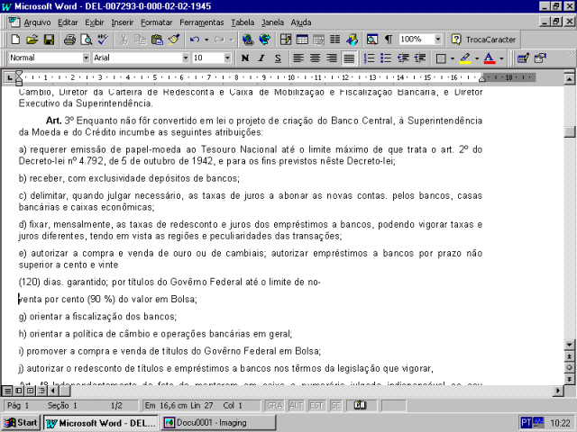

DECRETO-LEI N. 7.293 - DE 2 DE FEVEREIRO DE 1945

Cria a Superintendência da Moeda e do Crédito, e dá outras providências

O Presidente da República, usando da atribuição que lhe confere o artigo 180 da Constituição,

decreta:

Art. 1º E' criada, diretamente subordinada ao Ministro da Fazenda a Superintendência da Moeda e do Crédito, com o objetivo imediato de exercer o contrôle do mercado monetário e preparar a organização do Banco Central.

Art. 2º A Superintendência da Moeda e do Crédito terá um (1) Diretor Executivo, nomeado por decreto do Presidente da República, e sair orientada por um Conselho, e que presidirá o Ministro da Fazenda, constituído dos seguintes membros: - Presidente do Banco do Brasil S. A., Diretor da Carteira de Câmbio, Diretor da Carteira de Redesconta e Caixa de Mobilização e Fiscalização Bancária, e Diretor Executivo da Superintendência.

Art. 3º Enquanto não fôr convertido em lei o projeto de criação do Banco Central, à Superintendência da Moeda e do Crédito incumbe as seguintes atribuições:

a) requerer emissão de papel-moeda ao Tesouro Nacional até o limite máximo de que trata o art. 2º do Decreto-lei nº 4.792, de 5 de outubro de 1942, e para os fins previstos nêste Decreto-lei;

b) receber, com exclusividade depósitos de bancos;

c) delimitar, quando julgar necessário, as taxas de juros a abonar as novas contas pelos bancos, casas bancárias e caixas econômicas;

d) fixar, mensalmente, as taxas de redesconto e juros dos empréstimos a bancos, podendo vigorar taxas e juros diferentes, tendo em vista as regiões e peculiaridades das transações;

e) autorizar a compra e venda de ouro ou de cambiais; autorizar empréstimos a bancos por prazo não superior a cento e vinte (120) dias. garantido; por títulos do Govêrno Federal até o limite de noventa por cento (90%) do valor em Bolsa;

g) orientar a fiscalização dos bancos;

h) orientar a política de câmbio e operações bancárias em geral;

i) promover a compra e venda de títulos do Govêrno Federal em Bolsa;

j) autorizar o redesconto de títulos e empréstimos a bancos nos têrmos da legislação que vigorar,

Art.

4º Independentemente do fato de manterem em caixa o numerário julgado indispensável ao seu movimento, são os bancos obrigados a conservar em depósito no Banco do Brasil S.A., à ordem da Superintendência da Moeda e do Crédito sem juros:

a) oito por cento (8%) sôbre a valor dos depósitos à vista:

b) quatro por cento (4%) sôbre o valor de importâncias depositadas a prazo fixo ou mediante aviso prévio superior a noventa (90) dias.

Parágrafo único. A Superintendência da Moeda e do Crédito poderá alterar, para mais ou para  menos, até o máximo de setenta e cinco por cento (75%) das percentagens indicadas a obrigatoriedade referida neste artigo sendo-lhe ainda facultado usar para isso o critério discriminatório de que trata o art. 3º letra d, dêste Decreto-lei,

Art. 5º A Superintendência da Moeda e do Crédito fixará o prazo para integral cumprimento do disposto na letra b do art. 3º e no art. 4º antecedentes.

Art. 6º A Superintendência da Moeda e do Crédito baixará sempre que fôr necessário, instruções para perfeita execução do presente Decreto-lei.

Art. 7º Fica o Ministro da Fazenda autorizado a contratar com o Banco do Brasil S.A., a execução dos serviços da Superintendência da Moeda e do Crédito.

§ 1º O contrato, previamente lavrado no livro próprio de têrmos existente no Gabinete do Ministro, dependerá de aprovação por decreto do Govêrno.

§ 2º Das cláusulas do contrato constará que o Diretor Executivo da Superintendência terá idênticas vantagens às que usufruem os diretores do Banco do Brasil S.A.

Art. 8º No fim de cada ano financeiro, se as rendas auferidas pela Superintendência da Moeda e do Crédito não derem para cobrir os encargos decorrentes da execução do contrato a que se refere o artigo anterior, a diferença será atendida e classificada, dentro do respectivo exercício, à conta de crédito especialmente aberto ao Ministério da Fazenda para tal fim.

Parágrafo único. Em caso contrário o excesso de receita será escriturado como renda eventual da União.

Art. 9º Ficam revogadas as atribuições legais que competiam às Carteiras de Câmbio e de Redesconto do Banco do Brasil S.A. de Caixa de Mobilização e Fiscalização Bancária, ora atribuída à Superintendência da Moeda e do Crédito por êste Decreto-lei.

Art. 10. Êste Decreto-lei entrará em vigor na data de sua publicação. Art. 11. Revogam-se as disposições em contrário.

Rio de Janeiro, 2 de fevereiro de 1945, 124º da Independência e 57º da República.

Getulio Vargas.

A. de Souza Costa.
