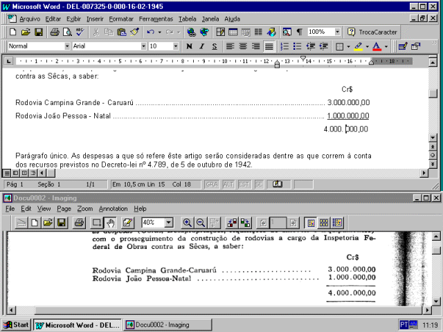

DECRETO-LEI N. 7.325 - DE 16 DE FEVEREIRO DE 1945

Abre ao Ministério da Viação e Obras Públicas, o crédito especial de Cr$ 4.000.000,00 para construção de rodovias a cargo da inspetoria Federal de Obras contra as Secas

O Presidente da República, usando da atribuição que lhe confere o artigo 180 da Constituição,

decreta:

Art. 1º Fica aberto ao Ministério da Viação e Obras Públicas, o crédito especial de quatro milhões de cruzeiros (Cr$ 4.000.000,00), para atender às despesas (Obras, Desapropriações, Aquisições de Imóveis e Equipamentos) com o prosseguimento da construção de rodovias a cargo da Inspetoria Federal de Obras contra as Sêcas, a saber:

      Cr$

Rodovia Campina Grande - Caruarú ............................................................................................ 3.000.000,00

Rodovia João Pessoa - Natal ....................................................................................................... 1.000.000,00

            4.000.000,00

Parágrafo único. As despesas a que só refere êste artigo serão consideradas dentre as que correm à conta dos recursos previstos no Decreto-lei nº 4.789, de 5 de outubro de 1942.

Art.

2º Êste Decreto-lei entrará em vigor na data de sua publicação.

Art. 3º Revogam-se as disposições em contrário.

Rio de Janeiro, 16 de fevereiro de 1945, 124º da Independência e 57º da República.

Getulio Vargas.

João de Mendonça Lima.

A. de Souza Costa.
