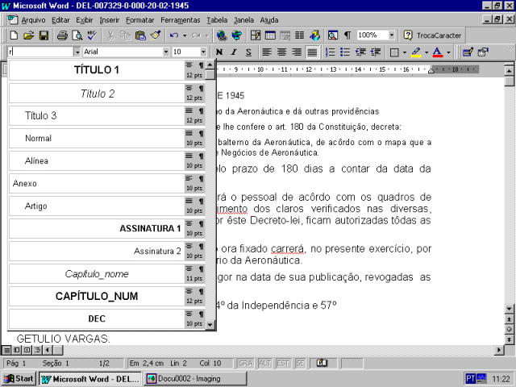

DECRETO-LEI N. 7.329 - DE 20 DE FEVEREIRO DE 1945

Fixa novo efetivo para o Corpo do Pessoal Subalterno da Aeronáutica e dá outras providências

O Presidente da República, usando da atribuição que lhe confere o art. 180 da Constituição,

decreta:

Art. 1º Fica fixado o efetivo do Corpo do Pessoal Subalterno da Aeronáutica, de acôrdo com o mapa que a êsta acompanha, assinado pelo Ministro de Estado e Negócios de Aeronáutica.

Art. 2º Fica suspenso o licenciamento pelo prazo de 180 dias a contar da data da publicação do presente Decreto-lei.

Art. 3º O Ministro da Aeronáutica distribuirá o pessoal de acôrdo com os quadros de efetivos aprovados, e, para o preenchimento dos claros verificados nas diversas, graduações, resultantes do efetivo fixado por êste Decreto-lei, ficam autorizadas tôdas as providências que no caso couberem.

Art. 4º A despesa com o aumento do efetivo ora fixado carrerá, no presente exercício, por conta dos créditos já distribuidos ao Ministério da Aeronáutica.

Art. 5º O presente Decreto-lei entrará em vigor na data de sua publicação, revogadas  as disposições em contrário.

Rio de Janeiro, 20 de fevereiro de 1945, 124º da Independência e 57º da República.

GETULIO VARGAS.

Joaquim Pedro Salgado Filho.

Mapa do efetivo do Corpo do Pessoal Subalterno da Aeronáutica a que se refere o Decreto-lei nº 7.329, de 20 de fevereiro de 1945

Sub-Oficiais..................................................................................................... 406

Primeiros Sargentos..................................................................................... 1.195

Segundos Sargentos..................................................................................... 2.018

Terceiros Sargentos ..................................................................................... 3.166                       6.785

Cabos............................................................................................................ 2.551

Soldados de 1ª Classe..... ............................................................................. 5.396

Soldados de 2ª Classe................................................................................... 6.010                    13.957

Músicos de 1ª Classe..... .................................................................................. 230

Músicos de 2ª Classe................ ........................................................................150

Músicos de 3ª Classe.......................................................................................... 90               470

Taifeiros-mor...................................................................................................... 262

Taifeiros de 1ª Classe........................................................................................ 906

Taifeiros de 2ª Classe.......................................................................................1.029            2.197

                      23.409
