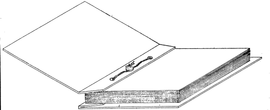

decreto-lei Nº 305, DE 28 DE FEVEREIRO DE 1967

Dispõe sôbre a legalização dos livros de escrituração das operações mercantis.

O PRESIDENTE DA REPÚBLICA, usando da atribuição que lhe confere o § 2, do Ato Institucional nº 4, de 7 de dezembro de 1966,

decreta:

Art. 1º São obrigatórios para qualquer comerciante com firma em nome individual e para as sociedades mercantis em geral os livros "Diário" e "Copiador", além dos que forem exigidos em lei especial.

§ 1º Além dos livros a que se refere o artigo anterior, as sociedades por ações deverão possuir:

I - o livro de “Registro de Ações Nominativas”;

II - o livro de “Transferência de Ações Nominativas";

III - o livro de "Registro de Partes Beneficiárias Nominativas”;

IV - o livro de “Transferências de Partes Beneficiárias Nominativas";

V - o livro de "Atas de Assembléias-Gerais";

VI - o livro de “Presença dos Acionistas";

VII - o livro de "Atas das Reuniões da Diretoria";

VIII - o livro de "Atas e Pareceres do Conselho Fiscal".

§ 2º Os livros a que se referem os ns. III e IV do parágrafo anterior só serão obrigatórios para as sociedades que emitirem partes beneficiárias nominativas.

§ 3º As sociedades por cotas de responsabilidade limitada poderão possuir facultativamente os livros a que se referem os ns. V a VIII, do § 2º, dêste artigo.

Art. 2º Efetuado o pagamento da taxa cobrada pelo órgão do Registro do Comércio local, pelo mesmo será procedida a legalização dos livros, onde receberá, na furação própria ao longo do dorso e no sentido vertical, um fio e sêlo metálicos, conforme figura anexa ficando suprimida a rubrica de fôlhas.

Parágrafo único. A furação de que trata êste artigo será feita mecânicamente pelos respectivos fabricantes dos livros, entre as sobrecapas que ficam junto à primeira e a última fôlha útil do livro.

Art. 3º Os livros deverão ser encadernados e suas fôlhas numeradas, devendo conter na primeira e na última páginas úteis, respectivamente, têrmos de abertura e encerramento com indicação de firma individual ou do nome comercial da sociedade a que pertencem, do local da sede ou estabelecimento do número e data do registro da firma ou do arquivamento dos atos constitutivos da sociedade no Registro do Comércio, do fim a que se destinam os livros, dos respectivos números de ordem e do número de suas páginas.

§ 1º Os têrmos de abertura e do encerramento deverão ser datados e assinados pelo comerciante e pelo responsável por sua escrituração.

§ 2º Os têrmos de abertura e de encerramento serão ainda assinados pelo funcionário competente do Registro do Comércio.

§ 3º O mesmo funcionário aplicará o fio e sêlo metálicos de inviolabilidade.

§ 4º Fora do Distrito Federal e das sedes das Juntas Comerciais ou de suas Delegacias, as formalidades de que trata êste artigo poderão ser preenchidas pelo Juiz de Direito, a cuja jurisdição estiver sujeito o comerciante ou sociedade mercantil.

Art. 4º Quando o comerciante adotar fichas, ao invés de livros, para os casos de escrituração mecânica, serão as mesmas numeradas seguidamente e autenticadas mecânicamente no Registro do Comércio, recebendo a de número um, no anverso, o têrmo de abertura e a última, no verso, o têrmo de encerramento a que se refere o artigo anterior.

Parágrafo único. A série de fichas abrange as fichas guias onde deverão ser anotadas as eventualmente inutilizadas em conseqüência de êrro, bordadura ou qualquer outro motivo que deverá ser registrado na ficha guia.

Art. 5º É facultado a qualquer comerciante, em nome individual, ou sociedade, solicitar a legalização de livros não obrigatórios.

Art. 6º É facultado a qualquer comerciante, em nome individual, ou sociedade, solicitar a transferência de livros para seus sucessores, dede que conste expressamente do instrumento próprio, devidamente arquivado, que a sucessão foi realizada assumindo o sucessor a responsabilidade do ativo e passivo do sucedido.

Art. 7º Revogam-se as disposições em contrário.

Brasília, 28 de fevereiro de 1967; 146º da Independência e 79º da República.

h. CASTELLO BRAnCO

Octávio Bulhões

Roberto Campos

Paulo Egydio Martins

DECRETO-LEI Nº 305, DE 28 DE FEVEREIRO DE 1967

Dispõe sôbre a legalização dos livros de escrituração das operações mercantis.

(PUBLICADO NO DIÁRIO OFICIAL DE 28-2-67 E RETIFICADO NO DE 10-3-67)

RETIFICAÇÃO

Publica-se a figura anexa ao Decreto-lei, por ter sido omitida.

Figura a que se refere o art. 2º do Decreto-lei nº 305, de 28 de fevereiro de 1967 (Modêlo de sêlo de segurança a ser usado nos livros de escrituração das operações mercantis).

