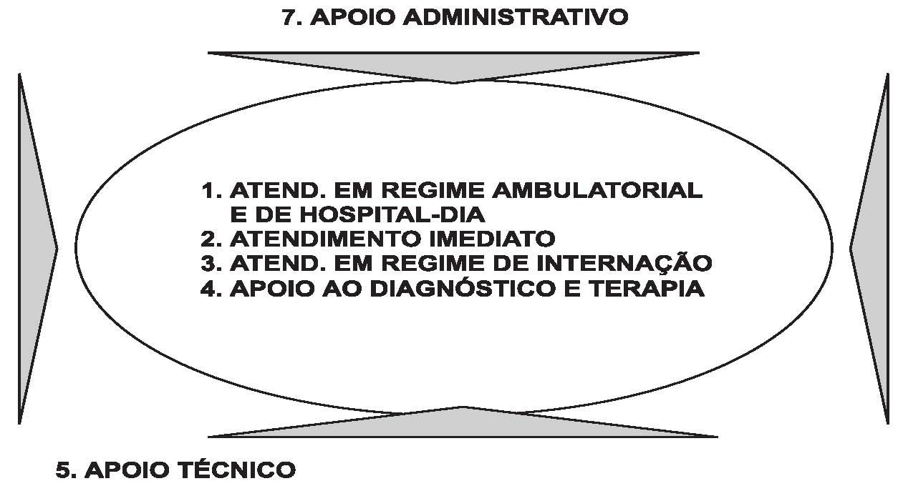

ADVERTÊNCIA

Este texto não substitui o publicado no Diário Oficial da União

Ministério da Saúde Agência Nacional de Vigilância Sanitária

# RESOLUÇÃO-RDC Nº 50, DE 21 DE FEVEREIRO DE 2002

> **Edição BVS/Ministério da Saúde — ANVISA (lote atos infralegais por órgão, issue #75).** Fonte: https://bvsms.saude.gov.br/bvs/saudelegis/anvisa/2002/rdc0050_21_02_2002.html (capturada em 2026-11-04T19:31:55Z, SHA-256 `70242edb6edf6b244224d9cdf2e9936bd57ea97954e8809f1cc8bd1a18a1fbd1`, charset latin-1). A página preserva advertência de não substituição do DOU. Identidade: `br-federal-rdc-anvisa-2002-02-21-50` (`norma_tipo=rdc`, órgão `anvisa`). 52 tabelas da fonte convertidas (8 Markdown + 44 HTML). Figura normativa `rdc0050_21_02_2002_fig1` preservada como fac-símile em `provas/atos-infralegais-orgaos/fac-similes/rdc-anvisa-50-2002-fig1.jpg`. O acervo não certifica vigência nem afirma que esta é a única edição vigente da ANVISA.

Dispõe sobre o Regulamento Técnico para planejamento, programação, elaboração e avaliação de projetos físicos de estabelecimentos assistenciais de saúde.

A Diretoria Colegiada da Agência Nacional de Vigilância Sanitária, no uso da atribuição que lhe confere o art. 11 inciso IV do Regulamento da ANVISA aprovado pelo Decreto nº 3.029, de 16 de abril de 1999, em reunião realizada em 20 de fevereiro de 2002, e considerando o princípio da descentralização político-administrativa previsto na Constituição Federal e na Lei nº 8.080 de 19/09/1990;

considerando o art. 3º, alínea C, art. 6º, inciso VI e art. 10 previstos na Portaria nº 1.565/GM/MS, de 26 de agosto de 1994;

<!-- fac-simile:inicio -->

**Fac-símile normativo (figura da fonte BVS/ANVISA).** Diagrama oficial do Anexo da RDC 50/2002: relações funcionais entre unidades de um estabelecimento de saúde (urgência/emergência, centro cirúrgico, UTI, internação, diagnóstico, apoio, etc.). Fac-símile preservado; não omitido. Arquivo: `provas/atos-infralegais-orgaos/fac-similes/rdc-anvisa-50-2002-fig1.jpg` (SHA-256 `4c1ed67da5be104de46755bd041a1d193d816c24d9918cffa01b693729a584e1`; origem https://bvsms.saude.gov.br/bvs/saudelegis/anvisa/2002/IMG/rdc0050_21_02_2002_fig1.jpg). A imagem não foi substituída por resumo.

<!-- fac-simile:fim -->

considerando a necessidade de atualizar as normas existentes na área de infra-estrutura física em saúde;

considerando a necessidade de dotar o País de instrumento norteador das novas construções, reformas e ampliações, instalações e funcionamento de Estabelecimentos Assistenciais de Saúde que atenda aos princípios de regionalização, hierarquização, acessibilidade e qualidade da assistência prestada à população;

considerando a necessidade das secretarias estaduais e municipais contarem com um instrumento para elaboração e avaliação de projetos físicos de estabelecimentos assistenciais de saúde, adequado às novas tecnologias na área da saúde;

considerando o disposto nas Portarias/SAS/MS n.º 230, de 1996 e 104, de 1997;

considerando a consulta pública publicada pela Portaria SVS/MS n.º 674, de 1997;

adota a seguinte Resolução de Diretoria Colegiada e eu, Diretor-Presidente, determino a sua publicação.

Art. 1º Aprovar o Regulamento Técnico destinado ao planejamento, programação, elaboração, avaliação e aprovação de projetos físicos de estabelecimentos assistenciais de saúde, anexo a esta Resolução, a ser observado em todo território nacional, na área pública e privada compreendendo:

a) as construções novas de estabelecimentos assistenciais de saúde de todo o país;

b) as áreas a serem ampliadas de estabelecimentos assistenciais de saúde já existentes;

c) as reformas de estabelecimentos assistenciais de saúde já existentes e os anteriormente não destinados a estabelecimentos de saúde.

Art. 2º A Agência Nacional de Vigilância Sanitária do Ministério da Saúde prestará cooperação técnica às Secretarias Estaduais e Municipais de Saúde, a fim de orientá-las sobre o exato cumprimento e interpretação deste Regulamento Técnico.

Art. 3º As Secretariais Estaduais e Municipais de Saúde são responsáveis pela aplicação e execução de ações visando o cumprimento deste Regulamento Técnico, podendo estabelecer normas de caráter supletivo ou complementar a fim de adequá-lo às especificidades locais.

Art. 4º A Agência Nacional de Vigilância Sanitária do Ministério da Saúde, procederá a revisão deste Regulamento Técnico após cinco anos de sua vigência, com o objetivo de atualizá-lo ao desenvolvimento científico e tecnológico do país.

Art. 5º A inobservância das normas aprovadas por este Regulamento constitui infração à legislação sanitária federal, conforme dispõe o art. 10, incisos II e III., da Lei n.º 6.437, de 20 de agosto de 1977.

Art. 6º Esta Resolução de Diretoria Colegiada entra em vigor na data de sua publicação.

GONZALO VECINA NETO

ANEXO

REGULAMENTO TÉCNICO PARA PLANEJAMENTO, PROGRAMAÇÃO, ELABORAÇÃO E AVALIAÇÃO DE PROJETOS FÍSICOS DE ESTABELECIMENTOS ASSISTENCIAIS DE SAÚDE

Todos os projetos de estabelecimentos assistenciais de saúde-EAS deverão obrigatoriamente ser elaborados em conformidade com as disposições desta norma. Devem ainda atender a todas outras prescrições pertinentes ao objeto desta norma estabelecidas em códigos, leis, decretos, portarias e normas federais, estaduais e municipais, inclusive normas de concessionárias de serviços públicos. Devem ser sempre consideradas as últimas edições ou substitutivas de todas as legislações ou normas utilizadas ou citadas neste documento.

Embora exista uma hierarquia entre as três esferas, o autor ou o avaliador do projeto deverá considerar a prescrição mais exigente, que eventualmente poderá não ser a do órgão de hierarquia superior.

PARTE I- PROJETOS DE ESTABELECIMENTOS ASSISTENCIAIS DE SAÚDE

1\. ELABORAÇÃO DE PROJETOS FÍSICOS

Nos casos não descritos nesta resolução, são adotadas como complementares a seguinte norma:- NBR 6492 - Representação de projetos de arquitetura;

1.1.. TERMINOLOGIA

Para os estritos efeitos desta norma, são adotadas as seguintes definições:

1.1.1. Programa de Necessidades

Conjunto de características e condições necessárias ao desenvolvimento das atividades dos usuários da edificação que, adequadamente consideradas, definem e originam a proposição para o empreendimento a ser realizado. Deve conter a listagem de todos os ambientes necessários ao desenvolvimento dessas atividades.

1.1.2. Estudo Preliminar

Estudo efetuado para assegurar a viabilidade técnica a partir dos dados levantados no Programa de Necessidades, bem como de eventuais condicionantes do contratante.

1.1.3. Projeto Básico

Conjunto de informações técnicas necessárias e suficientes para caracterizar os serviços e obras, elaborado com base no Estudo Preliminar, e que apresente o detalhamento necessário para a definição e quantificação dos materiais, equipamentos e serviços relativos ao empreendimento.

1.1.4. Projeto Executivo

Conjunto de informações técnicas necessárias e suficientes para realização do empreendimento, contendo de forma clara, precisa e completa todas as indicações e detalhes construtivos para a perfeita instalação, montagem e execução dos serviços e obras.

1.1.5. Obra de Reforma

Alteração em ambientes sem acréscimo de área, podendo incluir as vedações e/ou as instalações existentes.

1.1.6. Obra de Ampliação

Acréscimo de área a uma edificação existente, ou mesmo construção de uma nova edificação para ser agregada funcionalmente (fisicamente ou não) a um estabelecimento já existente.

1.1.7. Obra Inacabada

Obra cujos serviços de engenharia foram suspensos, não restando qualquer atividade no canteiro de obras.

1.1.8. Obra de Recuperação

Substituição ou recuperação de materiais de acabamento ou instalações existentes, sem acréscimo de área ou modificação da disposição dos ambientes existentes.

1.1.9. Obra Nova

Construção de uma nova edificação desvinculada funcionalmente ou fisicamente de algum estabelecimento já existente.

1.2. ETAPAS DE PROJETO

Os projetos para a construção, complementação, reforma ou ampliação de uma edificação ou conjunto de edificações serão desenvolvidos, basicamente, em três etapas: estudo preliminar, projeto básico e projeto executivo.

O desenvolvimento consecutivo dessas etapas terá, como ponto de partida, o programa de necessidades (físico-funcional) do EAS onde deverão estar definidas as características dos ambientes necessários ao desenvolvimento das atividades previstas na edificação

1.2.1. Estudo preliminar

Visa a análise e escolha da solução que melhor responda ao Programa de Necessidades, sob os aspectos legais, técnicos, econômicos e ambientais do empreendimento.

1.2.1.1 Arquitetura

Consiste na definição gráfica do partido arquitetônico, através de plantas, cortes e fachadas (opcional) em escala livre e que contenham graficamente:

\- a implantação da edificação ou conjunto de edificações e seu relacionamento com o local escolhido;

\- acessos, estacionamentos e outros - e expansões possíveis;

\- a explicitação do sistema construtivo que serão empregados;

\- os esquemas de zoneamento do conjunto de atividades, as circulações e organização volumétrica;

\- o número de edificações, suas destinações e locações aproximadas;

\- o número de pavimentos;

\- os esquemas de infra-estrutura de serviços;

\- o atendimento às normas e índices de ocupação do solo.

O estudo deverá ser desenvolvido a partir da análise e consolidação do programa de necessidades, caracterizando os espaços, atividades e equipamentos básicos (médico-hospitalares e de infraestrutura) e do atendimento às normas e leis de uso e ocupação do solo.

Além dos desenhos específicos que demonstrem a viabilidade da alternativa proposta, será parte integrante do estudo preliminar, um relatório que contenha memorial justificativo do partido adotado e da solução escolhida, sua descrição e características principais, as demandas que serão atendidas e o pré-dimensionamento da edificação.

Deverão ser consideradas as interferências entre os diversos sistemas da edificação.

Quando solicitado pelo contratante e previamente previsto em contrato, deverá ser apresentada estimativa de custos da obra.

1.2.1.2. Instalações

1.2.1.2.1.Elétrica e Eletrônica

A. Escopo

Deverá ser desenvolvido um programa básico das instalações elétricas e especiais do E.A.S., destinado a compatibilizar o projeto arquitetônico com as diretrizes básicas a serem adotadas no desenvolvimento do projeto, contendo quando aplicáveis:

\- Localização e característica da rede pública de fornecimento de energia elétrica;

\- Tensão local de fornecimento de energia elétrica (primária e secundária);

\- Descrição básica do sistema de fornecimento de energia elétrica: entrada, transformação, medição e distribuição;

\- Descrição básica do sistema de proteção contra descargas atmosféricas;

\- Localização e características da rede pública de telefonia;

\- Descrição básica do sistema telefônico: entrada, central privada de comutação e L.P.'s;

\- Descrição básica do sistema de sinalização de enfermagem;

\- Descrição básica do sistema de sonorização;

\- Descrição básica do sistema de intercomunicação;

\- Descrição básica do sistema de televisão e rádio;

\- Descrição básica do sistema de computadores;

\- Descrição básica do sistema de radiologia;

\- Descrição básica do sistema de busca-pessoa;

\- Descrição básica do sistema de aterramento das salas cirúrgicas (quando houver);

\- Descrição básica do sistema de geração da energia de emergência (baterias ou grupo gerador);

\- Descrição básica do sistema de alarme contra incêndios;

\- Determinação básica dos espaços necessários para as centrais de energia elétrica e centrais de comutação telefônica;

\- Determinação básica das áreas destinadas ao encaminhamento horizontal e vertical do sistema elétrico (prumadas);

\- Efetuar consulta prévia às concessionárias de energia elétrica e telefonia;

\- Apresentar memória de cálculo, com justificativa dos sistemas propostos.

B. Produtos

\- Descritivo básico, com indicação das alternativas e recomendações de ordem técnica para adequação do projeto básico de arquitetura.

\- Documentos gráficos para elucidar as proposições técnicas.

1.2.1.2.2. Hidráulica e Fluido-Mecânica

A. Escopo

Deverá ser desenvolvido um programa básico das instalações hidráulicas e especiais do estabelecimento, destinado a compatibilizar o projeto arquitetônico com as diretrizes básicas a serem adotadas no desenvolvimento do projeto, contendo quando aplicáveis:

\- Localização da rede pública de fornecimento de água ou quando necessária a indicação de poço artesiano;

\- Descrição básica do sistema de abastecimento de água:entrada;

\- Previsões do consumo de água, reservação (enterrada e elevada) e casa de bombas;

\- Descrição básica do sistema de aquecimento;

\- Previsão de consumo de água quente;

\- Descrição básica do sistema de proteção e combate a incêndio;

\- Localização da rede pública de fornecimento de gás combustível e/ou quando necessário de gás engarrafado;

\- Previsão de consumo de gás combustível;

\- Localização da rede pública de esgoto e/ou quando necessário a indicação de sistema de tratamento (fossa séptica, câmaras de decantação para esgoto radioativo, outros);

\- Localização de galeria para drenagem de águas pluviais e/ou quando necessário a indicação de despejo livre;

\- Previsão do volume de escoamento de águas pluviais;

-Descrição básica do sistema de fornecimento de gases medicinais (oxigênio, óxido nitroso, ar comprimido medicinal e outros) quando for o caso;

\- Descrição básica do sistema de tratamento de Resíduos de Serviços de Saúde (RSS), quando for o caso;

\- Previsão do consumo dos gases medicinais;

\- Descrição do sistema de fornecimento de vácuo;

\- Previsão do consumo de vácuo;

\- Descrição do sistema de fornecimento de vapor;

\- Previsão de consumo de vapor;

\- Consultas prévias junto às concessionárias públicas de fornecimento de água e gás;

\- Determinação básica dos espaços necessários para as centrais de gases medicinais, gás combustível, vácuo, vapor, tratamento de RSS, quando for o caso;

\- Determinação básica dos espaços necessários para as centrais de gases medicinais, gás combustível, vácuo, vapor;

\- Determinação básica das áreas destinadas aos encaminhamentos dos sistemas hidráulicos e especiais (prumadas);

\- Apresentação de memórias de cálculo e justificativa dos sistemas propostos.

B. Produtos

\- Descritivo básico com indicação das alternativas e recomendações de ordem técnica para adequação ao projeto básico de arquitetura;

\- Documentos gráficos para elucidar as proposições técnicas.

1.2.1.2.3. Climatização

A. Escopo

Deverá ser desenvolvido um programa básico das instalações de ar condicionado e ventilação mecânica do EAS, destinado a compatibilizar o projeto arquitetônico com as diretrizes básicas a serem adotadas no desenvolvimento do projeto, contendo quando aplicáveis:

\- Proposição das áreas a serem climatizadas (refrigeração, calefação, umidificação, pressurização, ventilação e câmaras frigoríficas);

\- Descrição básica do sistema de climatização, mencionando:filtros, água gelada, "self" a ar, Tc;

\- Previsão do consumo de água;

\- Previsão de consumo de energia elétrica;

\- Elaboração do perfil da carga térmica;

\- Elaboração do estudo comparativo técnico e econômico das alternativas técnicas para o sistema;

\- Localização da central de casa de máquinas em função dos sistemas propostos;

\- Pré-localização do sistema de distribuição, prumadas dos dutos e redes de água em unifilares da alternativa proposta.

B - Produtos

\- Descritivo básico, com indicação das alternativas e recomendações de ordem técnica para adequação do projeto básico de arquitetura;

\- Documentos gráficos para elucidar as proposições técnicas.

1.2.1.3. Estrutura e Fundações

Assim como os projetos de arquitetura e instalações, os projetos de estrutura e fundações obedecerão as etapas de estudo preliminar, projeto básico e projeto executivo e deverão estar em perfeita sintonia com aqueles projetos, estimando as cargas de acordo com os ambientes e equipamentos propostos.

1.2.2 Projeto Básico

Deverá demonstrar a viabilidade técnica da edificação a partir do Programa de necessidades e do Estudo preliminar desenvolvidos anteriormente, possibilitar a avaliação do custo dos serviços e obras, bem como permitir a definição dos métodos construtivos e prazos de excussão do empreendimento. Serão solucionadas as interferências entre os sistemas e componentes da edificação.

1.2.2.1. Arquitetura

Deverão estar graficamente demonstrados:

\- em plantas, cortes e fachadas, com escalas não menores que 1:100, todos os ambientes com nomenclatura conforme listagem contida nessa Portaria, dimensões (medidas lineares e áreas internas dos compartimentos e espessura das paredes), locação de louças sanitárias e bancadas, posição dos leitos (quando houver), locação dos equipamentos não portáteis médico-hospitalares e de infra-estrutura - caldeiras, subestação, locais de tratamento de RSS, etc e quando na tabela de ambientes estiver especificado ADE. (vide capítulo 1 item6.2), indicações de cortes, elevações, ampliações e detalhes, sempre com indicação clara dos respectivos materiais de execução e acabamento.Em se tratando de reforma e/ou ampliação e/ou conclusão, as plantas devem conter legenda indicando área a ser demolida, a ser construída e existente;

\- locação da edificação ou conjunto de edificações e seus acessos de pedestres e veículos;

\- a proposta de cobertura em planta com todas as indicações pertinentes;

\- planta de situação do terreno em relação ao seu entorno urbano.

O projeto básico será constituído, além dos desenhos que representem tecnicamente a solução adotada, de relatório técnico descritivo que contenha:

\- memorial do projeto de arquitetura descrevendo as soluções adotadas pelo mesmo, onde se incluem, necessariamente, considerações sobre os fluxos internos e externos;

\- resumo da proposta assistencial, contendo listagem das atividades que irão ocorrer no interior do EAS (a partir da listagem de atividades dessa norma);

\- quadro de número de leitos discriminando: leitos de internação, leitos de observação e leitos de tratamento intensivo, conforme Terminologia Básica em Saúde do Ministério da Saúde;

\- especificação básica de materiais e equipamentos de infraestrutura (poderá estar indicado nas plantas de arquitetura) e quando solicitado, dos equipamentos médico-hospitalares;

\- descrição sucinta da solução adotada para o abastecimento de água potável e energia elétrica, e coleta e destinação de esgoto, resíduos sólidos e águas pluviais da edificação;

\- no caso de instalações radiativas, o licenciamento é de acordo com a norma da CNEN NE 6.02.,

\- quando solicitado pelo contratante e, previsto em contrato, também a quantificação de materiais, equipamentos e serviços, e o orçamento da obra.

O Projeto Básico de Arquitetura-PBA (representação gráfica + relatório técnico) será a base para o desenvolvimento dos projetos complementares de engenharia (estrutura e instalações).

1.2.2.2. Instalações

1.2.2.2.1.Elétrica e Eletrônica

A. Escopo

A partir das diretrizes estabelecidas no estudo preliminar e com base no projeto arquitetônico e de estrutura, deverá ser elaborado o projeto básico de instalações elétricas e especiais, contendo quando aplicáveis:

\- Confirmação das entradas de energia elétrica e de telefonia;

\- Confirmação do sistema de energia elétrica e da central de comutação telefônica;

\- Confirmação do sistema de distribuição contendo redes e pré-dimensionamento;

\- Proposição da locação dos quadros gerais de BT, QL e QF;

-Proposição da locação dos quadros de distribuição telefônica;

\- Proposição das dimensões das centrais da energia (medição,transformação, quadros gerais, BT, geradores) e da central telefônica;

\- Proposição dos pontos de alimentação, iluminação e sinalização:

Pontos de força para equipamentos e tomadas de uso geral;

Pontos de luz e seus respectivos interruptores;

Pontos de detecção e alarme de incêndio;

Pontos de telefones e interfones;

Pontos para o sistema de sinalização de enfermagem, com seus respectivos acionamentos;

\- Proposição dos pontos para locação dos captores e para o sistema de proteção contra descargas atmosféricas;

-Proposição dos pontos de alimentação do sistema de ar condicionado, elevadores, sistema de som, intercomunicação e sistemas de computadores;

\- Proposição dos pontos de alimentação de todos os sistemas de suprimento, processamento e tratamento de efluentes, líquidos ou sólidos, quando for o caso.

B. Produtos

\- Memorial descritivo e definitivo explicativo do projeto, com soluções adotadas e compatibilizadas com o projeto básico e as soluções adotadas nos projetos das áreas complementares.

\- Documentos Gráficos:

\- Implantação geral - escala ≥ 1:500;

\- Plantas baixas - escala ≥ 1:100;

\- Planta de cobertura - escala ≥ 1:100;

\- Prumadas esquemáticas - sem escala.

1.2.2.2.2.Hidráulica e Fluido-Mecânica

A. Escopo

A partir das diretrizes estabelecidas no estudo preliminar e baseado no anteprojeto básico arquitetônico, deverá ser elaborado o projeto básico de instalações hidráulicas e especiais, contendo quando aplicáveis:

\- Proposição da entrada de água, da entrada de gás e ligações de esgoto e águas pluviais;

\- Confirmação da necessidade de poço artesiano e sistema de tratamento de esgoto;

\- Confirmação das necessidades de abastecimento e captação:

de água para consumo e combate a incêndios;

de esgotos pluviais;

de gás combustível;

de gases medicinais;

de vácuo;

de vapor;

\- Confirmação dos tubos de queda para as prumadas devidamente pré-dimensionadas para a compreensão da solução adotada para águas pluviais.

-Confirmação do dimensionamento das centrais de gases medicinais, gás, vácuo e vapor, incluindo as redes e respectivos pontos de consumo;

\- Confirmação do dimensionamento das centrais de tratamento ou suprimento de instalações especiais, como tratamento deágua para diálise, tratamento de RSS, tratamento de esgoto, etc.

B. Produtos

\- Memorial descritivo definitivo, explicativo do projeto, com soluções adotadas e compatibilizadas com o projeto básico de arquitetura e as soluções adotadas nos projetos das áreas complementares.

\- Documentos gráficos:

implantação geral - escala ≥ 1:500;

plantas baixas - escala ≥ 1:100;

planta de cobertura - escala≥ 1:100;

prumadas esquemáticas - escala ≥ 1:100.

1.2.2.2.3. Climatização

A. Escopo

A partir das diretrizes estabelecidas no programa básico e baseado no projeto básico arquitetônico, deverá ser elaborado o projeto básico de instalações de ar condicionado e ventilação mecânica, contendo quando aplicáveis:

\- Definição dos pesos e dimensões dos equipamentos para o sistema proposto;

\- Confirmação da alternativa do sistema a ser adotado

\- Confirmação das áreas a serem climatizadas;

\- Confirmação das áreas a serem ventiladas;

\- Confirmação dos consumos de água e energia elétrica;

\- Compatibilização com os projetos básicos de instalaçõeselétrica e hidráulica com o sistema adotado;

\- Proposição das redes de dutos unifilares com dimensionamento das linhas tronco de grelhas, difusores, etc.;

\- Localização dos pontos de consumo elétrico com determinação de potência, tensão e número de fases;

\- Localização dos pontos de consumo hidráulico (água e drenagem).

B. Produtos

\- Memorial descritivo definitivo, explicativo do projeto, com soluções adotadas e compatibilizadas com o projeto básico e as soluções adotadas nos projetos das áreas complementares;

\- Documentos gráficos:

implantação geral - escala ≥ 1:500;

plantas baixas - escala ≥ 1:100;

planta da cobertura - escala ≥ 1:100.

1.2.3. Projeto Executivo

Deverá apresentar todos os elementos necessários à realização do empreendimento, detalhando todas as interfaces dos sistemas e seus componentes.

1.2.3.1. Arquitetura

O projeto executivo deverá demonstrar graficamente:

\- a implantação do edifício, onde constem:

orientação da planta com a indicação do Norte verdadeiro ou magnético e as geratrizes de implantação;

representação do terreno, com as características planialtimétricas, compreendendo medidas e ângulos dos lados e curvas de nível, e localização de árvores, postes, hidrantes e outros elementos construídos, existentes;

as áreas de corte e aterro, com a localização e indicação da inclinação de taludes e arrimos;

a RN do levantamento topográfico;

os eixos das paredes externas das edificações, cotados em relação a referências preestabelecidas e bem identificadas;

cotas de nível do terrapleno das edificações e dos pontos significativos das áreas externas (calçadas, acessos, patamares, rampas e outros);

localização dos elementos externos, construídos como estacionamentos, construções auxiliares e outros;

\- o edifício, compreendendo:

plantas de todos os pavimentos, com nomenclatura conforme listagem de ambientes contida nessa norma e medidas internas de todos os compartimentos, espessura de paredes, material e tipo de acabamento, e indicações de cortes, elevações, ampliações e detalhes;

dimensões e cotas relativas de todas as aberturas, altura dos peitoris, vãos de portas e janelas e sentido de abertura;

plantas de cobertura, indicando o material, a inclinação, sentido de escoamento das águas, a posição das calhas, condutores e beirais, reservatórios, domus e demais elementos, inclusive tipo de impermeabilização, juntas de dilatação, aberturas e equipamentos, sempre com indicação de material e demais informações necessárias;

todas as elevações, indicando aberturas e materiais de acabamento;

cortes das edificações, onde fique demonstrado o pé direito dos compartimentos, altura das paredes e barras impermeáveis, altura de platibandas, cotas de nível de escadas e patamares, cotas de piso acabado, forros e coberturas, tudo sempre com indicação clara dos respectivos materiais de execução e acabamento;

impermeabilização de paredes e outros elementos de proteção contra umidade;

ampliações, de áreas molhadas, com posicionamento de aparelhos hidráulico-sanitários, indicando seu tipo e detalhes necessários;

as esquadrias, o material componente, o tipo de vidro, fechaduras, fechos, dobradiças, o acabamento e os movimentos das peças, sejam verticais ou horizontais;

todos os detalhes que se fizerem necessários para a perfeita compreensão da obra a executar, como cobertura, peças de concreto aparente, escadas, bancadas, balcões e outros planos de trabalho, armários, divisórias, equipamentos de segurança e outros fixos e todos os arremates necessários;

se a indicação de materiais e equipamentos for feita por código, incluir legenda indicando o material, dimensões de aplicação e demais dados de interesse da execução das obras;

Quando for solicitado pelo contratante, o projeto executivo será integrado por um cronograma onde estejam demonstradas as etapas lógicas da execução dos serviços e suas interfaces, bem como um manual de operação e manutenção das instalações, quando se tratar de equipamentos ou projetos especiais.

Todos os detalhes executivos que interfiram com outros sistemas deverão estar perfeitamente harmonizados.

Também constará do projeto executivo, se solicitado pelo contratante e previsto em contrato, o orçamento analítico da obra e cronograma físico-financeiro.

1.2.3.2. Instalações

1.2.3.2.1. Elétrica e Eletrônica

A. Escopo

Após a aprovação do projeto básico pelo órgão competente e/ou cliente, deverá ser elaborado o projeto executivo de instalações elétricas e especiais, atentando para os projetos executivos de arquitetura e formas de estrutura, de modo a permitir a completa execução das obras.

B. Produtos

\- Memorial descritivo e explicativo das instalações elétricas ou especiais, indicando fórmulas, dados e métodos utilizados nos dimensionamentos: tensão, corrente, fator de demanda, fator de potência,índice iluminotécnico, telefonia, etc.;

\- Memorial descritivo da ordem de serviço a ser executada e recomendações quanto a método e técnicas a serem utilizadas.

\- Documentos Gráficos:

As plantas poderão ser apresentadas agrupando-se os diversos sistemas, segundo o seguinte critério: agrupamento 1 - iluminação, sonorização, sinalização de enfermagem, alarme de detecção contra incêndio e relógio; agrupamento 2 - alimentadores, tomadas, telefone, interfone e sistema de computadores;

Implantação geral - escala ≥ 1:500;

Plantas baixas - escala ≥ 1:100;

Planta de cobertura - escala ≥ 1:100;

Planta corte e elevação da cabine de medição e transformação - escala ≥ 1:25;

Diagrama unifilar geral - sem escala;

Diagramas trifilares dos quadros elétricos - sem escala;

Detalhes gerais - escala ≥ 1:25;

Prumadas esquemáticas - sem escala;

Legenda das simbologias adotadas - sem escala.

\- Relação quantitativa e qualitativa dos materiais e equipamentos a serem utilizados nos diversos sistemas, contendo:

Tipo e qualidade;

Características para sua identificação;

Unidade de comercialização;

Respectivas quantidades;

\- Elementos necessários para aprovação junto à companhia de fornecimento de energia elétrica, contendo:

. Plantas e detalhes (escala ≥ 100 e ≥ 1:25);

. Tabela de carga instalada e demandada;

\- Memorial descritivo;

\- Outros documentos solicitados pela concessionária;

\- Elementos necessários para aprovação junto à companhia telefônica, contendo:

\- Plantas e detalhes (escala≥ 1:100 e ≥ 1:25);

\- Memorial descritivo;

\- Outros documentos solicitados pela concessionária.

1.2.3.2.1. Hidráulica e Fluído-Mecânica

A. Escopo

Após a provação do projeto básico pelo órgão competente, deverá ser elaborado o projeto executivo de instalações hidráulicas e especiais, atentando para o projeto executivo de arquitetura, de modo a permitir a completa execução das obras.

B. Produtos

\- Memorial descritivo e explicativo das instalações hidráulicas ou especiais, indicando fórmulas, dados e métodos utilizados nos dimensionamentos e cálculos (volume, capacidade, vazão, etc.);

\- Memorial descritivo da ordem de serviço a ser executado e recomendações quanto a método e técnicas a serem utilizadas;

\- Documentos gráficos:

As plantas poderão ser apresentadas, agrupando-se os diversos sistemas, de acordo com o seguinte critério: instalações de água quente e fria, instalações de esgoto e águas pluviais, instalações de gás combustível, instalações de gases medicinais, instalações de redes de proteção e combate a incêndio e instalações da rede de vapor e condensado;

Planta de implantação geral do edifício, em escala ≥ 1:200,desenvolvida a partir do projeto arquitetônico, contendo as redes públicas existentes de água, gás, esgoto sanitário e águas pluviais;

Plantas baixas dos pavimentos - escala ≥ 1:50;

Planta de cobertura - escala ≥ 1:50;

Esquema isométrico - escala ≥ 1:25;

Detalhes gerais - escala ≥ 1:25;

Detalhes de reservatórios de água - escala ≥ 1:50;

Legenda das simbologias adotadas - sem escala;

\- Relação quantitativa e qualitativa dos materiais e equipamentos a serem utilizados nos diversos sistemas, contendo:

Tipo e qualidade;

Características para sua identificação;

Unidade de comercialização;

Respectivas quantidades;

\- Elementos necessários para aprovação junto ao Corpo de Bombeiros contendo:

Memoriais descritivos;

Memoriais de cálculo;

Plantas e detalhes do sistema (escala ≥ 1:100 e ≥ 1:25, respectivamente);

Outros documentos solicitados pelo órgão.

\- Elementos necessários para aprovação junto à companhia de gás, quando da existência da mesma, contendo:

Plantas e detalhes (escala ≥ 1:50 e ≥ 1:25);

Memorial descritivo;

\- Elementos necessários para o dimensionamento do ramal de entrada de água (hidrômetro) e saída de esgoto sanitário, junto à concessionária de água e esgoto, contendo:

Plantas e detalhes (escala ≥ 1:50 e ≥ 1:25);

Memorial descritivo;

Outros documentos solicitados pela concessionária.

1.2.3.2.1. Climatização

A. Escopo

Após a aprovação do projeto básico pelo órgão competente, deverá ser elaborado o projeto executivo de instalações de ar condicionado e ventilação mecânica, atentando para o projeto executivo de arquitetura e de estruturas, de modo a permitir a execução das obras das instalações hidráulicas e especiais por terceiros, segundo padrões convencionais da construção civil.

B. Escopo

\- Memorial descritivo e explicativo das instalações de ar condicionado e ventilação mecânica, indicando fórmulas, dados e métodos utilizados nos dimensionamentos de: cargas térmicas, consumo de água, carga elétrica, número de troca de ar e filtros de ar; - Memorial descritivo da ordem de serviço a ser executada e recomendações quanto ao método e técnicas a serem utilizadas para execução de obra.

\- Documentos gráficos:

As plantas poderão ser apresentadas agrupando-se as instalações de ar condicionado, redes de água gelada, ventilação e exaustão e deverão ser compostas por:

implantação geral - escala ≥ 1:500;

plantas baixas - escala ≥ 1:100;

planta de cobertura - escala ≥ 1:100;

esquema isométrico - escala ≥ 1:25;

detalhes gerais - escala ≥ 1:25;

esquema elétrico - sem escala;

fluxograma - sem escala;

legenda das simbologias adotadas - sem escala;

\- Relação quantitativa e qualitativa dos materiais e equipamentos a serem utilizados nos diversos sistemas, contendo:

Tipo e qualidade;

Características para sua identificação;

Unidade de comercialização;

Respectivas quantidades.

1.3 - RESPONSABILIDADES

1.3.1. Cabe a cada área técnica o desenvolvimento do projeto executivo respectivo. O projeto executivo completo da edificação será constituído por todos os projetos especializados devidamente compatibilizados, de maneira a considerar todas as suas interferências.

1.3.2. A elaboração e avaliação dos projetos físicos serão de responsabilidade de técnicos ou firmas legalmente habilitados pelo Conselho Regional de Engenharia, Arquitetura e Agronomia - CREA.

1.3.3. O autor ou autores deverá assinar todas as peças gráficas dos projetos respectivos, mencionando o número de sua inscrição nos diversos órgãos e providenciando sempre a A.R.T. (Anotação de Responsabilidade Técnica) correspondente, recolhida na jurisdição aonde for elaborado o projeto.

1.3.4. Ainda que o encaminhamento para aprovação formal nos diversos órgãos de fiscalização e controle, como prefeitura municipal, corpo de bombeiros e entidades de proteção sanitária e do meio ambiente, não seja realizado diretamente pelo autor do projeto, será de sua responsabilidade a introdução das modificações necessáriasà sua aprovação. A aprovação do projeto não eximirá os autores desse das responsabilidades estabelecidas pelas normas, regulamentos e legislação pertinentes às atividades profissionais.

1.4. APRESENTAÇÃO DE DESENHOS E DOCUMENTOS

Os desenhos e documentos a serem elaborados deverão respeitar a NBR-6492 e também os requisitos a seguir descritos, que têm por finalidade padronizar e unificar a sua apresentação.

1.4.1. Formato das Folhas de Desenho

Os projetos deverão ser apresentados, preferencialmente, em folhas do mesmo formato.

A adoção de outros formatos ou tamanhos, se necessária, deverá contar com a anuência do contratante.

São os seguintes os formatos usuais:

A4 = 210x297mm

A3 = 297x420mm

A2 = 420x594mm

A1 = 594x841mm

A0 = 841x1.189mm

1.4.2. Padronização Gráfica de Desenhos

Todas as folhas de desenho deverão ter "carimbo" (campos de identificação), que conterá, no mínimo, as seguintes informações: - nome e assinatura do autor do projeto e número da carteira profissional;

\- nome do proprietário;

\- nome e endereço da obra a ser executada;

\- escalas utilizadas;

\- referência do projeto (parte de outro projeto, número do desenho, de referência; outras);

\- número do desenho e número de revisão (se for o caso);

\- data do desenho;

\- quadro de área discriminando: área do terreno, área construída total e áreas construídas por pavimento e/ou conjunto;

\- registro da aprovação, com data, nome e assinatura e número do CREA do responsável por esta aprovação;

Todos os desenhos deverão ser cotados e conter as legendas necessárias para sua clareza.

Nas plantas baixas será apresentada a capacidade do EAS no que diz respeito ao número de leitos e consultórios, conforme Terminologia Básica em Saúde do Ministério da Saúde.

1.4.3. Memoriais Descritivos, Especificações, Memórias de Cálculo, Quantificações e Orçamento

Serão apresentados em papel tamanho A4, preferencialmente datilografados/digitados, com carimbo ou folha-rosto contendo as informações mencionadas no item 4.2.

1.5. TIPOS E SIGLAS ADOTADAS

1.5.1 - Serviços Preliminares(P)

Canteiro de obras PC

Demolição PD

Terraplenagem PT

Rebaixamento de lençol freático PR

1.5.2 - Fundação e Estruturas(E)

Fundações EF

Estruturas de concreto EC

Estruturas metálicas ES

Estruturas de madeira EM

1.5.3 - Arquitetura e Elementos de Urbanismo(A)

Arquitetura AR

Comunicação visual AC

Interiores AI

Paisagismo AS

Pavimentação AP

Sistema viário AV

1.5.4 - Instalações Hidráulicas e Sanitárias(H)

Água fria HF

Água quente HQ

Drenagem de águas pluviais HP

Esgotos sanitários HE

Resíduos sólidos HR

1.5.5 - Instalações Elétricas e Eletrônicas(I)

Instalações elétricas IE

Telefonia IT

Detecção e alarme de incêndio II

Sonorização IN

Relógios sincronizados IR

Antenas coletivas de TV e FM IA

Circuito fechado de televisão IC

Sinalização de enfermagem IS

Lógica IL

1.5.6. - Instalações de Proteção Contra Descargas Elétricas(P)

1.5.7 - Instalações Fluído - Mecânicas(F)

Gás combustível FG

Vapor e condensado FV

Ar Comprimido: medicinal e industrial FA

Vácuo clínico e limpeza FV

Oxigênio medicinal FO

Óxido nitroso FN

1.5.8 - Instalações de Prevenção e Combate a Incêndio (C)

Prevenção e combate a incêndio CI

1.5.9 -Instalações de Climatização(A)

Ar Condicionado ACC

Ventilação mecânica ACV

1.6. AVALIAÇÃO DE PROJETOS

Para execução de qualquer obra nova, de reforma ou de ampliação de EAS é exigida a avaliação do projeto físico em questão pela Vigilância Sanitária local (estadual ou municipal), que licenciará a sua execução, conforme o Inciso II do Artigo 10º e Artigo 14º da Lei 6.437/77 que configura as infrações à legislação sanitária federal, Lei 8080/90 - Lei Orgânica da Saúde e Constituição Federal.

A avaliação dos projetos físicos de EAS exige a documentação denominada PBA - Projeto Básico de Arquitetura (representação gráfica + relatório técnico), conforme descrito no item 1.2.2.1. e ART prevista no item 1.3 dessa Resolução.

Quando do término da execução da obra e solicitação de licença de funcionamento do estabelecimento, a Vigilância Sanitária fará inspeção no local para verificar a conformidade do construído com o projeto licenciado anteriormente. No ato da emissão da licença ou alvará de funcionamento do EAS, o proprietário deverá entregar a Vigilância Sanitária as ARTs referentes aos projetos complementares de estruturas e instalações, quando couber, conforme previsto no item 1.3 dessa Resolução.

1.6.1 - Parecer Técnico

Para a avaliação do PBA é feita uma análise por equipe multiprofissional e elaborado parecer técnico baseado na documentação apresentada, emitido por profissional (is) legalmente habilitado (s) pelo Sistema CREA/CONFEA, em obediência aos termos da Lei n.º 5.194, de 24/12/66. Este parecer deverá ser expedido pelo órgão responsável pela direção do Sistema Único de Saúde municipal ou estadual.

O parecer deverá descrever o objeto de análise e conter uma avaliação do projeto básico arquitetônico quanto a:

Adequação do projeto arquitetônico às atividades propostas pelo EAS - verificação da pertinência do projeto físico apresentado com a proposta assistencial pretendida, por unidade funcional e conjunto do EAS, objetivando o cumprimento da assistência proposta;

Funcionalidade do edifício - verificação dos fluxos de trabalho/materiais/insumos propostos no projeto físico, visando evitar problemas futuros de funcionamento e de controle de infecção (se for o caso) da unidade e do EAS como um todo;

Dimensionamento dos ambientes - verificação das áreas e dimensões lineares dos ambientes propostos em relação ao dimensionamento mínimo exigido por este regulamento, observando uma flexibilidade nos casos de reformas e adequações, desde que justificadas as diferenças e a não interferência no resultado final do procedimento a ser realizado;

Instalações ordinárias e especiais - verificação da adequação dos pontos de instalações projetados em relação ao determinado por este regulamento, assim como das instalações de suporte ao funcionamento geral da unidade (ex.: sistema de ar condicionado adotado nas áreas críticas, sistema de fornecimento de energia geral e de emergência (transformadores e gerador de emergência), sistema de gases medicinais adotado, sistema de tratamento de esgoto, sistema de tratamento de RSS, quando for o caso e equipamentos de infraestrutura, tais como: elevadores, monta-cargas, caldeiras, visando evitar futuros problemas decorrentes da falta ou da inadequação dessas instalações;

Especificação básica dos materiais - verificação da adequação dos materiais de acabamento propostos com as exigências normativas de uso por ambiente e conjunto do EAS, visando adequar os materiais empregados com os procedimentos a serem realizados.

O parecer deve ser conclusivo e conter a análise do PBA sobre cada um dos itens acima relacionados, identificando os problemas existentes (se houver) de forma descritiva e recomendando as alterações ou complementações a serem feitas, assim como conter a observação da necessidade de apreciação e aprovação do projeto pelos órgãos competentes do nível local para execução da obra.

No caso de obras públicas o parecer deve conter ainda a observação quanto à exigência de conclusão dos projetos de instalações e estruturas (Lei 8.666 em seus artigos 6º e 7º e Resolução CONFEA n.º 361/91), assim como sua apreciação e aprovação pelosórgãos competentes do nível local, quando couber, para realização do processo de licitação e conseqüente execução da obra.

Nota: As peças gráficas e descritivas do PBART analisado deverão possuir registro de identificação do parecer técnico emitido, com data, nome, assinatura e número do CREA-Conselho Regional de Engenharia, Arquitetura e Agronomia, do responsável pelo parecer.

1.6.2 - Procedimentos

Para edificações novas, sejam estabelecimentos completos ou partes a serem ampliadas, é obrigatória a aplicação total desta norma.

Para obras de reforma e adequações, quando esgotadas todas as possibilidades sem que existam condições de cumprimento integral desta norma, devem-se privilegiar os fluxos de trabalho/material/paciente, adotando-se a seguinte documentação complementar, que deverá ser analisada em conjunto com o projeto básico de arquitetura':

1 - Planta baixa com "lay-out" dos equipamentos não portáteis (quando houver) e mobiliário principal, com as devidas dimensões consignadas ou representadas em escala;

2 - Declaração do projetista e do responsável pelo EAS de que o projeto proposto atende parcialmente as normas vigentes para o desenvolvimento das atividades assistenciais e de apoio previstas, relacionando as ressalvas que não serão atendidas e o modo como estão sendo supridas no projeto em análise.

Procedimento igual ao das reformas deve ser seguido quando se tratar da adoção de uma nova tecnologia não abordada pela norma, diferente das usuais, como por exemplo, lavanderias do tipo "túnel" e outros.

Em todos os casos, os projetos deverão ser acompanhados de relatório técnico conforme explanado no item 1.2.2.1 do item Elaboração de projetos físicos desta norma.

Caberá a gerência do EAS a guarda dos projetos aprovados, mantendo-os disponíveis para consulta por ocasião das vistorias ou fiscalizações.

A direção do EAS deverá comunicar aos órgãos de inspeção para que seja avaliada segundo as normas vigentes, modificações na estrutura física que impliquem mudanças de fluxos ou alteração substancial de lay-out ou incorporação de nova atividade.

A área técnica competente poderá solicitar os projetos complementares de estruturas e instalações ordinárias e especiais, conforme dispõe os itens 1.2.1.3 e 1.2.2.2. do capítulo - Elaboração de Projetos Físicos, quando couber.

1.6.3 - Obras financiadas pelo Ministério da Saúde

As obras a serem financiadas pelo Ministério da Saúde terão seus projetos avaliados conforme as orientações contidas nas normas de financiamento de programas e projetos mediante a celebração de convênios do Minstério da Saúde.

PARTE II. PROGRAMAÇÃO FÍSICO-FUNCIONAL DOS ESTABELECIMENTOS ASSISTENCIAIS DE SAÚDE

A programação físico-funcional dos estabelecimentos assistenciais de saúde, baseia-se em um Plano de Atenção à Saúde já elaborado, onde estão determinadas as ações a serem desenvolvidas e as metas a serem alcançadas, assim como estão definidas as distintas tecnologias de operação e a conformação das redes físicas de atenção à saúde, delimitando no seu conjunto a listagem de atribuições de cada estabelecimento de saúde do sistema.

Essas atribuições, tanto na área pública quanto na área privada, são conjuntos de atividades e sub-atividades específicas, que correspondem a uma descrição sinóptica da organização técnica do trabalho na assistência à saúde.

Os conjuntos de atribuições admitem diversas composições (teóricas) que são as tipologias (modelos funcionais) de estabelecimentos assistenciais de saúde. Portanto, cada composição de atribuições proposta definirá a tipologia própria a ser implantada.

Dessa forma adota-se nesse regulamento técnico uma abordagem onde não se utilizam programas e projetos pré-elaborados, que freqüentemente são desvinculados das realidades loco-regionais, mas apresentam-se as diversas atribuições de um estabelecimento assistencial de saúde que acrescidas das características e especificidades locais, definirão o programa físico-funcional do estabelecimento.

A metodologia utilizada para a composição dos programas funcionais é a apresentação da listagem, a mais extensa possível, do conjunto das atribuições e atividades do EAS, aqui tratado genericamente, sem compromisso com soluções padronizadas, embora seja reconhecida uma família de tipologias tradicionais. O objetivo é apresentar aos projetistas e avaliadores de EAS um leque das diversas atividades e os ambientes respectivos em que elas ocorrem.

A listagem contém as atribuições e atividades, com a qual se pode montar o estabelecimento desejado, ou seja, reunindo-se determinado grupo de atribuições-fim, associadas às atribuições de apoio necessárias ao pleno desenvolvimento das primeiras, define-se um estabelecimento específico.

Para tanto se deve selecionar as atribuições que participarão do programa de atividades do estabelecimento, de acordo com as necessidades da instituição, do município, da região e do estado, baseadas na proposta assistencial a ser adotada. Desta forma a decisão do tipo de estabelecimento a ser implantado será dos gestores, dos técnicos e da comunidade envolvida, e não mais de acordo com padrões preestabelecidos nacionalmente.

2\. ORGANIZAÇÃO FÍSICO FUNCIONAL

Neste capítulo são apresentadas as atribuições e atividades desenvolvidas nos diversos tipos de EAS. Procurou-se aqui, listar as atividades que são geradoras ou que caracterizam os ambientes. Estas são também as mais comumente encontradas nos diversos tipos de estabelecimentos. Embora o objetivo seja esgotar a listagem, esta é sempre passível de modificação, porque sempre será possível o surgimento e/ou transformação das atividades ou até mesmo das atribuições.

Os grupos de atividades de cada atribuição compõem unidades funcionais que, embora com estreita conotação espacial, não constituem, por si só, unidades espaciais.

O capítulo trata de questões funcionais genéricas como já citado, e não da descrição de determinados tipos de estabelecimentos pré-concebidos.

São oito as atribuições que se desdobram em atividades e sub-atividades representadas no diagrama.

2.1. Atribuições de Estabelecimentos Assistenciais

1-Prestação de atendimento eletivo de promoção e assistência à saúde em regime ambulatorial e de hospital-dia - atenção à saúde incluindo atividades de promoção, prevenção, vigilância à saúde da comunidade e atendimento a pacientes externos de forma programada e continuada;

2-Prestação de atendimento imediato de assistência à saúde - atendimento a pacientes externos em situações de sofrimento, sem risco de vida (urgência) ou com risco de vida (emergência);

3-Prestação de atendimento de assistência à saúde em regime de internação- atendimento a pacientes que necessitam de assistência direta programada por período superior a 24 horas (pacientes internos);

4-Prestação de atendimento de apoio ao diagnóstico e terapia- atendimento a pacientes internos e externos em ações de apoio direto ao reconhecimento e recuperação do estado da saúde (contato direto);

5-Prestação de serviços de apoio técnico- atendimento direto a assistência à saúde em funções de apoio (contato indireto);

6-Formação e desenvolvimento de recursos humanos e de pesquisa- atendimento direta ou indiretamente relacionado à atenção e assistência à saúde em funções de ensino e pesquisa;

7-Prestação de serviços de apoio à gestão e execução administrativa- atendimento ao estabelecimento em funções administrativas;

8-Prestação de serviços de apoio logístico - atendimento ao estabelecimento em funções de suporte operacional.

As quatro primeiras são atribuições fim, isto é, constituem funções diretamente ligadas à atenção e assistência à saúde. As quatroúltimas são atribuições meio para o desenvolvimento das primeiras e de si próprias.

2.1. Listagem de Atividades

São apresentadas a seguir as listagens das atividades e subatividades do EAS, desdobramentos das atribuições listadas anteriormente.

Em cada caso estão listadas apenas as atividades e subatividades próprias ou pertinentes a cada atribuição.

Evidentemente, cada listagem não vai definir por si uma unidade funcional perfeitamente auto-suficiente; esta só será possível com a agregação de atividades e sub-atividades próprias ou pertinentes a outras atribuições.

A partir da determinação das atribuições centrais e de apoio, para o objeto em estudo, a equipe de programação funcional comporá seu modelo funcional (tipológico), adequado às suas necessidades.

ATRIBUIÇÃO 1: PRESTAÇÃO DE ATENDIMENTO ELETIVO DE PROMOÇÃO E ASSISTÊNCIA À SAÚDE EM REGIME AMBULATORIAL E DE HOSPITAL-DIA

ATIVIDADES:

1.1-Realizar ações individuais ou coletivas de prevenção à saúde tais como: imunizações, primeiro atendimento, controle de doenças, visita domiciliar, coleta de material para exame, etc.;

1.2-Realizar vigilância epidemiológica através de coleta e análise sistemática de dados, investigação epidemiológica, informação sobre doenças, etc.;

1.3-Promover ações de educação para a saúde, através de palestras, demonstrações e treinamento "in loco", campanha, etc.;

1.4-Orientar as ações em saneamento básico através da instalação e manutenção de melhorias sanitárias domiciliares relacionadas com água, esgoto e resíduos sólidos;

1.5-Realizar vigilância nutricional através das atividades continuadas e rotineiras de observação, coleta e análise de dados e disseminação da informação referente ao estado nutricional, desde a ingestão de alimentos à sua utilização biológica;

1.6-Recepcionar, registrar e fazer marcação de consultas;

1.7-Proceder à consulta médica, odontológica, psicológica, de assistência social, de nutrição, de farmácia, de fisioterapia, de terapia ocupacional, de fonoaudiologia e de enfermagem;

1.8-Realizar procedimentos médicos e odontológicos de pequeno porte, sob anestesia local (punções, biópsia, etc);

1.9-Realizar procedimentos diagnósticos que requeiram preparação e/ou observação médica posterior, por período de até 24 horas \*;

1.10-Realizar procedimentos terapêuticos, que requeiram preparação e/ou observação médica posterior, por período de até 24 horas \*;

1.11-executar e registrar a assistência médica e de enfermagem por período de até 24 horas; e

1.12- Realizar treinamento especializado para aplicação de procedimento terapêutico e/ou manutenção ou uso de equipamentos especiais.

\* As sub-atividades relativas aos procedimentos diagnósticos e terapêuticos, encontram-se nas listagens da Atribuição 4 que descrevem cada um dos procedimentos por especialidades.

ATRIBUIÇÃO 2: PRESTAÇÃO DE ATENDIMENTO IMEDIATO DE ASSISTÊNCIA À SAÚDE

ATIVIDADES:

2.1-Nos casos sem risco de vida (urgência de baixa e média complexidade):

2.1.1-fazer triagem para os atendimentos;

2.1.2-prestar atendimento social ao paciente e/ou acompanhante;

2.1.3-fazer higienização do paciente;

2.1.4-realizar procedimentos de enfermagem;

2.1.5-realizar atendimentos e procedimentos de urgência;

2.1.6-prestar apoio diagnóstico e terapêutico por 24 hs;

2.1.7-manter em observação o paciente por período de até 24hs;e

2.1.8-fornecer refeição para o paciente.

2.2- Nos casos com risco de vida (emergência) e nos casos sem risco de vida (urgências de alta complexidade):

2.2.1-prestar o primeiro atendimento ao paciente;

2.2.2-prestar atendimento social ao paciente e/ou acompanhante;

2.2.3-fazer higienização do paciente;

2.2.4-realizar procedimentos de enfermagem;

2.2.5-realizar atendimentos e procedimentos de emergência e urgência de alta complexidade;

2.2.6-prestar apoio diagnóstico e terapia por 24 hs;

2.2.7-manter em observação o paciente por período de até 24 hs;e

2.2.8-fornecer refeição para o paciente.

ATRIBUIÇÃO 3: PRESTAÇÃO DE ATENDIMENTO DE ASSISTÊNCIA À SAÚDE EM REGIME DE INTERNAÇÃO

ATIVIDADES:

3.1- Internação de pacientes adultos e infantis:

3.1.1-proporcionar condições de internar pacientes, em ambientes individuais ou coletivos, conforme faixa etária, patologia, sexo e intensividade de cuidados;

3.1.2-executar e registrar a assistência médica diária;

3.1.3-executar e registrar a assistência de enfermagem, administrando as diferentes intervenções sobre o paciente;

3.1.4-prestar assistência nutricional e distribuir alimentação a pacientes (em locais específicos ou no leito) e a acompanhantes (quando for o caso);

3.1.5-prestar assistência psicológica e social;

3.1.6-realizar atividades de recreação infantil e de terapia ocupacional; e

3.1.7-prestar assistência pedagógica infantil (de 1º grau) quando o período de internação for superior a 30 dias.

3.2-Internação de recém-nascidos até 28 dias (neonatologia):

3.2.1-alojar e manter sob cuidados recém-nascidos sadios;

3.2.2-proporcionar condições de internar recém-nascidos, patológicos, prematuros e externos que necessitam de observação;

3.2.3-proporcionar condições de internar pacientes críticos em regime intensivo;

3.2.4-executar e registrar a assistência médica diária;

3.2.5-executar e registrar a assistência de enfermagem, administrando as diferentes intervenções sobre o paciente;

3.2.6-prestar assistência nutricional e dar alimentação aos recém-nascidos;

3.2.7-executar o controle de entrada e saída de RN.

3.3-Internação de pacientes em regime de terapia intensiva:

3.3.1-proporcionar condições de internar pacientes críticos, em ambientes individuais ou coletivos, conforme grau de risco, faixa etária (exceto neonatologia), patologia e requisitos de privacidade;

3.3.2-executar e registrar a assistência médica intensiva;

3.3.3-executar e registrar a assistência de enfermagem intensiva;

3.3.4-prestar apoio diagnóstico laboratorial, de imagens, hemoterápico, cirúrgico e terapêutico durante 24 horas;

3.3.5-manter condições de monitoramento e assistência respiratória 24 horas;

3.3.6-prestar assistência nutricional e distribuir alimentação aos pacientes;

3.3.7-manter pacientes com morte cerebral, nas condições de permitir a retirada de órgãos para transplante, quando consentida; e

3.3.8-prestar informações e assistência aos acompanhantes dos pacientes.

3.4-Internação de pacientes queimados em regime intensivo:

3.4.1-recepcionar e transferir pacientes;

3.4.2-proporcionar condições de internar pacientes com queimaduras graves, em ambientes individuais ou coletivos, conforme faixa etária, sexo e grau de queimadura;

3.4.3-executar e registrar a assistência médica ininterrupta;

3.4.4-executar e registrar a assistência de enfermagem ininterrupta;

3.4.5-dar banhos com fins terapêuticos nos pacientes;

3.4.6-assegurar a execução dos procedimentos pré-anestésicos e executar procedimentos anestésicos;

3.4.7-prestar apoio terapêutico cirúrgico como rotina de tratamento (vide item 5.6.);

3.4.8-prestar apoio diagnóstico laboratorial e de imagens ininterrupto;

3.4.9-manter condições de monitoramento e assistência respiratória ininterruptas;

3.4.10-prestar assistência nutricional de alimentação e hidratação aos pacientes; e

3.4.11-prestar apoio terapêutico de reabilitação fisioterápica aos pacientes.

ATRIBUIÇÃO 4: PRESTAÇÃO DE ATENDIMENTO DE APOIO AO DIAGNÓSTICO E TERAPIA

ATIVIDADES:

4.1-Patologia clínica:

4.1.1-receber ou proceder a coleta de material (no próprio laboratório ou descentralizada);

4.1.2-fazer a triagem do material;

4.1.3-fazer análise e procedimentos laboratoriais de substâncias ou materiais biológicos com finalidade diagnóstica e de pesquisa;

4.1.4-fazer o preparo de reagentes/soluções;

4.1.5-fazer a desinfecção do material analisado a ser descartado;

4.1.6-fazer a lavagem e preparo do material utilizado; e

4.1.7-emitir laudo das análises realizadas.

4.2-Imagenologia:

4.2.1-proceder à consulta e exame clínico de pacientes;

4.2.2-preparar o paciente;

4.2.3-assegurar a execução de procedimentos pré-anestésicose realizar procedimentos anestésicos;

4.2.4-proceder a lavagem cirúrgica das mãos;

4.2.5-realizar exames diagnósticos e intervenções terapêuticas:

a)por meio da radiologia através dos resultados de estudos fluoroscópicos ou radiográficos;

b)por meio da radiologia cardiovascular, usualmente recorrendo a catéteres e injeções de contraste. Executam-se também procedimentos terapêuticos como angioplastia, drenagens e embolizações terapêuticas;

c)por meio da tomografia- através do emprego de radiações ionizantes;

d)por meio da ultra-sonografia- através dos resultados dos estudos ultra-sonográficos;

e)por meio da ressonância magnética- através de técnica que utiliza campos magnéticos;

f)por meio de endoscopia digestiva e respiratória;

g)por outros meios;

4.2.6-elaborar relatórios médico e de enfermagem e registro dos procedimentos realizados;

4.2.7-proporcionar cuidados pós-anestésicos e pós procedimentos;

4.2.8-assegurar atendimento de emergência;

4.2.9-realizar o processamento da imagem;

4.2.10-interpretar as imagens e emitir laudo dos exames realizados;

4.2.11-guardar e preparar chapas, filmes e contrastes;

4.2.12-zelar pela proteção e segurança de pacientes e operadores; e

4.2.13-Assegurar o processamento do material biológico coletado nas endoscopias.

5.3-Métodos gráficos:

4.3.1-preparar o paciente;

4.3.2-realizar os exames que são representados por traçados gráficos aplicados em papel ou em filmes especiais, tais como: eletrocardiograma, ecocardiograma, ergometria, fonocardiograma, vetocardiograma, eletroencefalograma, potenciais evocados, etc.; e

4.3.3-emitir laudo dos exames realizados.

4.4-Anatomia patológica:

4.4.1-receber e registrar o material para análise ( peças, esfregaços, líquidos , secreções e cadáveres)

4.4.2-fazer a triagem do material recebido;

4.4.3-preparo e guarda dos reagentes;

4.4.4-fazer exames macroscópicos e/ou processamento técnico (clivagem, descrição, capsulamento, fixação e armazenagem temporária e peças) do material a ser examinado;

4.4.5-realizar exames microscópicos de materiais teciduais ou citológicos, obtidos por coleta a partir de esfregaços, aspirados, biópsias ou necrópsias;

4.4.6-realizar necrópsias;

4.4.7-emitir laudo dos exames realizados;

4.4.8-fazer a codificação dos exames realizados;

4.4.9-manter documentação fotográfica científica, arquivo de lâminas e blocos;

4.4.10-zelar pela proteção dos operadores.

4.5-Desenvolvimento de atividades de medicina nuclear:

4.5.1-receber e armazenar os radioisótopos;

4.5.2-fazer o fracionamento dos radioisótopos;

4.5.3-receber e proceder a coleta de amostras de líquidos corporais para ensaios;

4.5.4-realizar ensaios com as amostras coletadas utilizando radioisótopos;

4.5.5-aplicar radioisótopos no paciente pelos meios: injetável, oral ou inalável;

4.5.6-manter o paciente em repouso pós-aplicação;

4.5.7-realizar exames nos pacientes "aplicados";

4.5.8-realizar o processamento da imagem;

4.5.9-manter em isolamento paciente pós-terapia com potencial de emissão radioativa;

4.5.10-emitir laudo dos atos realizados e manter documentação; e

4.5.11-zelar pela proteção e segurança dos pacientes e operadores.

4.6-Realização de procedimentos cirúrgicos e endoscópicos:

4.6.1-recepcionar e transferir pacientes;

4.6.2-assegurar a execução dos procedimentos pré-anestésicos e executar procedimentos anestésicos no paciente;

4.6.3-proceder a lavagem cirúrgica e anti-sepsia das mãos;

4.6.4-executar cirurgias e endoscopias em regime de rotina ou em situações de emergência;

4.6.5-realizar endoscopias que requeiram supervisão de médico anestesista;

4.6.6-realizar relatórios médicos e de enfermagem e registro das cirurgias e endoscopias realizadas;

4.6.7-proporcionar cuidados pós-anestésicos;

4.6.8-garantir o apoio diagnóstico necessário; e

4.6.9-retirar e manter órgãos para transplante.

4.7.Realização de partos normais, cirúrgicos e intercorrências obstétricas:

4.7.1-recepcionar e transferir parturientes;

4.7.2-examinar e higienizar parturiente;

4.7.3-assistir parturientes em trabalho de parto;

4.7.4-assegurar a execução dos procedimentos pré-anestésicose anestésicos;

4.7.5-proceder a lavagem e anti-sepsia cirúrgica das mãos,nos casos de partos cirúrgicos;

4.7.6-assistir partos normais;

4.7.7-realizar partos cirúrgicos;

4.7.8-assegurar condições para que acompanhantes das parturientes possam assistir ao pré-parto, parto e pós-parto, a critério médico;

4.7.9-realizar curetagens com anestesia geral;

4.7.10-realizar aspiração manual intra-uterina-AMIU;

4.7.11-prestar assistência médica e de enfermagem ao RN, envolvendo avaliação de vitalidade, identificação, reanimação (quando necessário) e higienização;

4.7.12-realizar relatórios médicos e de enfermagem e registro de parto;

4.7.13-proporcionar cuidados pós-anestésicos e pós-parto; e

4.7.14-garantir o apoio diagnóstico necessário.

4.8-Desenvolvimento de atividades de reabilitação em pacientes externos e internos:

4.8.1-preparar o paciente;

4.8.2-realizar procedimentos:

a)por meio da fisioterapia - através de meios físicos:

Termoterapia (tratamento através de calor) -forno de Bier, infravermelho, Ultravioleta, ondas curtas, ultra-som e parafina;

Eletroterapia (tratamento através de corrente elétrica) -corrente galvânica e corrente farádica;

Cinesioterapia (tratamento através de movimento) -exercício ativo, exercício passivo e exercício assistido (com ajuda de aparelhos);

Mecanoterapia (tratamento através de aparelhos) -tração cervical, tração lombar, bicicleta fixa, bota de Delorene, mesa de Kanavel, espelho de postura, barra de Ling, escada e rampa, roda de ombro, paralela, tatame e quadro balcânico;

Hidroterapia (tratamento por meio de água) -turbilhão, tanque de Hubbad e piscina;

b)por meio da terapia ocupacional; e,

c)por meio da fonoaudiologia.

4.8.3-emitir relatório das terapias realizadas.

4.9-Desenvolvimento de atividades hemoterápicas e hematológicas:

4.9.1-recepcionar e registrar doadores;

4.9.2-manter arquivo de doadores;

4.9.3-fazer triagem hematológica e clínica de doadores;

4.9.4-coletar sangue ou hemocomponentes;

4.9.5-prestar assistência nutricional aos doadores;

4.9.6-proporcionar cuidados médicos aos doadores;

4.9.7-processar sangue em componentes;

4.9.8-analisar as amostras coletadas de doadores;

4.9.9-emitir laudo da análise realizada;

4.9.10-fazer a liberação e rotulagem dos produtos após o resultado das análises laboratoriais;

4.9.11-estocar sangue e hemocomponentes;

4.9.12-testar os hemocomponentes produzidos;

4.9.13-promover teste de compatibilidade entre a amostra de sangue de pacientes e hemocomponentes ou sangue de doadores;

4.9.14-distribuir sangue e hemocomponentes;

4.9.15-coletar amostra de sangue de pacientes;

4.9.16-promover terapêutica transfusional em paciente;

4.9.17-promover a aféreses terapêutica em paciente; e

4.9.18-realizar procedimentos de enfermagem.

4.10-Desenvolvimento de atividades de radioterapia:

4.10.1-proceder a consulta médica para o planejamento e programação da terapia;

4.10.2-preparar paciente;

4.10.3-realizar procedimentos de enfermagem;

4.10.4-realizar o planejamento e programação de procedimentos radioterápicos (cálculos, moldes, máscaras, simulação, etc.);

4.10.5-realizar o processamento da imagem;

4.10.6-aplicar radiações ionizantes (Raios X, gama, etc.) para fins terapêuticos através equipamentos apropriados;

4.10.7-manter em isolamento paciente em terapia com potencial de emissão radioativa; e,

4.10.8-zelar pela proteção e segurança dos pacientes, operadores e ambientes.

4.11-Desenvolvimento de atividades de quimioterapia:

4.11.1-realizar o planejamento e programação das ações de quimioterapia;

4.11.2-preparar paciente;

4.11.3-realizar procedimentos de enfermagem;

4.11.4-administrar/infundir soluções quimioterápicas para fins terapêuticos;

4.11.5-manter em observação paciente pós-terapia;

4.11.6-emitir laudo e registrar os atos realizados; e

4.11.7-zelar pela proteção e segurança dos pacientes, operadores e ambiente.

4.12-Desenvolvimento de atividades de diálise:

4.12.1-proceder a consulta médica para elaboração de plano de diálise;

4.12.2-proporcionar cuidados médicos imediatos aos pacientes com intercorrências advindas da diálise;

4.12.3-proporcionar condições para o tratamento (deionização, osmose reversa ou outro) da água a ser utilizada nas terapias;

4.12.4-realizar diálises (peritoniais e/ou hemodiálise);

4.12.5-realizar procedimentos de enfermagem;

4.12.6-realizar o processamento de limpeza e desinfecção dos capilares para reuso nas diálises; e,

4.12.7-proceder ao treinamento de DPAC (Diálise Peritonial Ambulatorial Contínua) para os pacientes;

4.12.8-prestar assistência nutricional aos pacientes.

4.13-Desenvolvimento de atividades relacionadas ao leite humano

4.13.1-recepcionar, registrar e fazer a triagem das doadoras;

4.13.2-preparar a doadora;

4.13.3-coletar leite humano (colostro, leite de transição e leite maduro), intra ou extra estabelecimento;

4.13.4-fazer o processamento do leite coletado, compreendendo as etapas de seleção, classificação, tratamento e acondicionamento;

4.13.5-fazer a estocagem do leite processado;

4.13.6-fazer o controle de qualidade do leite coletado e processado;

4.13.7-distribuir leite humano;

4.13.8-promover ações de educação no âmbito do aleitamento materno, através de palestras, demonstrações e treinamento "in loco"; e

4.13.9-proporcionar condições de conforto aos lactentes acompanhantes da doadora.

4.14-Desenvolvimento de atividades de oxigenoterapia hiperbárica (OHB):

4.14.1-proceder a consulta médica para o planejamento e programação da terapia;

4.14.2-emitir relatório das terapias realizadas;

4.14.3-realizar o tratamento médico através de câmara hiperbárica individual ou coletiva;

4.14.4-Proporcionar acompanhamento médicoaos pacientes durante as seções de tratamento;

4.14.5-proporcionar cuidados médicos imediatos aos pacientes com intercorrências advindas do tratamento;

4.14.6-realizar procedimentos de enfermagem;

4.14.7-zelar pela proteção e segurança dos pacientes, operadores e ambiente.

ATRIBUIÇÃO 5: PRESTAÇÃO DE SERVIÇOS DE APOIO TÉCNICO

ATIVIDADES:

5.1- Proporcionar condições de assistência alimentar a indivíduos enfermos e sadios \*.

5.1.1.receber, selecionar e controlar alimentos, fórmulas, preparações e utensílios;

5.1.2-armazenar alimentos, fórmulas, preparações e utensílios;

5.1.3-distribuir alimentos e utensílios para preparo;

5.1.4-fazer o preparo dos alimentos e fórmulas;

5.1.5-fazer a cocção das dietas normais, desjejuns e lanches;

5.1.6-fazer a cocção das dietas especiais;

5.1.7-fazer o preparo de fórmulas lácteas e não lácteas;

5.1.8-fazer a manipulação das nutrições enterais;

5.1.9-fazer o porcionamento das dietas normais;

5.1.10-fazer o porcionamento das dietas especiais;

5.1.11-fazer o envase, rotulagem e esterilização das fórmulas lácteas e não lácteas;

5.1.12-fazer o envase e rotulagem das nutrições enterais;

5.1.13-distribuir as dietas normais e especiais;

5.1.14.distribuir as fórmulas lácteas e não lácteas;

5.1.15-distribuir as nutrições enterais;

5.1.16-distribuir alimentação e oferecer condições de refeição aos pacientes, funcionários, alunos e público;

5.1.17-distribuir alimentação específica e individualizada aos pacientes;

5.1.18-higienizar e guardar os utensílios da área de preparo;

5.1.19-receber, higienizar e guardar utensílios dos pacientes além de descontaminar e esterilizar os utensílios provenientes de quartos de isolamento;

5.1.20-receber, higienizar e guardar as louças, bandeja e talheres dos funcionários, alunos e público;

5.1.21-receber, higienizar e guardar os carrinhos;

5.1.22-receber, higienizar e esterilizar mamadeiras e demais utensílios utilizados; e

5.1.23-receber, higienizar e esterilizar os recipientes das nutrições enterais.

\*Nota: Alguns estabelecimentos proporcionam condições de alimentação a público visitante.

5.2-Proporcionar assistência farmacêutica:

5.2.1-receber e inspecionar produtos farmacêuticos;

5.2.2-armazenar e controlar produtos farmacêuticos;

5.2.3-distribuir produtos farmacêuticos;

5.2.4-dispensar medicamentos;

5.2.5-manipular, fracionar e reconstituir medicamentos;

5.2.6-preparar e conservar misturas endovenosas (medicamentos)

5.2.7-preparar nutrições parenterais;

5.2.8-diluir quimioterápicos;

5.2.9-diluir germicidas;

5.2.10-realizar controle de qualidade; e

5.2.11-prestar informações sobre produtos farmacêuticos.

5.3-Proporcionar condições de esterilização de material médico, de enfermagem, laboratorial, cirúrgico e roupas:

5.3.1-receber, desinfetar e separar os materiais;

5.3.2-lavar os materiais;

5.3.3-receber as roupas vindas da lavanderia;

5.3.4-preparar os materiais e roupas (em pacotes);

5.3.5-esterilizar os materiais e roupas, através dos métodos físico (calor úmido, calor seco e ionização) e/ou químico (líquido e gás), proporcionando condições de aeração dos produtos esterilizados a gás;

5.3.6-fazer o controle microbiológico e de validade dos produtos esterilizados;

5.3.7-armazenar os materiais e roupas esterilizadas;

5.3.8-distribuir os materiais e roupas esterilizadas; e

5.3.9-zelar pela proteção e segurança dos operadores.

ATRIBUIÇÃO 6: FORMAÇÃO E DESENVOLVIMENTO DE RECURSOS HUMANOS E DE PESQUISA

ATIVIDADES:

6.1-Promover o treinamento em serviço dos funcionários;

6.2-Promover o ensino técnico, de graduação e de pós-graduação; e

6.3-Promover o desenvolvimento de pesquisas na área de saúde.\*

\*Nota: Sua execução pode se dar em praticamente todos os ambientes do EAS.

ATRIBUIÇÃO 7: PRESTAÇÃO DE SERVIÇOS DE APOIO DE GESTÃO E EXECUÇÃO ADMINISTRATIVA

ATIVIDADES:

7.1-Realizar os serviços administrativos do estabelecimento:

7.1.1-dirigir os serviços administrativos;

7.1.2-assessorar a direção do EAS no planejamento das atividades e da política de investimentos em recursos humanos, físicos, técnicos e tecnológicos;

7.1.3-fazer administração de pessoal;

7.1.4-executar compra de materiais e equipamentos;

7.1.5-executar administração orçamentária, financeira, contábil e faturamento;

7.1.6-organizar, processar e arquivar os dados de expediente;

7.1.7-prestar informações administrativas aos usuários e funcionários; e

7.1.8-apurar custos da prestação de assistência e outros.

7.2-Realizar os serviços de planejamento clínico, de enfermagem e técnico:

7.2.1-dirigir os serviços clínicos, de enfermagem e técnico do estabelecimento;

7.2.2-executar o planejamento e supervisão da assistência; e

7.2.3-prestar informações clínicas e de enfermagem ao paciente.

7.3-Realizar serviços de documentação e informação em saúde:

7.3.1-registrar a movimentação dos pacientes e serviços clínicos do estabelecimento;

7.3.2-proceder a marcação de consultas e exames;

7.3.3-fazer as notificações médicas e as movimentações dos pacientes do atendimento imediato;

7.3.4-receber, conferir, ordenar, analisar e arquivar os prontuários dos pacientes;

7.3.5-elaborar e divulgar estatísticas de produção e dados nosológicos do estabelecimento; e

7.3.6-fazer notificação policial dos casos de acidente e violência.\*

\*Função exercida por um policial, ficando o relacionamento da área de saúde com esse setor, submetido às normas éticas de cada profissão.

ATRIBUIÇÃO 8: PRESTAÇÃO DE SERVIÇOS DE APOIO LOGÍSTICO

ATIVIDADES:

8.1-Proporcionar condições de lavagem das roupas usadas

8.1.1-coletar e acondicionar roupa suja a ser encaminhada para a lavanderia (externa ao EAS ou não);

8.1.2-receber, pesar as roupas e classificar conforme norma;

8.1.3-lavar e centrifugar a roupa;

8.1.4-secar a roupa;

8.1.5-costurar e/ou confeccionar, quando necessário, a roupa;

8.1.6-passar a roupa através de calandra, prensa ou ferro;

8.1.7-separar e preparar (dobragem, etc.) as demais roupas lavadas;

8.1.8-armazenar as roupas lavadas;

8.1.9-separar e preparar os pacotes da roupa a ser esterilizada;

8.1.10-distribuir as roupas lavadas;

8.1.11-zelar pela segurança dos operadores; e

8.1.12-limpar e desinfectar o ambiente e os equipamentos.

8.2-Executar serviços de armazenagem de materiais e equipamentos:

8.2.1-receber, inspecionar e registrar os materiais e equipamentos;

8.2.2-armazenar os materiais e equipamentos por categoria e tipo; e

8.2.3-distribuir os materiais e equipamentos.

8.3-Proporcionar condições técnicas para revelação, impressão e guarda de chapas e filmes:

8.4-Executar a manutenção do estabelecimento:

8.4.1-receber e inspecionar equipamentos, mobiliário e utensílios;

8.4.2-executar a manutenção predial (obras civis e serviços de alvenaria, hidráulica, mecânica, elétrica, carpintaria, marcenaria, serralharia, jardinagem, serviços de chaveiro);

8.4.3-executar a manutenção dos equipamentos de saúde:assistenciais, de apoio, de infra-estrutura e gerais, mobiliário e utensílios (serviços de mecânica, eletrônica, eletromecânica, ótica, gasotécnica, usinagem, refrigeração, serralharia, pintura, marcenaria e estofaria);

8.4.4-guardar e distribuir os equipamentos, mobiliário e utensílios; e

8.4.5-alienar bens inservíveis.

8.5-Proporcionar condições de guarda, conservação, velório e retirada de cadáveres.

8.6-Proporcionar condições de conforto e higiene aos:

8.6.1-paciente: recepção, espera, guarda de pertences, recreação, troca de roupa e higiene pessoal;

8.6.2-doador: espera, guarda de pertences e higiene pessoal;

8.6.3-funcionário e aluno: descanso, guarda de pertences, troca de roupa e higiene pessoal;

8.6.4-público: espera, guarda de pertences e higiene pessoal.

8.7-Zelar pela limpeza e higiene do edifício, instalações eáreas externas e materiais e instrumentais e equipamentos assistenciais, bem como pelo gerenciamento de resíduos sólidos.

8.8-Proporcionar condições de segurança e vigilância do edifício, instalações e áreas externas.

8.9-Proporcionar condições de infra-estrutura predial:

8.9.1-de produção:

a)abastecimento de água;

b)alimentação energética;

c)geração de energia;

d)geração de vapor; e,

e)geração de água e ar frio.

8.9.2-de distribuição ou coleta:

a)efluentes;

b)resíduos sólidos;

c)resíduos radioativos.

8.9.3-reservação, lançamento ou tratamento:

a)água;

b)gases combustíveis (GLP e outros);

c)óleo combustível;

d)gases medicinais; e

e)esgoto.

8.9.4-guarda de veículos

3\. DIMENSIONAMENTO, QUANTIFICAÇÃO E INSTALAÇÕES PREDIAIS DOS AMBIENTES

Neste capítulo são abordados os aspectos espaciais estritamente relacionados com as diversas atribuições e atividades, a partir de uma listagem extensa dos ambientes próprios para os Estabelecimentos Assistenciais de Saúde, reunidos em tabelas por grupos de atividades.

As tabelas apresentadas a seguir não são programas arquitetônicos de unidades específicas, mas sim tabelas contendo os diversos ambientes próprios para cada atividade descrita no capítulo 2 - organização físico-funcional.

Portanto, ao se elaborar o programa arquitetônico de um EAS qualquer é necessário, antes de se consultar as tabelas, descrever quais atividades serão realizadas nesse EAS e assim identificar quais os ambientes necessários para a realização dessas atividades. Não é correto listar ambientes sem saber antes que tipos de atividades serão desenvolvidas no EAS.

A presente norma não estabelece uma tipologia de edifícios de saúde, como por exemplo posto de saúde, centro de saúde, hospital, etc., aqui se procurou tratar genericamente todos esses edifícios como sendo estabelecimentos assistenciais de saúde - EAS, que devem se adequar as peculiaridades epidemiológicas, populacionais e geográficas da região onde estão inseridos. Portanto, são EASs diferentes, mesmo quando se trata de edifícios do tipo centros de saúde, por exemplo. O programa arquitetônico de um centro de saúde irá variar caso a caso, na medida em que atividades distintas ocorram em cada um deles.

Desta forma, as diversas tabelas contidas no documento permitem que sejam elaborados programas arquitetônicos dos mais diversos. Para tanto se deve, a partir da definição da listagem das atividades que o EAS irá realizar, escolher os ambientes próprios para realização das mesmas. Assim, identificando-se na listagem de atribuições/ atividades do capítulo 2 o número da atividade que se irá realizar, deve-se procurar na primeira coluna de cada tabela esse número e consequentemente o ambiente correspondente àquela atividade. Exemplo: caso tenha-se definido que o EAS executará a atribuição de internação e mais precisamente as atividades de internação de pacientes em regime de terapia intensiva, deve-se procurar a tabela de unidade funcional internação, subgrupo internação intensiva. Nesta tabela serão encontrados os ambientes fins "relativosà UTI/CTI. Logicamente um programa arquitetônico de uma UTI não será composto somente por esses ambientes. Portanto, deve-se procurar nas tabelas relativas as atividades de apoio os ambientes complementares, como por exemplo banheiros, copas, etc. Esses ambientes encontram-se listados abaixo das tabelas, com a denominação ambientes de apoio.

Cabe ressaltar que o ambiente somente será obrigatório, se, obviamente, o EAS for exercer a atividade correspondente.

Portanto não há programas arquitetônicos pré-definidos, e sim uma listagem de ambientes que deve ser usada pela equipe de planejamento do EAS na medida que se está montado o programa desse, ou quando o projeto está sendo analisado para fins de aprovação.

Cada programa é específico e deve ser elaborado pela equipe que está planejando o EAS, incorporando as necessidades e as especificidades do empreendimento, propiciando desta forma uma descentralização de decisões, não mais tomadas sob uma base pré-definida de programas ou formas.

AMBIENTES DO EAS

Ambiente é entendido nesta norma como o espaço fisicamente determinado e especializado para o desenvolvimento de determinada(s) atividade(s), caracterizado por dimensões e instalações diferenciadas.

Os aspectos de dimensionamento e as instalações prediais dos ambientes encontram-se organizados em colunas próprias nas tabelas. A quantificação refere-se ao número de vezes em que o mesmo ambiente se repete. O dimensionamento é expresso pela quantificação e dimensões espaciais do ambiente, ou seja, o tamanho do ambiente (superfície e dimensão), em função do equipamento e/ou população presentes. O dimensionamento logicamente deverá estar relacionado à demanda pretendida ou estipulada, portanto a quantificação e o dimensionamento adotado nas tabelas são o mínimo necessário, podendo ser aumentado a partir da demanda gerada.

INSTRUÇÕES PARA USO DAS TABELAS DE AMBIENTES

A existência ou não de um determinado ambiente, depende da execução ou não da atividade correspondente. Entretanto, em alguns casos o fato de determinada atividade ser realizada, não garante a existência de ambiente específico para esta, pois a atividade eventualmente pode ser executada junto com outra atividade em outro ambiente.

Os ambientes em cuja coluna-quantificação aparecem numerais ou fórmulas matemáticas identificando a quantidade mínima destes, são obrigatórios, ou seja, quando a unidade existir, assim como a atividade correspondente, estes tem de estar presentes. Os demais são optativos, na dependência do tipo do estabelecimento.

Os ambientes de apoio podem ou não estar dentro da área da unidade, desde que de fácil acesso, salvo exceções explicitadas entre parênteses ao lado do nome do ambiente, assim como podem ser compartilhados entre duas ou mais unidades. Unidades de acesso restrito (centro cirúrgico; centro obstétrico; hemodinâmica; UTI, etc.), têm seus ambientes de apoio no interior das próprias unidades. Os aspectos de quantificação, de dimensão e de instalações dos ambientes de apoio encontram-se detalhados nas tabelas das unidades funcionais específicas desses.

Os ambientes de apoio que estiverem assinalados com \* não são obrigatórios, os demais são. Esses ambientes de apoio podem ser compartilhados entre duas ou mais unidades, a depender do "lay-out" dessas;

Estabelecimentos que realizam atividades especializadas relativas a uma ou mais unidades funcionais e que funcionam físico e funcionalmente isolado - extra-hospitalar, dispondo de recursos materiais e humanos compatíveis à prestação de assistência como, por exemplo, clínicas de diálise, de quimioterapia e radioterapia, de endoscopia, estabelecimentos da rede de sangue, etc., necessitam de ambientes de apoio, ou mesmo unidades inteiras complementares aos ambientes especificados nas tabelas, de modo a suprir estes EASs de serviços essenciais ao seu funcionamento. Esses ambientes poderão se localizar dentro do próprio edifício ou mesmo fora desses através de serviços terceirizados ou não e normalmente estão relacionadas às atividades de processamento de roupas, esterilização de materiais, nutrição de pacientes ou funcionários, etc. Ambientes de apoio relacionados ao conforto e higiene dos pacientes e funcionários, guarda de RSS e limpeza do EAS devem estar localizados na própria edificação.

Para fins de avaliação de projeto, aceitam-se variações de até 5 % nas dimensões mínimas dos ambientes, principalmente para atendimento a modulações arquitetônicas e estruturais. Para análise de projetos de reforma vide item 6 do capítulo Elaboração de Projetos Físicos.

LEGENDA:

HF= Água fria

HQ = Água quente

FV = Vapor

FG = Gás combustível

FO = Oxigênio (6)

FN = Óxido nitroso

FV C = Vácuo clínico (6)

FV L = Vácuo de limpeza

FA M = Ar comprimido medicinal (6)

FA I = Ar comprimido industrial

AC = Ar condicionado (1)

CD = Coleta e afastamento de efluentes diferenciados (2)

EE = Elétrica de emergência (3)

ED = Elétrica diferenciada (4)

E = Exaustão (5)

ADE = A depender dos equipamentos utilizados. Nesse caso é obrigatória a apresentação do "lay-out" da sala com o equipamento.

(1) Refere-se à climatização destinada à ambientes que requerem controle na qualidade do ar.

(2) Refere-se à coleta e afastamento de efluentes que necessitam de algum tratamento especial.

(3) Refere-se à necessidade de o ambiente ser provido de sistema elétrico de emergência.

(4) Refere-se à necessidade de o ambiente ser provido de sistema elétrico diferenciado dos demais, na dependência do equipamento instalado. Exemplo: sistema com tensão diferenciada, aterramento, etc.

(5) É dispensável quando existir sistema de ar recirculado.

(6) Canalizado ou portátil.

(\*) A classificação foi adotada em função de como o profissional de saúde recebe as informações ou realiza as terapias

OBS.: Não foram objetos de estudo as instalações: elétrica comum, hidro-sanitária comum, telefone, som, processamento de dados, cabeamento estruturado, águas pluviais, combate a incêndios e climatização de conforto.

<table>
<tr><th colspan="4">UNIDADE FUNCIONAL: 1- ATENDIMENTO AMBULATORIAL</th><th></th></tr>
<tr><th rowspan="2">N.º ATIV.</th><td rowspan="2">UNIDADE / AMBIENTE</td><td colspan="2">D I M E N S I O N A M E N TO</td><td rowspan="2">INSTALAÇÕES</td></tr>
<tr><td>QUANTIFICAÇÃO (min.)</td><td>DIMENSÃO (min.)</td></tr>
<tr><th>1.1 a 1.5</th><td>Ações Básicas de Saúde</td><td></td><td></td><td></td></tr>
<tr><th>1.1</th><td>Sala de atendimento individualizado</td><td>1</td><td>9,0 m</td><td>HF</td></tr>
<tr><th>1.1, 1.3, 1.4 e 1.5</th><td>Sala de demonstração e educação em saúde</td><td>1</td><td>1,0 m por ouvinte</td><td>HF</td></tr>
<tr><th>1.1</th><td>Sala de imunização</td><td>1</td><td>6,0 m</td><td>HF</td></tr>
<tr><th>1.5</th><td>Sala de armazenagem e distribuição de alimentos de programas especiais</td><td></td><td>1,0 m por tonelada para empilhamentos com h.= 2,0 m e com aproveitamento de 70% da m do ambiente</td><td></td></tr>
<tr><th>1.2, 1.4, 1.5</th><td>Sala de relatório</td><td></td><td>1,0 m por funcionário</td><td></td></tr>
<tr><th>1 . 11</th><td>Enfermagem</td><td></td><td></td><td></td></tr>
<tr><th>1.11</th><td>Sala de preparo de paciente (consulta de enferm., triagem, biometria)</td><td></td><td>6,0 m</td><td>HF</td></tr>
<tr><th>1 . 11</th><td>Sala de serviços</td><td></td><td>8,0 m</td><td>HF</td></tr>
<tr><th>1.8; 1.11</th><td>Sala de curativos / suturas e coleta de material (exceto ginecológico)</td><td></td><td>9,0 m</td><td>HF</td></tr>
<tr><th>1.11</th><td>Sala de reidratação (oral e intravenosa)</td><td></td><td>6,0 m por paciente</td><td>HF;EE</td></tr>
<tr><th>1.11</th><td>Sala de inalação individual</td><td>1, obrigatório em unidades p/ tratamento de AIDS</td><td>4,0 m</td><td>H F ; FA M ; F O ; E</td></tr>
<tr><th>1.11</th><td>Sala de inalação coletiva</td><td></td><td>1,6 m por paciente</td><td>H F ; FA M ; F O</td></tr>
<tr><th>1.11</th><td>Sala de aplicação de medicamentos</td><td></td><td>5,5 m</td><td>HF</td></tr>
<tr><th>1.7</th><td>Consultórios ¹</td><td></td><td></td><td></td></tr>
<tr><th>1.7; 1.8</th><td>Consultório indiferenciado 4</td><td rowspan="6">NC=(A.B):(C.D.E.F.) *</td><td>7,5 mcom dim. mínima=2,2 m</td><td>HF</td></tr>
<tr><th>1.7</th><td>Consultório de serviço social - consulta de grupo</td><td>6,0 m 0,8 mp/ paciente</td><td></td></tr>
<tr><th>1.7; 1.8</th><td>Consultório de ortopedia</td><td>7,5 m ou 6,0 m ( área de exames comum a outros consultórios com área mínima de 7,0 m²). Dim. mínima de ambos=2,2 m</td><td>HF</td></tr>
<tr><th>1.7; 1.8</th><td>Consultório diferenciado (oftalmo, otorrino, etc.)</td><td rowspan="2">A depender do equipamento utilizado. Distância mínima entre cadeiras odontológicas individuais numa mesma sala = 1 m</td><td>HF</td></tr>
<tr><th>1.7; 1.8</th><td>Consultório odontológico coletivo</td><td>H F ; FA M ; F V C</td></tr>
<tr><th>1.7; 1.8</th><td>Consultório odontológico</td><td>9,0 m</td><td></td></tr>
<tr><th></th><td>Internação de Curta Duração ²</td><td></td><td></td><td></td></tr>
<tr><th>1 . 11</th><td>Posto de enfermagem e serviços</td><td>1 a cada 12 leitos de curta duração</td><td>6,0 m</td><td>HF;EE</td></tr>
<tr><th>1 . 11</th><td>Área de prescrição médica</td><td></td><td>2,0 m</td><td></td></tr>
<tr><th>1.8; 1.9; 1.10; 1.11; 1.12</th><td>Quarto individual de curta duração</td><td rowspan="2">1</td><td rowspan="2">10,0m = quarto de 1 leito 7,0m por leito = quarto de 2 leitos 6,0mpor leito = quarto de 3 a 6 leitos N.º máximo de leitos por quarto = 6 Distância entre leitos paralelos = 1m Distância entre leito e paredes: cabeceira = inexistente; pé do leito = 1,2m; lateral = 0,5m Na pediatria e na geriatria devem ser previstos espaços para cadeira de acompanhante ao lado do leito</td><td rowspan="2">HF; HQ; FO; FAM; EE; ED</td></tr>
<tr><th>1.8; 1.9; 1.10; 1.11; 1.12</th><td>Quarto coletivo de curta duração</td></tr>
</table>

Vide Portaria Conjunta MS/GAB nº 1 de 02/08/00 sobre funcionamento de estabelecimentos privados de vacinação e Portaria MS/GAB nº 44 de 10/01/01 sobre hospital-dia no âmbito do SUS.

¹ Admite-se consultórios agrupados sem ambientes de apoio, desde que funcionem de forma individual. Nesses caso os ambientes de apoio se resumem a sala(s) de espera e recepção e sanitário(s) para público e, caso haja consultórios de ginecologia, proctologia e urologia, sanitário para pacientes anexo à esses.

² Quando o EAS possuir unidade de internação, esta pode ser utilizada para manutenção de pacientes em observação pós-cirurgia ambulatorial.

³ Exlusivo para unidades que dão assistência à pacientes com AIDS.

4 Vide Portaria MS/GAB nº 1316 de 30/11/00 - Regulamento Técnico para transplante de medula óssea e outros precursores hematopoéticos.

Obs. : Os outros ambientes necessários a realização das atividades 1.9 e 1.10 encontram-se nas tabelas específicas - Apoio ao diagnóstico e terapia.

AMBIENTES DE APOIO:

-Sala de espera para pacientes e acompanhantes

-Área para registro de pacientes / marcação

-Sala de utilidades

-Depósito de material de limpeza

-Sanitários para pacientes e público (mas. e fem.)

-Sanitários para pacientes (anexo aos consultórios de gineco-obstetrícia, proctologia e urologia)

-Banheiros para pacientes (1 para cada quarto)

\*-Sanitários para funcionários

\*-Depósito de equipamentos

\*-Área para guarda de macas e cadeira de rodas

\*-Sala administrativa

\*-Copa

NC= Nº de consultórios/cadeiras(odont.) necessários (as)

A= Pop. da área B= Nº de consultas/habitante/ano

C=Nº de meses do ano E=Nº de consultas/turno de atendimento

D=Nº de dias úteis do mês F=Nº de turnos de atendimentos

B= Nº de consultas/habitante/ano

E=Nº de consultas/turno de atendimento

F=Nº de turnos de atendimentos

<table>
<tr><th colspan="2">UNIDADE FUNCIONAL: 2 - ATENDIMENTO IMEDIATO</th><th colspan="2"></th><th></th></tr>
<tr><th rowspan="2">Nº ATIV.</th><td rowspan="2">UNIDADE / AMBIENTE</td><td colspan="2">D I M E N S I O N A M E N TO</td><td rowspan="2">INSTALAÇÕES</td></tr>
<tr><td>QUANTIFICAÇÃO (min.)</td><td>DIMENSÃO(min.)</td></tr>
<tr><th>2.1;2.2</th><td>Atendimentos de Urgência e Emergência</td><td></td><td></td><td></td></tr>
<tr><th></th><td>Urgências (baixa e média complexidade)</td><td></td><td></td><td></td></tr>
<tr><th></th><td>Área externa para desembarque de ambulâncias</td><td>1</td><td>21,00 m de área coberta</td><td></td></tr>
<tr><th>2.1.1</th><td>Sala de triagem médica e/ou de enfermagem</td><td>1</td><td>8,0 m</td><td>HF</td></tr>
<tr><th>2.1.2</th><td>Sala de serviço social</td><td>1</td><td>6,0 m</td><td></td></tr>
<tr><th>2.1.3;2.2.3</th><td>Sala de higienização</td><td></td><td>8,0 m</td><td>HF;HQ</td></tr>
<tr><th>2.1.4;2.1.5</th><td>Sala de suturas / curativos</td><td>1</td><td>9,0 m</td><td>H F ; FA M ; E E</td></tr>
<tr><th>2.1.4;2.1.5</th><td>Sala de reidratação</td><td></td><td>6,0 m por leito</td><td>H F ; FA M ; E E</td></tr>
<tr><th>2.1.4;2.1.5</th><td>Sala de inalação</td><td>1</td><td>1,6 m por paciente</td><td>FA M ; F O ; E E</td></tr>
<tr><th>2.1.4</th><td>Sala de aplicação de medicamentos</td><td></td><td>5,0 m</td><td>HF</td></tr>
<tr><th>2.1.4;2.1.5</th><td>Sala de gesso e redução de fraturas</td><td>1</td><td>10,0 m quando houver boxes individuais = 4,0 m por box</td><td>HF;HQ;CD;EE</td></tr>
<tr><th>2.1.5</th><td>Sala para exame indiferenciado</td><td rowspan="2">1. Cálculo do nº de salas: NAU= PG . CHA . A ¹</td><td>7,5 m</td><td>HF;EE</td></tr>
<tr><th>2.1.5</th><td>Sala para exame diferenciado (oftalmo, otorrino, etc)</td><td>A depender do equipamento utilizado</td><td>HF;EE;ADE</td></tr>
<tr><th>2.1.5;2.1.7</th><td>Sala de observação</td><td>1 quando não existir a unidade de e m e rg ê n c i a</td><td>8,5 m</td><td>HF;EE</td></tr>
<tr><th>2.1.4</th><td>Posto de enfermagem e serviços</td><td>1 a cada 12 leitos de observação</td><td>6,0 m</td><td>HF;EE</td></tr>
</table>

AMBIENTES DE APOIO:

Urgência ( baixa e média complexidade )

-Área para notificação médica de pacientes

-Área de recepção de pacientes

-Sanitários para pacientes (geral - mas. e fem. e consultórios de gineco-obstetrícia, urologia e proctologia)

-Sala de utilidades

-Sala de espera para pacientes e acompanhantes

-Depósito de material de limpeza

-Área para guarda de macas e cadeira de rodas

\*-Sala administrativa

\*-Copa

¹NAU=Nº de atendimentos de urgência

PG= População geral

CHA=Nº de consultas/habitantes/ano

A= Estimativa percentual do total de consultas médicas que demandam atendimento de emergência

<table>
<tr><th colspan="2">UNIDADE FUNCIONAL: 2 - ATENDIMENTO IMEDIATO</th><th colspan="2"></th><th></th></tr>
<tr><th rowspan="2">Nº ATIV.</th><td rowspan="2">UNIDADE / AMBIENTE</td><td colspan="2">D I M E N S I O N A M E N TO</td><td rowspan="2">INSTALAÇÕES</td></tr>
<tr><td>QUANTIFICAÇÃO (min.)</td><td>DIMENSÃO(min.)</td></tr>
<tr><th>2.1;2.2</th><td>Atendimentos de Urgência e Emergência (cont.)</td><td></td><td></td><td></td></tr>
<tr><th></th><td>Urgências (alta complexidade) e Emergências</td><td></td><td></td><td></td></tr>
<tr><th>2.2.4</th><td>Posto de enfermagem / prescrição médica</td><td>1 para cada 12 leitos de observação</td><td>6,0 m</td><td>HF;EE</td></tr>
<tr><th>2.2.4</th><td>Sala de serviços</td><td>1</td><td>5,7 m</td><td>HF;EE</td></tr>
<tr><th>2.2.4 à 2.2.7</th><td>Sala de isolamento</td><td></td><td>8,0 m</td><td>H F ; H Q ; F O ; FA M ; E E</td></tr>
<tr><th>2.2.4 à 2.2.7</th><td>Sala coletiva de observação de pediatria</td><td rowspan="2">1 de pediatria, 2 de adulto (mas e fem). O nº de leitos é calculado sobre a estimativa do total de atendimento de emergência e urgência. A sala de pediatria é opcional quando o nº de leitos total de obs. for a 6.</td><td>8,5 m por leito</td><td>H F ; F O ; FA M ; E E</td></tr>
<tr><th>2.2.4 à 2.2.7</th><td>Salas coletivas de observação de adulto - masculina e feminina ¹</td><td>8,5 m por leito</td><td>HF;FO;FAM;EE</td></tr>
<tr><th>2.2.1;2.2.3 à 2.2.6</th><td>Sala de procedimentos especiais ( invasivos )</td><td></td><td>15,0 m</td><td>FO;FN;FVC; FA M ; A C ; E E ; E D</td></tr>
<tr><th></th><td>Área de escovação</td><td>2 torneiras por sala invasivos</td><td>1,10 m por torneira</td><td>HF;HQ</td></tr>
<tr><th>2.2.1;2.2.3 à 2.2.6</th><td>Sala de emergências (politraumatismo, parada cardíaca, etc)</td><td>1</td><td>12 mpor leito (2 leitos no min.), com distância de 1 m entre estes e paredes, exceto cabeceira e com espaço suficiente para manobra da maca junto ao pé dessa. Pé-direito mínimo = 2,7 m</td><td>HF;FO;FN;FVC; FA M ; A C ; E E</td></tr>
</table>

AMBIENTES DE APOIO (deve-se acrescer os ambientes de apoio da urgência de baixa e média complexidade):

Atendimento de Urgência e Emergência

-Área para guarda de pertences de pacientes

-Agência transfusional ²

-Banheiros para pacientes (salas de observação e isolamento)

-Rouparia

-Sanitários para funcionários

-Banheiro para funcionários (plantão)

-Quarto de plantão

-Depósito de equipamentos

\- Sala de distribuição de hemocomponentes ("in loco" ou não)

\*- Salas administrativas

\*- Copa

\*- Posto policial

Obs.: Caso tenha-se atendimento pediátrico na unidade, este deverá ser diferenciado do de adultos, com s. de observação e de espera próprias. Admite-se uma única sala de espera quando o nº total de s. de exames for ≤ a 4.

Deve-se acrescer aos ambientes listados nesta tabela, todos os ambientes contidos na tabela anterior de urgências de baixa e média complexidade, inclusive os ambientes de apoio. As unidades de alta complexidade e/ou emergência são compostas pelos ambientes desta tabela, mais os ambientes obrigatórios das urgências de baixa e média complexidade.

¹ Admite-se uma única sala para homens e mulheres, desde que entre os leitos haja algum dispositivo de vedação que permita a privacidade dos pacientes e o nº total de leitos não for maior do que 12.

² "In loco" ou não. Obrigatório somente quando não existir outra unidade de hemoterapia com estocagem de hemocomponentes no EAS.

<table>
<tr><th colspan="2">UNIDADE FUNCIONAL: 3 - INTERNAÇÃO</th><th colspan="3"></th></tr>
<tr><th rowspan="2">Nº ATIV.</th><td rowspan="2">UNIDADE / AMBIENTE</td><td colspan="2">D I M E N S I O N A M E N TO</td><td rowspan="2">INSTALAÇÕES</td></tr>
<tr><td>QUANTIFICAÇÃO (min.)</td><td>DIMENSÃO(min.)</td></tr>
<tr><th>3.1</th><td>Internação geral (lactente, criança, adolescente e adulto) ¹</td><td></td><td></td><td></td></tr>
<tr><th>3.1.2;3.1.3</th><td>Posto de enfermagem / prescrição médica</td><td>1 posto a cada 30 leitos</td><td>6,0 m</td><td>HF;EE</td></tr>
<tr><th>3.1.3</th><td>Sala de serviço</td><td>1 sala p/ cada posto de enfermagem</td><td>5,7 m</td><td>HF;EE</td></tr>
<tr><th>3.1.2;3.1.3</th><td>Sala de exames e curativos</td><td>1 a cada 30 leitos ( quando existir enfermaria que não tenha sub-divisão física dos leitos )</td><td>7,5 m</td><td>H F ; FA M ; E E</td></tr>
<tr><th>3.1.2</th><td>Área para prescrição médica</td><td></td><td>2,0 m</td><td></td></tr>
<tr><th>3.1.3</th><td>Área de cuidados e higienização de lactente</td><td>1 a cada 12 berços ou fração</td><td>4,0 m</td><td>HF;HQ</td></tr>
<tr><th>3.1.1 à 3.1.5;3.1.7</th><td>Enfermaria de lactente</td><td rowspan="3">15 % dos leitos do estabelecimento. Deve haver no mínimo 1 quarto que possa servir para isolamento a cada 30 leitos ou fração</td><td rowspan="3">4,5m por leito = lactente 9,0m = quarto de 1 leito 5,0m por leito = criança Nº máximo de crianças até 2 anos por enfermaria = 12</td><td rowspan="7">H F ; H Q ; F O ; FA M ; EE;ED; FVC ( no caso do uso para "PPP" );EE;AC ¹</td></tr>
<tr><th>3.1.1 à 3.1.5;3.1.7; 4.5.9</th><td>Quarto de criança</td></tr>
<tr><th>3.1.1 à 3.1.5;3.1.7</th><td>Enfermaria de criança</td></tr>
<tr><th>3.1.1 à 3.1.5;4.5.9; 4.7.2;4.7.3</th><td>Quarto de adolescente</td><td></td><td rowspan="4">10,0m = quarto de 1 leito, ou 14,0m com dimensão mínima de 3,0m no caso do uso para "PPP" 7,0m por leito = quarto de 2 leitos 6,0mpor leito = enfermaria de 3 a 6 leitos Nº máximo de leitos por enfermaria = 6 Distância entre leitos paralelos = 1m Distância entre leito e paredes: cabeceira = inexistente; pé do leito =1,2 m; lateral = 0,5m Para alojamento conjunto, o berço deve ficar ao lado do leito da mãe e afastado 0,6 m de outro berço.</td></tr>
<tr><th>3.1.1 à 3.1.5</th><td>Enfermaria de adolescente</td><td></td></tr>
<tr><th>3.1.1` a 3.1.5;4.5.9; 4.7.2.;4.7.3;3.2.1</th><td>Quarto de adulto</td><td>A cada 30 leitos ou fração deve existir no mínimo 1 quarto para situações que requeiram isolamento</td></tr>
<tr><th>3.1.1 ` a 3.1.5;3.2.1</th><td>Enfermaria de adulto</td><td></td></tr>
<tr><th>3.1.6</th><td>Área de recreação / lazer / refeitório</td><td>1 para cada unidade de pediatria, psiquiatria e crônicos</td><td>1,2 m por paciente em condições de exercer atividades recreativas / lazer</td><td>HF</td></tr>
<tr><th>8.6.3; 8.6.4</th><td>Área ou antecâmara de acesso ao quarto de isolamento</td><td></td><td>1,8 m</td><td>HF</td></tr>
<tr><th>3.1.7</th><td>Sala de aula</td><td></td><td>0,8m por aluno</td><td></td></tr>
</table>

AMBIENTES DE APOIO:

-Sala de utilidades -Banheiro para acompanhantes na pediatria

-Sanitários para público e funcionário ( mas. e fem. )

-Rouparia -Sala de estar para acompanhantes na pediatria

-Depósito de material de limpeza

-Banheiro para pacientes (cada quarto ou enfermaria, exceto lactente, deve ter acesso direto a um banheiro, podendo este servir a no máximo 2 enfermarias)

-Banheiro (anexo a sala de estar para acompanhantes na pediatria)

\*-Área para guarda de macas e cadeira de rodas

\*-Sala administrativa

\*-Sanitários para funcionários

\*-Sala de estar para pacientes, acompanhantes e visitantes

\*-Depósito de equipamentos e materiais

\*-Sala para coleta de leite humano (somente para enfermarias)

\*-Copa de distribuição

Obs.: - O posto pode se apresentar dividido em sub-unidades. Neste caso deve haver ao menos uma sala de serviço a cada 30 leitos. Estas sub-unidades podem ter variações quanto à dimensão mínima.

\- Os quartos e enfermarias da pediatria devem possuir painéis de vidro nas paredes divisórias com a circulação.

\- Na pediatria e na geriatria devem ser previstos espaços para poltrona de acompanhante ao lado do leito. O mesmo deve acontecer no caso de alojamento conjunto, reservando-se um espaço para o berço ao lado da cama da mãe. Nesse último caso as metragens quadradas permanecem as mesmas citadas na tabela. Vide estatuto da Criança e do Adolescente ( Lei nº 8069/90 ).

\- Na internação de idosos em hospitais públicos deve ser previsto espaço para poltrona de acompanhante ao lado do leito. Nesse caso as metragens quadradas permanecem as mesmas citadas na tabela. Vide Portaria MS/GAB nº 280 DE 07/04/99 publicada no DO de 08/04/99.

\- No caso da adoção da técnica de alojamento conjunto, o quarto ou a enfermaria deve possuir uma bancada servida por água quente para higienização do RN, quando esse serviço não for realizado na neonatologia.

\- PPP = pré-parto/parto/pós-parto - técnica para partos através de processos fisiológicos. O quarto deve possuir área para reanimação de RN. No caso do uso de sala separada para reanimação de RN, vide tabela de CPN.

\- A área de cuidados e higenização de lacternte deve possuir uma pia de despejo.

\- A sala de estar para acompanhantes na pediatria é optativa quando a unidade de internação pediátrica for composta por somente quartos individuais.

\- Para internação de transplantados de medula óssea é exigida uma sub-unidade exclusiva, com capacidade de no mínimo 3 quartos individuais com filtragem absoluta do ar interior ¹ no caso de transplantados alogênicos. Vide Portaria MS/GAB nº 1316 de 30/11/00 - Regulamento Técnico para transplante de medula óssea e outros precursores hematopoéticos.

¹ Vide adendo - Classificação dos pacientes segundo faixa etária.

<table>
<tr><th colspan="2">UNIDADE FUNCIONAL: 3 - INTERNAÇÃO (cont.)</th><th colspan="3"></th></tr>
<tr><th rowspan="2">Nº ATIV.</th><td rowspan="2">UNIDADE / AMBIENTE</td><td colspan="2">D I M E N S I O N A M E N TO</td><td rowspan="2">INSTALAÇÕES</td></tr>
<tr><td>QUANTIFICAÇÃO (min.)</td><td>DIMENSÃO(min.)</td></tr>
<tr><th>3.2</th><td>Internação de recém-nascido (neonatologia)</td><td>A unidade completa é obrigatória a partir da existência de 12 berços de RN de c. intermediários/sadios ou 5 berços de RN de cuidados intensivos ¹</td><td></td><td></td></tr>
<tr><th>3.2.4;3.2.5</th><td>Posto de enfermagem / prescrição médica</td><td>1 a cada 15 berços de cuidados intermediários ou sadios e 1 para cada berçário de cuidados intensivos</td><td>4,5 m</td><td>HF;EE</td></tr>
<tr><th>3.2.4.</th><td>Área para prescrição médica</td><td></td><td>2,0 m</td><td></td></tr>
<tr><th>3.2.5</th><td>Área de serviços de enfermagem</td><td>1 Área de serviços por posto de enfermagem</td><td>6,0 m</td><td>HF;EE</td></tr>
<tr><th>3.2.5</th><td>Área de cuidados e higienização²</td><td>1 a cada 15 berços ou fração</td><td>4,0 m</td><td>HF;HQ;FVC; FAM; EE</td></tr>
<tr><th>3.2.1;3.2.6</th><td>Berçário de sadios</td><td></td><td rowspan="2">2,2 m por berço (R.N. sadio) e 4,5 m (outros), mantendo uma distância mínima de 0,6 m (sadios) e 1 m (outros) entre berços e entre estes e paredes, exceto entre cabeceira do berço e parede. Para alojamento conjunto³, o berço deve ficar ao lado do leito da mãe e afastado 0,6 m de outro berço.</td><td>HF; EE</td></tr>
<tr><th>3.2.2;3.2.6</th><td>Berçário de cuidados intermediários</td><td>1. Devem existir 4 berços a cada 80 RN/ano de baixo peso (-2500 g)</td><td>HF;HQ;FVC; FAM; EE;FO</td></tr>
<tr><th>3.2.3;3.2.6</th><td>Berçário de cuidados intensivos - UTI neonatal 4</td><td>Mínimo de 5 leitos, sendo 1 berços a cada 80 RN/ano de baixo peso (-2500g). É obrigatório em todo em EAS que atendam gravidez/parto de alto risco</td><td>6,5 m por berço. Distância entre paredes e berço = 1 m, exceto cabeceira Distância entre berços = 2 m</td><td>H F ; F O ; FA M ; A C ; E E ; FVC;ED;E</td></tr>
</table>

Vide Manual de Assistência ao Recém Nascido, Coordenação Materno Infantil do Ministério da Saúde, 1994 e Portaria 1091/GM de 25/08/99, publicada no DO 26/08/99, sobre Unidade de cuidados intermediários neonatal no âmbito do SUS.

AMBIENTES DE APOIO:

Internação de recém-nascido - neonatologia ( unidade de acesso restrito):

-Sala de utilidades

-Área para registro de pacientes (controle de entrada e saída)

-Quarto de plantão ("in loco" ou não)

-Sanitários para funcionários

-Depósito de equipamentos / materiais

-Depósito de material de limpeza

-Vestiário de acesso à unidade

\*-Sala administrativa

\*-Copa de distribuição

\*-Área para guarda de carros de transferência de R.N.

\*-Sala para coleta de leite (obrigatório quando a mãe não estiver internada no mesmo EAS)

\*-Sala de estar para visitante (anexa à unidade)

\*-Sanitários para público (junto à sala de estar)

Obs.: - Os berçários devem possuir painéis de vidro na área de visão, instalados nas paredes.

¹ EAS com menos de 12 leitos de RN podem prescindir da unidade física de neonatologia completa, entretanto devem possuir na unidade de internação geral ao menos o ambiente "berçário de cuidados intermediários", com o mesmo dimensionamento da tabela de acima. Neste ambiente deve ser instalada uma bancada com pia com água quente para cuidados e higenização dos RNs. O posto de enfermagem pode ser compartilhado com o da unidade de internação geral onde o berçário citado está instalado, desde que este seja contíguo ao posto.

² A sala de cuidados e higenização de lactente deve possuir uma pia de despejo.

³ Obrigatório de acordo com o Estatuto da Criança e do Adolescente ( Lei nº 8069/90 ).

4 Preferencialmente deve estar localizado na unidade de neonatologia. Poderá eventualmente localizar-se no CTI/UTI.

<table>
<tr><th colspan="2">UNIDADE FUNCIONAL: 3 - INTERNAÇÃO (cont.)</th><th colspan="2"></th><th></th></tr>
<tr><th rowspan="2">Nº ATIV.</th><td rowspan="2">UNIDADE / AMBIENTE</td><td colspan="2">D I M E N S I O N A M E N TO</td><td rowspan="2">INSTALAÇÕES</td></tr>
<tr><td>QUANTIFICAÇÃO (min.)</td><td>DIMENSÃO(min.)</td></tr>
<tr><th>3.3</th><td>Internação intensiva-UTI / CTI (1)</td><td>É obrigatória a existência em hospitais terciários e em hospitais secundários com capacidade 100 leitos, bem como nos especializados que atendam pacientes graves ou de risco e em EAS que atendam gravidez /par-to de alto risco. Neste último caso o EAS deve dispor de UTIs adulto e neonatal.</td><td></td><td></td></tr>
<tr><th>3.3.2;3.3.3; 3.3.5</th><td>Posto de enfermagem / área de serviços de enfermagem</td><td>1 para cada área coletiva ou conjunto de quartos, independente do nº de leitos.</td><td>Ao menos um dos postos (quando houver mais de um) deve possuir 6,0m.</td><td>HF;EE</td></tr>
<tr><th>3.3.2</th><td>Área para prescrição médica</td><td></td><td>1,5 m</td><td></td></tr>
<tr><th>3.3.1 à 3.3.3; 3.3.5; à 3.3.7</th><td>Quarto (isolamento ou não)</td><td rowspan="2">Mínimo de 5 leitos podendo existir quartos ou áreas coletivas, ou am-bos a critério do EAS. O nº de leitos de UTI deve corresponder a no mí-nimo 6% do total de leitos do EAS. Deve ser previsto um quarto de isolamento para cada 10 leitos de UTI, ou fração.</td><td>10,0 mcom distância de 1 m entre paredes e leito, exceto cabeceira e com espaço suficiente para manobra da maca junto ao pé dessa.</td><td>HF;FO;FAM; AC; EE;FVC;ED;E</td></tr>
<tr><th>3.3.1 à 3.3.3; 3.3.5; à 3.3.7</th><td>Área coletiva de tratamento ( exceto neonatologia )</td><td>9,0 m por leito com distância de 1 m entre paredes e leito, exceto cabeceira e de 2 m entre leitos e com espaço suficiente para manobra da maca junto ao pé dessa.</td><td>H F ; F O ; FA M ; A C ; EE; FVC; ED</td></tr>
<tr><th>5.3.1; 5.3.2</th><td>Sala de higenização e preparo de equipamentos / material</td><td>1. "In loco" ou não</td><td>6,0m com dimensão mínima igual a 1,5 m</td><td>HF</td></tr>
<tr><th>3.3.8</th><td>Sala de entrevistas</td><td></td><td>6,0m</td><td></td></tr>
</table>

AMBIENTES DE APOIO:

CTI/UTI ( unidade de acesso restrito):

-Sala de utilidades

-Quarto de plantão

-Rouparia

-Depósito de equipamentos e materiais

-Banheiro para quarto de plantão

-Sanitários com vestiários para funcionários ( mas. e fem. )

-Sanitário para pacientes ( geral )

\- Pode ser substituído, quando se fizer uso de quartos individuais, por equipamento ou bancada contendo lavatório e bacia sanitária juntos.

-Sala de espera para acompanhantes e visitantes ( anexo à unidade ou não )

-Sala administrativa ( secretaria )

-Depósito de material de limpeza

-Copa

\*-Área de estar para equipe de saúde

\*-Sanitário para público (junto à sala de espera)

Obs.: - Os boxes das áreas coletiva de tratamento devem possuir dispositivos que permitam a privacidade dos pacientes quando necessário.

\- Na UTI pediátrica deve ser prevista poltrona para acompanhante junto aos leitos, sem que isto implique em aumento de área prevista para cada leito.

\- A sala de espera pode ser compartilhada com setores afins do hospital, desde que seja dimensionada de forma a atender à demanda das unidades a que se destina.

\- O posto de enfermagem deve estar instalado de forma a permitir observação visual direta ou eletrônica dos leitos ou berços. No caso de observação visual por meio eletrônico, deverá dispor de uma central de monitores.

<table>
<tr><th colspan="2">UNIDADE FUNCIONAL: 3 - INTERNAÇÃO (cont.)</th><th colspan="2"></th><th></th></tr>
<tr><th rowspan="2">Nº ATIV.</th><td rowspan="2">UNIDADE / AMBIENTE</td><td colspan="2">D I M E N S I O N A M E N TO</td><td rowspan="2">INSTALAÇÕES</td></tr>
<tr><td>QUANTIFICAÇÃO (min.)</td><td>DIMENSÃO(min.)</td></tr>
<tr><th></th><td>Internação Para Tratamento Intensivo de Queimados-UTQ</td><td>A unidade deve existir a partir da necessidade de 5 leitos para queimados</td><td></td><td></td></tr>
<tr><th>3.4.1</th><td>Área de recepção e preparo de paciente</td><td>1</td><td>Suficiente para o recebimento de uma maca</td><td></td></tr>
<tr><th>3.4.3;3.4.4;3.4.9</th><td>Posto de enfermagem / prescrição médica</td><td>1 a cada 10 leitos</td><td>6,0 m</td><td>HF;EE</td></tr>
<tr><th>3.4.3</th><td>Área para prescrição médica</td><td></td><td>2,0 m</td><td></td></tr>
<tr><th>3.4.3;3.4.4;3.4.6</th><td>Sala de exames e curativos</td><td>1 a cada 30 leitos ( quando existir enfermaria que não tenha sub-divisão física dos leitos )</td><td>7,5 m</td><td>H F ; FA M ; E E</td></tr>
<tr><th>3.4.4</th><td>Sala de serviços</td><td>Cada posto deve ser servido por ao menos 1 sala.</td><td>5,7 m</td><td>HF;EE</td></tr>
<tr><th>3.4.2;3.4.4; 3.4.9;3.4.10</th><td>Quarto</td><td rowspan="2">A cada 10 leitos de enfermaria ou fração,tem de existir um quarto para isolamento. Nº máximo de leitos por enfermaria = 6</td><td>12,0m com distância de 1 m entre paredes e leito, exceto cabeceira</td><td rowspan="2">HF;HQ; FO; FAM; FVC;AC; EE; ED</td></tr>
<tr><th>3.4.2;3.4.4 3.4.9;3.4.10</th><td>Enfermaria de adulto, de adolescente e criança</td><td>7,0m por leito = quarto de 2 leitos 6,0m por leito = enfermaria de 3 à 6 leitos Distância entre leitos paralelos = 1m Distância entre leito e paredes = cabeceira = inexistente; pé do leito = 1,2m; lateral = 0,5m Nos leitos pediatria, deve ser previsto espaço para cadeira de acompanhante ao lado destes</td></tr>
<tr><th>3.4.5;3.4.6</th><td>Sala para tratamento de balneoterapia</td><td>1</td><td>12,0 m</td><td>HF;HQ;FO;EE; ED;FN</td></tr>
<tr><th>3.4.3;3.4.4</th><td>Banco de pele</td><td></td><td>3,0 m</td><td>HF;EE</td></tr>
</table>

AMBIENTES DE APOIO:

UTQ ( unidade de acesso restrito):

-Sala de utilidades

-Sala cirúrgica ("in loco" ou no centro cirúrgico)

-Copa

-Depósito de equipamentos

-Rouparia

-Quarto de plantão para funcionários ("in loco" ou não )

-Banheiros com vestiários para funcionários (paramentação, barreira de acesso à unidade - mas. e fem.)

-Banheiro para pacientes (cada quarto ou enfermaria deve ter acesso direto a um banheiro, podendo este servir a no máximo 2 enfermarias)

-Salão para cinésioterapia e mecanoterapia ("in loco" ou não)

-Depósito de material de limpeza

\*-Área para guarda de macas e cadeira de rodas

\*-Sala administrativa

\*-Sala de estar para visitante (anexo à unidade)

\*-Sanitário para público (sala de estar)

<table>
<tr><th colspan="4">UNIDADE FUNCIONAL: 4 - APOIO AO DIAGNÓSTICO E TERAPIA</th><th></th></tr>
<tr><th rowspan="2">Nº ATIV.</th><td rowspan="2">UNIDADE / AMBIENTE</td><td colspan="2">D I M E N S I O N A M E N TO</td><td rowspan="2">INSTALAÇÕES</td></tr>
<tr><td>QUANTIFICAÇÃO (min.)</td><td>DIMENSÃO(min.)</td></tr>
<tr><th>4.1</th><td>Patologia Clínica</td><td></td><td></td><td></td></tr>
<tr><th>4.1.1; 4.1.2</th><td>Box de coleta de material</td><td>1 para cada 15 coletas / hora.</td><td>1,5 m por box. Um dos boxes deve ser destinado à maca e com dimensão para tal</td><td></td></tr>
<tr><th>4.1.1; 4.1.2</th><td>Sala para coleta de material</td><td>Caso haja só um ambiente de coleta, este tem de ser do tipo sala</td><td>3,6 m</td><td>HF</td></tr>
<tr><th>4.1.2</th><td>Área para classificação e distribuição de amostras</td><td></td><td>3,0 m</td><td>HF</td></tr>
<tr><th>4.1.4</th><td>Sala de preparo de reagentes</td><td></td><td>3,0 m</td><td>HF;CD;E</td></tr>
<tr><th>4.1.3 a 4.1.7 4.9.8; 4.9.9</th><td>Laboratório de hematologia</td><td rowspan="8">1. A depender do tipo de atividades exercidas pelo EAS, o laboratório pode subdividir-se em vários outros. Quando existir UTI, UTQ ou emergência no estabelecimento, tem de haver um laboratório dando suporte a estas unidades por 24 horas. A câmara de imunofluorescência é optativa ADE.</td><td rowspan="8">14,0 m para um laboratório "geral". 6,0 m para um laboratório. específico (ex.: hematologia)</td><td rowspan="9">HF;CD;ED;FG; EE;E;ADE</td></tr>
<tr><th>4.1.3 a 4.1.7</th><td>Laboratório de parasitologia- Área de preparo- Área de microscopia</td></tr>
<tr><th>4.1.3 a 4.1.7</th><td>Laboratório de urinálise</td></tr>
<tr><th>4.1.3 a 4.1.7 4.9.8; 4.9.9</th><td>Laboratório de imunologia ² - Câmara de imunofluorescência</td></tr>
<tr><th rowspan="4">4.1.3 a 4.1.7</th><td>Laboratório de bacteriologia ou microbiologia</td></tr>
<tr><td>Laboratório de micologia</td></tr>
<tr><td>Laboratório de virologia - Antecâmara de paramentação - Sala de manuseio de células</td></tr>
<tr><td>Laboratório de bioquímica-Área para eletroforese</td></tr>
<tr><th>4.1.3 a 4.1.7 4.9.8; 4.9.9 4.1.4</th><td>Laboratório de biologia molecular ² - Sala de preparo de soluções ³ - Sala de extração de ácidos nucléicos ³ - Antecâmara de paramentação exclusiva para acesso à sala de PCR - Sala de PCR (amplificação)- Área de preparo de géis</td><td></td><td></td></tr>
</table>

<table>
<tr><th rowspan="4"></th><th rowspan="4"></th><th rowspan="4"></th><th>9,0 m²</th><th rowspan="2"></th></tr>
<tr><td>8,5 m²</td></tr>
<tr><td>2,8 m²</td><td>HF</td></tr>
<tr><td>6,0 m²</td><td>HF;FG; CD; EE;</td></tr>
<tr><th rowspan="2"></th><td rowspan="2">- Sala de revelação de géis</td><td></td><td></td><td>ED;ADE</td></tr>
<tr><td>"In loco" no laboratório ou não</td><td>4,0 m</td><td>ED;ADE</td></tr>
<tr><th>4.3.4; 4.1.3a 4.1.7.</th><td>Laboratório de suporte à UTI e UTQ¹</td><td></td><td>8,0 m</td><td rowspan="2">HF;FG;CD;EE; ED; E;ADE</td></tr>
<tr><th>4.3.4; 4.1.3 a 4.1.7</th><td>Laboratório de emergência</td><td></td><td>16,0 m</td></tr>
</table>

AMBIENTES DE APOIO:

-Área para registro de pacientes

-Sala de espera para pacientes e acompanhantes

-Sanitários para funcionários ("in loco" ou não)

-Sanitários para pacientes e acompanhantes

-Salas administrativas

-Depósito de material de limpeza

-Sala de esterilização de material

\*-Copa

\*-Quarto de plantão (quando houver funcionamento por 24 horas)

\*-Depósito de equipamentos e materiais

Obs.: Os laboratórios podem estar localizados em um único salão, separados por áreas e bancadas específicas. A depender do nível de biossegurança (vide item B.7 do capítulo Condições ambientais de controle de infecção) exigido pelos procedimentos realizados em cada um dos laboratórios, pode ou não ser necessária a existência de sala exclusiva, inclusive com antecâmara.

¹ Situado nessas unidades.

² vide Portaria MS/GAB nº 1312 de 30/11/2000 sobre normas de cadastramento dos laboratórios de histocompatibilidade no âmbito do SUS e norma da ANVISA sobre sangue e hemocomponentes.

³ As Salas de preparo de soluções e de extração de ácidos nucléicos pode se constituir em uma única sala, com duas áreas distintas.

<table>
<tr><th colspan="2">UNIDADE FUNCIONAL: 4 - APOIO AO DIAGNÓSTICO E TERAPIA (cont.)</th><th colspan="3"></th></tr>
<tr><th rowspan="2">Nº ATIV.</th><td rowspan="2">UNIDADE / AMBIENTE</td><td colspan="2">D I M E N S I O N A M E N TO</td><td rowspan="2">INSTALAÇÕES</td></tr>
<tr><td>QUANTIFICAÇÃO (min.)</td><td>DIMENSÃO(min.)</td></tr>
<tr><th>4.2</th><td>Imagenologia ¹</td><td></td><td></td><td></td></tr>
<tr><th>4.2.5.a</th><td>Radiologia</td><td></td><td></td><td></td></tr>
<tr><th>4.2.2</th><td>Sala de preparo de pacientes</td><td></td><td>6,0 m</td><td></td></tr>
<tr><th>4.2.5.b</th><td>Sala de preparo de contraste</td><td></td><td>2,5 m</td><td>HF</td></tr>
<tr><th>4.2.2</th><td>Sala de indução anestésica e recuperação de exames</td><td></td><td>Distância entre macas(s) igual à 0,8 m e entre maca(s) e paredes, exceto cabeceira, igual à 0,6 m. e com espaço suficiente para manobra da maca junto ao pé dessa.</td><td>HF;FO;FN; AM; FVC; EE; ED</td></tr>
<tr><th>4.2.2</th><td>Sala de serviços</td><td></td><td>5,7 m</td><td>HF</td></tr>
<tr><th>4.2.5.a; 4.2.12</th><td>Sala de exames (com comando) - Geral - Odontológico - Mama - Densitometria</td><td>1 (geral). A necessidade de salas de exames específicos, depende do programa do estabelecimento. O nº de salas depende da capacidade de produção do equipamento e da demanda de exames do estabelecimento</td><td>ADE, com distâncias mínima entre as bordas ou extremidades do equipamento exceto estativa mural e gerador e todas as paredes da sala igual a: -1,0 m das bordas laterais da mesa de exame do equipamento; -0,6 m das demais bordas ou extremidades do equipamento. .Odonto. comando fora da sala=4,0 m (dimensão mín. de 2,0 m) .Odonto. comando na sala=6,0 m (dimensão mín. de 2,0 m) .Mama = 8,0 m com dimensão mínima de 2,0 m Obs.: O dimensionamento das s. de exames de raios-X convencionais ou telecomandados, devem obedecer também a distância mínima de 1,5m de qualquer parede da sala ou barreira de proteção ao ponto emissão de radiação do equipamento, observandose sempre os deslocamentos máximos permitidos pelo mesmo; A sala de mamografia deverá atender ao estabelecido no item anterior, sendo que entre o equipamento (face posterior a do cabeçote) e a parede paralela à essa face, a distância poderá ser reduzida à 0,4 m; Equipamentos odontológicos intra-oral podem ser instalados no próprio consultório desde que a equipe possa manter-se à no mínimo 2 m de distância do cabeçote e do paciente. Esta distância é desne-cessária quando o disparador estiver situado em outra sala.</td><td>Geral: FVC;FAM;EE; ED; AC Intervencionista: FO;FN; FVC; FAM; C; Mamog. e densit.: AC;EE; ED Odonto: EE;ED;HF</td></tr>
<tr><th>4.2.5.a</th><td>Sala de exames telecomandados ¹</td><td></td><td>Não é permitida a instalação de mais de um equipam. por sala.</td><td></td></tr>
<tr><th>4.2.5.a; 4.2.12</th><td>Área de comando</td><td>1 para cada sala de exames telecomandados. Uma sala pode servir à 2 salas de exames</td><td>4,0 m com dimensão mínima = 1,8 m</td><td>EE;ED</td></tr>
<tr><th>4.2.10</th><td>Sala de interpretação e laudos</td><td>1</td><td>6,0 m</td><td></td></tr>
</table>

¹ Vide Portaria nº 453/98 do Ministério da Saúde " Diretrizes de Proteção Radiológica em Radiodiagnóstico Médico e Odontológico, publicada no DO de 02/06/98.

AMBIENTES DE APOIO:

Imagenologia ( comum à todos, exceto salas para oftalmologia e hemodinâmica)

-Área para registro de pacientes

-Sala de espera de pacientes e acompanhantes

-Sanitários para pacientes

-Sanitários para funcionários ( "in loco" ou não )

-Vestiários de pacientes -Laboratório de processamento de chapas ou filmes

-Arquivo de chapas e filmes

-Depósito de material de limpeza

-Sanitário para pacientes ( exclusivo para salas de raio "X" telecomandado e ultra-sonografia geral )

-Quarto de plantão ( "in loco" ou não, opcional quando se tratar de cliníca exclusiva de imagens, extra-hospitalar )

-Depósito de equipamentos e materiais

-Sala de utilidades

-Sala administrativa

\*-Sala de estar para funcionários

\*-Área para guarda de macas e cadeira de rodas

\*-Copa

<table>
<tr><th colspan="2">UNIDADE FUNCIONAL: 4 - APOIO AO DIAGNÓSTICO E TERAPIA (cont.)</th><th colspan="2"></th><th></th></tr>
<tr><th rowspan="2">Nº ATIV.</th><td rowspan="2">UNIDADE / AMBIENTE</td><td colspan="2">D I M E N S I O N A M E N TO</td><td rowspan="2">INSTALAÇÕES</td></tr>
<tr><td>QUANTIFICAÇÃO (min.)</td><td>DIMENSÃO(min.)</td></tr>
<tr><th>4.2</th><td>Imagenologia ¹</td><td></td><td></td><td></td></tr>
<tr><th>4.2.5.b</th><td>Hemodinâmica</td><td></td><td></td><td></td></tr>
<tr><th>4.2.1</th><td>Consultório indiferenciado</td><td>1. "In loco" ou não</td><td>7,5 m</td><td>HF</td></tr>
<tr><th>4.2.2</th><td>Área de recepção de pacientes</td><td>1</td><td>Suficiente para o recebimento de uma maca</td><td></td></tr>
<tr><th>4.2.4</th><td>Área de escovação</td><td>2 torneiras para cada sala de exames</td><td>1,10 m por torneira com dim. mínima = 1,0 m</td><td>HF</td></tr>
<tr><th>4.2.5.b</th><td>Área de comando e componentes técnicos</td><td>1 para cada sala de exames. Uma sala pode servir à 2 salas de exames</td><td>8,0 m</td><td>AC;EE;ED;</td></tr>
</table>

| 4.2.4.b | Sala de exames e terapias | 1 sala. O nº de salas depende da capacidade de produção do equip. e da demanda de exames do EAS | ADE, com distâncias mínima entre as bordas ou extremidades do equipamento e todas as paredes da sala igual à: - 1,0 m das bordas laterais da mesa de exame do equip.; - 0,6 m das demais bordas ou extremidades do equip. Obs.: O dimensionamento das salas de exames, devem obedecer também a distância mínima de 1,5m de qualquer parede da sala sala ou barreira de proteção ao ponto emissão de radiação do equipamento, observando-se sempre os deslocamentos máximos permitidos pelo mesmo. Pé-direito mínimo = 2,7 m | FO;FAM;AC; EE; FVC; ED; DE |
| --- | --- | --- | --- | --- |
| 4.2.6 | Posto de enfermagem e serviços | 1 a cada 12 leitos de recuperação pósanestésica | 4,5 m | HF;EE |
| 4.2.3.; 4.2.7 | Área de indução e recuperação pós-anestésica | 1 área. O nº de leitos deve ser igual ao nº de salas + 1. | 8,0 m. Distância entre as macas igual a 0,8 m, entre macas e paredes, exceto cabeceira, igual a 0,6 m e com espaço suficiente para manobra da maca junto ao pé dessa. O nº de macas depende dos tipos e demanda dos exames previstos. | H F ; F O ; F N ; FA M ; FVC;EE;ED |
| 4.2.10 | Sala de interpretação e laudos (leitura de filmes) | 1 | 4,5 m |  |

¹ Vide Portaria nº 453/98 do Ministério da Saúde " Diretrizes de Proteção Radiológica em Radiodiagnóstico Médico e Odontológico, publicada no DO de 02/06/98.

AMBIENTES DE APOIO:

Imagenologia:

Hemodinâmica ( unidade de acesso restrito):

-Sala de utilidades

-Sanitário com vestiário para funcionários (barreira)

-Sanitário com vestiários para pacientes

-Depósito de material de limpeza

-Sala administrativa

-Laboratório de processamento de filmes ( "in loco" ou não ou compartilhado com o da radiologia)

-Rouparia

\*-Sala de preparo de equipamentos e materiais

<table>
<tr><th colspan="2">UNIDADE FUNCIONAL: 4 - APOIO AO DIAGNÓSTICO E TERAPIA (cont.)</th><th colspan="3"></th></tr>
<tr><th rowspan="2">Nº ATIV.</th><td rowspan="2">UNIDADE / AMBIENTE</td><td colspan="2">D I M E N S I O N A M E N TO</td><td rowspan="2">INSTALAÇÕES</td></tr>
<tr><td>QUANTIFICAÇÃO (min.)</td><td>DIMENSÃO(min.)</td></tr>
<tr><th>4.2</th><td>Imagenologia</td><td></td><td></td><td></td></tr>
<tr><th>4.2.5.c</th><td>Tomografia ¹</td><td></td><td></td><td></td></tr>
<tr><th>4.2.5.c; 4.2.12</th><td>Sala de exames de tomografia</td><td>1. O nº de salas depende da capacidade de produção do equipamento e da demanda de exames do estabelecimento</td><td>ADE, com distâncias mínima entre as bordas ou extremidades do equipamento e todas as paredes da sala igual à: - 1,0 m das bordas laterais da mesa de exame do equip.; - 0,6 m das demais bordas ou extremidades do equip.</td><td>FAM;AC;EE; ED; ADE</td></tr>
<tr><th>4.2.5.c; 4.2.12</th><td>Área de comando</td><td>1 para cada sala de exames. Uma sala pode servir à 2 salas de exames</td><td>6,0 m</td><td>EE;ED</td></tr>
<tr><th>4.2.3.; 4.2.7</th><td>Sala de indução e recuperação anestésica</td><td rowspan="2">A depender dos tipos de exames realizados. Deve existir quando houver atendimento pediátrico</td><td>Distância entre leito(s) igual à 0,8 m e entre leito(s) e paredes, exceto cabeceira, igual à 0,6 m e com espaço suficiente para manobra da maca junto ao pé dessa</td><td>HF;FO;FVC; FAM; EE; ED</td></tr>
<tr><th>4.2.5.c</th><td>Posto de enfermagem e serviços</td><td>4,5 m</td><td>HF;EE</td></tr>
<tr><th>4.2.5.c</th><td>Sala de componentes técnicos (computadores, etc.)</td><td>1. Uma sala pode servir a duas salas de exames</td><td>A depender do equipamento utilizado</td><td>EE;ED;AC;ADE</td></tr>
<tr><th>4.2.10</th><td>Sala de laudos e interpretação</td><td></td><td>6,0 m</td><td>ED</td></tr>
<tr><th>4.2.5.d</th><td>Ultra-sonografia</td><td></td><td></td><td></td></tr>
<tr><th>4.2.5.d</th><td>Sala de exames e terapias de ultra-sonografia - Geral - Oftamológico - Litotripsia extracorpórea e ultra-sonog. Intervencionista ¹</td><td>1 (geral). A necessidade de salas de exames específicos, depende do pro-grama do estabelecimento. O nº de salas depende da capacidade de produção do equip. e da demanda de exames do EAS</td><td>6,0 m= geral 4,0 m = oftamológico Litotripsia = ADE, com distâncias mínima entre as bordas ou extremidades do equipamento (exceto colimador) e todas as paredes da sala igual a: - 1,0 m das bordas laterais da mesa de exame do equip.; -0,6 m das demais bordas ou extremidades do equipamento. O dimensionamento da sala de litotripsia devem obedecer também a distância mínima de 1,5m de qualquer parede da sala ou barreira de proteção ao ponto emissão de raio x do equipamento, observando-se sempre os deslocamentos máximos permitidos pelo mesmo. A sala deve conter no máximo 1 equipamento.</td><td>HF;FAM;AC; EE; ED; ADE Litotripsia: HF; F O ; FA M ; E E ; E D ; A C</td></tr>
<tr><th>4.2.5.d</th><td>Sala ou área de comando (para litotripsia)</td><td>1. Uma sala pode servir a duas salas de exames</td><td>A depender do equipamento utilizado</td><td>AC;EE;ED; ADE</td></tr>
<tr><th>4.2.5.d</th><td>Sala de ecocardiografia</td><td>1. O nº de salas depende da capacidade de produção do equipamento e da demanda de exames do estabelecimento</td><td>5,5 m</td><td>AC;HF;ED; EE</td></tr>
<tr><th>4.2.10</th><td>Sala de interpretação e laudos</td><td></td><td>6,0 m</td><td></td></tr>
</table>

¹ Vide Portaria nº 453/98 do Ministério da Saúde " Diretrizes Básicas de Proteção Radiológica em Radiodiagnóstico Médico e Odontológico, publicada no DO de 02/06/98.

AMBIENTES DE APOIO:

Ultra-sonografia geral:

-Sanitário para pacientes (anexo a sala de ultra-sonografia de abdome. O sanitário pode servir a mais de uma sala)

AMBIENTES DE APOIO:

Tomografia: Vide radiologia

<table>
<tr><th colspan="2">UNIDADE FUNCIONAL: 4 - APOIO AO DIAGNÓSTICO E TERAPIA (cont.)</th><th colspan="3"></th></tr>
<tr><th rowspan="2">Nº ATIV.</th><td rowspan="2">UNIDADE / AMBIENTE</td><td colspan="2">D I M E N S I O N A M E N TO</td><td rowspan="2">INSTALAÇÕES</td></tr>
<tr><td>QUANTIFICAÇÃO (min.)</td><td>DIMENSÃO(min.)</td></tr>
<tr><th>4.2</th><td>Imagenologia -cont.</td><td></td><td></td><td></td></tr>
<tr><th>4.2.5.e</th><td>Ressonância magnética</td><td></td><td></td><td></td></tr>
<tr><th>4.2.5.e</th><td>Área de detecção de metais</td><td></td><td>A depender do equipamento utilizado</td><td>ADE</td></tr>
<tr><th>4.2.3; 4.2.7</th><td>Sala de indução e recuperação anestésica</td><td>A depender dos tipos de exames realizados. Deve de existir quando houver atendimento pediátrico</td><td>Distância entre leito(s) igual à 0,8 m e entre leito(s) e paredes, exceto cabeceira, igual à 0,6 m e com espaço suficiente para manobra da maca junto ao pé dessa.</td><td>HF;FO; FVC; FAM; EE;ED</td></tr>
<tr><th>4.2.5.e</th><td>Sala de exames de ressonância magnética</td><td>1. O nº de salas depende da capacidade de produção do equipamento e da demanda de exames do estabelecimento</td><td>ADE, com distâncias mínima entre as bordas ou extremidades do equipamento e todas as paredes da sala igual à: - 1,0 m das bordas laterais da mesa de exame do equip.; -0,6 m das demais bordas ou extremidades do equipamento.</td><td>FAM;AC;EE; ED; ADE</td></tr>
<tr><th>4.2.5.e</th><td>Área de comando</td><td>1 para cada sala de exames. Uma sala pode servir à 2 salas de exames</td><td>6,0 m</td><td>AC;EE;ED</td></tr>
<tr><th>4.2.8</th><td>Área para atendimentos de emergências</td><td>1. Opcional caso exista a sala de recuperação anestésica</td><td>6,0 m</td><td>HF;FO;FAM EE;ED</td></tr>
<tr><th>4.2.5.e</th><td>Posto de enfermagem e serviços</td><td></td><td>6,0 m</td><td>HF;EE</td></tr>
<tr><th>4.2.10</th><td>Sala de laudos e interpretação</td><td></td><td>6,0 m</td><td></td></tr>
<tr><th>4.2.5.e</th><td>Sala de componentes técnicos (computadores, compressor hélio, etc)</td><td>1. Uma sala pode servir à duas salas de exames</td><td>A depender do equipamento utilizado</td><td>AC;EE;ED;ADE</td></tr>
<tr><th>4.2.5.g</th><td>Outros</td><td></td><td></td><td></td></tr>
<tr><th>4.2.5.g</th><td>Sala exames oftamológicos (retinografia, paquimetria, campimetria, etc.)</td><td></td><td>4,0 m</td><td>ED;ADE</td></tr>
</table>

AMBIENTES DE APOIO: Vide radiologia

<table>
<tr><th colspan="5">UNIDADE FUNCIONAL: 4 - APOIO AO DIAGNÓSTICO E TERAPIA (cont.)</th></tr>
<tr><th rowspan="2">Nº ATIV.</th><td rowspan="2">UNIDADE / AMBIENTE</td><td colspan="2">D I M E N S I O N A M E N TO</td><td rowspan="2">INSTALAÇÕES</td></tr>
<tr><td>QUANTIFICAÇÃO (min.)</td><td>DIMENSÃO(min.)</td></tr>
<tr><th></th><td>Imagenologia -cont.</td><td></td><td></td><td></td></tr>
<tr><th>4.2.5.f</th><td>Endoscopia Digestiva e Respiratória ¹</td><td></td><td></td><td></td></tr>
<tr><th>4.2.1</th><td>Consultório indiferenciado ²</td><td>1</td><td>7,5 m</td><td>HF</td></tr>
<tr><th>4.2.2 a; 4.2.5.f; 4.2.7; 4.2.13; 9.7</th><td>Sala de exames e procedimentos ²- Área para limpeza e desinfecção de endoscópios</td><td>1</td><td>12,0 m com área de limpeza e 9,0 m sem área de limpeza</td><td>HF;HQ;FO; FVC; FAM; ED;EE</td></tr>
<tr><th>4.2.2 a; 4.2.5.f; 4..2.7; 4.2.13</th><td>Sala de exames para procedimentos associados a radiologia ²</td><td></td><td>Vide salas de exames de raios "x"</td><td>HF;HQ;FO;FVC FA M ; E E ; E D</td></tr>
<tr><th>4.2.7</th><td>Sala de recuperação ²</td><td>1</td><td>Distância entre leito(s) igual à 0,8 m e entre leito(s) e paredes, exceto cabeceira, igual à 0,6 m e com espaço suficiente para manobra da maca junto ao pé dessa</td><td>HF;FO;FVC; FAM; EE</td></tr>
<tr><th>4.2.10</th><td>Sala de laudos e interpretação ²</td><td>1</td><td>6,0 m</td><td></td></tr>
</table>

AMBIENTES DE APOIO: Vide radiologia

Endoscopia Digestiva e Respiratória:

\*-Sala para preparo de equipamentos/material (obrigatória no caso de haver mais de uma sala de exames. Nesse caso dispensa-se a área de limpeza e desinfecção de endoscópios localizada na sala de exames)

¹ Os ambientes dessa unidade podem ser compartilhados com os demais da imagenologia, exceto a sala de exames e a sala de preparo de equipamentos.

² Unidades com uma única sala de exames poderão exercer as atividades 5.2.1,5.2.7 e 5.2.8 na sala de exames e procedimentos. Nesse caso dispensa-se o consultório e as salas de recuperação e de laudos.

<table>
<tr><th colspan="4">UNIDADE FUNCIONAL: 4 - APOIO AO DIAGNÓSTICO E TERAPIA (cont.)</th><th></th></tr>
<tr><th rowspan="2">Nº ATIV.</th><td rowspan="2">UNIDADE / AMBIENTE</td><td colspan="2">D I M E N S I O N A M E N TO</td><td rowspan="2">INSTALAÇÕES</td></tr>
<tr><td>QUANTIFICAÇÃO (min.)</td><td>DIMENSÃO(min.)</td></tr>
<tr><th>4.3</th><td>Métodos gráficos ¹</td><td></td><td></td><td></td></tr>
<tr><th>4.3.2</th><td>Cabine de audiometria</td><td rowspan="12">1 de cada, quando for o caso. O nº de salas depende da capacidade de pro dução do equipamento e da demanda de exames do EAS e do tipo de ativi -des desse</td><td>1,4 m com dim. mínima =1,2 m</td><td></td></tr>
<tr><th>4.3.2;4.3.3</th><td>Sala de otoneurologia</td><td>11,0 m com dim. mínima =2,2 m</td><td rowspan="9">HF;ED; ADE; EE</td></tr>
<tr><th>4.3.2;4.3.3</th><td>Sala de potenciais evocados</td><td>5,5 m com dim. mínima =2,2 m</td></tr>
<tr><th>4.3.2;4.3.3</th><td>Sala de eletroencefalografia - EEG</td><td>5,5 m com dim. mínima =2,2 m</td></tr>
<tr><th>4.3.2;4.3.3</th><td>Sala de eletromiografia</td><td>5,5 m com dim. mínima =2,2 m</td></tr>
<tr><th>4.3.2; 4.3.3</th><td>Sala de fluxo vascular contínuo (Doppler)</td><td>5,5 m com dim. mínima =2,2 m</td></tr>
<tr><th>4.3.2; 4.3.3</th><td>Sala de eletrocardiografia - ECG</td><td>5,5 m com dim. mínima =2,2 m</td></tr>
<tr><th>4.3.2; 4.3.3</th><td>Sala de eletrocardiografia contínua - (Holter)</td><td>5,5 m com dim. mínima =2,2 m</td></tr>
<tr><th>4.3.2; 4.3.3</th><td>Sala de ergometria</td><td>5,5 m com dim. mínima =2,2 m</td></tr>
<tr><th>4.3.2; 4.3.3</th><td>Sala de fonomecanocardiografia</td><td>5,5 m com dim. mínima =2,2 m</td></tr>
<tr><th>4.3.2; 4.3.3</th><td>Sala de função pulmonar</td><td>4,0 m</td><td>EE</td></tr>
<tr><th>4.3.2</th><td>Sala para estudos do sono</td><td>4,0 m</td><td rowspan="2">ED;EE</td></tr>
<tr><th>4.3.2; 4.3.3</th><td>Área de comando para: audiometria, potenciais evocados e estudo do sono</td><td>1 para cada sala de exames. Uma área pode servir à 2 salas de exames</td><td>4,0 m</td></tr>
<tr><th>4.3.3</th><td>Sala de interpretação e laudos</td><td>1. Quando não for feita nas salas de exames</td><td>6,0 m</td><td></td></tr>
</table>

AMBIENTES DE APOIO:

Métodos gráficos:

-Área para recepção e registro de pacientes

-Sala de espera de pacientes e acompanhantes

-Sanitários para pacientes e acompanhantes

-Sanitário para paciente (sala de estudo do sono)

-Vestiários para pacientes (ergometria)

\*-Sanitários para funcionários ("in loco" ou não)

¹ A unidade funcional Métodos Gráficos não se configura uma unidade física

<table>
<tr><th colspan="5">UNIDADE FUNCIONAL: 4 - APOIO AO DIAGNÓSTICO E TERAPIA (cont.)</th></tr>
<tr><th rowspan="2">Nº ATIV.</th><td rowspan="2">UNIDADE / AMBIENTE</td><td colspan="2">D I M E N S I O N A M E N TO</td><td rowspan="2">INSTALAÇÕES</td></tr>
<tr><td>QUANTIFICAÇÃO (min.)</td><td>DIMENSÃO(min.)</td></tr>
<tr><th>4.4</th><td>Anatomia Patológica e Citopatologia</td><td></td><td></td><td></td></tr>
<tr><th>4.4.1;4.4.2;4.4.7; 4.4.8</th><td>Sala de recepção e classificação- Área para recepção e registro de material- Área para emissão e codificação de laudos</td><td>1</td><td>6,0 m2</td><td></td></tr>
<tr><th>4.4.4</th><td>Sala de macroscopia- Área de descrição e clivagem- Área de armazenamento de peças</td><td>1</td><td>6,0 m2</td><td>HF; E</td></tr>
<tr><th>4.4.4</th><td>Sala de técnica - Área histológica (inclusão em parafina, microtomia, coloração e montagem)- Área citológica (processamento e confecção de lâminas para líquidos, coloração e montagem)</td><td>1</td><td>12,0 m2</td><td>HF</td></tr>
</table>

| 4.4.4 | Sala de imuno-histoquímica- Área de processamento |  | 6,5 m2 | HF |
| --- | --- | --- | --- | --- |
| 4.4.5 | Sala de microscopia | 1 | 6,0 m2 |  |
| 4.4.4; 4.4.5 | Sala de biópsia de congelação 1 |  | 3,6 m2 | HF; ED |
| 4.4.6 | Sala de necrópsia- Área de exames - Área de guarda temporária de cadáveres ( câmara frigorífica) | 1 | 17,0 m2 com dim. mínima = 2,8 m, acrescentar 8,5 m2 por mesa adicional 3,0 m2 se houver câmara frigorífica | HF; E; EE;ADE |
| 4.4.9 | Arquivo de peças, lâminas, blocos e fotografias | 1 | 12,0 m2 |  |

Vide Manual de Organização de Laboratório de Citopatologia e Histopatologia do MS, 1987, ou o que vier a substituí-lo.

AMBIENTES DE APOIO:

Anatomia Patológica e Citopatologia:

-Banheiros para funcionários

-Depósito de material de limpeza

\*-Sala de utilidades

\*- Depósito de material (reagentes, parafina, etc...)

1 - Esta sala (quando existir), estará localizada no Centro Cirúrgico.

<table>
<tr><th colspan="5">UNIDADE FUNCIONAL: 4 - APOIO AO DIAGNÓSTICO E TERAPIA (cont.)</th></tr>
<tr><th rowspan="2">Nº ATIV.</th><td rowspan="2">UNIDADE / AMBIENTE</td><td colspan="2">D I M E N S I O N A M E N TO</td><td rowspan="2">INSTALAÇÕES</td></tr>
<tr><td>QUANTIFICAÇÃO (min.)</td><td>DIMENSÃO(min.)</td></tr>
<tr><th>4.5.</th><td>Medicina nuclear</td><td></td><td></td><td></td></tr>
<tr><th>4.5.1; 4.5.2</th><td>Laboratório de manipulação e estoque de fontes em uso ¹</td><td>1</td><td>8,0 m</td><td>HF;E</td></tr>
<tr><th>4.5.1; 4.5.2</th><td>Sala de decaimento (depósito de rejeitos radioativos) ²</td><td>1</td><td>4,0 m</td><td></td></tr>
<tr><th>4.5.3</th><td>Box para coleta de material</td><td>1 para cada 15 coletas / hora</td><td>1,5 m por box, sendo 1 para maca com dimensão para tal</td><td>HF</td></tr>
<tr><th>4.5.4</th><td>Laboratório de radioimunoensaio ("in loco" ou não)</td><td>1</td><td>6,0 m</td><td>HF;ED;E</td></tr>
<tr><th>4.5.5</th><td>Sala de administração de radiofármacos</td><td>1</td><td>5,5 mcom dim. mínima = 2,2 m</td><td>HF</td></tr>
<tr><th>4.5.6</th><td>Sala ou box de pacientes "injetados"</td><td>1</td><td>Box individual para leito: 3,0 m. Obrigatória a existência de no mínimo 1 box Sala: 0,9 m² por cadeira</td><td></td></tr>
<tr><th>4.5.7</th><td>Salas de exames de medicina nuclear - Gama-câmara - Cintilógrafo</td><td>1. O nº de salas depende da capaci-dade de produção dos equipamentos e da demanda de exames do estabelecimento</td><td>ADE, com distâncias mínima entre as bordas ou extremidades do equipamento e todas as paredes da sala igual à: - 100 cm das bordas laterais da mesa de exame do equip.; - 60 cm das demais bordas ou extremidades do equipamento.</td><td>FA M ; A C ; E E ADE</td></tr>
<tr><th>4.5.10</th><td>Sala de laudos e arquivos</td><td></td><td>6,0 m</td><td></td></tr>
</table>

Vide norma CNEN - NE 3.05 - Requisitos de Radioproteção e Segurança Para Serviços de Medicina Nuclear e NE 6.05 - Gerência de Rejeitos Radioativos em Instalações Radioativas.

AMBIENTES DE APOIO:

Medicina nuclear:

-Área de recepção e espera de pacientes

-Sanitário com vestiário para pacientes (exclusivo)

-Laboratório de revelação de filmes ("in loco" ou não)

-Depósito de material de limpeza

\*-Sala administrativa

\*-Quarto para internação com banheiro exclusivo (quando aplicado dose de Iodo - 131 acima de 1,11 GBq (30 mCi) -"in loco" ou não

\*-Sanitários para funcionários

\*Área para guarda de macas e cadeira de rodas

\*Copa

¹ Deve possuir lava-olhos e chuveiro de emergência no acesso à sala.

² Pode constituir-se em um recipiente blindado acondicionado no laboratório de manipulação, exceto quando a unidade possuir mais de três equipamentos de diagnóstico e/ou ao menos 1 quarto terapêutico.

<table>
<tr><th colspan="2">UNIDADE FUNCIONAL: 4 - APOIO AO DIAGNÓSTICO E TERAPIA (cont.)</th><th></th><th></th><th></th></tr>
<tr><th rowspan="2">Nº ATIV.</th><td rowspan="2">UNIDADE / AMBIENTE</td><td></td><td>D I M E N S I O N A M E N TO</td><td rowspan="2">INSTALAÇÕES</td></tr>
<tr><td>QUANTIFICAÇÃO (min.)</td><td>DIMENSÃO(min.)</td></tr>
<tr><th>4.6</th><td>Centro Cirúrgico ¹</td><td></td><td></td><td></td></tr>
<tr><th>4.6.1</th><td>Área de recepção de paciente</td><td>1</td><td>Suficiente para o recebimento de uma maca</td><td></td></tr>
<tr><th>4.6.2</th><td>Sala de guarda e preparo de anestésicos</td><td></td><td>4,0 m</td><td>H F ; FA M</td></tr>
<tr><th>4.6.2</th><td>Área de indução anestésica</td><td></td><td>2 macas no mínimo, com distância entre estas igual a 0,8 m, entre macas e paredes, exceto cabeceira, igual à 0,6 m e com espaço suficiente para manobra da maca junto ao pé dessa.</td><td>HF;FN;FVC;FO; FA M ; A C ; E E ; E D</td></tr>
<tr><th>4.6.3</th><td>Área de escovação</td><td>Até 2 salas cirúrgicas = 2 torneiras por cada sala. Mais de 2 salas cirúrgicas = 2 torneiras a cada novo par de salas ou fração</td><td>1,10 m por torneira com dim. mínima = 1,0 m</td><td>HF;HQ</td></tr>
<tr><th>4.6.4; 4.6.5;4.6.8</th><td>Sala pequena de cirurgia ( oftalmologia , endoscopia , otorrinolaringologia, etc)</td><td rowspan="3">2 salas. Para cada 50 leitos não especializados ou 15 leitos cirúrgicos deve haver uma sala. Estabelecimentos especializados (cardiologia, cirurgia, etc) tem de fazer um cálculo específico</td><td rowspan="3">S. pequena: 20,0 m com dimensão mínima = 3,45 m. S. média: 25,0 m com dimensão mínima = 4,65 m S. grande 36,0 mcom dim. mínima = 5,0 m. Cada sala só pode conter uma única mesa cirúrgica. Pé-direito mínimo = 2,7 m</td><td rowspan="3">F O ; F N ; FA M ; FVC;AC;EE;ED; E; ADE</td></tr>
<tr><th></th><td>Sala média de cirurgia (geral)</td></tr>
<tr><th></th><td>Sala grande de cirurgia ( ortopedia, neurologia, cardiologia, etc )</td></tr>
<tr><th>4.6.4; 4.6.9</th><td>Sala de apoio às cirurgias especializadas</td><td></td><td>12,0 m</td><td>HF;AC;EE; ED</td></tr>
<tr><th>4.6.6</th><td>Área para prescrição médica</td><td></td><td>2,0 m</td><td>EE</td></tr>
<tr><th>4.6.6</th><td>Posto de enfermagem e serviços</td><td>1 a cada 12 leitos de recuperação pósanestésica</td><td>6,0 m</td><td>HF;AC;EE</td></tr>
<tr><th>4.6.7</th><td>Área de recuperação pós-anestésica</td><td>1</td><td>2 macas no mínimo, com distância entre estas igual a 0,8 m, entre macas e paredes, exceto cabeceira, igual à 0,6 m e com espaço suficiente para manobra da maca junto ao pé dessa. O nº de macas deve ser igual ao nº de salas cirúrgicas + 1. No caso de cirurgias de alta complexidade a recuperação pode se dar diretamente na UTI. Nesse caso, o cálculo do nº de macas deve considerar somente as salas para cirurgias menos complexas.</td><td>H F ; F O ; FA M ; A C ; F V C ; E E ; E D</td></tr>
</table>

AMBIENTES DE APOIO :

Centro Cirúrgico ( unidade de acesso restrito):

-Sala de utilidades

-Banheiros com vestiários para funcionários (barreira)

-Sala administrativa

-Laboratório para revelação de chapas ("in loco" ou não)

-Sala de preparo de equipamentos / material

-Depósitos de equipamentos e materiais

\- Sala de distribuição de hemocomponentes ("in loco" ou não)

\*-Copa

\*-Sala de espera para acompanhantes (anexa à unidade)

\*-Sanitários para acompanhantes (sala de espera)

\*-Sala de estar para funcionários

\*-Área para guarda de macas e cadeira de rodas

\*-Área de biópsia de congelamento

¹ Centros cirúrgicos exclusivamente ambulatoriais (CCA) podem ter o programa simplificado em relação ao centro cirúrgico não ambulatorial:

Programa mínimo de centros cirúrgicos ambulatoriais: Área de recepção e preparo de paciente, Área de escovação, Sala pequena ou média de cirurgia (pode ser uma única), Área de recuperação pós-anestésica composto de enfermagem (uma ou mais macas), Sala de espera para pacientes e acompanhantes (anexa à unidade), Sala de utilidades, Vestiários/sanitários masculino e feminino para funcionários/pacientes (barreira a entrada da unidade. Quando o CCA for composto de uma única sala de cirurgia, o vestiário/sanitário pode ser único), Depósito de material de limpeza, Sala administrativa/área de registro ("in loco" ou não).

<table>
<tr><th colspan="4">UNIDADE FUNCIONAL: 4 - APOIO AO DIAGNÓSTICO E TERAPIA (cont.)</th><th></th></tr>
<tr><th rowspan="2">Nº ATIV.</th><td rowspan="2">UNIDADE / AMBIENTE</td><td colspan="2">D I M E N S I O N A M E N TO</td><td rowspan="2">INSTALAÇÕES</td></tr>
<tr><td>QUANTIFICAÇÃO (min.)</td><td>DIMENSÃO(min.)</td></tr>
<tr><th>4.7</th><td>Centro Obstétrico (Partos cirúrgicos e normais)</td><td>A depender da demanda, e por questões operacionais, c. cirúrgico e obstétrico podem constituir-se em uma única unidade física</td><td></td><td></td></tr>
<tr><th>4.7.1.</th><td>Área de recepção de parturiente</td><td>1</td><td>Suficiente para o recebimento de uma maca</td><td></td></tr>
<tr><th>4.7.2</th><td>Sala de exame, admissão e higienização de parturientes</td><td>1</td><td>8,0 m</td><td>HF;HQ</td></tr>
<tr><th>4.7.3</th><td>Sala de pré-parto</td><td>1, tendo 1 leito de pré-parto a cada 10 leitos obstétricos ou fração. O pré-parto pode ser realizado no quarto de internação quando esse for individual.</td><td>9,0 m= individual 14,0 m = 2 leitos Nº máximo de leitos por sala=2</td><td>H F ; F O ; FA M ; E E ; ED</td></tr>
<tr><th>4.7.3</th><td>Posto de enfermagem</td><td>1 a cada 30 leitos de pré-parto</td><td>2,5 m</td><td>HF;EE</td></tr>
<tr><th>4.7.4</th><td>Sala de guarda e preparo de anestésicos</td><td></td><td>4,0 m</td><td>H F ; FA M</td></tr>
<tr><th>4.7.4</th><td>Área de indução anestésica</td><td></td><td>2 macas no mínimo, com distância entre estas igual a 0,8 m e entre macas e paredes, exceto cabeceira, igual à 0,6 m e com espaço suficiente para manobra da maca junto ao pé dessa.</td><td>HF;FO;FN;FVC; FA M ; A C ; E E ; E D</td></tr>
<tr><th>4.7.5</th><td>Área de escovação</td><td>Até 2 salas cirúrgicas = 2 torneiras por cada sala. Mais de 2 salas cirúrgicas = 2 torneiras a cada novo par de salas ou fração</td><td>1,10 m por torneira com dim. mínima = 1,0 m</td><td>HF;HQ</td></tr>
<tr><th>4.7.6; 4.7.8</th><td>Sala de parto normal</td><td>1 a cada 20 leitos obstétricos ou fra-ção. A sala de parto normal torna-se optativa quando for adotada a técnica "PPP"</td><td rowspan="2">Parto cirúrgico = 20,0 m com dimensão mínima = 3,45 m. Parto normal = 14,0 m com dimensão mínima = 3,0 m. Cada sala de parto normal ou cirúrgico deve conter uma única mesa de parto.</td><td>FVC;FO;FN; FA M ; A C ; E E ; E D</td></tr>
<tr><th>4.7.7; 4.7.8</th><td>Sala de parto cirúrgico / curetagem</td><td>1 a cada 3 salas de parto normal ou fração</td><td>FVC;FO;FN;AC; FAM;EE; ED; E</td></tr>
<tr><th>4.7.10</th><td>Sala para AMIU</td><td></td><td>6,0 m</td><td>HF;EE</td></tr>
<tr><th>4 . 7 . 11</th><td>Área para assistência de R.N.</td><td rowspan="2">1 área em cada sala de parto. No caso do uso sala exclusiva e não área, essa pode servir a mais de uma sala de parto.</td><td>0,8 m, além da dimensão da própria sala de parto</td><td rowspan="2">HQ;FAM;FO; FVC; E; ED</td></tr>
<tr><th>4.7.11</th><td>Sala para assistência de R.N.</td><td>6,0 m para até 2 salas de parto. Acrescer 0,8 m para cada sala adicional</td></tr>
<tr><th>4.7.12.</th><td>Área de prescrição médica</td><td></td><td>2,0 m</td><td></td></tr>
<tr><th>4.7.12</th><td>Posto de enfermagem e serviços</td><td>1 a cada 12 leitos de recuperação pós-anestésica</td><td>6,0 m</td><td>HF;EE</td></tr>
<tr><th>4.7.13</th><td>Área de recuperação pós-anestésica</td><td>1</td><td>2 macas no mínimo, com distância entre estas igual a 0,8 m, entre macas e paredes, exceto cabeceira, igual à 0,6 m e com espaço suficiente para manobra da maca junto ao pé dessa. O nº de macas deve ser igual ao nº de salas de parto cirúrgico</td><td>H F ; F O ; FA M ; A C ; F V C ; E E ; ED</td></tr>
</table>

AMBIENTES DE APOIO:

Centro obstétrico ( unidade de acesso restrito):

-Sala de utilidades

-Banheiros com vestiários para funcionários (barreira)

-Sala administrativa -Depósito de equipamentos e materiais

-Rouparia -Depósito de material de limpeza

-Banheiro (s. de pré-parto e higien., sendo 1 lavatório, 1 bacia s. e 1 chuveiro a c/ 4 leitos)

-Sala de distribuição de hemocomponentes ("in loco" ou não)

\*-Sala de espera para acompanhantes (anexa à unidade)

\*-Sala de preparo de equipamentos / material

\*-Copa

\*-Sala de estar para funcionários

\*-Área para guarda de macas e cadeira de rodas

\*-Sanitários para acompanhantes (sala de espera)

\*-Área de guarda de pertences

\*-Sala de estar (parturientes do pré-parto)

Obs.: - O acesso as salas de exame admissão e higienização de parturientes, pré-parto e AMIU não se dá através dos vestiários de barreira. A sala para AMIU pode se localizar em ambulatório, desde que esse esteja inserido em um estabelecimento hospitalar.

\- Os ambientes de apoio podem ser compartilhados com os do c. cirúrgico quando as unidades forem contígüas, observando-se para esses ambientes, dimensões porporcionais ao nº de salas de parto e cirúrgicas.

<table>
<tr><th colspan="4">UNIDADE FUNCIONAL: 4 - APOIO AO DIAGNÓSTICO E TERAPIA (cont.)</th><th></th></tr>
<tr><th rowspan="2">Nº ATIV.</th><td rowspan="2">UNIDADE / AMBIENTE</td><td colspan="2">D I M E N S I O N A M E N TO</td><td rowspan="2">INSTALAÇÕES</td></tr>
<tr><td>QUANTIFICAÇÃO (min.)</td><td>DIMENSÃO(min.)</td></tr>
<tr><th>4.7</th><td>Centro de Parto Normal - CPN</td><td>Pode ser adotado unicamente para partos normais "sem risco", quando se fizer uso da técnica PPP (pré-parto/parto/pósparto natural). Não exclui o uso do centro obstétrico para os demais partos no próprio EAS ou no de referência. A dis-tân-cia até esse EAS de referência deve ser vencida em no máximo 1 hora</td><td></td><td></td></tr>
<tr><th>4.7.1.</th><td>Área de recepção de parturiente</td><td>1</td><td>Suficiente para o recebimento de uma maca</td><td></td></tr>
<tr><th>4.7.2</th><td>Sala de exame e admissão de parturientes</td><td>1</td><td>8,0 m</td><td>HF;HQ</td></tr>
</table>

| 4.7.3; 4.7.6; 4.7.8; 4.7.11; 4.7.12 | Salão com: - Box/Sala para pré-parto/parto/pós-parto (PPP) - Área para lavagem das mãos- Área de prescrição - Posto de enfermagem e serviços | Salão com no máximo 10 boxes/ salas. CPN isolados não poderão ado-tar a solução de boxes individuais |  | HF;FO;FVC; |
| --- | --- | --- | --- | --- |
|  |  | 1 | 10,5 m com dimensão mínima igual a 3,2 m. Nº máximo de leitos por sala =1 | FA M ; E E |
|  |  | 1 lavatório a cada 2 boxes/s. de PPP | 0,9 m | HF |
|  |  | Obrigatório somente para CPN isolados | 2,0 m |  |
|  |  | 1 a cada 10 boxes/salas de PPP. Optativo no caso de CPN isolados | 6,0 m | HF;EE |
|  | Quarto para pré-parto/parto/pós-parto - PPP ¹ | Obrigatório somente para CPN isolados. 10 a cada posto de enfer-magem quando na u. de internação | 12,0 m ou 14,0 m² (quarto + área com bancada para assistência de RN) com dimensão mínima igual a 3,0 m. Nº máximo de leitos por quarto = 1 | H F ; H Q ; F O ; F V C ; FA M ; E E |
| 4.7.3 | Sala de estar para parturientes em trabalho de parto e acompanhantes | 1 | 3,5 m x nº total de salas de PPP |  |
| 4.7.10 | Sala/área para assistência de R.N. | 1 a cada 10 boxes de PPP 1 a cada 10 salas ou quartos de PPP sem área de assistência de RN | 6,0 m para até 2 salas de parto. Acrescer 0,8 m para cada sala adicional | H Q ; FA M ; F O ; FVC;EE;ED |

Vide Portaria MS nº 985 de 5/8/99, publicada no DO de 6/8/99 sobre Centro de parto normal no âmbito do SUS.

AMBIENTES DE APOIO:

Centro de parto normal:

-Sala de utilidades

-Sanitários para funcionários e acompanhantes

-Banheiro para parturientes (1 lavatório, 1 bacia sanitária. e 1 chuveiro a c/ 4 parturientes)²

-Depósito de material de limpeza

-Depósitos de equipamentos e materiais

-Sala administrativa

-Copa

-Rouparia

\*-Sala de ultrassonografia

\*-Área para guarda de macas e cadeira de rodas

Obs.: - Os ambientes de apoio e a sala de admissão e higienização podem ser compartilhados com os ambientes externos à área restrita do centro obstétrico.

\- A técnica PPP permite a variação para PP com a realização do pós-parto na unidade de internação do EAS. A higenização da parturiente deverá ser feita no próprio boxe/sala ou quarto para PPP.

¹ Os quartos para "PPP" podem se localizar em unidades de internação de um EAS, desde que possuam uma área para assistência de RN no interior do quarto ou uma sala exclusiva para essa atividade. CPN isolados não poderão ter mais do que cinco quartos.

² Junto aos boxes.

<table>
<tr><th colspan="2">UNIDADE FUNCIONAL: 4 - APOIO AO DIAGNÓSTICO E TERAPIA</th><th colspan="2"></th><th></th></tr>
<tr><th rowspan="2">Nº ATIV.</th><td rowspan="2">UNIDADE / AMBIENTE</td><td colspan="2">D I M E N S I O N A M E N TO</td><td rowspan="2">INSTALAÇÕES</td></tr>
<tr><td>QUANTIFICAÇÃO (min.)</td><td>DIMENSÃO (min.)</td></tr>
<tr><th>4.8</th><td>Reabilitação</td><td></td><td></td><td></td></tr>
<tr><th>4.8.2.a; 3.4.10</th><td>Fisioterapia</td><td></td><td></td><td></td></tr>
<tr><th>4.8.2.a</th><td>Box de terapias</td><td rowspan="4">O número de boxes e salas depende das atividades desenvolvidas pelo e da demanda de pacientes</td><td>2,4 m com dimensão mínima = 1,2 m ( cada ). Ao menos um dos boxes deve possuir dimensão mínima = 1,5 m</td><td>HF;ADE</td></tr>
<tr><th>4.8.2.a</th><td>Sala para turbilhão</td><td rowspan="3">A depender dos equipamentos utilizados</td><td>HF;HQ;ED</td></tr>
<tr><th>4.8.2.a</th><td>Piscina</td><td>HF;HQ;ADE</td></tr>
<tr><th>4.8.2.a</th><td>Salão para cinesioterapia e mecanoterapia</td><td>HF</td></tr>
<tr><th>4.8.2.b</th><td>Terapia ocupacional</td><td></td><td></td><td></td></tr>
<tr><th>4.8.2.b; 4.8.3</th><td>Consultório de terapia ocupacional - consulta individual</td><td>1</td><td>7,5 m</td><td></td></tr>
<tr><th>4.8.2.b; 4.8.3</th><td>Sala de terapia ocupacional-consulta de grupo</td><td>1</td><td>2,2 m por paciente com mínimo de 20,0 m</td><td></td></tr>
<tr><th>4.8.2.c</th><td>Fonoaudiologia</td><td></td><td></td><td></td></tr>
<tr><th>4.8.2.c; 4.8.3</th><td>Consultório de fonoaudiologia</td><td>1</td><td>7,5 m</td><td></td></tr>
<tr><th>4.8.2 c; 4.8.3</th><td>Sala de psicomotricidade e ludoterapia</td><td>1</td><td>3,0 m por paciente com mínimo de 20,0 m</td><td></td></tr>
</table>

AMBIENTES DE APOIO:

Reabilitação

Fisioterapia:

-Área para registro de pacientes

-Sala de espera de pacientes e acompanhantes

-Sanitários com vestiários para pacientes

-Depósito de material de limpeza

-Consultório de fisioterapia ("in loco" ou não)

\*-Área para guarda de macas e cadeira de rodas

\*-Copa

\*-Sala administrativa

\*-Rouparia (fisioterapia)

\*-Depósito de equipamentos (fisioterapia)

Obs.: A unidade funcional Reabilitação não se configura uma unidade física , a sub-unidade fisioterapia sim.

<table>
<tr><th colspan="2">UNIDADE FUNCIONAL: 4 - APOIO AO DIAGNÓSTICO E TERAPIA (cont.)</th><th></th><th></th><th></th></tr>
<tr><th rowspan="2">Nº ATIV.</th><td rowspan="2">UNIDADE / AMBIENTE</td><td></td><td>D I M E N S I O N A M E N TO</td><td rowspan="2">INSTALAÇÕES</td></tr>
<tr><td>QUANTIFICAÇÃO (min.)</td><td>DIMENSÃO (min.)</td></tr>
<tr><th>4.9</th><td>Hemoterapia e Hematologia</td><td rowspan="2"></td><td></td><td></td></tr>
<tr><th>4.9.1 a 4.9.14</th><td>Coleta, Processamento, Análise lab. e Estocagem/Distribuição</td><td></td><td></td></tr>
<tr><th>4.9.1</th><td>Sala para recepção, registro e espera de doadores¹</td><td rowspan="2">1 (de cada)</td><td>3,0 m por poltrona de doação para EAS com até 8 poltronas e 2,0 m para EAS com mais de 8 poltronas</td><td></td></tr>
<tr><th>4.9.2</th><td>Arquivo de doadores¹</td><td>A depender da tecnologia utilizada</td><td></td></tr>
<tr><th>4.9.3</th><td>Sala/área para triagem hematológica¹</td><td>1</td><td>4,0 m</td><td rowspan="3">HF;EE</td></tr>
<tr><th>4.9.3;4.9.6;4.9.18</th><td>Triagem clínica ¹</td><td rowspan="3">1 (de cada)</td><td>7,5 m</td></tr>
<tr><th>4.9.4; 4.9.6;4.9.18</th><td>Sala para coleta de sangue de doadores¹- Área de aféreses de doador</td><td>4,0 m por poltrona de doação.2a4 poltronas por sala de triagem clínica</td></tr>
<tr><th>4.9.6;4.9.18</th><td>Sala para recuperação de doadores¹</td><td>6,0 m</td><td>HF;FO</td></tr>
<tr><th>4.9.7</th><td>Sala para processamento de sangue²</td><td>1</td><td>Área para centrifugação= a depender do equipamento.</td><td>HF;EE;ED;E;AC</td></tr>
<tr><th>4.9.11</th><td>Área/sala para pré-estoque ²/6</td><td>1</td><td>2,0 m(por freezer ou refrigerador)</td><td>EE</td></tr>
<tr><th>4.9.10</th><td>Sala para liberação e rotulagem ²</td><td>1</td><td>6,0 m</td><td></td></tr>
<tr><th>4.9.7</th><td>Sala para procedimentos especiais (abertura do sistema, alicotagem, lavagem de hemácias, etc) ²</td><td>1</td><td>ADE</td><td>ADE</td></tr>
</table>

| 4.9.13; 4.9.14 | Sala de distribuição/compatibilidade ²/³- Área para teste de compatibilidade (prova cruzada)- Área para controle e distribuição de hemocomponentes | 1 | 12,0 m | HF;ED;EE |
| --- | --- | --- | --- | --- |
| 4.9.11 | Área/sala para estocagem de hemocomponentes ³ |  | 2,0 m p/ freezer ou refrigerador. A depender do equipamento no caso do uso de câmaras frias | EE;ADE |
| 4.9.12 | Laboratório de controle de qualidade do produto final | 1 | 10,0 m | HF;ED;ADE |
| 4.9.15 a 4.9.18 | Atendimento a Pacientes Hematológicos |  |  |  |
| 4.9.15 | Sala de coleta de material 4 | 1 | 3,5 m | HF |
| 1.7;4.9.6 | Consultório indiferenciado 4 | 1 | 7,5 m | HF |
| 4.9.16; 4.9.17;4.9.18 | Sala de transfusão 4 - Box de transfusão individual (isolamento)- Área de transfusão coletiva - Área de aféreses terapêutica | 1 | 10,0 m (ind.) 8,5 m (coletiva e aféreses) por leito, com distância entre estes e paredes, exceto cabeceira, de 1,0m e com espaço suficiente para manobra da maca junto ao pé dessa. | H F ; F O ; FA M ; EE;ED |
| 4.9.18 | Posto de enfermagem e serviços 4 | 1 a cada 12 leitos de transf. ou fração | 6,0 m | HF;EE |

Vide Resolução RDC 151 de 21/08/01, publicada no DO de 22/08/01 -Níveis de complexidade de serviços de hemoterapia e legislação da ANVISA/Ministério da Saúde sobre sangue e hemoderivados.

AMBIENTES DE APOIO:

Hemoterapia e Hematologia:

-Sanitários para doadores ¹

-Lanchonete para doadores ¹

-Laboratórios de: hematologia/coagulação, sorologia/imunofluorescência e imunohematologia 5

-Depósito de material de limpeza (um para área de doadores e outro para a área de pacientes quando houver)

-Sala de utilidades 4

-Área para registro de pacientes 4

-Sala de espera para pacientes e acompanhantes 4

-Sanitários de pacientes e público 4

\- Central de material esterilizado - simplificada 5

\*-Consultório de serviço social

\*-Sala administrativa

\*-Área para guarda de macas e cadeira de rodas

\*-Sanitários para funcionários ("in loco" ou não)

\*Depósitos de equipamentos e materiais

¹ Quando existir a atividade 4.9.4. no estabelecimento. A recuperação de doadores pode ser feita em sala exclusiva, área anexa a sala de coleta ou em sala de triagem clínica anexa a sala de coleta.

² Quando existir a atividade 4.9.7. no estabelecimento.

³ Quando existir somente as atividades 4.9.11; 4.9.13; e 4.9.14 no estabelecimento, estas podem ser ralizadas em uma única sala dividida em no mínimo duas áreas, ou seja, uma área para recepção/distribuição e estoque e outra para o teste de compatibilidade. Neste caso dispensa-se o restante dos ambientes.

4 Quando existirem as atividades 4.9.15 a 4.9.18 no estabelecimento.

5 Quando existir a atividade 4.9.8 no estabelecimento.

6 A sala de pré-estoque pode ser substituída por uma área dentro da sala de processamento ou da sala para liberação e rotulagem.

<table>
<tr><th colspan="2">UNIDADE FUNCIONAL: 4 - APOIO AO DIAGNÓSTICO E TERAPIA (cont.)</th><th colspan="2"></th><th></th></tr>
<tr><th rowspan="2">Nº ATIV.</th><td rowspan="2">UNIDADE / AMBIENTE</td><td colspan="2">D I M E N S I O N A M E N TO</td><td rowspan="2">INSTALAÇÕES</td></tr>
<tr><td>QUANTIFICAÇÃO (min.)</td><td>DIMENSÃO (min.)</td></tr>
<tr><th>4.10</th><td>Radioterapia ¹</td><td></td><td></td><td></td></tr>
<tr><th>4.10.1</th><td>Consultório indiferenciado</td><td>1."In loco" ou não</td><td>7,5 m</td><td rowspan="2">HF</td></tr>
<tr><th>4.10.2</th><td>Sala de preparo e observação de pacientes</td><td>1</td><td>6,0 m</td></tr>
<tr><th>4.10.3</th><td>Posto de enfermagem</td><td rowspan="2">1, quando existir atividades de braquiterapia</td><td>6,0 m</td><td>HF</td></tr>
<tr><th>4.10.3</th><td>Sala de serviços</td><td>6,0 m</td><td>HF</td></tr>
<tr><th>4.10.4</th><td>Sala para confecção de moldes e máscaras</td><td>1</td><td>10,0 m</td><td>HF;FG</td></tr>
<tr><th>4.10.4</th><td>Sala de simulação</td><td>1. Opcional quando a simulação for feita em equipamentos de tomografia ou de ressonância magnética.</td><td>A depender do equipamento utilizado</td><td>AC;ED;ADE</td></tr>
<tr><th>4.10.4</th><td>Sala de planejamento e física médica</td><td>1</td><td>12,0 m</td><td></td></tr>
<tr><th>4.10.6</th><td>Área de comando</td><td>Cada s. de terapia ou simulação deve possuir sala de comando, sendo que 1 sala pode ser compartilhada por até 2 s. de terapia ou simulação</td><td>6,0 m</td><td>EE;ED;ADE</td></tr>
<tr><th>4.10.6; 4.10.7</th><td>Salas de terapia - Bomba de cobalto - Braquiterapia de baixa taxa de dose - Braquiterapia de alta taxa de dose - Acelerador linear - Ortovoltagem (raios X - terapias superficial e profunda)</td><td>1. O nº de salas e o tipo destas, depende da capacidade de produção dos equipamentos, da demanda de terapias do estabelecimento e do tipo de atividades a serem desenvolvidas.</td><td>A depender do equipamento utilizado</td><td>F O ; FA M ; A C ; E E ; FVC;ED;ADE</td></tr>
</table>

¹ Vide norma CNEN - NE 3.06 de 03/90 - Requisitos de Radioproteção e Segurança para Serviços de Radioterapia e Vide Portaria MS nº 3.535 de 02/09/98 e Portaria MS 255 de 31/03/99 sobre centros de atendimento de oncologia, publicadas nos DO de 14/10/98 e 01/04/99 e Portaria MS/SAS nº 113 de 31/03/99 sobre cadastramento de serviços que realizam procedimentos de alta complexidade em câncer, publicada no DO de 08/04/99.

AMBIENTES DE APOIO:

-Área para registro de pacientes

-Sala de espera para pacientes e acompanhantes

-Depósito de material de limpeza

-Sanitários para funcionários

-Vestiários para pacientes

-Sala de utilidades

-Laboratório de revelação ("in loco" ou não)

-Sala administrativa

-Depósito de equipamentos/materias

\*-Sanitários para pacientes ("in loco" ou não)

\*- Área para guarda de macas e cadeira de rodas

\*-Copa

<table>
<tr><th colspan="4">UNIDADE FUNCIONAL: 4 - APOIO AO DIAGNÓSTICO E TERAPIA (cont.)</th><th></th></tr>
<tr><th rowspan="2">Nº ATIV.</th><td rowspan="2">UNIDADE / AMBIENTE</td><td colspan="2">D I M E N S I O N A M E N TO</td><td rowspan="2">INSTALAÇÕES</td></tr>
<tr><td>QUANTIFICAÇÃO (min.)</td><td>DIMENSÃO (min.)</td></tr>
<tr><th>4 . 11</th><td>Quimioterapia</td><td></td><td></td><td></td></tr>
<tr><th>4.11.1</th><td>Consultório indiferenciado</td><td>1."In loco" ou não</td><td>7,5 m</td><td>HF</td></tr>
<tr><th>4.11.4; 4.11.5</th><td>Sala de aplicação de quimioterápicos - Adulto curta duração - poltronas e/ou longa duração¹ - leito - Criança curta duração - poltronas e/ou longa duração¹ - leito</td><td>1. No caso de haver atendimento pediátrico, a sala deve ser exclusiva</td><td>7,0 m por leito e 5,0 m por poltrona</td><td>H F ; F O ; FA M ; E E</td></tr>
<tr><th>4.11.4</th><td>Área de material e medicamentos ²</td><td>1, quando o preparo das drogas for feito na farmácia</td><td>3,0 m</td><td></td></tr>
<tr><th>4.11.3; 4.11.6</th><td>Posto de enfermagem e serviços</td><td>1 a cada 12 poltronas/leitos ou fração</td><td>6,0 m</td><td>HF</td></tr>
</table>

Vide Portaria MS nº 3.535 de 02/09/98 e Portaria MS 255 de 31/03/99 sobre centros de atendimento de oncologia, publicadas nos DO de 14/10/98 e 01/04/99 e Portaria MS/SAS nº 113 de 31/03/99 sobre cadastramento de serviços, publicada no DO de 08/04/99.

AMBIENTES DE APOIO:

-Área para registro e espera de pacientes

-Sala de utilidades

-Sanitário de pacientes ( sala de aplicação )

-Depósito de material de limpeza

\*-Sanitários de pacientes ( área de espera )

\*-Sala administrativa

\*-Copa

\*- Área para guarda de macas e cadeira de rodas

Obs.: ¹ Pode ser realizado nos quartos ou enfermarias da internação.

² Vide unidade funcional farmácia.

<table>
<tr><th colspan="2">UNIDADE FUNCIONAL: 4 - APOIO AO DIAGNÓSTICO E TERAPIA (cont.)</th><th></th><th></th><th></th></tr>
<tr><th rowspan="2">Nº ATIV.</th><td rowspan="2">UNIDADE / AMBIENTE</td><td></td><td>D I M E N S I O N A M E N TO</td><td rowspan="2">INSTALAÇÕES</td></tr>
<tr><td>QUANTIFICAÇÃO (min.)</td><td>DIMENSÃO (min.)</td></tr>
<tr><th>4.12</th><td>Diálise ¹</td><td></td><td></td><td></td></tr>
<tr><th>4.12.1</th><td>Consultório indiferenciado</td><td>1 "in loco" ou não</td><td></td><td>HF</td></tr>
<tr><th>4.12.1</th><td>Área de prescrição médica</td><td></td><td>2,0 m</td><td></td></tr>
<tr><th>4.12.2</th><td>Sala de recuperação de pacientes</td><td>1 a cada 20 poltronas ou leitos para diálise</td><td>6,0 m</td><td>HF;EE;ED;FO FA M ; A D E</td></tr>
<tr><th>4.12.4</th><td>Sala para tratamento hemodialítico</td><td>1</td><td>5,0 m por poltrona / leito. 1,00 m entre leitos/poltronas, 0,5 m entre leitos/poltronas e paredes paralelas, 1,5 m livres em frente ao pé da poltrona/leito e 0,6 entre cabeceira da poltrona e a parede atrás da poltrona/leito</td><td></td></tr>
<tr><th>4.12.4</th><td>Sala de tratamento hemodialítico de pacientes HBsAg+</td><td>1 a cada 10 poltronas para hemodiálise. Opcional caso a unidade mantenha contrato com outro EAS que faça essa atividade</td><td>7,0 m</td><td></td></tr>
<tr><th>4.12.4</th><td>Sala para diálise peritoneal ambulatorial contínua ( DPAC )</td><td rowspan="2">1 (de cada).A depender das atividades do EAS</td><td>6,0 m</td><td>HF</td></tr>
<tr><th>4.12.4</th><td>Sala para diálise peritoneal intermitente ( DPI )</td><td>8,5 m por leito para sala com até dois leitos e 6,5 m quando houver mais de 2 leitos. Distância entre leitos = 1,0 m, entre estes e paredes paralelas = 0,5 m e 1,50 m livres em frente ao pé do leito.</td><td>HF;ED;EE;ADE</td></tr>
<tr><th>4.12.5</th><td>Posto de enfermagem e serviços</td><td>1 a cada 25 leitos ou poltronas e mais 1 a cada 8 leitos ou poltronas no caso de haver diálise peritoneal</td><td>6,0 m</td><td>HF;EE</td></tr>
<tr><th>4.12.6</th><td>Sala de reprocessamento de dialisadores contaminados por hepatite C</td><td>1</td><td>3,0 m</td><td>HF;E</td></tr>
<tr><th>4.12.6</th><td>Sala de reprocessamento de dialisadores contaminados por HBsAg+</td><td>1. Opcional caso a unidade não faça atendimentos de pacientes HBsAg+</td><td>3,0 m</td><td>HF;E</td></tr>
<tr><th>4.12.6</th><td>Sala de reprocessamento de dialisadores de paciente não contaminado</td><td>1</td><td>8,0 m a cada grupo de 20 poltronas para hemodiálise</td><td>HF;E</td></tr>
<tr><th>4.12.3.</th><td>Sala para tratamento e reservatório de água tratada para diálise</td><td>1</td><td>A depender do equipamento utilizado</td><td>HF</td></tr>
</table>

¹ Vide Portaria nº 82 de 03/02/00 do Ministério da Saúde, publicada no DOU de 08/02/00

AMBIENTES DE APOIO:

-Área para registro e espera de pacientes e acompanhantes

-Sala de utilidades

-Sanitários de pacientes ( mas. e fem. )

-Sanitários de funcionários ( mas. e fem. )

-Depósito de material de limpeza

-Depósito de material (sala p/ armazenagem de concentrados, medicamentos e material médico-hospitalar)

-Área para guarda de pertences

\*-Sala administrativa

\*-Copa para pacientes e funcionários

\*-Área para guarda de macas e cadeira de rodas

<table>
<tr><th colspan="2">UNIDADE FUNCIONAL: 4 - APOIO AO DIAGNÓSTICO E TERAPIA (cont.)</th><th></th><th></th><th></th></tr>
<tr><th rowspan="2">Nº ATIV.</th><td rowspan="2">UNIDADE / AMBIENTE</td><td></td><td>D I M E N S I O N A M E N TO</td><td rowspan="2">INSTALAÇÕES</td></tr>
<tr><td>QUANTIFICAÇÃO (min.)</td><td>DIMENSÃO (min.)</td></tr>
<tr><th>4.13</th><td>Banco de leite humano - BLH ¹</td><td></td><td></td><td></td></tr>
<tr><th>4.13.1</th><td>Sala para recepção, registro e triagem de doadoras</td><td>1</td><td>12,0 m</td><td></td></tr>
<tr><th>4.13.2</th><td>Sala de preparo da doadora</td><td>1</td><td>4,0 m</td><td>HF</td></tr>
<tr><th>4.13.1</th><td>Área de recepção de coleta externa</td><td></td><td>3,0 m</td><td></td></tr>
<tr><th>4.13.1</th><td>Arquivo de doadoras</td><td></td><td>A depender da tecnologia utilizada</td><td></td></tr>
<tr><th>4.13.3</th><td>Sala para coleta</td><td>1</td><td>2,3 m por cadeira de doação</td><td>HF</td></tr>
<tr><th rowspan="2">4.13.4; 4.13.5 e 4.13.7</th><td rowspan="2">Sala para processamento, estocagem e distribuição de leite - Seleção - Classificação - Pasteurização - Estocagem - Liofilização</td><td>1</td><td>-Seleção, Classificação e Pasteurização = 15,0 m - Estocagem = 2,0 m por freezer ou geladeira. A depender do equipamento, no caso do uso de câmaras fria (+4º à +6 e 25º)</td><td>HF;ED;EE;ADE</td></tr>
<tr><td></td><td>ADE</td><td>EE;ADE</td></tr>
<tr><th>4.13.6</th><td>Laboratório de controle de qualidade ²</td><td>1</td><td>15,0 m</td><td>HF;ED</td></tr>
<tr><th>4.13.9</th><td>Sala para lactentes acompanhantes</td><td></td><td>4,4 m. Sala com dois berços no mínimo</td><td>HF</td></tr>
</table>

¹ Vide Portaria nº 322 de 26/05/88 do Ministério da Saúde publicada no DOU de 27/05/88

AMBIENTES DE APOIO:

-Sala de esterilização de materiais ²

-Sanitários (mas. e fem.)

-Vestiário (barreira para área de liofilização, quando esta for realizada)

-Depósito de material de limpeza

\*-Sala administrativa

\*-Copa

\*-Consultório

\*-Sala de demonstração e educação em saúde

(2) Estas atividades podem ser realizadas em ambientes não exclusivos do BLH

<table>
<tr><th colspan="2">UNIDADE FUNCIONAL: 4 - APOIO AO DIAGNÓSTICO E TERAPIA (cont.)</th><th></th><th></th><th></th></tr>
<tr><th rowspan="2">Nº ATIV.</th><td rowspan="2">UNIDADE / AMBIENTE</td><td></td><td>D I M E N S I O N A M E N TO</td><td rowspan="2">INSTALAÇÕES</td></tr>
<tr><td>QUANTIFICAÇÃO (min.)</td><td>DIMENSÃO (min.)</td></tr>
<tr><th>4.14</th><td>Oxigenoterapia Hiperbárica</td><td></td><td></td><td></td></tr>
<tr><th>4.14.14.14.2</th><td>Consultório indiferenciado</td><td>1."In loco" ou não</td><td>7,5 m</td><td>HF</td></tr>
<tr><th>4.14.5</th><td>Sala de curativos</td><td>1</td><td>6,0 m</td><td>HF</td></tr>
<tr><th>4.14.3;4.14.4;4.14.5</th><td>Sala de terapia individual - câmara hiperbárica para 1 paciente com área de comando acoplada à câmara</td><td>1</td><td>Sala de terapia: ADE, com distâncias mínima entre as bordas ou extremidades do equipamento e todas as paredes da sala igual à: - 230 cm entrada da câmara; - 80 cm das demais bordas ou extremidades do equipamento</td><td>HF; FO; FAM; EE; ED; FVC</td></tr>
<tr><th>4.14.3;4.14.4;4.14.5</th><td>Sala de terapia coletiva - câmara hiperbárica para vários pacientes - Área de comando</td><td>1</td><td>- Sala de terapia: ADE, com distâncias mínima entre as bordas ou extremidades do equipamento e todas as paredes da sala igual à: - 230 cm entrada da câmara; - 150 cm saída posterior (ante-câmara interna do equipamento) - 80 cm das demais bordas ou extremidades do equipamento - Área de comando: 3,0 m</td><td>HF; FO; FAM; EE; ED; FVC</td></tr>
<tr><th>4.14.7</th><td>Sala de máquinas para câmara coletiva</td><td>1</td><td>4,0 m</td><td>EE</td></tr>
</table>

AMBIENTES DE APOIO:

-Área para registro e espera de pacientes

-Depósito de material de limpeza

-Vestiários de pacientes

-Sanitários de pacientes¹ ( área de espera )

\*-Sala administrativa

\*-Copa

\*- Área para guarda de macas e cadeira de rodas

¹ Pode ser compartilhado com outras unidades. Opcional para unidades com câmara individual

<table>
<tr><th colspan="2">UNIDADE FUNCIONAL: 5 - APOIO TÉCNICO</th><th colspan="2"></th><th></th></tr>
<tr><th rowspan="2">Nº ATIV.</th><td rowspan="2">UNIDADE / AMBIENTE</td><td colspan="2">D I M E N S I O N A M E N TO</td><td rowspan="2">INSTALAÇÕES</td></tr>
<tr><td>QUANTIFICAÇÃO (min.)</td><td>DIMENSÃO (min.)</td></tr>
<tr><th>5.1</th><td>Nutrição e Dietética</td><td>Tem de existir quando houver internação de pacientes. A unidade pode estar dentro ou fora do EAS</td><td></td><td></td></tr>
<tr><th></th><td>Cozinha (tradicional) ¹</td><td></td><td></td><td></td></tr>
<tr><th>5.1.1</th><td>Área para recepção e inspeção de alimentos e utensílios</td><td>1</td><td rowspan="11">Área total menos refeitório = - até 200 refeições por turno = 0,45 m por refeição - de 201 a 400 refeições por turno = 0,30 m por refeição - de 401 a 800 refeições por turno = 0,18 m por refeição - acima de 800 refeições por turno= 0,16 m por refeição</td><td>HF</td></tr>
<tr><th>5.1.2; 5.1.3</th><td>Despensa de alimentos e utensílios - área para alimentos em temperatura ambiente - área para utensílios - área e/ou câmara para alimentos resfriados - área e/ou câmara para alimentos congelados</td><td>1</td><td>EE</td></tr>
<tr><th>5.1.2; 5.1.3</th><td>Área para guarda de utensílios</td><td>1</td><td></td></tr>
<tr><th>5.1.3</th><td>Área de distribuição de alimentos e utensílios</td><td></td><td rowspan="2">HF;ADE</td></tr>
<tr><th>5.1.4</th><td>Área para preparo de alimentos - área para verduras, legumes e cereais - área para carnes - área para massas e sobremesas</td><td>1</td></tr>
<tr><th>5.1.5; 5.1.7</th><td>Área para cocção de dietas normais</td><td>1</td><td rowspan="6">HF;ADE;E</td></tr>
<tr><th>5.1.5; 5.1.7</th><td>Área para cocção de desjejum e lanches</td><td>1</td></tr>
<tr><th>5.1.6; 5.1.7</th><td>Área para cocção de dietas especiais</td><td>1</td></tr>
<tr><th>5.1.9</th><td>Área para porcionamento de dietas normais</td><td></td></tr>
<tr><th>5.1.10</th><td>Área para porcionamento de dietas especiais</td><td></td></tr>
<tr><th>5.1.13; 5.1.9; 5.1.10; 5.1.17</th><td>Área para distribuição de dietas normais e especiais - Copa de distribuição - Balcão de distribuição</td><td>Balcão: 1. Copa: 1 a cada 30 leitos (quando o sistema de distribuição for descentralizada)</td></tr>
<tr><th>5.1.16 4.9.4</th><td>Refeitórios - Refeitório para paciente - Refeitório para funcionário - Refeitório para aluno - Refeitório para público - Lanchonete para doador de sangue</td><td>Lanchonete: 1 quando existir doa-ção de sangue no estabelecimento Demais: optativo</td><td>Refeitório = 1,0 m por comensal Lanchonete = 1,0 m por doador (todos sentados), sendo 1 cadeira para cada poltrona de doação</td><td>HF</td></tr>
<tr><th>5.1.18; 5.1.20</th><td>Área para recepção, lavagem e guarda de louças, bandejas e talheres</td><td>1</td><td>A depender da tecnologia utilizada</td><td rowspan="2">HF;HQ;ADE;CD</td></tr>
<tr><th>5.1.18</th><td>Área para lavagem e guarda de panelas</td><td></td><td>3,0 m</td></tr>
<tr><th>5.1.21</th><td>Área para recepção lavagem e guarda de carrinhos</td><td>1, quando utilizado carro de trans-porte de alimentos</td><td>3,0 m</td><td>H F ; H Q ; FA I ; C D</td></tr>
<tr><th>5.1.14; 5.1.15; 5.1.19; 5.1.20</th><td>Copa</td><td>1 em cada unidade requerente. EAS que não possuem internação podem fazer uso somente de copa (s)</td><td>2,6 mcom dimensão mínima igual a 1,15 m</td><td>HF</td></tr>
</table>

AMBIENTES DE APOIO: vide página do lactário:

<table>
<tr><th colspan="2">UNIDADE FUNCIONAL: 5 - APOIO TÉCNICO</th><th colspan="2"></th><th></th></tr>
<tr><th rowspan="2">Nº ATIV.</th><td rowspan="2">UNIDADE / AMBIENTE</td><td colspan="2">D I M E N S I O N A M E N TO</td><td rowspan="2">INSTALAÇÕES</td></tr>
<tr><td>QUANTIFICAÇÃO (min.)</td><td>DIMENSÃO (min.)</td></tr>
<tr><th></th><td>Lactário</td><td>1Deve existir em EAS que possuam atendimento pediátrico e/ou obsté-trico</td><td>Em EAS com até 15 leitos pediátricos, pode ter área mínima de 15,0 m com distinção entre área "suja e limpa", com acesso independente à área "limpa" feito através de vestiário de barreira</td><td></td></tr>
<tr><th rowspan="2">5.1.22</th><td rowspan="2">Sala composta de:- Área para recepção, lavagem e descontaminação de mamadeiras e outros utensílios - Área para esterilização de mamadeiras</td><td>1</td><td>8,0 m</td><td>HF;HQ;ADE;CD</td></tr>
<tr><td>1</td><td>4,0 m</td><td>ADE</td></tr>
<tr><th>5.1.7; 5.1.11</th><td rowspan="2">Sala composta de:- Área para preparo e envase de fórmulas lácteas e não lácteas- Área para estocagem e distribuição de fórmulas lácteas e não lácteas</td><td>1</td><td>7,0 m</td><td rowspan="2">HF;HQ;ADE;AC</td></tr>
<tr><th>5.1.14</th><td>1</td><td>5,0 m</td></tr>
<tr><th></th><td>Nutrição Enteral ²</td><td>1Deve existir em EAS que utiliza nutrição enteral em sistema aberto (preparado para consumo imediato). Quando houver lactário, os ambientes poderão ser compartilhadas com este em condições específicas²</td><td></td><td></td></tr>
<tr><th>5.1.15; 7.1.6</th><td>Sala de recebimento de prescrições e dispensação de NE ³</td><td>1</td><td>7,0 m</td><td></td></tr>
<tr><th>5.1.4; 5.1.6</th><td>Sala de preparo de alimentos "in natura" 4</td><td></td><td>6,0 m</td><td>HF;CD</td></tr>
<tr><th>5.1.23</th><td>Sala de limpeza e sanitização de insumos (assepsia de embalagens)</td><td>1</td><td>4,5 m</td><td>HF</td></tr>
<tr><th>5.1.8; 5.1.12</th><td>Sala de manipulação e envase de NE</td><td>1</td><td>7,0 m</td><td>HF 5</td></tr>
</table>

² Vide Resolução da ANVISA/MS - RDC nº 63 de 06/07/2000, publicada no DO de 07/07/2000 sobre Terapia de Nutrição Enteral

AMBIENTES DE APOIO:

Cozinha:

-Sanitários para funcionários

-Depósito de material de limpeza

-Sala administrativa

-Sanitários para o refeitório ( "in loco ou não" )

Lactário

-Depósito de material de limpeza

-Vestiários (barreira para a sala de preparo, envase e estocagem)

\*-Sala administrativa

Nutrição Enteral:

-Vestiários (barreira para a sala de manipulação e envase e sala de limpeza e sanitização de insumos)

-Depósito de material de limpeza

\- Área de armazenagem ("in loco" ou não ou compartilhado com outras unidades)

¹ O presente documento não abordou cozinhas do tipo "congelados, super gelados" e metabólica (experimental). Vide item 6.2 do capítulo Elaboração de Projetos Físicos

³ Esta sala pode ser compartilhada com outros ambientes de outras unidades como os do lactário.

4 Quando houver processamento de alimentos "in natura" (cozimento ou somente preparo) antes da manipulação da NE, este deverá ser feito em sala separada ou ainda na cozinha ou lactário.

5 Refere-se a um ponto de água para instalação de filtro. A sala não pode possuir pia de lavagem.

<table>
<tr><th colspan="2">UNIDADE FUNCIONAL: 5 - APOIO TÉCNICO</th><th colspan="2"></th><th></th></tr>
<tr><th rowspan="2">Nº ATIV.</th><td rowspan="2">UNIDADE / AMBIENTE</td><td colspan="2">D I M E N S I O N A M E N TO</td><td rowspan="2">INSTALAÇÕES</td></tr>
<tr><td>QUANTIFICAÇÃO (min.)</td><td>DIMENSÃO (min.)</td></tr>
<tr><th>5.2</th><td>Farmácia</td><td></td><td></td><td></td></tr>
<tr><th>5.2.1</th><td>Área para recepção e inspeção</td><td>1</td><td>10 % da área para armazenagem</td><td></td></tr>
<tr><th>5.2.2</th><td>Área para armazenagem e controle (CAF) ¹ - Matéria prima: - Inflamáveis - Não inflamáveis - Material de embalagem e envase - Quarentena - Medicamentos - Termolábeis (23º à 25º no máximo) - Imunobiológicos (4ºC à 8ºC e - 18ºC à - 20ºC) - Controlados - Outros - Materiais e artigos médicos descartáveis - Germicidas - Soluções parenterais - Correlatos</td><td>1 (de cada). A depender das atividades do estabelecimento.</td><td>-0,6 m por leito -Termolábeis = a depender da temperatura e umidade da região e do tipo de embalagem dos medicamentos. -Imunob.= 2,0 m p/ freezer ou geladeira. A depender do equipamento, no caso do uso de câmaras fria.</td><td>E;ADE EE (área de imuno-biológicos)</td></tr>
<tr><th>5.2.3</th><td>Área de distribuição</td><td>1</td><td>10 % da área para armazenagem</td><td></td></tr>
<tr><th>5.2.4</th><td>Área para dispensação ( farmácia satélite )</td><td></td><td>4,0 m. Pode ser substituída por carrinhos de medicamentos ou armários específicos.</td><td>HF</td></tr>
<tr><th>5.2.</th><td>Farmacotécnica</td><td>A existência dessa sub-unidade dependerá da execução ou não das atividades correspondentes</td><td></td><td></td></tr>
<tr><th>5.2.5</th><td>Sala de manipulação, fracio. de doses e reconstituição de medicamento</td><td>1</td><td>12,0 m</td><td>HF;ADE</td></tr>
<tr><th>5.2.4</th><td>Área de dispensação</td><td>1</td><td>6,0 m</td><td>HF</td></tr>
<tr><th>5.2.9</th><td>Sala para preparo e diluição de germicidas</td><td>1</td><td>9,0 m</td><td>HF;E</td></tr>
<tr><th>5.2.10</th><td>Laboratório de controle de qualidade</td><td>"In loco" ou não</td><td>6,0 m</td><td>HF;FG;ED;ADE</td></tr>
<tr><th>5 . 2 . 11</th><td>Centro de informação sobre medicamento</td><td></td><td>6,0 m</td><td></td></tr>
<tr><th>5.2.7; 5.2.8</th><td>Sala de limpeza e higenização de insumos (assepsia de embalagens) ² ³</td><td>1</td><td>4,5 m</td><td>HF;AC</td></tr>
<tr><th>5.2.8</th><td>Sala de preparação de quimioterápicos ³</td><td>1</td><td>5,0 m por capela de fluxo laminar</td><td>AC;ED</td></tr>
<tr><th>5.2.7</th><td>Sala de manipulação de nutrição parenteral 4</td><td>1</td><td>5,0 m por capela de fluxo laminar</td><td>AC</td></tr>
</table>

Vide Portaria MS nº 3.535 de 02/09/98 e Portaria MS 255 de 31/03/99 sobre centros de atendimento de oncologia, publicadas nos DO de 14/10/98 e 01/04/99 e Portaria MS/SAS nº 113 de 31/03/99 sobre cadastramento de serviços, publicada no DO de 08/04/99.

AMBIENTES DE APOIO:

-Sanitários para funcionários

-Depósito de material de limpeza

Farmacotécnica:

-Sanitários com vestiários para funcionários

-Sala administrativa

-Vestiário (barreira as sala de limpeza e higenização e salas de manipulação ) ³

-Depósito de material de limpeza

-Sala de esterilização de materiais

\*-Copa

¹ Vide Manual de Recomendações para Projetos de Construção de Almoxarifados Centrais de Medicamentos, CEME - Central de Medicamentos, 1984 e Guia Básico de Farmácia Hospitalar, Min. Da Saúde,1994.

² Optativo quando não houver preparação de quimioterápicos ou manipulação de nutrição parenteral. Uma única sala pode servir a sala de quimioterápicos e a sala de nutrição parenteral.

³ Estas salas podem estar localizadas na unidade de quimioterapia ou na farmácia, sempre sob a responsabilidade de um farmacêutico. Deve possuir visor que possibilite a visão da capela de fluxo laminar.

4 Vide Portaria nº 272 de 08/04/98 do Ministério da Saúde publicada no DO de 23/04/98

<table>
<tr><th colspan="2">UNIDADE FUNCIONAL: 5- APOIO TÉCNICO</th><th colspan="2"></th><th></th></tr>
<tr><th rowspan="2">Nº ATIV.</th><td rowspan="2">UNIDADE / AMBIENTE</td><td colspan="2">D I M E N S I O N A M E N TO</td><td rowspan="2">INSTALAÇÕES</td></tr>
<tr><td>QUANTIFICAÇÃO (min.)</td><td>DIMENSÃO (min.)</td></tr>
<tr><th>5.3</th><td>Central de Material Esterilizado</td><td>Deve existir quando houver centros cirúrgico, obstétrico e/ou ambula-torial, hemodinâmica, emerg de alta complexidade e urgência. A unida-de pode se localizar fora do EAS</td><td></td><td></td></tr>
<tr><th rowspan="2">5.3.1;5.3.2</th><td rowspan="2">Sala composta de:- Área para recepção, descontaminação e separação de materiais- Área para lavagem de materiais</td><td>1</td><td rowspan="2">0,08 m² por leito com área mínima de 8,0 m²</td><td rowspan="3">HF;HQ;E; ADE HF;E</td></tr>
<tr><td>1</td></tr>
<tr><th>5.3.2</th><td>Sala para lavagem e preparo de luvas (entalcamento)</td><td></td><td>7,0 m²</td></tr>
</table>

<table>
<tr><th>5.3.3</th><th>Sala composta de:- Área para recepção de roupa limpa- Área para preparo de materiais e roupa limpa- Área para esterilização física- Área para esterilização química líquida</th><th>1</th><th>4,0 m²</th><th rowspan="3"></th></tr>
<tr><td>5.3.4</td><td></td><td></td><td>0,25m² por leito com área mínima de 12,0 m²</td></tr>
<tr><td>5.3.5; 5.3.6</td><td></td><td></td><td>A depender do equipamento utilizado. Distância mínima entre as autoclaves = 20 cm</td></tr>
<tr><td>5.3.5; 5.3.6;5.3.7</td><td>Sub-unidade para esterilização química gasosa ¹- Área de comando - Sala de esterilização - Sala ou área de depósito de recipientes de ETO - Sala de aeração - Área de tratamento do gás</td><td></td><td>Comando = 2,0 m S. de esterilização = 5,0 m² Depósito = 0,5 m² S. de aeração = 6,0 m²</td><td>HF;AC;E</td></tr>
<tr><td>5.3.7;5.3.8</td><td>Sala de armazenagem e distribuição de materiais e roupas esterilizados</td><td>1</td><td>0,2 m² por leito com o mínimo de 10,0 m²</td><td>AC</td></tr>
<tr><td></td><td>-Área para armaz. e distribuição de mat. esterilizados descartáveis</td><td>1</td><td>25 % da área de armazenagem de material esterilizado</td><td></td></tr>
<tr><td>5.3</td><td>Central de Material Esterilizado - Simplificada ²</td><td>Em estabelecimentos de sangue e hemocomponentes, laboratórios au-tônomos ou EAS que não realiza atividades cirúrgicas, pode-se dis-pensar a toda a CME, inclusive os ambientes de apoio, em favor dessa</td><td></td><td></td></tr>
<tr><td>4.1.5; 4.1.6; 5.3.1; 5.3.2; 5.3.9</td><td>Sala de lavagem e descontaminação</td><td>1 A sala de utilidades pode substituir esta sala ou vice-versa.</td><td>4,8 m²</td><td>HF;HQ</td></tr>
<tr><td>5.3.4; 5.3.5;5.3.6 5.3.7; 5.3.8;5.3.9</td><td>Sala de esterilização</td><td>1</td><td>3,2 m²</td><td>E</td></tr>
</table>

Vide Manual do Ministério da Saúde - Processamento de Artigos e Superfícies em Estabelecimentos de Saúde.

AMBIENTES DE APOIO:

-Sanitários com vestiário para funcionários (barreira para as áreas de recepção de roupa limpa, preparo de materiais, esterilização e sala/área de armazenagem e distribuição - área "limpa")

-Sanitário para funcionários (área "suja" - recepção, descontaminação, separação e lavagem de materiais). Não se constitui necessariamente em barreira à área suja. Os sanitários com vestiários poderão ser comuns às áreas suja e limpa, desde que necessariamente estes se constituam em uma barreira a área limpa e o acesso à área suja não seja feito através de nenhum ambiente da área limpa.

-Depósito(s) de material de limpeza (pode ser comum para as áreas "suja e limpa", desde que seu acesso seja externo a essas)

-Sala administrativa

-Área para manutenção dos equipamentos de esterilização física (exceto quando de barreira)

-Vestiário de barreira às salas de esterilização e de lavagem e descontaminação (exclusivo para a CME simplificada)

Obs.: A presente Portaria não trata de tecnologias do tipo peróxido de hidrogênio. Vide item 1.6.2 - Elaboração de Projetos Físicos

¹ Pode se localizar na CME ou não. Vide Portaria Interministarial nº 482 sobre óxido de etileno de 16/04/99, publicada no DOU de 19/04/99.

² Consultórios isolados podem possuir somente equipamentos de esterilização dentro do mesmo, desde que estabelecidas rotinas de assepsia e manuseio de materiais a serem esterilizados.

<table>
<tr><th colspan="2">UNIDADE FUNCIONAL: 6 - ENSINO E PESQUISA</th><th colspan="2"></th><th></th></tr>
<tr><th rowspan="2">Nº ATIV.</th><td rowspan="2">UNIDADE / AMBIENTE</td><td colspan="2">D I M E N S I O N A M E N TO</td><td rowspan="2">INSTALAÇÕES</td></tr>
<tr><td>QUANTIFICAÇÃO (min.)</td><td>DIMENSÃO (min.)</td></tr>
<tr><th>6.1; 6.2</th><td>Sala de Ensino - Sala de aula - Anfiteatro / auditório</td><td rowspan="4">A depender das atividades do estabelecimento</td><td>Sala de aula*=1,3 m² por aluno Anfiteatro* = 1,2 m² por pessoa</td><td></td></tr>
<tr><th>6.1; 6.2</th><td>Sala de estudo ( trabalho individual )</td><td>2,0 m² por aluno</td><td></td></tr>
<tr><th>6.1; 6.2</th><td>Sala de professor</td><td>9,0 m²</td><td></td></tr>
<tr><th>6.1; 6.2; 6.3</th><td>Biblioteca - Área para referência- Área para acervo- Área para leitura - Sala para processos técnicos</td><td>Área para referência = a depender do equipamento utilizado A. acervo = 200 livros por m² A. leitura = 2,0 m² por leitor S. processos = 12,0 m²</td><td></td></tr>
</table>

\* Carteira tipo universitária. No caso de utilização de mesas (55 x 60 cm) e cadeiras, os índices sofrem acréscimo de 40%.

AMBIENTES DE APOIO:

-Sanitários para funcionários e alunos

-Salas administrativas

\*-Copa

Obs.: A unidade funcional Ensino e Pesquisa, não se configura, necessariamente, uma unidade física

<table>
<tr><th colspan="4">UNIDADE FUNCIONAL: 7 - APOIO ADMINISTRATIVO</th><th></th></tr>
<tr><th rowspan="2">Nº ATIV.</th><td rowspan="2">UNIDADE / AMBIENTE</td><td colspan="2">D I M E N S I O N A M E N TO</td><td rowspan="2">INSTALAÇÕES</td></tr>
<tr><td>QUANTIFICAÇÃO (min.)</td><td>DIMENSÃO (min.)</td></tr>
<tr><th>7.1; 7.2</th><td>Serviços Administrativos/ Serviços Clínicos, de Enfermagem e Técnico</td><td></td><td></td><td></td></tr>
<tr><th>7.1.1 e 7.2.1</th><td>Sala de direção</td><td rowspan="3">A depender das atividades e organização administrativa do EAS</td><td>12,0 m²</td><td rowspan="7">ADE</td></tr>
<tr><th>1.3;1.4; 7.1.1 7.1.2; 7.2.1 e 7.2.2</th><td>Sala de reuniões</td><td>2,0 m² por pessoa</td></tr>
<tr><th>7.1</th><td>Sala administrativa</td><td>5,5 m² por pessoa</td></tr>
<tr><th>7.1.2 a 7.1.6; 7.2.2; 7.2.3; 7.3.5</th><td>Área para execução dos serviços administrativos, clínicos, de enfermagem e técnico</td><td>1</td><td>5,5 m² por pessoa</td></tr>
<tr><th>7.1.6</th><td>Arquivo administrativo</td><td>1</td><td>A depender da tecnologia utilizada</td></tr>
<tr><th>7.1.3</th><td>Área para controle de funcionário (ponto)</td><td></td><td>4,0 m²</td></tr>
<tr><th>7.1.7 e 7.2.3</th><td>Área para atendimento ao público - Protocolo - Tesouraria - Posto de informações (administrativas e/ou clínicas)</td><td>A depender das atividades e organização administrativa do estabelecimento</td><td>Protocolo = 3,0 m² por funcionário Tesouraria = 2,5 m² por funcionário Posto de informações = 3,0 m²</td></tr>
<tr><th>7.3</th><td>Documentação e Informação</td><td></td><td></td><td></td></tr>
<tr><th>7.3.1</th><td>Área para registro de pacientes / marcação</td><td>1</td><td>5,0 m²</td><td rowspan="4">ADE</td></tr>
<tr><th>7.3.2</th><td>Área para notificação médica de pacientes de atendimento imediato</td><td>1, quando existir Atendimento Imediato</td><td>5,0 m²</td></tr>
<tr><th>7.3.3</th><td>Posto policial</td><td>1, quando existir Emergência</td><td>4,0 m²</td></tr>
<tr><th>7.3.4</th><td>Arquivo médico - Arquivo ativo - Arquivo passivo</td><td>1</td><td>A depender da tecnologia utilizada</td></tr>
</table>

AMBIENTES DE APOIO:

Serviços administrativos:

-Sanitários para funcionários e público

-Copa

-Depósito de material de limpeza-

Documentação e Informação:

-Salas administrativas

-Sanitários para funcionários

-Sala de espera

<table>
<tr><th colspan="4">UNIDADE FUNCIONAL: 8 - APOIO LOGÍSTICO</th><th></th></tr>
<tr><th rowspan="2">Nº ATIV.</th><td rowspan="2">UNIDADE / AMBIENTE</td><td colspan="2">D I M E N S I O N A M E N TO</td><td rowspan="2">INSTALAÇÕES</td></tr>
<tr><td>QUANTIFICAÇÃO (min.)</td><td>DIMENSÃO (min.)</td></tr>
<tr><th>8.1</th><td>Processamento de Roupa ¹</td><td>Deve existir quando houver internação de pacientes. A unidade pode estar dentro ou fora do EAS</td><td>- EAS que processem até 100 kg de roupa/dia=26 m² - EAS que processem de 100 a 200 kg de roupa/dia=36 m² - EAS que processem de 201 a 400 kg de roupa/dia=60 m² - EAS que processem de 401 a 1500 kg de roupa/dia=0,17 m² para cada kg de roupa/dia - EAS que processem acima de 1500 kg de roupa/dia=0,15 m² para cada kg de roupa/dia Cálculo do peso: PRP = TP . KPD . 7 dias para EAS com -----------------------internação NDT</td><td></td></tr>
<tr><th>8.1.2</th><td>Sala para recebimento, pesagem, classificação e lavagem (área "suja")</td><td>1</td><td>25 % da área total (com DML e banheiro)</td><td>HF;E; CD</td></tr>
<tr><th>8.1.3</th><td rowspan="6">Salão de processamento composto de (área "limpa"):- Área para centrifugação- Área de secagem- Área de costura - Área de passagem (calandra, prensa e ferro)- Área de separação e dobragem- Área para armazenagem/distribuição</td><td>1</td><td rowspan="5">45 % da área total (com DML)</td><td rowspan="5">HF;E;CD;ADE</td></tr>
<tr><th>8.1.4</th><td>1</td></tr>
<tr><th>8.1.5</th><td>1</td></tr>
<tr><th>8.1.6 e 8.1.7</th><td>1</td></tr>
<tr><th>8.1.9; 8.1.7</th><td>1</td></tr>
<tr><th>8.1.8; 8.1.10</th><td>1</td><td>30 % da área total</td><td></td></tr>
<tr><th>8 . 1 . 11</th><td>Sala do gerador de ozônio</td><td>1 quando forem utilizadas máquinas lavadoras a base de ozônio</td><td>ADE</td><td>E</td></tr>
<tr><th>8.1.2 à 8.1.10 exceto 8.1.5 e 8.1.9</th><td>Sala para lavagem de roupas</td><td>Sala específica para EAS destinados exclusivamente à assistência ambulatorial de saúde mental. Neste caso ex-cluem-se todas as demais salas.</td><td>8,0 m² com largura mínima igual à 1,5 m</td><td>HF</td></tr>
<tr><th>8.1.8</th><td>Rouparia</td><td>1 em cada unidade funcional que tenha pacientes</td><td>2,2 m². Pode ser substituída por armários exclusivos ou carros roupeiros</td><td></td></tr>
<tr><th>8.1.8 e 8.1.10</th><td>Sala de armazenagem geral de roupa limpa (rouparia geral)</td><td>1 quando não existir lavanderia no EAS</td><td>Área para no mínimo dois carros de roupa limpa</td><td></td></tr>
<tr><th>8.1.1</th><td>Sala de armazenagem geral de roupa suja</td><td>1 quando não existir lavanderia no EAS</td><td>Área para no mínimo dois carros de roupa suja</td><td></td></tr>
</table>

¹ Verificar "Manual de Lavanderia para Serviços de Saúde" - ANVISA/Ministério da Saúde, Brasília, 2002.

AMBIENTES DE APOIO:

-Banheiro para funcionários (exclusivo para sala de recebimento. Barreira para sala)

-Depósito de material de limpeza (exclusivo para sala de recebimento)

-Depósito de material de limpeza

\*-Sanitários para funcionários ("in loco" ou não)

\*-Sala administrativa (obrigatória quando o processamento for acima de 400 Kg/dia)

PRP = Peso (Kg) de roupa processada por dia

KPD = Kg / Paciente / Dia

NDT = Número de dias trabalhados por semana

TP = Total de pacientes (considerar o percentual médio de ocupação do EAS)

<table>
<tr><th colspan="2">UNIDADE FUNCIONAL: 8 - APOIO LOGÍSTICO</th><th></th><th></th><th></th></tr>
<tr><th rowspan="2">Nº ATIV.</th><td rowspan="2">UNIDADE / AMBIENTE</td><td></td><td>D I M E N S I O N A M E N TO</td><td rowspan="2">INSTALAÇÕES</td></tr>
<tr><td>QUANTIFICAÇÃO (min.)</td><td>DIMENSÃO (min.)</td></tr>
<tr><th>8.2</th><td>Central de Administração de Materiais e Equipamentos</td><td></td><td></td><td></td></tr>
<tr><th>8.2.1</th><td>Área para recebimento, inspeção e registro</td><td>1</td><td>10 % da área de armazenagem</td><td></td></tr>
<tr><th>8.2.2</th><td>Área para armazenagem - Equipamento - Mobiliário - Peças de reposição - Utensílios - Material de expediente - Roupa nova - Inflamáveis</td><td>1 subdividido em grupos afins</td><td>A depender da política de compras do estabelecimento (maior ou menor estoque)</td><td></td></tr>
<tr><th>8.2.3</th><td>Área de distribuição</td><td>1</td><td>10 % da área de armazenagem</td><td></td></tr>
<tr><th>8.2.2; 3.3.4; 3.4.7</th><td>Depósito de equipamentos / materiais</td><td>1 em cada unidade requerente</td><td>A depender dos tipos de equipamentos e materiais</td><td></td></tr>
<tr><th>8.2.2</th><td>Área para guarda de macas, cadeira de rodas e carro para transporte de recém-nascidos</td><td></td><td>3,0 m²</td><td></td></tr>
<tr><th>8.3</th><td>Revelação de Filmes e Chapas</td><td></td><td></td><td></td></tr>
<tr><th>8.3; 4.10.5 e 4.5.8; 4.2.5 4.2.7</th><td>Laboratório de processamento - Sala de revelação - Área receptora de chapas processadas</td><td>1, quando existir a unidade de imagenologia. A NPC = -----B</td><td>A depender da quantidade de equipamentos e do tipo destes</td><td>Área receptora=E; HF; ADE</td></tr>
<tr><th>4.2.5</th><td>Arquivo de chapas e/ou filmes e/ou fotos</td><td>1</td><td>2,0 m²</td><td></td></tr>
</table>

AMBIENTES DE APOIO:

Central de Administração de Materiais e Equipamentos:

-Sanitários para funcionários

-Depósito de material de limpeza

NPC = Número de processadoras de chapas de Raios "X"

A = Estimativa do número médio de exames radiológicos realizados por mês

B = Capacidade de produção mensal doas processadoras

<table>
<tr><th colspan="2">UNIDADE FUNCIONAL: 8 - APOIO LOGÍSTICO</th><th colspan="2"></th><th></th></tr>
<tr><th rowspan="2">Nº ATIV.</th><td rowspan="2">UNIDADE / AMBIENTE</td><td colspan="2">D I M E N S I O N A M E N TO</td><td rowspan="2">INSTALAÇÕES</td></tr>
<tr><td>QUANTIFICAÇÃO (min.)</td><td>DIMENSÃO (min.)</td></tr>
<tr><th>8.4</th><td>Manutenção</td><td>A unidade pode estar dentro ou fora do EAS, ou através de terceiros</td><td></td><td></td></tr>
<tr><th>8.4.1</th><td>Área de recepção e inspeção de equipamentos, mobiliário e utensílios</td><td>1</td><td>10 % da área das oficinas</td><td></td></tr>
<tr><th>8.4.2, 8.4.3</th><td>Oficina de manutenção - Serralharia - Marcenaria e carpintaria - Pintura - Elétrica - Hidráulica - Refrigeração - Gasotécnica - Mecânica - Eletrônica - Eletromecânica - Ótica - Mecânica fina - Usinagem - Estofaria</td><td>1 (de cada) a depender das atividades do EAS e da política administrativa deste</td><td>A depender do maquinário utilizado e do nº de pessoal que trabalha nas oficinas</td><td>ADE</td></tr>
<tr><th>8.4.4</th><td>Área de guarda e distribuição de equipamentos, mobiliário e utensílios</td><td>1</td><td>10 % da área das oficinas</td><td></td></tr>
<tr><th>8.4.5</th><td>Área de inservíveis</td><td></td><td>A depender da política de alienação de bens</td><td></td></tr>
<tr><th>8.5</th><td>Necrotério</td><td>A unidade deve existir quando houver Internação e / ou Atendimento imediato</td><td></td><td></td></tr>
<tr><th>8.5</th><td>Sala de preparo e guarda de cadáver</td><td>1</td><td>14,0 m² (área para 2 cadáveres no mínimo)</td><td>HF</td></tr>
<tr><th>8.5</th><td>Sala para velório</td><td></td><td>15 m²</td><td>HF</td></tr>
<tr><th>8.5</th><td>área externa para embarque de carro funerário</td><td>1</td><td>21,0 m²</td><td></td></tr>
</table>

AMBIENTES DE APOIO:

Manutenção:

-Banheiros com vestiários para funcionários

-Área de armazenagem de peças de reposição

\*-Sala administrativa

Necrotério:

\*-Sanitários para público ( obrigatório quando houver velório )

<table>
<tr><th colspan="4">UNIDADE FUNCIONAL: 8 - APOIO LOGÍSTICO</th><th></th></tr>
<tr><th rowspan="2">Nº ATIV.</th><td rowspan="2">UNIDADE / AMBIENTE</td><td colspan="2">D I M E N S I O N A M E N TO</td><td rowspan="2">INSTALAÇÕES</td></tr>
<tr><td>QUANTIFICAÇÃO (min.)</td><td>DIMENSÃO (min.)</td></tr>
<tr><th>8.6</th><td>Conforto e Higiene</td><td></td><td></td><td></td></tr>
<tr><th>8.6.1, 8.6.2, 8.6.4</th><td>Área de recepção e espera para paciente, doador, acompanhante de paciente</td><td rowspan="2">1 em cada unidade requerente</td><td>1,2 m² por pessoa</td><td></td></tr>
<tr><th>8.6.1, 8.6.4</th><td>Área de estar para paciente interno, acompanhante de paciente e visitante de paciente</td><td>1,3 m² por pessoa</td><td></td></tr>
<tr><th>8.6.1</th><td>Box de vestiário para paciente</td><td>No mínimo 2 por cada unidade requerente</td><td>1,0 m². Ao menos um dos boxes deve possuir 2,25 m² com dimensão mínima de 1,5m (deficientes)</td><td></td></tr>
<tr><th>8.6.1, 8.6.2, 8.6.4</th><td>Sanitário para paciente, doador e público (1)</td><td>1 para cada sexo por unidade re-querente</td><td>Individual: 1,6 m² com dimensão mínima = 1,2 m Individual p/ deficientes: 3,2m² com dimensão mínima = 1,7 m Coletivo: 1 bacia sanitária e 1 lavatório para cada grupo de 6 pessoas. Dimensão mínima = 1,7 m</td><td>HF</td></tr>
<tr><th>8.6.1</th><td>Banheiro para paciente interno (1)</td><td>1 para cada 2 enfermarias ou quartos</td><td>Individual: 3,6 m² com dimensão mínima = 1,7 m Individual p/ deficientes: 4,8 m² com dimensão mínima = 1,7 m Box chuveiro: dimensões mínimas = 0,8m x 1,0 m Box chuveiro p/ deficientes: dimensões mínimas = 0,9m x 1,1 m Coletivo: 1 bacia sanitária, 1 lavatório e 1 chuveiro para cada 6 leitos. Dimensão mínima = 1,7 m</td><td>HF;HQ;ADE</td></tr>
<tr><th>8.6.1, 8.6.2, 8.6.4</th><td>Área para guarda de pertences de paciente, doador e público</td><td rowspan="3">1 em cada unidade requerente</td><td>0,3 m² por pessoa</td><td></td></tr>
<tr><th>8.6.3</th><td>Sala de estar para funcionários e alunos</td><td>1,3 m² por pessoa</td><td></td></tr>
<tr><th>8.6.3</th><td>Quarto de plantão para funcionários e alunos</td><td>5,0 m² com dim. mínima = 2,0 m</td><td></td></tr>
<tr><th>8.6.3</th><td>Vestiário central para funcionários e alunos (1)</td><td>1 para cada sexo</td><td>0,5 m² por funcionário/turno, sendo 25% para homens e 75% para mulheres. 1 bacia sanitária, 1 lavatório e 1 chuveiro a cada 10 funcionários (2)</td><td>HF;HQ</td></tr>
<tr><th>8.6.3</th><td>Sanitário para funcionários e alunos (1)</td><td rowspan="2">1 para cada sexo por unid. re-querente</td><td>1 bacia sanitária e 1 lavatório cada 10 funcionários (2)</td><td>HF</td></tr>
<tr><th>8.6.3</th><td>Banheiro para funcionários e alunos (1)</td><td>1 bacia sanitária, 1 lavatório e 1 chuveiro a cada 10 funcion. (2)</td><td>HF;HQ;ADE</td></tr>
<tr><th>8.6.3</th><td>Vestiário de barreira (à ambientes específicos)</td><td>1 por unidade requerente</td><td>3,0 m²</td><td>HF</td></tr>
<tr><th>8.6.3</th><td>Área para guarda de pertences de funcionários e alunos</td><td rowspan="2">1 em cada unidade requerente</td><td>0,3 m² por pessoa</td><td></td></tr>
<tr><th>8.6.4</th><td>Sala de espera para público</td><td>1,3 m² por pessoa</td><td></td></tr>
</table>

(1)- Os sanitários e banheiros p/ deficientes tem de dar condições de uso à portadores de deficiência ambulatorial conforme norma da ABNT NBR 9050.

(2)- Segundo a NR 24 - Condiçoes sanitárias e de conforto nos locais de trabalho, do Ministério do Trabalho.

\- Admite-se o uso de box menor para bacias sanitárias, quando se tratar de reformas sem ampliações, conforme NBR 9050;

\- Cada unidade requerente do EAS deve possuir ao menos um sanitário individual p/ deficientes ( mas. e fem. ) para pacientes, doador e público com as dimensões citadas, caso não haja sanitários coletivos nestas unidades. É possível a existência de somente um conjunto desses sanitários, caso exista mais de uma unidade em um mesmo pavimento, e este não possua deslocamentos até os sanitários maiores do que 80,00 m;

\- Unidades que só possuam funcionários de um único sexo, ou cujo número de funcionários masculinos ou de funcionários femininos seja inferior à 3 (três), podem possuir um único sanitário ou banheiro para uso do sexo majoritário, desde que o deslocamento até outros sanitários de uso do sexo minoritário não sejam maior do que 80,00 m. Esta questão deve estar devidamente justificada no projeto;

\- Nos sanitários e banheiros coletivos e vestiários centrais, 5% no mínimo do total de cada peça sanitária, deve ser adequado ao uso de pessoas portadora de deficiência ambulatória, conforme NBR 9050, obedecendo o mínimo de uma peça de cada. Nesses casos o box com bacia sanitária para deficientes deve possuir dimensões mínimas iguais à 1,5m x 1,7m;

\- Cada unidade de internação geral deve possuir para pacientes internos, ao menos 30% de banheiros para deficientes com as dimensões citadas acima, exceto as unidades de geriatria e ortopedia, cujo percentual deve ser igual à 100%.

\- Os vasos sanitários para deficientes ambulatoriais devem possuir altura entre 46 e 50 cm.

Obs.: A unidade funcional Conforto e Higiene, não se configura uma unidade física

<table>
<tr><th colspan="4">UNIDADE FUNCIONAL: 8 - APOIO LOGÍSTICO</th><th></th></tr>
<tr><th rowspan="2">Nº ATIV.</th><td rowspan="2">UNIDADE / AMBIENTE</td><td colspan="2">D I M E N S I O N A M E N TO</td><td rowspan="2">INSTALAÇÕES</td></tr>
<tr><td>QUANTIFICAÇÃO (min.)</td><td>DIMENSÃO (min.)</td></tr>
<tr><th>8.7</th><td>Limpeza e Zeladoria</td><td></td><td></td><td></td></tr>
<tr><th>8.7</th><td>Depósito de material de limpeza com tanque (DML)</td><td rowspan="3">1 em cada unidade requerente</td><td>2,0 m² com dimensão mínima = 1,0 m</td><td>HF</td></tr>
<tr><th>5.3.1; 5.3.2; 8.7; 8.1.1</th><td>Sala de utilidades com pia de despejo²</td><td>4,0 m² com dimensão mínima = 1,5 m. Quando houver guarda temporária de resíduos sólidos acrescer 2 m²</td><td>HF;ADE</td></tr>
<tr><th>8.7</th><td>Sala de preparo de equipamentos / material</td><td>4,0 m² com dimensão mínima = 1,5 m</td><td>HF</td></tr>
<tr><th>8.7</th><td>Abrigo de recipientes de resíduos ( lixo )² -Depósito (com no mín. 2 boxes -resíduos biológicos e comuns) -Depósito de resíduos químicos - Higienização de recipientes coletores</td><td>1 servindo a toda edificação onde estiver localizado o EAS</td><td>Depósito: Cada box deve ser suficiente para a guarda de dois recipientes coletores Depósito químicos: a depender do PGRSS ² do EAS Higienização: box para1 carro coletor</td><td>HF</td></tr>
<tr><th>8.7</th><td>Sala para equipamento de tratamento de resíduos</td><td>De acordo com o PGRSS ² do EAS</td><td>ADE</td><td>ADE</td></tr>
<tr><th>8.7</th><td>Sala de armazenamento temporário de resíduos</td><td>1 em cada unidade requerente de acordo com o PGRSS ² do EAS</td><td>ADE. Suficiente para a guarda de dois recipientes coletores</td><td>HF</td></tr>
<tr><th>8.8</th><td>Segurança e Vigilância</td><td></td><td></td><td></td></tr>
<tr><th>8.8</th><td>Área para identificação de pessoas e/ou veículos</td><td>1 para cada acesso</td><td>4,0 m²</td><td></td></tr>
<tr><th>8.9</th><td>Intra-estrutura Predial</td><td></td><td></td><td></td></tr>
<tr><th>8.9.1</th><td>Sala para grupo gerador</td><td>1</td><td rowspan="2">De acordo com as normas da concessionária local e com o equipamento utilizado</td><td rowspan="2">EE;ED</td></tr>
<tr><th>8.9.1</th><td>Sala para subestação elétrica</td><td>1. A depender da demanda de carga elétrica do estabelecimento</td></tr>
<tr><th rowspan="2">8.9.1; 8.9.3</th><td>Área para caldeiras ¹</td><td rowspan="4">1. A depender das atividades do EAS 1 (de cada).A depender das atividades do EAS</td><td rowspan="4">A depender dos equipamentos utilizados</td><td rowspan="4">EE (ar condicion. e bombas);ADE</td></tr>
<tr><td>Casa de caldeiras ¹</td></tr>
<tr><th>8.9.1</th><td>Sala para equipamentos de ar condicionado</td></tr>
<tr><th>8.9.1</th><td>Casa de bombas / máquinas</td></tr>
<tr><th>8.9.3</th><td>Área para tanques de gases medicinais</td><td rowspan="2">1.A depender das atividades desen volvidas no EAS</td><td rowspan="3">A depender dos equipamentos utilizados</td><td>EE</td></tr>
<tr><th>8.9.3</th><td>Área para centrais de gases (cilindros)</td><td>EE</td></tr>
<tr><th>8.9.3</th><td>Unidade de tratamento de esgoto</td><td>1. Tem de existir quando for lançado em rios ou lagos</td><td>ADE</td></tr>
<tr><th>8.9.4</th><td>Garagem</td><td></td><td>No mínimo 2 vagas para ambulâncias.Conforme código de obras</td><td></td></tr>
<tr><th>8.9.4</th><td>Estacionamento</td><td>1</td><td>local. Vide capítulo - Circulações Externas e Internas</td><td></td></tr>
</table>

¹ Vide Portaria do Ministério do Trabalho NR 13/94, publicada no DOU de 26/04/95

² Plano de Gerenciamento de Resíduos Sólidos. Vide Regulamento técnico da ANVISA/MS sobregerenciamento de resíduos de serviços de saúde.

Obs.: As unidades funcionais Limpeza e Zeladoria e Infraestrutura Predial, não se configuram unidades físicas

PARTE III - CRITÉRIOS PARA PROJETOS DE ESTABELECIMENTOS ASSISTENCIAIS DE SAÚDE

São apresentadas variáveis que orientam e regulam as decisões a serem tomadas nas diversas etapas de desenvolvimento de projeto. São elas:

\- Circulações externas e internas;

\- Condições ambientais de conforto;

\- Condições ambientais de controle de infecção hospitalar;

\- Instalações prediais ordinárias e especiais; e

\- Condições de segurança contra incêndio.

A seguir são apresentados os critérios de projeto individualizados por assunto, na seqüência das etapas de projeto - estudo preliminar, projeto básico e projeto executivo, quando couber.

4\. CIRCULAÇÕES EXTERNAS E INTERNAS

As circulações externas e internas do EAS são seus acessos, estacionamentos e circulações horizontais e verticais caracterizadas a seguir e em conformidade com a norma NBR-9050 da ABNT, Acessibilidade de pessoas portadoras de deficiências a edificações, espaço, mobiliário e equipamentos urbanos.

4.1 - ACESSOS

Os acessos do EAS estão relacionados diretamente com a circulação de sua população usuária e de materiais. A relação a ser considerada é de tipos funcionais de acessos e não de número de acessos, esta sim, via de regra, função da quantidade dos serviços prestados.

Deve haver uma preocupação de se restringir ao máximo os números desses acessos, com o objetivo de se conseguir um maior controle da movimentação no EAS, evitando-se o tráfego indesejado em áreas restritas, o cruzamento desnecessário de pessoas e serviços diferenciados, além dos problemas decorrentes de desvios de materiais.

Um EAS pode agregar diversos tipos funcionais de acessos em um único espaço físico, dependendo da interligação e aglutinação das unidades funcionais existentes, ou ter acessos físicos diferenciados para cada tipo funcional.

Os tipos de pessoas e materiais que acessam (entram e saem) ao EAS são:

Paciente externo ambulante ou transportado, acompanhante e doador;

Paciente a ser internado ambulante ou transportado e acompanhante;

Cadáver, acompanhante e visitas relacionadas a esse;

Funcionário e aluno (a distribuição por categorias é definida pela administração do EAS), vendedor, fornecedor e prestador de serviço, outros; e

Suprimentos e resíduos.

Os acessos de pessoas (pacientes, doadores, funcionários, alunos e público), devem possibilitar que os portadores de deficiência ambulatória possam adentrar ao prédio sem a ajuda de terceiros.

4.2 - ESTACIONAMENTOS

De acordo com os serviços prestados e população usuária do EAS, devem ser previstos locais de estacionamento para as viaturas de serviço e de passageiros, sendo consideradas para quantificação do número de vagas as orientações dos códigos de obras municipais, ficando estabelecido para os EASs com internação situados em cidades onde o código de obras é omisso em relação a esse assunto, uma área mínima de 12,00 m² ou uma vaga para veículo a cada quatro leitos. O estacionamento pode ser localizado em local distinto ao do prédio do EAS, conforme orientação contida no código de obras da cidade.

Junto às calçadas, os meios-fios (guias) devem ser rebaixados de modo a permitir o tráfego de cadeira de rodas ou macas.

A seguir são apresentados de modo geral os tipos de serviços e a população usuária que requerem estacionamentos:

\- paciente externo transportado (paciente de emergência), que chega ou parte de automóvel, ambulância ou helicóptero;

\- paciente a ser internado (paciente interno);

\- visita ao paciente internado;

\- paciente externo de ambulatório;

\- funcionários (médicos e enfermeiros), se possível vaga de uso exclusivo;

\- demais funcionários;

\- fornecedores, vendedores;

\- entrega de suprimentos: combustível, mantimentos, medicamentos, etc.;

\- remoção de cadáveres; e

\- remoção de resíduos sólidos.

Para estacionamentos com até 100 vagas, devem existir duas vagas reservadas a deficientes ambulatórios. Estacionamentos acima de 100 vagas devem possuir 1% dessas destinados a esses deficientes, conforme norma NBR-9050 da ABNT.

Os helipontos, quando existirem, devem atender as normas do Ministério da Aeronáutica / Departamento de Aviação Civil - DAC, Instrução de Aviação Civil IAC-3134-135-1096 e Portaria nº 18/GM5 de 14/02/74 publicada do DOU 01/03/74.

4.3- CIRCULAÇÕES HORIZONTAIS

As circulações horizontais adotadas no EAS devem seguir as seguintes orientações:

a) Corredores

Os corredores destinados à circulação de pacientes devem possuir corrimãos em ao menos uma parede lateral a uma altura de 80 cm a 92 cm do piso, e com finalização curva. Os bate-macas podem ter também a função de corrimão.

Os corredores de circulação de pacientes ambulantes ou em cadeiras de rodas, macas ou camas, devem ter a largura mínima de 2,00 m para os maiores de 11,0m e 1,20m para os demais, não podendo ser utilizados como áreas de espera.

Os corredores de circulação de tráfego intenso de material e pessoal devem ter largura mínima de 2,00 m, não podendo ser utilizados como área de estacionamento de carrinhos.

Nas áreas de circulação só podem ser instalados telefones de uso público, bebedouros, extintores de incêndio, carrinhos e lavatórios, de tal forma que não reduzam a largura mínima estabelecida e não obstruam o tráfego, a não ser que a largura exceda a 2,00 m;

Os corredores destinados apenas à circulação de pessoal e de cargas não volumosas devem ter largura mínima de 1,20 m.

No caso de desníveis de piso superiores a 1,5 cm, deve ser adotada solução de rampa unindo os dois níveis.

Circulações das unidades de emergência e urgência, centro cirúrgico e obstétrico, devem sempre possuir largura mínima de 2,00 m.

b) Portas

Todas as portas de acesso a pacientes devem ter dimensões mínimas de 0,80 (vão livre) x 2,10 m, inclusive sanitários.

Todas as portas de acesso aos ambientes aonde forem instalados equipamentos de grande porte têm de possuir folhas ou paneis removíveis, com largura compatível com o tamanho do equipamento, permitindo assim sua saída.

Todas as portas utilizadas para a passagem de camas/macas e de laboratórios devem ter dimensões mínimas de 1,10 (vão livre) x 2,10 m, exceto as portas de acesso as unidades de diagnóstico e terapia, que necessitam acesso de maca. As salas de exame ou terapias têm de possuir dimensões mínimas de 1,20 x 2,10 m.

As portas de banheiros e sanitários de pacientes devem abrir para fora do ambiente, ou permitir a retirada da folha pelo lado de fora, a fim de que sejam abertas sem necessidade de empurrar o paciente eventualmente caído atrás da porta. As portas devem ser dotadas de fechaduras que permitam facilidade de abertura em caso de emergência e barra horizontal a 90 cm do piso;

As maçanetas das portas devem ser do tipo alavanca.

4.4 - CIRCULAÇÕES VERTICAIS

A circulação vertical para movimentação de pacientes em EAS deve atender aos seguintes critérios:

EAS com até dois pavimentos (inferior ou superior), incluindo térreo - fica dispensado de elevador ou rampa. Neste caso a movimentação de pacientes poderá ser feita através de escada com equipamentos portáteis ou plataforma mecânica tipo plano inclinado adaptada à escada, no caso do paciente precisar ser transportado;

EAS com até de dois pavimentos (inferior ou superior), inclusive térreo que exerça atividades de internação, cirurgias não ambulatoriais, parto-cirúrgico e procedimentos médicos com a utilização de anestesia geral, localizadas em pavimento(s) diferente(s) do de acesso exterior - deve possuir elevador de transporte de pacientes em macas ou rampa;

\- EAS com mais de dois pavimentos- deve possuir elevador ou rampa;

\- EAS com mais de dois pavimentos que exerça atividades de internação, cirurgias não ambulatoriais, parto-cirúrgico e procedimentos médicos com a utilização de anestesia geral, localizadas em pavimento(s) diferente(s) do de acesso exterior - deve possuir elevador de transporte de pacientes em macas;

\- EAS localizado em edificação de multiuso com mais de dois pavimentos e que exerça suas atividades em um único pavimento diferente do de acesso exterior - deve possuir elevador. O elevador pode ou não ser do tipo de transporte de pacientes em macas.

\- EAS localizado em edificação de multiuso com mais de dois pavimentos que desenvolva atividades de internação, cirurgias não ambulatoriais, parto cirúrgico e procedimentos médicos com a utilização de anestesia geral, localizadas em pavimentos diferentes do pavimento de acesso exterior - deve possuir elevador de transporte de pacientes em macas.

\- EAS em edificação de multiuso com mais de dois pavimentos, que desenvolva atividades diferentes das explicitadas no item anterior e localizadas em pavimento(s) diferente(s) do pavimento de acesso exterior - deve possuir elevador. O elevador pode ou não ser do tipo de transporte de pacientes em macas.

Em todos os casos citados acima, exceto em EAS com mais de três pavimentos (incluindo térreo), as rampas podem substituir os elevadores. Vide item 4.4. b) desta resolução.

São as seguintes as normas a serem seguidas nos EAS, para movimentação vertical de pacientes, demais pessoas ou materiais:

a) Escadas

A construção das escadas deve obedecer aos critérios referentes ao código de obras da localidade e a outras exigências legais supervenientes, bem como às seguintes especificações adicionais:

\- as escadas que, por sua localização, se destinem ao uso de pacientes, têm de ter largura mínima de 1,50m e serem providas de corrimão com altura de 80 cm a 92 cm do piso, e com finalização curva. Vide norma ABNT NBR 9050, item 6.6.1;

\- nas unidades de internação, a distância entre a escada e a porta do quarto (ou enfermaria) mais distante não pode ultrapassar de 35,00m;

\- escadas destinadas ao uso exclusivo do pessoal têm de ter largura mínima de 1,20m;

\- o piso de cada degrau tem de ser revestido de material antiderrapante e não ter espelho vazado;

\- os degraus devem possuir altura e largura que satisfaçam, em conjunto, à relação 0,63 = 2H + L = 0,64m, sendo 'H' a altura (espelho) e 'L' largura (piso) do degrau. Além disso, a altura máxima, será de 0,185m (dezoito centímetros e meio) e a profundidade mínima de 0,26m (vinte e seis centímetros);

\- nenhuma escada pode ter degraus dispostos em leque, nem possuir prolongamento do patamar além do espelho (bocel);

\- nenhum lance de escada pode vencer mais de 2,00m sem patamar intermediário;

\- o vão de escada não pode ser utilizado para a instalação de elevadores ou monta-cargas;e

\- no pavimento em que se localize a saída do prédio tem de estar nitidamente assinalado "SAÍDA".

As escadas de incêndio devem atender ao determinado no item B.3.1 do capítulo 8. Condições de segurança contra incêndio e as normas dos corpos de bombeiros locais.

b) Rampas

EAS que utilizam rampas para pacientes devem obedecer os seguintes critérios:

\- rampas só podem ser utilizadas como único meio de circulação vertical quando vencerem no máximo dois pavimentos independentemente do andar onde se localiza. Ex.: poderá ser do térreo ao 2º pavimento, ou do 10º ao 12º pavimento. É livre o número de lances quando complementada por elevadores para pacientes;

\- admite-se o vencimento de mais um pavimento além dos dois previstos, quando esse for destinado exclusivamente a serviços, no caso dos EAS que não possuam elevador;

\- a largura mínima será de 1,50m, declividade conforme tabela a seguir e patamares nivelados no início e no topo. Rampa só para funcionários e serviços pode ter 1,20 m de largura;

\- quando as rampas mudarem de direção, deve haver patamares intermediários destinados a descanso e segurança. Esses patamares devem possuir largura mínima de 1,20cm;

\- as rampas devem ter o piso não escorregadio, corrimão e guarda-corpo;

\- não é permitida a abertura de portas sobre a rampa. Em caso de necessidade deve existir vestíbulo com largura mínima de 1,50 m e comprimento de 1,20 m, mais a largura da folha da porta ;

\- em nenhum ponto da rampa o pé-direito poderá ser inferior a 2,00m; e

\- para rampas curvas, admite-se inclinação máxima de 8,33% e raio mínimo de 3,0 m medidos no perímetro interno à curva.

TABELA - CONDIÇÕES MÍNIMAS PARA RAMPAS

| Inclinação admissível de cada segmento de rampa | Desnível máx. de cada segmento de rampa | N.º máximo permitido de Segmentos de rampa | Comprimento máx. de cada segmento de rampa |
| --- | --- | --- | --- |
| 1:8 ou 12,5% | 0,183 m | 01 | 1,46 m |
| 1:10 ou 10% | 0,274 m 0,500 m 0,750 m | 08 06 04 | 2,74 m 5,00 m 7,50 m |
| 1:12 ou 8,33% | 0,900 m | 10 | 10,80 m |
| 1:16 ou 6,25% | 1,000 m 1,200 m | 14 12 | 16,00 m 19,20 m |
| 1:20 ou 5,00% | 1,500 m | - | 30,00 m |

Fonte: NBR 9050

c) Elevadores

A instalação de elevadores deve obedecer à norma da ABNT NBR-7192, aos dispositivos legais do Ministério do Trabalho e a outras exigências legais, bem como às seguintes especificações adicionais:

c.1) Capacidade

A instalação tem de ser capaz de transportar em cinco minutos:

\- 8% da população onde houver monta-cargas para o serviço de alimentação e material; e

\- 12% da população onde não houver monta-cargas.

c.2) Para transporte de pacientes em maca

Ao menos um dos elevadores para pacientes em macas do EAS deve obedecer ao item B.3.2 do capítulo Condições de Segurança contra Incêndio desta Resolução.

As dimensões internas mínimas da cabine do elevador são de no mínimo 2,10m x 1,30m.

O movimento das portas do elevador automático tem de ser retardado com interrupção mínima de 18 segundos.

Os comandos externos e internos do elevador devem estar localizados a uma altura máxima de 1,30m em relação ao piso.

O elevador deve ter portas de correr simultâneas na cabine e no pavimento, sendo a largura mínima da porta igual a 0,90 m quando essa estiver colocada na menor dimensão da cabine e 1,10 m quando colocada na maior dimensão. A porta da cabina deve possuir barreira foteletrônica infravermelho. Deve conter dispositivo "no break", com autonomia de uma hora, que no caso de falta de energia elétrica, mantêm iluminação na cabina e propicia o funcionamento do mesmo.

Todo elevador para pacientes deve estar dotado de nivelamento automático e de dispositivo que possibilite a interrupção das chamadas dos andares, para levar a cabine diretamente ao andar desejado.

c.3) Para pacientes não transportados em maca, demais passageiros e materiais.

Ao menos um dos elevadores para passageiros do EAS deve obedecer aos dispostos na norma da ABNT NBR-13.994 - Elevadores para transporte de pessoas portadoras de deficiência.

Sempre que o(s) elevador(es) para transporte de pacientes não satisfizer(em) o volume de tráfego total, calculado de acordo com os valores mínimos discriminados no item c.1, tem de ser instalado(s) elevador(es) adicional(is) para o transporte de funcionários, visitantes e materiais.

Os elevadores destinados ao transporte de materiais têm de ser dotados de portas de correr simultâneas na cabine e no pavimento.

A porta da cabina deverá possuir barreira foteletrônica infravermelho.

Deve conter dispositivo "no break", com autonomia de uma hora, que no caso de falta de energia elétrica mantêm iluminação na cabina e propicia o funcionamento da campainha de alarme. No caso dos elevadores destinados à pacientes, esse sistema deve manter o funcionamento total do elevador.

Obs: Vide Capítulo Condições Ambientais de Controle de Infecção Hospitalar.

c.4) Comando

Os elevadores de transporte de pacientes que servem a mais de quatro pavimentos devem ter comando automático, coletivo, com seleção na subida e na descida.

d) Monta-cargas

A instalação de monta-cargas deve obedecer à norma NBR- 7192 da ABNT, bem como às seguintes especificações:

\- as portas dos monta-cargas devem abrir para recintos fechados e nunca diretamente para corredores; e

\- em cada andar o monta-cargas deve ser dotado de porta corta-fogo, automática, do tipo leve.

Obs: Vide Capítulo Condições Ambientais de Controle de Infecção Hospitalar.

e) Tubo de Queda

Só é permitido para uso exclusivo de roupa suja; e

Devem ser dotados de dispositivos que permitam sua total desinfecção

Obs: Vide Capítulo Condições Ambientais de Controle de Infecção Hospitalar.

5\. CONDIÇÕES AMBIENTAIS DE CONFORTO

Os sistemas de controle ambiental nos EAS abrangem duas dimensões: a endógena, que considera o edifício em sua finalidade de criar condições desejáveis de salubridade através do distanciamento das pessoas das variáveis ambientais externas, e a exógena, que observa os impactos causados pelas construções no meio ambiente externo alterando, de forma positiva ou negativa, suas condições climáticas naturais. As decisões de projeto dos EAS devem preocuparse em atender sua dimensão endógena sem acarretar interferências negativas nas características ambientais de seu entorno.

A dimensão endógena dos sistemas de controle ambiental dos edifícios está amparada por normas técnicas e de higiene e segurança do trabalho, que serão citadas oportunamente. A dimensão exógena dos referidos sistemas é contemplada por alguns instrumentos legais, como os Códigos de Obras e Posturas da maioria dos municípios brasileiros, que estabelecem limites à implantação de edifícios (atividades permitidas e proibidas, normas de construção e de aproveitamento do lote, etc.) e abordam as relações dos prédios com a realidade climática local. Mais recentemente, a legislação federal tem complementado esses estatutos, com normas urbanísticas, ambientais e de saneamento; dentre eles, cite-se a Constituição Federal de 1988, em seus artigos 200 e 225, as leis 6938/81 e 6667 e o Código Florestal (Lei 4771/65, atualizada pela Lei 7803).

A abordagem do controle das condições de conforto ambiental dos EAS realizou-se a partir da interação das expectativas específicas a cada sub-aspecto (higrotérmico e de qualidade do ar, acústico e luminoso) com a classificação dos ambientes daqueles edifícios segundo as atividades que abrigam. Obteve-se listagens deáreas funcionais, correspondentes aos referidos sub-aspectos, onde os compartimentos das diversas unidades funcionais dos EAS agrupamse pela demanda de sua população a determinadas condições de conforto. Entretanto, devem ser cumpridos os requisitos de condicionamento ambiental estabelecidos nas normas genéricas de construção, constituindo-se esses estabelecimentos em casos a serem especialmente atendidos.

Considera-se como regra básica para todos os EAS no tocante as exigências de conforto higrotérmico e luminoso, que na localização da edificação no terreno devam ser seguidas as exigências do código de obras local. No entanto, nenhuma janela de ambientes de uso prolongado, aqueles com permanência de uma mesma pessoa por período contínuo de mais de quatro horas, poderá possuir afastamentos menores do que 3,0 m em relação a empenas de qualquer edificação. Nos demais ambientes, esses afastamentos não poderão ser menores do que 1,5 m, exceto banheiros, sanitários, vestiários e DML, que poderão ser ventilados através de poços de ventilação ou similares.

5.1-CONFORTO HIGROTÉRMICO E QUALIDADE DO AR

Os diversos ambientes funcionais dos EAS solicitam sistemas de controle das condições de conforto higrotérmico e de qualidade do ar diferentes, em função dos grupos populacionais que os freqüentam, das atividades que neles se desenvolvem e das características de seus equipamentos.

Os ambientes contidos em cada um destes grupos de sistemas de controle de conforto higrotérmico e de qualidade do ar serão apresentados a seguir, e correspondem à classificação funcional utilizada nesta norma.

Ambientes funcionais dos EAS que demandam sistemas comuns de controle das condições ambientais higrotérmicas e de qualidade do ar.

Esses ambientes correspondem a certas unidades funcionais que não carecem de condições especiais de temperatura, umidade e qualidade do ar. Sua ventilação e exaustão podem ser diretas ou indiretas.

Observe-se o Código de obras local.

Ambientes funcionais dos EAS que demandam sistemas comuns de controle das condições ambientais higrotérmicas e especiais de controle de qualidade do ar, em função de deverem apresentar maiores níveis de assepsia.

Esses ambientes correspondem a certas unidades funcionais que exigem controle de qualidade do ar interior. Para tal, devem ser respeitadas as instalações indicadas na tabela de ambientes e o item 7.5-Instalação de climatização do capítulo 7-Instalações prediais ordinárias e especiais desta norma.

Ambientes funcionais dos EAS que demandam sistemas comuns de controle das condições ambientais higrotérmicas e especiais de controle de qualidade do ar, em função de que as atividades neles desenvolvidas produzem odores.

Esses ambientes correspondem a certas unidades funcionais que não carecem de condições especiais de temperatura e umidade, mas necessitam de exaustão mecânica. Para tal, devem ser respeitadas as instalações indicadas na tabela de ambientes e o item 7.5-Instalação de climatização do capítulo 7-Instalações prediais ordinárias e especiais desta norma.

Ambientes funcionais dos EAS que demandam sistemas comuns de controle das condições ambientais higrotérmicas e especiais de controle de qualidade do ar, em função de que as atividades neles desenvolvidas poluem o ar.

Esses ambientes correspondem a certas unidades funcionais que não carecem de condições especiais de temperatura e umidade, mas necessitam de ventilação direta associada à exaustão mecânica.

Para tal, devem ser respeitadas as instalações indicadas na tabela de ambientes e o item 7.5-Instalação de climatização do capítulo 7- Instalações prediais ordinárias e especiais desta norma.

Ambientes funcionais dos EAS que demandam sistemas especiais de controle das condições ambientais higrotérmicas e de controle de qualidade do ar, em função do tempo de permanência dos pacientes nos mesmos

Esses ambientes correspondem a certas unidades funcionais que carecem de condições especiais de temperatura, umidade e qualidade do ar, devendo-se buscar as melhores condições das mesmas por meio de ventilação e exaustão diretas.

\- Atendimento imediato

Salas de observação

\- Internação

Internação geral:

Quartos, enfermarias e áreas de recreação.

Ambientes funcionais dos EAS que demandam sistemas especiais de controle das condições ambientais higrotérmicas e de controle de qualidade do ar, em função das características particulares dos equipamentos que abrigam.

Esses ambientes correspondem a certas unidades funcionais que carecem de condições especiais de temperatura, umidade e qualidade do ar, demandando climatização artificial e necessitando de exaustão mecânica. Para tal, devem ser respeitadas as instalações indicadas na tabela de ambientes e o item 7.5-Instalação de climatização do item 7-Instalações prediais ordinárias e especiais desta norma.

Ambientes funcionais dos EAS que demandam sistemas especiais de controle das condições ambientais higrotérmicas e de controle de qualidade do ar, em função das características particulares dos equipamentos que abrigam e das atividades que neles se desenvolvem.

Esses ambientes correspondem a certas unidades funcionais que carecem de condições especiais de temperatura, umidade e qualidade do ar pois, por abrigarem equipamentos e atividades geradoras de calor, demandam ventilação direta associada à necessidade de exaustão mecânica. Para tal, devem ser respeitadas as instalações indicadas na tabela de ambientes e o item 7.5-Instalação de climatização do item 7-Instalações prediais ordinárias e especiais desta norma e código de obras local.

5.2-CONFORTO ACÚSTICO

Há uma série de princípios arquitetônicos gerais para controle acústico nos ambientes, de sons produzidos externamente. Todos agem no sentido de isolar as pessoas da fonte de ruído, a partir de limites de seus níveis estabelecidos por normas brasileiras e internacionais.

As normas para controle acústico a seguir devem ser seguidas por todos EAS.

\- A Portaria do Ministério do Trabalho de 08/06/78, que define normas regulamentadoras de Segurança e Medicina do Trabalho (NR 15), traz em seu anexo no. 1 os limites de tolerância para ruído continuo ou intermitente, e no anexo no. 2 os limites de tolerância para ruídos de impacto.

\- A Norma Brasileira NB-95 estabelece os níveis de ruído aceitáveis para diferentes atividades.

\- A NB-101, aprimora a NB-95, fixando níveis de ruído compatíveis com o conforto acústico em ambientes diversos.

É necessário observar as demandas específicas dos diferentes ambientes funcionais dos EAS quanto a sistemas de controle de suas condições de conforto acústico, seja pelas características dos grupos populacionais que os utilizam, seja pelo tipo de atividades ou ainda pelos equipamentos neles localizados.

Os ambientes contidos em cada um desses grupos de sistemas de controle de conforto acústico serão apresentados a seguir, e correspondem à classificação funcional utilizada nesta norma.

Ambientes funcionais dos EAS que demandam sistemas comuns de controle das condições ambientais acústicas.

Esses ambientes correspondem a certas unidades funcionais que não carecem de condições especiais de níveis de ruído e que não o produzem em grau elevado. Não necessitam de barreiras nem de isolamento sonoro especial.

Observe-se o Código de Obras local.

Ambientes funcionais dos EAS que demandam sistemas especiais de controle das condições ambientais acústicas porque, apesar de não abrigarem atividades nem equipamentos geradores de altos níveis de ruído, os grupos populacionais que os freqüentam necessitam dos menores níveis de ruído possíveis.

Esses ambientes correspondem a certas unidades funcionais que carecem de condições especiais de níveis de ruído e que não o produzem em grau elevado. Necessitam de isolamento sonoro especial.

\- Apoio ao diagnóstico e terapia

Métodos Gráficos:

Cabine de audiometria

Ambientes funcionais dos EAS que demandam sistemas especiais de controle das condições ambientais acústicas porque abrigam atividades e quipamentos geradores de altos níveis de ruído e os grupos populacionais que os freqüentam necessitam os menores níveis de ruído possíveis.

Esses ambientes correspondem a certas unidades funcionais que carecem de condições especiais de níveis de ruído e que o produzem em grau elevado. Necessitam de barreiras acústicas que garantam a não interferência desses ruídos em outros ambientes.

\- Atendimento imediato

Atendimentos de emergência e urgência

\- Apoio ao diagnóstico e terapia

Imagenologia/Ultra-sonografia:

Litotripsia extracorpórea

Ambientes funcionais dos EAS que demandam sistemas especiais de controle das condições ambientais acústicas porque abrigam atividades e equipamentos geradores de níveis de ruído muito altos e necessitam serem isolados como fonte.

Estes ambientes correspondem a certas unidades funcionais que não carecem de condições especiais de níveis de ruído, mas que o produzem em grau elevado. Necessitam de barreiras acústicas, em relação aos demais ambientes do EAS.

\- Apoio técnico

Nutrição e dietética:

Área de produção

\- Apoio ao diagnóstico e terapia

Imagenologia/Ultra-sonografia:

Litotripsia extracorpórea

\- Apoio logístico

Processamento de roupa:

Área para lavagem e centrifugação

Manutenção:

Oficinas de manutenção

Nota: Observem-se as normas específicas da ABNT

Infra-estrutura predial:

Sala para grupo gerador;

Casa de bombas;

Área para ar comprimido;

Salas para equipamentos de ar condicionado

5.3-CONFORTO LUMINOSO A PARTIR DE FONTE NATURAL

Normas a serem seguidas: NR-15, Anexo 4, Portaria de 08/06/78 do Ministério do Trabalho / Níveis mínimos de iluminamento em lux por atividade. Todos se relacionam com a condição de trabalho e se referem à categoria do funcionário dos estabelecimentos assistenciais de saúde.

Há demandas específicas dos diferentes ambientes funcionais dos EAS quanto a sistemas de controle de suas condições de conforto luminoso, seja pelas características dos grupos populacionais que os utilizam, seja pelo tipo de atividades ou ainda pelos equipamentos neles localizados.

Os ambientes contidos em cada um desses grupos de sistemas de controle de conforto luminoso serão apresentados a seguir, e correspondem à classificação funcional utilizada nesta norma.

Ambientes funcionais dos EAS que demandam sistemas comuns de controle das condições ambientais luminosas.

Esses ambientes correspondem a certas unidades funcionais que não carecem de condições especiais de iluminação. Não necessitam de incidência de luz de fonte natural direta nem de iluminação artificial especial.

Observe-se o Código de Obras local.

Ambientes funcionais dos EAS que demandam sistemas de controle natural das condições ambientais luminosas.

Estes ambientes correspondem a certas unidades funcionais que carecem de condições especiais de iluminação, no sentido de necessitarem de incidência de luz de fonte natural direta no ambiente.

\- Atendimento imediato

Salas de observação

\- Internação

Internação geral:

Quartos e enfermarias

Internação intensiva e queimados

Quartos e áreas coletivas

\- Apoio ao diagnóstico e terapia

Diálise:

Salas para tratamento hemodialítico

Salas para DPI

Ambientes funcionais dos EAS que demandam sistemas de controle artificial das condições ambientais luminosas.

Esses ambientes correspondem a certas unidades funcionais que carecem de condições especiais de iluminação. Necessitam de iluminação artificial especial no campo de trabalho.

\- Todos os ambientes onde os pacientes são manipulados, em especial os consultórios, salas de exames e terapias, salas de comando dessas, salas de cirurgias e de partos, quartos e enfermarias e salas de observação.

Ambientes funcionais dos EAS que demandam obscuridade.

Esses ambientes correspondem a certas unidades funcionais que carecem de condições especiais de iluminação, pois necessitam de obscuridade.

-Ambulatório

Consultórios de oftalmologia

\- Atendimento imediato

Salas para exames de oftalmologia

\- Apoio ao diagnóstico e terapia

Imagenologia:

Salas de exames

Oftalmologia:

Sala de exames

Laboratório de biologia molecular:

Sala de revelação de géis

\- Apoio logístico

Laboratório para revelação de filmes e chapa

Sala de revelação

6\. CONDIÇÕES AMBIENTAIS DE CONTROLE DE INFECÇÃO

O presente capítulo fixa critérios para projetos arquitetônicos de Estabelecimentos Assistenciais de Saúde visando seu bom desempenho quanto a condições ambientais que interferem no controle de infecção de serviços de saúde. Essa questão possui dois componentes técnicos, indispensáveis e complementares:

a) o componente de procedimentos nos EAS, em relação a pessoas, utensílios, roupas e resíduos-RSS;

b) o componente arquitetônico dos EAS, referente a uma série de elementos construtivos, como: padrões de circulação, sistemas de transportes de materiais, equipamentos e resíduos sólidos;sistemas de renovação e controle das correntes de ar, facilidades de limpeza das superfícies e materiais; e instalações para a implementação do controle de infecções.

6.1-CONCEITUAÇÃO BÁSICA

O papel da arquitetura dos Estabelecimentos Assistenciais de Saúde na prevenção das infecções de serviços de saúde pode ser entendido em seus aspectos de barreiras, proteções, meios e recursos físicos, funcionais e operacionais, relacionados a pessoas, ambientes, circulações, práticas, equipamentos, instalações, materiais, RSS e fluidos.

Segundo a Portaria do Ministério da Saúde GM no 2616 de 12/05/98, publicada no DOU de 13/05/98, Anexo II, "Infecção Hospitalaré aquela adquirida após a admissão do paciente e que se manifesta durante a internação ou após a alta, quando puder ser relacionada com a internação ou procedimentos hospitalares". "Infecção Comunitária é aquela constatada ou em incubação no ato da admissão do paciente, desde que não relacionada com internação anterior no mesmo hospital". Essa Portaria limita-se à prevenção e controle de infecção de origem interna ao EAS, no que se refere à água, esgoto, roupa, resíduos, alimentos, ar condicionado, equipamento de esterilização, destilador de água etc.

A prevenção de doenças ocupacionais dos funcionários e profissionais trabalhadores nesses estabelecimentos também é preocupação dessa Portaria.

As precauções padrão constituem-se de barreiras e ênfase nos cuidados com certos procedimentos, visando evitar que a equipe de assistência tenha contato direto ou indireto com os diversos líquidos corporais, agulhas, instrumentos e equipamentos encontram-se inclusos nos contatos indiretos. O mais recente progresso na prevenção e controle de infecção de serviços de saúde é o isolamento simplificado, que consta de duas práticas:

a) Prática geral: aplicação das precauções universais (PU) a todos os pacientes, durante todo o período de internação, independentemente do diagnóstico do paciente; e

b) Prática específica: aplica-se sempre que o paciente apresentar doença infecciosa, com possibilidade de transmissão de pessoa a pessoa e/ou colonização por germes multirresistentes, conforme listagem organizada pela CDC. Consiste em suplementar as precauções universais com isolamento de bloqueio (IB) e com precauções com materiais infectantes (PMI). O isolamento de bloqueio consiste na utilização de barreiras físicas e cuidados especiais, para impedir que os germes envolvidos se transmitam.

6.2-CRITÉRIOS DE PROJETO

Sendo o controle da infecção hospitalar fortemente dependente de condutas, as soluções arquitetônicas passam a admitir possibilidades tradicionalmente a elas vedadas, por contribuírem apenas parcialmente ao combate dessa moléstia. Contudo, há características ambientais dos Estabelecimentos Assistenciais de Saúde que auxiliam nas estratégias contra a transmissão de infecções adquiridas em seu recinto. Serão apresentadas como critérios de projeto, vinculadas às diversas etapas do processo:

A. ESTUDO PRELIMINAR

A.1 - Localização do EAS

É proibida a localização de EAS em zonas próximas a depósitos de lixo, indústrias ruidosas e/ou poluentes;

A.2 - Zoneamento das Unidades e Ambientes Funcionais, segundo sua sensibilidade a risco de transmissão de infecção As condições ambientais necessárias ao auxílio do controle da infecção de serviços de saúde dependem de pré-requisitos dos diferentes ambientes do Estabelecimento Assistencial de Saúde, quanto a risco de transmissão da mesma. Nesse sentido, eles podem ser classificados:

Áreas críticas - são os ambientes onde existe risco aumentado de transmissão de infecção, onde se realizam procedimentos de risco, com ou sem pacientes, ou onde se encontram pacientes imunodeprimidos.

Áreas semicríticas - são todos os compartimentos ocupados por pacientes com doenças infecciosas de baixa transmissibilidade e doenças não infecciosas.

Áreas não-críticas - são todos os demais compartimentos dos EAS não ocupados por pacientes, onde não se realizam procedimentos de risco.

A.3 Circulações, quanto a Elementos Limpos e Sujos

A melhor prevenção de infecção hospitalar é tratar os elementos contaminados na fonte; o transporte de material contaminado, se acondicionado dentro da técnica adequada, pode ser realizado através de quaisquer ambientes e cruzar com material esterilizado ou paciente,sem risco algum.

Circulações exclusivas para elementos sujos e limpos é medida dispensável nos EAS. Mesmo nos ambientes destinados à realização de procedimentos cirúrgicos, as circulações duplas em nada contribuem para melhorar sua técnica asséptica, podendo prejudicá-la pela introdução de mais um acesso, e da multiplicação de áreas a serem higienizadas.

B. PROJETO BÁSICO

B.1 Barreiras Físicas

Barreiras físicas são estruturas que devem ser associadas a condutas técnicas visando minimizar a entrada de microorganismos externos. São absolutamente necessárias nas áreas críticas.

As exigências de isolamento de patógenos variam de acordo com a via pela qual são eliminados. As precauções padrão procuram cobrir todas estas possibilidades e para viabilizar a operacionalização existem procedimentos de segurança e barreiras individuais (luvas, avental, máscara e óculos de proteção - EPI), assim como barreiras físicas que correspondem a alguns compartimentos do EAS em especial aos vestiários e aos quartos privativos. Vide item B.7 Níveis de biosssegurança.

B.1.1 Vestiários/Banheiros/Sanitários de Barreira nos Compartimentos

Destinados à Realização de Procedimentos assépticos (c. cirúrgico, c. obstétrico, lactário/nutrição enteral, hemodinâmica, CME, diluição de quimioterápicos e preparo de nutrição parenteral).

Os vestiários em ambientes destinados à realização dos procedimentos citados têm de ser quantitativamente suficientes em relação à capacidade de atendimento dessas unidades, serem exclusivosàs mesmas, dotados de lavatório(s) e de área de paramentação, além de chuveiros (c. cirúrgico, c. obstétrico e CME), vaso sanitário (c. cirúrgico, c. obstétrico, CME e hemodinâmica), e servirem de barreira ao acesso a estes ambientes. O vestiário das salas de diluição de quimioterápicos deve possuir lava-olhos, além do lavatório e da área de paramentação.

É necessário possuírem áreas limpa e suja estanques, assim chamadas por abrigarem funcionários, equipamentos e roupas em contato ou não com material contaminado e com entradas e saídas distintas.

B.1.2 Sanitários nos Compartimentos Destinados ao Preparo e Cocção de Alimentos

Sanitários franqueados para outros tipos de população do EAS não podem ser compartilhados pelo pessoal que manuseia alimentos; e

A localização destes sanitários no âmbito da própria unidade funcional é obrigatória.

B.1.3 Banheiro na Sala de Recepção, Classificação, Pesagem e Lavagem de Roupas Sujas

Este banheiro deve servir de barreira ao acesso a sala de recepção, ....e dispor de bacia sanitária, lavatório e chuveiro próprios. Deve ainda possuir entrada e saída distintas.

B.1.4 Processamento de Roupa

O fluxo da roupa nos estabelecimentos assistenciais de saúde pode ser agente de transmissão da infecção hospitalar. Nos EAS, as principais barreiras do fluxo de roupa são:

1ª) Pré-classificação de roupa na origem: através de carros porta-saco (duplo ou triplo), dotados de tampa acionada por pé.

2ª) Sala de recepção, classificação, pesagem e lavagem de roupa suja: ambiente altamente contaminado que necessita requisitos arquitetônicos próprios como: banheiro, exaustão mecanizada com pressão negativa, local para recebimento de sacos de roupa por carros, tubulão ou monta-cargas, espaço para carga de máquina de lavar, ponto de água para lavagem do ambiente, pisos e paredes laváveis, ralos, interfone ou similar e visores. Pisos e paredes devem ser de material resistente e lavável. A conduta nessa área deve prever equipamento de proteção individual aos funcionários.

3ª) Lavagem de Roupa: independente do porte da lavanderia, deve-se usar sempre máquinas de lavar de porta dupla ou de barreira, onde a roupa suja é inserida pela porta da máquina situada do lado da sala de recebimento, pesagem e classificação por um operador e, após lavada, retirada do lado limpo através de outra porta. A comunicação entre as duas áreas é feita somente por visores e interfones.

B.1.5 Quarto Privativo de Isolamento

É obrigatório somente nos casos de necessidade de isolamento de substâncias corporais infectantes ou de bloqueio; nesses casos deve ser dotado de banheiro privativo (com lavatório, chuveiro e vaso sanitário), exceto UTI, e de ambiente específico com pia e armários estanques para roupa e materiais limpo e sujo anterior ao quarto (não necessariamente uma antecâmara).

O quarto privativo no EAS tem flexibilidade para, sempre que for requerida proteção coletiva (PC), operar prontamente como isolamento. Poderá, ainda, atuar como isolamento de substâncias corporais (ISC) e como isolamento de bloqueio (IB), se instalar-se sistema de abertura de porta por comando de pé ou outro, que evite tocar na maçaneta.

B.1.6 Centros Cirúrgico e Obstétrico e Hemodinâmica O local de acesso dos pacientes (zona de transferência) a essas unidades deve ser provido de barreira física que impeça a entrada de macas de pacientes e permita a saída dessas.

B.2 Fluxos de Trabalho

Nas unidades de processamento de roupas, nutrição e dietética e central de esterilização de material, os materiais devem obrigatoriamente, seguir determinados fluxos e, portanto os ambientes destas unidades devem se adequar às estes fluxos.

São eles:

B.2.1- Processamento de Roupas:

Recepção →classificação / pesagem →lavagem / centrifugação →seleção (relavagem ou conserto se for o caso) →secagem / calandragem →passagem / prensagem →seleção para costura (conserto e relavagem ou baixa, se for o caso) → dobragem → preparo de pacotes→armazenamento e distribuição.

Obs. As quatro primeiras atividades (recebimento, classificação, pesagem, lavagem) são consideradas "sujas" e portanto devem ser, obrigatoriamente, realizadas em ambientes próprios e exclusivos e com paramentação adequada.

B.2.2- Nutrição e Dietética.

A. Lactário:

Preparo

Preparo de fórmulas lácteas e não lácteas →envase de mamadeiras→esterilização terminal →distribuição.

Limpeza

Recebimento →lavagem (enxaguar, escovar e lavar) de utensílios.

Obs: A atividade de preparo deve estar obrigatoriamente em ambiente distinto ao de recepção e lavagem e requer paramentação.

Entretanto, deve permitir a passagem direta das mamadeiras entre estes ambientes através de guichê ou similar.

B. Nutrição Enteral

Preparo

Recebimento de prescrições → cozimento e/ou preparo de materiais "in natura" (quando houver) → manipulação de NE→ envase de recipientes → dispensação.

Limpeza

Recebimento de materiais e insumos→ limpeza e hienização de insumos

Obs: A atividade de manipulação deve estar obrigatoriamente em ambiente distinto ao de limpeza e higenização de insumos e de preparo de alimentos "in natura" e requer paramentação. Entretanto, deve permitir a passagem direta dos recipientes entre estes ambientes através de guichê ou similar e entre a sala de manipulação e dispensação.

B.2.3- Central de Material Esterilizado.

Recebimento de roupa limpa / material →descontaminação de material→separação e lavagem de material →preparo de roupas e material →esterilização →aeração (quando for o caso) →guarda e distribuição.

Obs: As atividades de recebimento, descontaminação, lavagem e separação de materiais são consideradas "sujas" e portanto devem ser, obrigatoriamente, realizadas em ambiente(s) próprio(s) e exclusivo(s), e com paramentação adequada com a colocação dos seguintes EPIs: avental plástico, botas, óculos e luvas (não cirúrgica).

Entretanto, deve permitir a passagem direta dos materiais entre este(s) ambiente(s) e os demais ambientes "limpos" através de guichê ou similar.

B.3 Distribuição de água

Os reservatórios destinados à água potável devem ser duplos para permitir o uso de um enquanto o outro estiver interditado para reparos ou limpeza.

Deve-se prover a rede de água do EAS, quando sujeita a refluxo, de meios de prevenção contra ocorrência de pressão negativa em ramais que abastecem mangueiras, bacias sanitárias, e outras fontes de contaminação por água.

B.4 Colocação de Lavatórios/pias/lavabos cirúrgicos

Para lavagem das mãos existem três tipos básicos de equipamentos que são classificados como:

\- Lavatório - exclusivo para a lavagem das mãos. Possui pouca profundidade e formatos e dimensões variadas. Pode estar inserido em bancadas ou não;

\- Pia de lavagem - destinada preferencialmente à lavagem de utensílios podendo ser também usada para a lavagem das mãos.

Possui profundidade variada, formato retangular ou quadrado e dimensões variadas. Sempre está inserida em bancadas;

\- Lavabo cirúrgico - exclusivo para o preparo cirúrgico das mãos e antebraço. Deve possuir profundidade suficiente que permita a lavagem do antebraço sem que o mesmo toque no equipamento.

Lavabos com uma única torneira devem ter dimensões mínimas iguais a 50 cm de largura, 100 cm de comprimento e 50 cm de profundidade.

A cada nova torneira inserida deve-se acrescentar 80 cm ao comprimento da peça. Para lavagem de fistulas na diálise, o lavabo deve seguir estas especificações.

Sempre que houver paciente (acamado ou não), examinado, manipulado, tocado, medicado ou tratado, é obrigatória a provisão de recursos para a lavagem de mãos através de lavatórios ou pias para uso da equipe de assistência. Nos locais de manuseio de insumos, amostras, medicamentos, alimentos, também é obrigatória a instalação de pias / lavatórios.

Esses lavatórios/pias/lavabos cirúrgicos devem possuir torneiras ou comandos do tipo que dispensem o contato das mãos quando do fechamento da água. Junto a estes deve existir provisão de sabão líquido degermante, além de recursos para secagem das mãos.

Para os ambientes que executem procedimentos invasivos, cuidados a pacientes críticos e/ou que a equipe de assistência tenha contato direto com feridas e/ou dispositivos invasivos tais como cateteres e drenos, deve existir, além do sabão citado, provisão de anti-séptico junto as torneiras de lavagem das mãos. Nos lavabos cirúrgicos a torneira não pode ser do tipo de pressão com temporizador.

B.4.1 Compartimentos Destinados à Internação de Pacientes Adultos e Infantis

Cada quarto ou enfermaria de internação deve ser provido de banheiro exclusivo, além de um lavatório/pia para uso da equipe de assistência em uma área anterior a entrada do quarto/enfermaria ou mesmo no interior desses, fora do banheiro. Um lavatório/pia externo ao quarto ou enfermaria pode servir a no máximo 4 (quatro) quartos ou 2 (duas) enfermarias.

Na UTI deve existir um lavatório a cada 5 (cinco) leitos de não isolamento e no berçário 1 (um) lavatório a cada 4 (quatro) berços (intensivos ou não).

B.4.2 Compartimentos Destinados ao Preparo e Cocção de Alimentos e Mamadeiras

Em cada local de trabalho destes compartimentos é obrigatória a instalação de um lavatório / pia no ambiente para uso da equipe profissional.

B.4.3 Compartimentos Destinados à Realização de Procedimentos Cirúrgicos, Hemodinâmicos e Partos Cirúrgicos

Os lavabos ou cochos para lavagem cirúrgica devem localizar- se em ambiente anterior aos compartimentos destinados às atividades descritas.

B.4.4 Compartimentos Destinados à Realização de Procedimentos de Reabilitação e Coleta Laboratorial

A cada 6 (seis) boxes deve existir um lavatório em local anexo a esses boxes e no mínimo um lavatório no salão de cinésio e mecanoterapias.

B.4.5 Salas de Tratamento Hemodialítico

Dentro das próprias salas ou em ambiente de fácil acesso deve(m) existir lavabo(s) exclusivo(s) para uso de pacientes na limpeza e higienização de fístulas.

B.4.6 Compartimento Destinados ao Processamento de Roupas

Tanto na área "suja" (banheiro), quanto na área "limpa", é obrigatório a instalação de um lavatórios para uso da equipe profissional.

B.4.7 Salas de Exames e de Terapia não Citadas nos Itens B.4.1 a B.4.6

Dentro das próprias salas ou em ambiente anexo de fácil acesso deve(m) existir lavatório(s) exclusivo(s) para uso da equipe de assistência.

B.4.8 Consultórios e Salas de Exames de Emergência e Urgência

Deve(m) existir lavatório(s) exclusivo(s) para uso da equipe de assistência dentro dos próprios ambientes. Caso exista um sanitário ou banheiro dentro do consultório/sala, fica dispensada a existência de lavatório extra. Consultórios exclusivos para atividades não médicas não necessitam desses lavatórios.

B.5 Ralos (esgotos)

Todas as áreas "molhadas" do EAS devem ter fechos hídricos (sifões) e tampa com fechamento escamoteável. É proibida a instalação de ralos em todos os ambientes onde os pacientes são examinados ou tratados.

B.6 Localização das Salas de Utilidades

As salas de utilidades devem ser projetadas de tal forma que possam, sem afetar ou interferir com outras áreas ou circulações, receber material contaminado da unidade onde se encontra, receber o despejo de resíduos líquidos contaminados, além de abrigar roupa suja e opcionalmente resíduo sólido (caso não exista sala específica para esse fim), a serem encaminhados a lavanderia e ao abrigo de resíduos sólidos. A sala deve possuir sempre, no mínimo, uma pia de despejo e uma pia de lavagem comum.

B.7 Biossegurança em Laboratórios

Conjunto de práticas, equipamentos e instalações voltadas para a prevenção, minimização ou eliminação de riscos inerentes as atividades de prestação de serviços, pesquisas, produção e ensino, visando a saúde dos homens, a preservação do ambiente e a qualidade dos resultados.

B.7.1 Níveis de Biossegurança

Existem quatro níveis de biossegurança, NB-1, NB-2, NB-3 e NB-4, crescentes no maior grau de contenção e complexidade do nível de proteção, que consistem de combinações de práticas e técnicas de laboratório e barreiras primárias e secundárias de um laboratório.

O responsável técnico pelo laboratório é o responsável pela avaliação dos riscos e pela aplicação adequada dos níveis de biossegurança aqui descritos, em função dos tipos de agentes e das atividades a serem realizadas. Poderão ser adotadas práticas mais ou menos rígidas quando exister informação específica disponível que possa sugerir a virulência, a patogenicidade, os padrões de resistência a antibióticos, a vacina e a disponibilidade de tratamento, ou outros fatores significadamente alterados.

B.7.1.1 Nível de Biossegurança 1 - NB-1

"O nível de Biossegurança 1 representa um nível básico de contenção que se baseia nas práticas padrões de microbiologia sem uma indicação de barreiras primárias ou secundárias, com exceção de uma pia para a higienização das mãos.

As práticas, o equipamento de segurança e o projeto das instalações são apropriados para o treinamento educacional secundário ou para o treinamento de técnicos, e de professores de técnicas laboratoriais. Este conjunto também é utilizado em outros laboratórios onde o trabalho, com cepas definidas e caracterizadas de microrganismos viáveis e conhecidos por não causarem doenças em homens adultos e sadios, é realizado. O Bacillus subtilis, o Naegleria gruberi, o vírus da hepatite canina infecciosa e organismos livre sob as Diretrizes do NIH de DNA Recombinantes são exemplos de microorganismos que preenchem todos estes requisitos descritos acima.

Muitos agentes que geralmente não estão associados a processos patológicos em homens são, entretanto, patógenos oportunos e que podem causar uma infecção em jovens, idosos e indivíduos imunosupressivos ou imunodeprimidos. As cepas de vacina que tenham passado por múltiplas passagens in vivo não deverão ser consideradas não virulentas simplesmente por serem cepas de vacinas" ¹

B.7.1.2 Nível de Biossegurança 2 - NB-2

"As práticas, os equipamentos, o projeto e a construção são aplicáveis aos laboratórios clínicos, de diagnóstico, laboratórios escolas e outros laboratórios onde o trabalho é realizado com um maior espectro de agente nativos de risco moderado presentes na comunidade e que estejam associados a uma patologia humana de gravidade variável. Com boas técnicas de microbiologia, esses agentes podem ser usados de maneira segura em atividades conduzidas sobre uma bancada aberta, uma vez que o potencial para a produção de borrifos e aerossóis é baixo. O vírus da hepatite B, o HIV, a salmonela e o Toxoplasma spp. são exemplos de microrganismos designados para este nível de contenção. O nível de Biossegurança 2 é adequado para qualquer trabalho que envolva sangue humano, líquidos corporais, tecidos ou linhas de células humanas primárias onde a presença de um agente infeccioso pode ser desconhecido.

Embora os organismos rotineiramente manipulados em um Nível de Biossegurança 2 não sejam transmitidos através de aerossóis, os procedimentos envolvendo um alto potencial para a produção de salpicos ou aerossóis que possam aumentar o risco de exposição destes funcionários devem ser conduzidos com um equipamento de contenção primária ou com dispositivos como a CSB ou os copos de segurança da centrífuga. Outras barreiras primárias, como os escudos para borrifos, proteção facial, aventais e luvas devem ser utilizados.

As barreiras secundárias como pias para higienização das mãos e instalações para descontaminação de lixo devem existir com o objetivo de reduzir a contaminação potencial do meio ambiente"¹.

B.7.1.3 Nível de Biossegurança 3 - NB-3

"As práticas, o equipamento de segurança, o planejamento e construção das dependências são aplicáveis para laboratórios clínicos, de diagnósticos, laboratório escola, de pesquisa ou de produções. Nestes locais realiza-se o trabalho com agentes nativos ou exóticos que possuam um potencial de transmissão via respiratória e que podem causar infecções sérias e potencialmente fatais. O Mycobascterium tuberculosis, o vírus da encefalite de St. Louis e a Coxiella burnetii são exemplos de microrganismos determinados para este nível. Os riscos primários causados aos trabalhadores que lidam com estes agentes incluem a auto-inoculação, a ingestão e a exposição aos aerossóis infecciosos.

No Nível de Biossegurança 3, enfatizamos mais as barreiras primárias e secundárias para protegermos os funcionários de áreas contíguas, a comunidade e o meio ambiente contra a exposição aos aerossóis potencialmente infecciosos. Por exemplo, todas as manipulações laboratoriais deverão ser realizadas em uma CSB (Cabine de Segurança Biológica) ou em um outro equipamento de contenção como uma câmara hermética de geração de aerossóis. As barreiras secundárias para esse nível incluem o acesso controlado ao laboratório e sistemas de ventilação que minimizam a liberação de aerossóis infecciosos do laboratório"¹.

B.7.1.4 Nível de Biossegurança 4 - NB-4

"As práticas, o equipamento de segurança, o planejamento e construção das dependências são aplicáveis para trabalhos que envolvam agentes exóticos perigosos que representam um alto risco por provocarem doenças fatais em indivíduos. Estes agentes podem ser transmitidos via aerossóis e até o momento não há nenhuma vacina ou terapia disponível. Os agentes que possuem uma relação antigênica próxima ou idêntica aos dos agentes do Nível de Biossegurança 4 também deverão ser manuseados neste nível. Quando possuímos dados suficientes, o trabalho com esses agentes deve continuar neste nível ou em um nível inferior. Os vírus como os de Marburg ou da febre hemorrágica Criméia - Congo são manipulados no Nível de Biossegurança 4.

Os riscos primários aos trabalhadores que manuseiam agentes do Nível de Biossegurança 4 incluem a exposição respiratória aos aerossóis infecciosos, exposição da membrana mucosa e/ou da pele lesionada as gotículas infecciosas e a auto-inoculação. Todas as manipulações de materiais de diagnóstico potencialmente infecciosos, substâncias isoladas e animais naturalmente ou experimentalmente infectados apresentam um alto risco de exposição e infecção aos funcionários de laboratório, à comunidade e ao meio ambiente.

O completo isolamento dos trabalhadores de laboratórios em relação aos materiais infecciosos aerossolizados é realizado primariamente em cabines de segurança biológica Classe III ou com um macacão individual suprido com pressão de ar positivo. A instalação do Nível de Biossegurança 4 é geralmente construída em um prédio separado ou em uma zona completamente isolada com uma complexa e especializada ventilação e sistemas de gerenciamento de lixo que evitem uma liberação de agentes viáveis no meio ambiente"¹.

A seguir é apresentado um quadro resumo dos níveis de biossegurança recomendados para agentes infecciosos, segundo orientação contida na publicação do CDC- Centro de Prevenção e Controle de Doenças do Departamento de Saúde e Serviços Humanos dos EUA, Biossegurança em Laboratórios Biomédicos e de Microbiologia, traduzida pelo Ministério da Saúde/Fundação Nacional de Saúde. Maiores detalhes devem ser consultados nesta mesma publicação ou definidos de acordo com a especificidade da situção, em consonância com as diretrizes gerais definidas neste regulamento.

RESUMO DOS NÍVEIS DE BIOSSEGURANÇA RECOMENDADOS PARA AGENTES INFECCIOSOS

| NB | AGENTES | PRÁTICAS | EQUIPAMENTO DE SEGURANÇA | I N S TA L A Ç Õ E S (Barreiras Secundárias) |
| --- | --- | --- | --- | --- |
| 1 | Que não são conhecidos por causarem doenças em adultos sadios. | Práticas Padrões de microbiologia | Não são necessários | Bancadas abertas com pias próximas. |
| 2 | Associados com doenças humanas, risco = lesão percutânea, ingestão, exposição da membrana mucosa. | Prática de NB-1 mais: - Acesso limitado - Aviso de Risco Biológico - Precauções com objetos perfurocortantes. - Manual de Biossegurança que defina qualquer descontaminação de dejetos ou normas de vigilância médica. | Barreiras Primárias = Cabines de Classe I ou II ou outros dispositivos de contenção física usados para todas as manipulações de agentes que provoquem aerossóis ou vazamento de materiais infecciosos; Procedimentos Especiais como o uso de aventais, luvas, proteção para o rosto como necessário. | NB-1 mais: Autoclave disponível. |
| 3 | Agentes exóticos com potencial para transmissão via aerossol; a doença pode ter conseqüências sérias ou até fatais. | Práticas de NB-2 mais: - Acesso controlado - Descontaminação de todo o lixo - Descontaminação da roupa usada no laboratório antes de ser lavada. - Amostra sorológica | Barreiras Primárias = Cabines de Classe I ou II ou outros dispositivos de contenção usados para todas as manipulações abertas de agentes; Uso de aventais, luvas, proteção respiratória quando necessária. | NB-2 mais: - Separação física dos corredores de acesso. - Portas de acesso dupla com fechamen-to automático. - Ar de exaustão não recirculante. - Fluxo de ar negativo dentro do laboratório. |
| 4 | Agentes exóticos ou perigosos que impõem um alto riso de doenças que ameaçam a vida, infecções laboratoriais transmitidas via aerossol; ou relacionadas a agentes com risco desconhecido de transmissão | NB-3 mais: -Mudança de roupa antes de entrar. -Banho de ducha na saída. -Todo o material descontaminado na saída das instalações. | Barreiras Primárias = Todos os procedimentos conduzidos em cabines de Classe III ou Classe I ou II junta-mente com macacão de pressão positiva com suprimento de ar. | NB-3 mais: - Edifício separado ou área isolada. - Sistemas de abastecimento e escape, a vácuo, e de descontaminação. -Outros requisitos sublinhados no texto. |

Fonte: CDC- CENTRO DE PREVENÇÃO E CONTROLE DE DOENÇAS. Departamento de Saúde e Serviços Humanos dos EUA. Biossegurança em Laboratórios Biomédicos e de Microbiologia. 4ª edição. Washington. EUA. 1999. Tradução: Ministério da Saúde. Fundação Nacional de Saúde. Brasília, DF. 2000.

B.7.2 Barreiras de Contenção Biológica

De acordo com o nível de biosssegurança exigido, são definidos os requisitos recomendados e obrigatórios que se classificam em barreiras de contenção primárias e secundárias.

B.7.2.1 Barreiras Primárias - Equipamentos de Segurança

São considerados como barreiras primárias as cabines de segurança biológica (CSB) ou outros equipamentos projetados para remover ou minimizar exposições aos materiais biológicos perigosos.

"A cabine de segurança biológica (CSB) é o dispositivo principal utilizado para proporcionar a contenção de borrifos ou aerossóis infecciosos provocados por inúmeros procedimentos microbiológicos. Três tipos de cabines de segurança biológica (Classe I, II e III) usadas em laboratórios de microbiologia estão descritas no quadro abaixo - Comparações das CSB. As cabines de segurança biológica Classe I e II, que possuem a frente aberta, são barreiras primárias que oferecem níveis significativos de proteção para a equipe do laboratório e para o meio ambiente quando utilizadas com boas técnicas microbiológicas"¹. As cabines de segurança biológica Classe II subdividem-se ainda segundo o padrão de fluxo do ar em A, B1, B2 e B3 (ver tabela a seguir). Fornecem uma proteção contra a contaminaççao externa de materiais (por exemplo, cultura de células, estoque microbiológico) que serão manipulados dentro das cabines.

"A cabine de segurança biológica Classe III hermética e impermeável aos gases proporciona o mais alto nível de proteção aos funcionários e ao meio ambiente"¹

Equipamentos de segurança são também os EPIs descritos no item B.1.

COMPARAÇÃO DAS CABINES DE SEGURANÇA BIOLÓGICA

| Tipo | Ve l o cidade Frontal | Padrões de Fluxo do Ar | Radionucleídeos Subs. Químicas | Níveis de Biossegurança | Proteção do Produto |
| --- | --- | --- | --- | --- | --- |
| Classe I com a frente aberta | 75 | Frontal; atrás e acima através do filtro HEPA | Não | 2,3 | Não |
| Classe II Tipo A | 75 | 70% de ar recirculado através do HEPA; exaustão através do H E PA | Não | 2,3 | Sim |
| Tipo B1 | 100 | 30% de ar recirculado através do HEPA; exaustão de ar via HEPA e dutos | Sim (níveis baixo/volatividade) | 2,3 | Sim |
| Tipo B2 | 100 | Nenhuma recirculado do ar; Total exaustão de ar via HEPA e dutos | Sim | 2,3 | Sim |
| Tipo B3 | 100 | Idêntica às cabines II A, mas o sistema de ventilação plena sob pressão negativa para sala e exaustão através de dutos | Sim | 2,3 | Sim |
| Classe III | NA | Entradas e saída do ar através do filtro HEPA 2 | Sim | 3,4 | Sim |

\* Os comparatimentos para as luvas poderão ser acrescentados e aumentarão a velocidade frontal para 150 ifpm; as luvas podem ser adicionadas com a liberação da pressão da entrada de ar que permitirá o trabalho com radionuclídeos/químicos

Fonte: CDC- CENTRO DE PREVENÇÃO E CONTROLE DE DOENÇAS. Departamento de Saúde e Serviços Humanos dos EUA. Biossegurança em Laboratórios Biomédicos e de Microbiologia. 4ª edição. Washington. EUA. 1999. Tradução: Ministério da Saúde. Fundação Nacional de Saúde. Brasília, DF. 2000.

B.7.2.2 Barreiras Secundárias

Entende-se como Barreiras Secundárias algumas soluções físicas presentes nos ambientes devidamente previstas nos projetos de arquitetura e de instalações prediais, e construídas de forma a contribuirem para a proteção da equipe do estabelecimento de saúde, proporcionando uma barreira de proteção para as pessoas que se encontram fora do laboratório contra agentes infecciosos que podem ser liberados acidentalmente pelo ambiente.

As barreiras secundárias recomendadas dependerão do risco de transmissão dos agentes específicos.

"Quando o risco de contaminação através da exposição aos aerossóis infecciosos estiver presente, níveis mais elevados de contenção primária e barreiras de proteção secundárias poderão ser necessários para evitar que agentes infecciosos escapem para o meio ambiente. Estas características do projeto incluem sistemas de ventilação especializados em assegurar o fluxo de ar unidirecionado, sistemas de tratamento de ar para a descontaminação ou remoção do ar liberado, zonas de acesso controlado, câmaras pressurizadas como entradas de laboratório, separados ou módulos para isolamento do laboratório"¹. Vide capítulo 7, item 7.5 - Instalação de Climatização.

C. PROJETO EXECUTIVO

C.1 Acabamentos de Paredes, Pisos, Tetos e Bancadas

Os requisitos de limpeza e sanitização de pisos, paredes, tetos, pias e bancadas devem seguir as normas contidas no manual Processamento de Artigos e Superfícies em Estabelecimentos de Saúde 2ª edição, Ministério da Saúde / Coordenação de Controle de Infecção Hospitalar. Brasília-DF, 1994 ou o que vier a substituí-lo.

Os materiais adequados para o revestimento de paredes, pisos e tetos de ambientes de áreas críticas e semicríticas devem ser resistentes à lavagem e ao uso de desinfetantes, conforme preconizado no manual anteriormente citado.

Devem ser sempre priorizados para as áreas críticas e mesmo nas áreas semicríticas, materiais de acabamento que tornem as superfícies monolíticas, com o menor número possível de ranhuras ou frestas, mesmo após o uso e limpeza freqüente.

Os materiais, cerâmicos ou não, quando usados nas áreas críticas, não podem possuir índice de absorção de água superior a 4% individualmente ou depois de instalados no ambiente, além do que, o rejunte de suas peças, quando existir, também deve ser de material com esse mesmo índice de absorção. O uso de cimento sem qualquer aditivo antiabsorvente para rejunte de peças cerâmicas ou similares, é vedado tanto nas paredes quanto nos pisos das áreas criticas.

As tintas elaboradas a base de epoxi, PVC, poliuretano ou outras destinadas a áreas molhadas, podem ser utilizadas nas áreas críticas tanto nas paredes, tetos quanto nos pisos, desde que sejam resistentes à lavagem, ao uso de desinfetantes e não sejam aplicadas com pincel. Quando utilizadas no piso, devem resistir também a abrasão e impactos a que serão submetidas.

O uso de divisórias removíveis nas áreas críticas não é permitido, entretanto paredes pré-fabricadas podem ser usadas, desde que quando instaladas tenham acabamento monolítico, ou seja, não possuam ranhuras ou perfis estruturais aparentes e sejam resistentes à lavagem e ao uso de desinfetantes, conforme preconizado no manual citado no primeiro parágrafo desse item. Nas áreas semicríticas as divisórias só podem ser utilizadas se forem, também, resistentes ao uso de desinfetantes e a lavagem com água e sabão, conforme preconizado no manual citado no primeiro parágrafo desse item.

Nas áreas críticas e semicríticas não deve haver tubulações aparentes nas paredes e tetos. Quando estas não forem embutidas, devem ser protegidas em toda sua extensão por um material resistente a impactos, a lavagem e ao uso de desinfetantes.

C.2 Rodapés

A execução da junção entre o rodapé e o piso deve ser de tal forma que permita a completa limpeza do canto formado. Rodapés com arredondamento acentuado, além de serem de difícil execução ou mesmo impróprios para diversos tipos de materiais utilizados para acabamento de pisos, pois não permitem o arredondamento, em nada facilitam o processo de limpeza do local, quer seja ele feito por enceradeiras ou mesmo por rodos ou vassouras envolvidos por panos.

Especial atenção deve ser dada a união do rodapé com a parede de modo que os dois estejam alinhados, evitando-se o tradicional ressalto do rodapé que permite o acúmulo de pó e é de difícil limpeza.

C.3 Forros

Os tetos em áreas críticas (especialmente nos salas destinadosà realização de procedimentos cirúrgicos ou similares) devem ser contínuos, sendo proibido o uso de forros falsos removíveis, do tipo que interfira na assepsia dos ambientes. Nas demais se pode utilizar forro removível, inclusive por razões ligadas à manutenção, desde que nas áreas semicríticas esses sejam resistentes aos processos de limpeza, descontaminação e desinfecção estabelecidos no item C1.

C.4 Banheiras "Terapêuticas"

Devem ser construídas de modo a impedir permanência deáguas residuais quando esgotadas.

C.5 Elevadores, Monta-Cargas e Tubulões

Nos elevadores e monta-cargas são necessários vestíbulos nos acessos aos primeiros, e antecâmaras nos acessos aos outros, que permita espaço suficiente para entrada completa dos carros de coleta.

Toda tubulação usada para o transporte de roupa suja tem que possuir mecanismos de lavagem próprios, antecâmaras de acesso com portas, tubo de ventilação paralelo ligado em intervalos ao tubulão e área de recepção exclusiva da roupa suja, com ralo sifonado para captação da água oriunda da limpeza do tubulão. O tubulão deve ser de material resistente ao uso de desinfetantes e a lavagem com água e sabão, anticorrosivo e com no mínimo 60 cm de diâmetro.Deve ainda possuir na saída, mecanismos ou desenho que amorteça o impacto dos sacos contendo as roupas.

C.6 Bidês

É proibida a instalação de bidês nos EAS. Todos os banheiros e sanitários de pacientes internados têm de possuir duchas higiênicas.

C.7 Renovação de Ar em Áreas Críticas

Todas as entradas de ar externas devem ser localizadas o mais alto possível em relação ao nível do piso e devem ficar afastadas das saídas de ar dos incineradores e das chaminés das caldeiras. Vide Capítulo 7 - Instalações Prediais Ordinárias e Especiais, item 7.5.

C.8 Animais sinantrópicos

Devem ser adotadas medidas para evitar a entrada de animais sinantrópicos nos ambientes do EAS, principalmente quando se tratar de regiões onde há incidência acentuada de mosquitos, por exemplo.

7\. INSTALAÇÕES PREDIAIS ORDINÁRIAS E ESPECIAIS

O capítulo apresenta as normas a respeito de instalações ordinárias e especiais² de Estabelecimentos Assistenciais de Saúde, a saber ³:

Instalações hidro-sanitárias (H)

Água fria (HF)

Água quente (HQ)

Esgoto sanitário (HE)

Instalações elétrica e eletrônica (I) 4

Elétrica (IE)

Sinalização de enfermagem (IS)

Instalação de proteção contra descarga elétrica (P)

Instalações fluido-mecânicas (F)

Vapor e condensado (FV)

Gás combustível (FG)

Oxigênio medicinal (FO)

Ar comprimido (FA)

Ar comprimido Medicinal

Ar comprimido Industrial

Ar comprimido Sintético

Vácuo (FV)

Vácuo clínico

Vácuo de limpeza

Óxido nitroso (FN)

Instalação de climatização (IC)

Ar Condicionado (AC)

Ventilação (V)

Exaustão (E)

GENERALIDADES

É proibida a instalação de tubulações em poços de elevadores.

As tubulações devem ser identificadas de acordo com a sua utilização conforme norma da ABNT NBR 6493 - Emprego de cores fundamentais para tubulações industriais.

7.1. INSTALAÇÕES HIDRO-SANITÁRIAS (H)

7.1.1. Água Fria (HF)

Nos casos não descritos nesta resolução, são adotadas como complementares as seguintes normas: ABNT, NB 92 - Instalações Prediais de Água Fria e Portaria n.º 82 de 03/02/00 do Ministério da Saúde, publicada no DOU de 08/02/00 sobre funcionamento dos serviços de terapia renal substitutiva.

CONSUMO

As diversas unidades funcionais do EAS demandam água fria de forma diferenciada, portanto, o cálculo do consumo total necessário ao dimensionamento do(s) reservatório(s) só é possível a partir do cálculo dos consumos parciais das unidades5.

As bases de cálculo do dimensionamento são:

. População;

. Determinadas atividades.

No que se refere à população interessa o seguinte:

. Paciente interno - permanece 24 hs no EAS e consome para a sua higienização, portanto, o correspondente ao residente em hotel ou alojamento (excluindo cozinha e lavanderia), ou seja, 120 1 / dia;

. Paciente externo, doador e público - permanecem poucas horas no E.A.S. e consome para a sua higienizacão, estimando-se cerca de 10 l / dia;

. Funcionário e aluno - permanece o turno de trabalho, no EAS e consome para higienização, portanto, o correspondente ao consumo de atividades comerciais, 50 1 / dia.

Acrescenta-se ao consumo acima, àquele de determinadas atividades, proporcionalmente marcantes no total de consumo do E.A.S., a saber:

a) Reabilitação (hidroterapia) - correspondente ao consumo das instalações e equipamentos: piscina, tanque de turbilhão, tanque de Hubbard, tanque de gelo, etc.;

b) Diálise - 180 1 por equipamento de hemodiálise em uso/turno. Reservatório de água especialmente tratada para diálise:capacidade mínima de 20 1 por equipamento de hemodiálise em uso;

c) Laboratórios;

d) Cozinha - para preparo e cocção dos alimentos, lavagem de panelas e utensílios, louças, bandejas, talheres e carrinhos. No caso da cozinha tradicional, estima-se o consumo em 25 1 / refeição;

e) Lactário e nutrição enteral;

f) Central de material esterilizado;

g) Lavanderia - a base de cálculo6 é a quantidade de roupa:

\- observação atendimento imediato: 6kg/paciente dia;

\- internações clínicas médicas, cirúrgicas e pediátricas: 4kg/paciente dia;

\- internação clínica obstétrica: 6kg/paciente dia;

\- internação clínica especializada: variável;

\- internação intensiva: 6kg/paciente dia;

Estima-se entre 25 e 30 l de água para cada quilo de roupa seca;

h) Limpeza e zeladoria.

RESERVATÓRIO

Calculado o consumo diário do EAS, a reserva de água fria, no caso de abastecimento a partir de rede pública, deve ter autonomia mínima de dois dias ou mais, em função da confiabilidade do sistema.

O reservatório deve possuir no mínimo dois compartimentos, de modo a permitir as operações de limpeza e manutenção.

7.1.2. - Água Quente (HQ)

Nos casos não descritos nesta resolução, é adotada como complementar a norma da ABNT, NBR 7198 - Instalações prediais de água quente.

CONSUMO

A exemplo da água fria, o consumo de água quente é diferenciado para as diversas unidades funcionais do EAS e as bases para seu cálculo são a população e determinadas atividades.

O consumo de água quente pela população refere-se à higienização e, portanto, é função do nível de conforto das instalações e do clima. Considerando como condições mínimas de conforto o uso pessoal em banho, a população consumidora se restringe ao paciente interno, acompanhante, funcionário e aluno. Finalmente o consumo médio de água quente por banho é de ordem de 30 1 a 60ºC.

No que se refere às atividades, tem de se considerar, no cálculo de consumo, as unidades (caso existam):

a) Reabilitação (hidroterapia);

b) Cozinha - é o consumo para preparo e cocção de alimentos, e lavagem de utensílios estimado em 12 l à 60º C por refeição;

c) Lactário e nutrição enteral

d) Central de material esterilizado;

e) Lavanderia - a base de cálculo é a quantidade de roupa, ou seja, 15 l à 74º C por cada quilo de roupa seca;

f) Limpeza e zeladoria.

7.1.3. Esgoto Sanitário (HE)

Nos casos não descritos nesta resolução, são adotadas como complementares as seguintes normas:

ABNT, NBR 8160 - Instalações prediais de esgoto sanitário;

NBR 7229 - construção e instalação de fossas sépticas;

CNEN NE - 6.05 - Gerência de rejeitos, radioativos em instalações radioativas;

CNEN NE - 3.05 - Requisitos de radiação e segurança para serviços de medicina nuclear.

CAIXAS DE SEPARAÇÃO

As instalações de esgoto sanitário do EAS devem dispor, além das caixas de separação de materiais usuais, daquelas específicas para os rejeitos das atividades desenvolvidas, a saber:

.Caixa de separação de material químico em atividade - laboratório (deve ser observada a natureza do elemento químico e o quantitativo de uso desse para definição da necessidade ou não de instalação da caixa);

.Caixa de gordura - unidade de nutrição e dietética, lactário e nutrição enteral;

.Caixa de separação de produto de lavagem - unidade de processamento de roupa;

.Caixa de separação de gesso - sala de gesso;

.Caixa de separação de fixadores e reveladores - laboratório para revelação de filmes e chapas a depender do equipamento utilizado;

.Caixa de separação de graxa - oficina de manutenção;

.Caixa de separação para os efluentes de lavadores de gás de chaminés de caldeiras.

LANÇAMENTO EXTERNO

Caso a região onde o EAS estiver localizado tenha rede pública de coleta e tratamento de esgoto, todo o esgoto resultante desse pode ser lançado nessa rede sem qualquer tratamento.

Não havendo rede de coleta e tratamento, todo esgoto terá que receber tratamento antes de ser lançado em rios, lagos, etc. (se for o caso).

7.2. Instalações Elétricas e Eletrônicas (I)

Nos casos não descritos nesta resolução, são adotadas como complementares as seguintes normas:

Portaria do Ministério da Saúde n.º 2662 de 22/12/1995, sobre instalações elétricas em estabelecimentos assistenciais de saúde;

ABNT NBR 13.534 - Instalações de elétrica em estabelecimentos assistenciais de saúde - requisitos de segurança, exceto a tabela B3 - Classificação dos locais, substituída pela listagem apresentada no item 7.2.1;

ABNT NBR 5413 - Iluminância de interiores.

7.2.1. Elétrica (IE)

CONSUMO

A estimativa do consumo de energia elétrica só é possível a partir da definição das atividades e equipamentos a serem utilizados.

No caso de existir a necessidade de transformadores exclusivos para o EAS esses devem ser, no mínimo, em número de 2 (dois), cada um com capacidade de no mínimo metade da carga prevista para a edificação.

SISTEMAS DE EMERGÊNCIA

Nos EAS existem diversos equipamentos eletro-eletrônicos de vital importância na sustentação de vida dos pacientes, quer por ação terapêutica quer pela monitoração de parâmetros fisiológicos.Outro fato a ser considerado diz respeito à classificação da norma NBR 5410 quanto à fuga de pessoas em situações de emergência, enquadrando essas instalações como BD 4 (fuga longa e incômoda). Em razão das questões acima descritas, estas instalações requerem um sistema de alimentação de emergência capaz de fornecer energia elétrica no caso de interrupções por parte da companhia de distribuição ou quedas superiores a 10% do valor nominal, por um tempo superior a 3s.

A NBR 13.534 divide as instalações de emergência em 3 classes, de acordo com o tempo de restabelecimento da alimentação.

São elas:

Classe 0.5:

Trata-se de uma fonte capaz de assumir automaticamente o suprimento de energia em no máximo 0,5 s e mantê-la por no mínimo 1 h. Essa classe destina-se à alimentação de luminárias cirúrgicas.

Classe 15:

Equipamentos eletro-médicos utilizados em procedimentos cirúrgicos, sustentação de vida (p. ex. equipamentos de ventilação mecânica) e aqueles integrados ao suprimento de gases devem ter sua alimentação chaveada automaticamente para a fonte de emergência em no máximo 15 s, quando a rede elétrica acusar queda superior a 10% do valor nominal por um período superior a 3 s devendo garantir o suprimento por 24 horas.

Classe \> 15:

Equipamentos eletro-eletrônicos não ligados diretamente a pacientes, como por exemplo, equipamentos de lavanderia, esterilização de materiais e sistemas de descarte de resíduos, admitem um chaveamento automático ou manual para a fonte de emergência em um período superior a 15 s, devendo garantir o suprimento por no mínimo 24 h.

Essa mesma norma classifica as instalações quanto ao nível de segurança elétrica e garantia de manutenção de serviços, dividindo- a em 3 grupos, conforme a atividade realizada no ambiente.São eles:

Grupo 0:

Tipo de equipamento eletromédico: sem parte aplicada.

Grupo 1

Tipo de equipamento eletromédico:

a) parte aplicada externa;

b) parte aplicada a fluídos corporais, porém não aplicada ao coração.

Grupo 2

Tipo de equipamento eletromédico: parte aplicada ao coração.

Adicionalmente equipamentos eletromédicos essenciais à sustentação de vida do paciente.

A seguir é apresentada listagem que substitui a tabela B3 - Classificação dos locais, da norma NBR 13.534 - Instalações elétricas em estabelecimentos assistenciais de saúde.

\- Ambulatório

Enfermagem

-Sala de reidratação (oral e intravenosa): em função da reidratação intravenosa, onde fica estabelecido um contato elétrico não direto com o coração, através do equipamento: Grupo 1, Classe 15.

Internação de curta duração

-Posto de enfermagem e serviços: Grupo 0, Classe \> 15;

-Para as demais: Grupo 1, Classe 15, principalmente se tais salas puderem ser utilizadas para algum tipo de monitoração eletrônica.

Atendimento imediato

Atendimentos de urgência e emergência:

Urgências (baixo e médio risco):

-Sala de inalação, reidratação, sala para exame indiferenciado, oftalmologia, otorrinolaringologia, ortopedia, odontológico individual:

Grupo 1, Classe 15;

-Para as demais Grupo 0, Classe \> 15.

Urgência (alta complexidade) e emergência:

-Sala de procedimentos invasivos, de emergências (politraumatismo, parada cardíaca): Grupo 2, Classe 0,5;

-Sala de isolamento, coletiva de observação, manutenção de paciente com morte cerebral: Grupo 1, Classe 15;

\- Internação

Internação geral: -Posto de enfermagem, sala de serviço, sala de exames e curativos e área de recreação : Grupo 0, Classe

.-+ 15;

-Para as demais: Grupo 1, Classe 15, principalmente se tais salas puderem ser utilizadas para algum tipo de monitoração eletrônica.

Internação geral de recém-nascidos (neonatologia):

Grupo 1, Classe 15.

Internação intensiva-UTI:

-Área para prescrições médicas, sala de serviço e demais salas de apoio: Grupo 0, Classe \> 15;

-Posto de enfermagem: via de regra Grupo 1, Classe 15, porém se houver equipamentos do tipo estação central de monitoração,é necessário ser do mesmo tipo que as demais salas onde se encontram os pacientes, pois caso contrário é possível a ocorrência interferências nos equipamentos.

-Áreas e quartos de pacientes: Grupo 2, Classe 15 e 0,5 para equipamentos eletromédicos que eventualmente se quer associar à fonte de segurança capaz de restabelecer a alimentação em no máximo 0,5 s.

Internação para tratamento de queimados-UTQ:

Grupo 1, Classe 15.

\- Apoio ao Diagnóstico e Terapia

Patologia clínica:

-Laboratórios e sala de laudos: Grupo 0, Classe \> 15, a menos que alguns dos equipamentos laboratoriais necessitem de uma classe mais restritiva. Tal informação deverá ser fornecida pelo fabricante do equipamento. Dependendo da potência um "no-break" local pode ser utilizado.

Imagenologia (tomografia, ultra-sonografia, ressonância magnética, endoscopia) e métodos gráficos:

-Para todas as salas de exames: Grupo 1, Classe 15.

-Hemodinâmica: Grupo 2, Classe 15 e Classe 0,5 para luminárias cirúrgicas e, eventualmente, equipamentos eletromédicos que se queiram associar à fonte de segurança capaz de restabelecer a alimentação em no máximo 0,5 s;

-Sala de recuperação pós-anestésica e posto de enfermagem:

Grupo 1, Classe 15.

Anatomia patológica

-Para câmara frigorífica para guarda de cadáveres: Grupo 0,

Classe \> 15.

Medicina nuclear:

\- Salas de exames: Grupo 1, Classe 15

Centro cirúrgico:

-Sala de indução anestésica (principalmente se forem utilizados gases anestésicos inflamáveis), salas de cirurgia (não importando o porte): Grupo 2, Classe 15 e Classe 0,5 para luminárias cirúrgicas e, eventualmente, equipamentos eletromédicos que se queiram associar à fonte de segurança capaz de restabelecer a alimentação em no máximo 0,5 s;

-Sala de recuperação pós-anestésica: Grupo 1, Classe 15 e Classe 0,5 para equipamentos eletromédicos que eventualmente se quer associar à fonte de segurança capaz de restabelecer a alimentação em no máximo 0,5 s;

-Demais: Grupo 1, Classe 15.

Centro obstétrico cirúrgico:

-Salas de pré-parto, parto normal e AMIU: Grupo 1, Classe 15;

-Sala de indução anestésica: se não aplicado gás anestésico pode ser Grupo 1, Classe 15;

-Sala de recuperação pós-anestésica e assistência ao RN:

Grupo 1, Classe 15;

-Sala de parto cirúrgico: Grupo 2, Classe 15 e Classe 0,5 para luminárias cirúrgicas e, eventualmente, equipamentos eletromédicos que se queiram associar à fonte de segurança capaz de restabelecer a alimentação em no máximo 0,5 s;

-Demais: Grupo 1, Classe 15.

Centro de parto normal:

-Salas de parto e assistência ao RN: Grupo 0, Classe \> 15.

Hemoterapia

-Para as salas de processamento e guarda de hemocomponentes:

Grupo 0, Classe \> 15;

-Sala de coleta de sangue: Grupo 1, Classe 15;

-Sala de recuperação de doadores: Grupo 1, Classe 15;

-Sala de transfusão e posto de enfermagem: Grupo 1, Classe 15.

Radioterapia

-Salas de exames: Grupo 1, Classe 15.

Quimioterapia

-Salas de aplicação: Grupo 0, Classe \> 15.

Diálise

-Salas para diálise / hemodiálise, recuperação de pacientes e posto de enfermagem: Grupo 1, Classe 15;

Banco de leite

-Salas de processamento, estocagem e distribuição: Grupo 0,

Classe \> 15.

Oxigenoterapia hiperbárica

-Salas de terapia e de máquinas: Grupo 1, Classe 15.

\- Apoio técnico

Nutrição e dietética

-Despensa de alimentos climatizada: Grupo 0, Classe \> 15.

Farmácia

-Área de imunobiológicos: Grupo 0, Classe \> 15.

\- Apoio logístico

Infra-estrtura predial

-Centrais de gases e vácuo, ar condicionado, sala para grupo gerador, para sub-estação elétrica e para bombas: Pelo menos uma luminária de cada um desses ambientes deve ser integrada ao sistema de emergência, todos os alarmes das redes, além das instalações elétricas que acionam os sistemas (bombas, compressores, etc.): Grupo 0, Classe 15.

Observações:

\- Os ambientes do Grupo 2 acima mencionados devem possuir, no mínimo, dois circuitos elétricos independentes e preferencialmente com luminárias intercaladas e todas essas devem ser interligadas ao sistema de emergência;

\- Pelo menos uma luminária de cada um dos ambientes das unidades que possuam Grupo 1 deve ser integrada ao sistema de emergência;

\- Todos os demais ambientes não citados não necessitam estar ligados a um sistema de emergência.

ILUMINAÇÃO

Quanto aos quartos enfermaria da unidade de internação geral- são quatro tipos de iluminação:

\- iluminação geral em posição que não incomode o paciente deitado;

\- iluminação de cabeceira de leito na parede (arandela) para leitura;

\- iluminação de exame no leito com lâmpada fluorescente, que também pode ser obtida através de aparelho ligado à tomada junto ao leito; e

\- iluminação de vigília na parede (a 50 cm do piso).

Quanto ao quarto e área coletiva da Unidade de Internação Intensiva são quatro tipos de iluminação7:

\- iluminação geral em posição que não incomode o paciente deitado;

\- iluminação de cabeceira de leito de parede (arandela);

\- iluminação de exame no leito com lâmpada fluorescente no teto e/ou arandela; e

\- iluminação de vigília nas paredes (a 50 cm do piso) inclusive banheiros.

Quanto à sala de cirurgia e sala de parto - além da iluminação geral de teto com lâmpada fluorescente, existe a iluminação direta com foco cirúrgico.

Quanto aos consultórios e salas para exames clínicos

\- iluminação que não altere a cor do paciente

\- TOMADAS

Quanto à enfermaria da unidade de internação geral e berçário de sadios - uma tomada para equipamento biomédico por leito isolado ou a cada dois leitos adjacentes, além de acesso à tomada para aparelho transportável de raios X distante no máximo 5m de cada leito8

Quanto ao berçário de cuidados intermediários - três tomadas para cada berço/Incubadora;

Quanto a quarto e área coletiva da Unidade de Internação Intensiva - oito9 tomadas para equipamento biomédico por leito10 berçário ou incubadora, além de acesso à tomada para aparelho transportável de raios X distante no máximo 5m de cada leito.

Quanto a sala de cirurgia e sala de parto - dois conjuntos com quatro tomadas11 cada um em paredes distintas e tomada por aparelho transportável de raios X.

7.2.2. Sinalização de enfermagem (IS)

Trata-se de sistema de sinalização luminosa imediata entre o paciente interno e o funcionário assistencial (médico e enfermeira).

O sistema interliga cada leito, sanitário e banheiro das diversas unidades e ambientes em que está presente o paciente interno, com o respectivo posto de enfermagem que lhe dá cobertura assistencial, a saber:

\- Quarto, enfermaria e banheiro da unidade de internação geral;

\- Quarto, áreas coletivas de pediatria e banheiro da unidade de internação intensiva; e

Sala de indução anestésica e sala de recuperação pós-anestésica dos centros cirúrgicos e Obstétricos, e demais.

A identificação deve se dar em cada leito e porta dos ambientes voltados para a circulação

7.2.3. Instalação de Proteção Contra Descarga Elétrica (P)

7.2.3.1 - Aterramento

Todos as instalações elétricas de um EAS devem possuir um sistema de aterramento que leve em consideração a equipotencialidade das massas metálicas expostas em uma instalação. Todos os sistemas devem atender a normas da ABNT NBR 13.534 e NBR 5410 e NBR 5419, no que diz respeito ao sistema de aterramento.

Fica proibida a utilização do sistema TN-C especificado na norma NBR 13.534 em EAS.

Nenhuma tubulação destinada à instalações pode ser usada para fins de aterramento.

7.2.3.2 - Piso condutivo

Fica estabelecido:

a. A utilização de piso condutivo somente quando houver uso de misturas anestésicas inflamáveis com oxigênio ou óxido nitroso, bem como quando houver agentes de desinfecção, incluindo-se aqui a Zona de Risco.

b. A utilização de sistemas de ventilação para diminuir a concentração de misturas anestésicas inflamáveis no ambiente do paciente, nas salas que fizerem uso dessas misturas.

c. A limitação, nas salas acima descritas, de uma região especial denominada de Zona de Risco, composta por sua vez pela Zona M, cujas definições seguem abaixo:

ZONA G

Numa sala comportando procedimentos de anestesia por inalação,é o volume no qual temporária ou continuamente podem ser produzidas, guiadas ou utilizadas pequenas quantidades de mistura inflamável de anestésico e oxigênio (ou oxigênio e óxido nitroso), incluindo também o ambiente total ou parcialmente fechado de equipamento ou partes de equipamento, até uma distância de 5 cm em relação a partes do Gabinete do Equipamento, onde pode ocorrer vazamento, nos seguintes casos:

a. Partes desprotegidas e passíveis de ruptura;

b. Partes sujeitas a deterioração rápida; ou

c. Partes suscetíveis a desconexão inadvertida.

Nota:

No caso de o vazamento verificar-se para um outro Gabinete não suficientemente ventilado (por ventilação natural ou forçada), e ser possível ocorrer um enriquecimento da mistura proveniente do vazamento, considera-se como ZONA-G tal Gabinete, incluindo possivelmente suas adjacências, até uma distância de 5 cm em relação a dito Gabinete ou parte do mesmo.

ZONA M

Numa sala comportando procedimentos de anestesia por inalação, é o volume em que podem formar-se pequenas quantidades de mistura inflamável de anestésico e ar.

Notas:

a. Uma ZONA M pode ser criada por vazamento de uma mistura inflável de anestésico e oxigênio (ou oxigênio e óxido nitroso) proveniente de uma ZONA-G, ou pela aplicação de produtos inflamáveis de anti-sepsia e/ou produtos de limpeza.

b. No caso de uma ZONA-M ser formada por vazamento, ela compreende o espaço vizinho da área de vazamento de uma ZONA-G até a distância de 25 cm, a partir do ponto de vazamento.

c. Marcação em equipamentos tipo "AP" e "APG".

d. Proibição de instalação de soquetes, chaves, quadros de distribuição de força e similares em Zona de Risco.

e. No caso da utilização de piso não condutivo no mesmo ambiente de piso condutivo, deve-se fazer uma marcação de distinção para ambos os pisos.

7.3 - INSTALAÇÕES FLUÍDO-MECÂNICAS (F)

Nos casos não descritos nesta resolução, são adotadas como complementares as seguintes normas:

NBR 12.188 - Sistemas centralizados de oxigênio, ar comprimido,óxido nitroso e vácuo para uso medicinal em estabelecimento de saúde;

NBR 13.932 - Instalações internas de gás liquefeito de petróleo(GLP) - Projeto e Execução;

NBR 13.933 - Instalações Internas de gás natural (GN) -Projeto e Execução.

7.3.1. Vapor (FV)

A aquisição, instalação e utilização de caldeiras devem atender a NR - 13 do Ministério do Trabalho, publicada no DOU de 26/04/96.

CONSUMO

O consumo total é calculado com base nos consumos de todos os equipamentos e das pressões de serviço.

As unidades funcionais que possuem equipamentos que demandam vapor são: cozinha, lactário, nutrição enteral, central de material esterilizado e lavanderia.

7.3.2.Gás combustível (FG)

SISTEMAS DE ABASTECIMENTO

São dois os sistemas de abastecimento:

\- encanado ou de rua; e

\- em recipiente (butijão ou cilindro).

O primeiro existe em algumas cidades ou áreas de cidades de grande porte e é geralmente atendido por concessionária. O segundoé abastecido por cilindros/butijão localizados no interior do EAS.

Dependendo do consumo, os cilindros são descentralizados ou centralizados. Quando o consumo for superior a 1kg/h adota-se o sistema centralizado em cilindros transportáveis, e quando for superior a 30kg/h adota-se o sistema centralizado em cilindros estacionários.

O dimensionamento da central é função do consumo e da regularidade do abastecimento.

CONSUMO

O consumo total é calculado com base nos consumos parciais das diversas unidades e seus equipamentos:

\- Patologia clínica - considerar os bicos de Bunsen dos diversos laboratórios;

\- Nutrição e dietética; cozinha, lactário e nutrição enteral - na ausência das instalações de vapor e condensado, considerar o consumo para cocção de alimentos;

\- Lavanderia - considerar as calandras e as secadoras a gás;

\- Autoclave - considerar as autoclaves a gás;

\- Gerador - considerar os geradores da água quente a gás;

\- Caldeira - considerar as caldeiras a gás;

\- Incinerador - considerar os incineradores a gás.

7.3.3. Gases Medicinais (oxigênio, ar comprimido e óxido nitroso)

Para o uso medicinal em EAS, os gases mais comumente empregados são o oxigênio, o ar comprimido e o óxido nitroso.

São apresentados os aspectos comuns das instalações dos gases medicinais, tratando-se posteriormente das especificidades de cada um deles.

SISTEMAS DE ABASTECIMENTO

São três os sistemas de abastecimento:

\- Cilindros transportáveis;

\- Centrais de reservação:

\- Centrais de cilindros

\- Tanques;

Usinas Concentradoras de Oxigênio.

O primeiro é utilizado no caso de emergências e uso eventual.

O abastecimento é descentralizado em cilindros transportáveis até os pontos de utilização.

O segundo e terceiro sistemas são centralizados. Neste caso o gás é conduzido por tubulação da central até os pontos de utilização.

Os sistemas de baterias de cilindros devem estar conectados a uma válvula reguladora de pressão capaz de manter a vazão máxima do sistema centralizado de forma contínua. Os sistemas de tanques e/ou usinas concentradoras, devem manter suprimento reserva para possíveis emergências, que devem entrar automaticamente em funcionamento quando a pressão mínima de operação preestabelecida do suprimento primário for atingida.

Os sistemas devem estar protegidos de fonte de calor como os incineradores, as caldeiras e outras, de tal forma que não haja possibilidade dos cilindros e demais equipamentos da central atingirem uma temperatura acima de 54ºC. Da mesma forma devem ficar afastados de transformadores, contactores, chaves elétricas e linhas abertas de condutores de energia elétrica. Os sistemas devem estar obrigatoriamente localizados acima do solo, ao ar livre ou quando não for possível, em um abrigo à prova de incêndio, protegido das linhas de transmissão de energia elétrica. Não podem estar localizados na cobertura da edificação. Devem ser de tal maneira instalados que permitam fácil acesso dos equipamentos móveis, de suprimento e de pessoas autorizadas.

Os ambientes onde estão instaladas as centrais de reservação e usinas concentradoras devem ser exclusivos para as mesmas, não podendo ter ligação direta com locais de uso ou armazenagem de agentes inflamáveis. O seu piso deve ser de material não combustível e resistente ao oxigênio líquido e/ou óxido nitroso líquido. Caso haja declive nesse piso, deve ser eliminada a possibilidade de escoamento do oxigênio líquido atingir as áreas adjacentes que tenha material combustível.

Quando o sistema de abastecimento estiver localizado emárea adjacente, no mesmo nível ou em nível mais baixo que depósitos de líquidos inflamáveis ou combustíveis, tornam-se necessários cuidados especiais utilizando-se diques, canaletas e outros, para evitar o fluxo desses líquidos para a área da central de gases.

Devem ser obedecidas as seguintes distâncias mínimas entre tanques e/ou cilindros de centrais de suprimento de oxigênio e óxido nitroso e adjacências

TABELA - DISTÂNCIAS MÍNIMAS

| Edificações | 5,0 m |
| --- | --- |
| Materiais combustíveis ou armazenamento de materiais inflamáveis | 5,0 m |
| Local de reunião de público | 5,0 m |
| Portas ou passagem sem visualização e que dão acesso à área de armazenamento | 3,0 m |
| Tráfego de veículos | 3,0 m |
| Calçadas públicas | 3,0 m |

Essas distâncias não se aplicam onde houver estrutura contra- fogo com resistência mínima ao fogo de 2 horas, entre tanques e/ou cilindros de centrais de suprimento de oxigênio e óxido nitroso e adjacências. Em tais casos, os tanques e/ou cilindros devem ter uma distância mínima de 0,5 m (ou maior se for necessário para a manutenção do sistema) da estrutura de proteção.

REDES DE DISTRIBUIÇÃO

As tubulações, válvulas reguladoras de pressão, manômetros e outras válvulas que fazem parte da central devem ser construídos com materiais adequados ao tipo de gás com o qual irão trabalhar e instalados de forma a resistir às pressões específicas.

As tubulações não aparentes que atravessam vias de veículos, arruamentos, estacionamentos ou outras áreas sujeitas a cargas de superfície, devem ser protegidas por dutos ou encamisamento tubular, respeitando-se a profundidade mínima de 1,20m. Nos demais a profundidade pode ser de no mínimo 80 cm sem necessidade de proteção.

Em seu trajeto, as tubulações não devem ser expostas ao contato com óleos ou substâncias graxas.

As tubulações aparentes quando instaladas em locais de armazenamento de material combustível ou em lavanderias, preparo de alimentos e refeitório ou outras áreas de igual risco de aquecimento, devem ser encamisadas por tubos de aço.

As válvulas de seção devem ser instaladas em local acessível, sem barreiras que impeçam sua operação em casos de manutenção ou de emergência. Devem estar sinalizadas com aviso de advertência para manipulação somente por pessoal autorizado.

Deve ser colocada uma válvula de seção após a saída da central e antes do primeiro ramal de distribuição. Cada ramal secundário da rede deve ter uma válvula de seção instalada de modo que permita isolar esse ramal, não afetando o suprimento dos outros conjuntos.

A unidade de terapia intensiva, os centros cirúrgicos e obstétricos devem ser atendidos pela tubulação principal da rede de distribuição, devendo ser instalada uma válvula de seção à montante do painel de alarme de emergência específico de cada uma dessas unidades.

SISTEMAS DE ALARMES E MONITORIZAÇÃO:

Todos os alarmes devem ser precisamente identificados e instalados em locais que permitam a sua observação constante e total.

Nos sistemas centralizados deve haver um alarme operacional que indique quando a rede deixa de receber de um suprimento primário, tanto de uma bateria de cilindros quanto de tanque, e passa a receber de um suprimento secundário ou de um suprimento reserva. Esse alarme deve ser sonoro e visual, sendo que este último só pode ser apagado com o restabelecimento do suprimento primário. Nos centros cirúrgicos, obstétricos, de terapia intensiva e onde tenham equipamentos de suporte à vida instalados, devem ser instalados, obrigatoriamente, alarmes de emergência que atuem quando a pressão manométrica de distribuição atingir o valor mínimo de operação.

Devem existir alarmes de emergência e esses devem ser independentes dos alarmes operacionais e de fácil identificação.

POSTOS DE UTILIZAÇÃO

Os postos de utilização e as conexões de todos os acessórios para uso de gases medicinais devem ser instalados conforme prescrito nas normas NBR 13730 - aparelho de anestesia - seção de fluxo contínuo - requisitos de desempenho e projeto; NBR 13164 - Tubos flexíveis para condução de gases medicinais sob baixa pressão; e NBR 11906 - Conexões roscadas e de engate rápido para postos de utilização dos sistemas centralizados de gases de uso medicinal sob baixa pressão que determina que cada ponto de utilização de gases medicinais deve ser equipado com uma válvula autovedante, e rotulado legivelmente com o nome ou abreviatura e símbolo ou fórmula química e com cores para identificação de gases.

Os postos de utilização devem ser providos de dispositivo (s) de vedação e proteção na saída, para quando os mesmos não estiverem em uso.

Os postos de utilização junto ao leito do paciente devem estar localizados a uma altura aproximada de 1,5m acima do piso, ou embutidos em caixa apropriada, a fim de evitar dano físico à válvula, bem como ao equipamento de controle e acessórios.

Nos ambientes do EAS supridos por sistemas centralizados, devem ser atendidos, no mínimo, os requisitos da Tabela - Número de Postos por Local de Utilização, constantes no item 7.4.

7.3.3.1.Oxigênio medicinal (FO)

Utilizado para fins terapêuticos, existem três tipos de sistemas de abastecimento de oxigênio medicinal: por cilindros transportáveis, por centrais de reservação e por usinas concentradoras.

SISTEMAS DE ABASTECIMENTO

Além das orientações de caráter geral contidas no item 7.3.3, deverão ser observadas as seguintes orientações específicas:

a) Centrais de suprimento com cilindros:

Contêm oxigênio no estado gasoso mantido em alta pressão.Devem ser duas baterias de cilindros sendo um de reserva, que fornecem o gás à rede de distribuição sem interrupção. A capacidade da central deve ser dimensionada de acordo com o fator de utilização previsto e a freqüência do fornecimento, sendo no mínimo igual ao consumo normal de dois dias, a não ser nos casos de fornecimento comprovado mais freqüente ou mais dilatado.

b) Centrais de suprimento com tanque criogênico:

Contêm o oxigênio no estado líquido que é convertido para o estado gasoso através de um sistema vaporizador. Esse tipo de instalação tem uma central de cilindros como reserva para atender a possíveis emergências, com um mínimo de dois cilindros, e ambos dimensionados de acordo com o fator de utilização proposto e a freqüência do fornecimento.

c) Usinas concentradoras:

O terceiro sistema é constituído de máquinas acionadas por energia elétrica que obtêm o oxigênio medicinal a no mínimo 92%, a partir do ar atmosférico através de peneiras moleculares, necessitando de um outro tipo de sistema como reserva.

7.3.3.2. Ar comprimido (FA)

SISTEMAS DE ABASTECIMENTO

São três os tipos de ar comprimido no EAS, que podem ser atendidos de forma descentralizada, através de equipamentos colocados junto ao ponto de utilização, ou de forma centralizada, através de equipamento central. São eles:

a) Ar comprimido industrial:

Utilizado para limpeza e acionamento de equipamentos. É gerado por compressor convencional.

b) Ar comprimido medicinal:

Utilizado para fins terapêuticos. Deve ser isento de óleo e deágua, desodorizado em filtros especiais e gerado por compressor com selo d'água, de membrana ou de pistão com lubrificação a seco. No caso de utilização de compressores lubrificados a óleo, é necessário um sistema de tratamento para a retirada do óleo e de odores do ar comprimido.

A central de suprimento deve conter no mínimo, um compressor e um suprimento reserva com outro(s) compressor(es), equivalente ao primeiro, ou cilindros.

No caso de central com suprimento reserva de compressor(es), cada compressor deve ter capacidade de 100% do consumo máximo provável com possibilidade de funcionar automaticamente ou manualmente, de forma alternada ou em paralelo, em caso de emergência.Pressupõe, portanto, a existência de suprimento de energia elétrica de emergência. No caso de central de suprimento reserva de cilindros, devem ser instalados, no mínimo, dois cilindros, e seu dimensionamento é função do consumo e freqüência do fornecimento.

A sucção dos compressores de ar medicinal deve estar localizada do lado de fora da edificação, captando ar atmosférico livre de qualquer contaminação proveniente de sistemas de exaustão, tais como fornos, motores de combustão, descargas de vácuo hospitalar, remoção de resíduos sólidos, etc. O ponto de captação de ar deve estar localizado a uma distância mínima de 3,0m de qualquer porta, janela, entrada de edificação ou outro ponto de acesso. O ponto de captação de ar deve também, estar localizado a uma distância mínima de 16,0m de qualquer exaustão de ventilação, descarga de bomba de vácuo ou exaustão de banheiro mantendo ainda uma distância de 6,0m acima do solo. A extremidade do local de entrada de ar deve ser protegida por tela e voltada para baixo.

Um dispositivo automático deve ser instalado de forma a evitar o fluxo reverso através dos compressores fora de serviço.

A central de suprimento com compressores de ar deve possuir filtros ou dispositivos de purificação, ou ambos quando necessário, para produzir o ar medicinal com os seguintes limites máximos poluentes toleráveis:

\- N2: Balanço

\- O2: 20,9%

\- CO: 5 ppm máximo;

\- CO2: 350 ppm máximo;

\- SO2: 0,016 ppm máximo;

\- NOx: 0,0255 ppm máximo;

\- Óleos e partículas sólidas: 0,1 mg/m³;

\- Ponto de orvalho: - 40º C, referido a pressão atmosférica.

c) Ar comprimido sintético:

É obtido a partir da mistura de oxigênio (21%) e nitrogênio líquido (79%). Também utilizado para fins terapêuticos como o ar comprimido medicinal.

A central com suprimento especial de mistura para suprimento de ar comprimido sintético deve possuir fontes de oxigênio e nitrogênio com especificações de pureza compatíveis para uso medicinal.A fonte de oxigênio pode ser a mesma que é utilizada para suprimento de oxigênio medicinal. Deve possuir um suprimento reserva.

O dispositivo especial de mistura deve possuir sistema de análise contínua do ar comprimido sintético produzido, bem como intertravamento com corte automático do suprimento de ar comprimido medicinal para o EAS, quando a especificação do mesmo não for atendida.

O dispositivo especial de mistura deve ser projetado e construído segundo o conceito "fail-safe" (falha segura), de modo que a falha eventual de qualquer dispositivo de controle bloqueie a operação do equipamento, não permitindo que o mesmo forneça o produto (ar comprimido sintético) fora de especificação.

O dispositivo especial de mistura deve operar automaticamente, produzindo ar comprimido sintético com a especificação requerida, em qualquer condição de demanda do EAS.

7.3.3.3. Óxido Nitroso (FN)

Utilizado em procedimentos anestésicos, o sistema de abastecimento pode ser centralizado ou descentralizado, seguindo-se as orientações do item 7.3.3.

7.3.4. Vácuo (FV)

SISTEMAS DE ABASTECIMENTO

São dois os sistemas independentes de vácuo no EAS:

a) Vácuo clínico:

Utilizado em procedimentos terapêuticos, deve ser do tipo seco, isto é, o material é coletado junto do paciente.

b) Vácuo de limpeza:

Utilizado para fins não terapêuticos.

Ambos os sistemas, em função do consumo, podem ser atendidos de forma descentralizada, por meio de equipamentos colocados junto ao ponto de utilização, ou de forma centralizada, através de equipamento central.

No que se refere ao vácuo clínico, o sistema central deve ser operado por, no mínimo, duas bombas, com capacidades equivalentes.Cada bomba deve ter capacidade de 100% do consumo máximo provável, com possibilidade de funcionar alternadamente ou em paralelo em caso de emergência.

No caso de um sistema com duas bombas ou mais a capacidade destas deve ser tal que 100% do consumo máximo provável possa ser mantido por uma bomba reserva.

Um reservatório de vácuo deve ser previsto em todos os sistemas de vácuo hospitalar, a fim de que as bombas não tenham de operar continuamente sob baixa demanda.

Somente pode ser utilizado o sistema de vácuo clínico com coleta do produto aspirado em recipiente junto ao ponto de utilização.

Deve ser previsto um sistema de alarme de emergência por sinal luminoso e sonoro, alertando a queda do sistema de vácuo, abaixo de 26,64 kPa (200 mm Hg).

Cada posto de utilização de vácuo deve ser equipado com uma válvula autovedante, e rotulado legivelmente com o nome ou abreviatura, símbolo e cores para identificação.

Devem ser instalados em paralelo dois filtros bacteriológicos à montante do reservatório de vácuo exceto nos casos de sistemas de vácuo providos de outros sistemas de desinfecção do gás aspirado na rede e a ser exaurido.

Cada filtro deve ter uma capacidade de retenção de partículas acima de 0,1m m. Sua montagem deve ser feita de modo que a troca dos mesmos seja feita de maneira simples e segura.

A utilização do "sistema Venturi" para geração de vácuo só é permitida quando acoplada a um sistema de filtro que impeça a contaminação do ambiente.

A descarga da central de vácuo deve ser obrigatoriamente dirigida para o exterior do prédio, com o terminal voltado para baixo, devidamente telado, preferivelmente acima do telhado da central de vácuo e das construções vizinhas e localizado a uma distância mínima de 3,0m de qualquer porta, janela, entrada de ar ou abertura do edifício.

Uma placa de sinalização de atenção e risco deve ser adequadamente colocada próxima ao ponto de descarga do vácuo.

7.4 - CONSUMO DE OXIGÊNIO, AR COMPRIMIDO, VÁCUO E ÓXIDO NITROSO

Número de Postos por Local de Utilização

<table>
<tr><th>LOCAL</th><th colspan="3">NÚMERO DE POSTOS</th><th></th></tr>
<tr><td></td><td>Oxigênio</td><td>Óxido Nitroso</td><td>Vácuo Clínico</td><td>Ar Comprimido Medicinal</td></tr>
<tr><td>Sala de Inalação</td><td>Caso não haja ar comprimido disponível no EAS, o mesmo deve ser substituído por 1 ponto de O2 por cadeira</td><td>-</td><td>-</td><td>1 para cada cadeira</td></tr>
<tr><td>Consultório Odontologia</td><td>-</td><td>-</td><td>1 por equipo</td><td>1 por equipo</td></tr>
<tr><td>Sala de Suturas /curativos</td><td>1 para cada 2 leitos ou fração</td><td>-</td><td>-</td><td>-</td></tr>
<tr><td>Sala de Isolamento da e m e rg ê n c i a</td><td>1 para cada 2 leitos ou fração</td><td>-</td><td>1 ponto para cada 2 leitos</td><td>-</td></tr>
<tr><td>Sala Observação da emergência</td><td>1 para cada leito. Caso não haja ar comprimido disponível no EAS, deve haver 2 pontos de O2 por leito</td><td>-</td><td>-</td><td>1 para cada lei-to</td></tr>
<tr><td>Sala de Procedim. Invasivos da Emerg.</td><td>2 por leito</td><td>1 para cada 2 leitos se estiver disponível na unidade</td><td>-</td><td>2 por leito</td></tr>
<tr><td>Sala de Emergência</td><td>2 por leito</td><td>-</td><td>1 por leito</td><td>1 por leito</td></tr>
<tr><td>Quarto/Enfermaria</td><td>1 para cada 2 leitos ou 1 por leito isolado</td><td>-</td><td>1 para cada 2 leitos</td><td>1 para cada 2 leitos</td></tr>
<tr><td>Sala de Exames e Curativos-internação</td><td>-</td><td>-</td><td>-</td><td>1 para cada 2 leitos</td></tr>
<tr><td>Sala de Exames e curativos-queimados/ Balneoterapia</td><td>1 para cada mesa</td><td>1 para cada mesa se estiver disponível na unidade</td><td>1 para cada mesa</td><td>1 para cada mesa</td></tr>
<tr><td>Área de cuidados e higienização de RN</td><td>1 por berço. Caso não haja ar comprimido disponível no EAS, deve haver 2 pontos de O2 por berço</td><td>-</td><td>-</td><td>1 por berço</td></tr>
<tr><td>Berçário Cuidados Intermediários</td><td>1 para cada berço/ incubadora. Caso não haja ar comprimido disponível no EAS, deve haver 2 pontos de O2 por berço/ incubadora</td><td>-</td><td>1 por berço</td><td>1 para cada berço / incubadora</td></tr>
<tr><td>Berçário Cuidados Intensivos-UTI neonatal</td><td>2 para cada berço / incubadora</td><td>-</td><td>1 por berço</td><td>2 para cada berço / incubadora</td></tr>
<tr><td>Quarto/Área Coletiva de UTI</td><td>2 para cada leito</td><td>-</td><td>1 por leito</td><td>2 para cada lei-to</td></tr>
<tr><td>Sala de Raio X Intervencionista</td><td>1 para cada sala</td><td>1 para cada sala se estiver disponível na unidade</td><td>1 para cada sala</td><td>1 para cada sala</td></tr>
<tr><td>Sala de Raio X Geral</td><td>1 para cada sala</td><td>-</td><td>1 para cada sala</td><td>-</td></tr>
<tr><td>Salas Hemodinâmica</td><td>2 para cada sala</td><td>-</td><td>-</td><td>2 para cada sala</td></tr>
<tr><td>Salas de Exames de Tomografia, RMN</td><td>1 para cada sala</td><td>1 para cada sala se estiver disponível na unidade</td><td>1 por sala</td><td>1 para cada sala</td></tr>
<tr><td>Salas Ultra-sonografia</td><td>1 para cada sala</td><td>-</td><td>-</td><td>-</td></tr>
<tr><td>Sala de Exames de Medicina Nuclear</td><td>1 para cada sala</td><td>-</td><td>-</td><td>-</td></tr>
<tr><td>Sala de Exames Endoscópicos</td><td>1 para cada sala. Caso não haja ar comprimi-do disponível no EAS, deve haver 2 pontos de O2 por leito</td><td>-</td><td>-</td><td>1 para cada lei-to</td></tr>
<tr><td>Sala de Indução e Recuperação Pós-anestésica</td><td>1 para cada leito</td><td>-</td><td>1 por leito</td><td>1 para cada lei-to</td></tr>
<tr><td>Sala Preparo Anestésico</td><td>-</td><td>-</td><td>-</td><td>-</td></tr>
<tr><td>Sala de Cirurgia</td><td>2 por sala cirúrgica</td><td>1 para cada sala se estiver disponível na unidade</td><td>1 por sala</td><td>2 por sala cirúrgica</td></tr>
<tr><td>Sala de Pré-parto</td><td>1 para cada leito</td><td>-</td><td>-</td><td>1 por leito</td></tr>
<tr><td>Sala de Parto</td><td>1 para cada mesa de par-to. Caso não haja ar comprimido disponí-vel no EAS, deve haver 2 pontos de O2 por mesa</td><td>1 para cada sala se estiver disponível na unidade</td><td>1 para cada mesa</td><td>1 para cada mesa</td></tr>
<tr><td>Área de assistência de Re-cém-nascidos</td><td>1 para cada berço. Caso não haja ar comprimido disponível no EAS, deve haver 2 pontos de O2 por berço</td><td>-</td><td>-</td><td>1por berço</td></tr>
<tr><td>Sala/quarto de PPP</td><td>1 para cada leito. Caso não haja ar comprimi-do disponível no EAS, deve haver 2 pontos de O2 por leito</td><td>-</td><td>-</td><td>1 para cada lei-to</td></tr>
<tr><td>Sala de Transfusão</td><td>1 para cada leito</td><td>-</td><td>-</td><td>-</td></tr>
<tr><td>Sala de Radioterapia</td><td>1 para cada sala</td><td>-</td><td>-</td><td>-</td></tr>
<tr><td>Sala de Aplicação de Quimioterápicos</td><td>1 por poltrona/leito</td><td>-</td><td>-</td><td>1para cada leito</td></tr>
<tr><td>Sala de T. Hemodialítico</td><td>1 por poltrona/leito</td><td>-</td><td>-</td><td>-</td></tr>
<tr><td>Câmara individual de Oxigenoterapia Hiperb</td><td>1 para cada câmara</td><td>-</td><td>-</td><td>-</td></tr>
<tr><td>Câmara coletiva de Oxigenoterapia Hiperb</td><td>1 para cada câmara</td><td>-</td><td>-</td><td>-</td></tr>
</table>

Demanda (litros/minuto) por Posto de Utilização

<table>
<tr><th>LOCAL</th><th colspan="4">Valores de Referência para Dimensionamento de Re-de</th></tr>
<tr><td></td><td>Oxigênio</td><td>Óxido Nitroso</td><td>Vácuo Clínico</td><td>Ar Comprimido Medicinal</td></tr>
<tr><td>Sala de Inalação</td><td>20</td><td>-</td><td>-</td><td>20</td></tr>
<tr><td>Consultório Odontologia</td><td>-</td><td>-</td><td>-</td><td>30</td></tr>
<tr><td>Sala de Suturas /curativos</td><td>20</td><td>-</td><td>-</td><td>-</td></tr>
<tr><td>Sala de Isolamento da emergência</td><td>20</td><td>-</td><td>-</td><td>60</td></tr>
<tr><td>Sala Observação, da emergência</td><td>60</td><td>-</td><td>-</td><td>60</td></tr>
<tr><td>Sala de Procedim. Invasivos da Emerg.</td><td>60</td><td>8</td><td>-</td><td>60</td></tr>
<tr><td>Sala de Emergência</td><td>60</td><td>-</td><td>60</td><td>60</td></tr>
<tr><td>Quarto/Enfermaria</td><td>20</td><td>-</td><td>30</td><td>20</td></tr>
<tr><td>Sala de Exames e Curativos-internação</td><td>20</td><td>-</td><td>-</td><td>20</td></tr>
<tr><td>Sala de Exames e Curativos-Queimados/ Balneoterapia</td><td>60</td><td>8</td><td>60</td><td>60</td></tr>
<tr><td>Área de cuidados e higienização de RN</td><td>60</td><td>-</td><td>-</td><td>60</td></tr>
<tr><td>Berçário Cuidados Intermediários</td><td>60</td><td>-</td><td>60</td><td>60</td></tr>
<tr><td>Berçário Cuidados Intensivos-UTI neonatal</td><td>60</td><td>-</td><td>60</td><td>60</td></tr>
<tr><td>Quarto/Área Coletiva de UTI</td><td>60</td><td>-</td><td>60</td><td>60</td></tr>
<tr><td>Sala de Raio X Intervencionista</td><td>60</td><td>8</td><td>60</td><td>60</td></tr>
<tr><td>Sala de Raio X Geral</td><td>60</td><td>-</td><td>60</td><td>-</td></tr>
<tr><td>Salas Hemodinâmica</td><td>30</td><td>-</td><td>-</td><td>30</td></tr>
<tr><td>Salas de Exames de Tomografia, RMN</td><td>60</td><td>8</td><td>-</td><td>60</td></tr>
<tr><td>Salas Ultra-sonografia</td><td>60</td><td>-</td><td>-</td><td>-</td></tr>
<tr><td>Sala de Exames de Medicina Nuclear</td><td>60</td><td>-</td><td>-</td><td>-</td></tr>
<tr><td>Sala de Exames Endoscópicos</td><td>30</td><td>-</td><td>-</td><td>30</td></tr>
<tr><td>Sala de Indução e Recuperação Pós-anestésica</td><td>60</td><td>-</td><td>60</td><td>60</td></tr>
<tr><td>Sala Preparo Anestésico</td><td>-</td><td>-</td><td>-</td><td>-</td></tr>
<tr><td>Sala de Cirurgia</td><td>60</td><td>8</td><td>60</td><td>60</td></tr>
<tr><td>Sala de Pré-parto</td><td>30</td><td>-</td><td>-</td><td>30</td></tr>
<tr><td>Sala de Parto</td><td>60</td><td>8</td><td>60</td><td>60</td></tr>
<tr><td>Área de assistência de Recém-nascidos</td><td>60</td><td>-</td><td>-</td><td>60</td></tr>
<tr><td>Sala/quarto de PPP</td><td>60</td><td>-</td><td>-</td><td>60</td></tr>
<tr><td>Sala de Transfusão</td><td>60</td><td>-</td><td>-</td><td>-</td></tr>
<tr><td>Sala de Radioterapia</td><td>60</td><td>-</td><td>-</td><td>-</td></tr>
<tr><td>Sala de Aplicação de Quimioterápicos</td><td>60</td><td>-</td><td>-</td><td>60</td></tr>
<tr><td>Sala de T. Hemodialítico</td><td>20</td><td>-</td><td>-</td><td>-</td></tr>
<tr><td>Câmara individual de Oxigenoterapia Hiperb.</td><td>120</td><td>-</td><td>-</td><td>-</td></tr>
<tr><td>Câmara coletiva de Oxigenoterapia Hiperb.</td><td>120</td><td>-</td><td>-</td><td>-</td></tr>
<tr><td colspan="5">Obs.: Condições normais de temperatura e pressão. Pressão 30 mm Hg de vácuo.</td></tr>
</table>

OBS: Deve ser prevista a utilização de vácuo de limpeza e ar comprimido industrial nas oficinas de manutenção e limpeza de carrinhos do SND.

7.5 - INSTALAÇÃO DE CLIMATIZAÇÃO (IC)

São aquelas que criam um micro clima nos quesitos de temperatura, umidade, velocidade, distribuição e pureza do ar.

Nos casos não descritos nesta resolução, são adotadas como complementares as seguintes normas:

\- ABNT/NBR-6401 - Instalações Centrais de Ar Condicionado para Conforto - Parâmetros Básicos de Projeto.

\- ABNT/NBR-7256 - Tratamento de Ar em Unidades Médico-Assistenciais.

\- Portaria do Ministério da Saúde/GM nº 3532 de 28/08/98 e publicada no DO de 31/08/98.

\- Recomendação Normativa 004-1995 da SBCC - Classificação de Filtros de Ar para Utilização em Ambientes Climatizados.

\- ABNT/NBR 14518 - Sistemas de Ventilação para Cozinhas Profissionais.

7.5.1 - Ar condicionado (AC)

Os setores com condicionamento para fins de conforto, como salas administrativas, quartos de internação, etc., devem ser atendidos pelos parâmetros básicos de projeto definidos na norma da ABNT NBR 6401.

Os setores destinados à assepsia e conforto, tais como salas de cirurgias, UTI, berçário, nutrição parenteral, etc., devem atender às exigências da NBR-7256.

No atendimento dos recintos citados acima devem ser tomados os devidos cuidados, principalmente por envolver trabalhos e tratamentos destinados à análise e erradicação de doenças infecciosas, devendo portanto ser observados os sistemas de filtragens, trocas de ar, etc. Toda a compartimentação do EAS estabelecida pelo estudo arquitetônico, visando atender à segurança do EAS e, principalmente, evitar contatos de pacientes com doenças infecciosas, deve ser respeitada quando da setorização do sistema de ar condicionado.

Tomada de Ar

As tomadas de ar não podem estar próximas dos dutos de exaustão de cozinhas, sanitários, laboratórios, lavanderia, centrais de gás combustível, grupos geradores, vácuo, estacionamento interno e edificação, bem como outros locais onde haja emanação de agentes infecciosos ou gases nocivos, estabelecendo-se a distância mínima de 8,00m destes locais.

Renovação de ar

O sistema de condicionamento artificial de ar necessita de insuflamento e exaustão de ar do tipo forçado, atendendo aos requisitos quanto à localização de dutos em relação aos ventiladores, pontos de exaustão do ar e tomadas do mesmo. Todo retorno de ar deve ser feito através de dutos, sendo vedado o retorno através de sistema aberto (plenum).

Para os setores que necessitam da troca de ar constante, tem de ser previsto um sistema energético, para atender às condições mínimas de utilização do recinto quando da falta do sistema elétrico principal, com o mínimo período de interrupção (vide item 7.2.1.).

Nível de ruído

Os níveis de ruído provocados pelo sistema de condicionamento, insuflamento, exaustão e difusão do ar, não podem ultrapassar os previstos pela norma brasileira NB-10 da ABNT para quaisquer freqüências ou grupos de freqüências audíveis.

Vibração

O sistema de ar condicionado não poderá provocar, em qualquer ponto do hospital, vibrações mecânicas de piso ou estrutura que prejudiquem a estabilidade da construção ou o trabalho normal do EAS, obedecido o critério compatível e especificado para cada aplicação.

7.5.2 - Ventilação (V)

7.5.2.1. Exaustão (E)

Lavanderia

É obrigatória a existência de sistemas de exaustão mecânica na lavanderia, tanto na área "suja" quanto na área "limpa". Estes sistemas devem ser independentes um do outro.

A saída do exaustor da sala de recebimento de roupa suja deve estar posicionada de modo que não prejudique a captação de ar de outros ambientes. Esta saída deve estar acima, no mínimo, um metro da cumeeira do telhado da edificação. Deve-se utilizar filtros F1 nessas saídas caso a mesma interfira na captação de ar de outros ambientes, quer seja por janelas ou tomadas de ar de sistemas de ar condicionado.

Caso a lavanderia utilize ozônio em seu processo de lavagem,é necessário um sistema de exaustão de ar na sala do gerador de ozônio, além do exaustor da sala de recebimento de roupa suja onde estão situadas as lavadoras de roupa.

Deve ser previsto coifa com exaustor sobre as calandras, com altura máxima de 60 cm acima das mesmas, além de outros exaustores perto de lavadoras, secadoras e prensas. Alguns equipamentos possuem exaustão própria. Nestes casos a coifa é dispensável.

Farmácia

O duto de exaustão da capela de fluxo laminar de manipulação de quimioterápicos deve possuir filtros finos.

8\. CONDIÇÕES DE SEGURANÇA CONTRA INCÊNDIO

8.1 - CRITÉRIOS DE PROJETOS

A. ESTUDO PRELIMINAR

A.1 - Acessibilidade

O acesso dos veículos do serviço de extinção de incêndio deve estar livre de congestionamento e permitir alcançar, ao menos, duas fachadas opostas. As vias de aproximação devem ter largura mínima de 3,20m, altura livre de 5,00m, raio de curvatura mínima de 21,30m e largura de operação mínima junto às fachadas de 4,50m.

A.2 - Setorização e compartimentação

Entende-se por setorização para fins de segurança contra incêndio, a divisão das unidades funcionais e ambientes do EAS, em setores com características específicas em relação à população, instalações físicas e função, tendo em vista subsidiar o zoneamento de incêndios. São eles:

A. Ações básicas de saúde, ambulatório e atendimento de emergência e urgência;

B. Internação geral (quarto e enfermaria);

C. Internação geral de recém-nascido (neonatologia), internação intensiva (UTI) e internação para tratamento de queimados (UTQ);

D. Apoio ao diagnóstico e terapia (laboratórios);\*

E. Centro cirúrgico e centro obstétrico;

F. Serviço de nutrição e dietética (cozinha);\*

G. Farmácia (área para armazenagem e controle-CAF);\*

H. Central de material esterilizado;\*

I. Anfiteatro, auditório;

J. Apoio administrativo;

K. Arquivo;\*

L. Processamento de roupa (lavanderia);\*

M. Área para armazenagem;\*

N. Oficinas;

O. Salas para grupo gerador e subestação elétrica;\*

P. Salão de caldeiras;\*

Q. Depósito de combustível; \*

R. Abrigo de resíduos sólidos (lixo);

S. Incinerador; \*

T. Área para central de gases; \*

U.Lavagem; e

V. Escadas, rampas, elevadores e monta-cargas.

Destes, alguns são de risco especial para o incêndio (anotação\*) pelo tipo de equipamento e/ou pela carga incêndio que possuem, e, portanto, são detalhados em separados, em setores de baixo, médio e alto risco a partir do tamanho destes ambientes, conforme tabela a seguir.

Setores de Risco Especial

<table>
<tr><th>AMBIENTES</th><th colspan="3">DIMENSÕES DOS AMBIENTES</th></tr>
<tr><td></td><td>BAIXO RISCO</td><td>MÉDIO RISCO</td><td>ALTO RISCO</td></tr>
<tr><td>Apoio ao diagnóstico e terapia (laboratório)</td><td>-100m²</td><td>100200m²</td><td>+200m²</td></tr>
<tr><td>Serviço de nutrição e dietética (cozinha)</td><td>-20m²</td><td>20200m²</td><td>+200²</td></tr>
<tr><td>Farmácia (área para armazenagem e controle-CAF)</td><td>-200m³</td><td>200400m³</td><td>+400m³</td></tr>
<tr><td>Central de materiais esterilizado</td><td>-100m³</td><td>100300m³</td><td>+300m³</td></tr>
<tr><td>Arquivo</td><td>-50m³</td><td>+50m³</td><td>-</td></tr>
<tr><td>Processamento de roupa (lavanderia)</td><td>-200m³</td><td>200400m³</td><td>+400m³</td></tr>
<tr><td>Área para armazenagem (mobiliário, material de expediente e roupa)</td><td>-50m³</td><td>+50m³</td><td>-</td></tr>
</table>

<table>
<tr><th>Oficinas</th><th>-200m³</th><th colspan="2">200400m³</th><th>+400m³</th></tr>
<tr><td>Salas para grupo gerador e subestação elétrica</td><td></td><td colspan="2">alto risco</td><td></td></tr>
<tr><td>Salão de caldeiras</td><td></td><td colspan="2">alto risco</td><td></td></tr>
<tr><td>Depósito de combustível</td><td>-200m³</td><td>200400m³</td><td></td><td>+400m³</td></tr>
<tr><td>Depósito de resíduos sólidos (lixo)</td><td>-15m²</td><td>15-30m²</td><td></td><td>+30m²</td></tr>
<tr><td>Incinerador</td><td></td><td colspan="2">alto risco</td><td></td></tr>
<tr><td>Área para tanques de oxigênio</td><td></td><td colspan="2">alto risco</td><td></td></tr>
<tr><td>Área para central de gases</td><td></td><td colspan="2">alto risco</td><td></td></tr>
<tr><td>Garagem</td><td>-125m²</td><td>+125m²</td><td></td><td>-</td></tr>
</table>

Os setores devem ser auto-suficientes em relação à segurança contra incêndio, isto é, devem ser compartimentados horizontal e verticalmente de modo a impedir a propagação do incêndio para outro setor ou resistir ao fogo do setor adjacente. A compartimentação horizontal permite a transferência da população (em especial do paciente) entre setores de incêndio no mesmo pavimento; a compartimentação vertical permite a transferência da população entre setores de incêndio em diferentes pavimentos.

Portanto, a determinação de superfície de pavimento necessária para alojar a população do setor contíguo tem de ser pressuposto do projeto. São os seguintes os parâmetros:

a. 25% dos pacientes estão em macas ou leitos (superfície necessária = 2,00m²/paciente);

b. 25% dos pacientes utilizam cadeiras de rodas, muletas ou necessitam de ajuda similar (superfície necessária = 1,00m²/ paciente); e

c. 50% dos pacientes não necessitam de ajuda e, portanto, são somados ao restante da população (superfície necessária = 0.5m²/pessoa).

Nenhuma abertura de setores de médio e alto risco podem interligar diretamente áreas de circulação ou garagem. Nessas situações, antecâmaras devem ser obrigatoriamente utilizadas. Qualquer setor de risco especial não pode ser interligado como rota de via de escape.

B. PROJETO BÁSICO

B.1 - Materiais construtivos estruturais

A opção pelo sistema estrutural e, portanto, dos materiais, deve ser feita com base no comportamento dos elementos portantes da edificação sob o fogo, especificamente, sua resistência à temperatura de ordem de 850º C, valor este que usualmente ocorre no centro de um incêndio.

Todo material utilizado na estrutura dos EAS tem de receber tratamento de ignifugação, de modo a suportar as temperaturas estimadas em um incêndio.

B.2 - Aberturas

B.2.1 - Portas

Os setores de incêndio devem ser dotados de portas resistentes ao fogo com fechamento permanente12. As portas de proteção em zonas de alta circulação devem possuir dispositivos de retenção próprios que possam ser desligados automática ou manualmente em caso de incêndio.

B.3 - Vias de Escape

B.3.1 - Escada de incêndio

Podem ser protegidas, enclausuradas ou à prova de fumaça. A escada protegida é ventilada, com paredes e portas resistentes ao fogo. A escada enclausurada tem paredes e portas corta-fogo. Finalmente, a escada à prova de fumaça incorpora a esta última a antecâmara (à prova de fumaça com duto de ventilação) . A escolha de cada tipo depende do grau de isolamento exigido13 O recurso de enclausuramento e de antecâmara deve ser utilizado não só no caso de escadas mas sempre que possível, nos vestíbulos de setores de alto risco e elevadores, além de dutos e monta-cargas, que ocupem áreas maiores que 1,00 m². As dimensões da antecâmara devem permitir a varredura das portas sem o choque com as macas em trânsito e sem o impedimento de fechamento das portas de modo a evitar a formação de corrente de ar.

As unidades de internação devem dispor de escada com raio de abrangência não superior a 30,00 m. Nos setores de alto risco o raio de abrangência máxima é de 15,00m.

Os lances das escadas devem ser retos e o número de degraus, de preferência, constantes. As dimensões do patamar devem permitir o giro de maca, considerando a presença das pessoas que transportam o paciente.

A escada deve possuir corrimão de ambos os lados, fechado no início de cada lance, de modo a evitar o engate de pulso, mão ou peças de vestuário.

TABELA - NÚMEROS DE PESSOAS A EVACUAR EM FUNÇÃO DA LARGURA DA ESCADA E NÚMERO DE PAVIMENTOS

<table>
<tr><th></th><th colspan="3">Evacuação As</th><th></th><th colspan="6"></th></tr>
<tr><th></th><td colspan="3">cendente</td><td></td><td colspan="6"></td></tr>
<tr><th></th><td colspan="3"></td><td></td><td colspan="6">Evacuação Descendente</td></tr>
<tr><th></th><td colspan="3">Altura</td><td></td><td colspan="6"></td></tr>
<tr><th rowspan="2">L a rg u ra da escada (m)</th><td rowspan="2">9M</td><td rowspan="2">6M</td><td rowspan="2">3M</td><td>Não Protegida</td><td colspan="6">Protegida</td></tr>
<tr><td></td><td></td><td></td><td></td><td></td><td></td><td>Adicio</td></tr>
<tr><th></th><td></td><td></td><td></td><td></td><td>2P</td><td>4P</td><td>6P</td><td>8P</td><td>10P</td><td>nal p/</td></tr>
<tr><th></th><td></td><td></td><td></td><td></td><td></td><td></td><td></td><td></td><td></td><td>p a v.</td></tr>
<tr><th>1,50 1,60 1,70 1,80 1,90 2,00 2,10 2,20 2,30 2,40</th><td>105 112 119 126 133 140 147 154 161 168</td><td>150 160 170 180 190 200 210 220 230 240</td><td>195 208 221 234 247 260 273 286 299 312</td><td>240 256 272 288 304 320 356 352 368 384</td><td>356 384 414 442 472 504 534 566 598 630</td><td>472 512 556 596 640 596 732 673 828 876</td><td>588 640 698 750 808 780 930 887 1058 1122</td><td>704 768 840 904 976 964 1128 1101 1288 1368</td><td>820 896 982 1058 1144 1148 1326 1315 1518 1614</td><td>58 64 71 77 84 92 99 107 115 123</td></tr>
</table>

FONTE: NORMA BÁSICA DE LA EDIFICACION - "CONDICIONES DE PROTECCION CONTRA INCENDIOS EM LOS EDIFÍCIOS"- DIRECIÓN GENERAL DE ARQUITECTURA Y EDIFICACIÓN - ESPAÑA (NBE - CPI/89).

OBSERVAÇÃO: AS ESCADAS PROTEGIDAS PODEM ABRIGAR 3 (TRÊS) PESSOAS POR M² DE ÁREA ÚTIL TENDO EM CONTA QUE AO MESMO TEMPO CIRCULARÃO E ABANDONARÃO A ESCADA NO PAVIMENTO DE SAÍDA.

P = Pavimentos

B.3.2 - Elevadores

Os EAS que necessitam de elevadores descritos no item 4.4

\- Circulações Verticais desta Resolução com cota de piso superior a 15,00m em relação ao pavimento de escape, devem dispor de pelo menos, um elevador de emergência adaptável para as manobras do Corpo de Bombeiros. Vide sub-item a) do item 4.4.

C. PROJETO EXECUTIVO

C.1. Sinalização de Segurança

O porte do EAS pode exigir que a sinalização seja feita nas paredes e pisos, porque a fumaça pode encobrir a sinalização mais alta. Toda atenção deve ser dada aos pacientes com as faculdades sensoriais diminuídas; sinais acústicos podem ser utilizados como meios complementares.

Todas as saídas de pavimento e setores de incêndio têm de estar sinalizadas. As circulações contarão com sinais indicativos de direção desde os pontos de origem de evacuação até os pontos de saída. A sinalização perfeitamente visível deve confirmar a utilização, por exemplo, de escadas de incêndio. Toda porta que não seja saída, e que não tenha indicação relativa à função do recinto a que dá acesso, pode induzir a erro. Dessa forma, deve ser sinalizada com o rótulo "SEM SAÍDA".

D. INSTALAÇÕES DE PROTEÇÃO CONTRA INCÊNDIO

Os sistemas de detecção são constituídos pelos seguintes elementos:

1-Dispositivos de entrada - Detectores automáticos, acionadores automáticos e acionadores manuais;

2-Centrais de alarme - Painéis de controle individualizados, no mínimo, por setor de incêndio;

3-Dispositivos de saída - Indicadores sonoros, indicadores visuais, painéis repetidores, discagem telefônica automática, desativadores de instalações, válvulas de disparo de agentes extintores, fechamento de portas CORTA-FOGO e monitores;

4-Rede de interligação - Conjunto de circuitos que interligam a central com os dispositivos de entrada, saída e as fontes de energia do sistema.

As centrais de alarme (ver NBR 9441) e controle devem ficar em locais de fácil acesso e permanentemente vigiadas. A instalação de detectores se faz por zonas coincidentes com cada setor de incêndio. Assim, as características do fogo que pode ser produzido no setor e a atividade que lá se desenvolve, determinam o tipo adequado de detector a especificar.

Os detectores podem ser pontuais, lineares, de fumaça, temperatura, de chama ou eletroquímicos.

A extinção pode ser feita pelos seguintes equipamentos ou suas combinações: extintores móveis (ver NB 142) e hidrantes de parede (ver NB 24).

As instalações automáticas de extinção, por sua vez, têm como missão o combate em uma área determinada de um incêndio, isso mediante a descarga de agentes extintores. Essas instalações são usadas em zonas de alto risco e cujo conteúdo seja de grande valor.

Se para a descarga de combate for necessária energia elétrica o sistema deverá estar ligado à rede de emergência.

Os sistemas de detecção e alarme têm de ser utilizados nos EAS que tenham:

1 - Mais de 3 (três) pavimentos incluindo subsolo;e

2 - Uma área construída maior que 2.000 m2

Os detectores de fumaça serão obrigatoriamente utilizados nos quartos e enfermarias de geriatria, psiquiatria e pediatria. As outras zonas de internação disporão de detectores de fumaça no interior de locais onde não seja previsível a permanência constante de pessoas. Locais esses como depósitos, vestiários, escritórios, despensas, et.

Os locais de risco especial, por sua vez, possuirão detectores adequados à classe previsível do fogo.

E- NORMATIZAÇÃO BRASILEIRA REFERENTE À SEGURANÇA CONTRA INCÊNDIO EM EDIFICAÇÕES URBANAS A SEREM OBSERVADAS.

NBR 9441-Execução de sistemas de detecção e alarme de incêndio;

NBR 8674-Execução de sistemas fixos automáticos de proteção contra incêndio com água nebulizada para transformadores e reatores de potência;

NBR 9441-Execução de sistemas de detecção e alarme de incêndio - procedimento;

NBR 5627-Exigências particulares das obras de concreto armado e protendido em relação a resistência ao fogo;

NBR 5828-Componentes construtivos estruturais. Determinação da resistência ao fogo;

NBR 6125-Chuveiros automáticos para extinção de incêndio;

NBR 9077-Saídas de emergência em edifícios;

NBR 11785-Barra antipânico - especificação;

NBR 11742-Porta corta-fogo para saídas de emergência;

NBR 7532-Identificadores de extintores de incêndio - dimensões e cores;

NB 24-Instalações hidráulicas prediais contra incêndio sob comando;

NB 98-Armazenamento e manuseio de líquidos inflamáveis e combustíveis;

NB 107-Instalações para utilização de gases liqüefeitos de petróleo;

EB 46-Identificação de gases em cilindros;

EB 152/MB 267/NB 1135 - Proteção contra incêndio por chuveiros automáticos;

GB 920/EB 132-Porta corta-fogo de madeira revestida de metal;

MB 1192-Determinação de resistência ao fogo de paredes e divisórias sem função estrutural; e

MB 478-Tinta retardante de incêndio - verificação das características.

ADENDO

População usuária do EAS

Para determinação das relações entre as diversas atribuições do EAS, faz-se necessário reconhecer as categorias de pessoas usuárias e circulantes no estabelecimento, que via de regra definirão os fluxos e acessos.

Adota-se a seguinte classificação por categoria para essa população:

1-Paciente - pessoa que está sob cuidados médicos:

1.1- paciente externo - paciente que após ser registrado num estabelecimento de saúde, recebe assistência ambulatorial ou de emergência (unidades funcionais diretamente vinculadas, ambulatório e atendimento imediato); e,

1.2- paciente interno - paciente que admitido no estabelecimento de saúde passa a ocupar um leito por período acima de 24 horas (unidade funcional diretamente ligada, internação).

\*Classificação dos pacientes segundo faixa etária:

Recém nascido 0 a 28 dias;

Lactente 29 dias a 1 ano e 11 meses completos;

Criança 2 a 9 anos;

Adolescente 10 a 19 anos; e,

Adulto mais de 20 anos.

2-Doador- pessoa que voluntariamente doa insumos humanos com fins terapêuticos.

2.1- De sangue; e

2.2- De leite humano.

3-Funcionário - pessoa que tem ocupação profissional no estabelecimento:

3.1-Administrativo ( nível superior, nível técnico e intermediário e nível auxiliar); e

3.2- Assistencial ( nível superior, nível técnico e intermediário e nível auxiliar).

4-Aluno - pessoa que recebe instrução e/ou educação, no estabelecimento:

4.1-Técnico;

4.2-Graduação;

4.3-Pós-graduação;e,

4.4-Estagiário.

5-Público - pessoa que circula no estabelecimento sem nenhuma das características citadas acima:

5.1- Acompanhante de paciente;

5.2- Visitante de paciente;

5.3- Fornecedor de materiais, prestador de serviços, vendedor de materiais e serviços; e,

5.4- Visitante, conferencista, instrutor, convidado, etc.

GLOSSÁRIO14

ABNT - Associação Brasileira de Normas Técnicas, órgão designado pelo COMMETRO como o responsável pela normalização técnica no país.

Abrigo de recipientes de resíduos - Ambientes destinados à guarda externa de resíduos de serviços de saúde sólidos (lixo) e higenização dos recipientes coletores.

Administração - unidade destinada ao desenvolvimento das atividades administrativas do estabelecimento de saúde.

Alarme de emergência - alarme que indica a necessidade de intervenção da equipe de saúde.

Alarme operacional - alarme que indica a necessidade de intervenção da equipe de técnica.

Almoxarifado - unidade destinada ao recebimento, guarda, controle e distribuição do material necessário ao funcionamento do estabelecimento de saúde.

Alojamento conjunto - modalidade de acomodação do recém- nascido normal em berço contíguo ao leito da mãe.

Ambiente - espaço fisicamente determinado e especializado para o desenvolvimento de determinada(s) atividade(s), caracterizado por dimensões e instalações diferenciadas. Um ambiente pode se constituir de uma sala ou de uma área.

Ambiente de apoio - sala ou área que dá suporte aos ambientes destinados às atividades fins de uma unidade.

Ambulatório - unidade destinada à prestação de assistência em regime de não internação.

Anatomia patológica - unidade destinada a realizar exames citológicos e estudos macro e ou microscópicos de peças anatômicas retiradas cirurgicamente de doentes ou de cadáveres, para fins de diagnóstico.

Animais sinantrópticos - espécies que indesejavelmente coabitam com o homem, tais como os roedores, baratas, moscas, pernilongos, pombos, formigas, pulgas e outros.

Área - ambiente aberto, sem paredes em uma ou mais de uma das faces.

Área para assistência de RN - ambiente destinado à execução dos primeiros cuidados do recém-nascido e à sua identificação.

Atendimento imediato - unidade destinada à assistência de pacientes, com ou sem risco de vida, cujos agravos à saúde necessitam de pronto atendimento.

Atividade - cada uma das ações específicas, que no seu conjunto atendem ao desenvolvimento de uma atribuição.

Atribuição - conjunto de atividades e sub-atividades específicas, que correspondem a uma descrição sinóptica da organização técnica do trabalho na assistência à saúde.

Banheiro - ambiente dotado de bacia(s) sanitária(s), lavatório(s) e chuveiro(s).

Barreira (contra contaminação) - bloqueio físico que deve existir nos locais de acesso a área onde seja exigida assepsia e somente se permita a entrada de pessoas com indumentária apropriada (paramentação).

Berçário - ambiente destinado a alojar recém-nascidos.

Berçário de cuidados intermediários - Ambiente hospitalar destinado à assistência ao recém-nascido enfermo e/ou prematuro sem necessidade de cuidados intensivos e/ou aqueles que receberam alta da unidade de terapia intensiva neonatal.

Berçário de cuidados intensivos - Ambiente hospitalar destinadoà assistência aos recém-nascidos que requeiram assistência médica, de enfermagem, laboratorial e radiológica ininterruptas.

Central de material esterilizado (CME) - unidade destinada à recepção, expurgo, limpeza, descontaminação, preparo, esterilização, guarda e distribuição dos materiais utilizados nas diversas unidades de um estabelecimento de saúde. Pode se localizar dentro ou fora da edificação usuária dos materiais.

Centro cirúrgico - unidade destinada ao desenvolvimento de atividades cirúrgicas, bem como à recuperação pós-anestésica e pósoperatória imediata.

Centro cirúrgico ambulatorial - unidade destinada ao desenvolvimento de atividades cirúrgicas que não demandam internação dos pacientes.

Centro de parto normal - unidade ou EAS que presta atendimento humanizado e de qualidade exclusivamente ao parto normal sem distócias. Caso se configure em um EAS isolado, extra-hospitalar, deve ter como referência um hospital que seja alcançável em no máximo uma hora.

Centro obstétrico - unidade destinada a higienização da parturiente, trabalho de parto, parto (normal ou cirúrgico) e os primeiros cuidados com os recém-nascidos.

CTI - conjunto de UTIs agrupadas num mesmo local.

Depósito de equipamentos/materiais - ambiente destinado à guarda de peças de mobiliário, aparelhos, equipamentos e acessórios de uso eventual.

Depósito de material de limpeza - sala destinado à guarda de aparelhos, utensílios e material de limpeza, dotado de tanque de lavagem.

Documentação e informação - unidade destinada à identificação, seleção, controle, guarda, conservação e processamento das informações de todos os dados clínicos e sociais de paciente ambulatorial ou internado. Compreende o registro geral, o arquivo médico e estatística.

Edificação de multiuso - edificação não exclusiva para EAS.

Emergência - unidade destinada à assistência de pacientes com risco de vida, cujos agravos necessitam de atendimento imediato utilizando-se técnicas complexas de assistência.

Enfermaria - ambiente destinado à internação de pacientes, dotado de banheiro anexo, com capacidade de três a seis leitos.

Estabelecimento assistencial de saúde (EAS) - denominação dada a qualquer edificação destinada à prestação de assistência à saúde à população, que demande o acesso de pacientes, em regime de internação ou não, qualquer que seja o seu nível de complexidade.

Estabelecimento autônomo especializado - EAS que realiza atividades especializadas relativas a uma ou mais unidades funcionais.

Funciona físico e funcionalmente isolado - extra-hospitalar, dispondo de recursos materiais e humanos compatíveis à prestação de assistência.

Esterilização terminal - esterilização da embalagem e produto juntos.

Farmácia - unidade destinada a programar, receber, estocar, preparar, controlar e distribuir medicamentos ou afins e/ou manipular fórmulas magistrais e oficinais.

Hemoterapia e hematologia - unidade destinada à coleta, processamento, armazenamento, distribuição e transfusão de sangue e seus hemocomponentes. Algumas unidades podem não executar algumas dessas atividades descritas anteriormente.

Hospital - estabelecimento de saúde dotado de internação, meios diagnósticos e terapêuticos, com o objetivo de prestar assistência médica curativa e de reabilitação, podendo dispor de atividades de prevenção, assistência ambulatorial, atendimento de urgência/emergência e de ensino/pesquisa.

Hospital-dia (regime de) - modalidade de assistência à saúde, cuja finalidade é a prestação de cuidados durante a realização de procedimentos diagnósticos e/ou terapêuticos, que requeiram a permanência do paciente na unidade por um período de até 24 horas.

Imagenologia - unidade funcional, podendo ser também uma unidade física, que abriga as atividades ou ambientes cujos exames e/ou terapias se utilizam de imagens.

Internação - admissão de um paciente para ocupar um leito hospitalar, por um período igual ou maior que 24 horas.

Internação - unidade destinada à acomodação e assistência do paciente internado.

Isolamento - quarto destinado a internar pacientes suspeitos ou portadores de doenças transmissíveis ou proteger pacientes altamente suscetíveis (imunodeprimidos ou imunosuprimidos).

Laboratório de emergência - Laboratório de funcionamento ininterrupto que congrega todas as atividades dos demais laboratórios, composto normalmente de um único salão subdividido em áreas distintas, onde são realizados os diversos tipos de exames. Sua existência dá-se em função do não funcionamento por 24 horas dos demais laboratórios. Serve principalmente à UTI, UTQ e Atendimento Imediato.

Lactário - unidade com área restrita, destinada à limpeza, esterilização, preparo e guarda de mamadeiras, basicamente, de fórmulas lácteas.

Lavabo cirúrgico - exclusivo para o preparo cirúrgico das mãos e antebraço.

Lavatório - peça sanitária destinada exclusivamente à lavagem de mãos.

Leito de observação ou auxiliar - leito destinado a acomodar os pacientes que necessitem ficar sob supervisão médica e ou de enfermagem para fins de diagnóstico ou terapêutica durante um período inferior a 24 horas.

Leito hospitalar - cama destinada à internação de um paciente no hospital. (Não considerar como leito hospitalar os leitos de observação e os leitos da Unidade de Terapia Intensiva).

Medicina nuclear - unidade destinada à execução de atividades relacionadas com a utilização de substâncias radioativas, para fins de diagnóstico e tratamento.

Necrotério - unidade ou ambiente destinado à guarda e conservação do cadáver.

Norma - modelo, padrão, aquilo que se estabelece como base ou unidade para a realização ou avaliação de alguma coisa.

Normalização ou normatização - atividade que visa a elaboração de padrões, através de consenso entre produtores, prestadores de serviços, consumidores e entidades governamentais.

Parto normal - aquele que tem início espontâneo, é de baixo risco no início do trabalho de parto e assim permanece ao longo do trabalho de parto e parto, o bebê nasce espontaneamente na posição de vértice entre 37 e 42 semanas de gestação e, após o parto, mãe e bebê estão em boas condições.

Patologia clínica - unidade destinada à realização de análises clínicas necessárias ao diagnóstico e à orientação terapêutica de pacientes.

Pia de Despejo - peça sanitária destinada a receber resíduos líquidos e pastosos, dotada de válvula de descarga e tubulação de esgoto de 75mm no mínimo.

Pia de lavagem - destinada preferencialmente à lavagem de utensílios podendo ser também usada para a lavagem das mãos.

Posto de enfermagem - área destinada à enfermagem e/ou médicos, para a execução de atividades técnicas específicas e administrativas.

Quarto - ambiente com banheiro anexo destinado à internação de pacientes, com capacidade para um ou dois leitos.

Radiologia - unidade onde se concentram equipamentos que realizam atividades concernentes ao uso de Raios X para fins de diagnóstico.

Radioterapia - unidade destinada ao emprego de radiações ionizantes com fins terapêuticos.

Resíduos de Serviços de Saúdes (RSS) - resíduos resultantes das atividades exercidas por estabelecimento gerador, classificado de acordo com regulamento técnico da ANVISA sobre gerenciamento de resíduos de serviços de saúde.

Rouparia - sala, área para carro roupeiros ou armáriodestinadoà guarda de roupa proveniente da lavanderia.

Sala - ambiente envolto por paredes em todo seu perímetro e uma porta.

Sala de entrevistas (UTI) - ambiente destinado ao atendimento de acompanhantes de pacientes internados na UTI, com vistas ao repasse de informações sobre o mesmo.

Sala de pré-parto - ambiente destinado a acomodar a parturiente durante a fase inicial do trabalho de parto. O quarto individual de internação pode ser utilizado para esta atividade.

Sala de preparo de equipamentos e materiais - ambiente destinado a realização dos diversos procedimentos de limpeza e desinfecção de equipamentos e materiais médico-hospitalares (respiradouros, sondas, etc.). Deve ser dotado de ducha para limpeza destes equipamentos.

Sala de recuperação pós-anestésica - ambiente destinado à prestação de cuidados pós-anestésicos e ou pós-operatórios imediatos a pacientes egressos das salas de cirurgia.

Sala de resíduos - ambiente destinado à guarda interna provisória de recipientes de resíduos sólidos (lixo) segregados até seu recolhimento ao abrigo de recipientes de resíduos.

Sala de serviço - ambiente destinado exclusivamente as atividades de enfermagem da unidade.

Sala de utilidades ou expurgo - ambiente destinado à limpeza, desinfecção e guarda dos materiais e roupas utilizados na assistência ao paciente e guarda temporária de resíduos. Deve ser dotado de pia e/ou esguicho de lavagem e de pia de despejo com válvula de descarga e tubulação de esgoto de 75mm no mínimo. Nos EAS de nível primário, pode-se dispensar a área de lavagem e descontaminação da central de material esterilizado - simplificada em favor da sala de utilidades.

Sala para PPP - ambiente específico para realização, exclusivamente, de partos não cirúrgicos através de técnicas naturais onde o pré-parto, o parto e o pós-parto acontecem no mesmo ambiente, tornando assim o parto mais humanizado, com a participação intensa de acompanhantes (marido, mãe, etc.) da parturiente. A sala deve possuir em todas as faces, elementos construtivos ou de decoração que permitam o completo isolamento visual e, se possível acústico.

Sala para AMIU - ambiente destinado à aspiração manual intra-uterina, realizada com anestesia local.

Sanitário - ambiente dotado de bacia (s) sanitária(s) e lavatório (s).

Tipologia - são os diversos modelos funcionais, resultantes do conjunto de atribuições que juntas compõe a edificação do estabelecimento de saúde.

Unidade - conjunto de ambientes fisicamente agrupados, onde são executadas atividades afins.

Unidade de acesso restrito - unidade física com barreira e controle de entrada e saída de pessoas e de material. Possui todo conjunto de ambientes fins e de apoio dentro da própria área da unidade.

Unidade física - conjunto de ambientes fins e de apoio pertencentes a uma unidade funcional.

Unidade funcional - conjunto de atividades e sub-atividades pertencentes a uma mesma atribuição.

Urgência de alta complexidade - unidade destinada à assistência de pacientes sem risco de vida, cujos agravos necessitam de atendimento imediato utilizando-se técnicas complexas de assistência.

Urgência de baixa complexidade - unidade destinada à assistência de pacientes sem risco de vida, cujos agravos necessitam de atendimento imediato utilizando-se técnicas simples de assistência.

Pode estar inserida na Unidade de Emergência ou de Alta Complexidade.

UTI - 1. Unidade de terapia intensiva - unidade que abriga pacientes de requeiram assistência médica, de enfermagem, laboratorial e radiológica ininterrupta - 2. Unidade específica dentro de uma CTI. Exemplo: unidade coronariana.

UTI neonatal - berçário de cuidados intensivos com todos os ambientes de apoio necessários.

UTQ - unidade de tratamento de queimados.

Vestiário - ambiente destinado à troca de roupa

Vestiário central de funcionários - ambiente dotado de bacias sanitárias, lavatórios, chuveiros e área de troca de roupa.

Vestiário de barreira - ambiente exclusivo para paramentação definida pela CCIH do EAS. Serve de barreira (controle de entrada e saída) à entrada da unidade. Pode estar acoplado ou não a um sanitário ou banheiro.

BIBLIOGRAFIA

FONTES BIBLIOGRÁFICAS DA PARTE I

1.PRESIDÊNCIA DA REPÚBLICA. Secretaria de Administração Pública - SEDAP. Práticas SEDAP. Brasília, 1988.

2\. MINISTERIO DA ADMINISTRAÇÃO FEDERAL E REFORMA DO ESTADO. Portaria GM nº 2.296 de 23/07/97. Diário Oficial da União de 31/07/1997, Seção 1.

3\. MINISTERIO DA SAÚDE. Normas para projetos físicos de estabelecimentos assistenciais de saúde. Portaria 1884/94. Secretaria de Assistência à Saúde. Brasília, 1994. (todos os capítulos)

FONTES BIBLIOGRÁFICAS DA PARTE II

1.AGÊNCIA NACIONAL DE VIGILÂNCIA SANITÁRIA/UNIDADE DE CONTROLE DE INFECÇÃO: Manual de Lavanderia em Serviços de Saúde. Brasília, 2002.

2.AMERICAN INSTITUTE OF ARCHITECTS. Guidelines for construction and equipment of hospital and medical facilities ,1987 Edition. Washington, D.C, 1987.

3.ASSOCIAÇÃO BRASILEIRA DE NORMAS TÉCNICAS.NBR 9050 Adequação da edificação e do mobiliário urbano ao deficiente físico. São Paulo, 1985.

4.BRASIL. Constituição, 1988. Constituição da república federativa do Brasil. Brasília , Senado Federal, 1988.

5.BROSS, J.C. Requisitos Básicos no Planejamento Hospitalar. In: Gonçalves, E.L., coord. O hospital e a visão administrativa contemporânea. São Paulo, Pioneira, 1983. p. 53-64.

6.COMISSÃO NACIONAL DE ENERGIA NUCLEAR - CNEN. NE 3.06. Requisitos de radioproteção e segurança para serviços de radioterapia. Rio de Janeiro, 1990.

7.COMISSÃO NACIONAL DE ENERGIA NUCLEAR - CNEN NE 3.05 - Requisitos de radioproteção e segurança para serviços de medicina nuclear. Rio de Janeiro, 1996.

8.COMISSÃO NACIONAL DE ENERGIA NUCLEAR - CNEN.NE 3.02. Serviços de radioproteção. Rio de Janeiro, 1988.COMISSÃO NACIONAL DE ENERGIA NUCLEAR - CNEN NE. 3.01. Diretrizes básicas de radioproteção. Rio de Janeiro, 1988.

9.DELRUE, J. Racionalización de la planificación y construcción de instalaciones de asistencia medica en los paises en desarrollo. In: Kleczkowski, B.M. & Pibouleau, R., eds. Critérios de planificación y deseño de instalaciones de atención de la salud en los países en desarrolo. Washington, Organización Pan-americana de Salud, 1979. V.1. (Publicación científica, 379). p. 67-135.

10.GOBBO, M.A.R & MACULEVICIUS, J. Manual de organização do lactário. Livraria Atheneu. Rio de Janeiro, 1985.

11.ISAZA P. & Santana C. Guias de diseño hospitalário para America Latina. Organizacion Pan-americana de la Salud, 1991.

12.JAMES, W. P. & TATTON-BROWN, W. Hospital, desing and development. London, The Architectural Press, 1986.

13.KARMAN, JARBAS. Iniciação a arquitetura hospitalar. União Social Camiliana, Centro São Camilo de Desenvolvimento em Administração da Saúde, São Paulo.

14.MEIN, Ph. El hospital de primeira linea. In: Kleczkowski, B.M. & Pibouleau, R., ed. Critérios de planificación y diseño de instalaciones de atención de la salud en los paises en desarrollo.

Washington, D.C. Organización Pan-americana de la Salud, 1986. V.A. (Publicación Científica, 495). P.199-215.

15.MINISTÉRIO DA EDUCAÇÃO E CULTURA. Centro de Desenvolvimento e Apoio Técnico à Educação. Programação arquitetônica de biotérios. Brasília, 1986.

16.MINISTÉRIO DA PREVIDÊNCIA E ASSISTÊNCIA SOCIAL. Central de Medicamentos. Almoxarifados centrais de medicamentos. Brasília, 1984.

17.MINISTÉRIO DA SAÚDE. Projeto de normas disciplinadoras da construções hospitalares. Rio de Janeiro, 1965.

18.MINISTÉRIO DA SAÚDE. Projeto de normas para estatutos e regulamento hospitalares. Rio de Janeiro, 1966.

19.MINISTÉRIO DA SAÚDE. O hospital e suas instalações: projeto de recomendações. Rio de janeiro, 1967.

20.MINISTÉRIO DA SAÚDE. Normas de construção e instalação de hospital geral. Brasília, 1974.

21.MINISTÉRIO DA SAÚDE. Hospital geral de pequeno e médio portes: equipamento e material. Brasília, 1980.

22.MINISTÉRIO DA SAÚDE. Equipamento e material para posto, centro de saúde e unidade mista. Brasília, 1985.

23.MINISTÉRIO DA SAÚDE . Rede de laboratório de saúde pública: estrutura básica. Brasília, 1980.

24MINISTÉRIO DA SAÚDE. Terminologia básica de saúde. Brasília, Centro de Documentação, 1983.

25.MINISTÉRIO DA SAÚDE. Manual de controle de infecção hospitalar. Brasília, Centro de Documentação, 1985.

26.MINISTÉRIO DA SAÚDE. Instrumento de avaliação para hospital geral de médio porte. Brasília, 1986.

27.MINISTÉRIO DA SAÚDE. Hospital Geral de pequeno porte. Brasília, 1985.

28.MINISTÉRIO DA SAÚDE. Hospital de Oncologia, Brasília, 1986.

29.MINISTÉRIO DA SAÚDE. Normas e padrões de construções e instalações de serviços de saúde, 2. ed. Brasília, 1987.

30.MINISTÉRIO DA SAÚDE. Normas para a construção e instalação de creches. Brasília, Centro de Documentação, 1989.

31.MINISTÉRIO DA SAÚDE. Normas para funcionamento de casas de repouso, clínicas geriátricas e outras instituições destinadas ao atendimento de idoso. Brasília, 1989.

32.MINISTÉRIO DA SAÚDE. ABC do SUS. Brasília, 1990

33.MINISTÉRIO DA SAÚDE. Lei orgânica da saúde. Brasília, Assessoria de Comunicação Social, 1990.

34.MINISTÉRIO DA SAÚDE. Normas para implantação de unidades de hemoterapia e hematologia. Brasília, 1992.

35.MINISTÉRIO DA SAÚDE. Instituto Nacional de Alimentação e Nutrição - INAN. Armazenamento convencional de alimentos básicos. Brasília, 1983 (Mimeografado).

36.MINISTÉRIO DA SAÚDE. Institudo Nacional de Alimentação e Nutrição - INAN. Manual de armazenagem dos alimentos na unidades de saúde. Brasília, 1983. (Mimeografado)

37.MINISTÉRIO DA SAÚDE. Equipamentos para estabelecimentos assistenciais de saúde. Planejamento e dimensionamento. Brasília, 1994.

38.MINISTÉRIO DA SAÚDE. Recomendações técnicas para o funcionamento de bancos de leite humano. Brasília, 1998.

39.MINISTÉRIO DA INDÚSTRIA E COMÉRCIO. EMBRATUR - Empresa Brasileira de Turismo. Manual de orientação. Meio de hospedagem de turismo. Rio de Janeiro.

40.MIQUELIN Lauro Carlos. Anatomia dos Edifícios Hospitalares. CEDAS. São Paulo. 1992

41.MEZZONO Augusto Antônio. Lavanderia Hospitalar - Organização e Técnica. 5ª edição. CEDAS. São Paulo. 1992.

42.MEZZONO Augusto Antônio. Serviço de Prontuário do Paciente - Organização e Técnica. 4ª edição. CEDAS. São Paulo, 1992.

43.NILSSON, N. Prevision de futuras ampliaciones y reformas durante el processo de planificación. In: Kleczkowski, B. M.& Pibouleau, R., eds. Critérios de planificación y diseño de instalaciones de atención de la salud em los paises en desarrollo. Washington, DC Organización Pan-americana de la Salud, 1979. V2. (Publicación científica, 382).p.109-32

44.OLIVEIRA, N.F.W. & Nery, Marly. Administração em serviços de nutrição. Rio de Janeiro/RJ. Editora Cultura médica ltda. 1986.

45.POSTILL, J. Evaliación física y funcional de las instalaciones existentes. In: Klecczkowski, B.M. & Pibouleau, R., ed. Critérios de Planificación y diseño de instalaciones de atencion de la salud em los paises en desarrollo. Washington, DC., Organización Pan-americana de la Salud, 1986. V.4 (Publicación científica, 495). p. 286-304.

46.RICHTER H.B. Planejamento da construção hospitalar. Separata da revista Vida Hospitalar Vol nº 6, 1972.

47.TORRES, SILVANA & LISBOA, TERESINHA C. Limpeza e higiene/lavanderia hospitalar. Balieiro Editores Ltda. São Paulo. 1999.

FONTES BIBLIOGRÁFICAS DA PARTE III, ITEM 4

1.ABNT. Normas em geral.

2.MINISTÉRIO DA SAÚDE. Normas e padrões de construções e instalações de serviços de saúde, 2. ed. Brasília, 1987.

FONTES BIBLIOGRÁFICAS DA PARTE III, ITEM 5

1.ABNT: Manual de Normas Técnicas.

2.ALEXANDER, Ch. et al.: A Pattern Language: Towns, Buildings, Construction. Oxford, N.Y.: 1977.

3.BNH-CEPAM: Diretrizes Para o Controle de Obras Pelo Município. Rio: BNH/ Depo. de Pesquisa, 1981.

4.CARVALHO, B. A.: Acústica Aplicada à Arquitetura. São Paulo: Ed. Freitas Bastos, 1967.

5.CAVALCANTI, D.: Legislação de Conservação da Natureza. Rio: 1981.

6.CHOAY, F. et MERLIM, P.: Dictionaire de L'Urbanisme et de L'Aménagement. Paris: PUF, 1988.

7.CONSTITUIÇÃO DA REPÚBLICA FEDERATIVA DO BRASIL. Brasília: Centro Gráfico do Senado, 1988.

8.DAJOS, R.: Précis d'Ecologie. Paris: Dunod, 1971.

9.De MARCO, C. S.: Elementos de Acústica Arquitetônica. São Paulo: Ed. Nobel, 1986.

10.FERNANDES, P.: L'Aide à la Conception Climatique en Pays Chauds. Toulouse: Ceaa, 1986.

11.FROTA, A. B. & SCHIFFER, S. R.: Manual de Conforto Térmico. São Paulo: Ed. Nobel, 1987.

12.GROPIUS, W.: Bauhaus Novarquitetura. São Paulo: Ed. Perspectiva, 1972.

13.KOENIGSBERGER, O. et al.: Manual of Tropical Housing and Building - Part One: Climatic Design. UK: Longman, 1974.

14.KRUGUER, M. J.: Programação Arquitetônica Hospitalar. Brasília: UnB, 1985. Mímeo.

15.MACHADO, I., OLIVEIRA, T., RIBAS, O.: Cartilha: Procedimentos Básicos para uma Arquitetura no Trópico úmido. São Paulo: Ed. Pini, 1986.

16.MASCARÓ, L. R.: Energia na Edificação - Estratégias paraminimizar seu consumo. São Paulo: Projeto Ed., 1985.

17.MEC / CAPES / UnB: Curso de Especialização Controle Ambiental em Arquitetura - módulo 1. Brasília: UnB, 1985. Mímeo.

18.MINISTERE DES RELATIONS EXTERIEURES: Bioclimatisme en Zone Tropicale. Paris: GRET, 1986.

19.MINISTERE DES RELATIONS EXTERIEURES: Toitures en Zones Tropicales Arides. Paris: GRET, 1986.

20.MINISTÉRIO DA SAÚDE / SNABS: Normas e Padrões de Construções e Instalações de Serviços de Saúde. Brasília: Centro de Documentação do MS, 1983.

21.MINISTÉRIO DA SAÚDE, Secretaria de Assistência à Saúde/ OLIVEIRA, T. A., RIBAS, O.: Textos de Apoio à Programação Física dos Estabelecimentos Assistenciais de Saúde-Sistemas de Controle das Condições Ambientais de Conforto.Brasília D.F., 1995. Mimeo.

22.MOLINER, F. R.: Conforto Térmico y Ventilación en una Situación Urbana. Madrid: Gráfica Hernandes, 1977.

23.MOTA, S.: Planejamento Urbano e Preservação Ambiental. Fortaleza: UFC / PROED, 1981.

24.MUELLER, C. G. et al.: Luz e Visão. Rio de Janeiro: Livraria José Olympio, 1966.

25.OLIVEIRA, P. M. P.: Cidade Apropriada ao Clima - A forma Urbana como Instrumento de Controle do Clima Urbano. Brasília: Ed. UnB, 1988.

26.OPAS / OMS: Critérios de Planificación y Deseño de Instalaciones de Atención de la Salud en los Paises en Desarrollo. Piboleau Ed., 1979.

27.PRATINI, E.: Morfologias Urbanas e o Potencial de Iluminação Natural nos Espaços Interiores das Edificações. Dissertação de Mestrado em Desenho Urbano. Brasília: UnB / URB, 1991. Mímeo.

28.RIVERO, R.: Acondicionamento Térmico Natural - Arquitetura e Clima. Porto Alegre, 1985.

SECRETARIA DO MEIO AMBIENTE DA PRESIDÊNCIA DA REPÚBLICA: Resoluções do CONAMA / 1984 a 1990. Brasília: IBAMA, 1990.

29.STEVENS, S. et al.: Som e Audição. Rio de Janeiro: Livraria José Olímpio, 1970.

FONTES BIBLIOGRÁFICAS DA PARTE III, ITEM 6

1.AGÊNCIA NACIONAL DE VIGILÂNCIA SANITÁRIA/UNIDADE DE CONTROLE DE INFECÇÃO: Manual de Lavanderia para Serviços de Saúde. Brasília, 2002.

2.ARAÚJO, O; BARCELLOS, R; BICALHO, F., MALTA, M.: Arquitetura no Controle de Infecção Hospitalar. Brasília: Ministério da Saúde, 1992.

3.BENNET & BRACHMAN: Hospital Infections. Boston: Sitle & Brown, 1986.

4.BLOCK, S.: Desinfection, Sterilization and Preservation. Ed. Cidade, 1991.

5.CENTERS FOR DISEASES CONTROL:: Guidelines for Preventing the transmission of Tuberculosis in Health-Care Settings, with Special Focus on HIV-Related Issues. Atlanta, Georgia, US: Department of Health and Human Services-Public Health Service, Dec. 1990.

6.CDC- CENTRO DE PREVENÇÃO E CONTROLE DE DOENÇAS. Departamento de Saúde e Serviços Humanos dos EUA. Biossegurança em Laboratórios Biomédicos e de Microbiologia. 4ª edição. Washington. EUA. 1999. Tradução: Ministério da Saúde. Fundação Nacional de Saúde. Brasília, DF. 2000.

7.FERNANDES, ANTONIO TADEU. Infecção Hospitalar e suas interfaces na área da Saúde. Ateneu. Saão Paulo. 2001.

8.MINISTÉRIO DA SAÚDE / COORDENAÇÃO DE CONTROLE DE INFECÇÃO HOSPITALAR: Processamento de Artigos e Superfícies em Estabelecimentos de Saúde. Brasília: COCIN, 1993.

9.MEZZONO Augusto Antônio. Lavanderia Hospitalar - Organização e Técnica. 5ª edição. CEDAS. São Paulo. 1992

10.HOSPITAL DO SESI: Infecção Hospitalar. Maceió, 1992.

11.MINISTÉRIO DA SAÚDE, Secretaria de Assistência à Saúde / FIORENTINI, D., KARMAN, J. B., LIMA, V.H. : Textos de Apoio à Programação Física dos Estabelecimentos Assistenciais de Saúde-Arquitetura na Prevenção de Infeção Hospitalar, Brasília D.F., 1995. Mimeo.

12.KARMAN, J.: Tubulão para Retorno de Roupa. in: Hospital de Hoje. IPH - Instituto Brasileiro de Desenvolvimento e de Pesquisas Hospitalares. 1964. Vol.22, p.5.

13.KARMAN, J.; FIORENTINI, D.; LIMA, V.H. & KARMAN, J.N.: Arquitetura na Prevenção de Infecção em Cozinhas Hospitalares. 1990.

14.KARMAN, JARBAS: Manutenção Hospitalar Preditiva. Editora Pini Ltda. São Paulo, 1994.

15.LITSKY, B.Y.: Hospital Sanitation. Chicago: Clissold Pub.Co., 1966.

16.SEC. DE ESTADO DA SAÚDE DE SÃO PAULO: Isolamentos hospitalares. São Paulo: Sec. Saúde / Informes Técnicos, nov. 1991.

17.\_\_\_\_\_\_\_\_\_\_\_\_\_\_\_\_\_\_\_\_\_\_\_\_\_\_\_\_\_\_\_\_\_\_\_\_: Normas de Isolamento e Precauções. CCIH - Serviço de Moléstias Infecciosas do Hospital do Servidor Público Estadual de São Paulo. São Paulo: 1987.

18.THE TAMPA GENERAL HOSPITAL: Guidelines for Barrier Technics (Isolation). 1990.

19.TORRES, SILVANA & LISBOA, TERESINHA C. Limpeza e Higiene/Lavanderia Hospitalar. Balieiro Editores Ltda. São Paulo. 1999

20.WENZEL, R.P. (ed.): Prevention and Control of Nososcomial Infections. Fotocópia s/ref.

21.ZANON, U. & NEVES, J.: Infecções Hospitalares - Prevenção, Diagnóstico e Tratamento. Ed. Cidade, 1987.

FONTES BIBLIOGRÁFICAS DA PARTE III, ITEM 7

1.ABNT, Normas em geral

2.MINISTÉRIO DA SAÚDE, Secretaria de Assistência à Saúde / NETO S. L.: Textos de Apoio à Programação Física dos Estabelecimentos Assistenciais de Saúde-Instalações Prediais Ordinárias e Especiais, Brasília D.F., 1995. Mimeo.

3.KARMAN, JARBAS: Manutenção Hospitalar Preditiva. Editora Pini Ltda. São Paulo, 1994.

4\. SANTANA, CRISMARA J. DA ROSA: Instalações Elétricas Hospitalares. EDIPUCRS, 2ª edição, 1999.

FONTES BIBLIOGRÁFICAS DA PARTE III, ITEM 8

1.FRANCIS L; Building Construction For The Fire Service. Branningam, NFPA - National Fire Protection Association USA.

2.T. T. LIE; Fire And Building, Architectural Science Series, UK.

3.MARCHANT, E. W; A Complete Guide To Fire And Building, MTP, UK.

4.MINISTÉRIO DA SAÚDE, Secretaria de Assistência à Saúde / NETO, M. A. L. : Textos de Apoio à Programação Física dos Estabelecimentos Assistenciais de Saúde- Condições de Segurança Contra Incêndio, Brasília D.F., 1995. Mimeo.

5.BARE, W. K. , WILEY AND SONS; Fundamental Of Fire Prevention., USA.

6.BUTCIER & PARNELL; Smoke Control In Fire Safty Design, Spon, UK.

7.FIRE RESEARCH STATION; Fire Safety Code For Buildings, UK.

8.ITSEMAP, MAPFRE, Instruções Técnicas de Proteção Contra Incêndios; Espanha.

Notas:

1\. CDC- Centro de Prevenção e Controle de Doenças. Departamento de Saúde e Serviços Humanos dos EUA. Biossegurança em Laboratórios Biomédicos e de Microbiologia. 4ª edição. Washington. 1999. Tradução: Ministério da Saúde. Fundação Nacional de Saúde. Brasília, DF. 2000.

2\. Instalações ordinárias são as instalações elétricas, hidrosanitária e telefone. As especiais são todas as outras específicas para o EAS. As instalações de prevenção e combate a incêndio estão tratadas no item. - Condições de segurança contra incêndio.

3\. Adota-se classificação da Portaria 2.296 de 23/07/97 do MARE, publicada no DO de 31/07/97. As siglas que a acompanham facilitam a elaboração da tabela dos ambientes

4\. As instalações de processamento de dados não são tratadas

5\. Estão excluídas: a reserva para combate a incêndio, sistema central de ar condicionado e regação de jardins.

6\. Agência Nacional de Vigilância Sanitária/Unidade de Controle de Infecção: Manual de Lavanderia em Serviços de Saúde. Brasília, 2002.

7\. Os circuitos da iluminação devem ser totalmente distintos dos circuitos das tomadas desde a fonte de entrada de forma a se evitar interferências eletromagnéticas nos equipamentos.

8\. Esta tomada pode estar no próprio quarto ou enfermaria ou no corredor da unidade.

9\. No caso de utilização de equipamentos tipo monitores multiparamédicos, justifica-se a utilização de somente 6 (seis) tomadas.

10\. Especialmente no caso de uso intensivo de equipamento biomédico na Unidade de Internação Intensiva, deve-se levar em conta o fato de existência de ambas as voltagens, 110v e 220v.

11\. Esta tomada pode estar no próprio quarto ou enfermaria ou no corredor da unidade.

12\. Fechamento significa porta encostada, e não bloqueada ou chaveada. As portas devem ser "de abrir" e nunca "de correr" ou giratórias.

13\. Vide NBR 9077/93 - Saídas de emergência em edifícios.

14\. Este glossário se complementa com o livro Terminologia Básica em Saúde, Ministério da Saúde - Brasília, 1987.

[Saúde Legis - Sistema de Legislação da Saúde](http://www.saude.gov.br/saudelegis)
