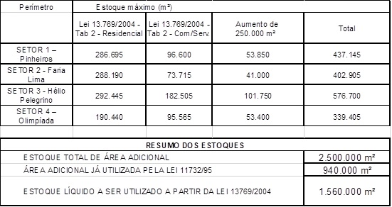

LEI Nº 13.769, DE 26 DE JANEIRO DE 2004

([Projeto de Lei nº 493/03](http://documentacao.camara.sp.gov.br/iah/fulltext/projeto/PL0493-2003.pdf), do Executivo, aprovado na forma do Substitutivo do Legislativo)

Altera a [Lei nº 11.732, de 14 de março de 1995](http://legislacao.prefeitura.sp.gov.br/leis/lei-11732-de-14-de-marco-de-1995), que estabelece programa de melhorias para a área de influência definida em função da interligação da Avenida Brigadeiro Faria Lima com a Avenida Pedroso de Moraes e com as Avenidas Presidente Juscelino Kubitschek, Hélio Pellegrino, dos Bandeirantes, Engº Luis Carlos Berrini e Cidade Jardim, adequando-a à [Lei Federal nº 10.257, de 10 de julho de 2001](http://www.planalto.gov.br/ccivil_03/leis/leis_2001/l10257.htm) (Estatuto da Cidade).

MARTA SUPLICY, Prefeita do Município de São Paulo, no uso das atribuições que lhe são conferidas por lei, faz saber que a Câmara Municipal, em sessão de 19 de dezembro de 2003, decretou e eu promulgo a seguinte lei:

CAPÍTULO I

CONCEITUAÇÃO

Art. 1º - Fica aprovada a Operação Urbana Consorciada Faria Lima, compreendendo um conjunto integrado de intervenções coordenadas pela Prefeitura, por intermédio da Empresa Municipal de Urbanização - EMURB, com a participação dos proprietários, moradores, usuários e investidores em geral, visando a melhoria e a valorização ambiental da área de influência definida em função da implantação do sistema viário de interligação da Avenida Brigadeiro Faria Lima e a Avenida Pedroso de Moraes e com as Avenidas Presidente Juscelino Kubitschek, Hélio Pellegrino, dos Bandeirantes, Engº Luis Carlos Berrini e Cidade Jardim.

§ 1º - A área objeto da Operação Urbana Faria Lima é a contida e delimitada pelo perímetro assinalado na planta nº FL017B001 que deverá integrar o arquivo da Empresa Municipal de Urbanização - EMURB, constante do Anexo 1 desta lei, descrito a seguir: começa no ponto situado na Avenida Cidade Jardim distante 50,00 (cinqüenta) metros de sua confluência com a Avenida Brigadeiro Faria Lima, segue em linha paralela à Avenida Brigadeiro Faria Lima até a Rua Henrique Monteiro, Rua Henrique Monteiro, Rua Bianchi Bertoldi, Rua Artur de Azevedo, Rua Cunha Gago, Rua Padre Garcia Velho, Avenida Pedroso de Moraes, Avenida Professor Frederico Hermann Junior, Avenida das Nações Unidas, Ponte Eusébio Matoso, Rua Gerivativa, Rua Magalhães de Castro, Rua Desembargador Armando Fairbanks, Avenida Valdemar Ferreira, Praça Jorge de Lima, Avenida Eusébio Matoso, Rua Bento Frias, Rua Henrique da Cunha, Ponte Eusébio Matoso, Avenida das Nações Unidas, Rua Hungria, Avenida das Nações Unidas, Avenida dos Bandeirantes, Rua do Cabo Verde, Avenida Santo Amaro, Avenida Graúna, Rua Pintassilgo, Rua Indiaroba, Avenida Jacutinga, Rua Tuim, Avenida Lavandisca, Rua Inhambu, Avenida Ministro Gabriel de Resende Passos, Rua Canário, Avenida República do Líbano, Avenida IV Centenário, Rua Vasco Crevatin, Rua Diogo Jácome, Rua Balthazar da Veiga, Rua Escobar Ortiz, Rua Afonso Brás, Rua Barra do Peixe, Rua Gararu, Rua Coronel Artur Paula Ferreira, Rua Valois de Castro, Rua Marcos Lopes, Rua Monte Aprazível, Rua Natividade, Avenida Santo Amaro, Rua Tenente Negrão, Rua Dr. Renato Paes de Barros, Avenida Presidente Juscelino Kubitschek, Rua Leopoldo Couto de Magalhães Junior, Rua Clodomiro Amazonas, Rua Joaquim Floriano, Rua Iguatemi, Avenida Brigadeiro Faria Lima, Avenida Cidade Jardim, até o ponto inicial.

§ 2º - Para os efeitos da presente Operação Urbana, ficam excluídas da área descrita no parágrafo anterior as zonas Z8-AV8 - Esporte Clube Pinheiros e Z8-AV8 - Associação Atlética "A Hebraica" e a parte da zona de uso Z1-013, contida entre a faixa de 50,00 (cinqüenta) metros lindeira à Avenida Brigadeiro Faria Lima e a faixa de 50,00 (cinqüenta) metros, lindeira à Rua Hungria, entre a Rua Dr. Alberto Cardoso de Mello Neto e a Avenida Rebouças.

§ 3º - Para os efeitos da presente Operação Urbana, os lotes parcialmente contidos nas faixas lindeiras à Rua Hungria e ao Corredor Z8-CR3 da Avenida Faria Lima serão considerados como integrantes da mesma.

~~§ 4º - Para os efeitos da presente Operação Urbana Consorciada, fica excluída da área descrita no parágrafo primeiro deste artigo, a parte remanescente da zona de uso Z9-022 não contida na faixa de 90,00 (noventa) metros de profundidade contados a partir de seu alinhamento, lindeira à Av. Presidente Jucelino Kubitschek, e situada entre as Ruas Clodomiro Amazonas e Ramos Batista.~~

§ 4º Para os efeitos da presente Operação Urbana Consorciada, fica excluída da área descrita no parágrafo primeiro deste artigo, a parte remanescente da antiga zona de uso Z9-022 exceto as faixas:(Redação dada pela [Lei nº 18.175/2024](https://legislacao.prefeitura.sp.gov.br/leis/lei-18175-de-25-de-julho-de-2024))

I – De 90,00 (noventa) metros de profundidade contados a partir de seu alinhamento, lindeira à Avenida Presidente Juscelino Kubitschek, e situada entre as Ruas Clodomiro Amazonas e Ramos Batista;(Incluído pela [Lei nº 18.175/2024](https://legislacao.prefeitura.sp.gov.br/leis/lei-18175-de-25-de-julho-de-2024))

II – De 90,00 (noventa) metros de cada lado da Avenida Faria Lima, medidas do alinhamento da Avenida Faria Lima, no trecho compreendido entre o ponto distante 90,00 (noventa) metros da Avenida Juscelino Kubitschek até, pelo lado par a Rua Fiandeiras e pelo lado ímpar a Rua Santa Justina.(Incluído pela [Lei nº 18.175/2024](https://legislacao.prefeitura.sp.gov.br/leis/lei-18175-de-25-de-julho-de-2024))

§ 5º Para efeito da presente Operação Urbana Consorciada, fica criado o perímetro expandido composto pelas seguintes áreas, delimitadas no Mapa 4 anexo à [Lei nº 16.050, de 31 de julho de 2014](https://legislacao.prefeitura.sp.gov.br/leis/lei-16050-de-31-de-julho-de-2014):(Incluído pela [Lei nº 18.175/2024](https://legislacao.prefeitura.sp.gov.br/leis/lei-18175-de-25-de-julho-de-2024))

1. ZEIS-1/W044 (BT) - Favela do Real Parque;(Incluído pela [Lei nº 18.175/2024](https://legislacao.prefeitura.sp.gov.br/leis/lei-18175-de-25-de-julho-de-2024))

2. ZEIS-1/W043 (BT) - Favela Panorama;(Incluído pela [Lei nº 18.175/2024](https://legislacao.prefeitura.sp.gov.br/leis/lei-18175-de-25-de-julho-de-2024))

3. ZEIS-1/W050 (CL) - Favela Paraisópolis;(Incluído pela [Lei nº 18.175/2024](https://legislacao.prefeitura.sp.gov.br/leis/lei-18175-de-25-de-julho-de-2024))

4. ZEIS-1/045 (BT) - Favela Jardim Colombo;(Incluído pela [Lei nº 18.175/2024](https://legislacao.prefeitura.sp.gov.br/leis/lei-18175-de-25-de-julho-de-2024))

5. ZEIS-1/W046, ZEIS-1/W047 e ZEIS-1/W048 (BT) - Favela Porto Seguro.(Incluído pela [Lei nº 18.175/2024](https://legislacao.prefeitura.sp.gov.br/leis/lei-18175-de-25-de-julho-de-2024))

§ 6º Para as áreas integrantes do perímetro expandido, mencionadas no § 5º, prevalecem as disposições das [Leis nº 16.050, de 31 de julho de 2014](https://legislacao.prefeitura.sp.gov.br/leis/lei-16050-de-31-de-julho-de-2014), e [nº 16.402, de 22 de março de 2016](https://legislacao.prefeitura.sp.gov.br/leis/lei-16402-de-22-de-marco-de-2016), ou daquelas que vierem a substituí-las, sendo esses perímetros destinados exclusivamente para a recepção de investimentos relacionados a provisão habitacional, melhoramentos e reurbanização, incluindo-se a melhoria dos sistemas existentes e implantação de novos sistemas de transporte coletivo, nos termos do disposto no parágrafo único do Art. 5º da [Lei nº 13.769, de 2004](https://legislacao.prefeitura.sp.gov.br/leis/lei-13769-de-26-de-janeiro-de-2004).(Incluído pela [Lei nº 18.175/2024](https://legislacao.prefeitura.sp.gov.br/leis/lei-18175-de-25-de-julho-de-2024))

Art. 2º - Para os efeitos da Operação Urbana Faria Lima, considera-se potencial adicional de construção a área de construção computável passível de ser acrescida à permitida pela legislação vigente e que poderá ser outorgada nos termos desta lei.

§ 1º - Para os efeitos da Operação Urbana Faria Lima, considera-se modificação de uso a possibilidade de se obter, mediante contrapartida, a alteração de usos não conformes com a legislação vigente na data da promulgação desta lei e que passam a ser admitidos conforme condições estabelecidas nos termos desta Operação Urbana.

§ 2º - Para os efeitos desta lei consideram-se parâmetros urbanísticos, a Taxa de Ocupação e o Gabarito da edificação.

§ 3º - Fica assegurada aos proprietários de imóveis contidos no perímetro referido em seu artigo 1º a opção de utilizar os benefícios concedidos nos termos desta lei, ou as disposições da legislação vigente na data de entrada do pedido.

Art. 3º - Com o objetivo de tratar de forma diferenciada as desigualdades existentes na região e privilegiando as funções urbanas relacionadas com a distribuição espacial da população, das atividades econômicas e sociais, da oferta de infra-estrutura e de serviços urbanos, são criados os seguintes setores:

I - Setor 1 Pinheiros: inicia-se no cruzamento da Avenida Eusébio Matoso e Avenida Rebouças com a Av. Brigadeiro Faria Lima, segue em linha paralela à Avenida Brigadeiro Faria Lima até a Rua Henrique Monteiro, Rua Henrique Monteiro, Rua Bianchi Bertoldi, Rua Artur de Azevedo, Rua Cunha Gago, Rua Padre Garcia Velho, Avenida Pedroso de Moraes, Avenida Professor Frederico Hermann Junior, Avenida das Nações Unidas, Ponte Eusébio Matoso, Rua Gerivativa, Rua Magalhães de Castro, Rua Desembargador Armando Fairbanks, Avenida Valdemar Ferreira, Praça Jorge de Lima, Avenida Eusébio Matoso, Rua Bento Frias, Rua Henrique da Cunha, Ponte Eusébio Matoso, Avenida Eusébio Matoso até o ponto inicial;

II - Setor 2 Faria Lima: inicia-se no cruzamento da Avenida Eusébio Matoso com a Avenida Nações Unidas, segue em linha paralela à Avenida das Nações Unidas, Rua Hungria, Avenida das Nações Unidas, Av. Presidente Juscelino Kubitschek, Av. Brigadeiro Faria Lima, Av. Eusébio Matoso até o ponto inicial;

III - Setor 3 Hélio Pelegrino: inicia-se no cruzamento da Avenida dos Bandeirantes com a Rua Cabo Verde, segue pela Rua Cabo Verde, Avenida Santo Amaro, Avenida Graúna, Rua Pintassilgo, Rua Indiaroba, Avenida Jacutinga, Rua Tuim, Avenida Lavandisca, Rua Inhambu, Avenida Ministro Gabriel de Resende Passos, Rua Canário, Avenida República do Líbano, Avenida IV Centenário, Rua Vasco Crevatin, Rua Diogo Jácome, Rua Balthazar da Veiga, Rua Escobar Ortiz, Rua Afonso Brás, Rua Barra do Peixe, Rua Guararu, Rua Paula Ferreira, Rua Valois de Castro, Rua Marcos Lopes, Rua Monte Aprazível, Rua Natividade, Avenida Santo Amaro, Rua Tenente Negrão, Rua Dr. Renato Paes de Barros, Avenida Presidente Juscelino Kubitschek, Rua Leopoldo Couto de Magalhães Junior, Rua Clodomiro Amazonas, Rua Joaquim Floriano, Rua Iguatemi, Avenida Brigadeiro Faria Lima, Av. Presidente Juscelino Kubitschek, Rua Clodomiro Amazonas, Rua Comendador Miguel Calfat, Rua Professor Atílio Innocenti, Rua Fiandeiras, Rua Nova Cidade, Rua Alvorada, Rua Dr. Manoel da Rocha, Avenida dos Bandeirantes até o ponto inicial;

IV - Setor 4 Olimpíadas: inicia-se no cruzamento da Avenida Presidente Juscelino Kubitschek com a Avenida das Nações Unidas, segue em linha paralela com a Avenida das Nações Unidas, Avenida dos Bandeirantes, Rua Dr. Manoel da Rocha, Rua Alvorada, Rua Nova Cidade, Rua Fiandeiras, Rua Professor Atílio Innocenti, Rua Comendador Miguel Calfat, Rua Clodomiro Amazonas, Avenida Juscelino Kubitschek até o ponto inicial.

CAPÍTULO II

OBJETIVOS E DIRETRIZES

Art. 4º - A Operação Urbana Consorciada Faria Lima tem por objetivos específicos:

I - criar condições efetivas para que os investidores e proprietários de imóveis beneficiados com a implantação dos melhoramentos mencionados a seguir forneçam os recursos necessários à sua viabilização, sem qualquer ônus para a municipalidade:

a) melhoramentos ainda não implantados, constantes do plano aprovado pela Lei nº 7.104, de 3 de janeiro de 1968, desde a Avenida Pedroso de Moraes até a confluência da Rua Nova Cidade com a Avenida Hélio Pellegrino;

b) melhoramentos ainda não implantados, constantes do plano aprovado pela [Lei nº 8.126, de 27 de setembro de 1974](http://legislacao.prefeitura.sp.gov.br/leis/lei-8126-de-27-de-setembro-de-1974), e referentes a interligação da Avenida Cidade Jardim com a Avenida dos Bandeirantes;

c) melhoramentos referentes a planos de integração e interligação do sistema viário, situados dentro do perímetro da Operação Urbana e constantes de leis em vigor;

d) obras, equipamentos públicos e áreas verdes contidos no perímetro da Operação Urbana;

II - criar alternativas para que os proprietários de lote parcial ou totalmente atingidos por melhoramentos aprovados possam receber o valor justo de indenização, à vista e previamente e, ainda, para que possam, efetivamente, participar da valorização decorrente da concretização da Operação Urbana;

III - melhorar, na área objeto da Operação Urbana, a qualidade de vida de seus atuais e futuros moradores, inclusive de habitação subnormal, e de usuários, promovendo a valorização da paisagem urbana e a melhoria da infra-estrutura e da qualidade ambiental;

IV - incentivar o melhor aproveitamento dos imóveis, em particular dos não construídos ou subutilizados;

V - ampliar e articular os espaços de uso público, em particular os arborizados e destinados à circulação e bem-estar dos pedestres.

Art. 5º - A Operação Urbana Consorciada Faria Lima tem como diretrizes urbanísticas:

I - complementação e integração do sistema viário existente na região com o macro sistema de circulação da Zona Sul, de forma a possibilitar a distribuição adequada dos fluxos de tráfego gerados pela Ponte Bernardo Goldfarb, pelo túnel sob o Rio Pinheiros, pelos corredores de ônibus e, ainda, pela implantação dos projetos de transporte de massa, elaborados pelo Metrô e pela Companhia Paulista de Trens Metropolitanos - CPTM, para atendimento dos usuários da região;

II - abertura de espaços de uso público, compatíveis com a dinâmica de desenvolvimento da região, dimensionados de forma a possibilitar a criação de áreas de lazer e de circulação segura para pedestres e de vias que permitam a priorização do transporte coletivo sobre o individual;

III - criação de condições ambientais diferenciadas para os novos espaços públicos obtidos, mediante a implantação de arborização, mobiliário urbano e comunicação visual adequados;

IV - uso do solo das propriedades públicas ou privadas compatível com a conformação das novas quadras criadas pela implantação das melhorias viárias e de infra-estrutura;

V - criação de condições para ampliação da oferta de habitações multifamiliares em áreas de melhor qualidade ambiental, de forma a possibilitar o atendimento do maior número de interessados;

VI - estímulo ao remembramento de lotes de uma mesma quadra e ao adensamento, sem prejuízo da qualidade ambiental, respeitado o coeficiente de aproveitamento máximo de 4,0 (quatro);

VII - interligação de quadras e de edificações dentro de uma mesma quadra mediante o uso dos espaços aéreo e subterrâneo inclusive dos logradouros públicos;

VIII - incentivo a usos diferenciados nas áreas contidas no perímetro da Operação Urbana, com ocupação do pavimento térreo para fins comerciais até o máximo de 70% (setenta por cento) da área do lote;

IX - estímulo ao uso residencial em áreas específicas, com taxa de ocupação máxima de 70% (setenta por cento) da área do lote;

X - criação de áreas verdes, ciclovias e adoção de mecanismos que possibilitem a absorção e o escoamento das águas pluviais;

XI - provisão de Habitação de Interesse Social, melhoramentos e reurbanização em locais definidos pelos órgãos competentes da municipalidade, destinada à população favelada residente na área da Operação Urbana e região do seu entorno;

XII - atendimento da população residente em áreas objeto de desapropriação, interessada em continuar morando na região, através do financiamento para aquisição de habitações multifamiliares já construídas ou que venham a ser construídas com recursos da Operação Urbana;

XIII - ampliação das áreas de estacionamento destinadas aos usos comerciais e de serviços.

Parágrafo único - A provisão de habitação de interesse social poderá ser realizada por meio de soluções habitacionais que assegurem o reassentamento da população favelada de que trata o inciso XI deste artigo, através de:

a) carta de crédito;

b) alienação de Habitação de Interesse Social;

c) alienação de Habitação do Mercado Popular (HMP);

d) locação social;

e) outras soluções, mediante aprovação do Conselho Municipal de Habitação.

f) a provisão de Habitação de Interesse Social, com recursos provenientes desta Lei e para atendimento das intervenções nela previstas, poderá ocorrer através do Programa Pode Entrar - Aquisição, mediante colaboração intersecretarial, respeitados os termos da [Lei nº 17.638, de 9 de setembro de 2021](https://legislacao.prefeitura.sp.gov.br/leis/lei-17638-de-9-de-setembro-de-2021); (Incluído pela [Lei nº 18.211/2024](https://legislacao.prefeitura.sp.gov.br/leis/lei-18211-de-27-de-dezembro-de-2024))

XIV – construção de equipamentos públicos e comunitários de saúde e educação, de acordo com a demanda indicada pelas secretarias competentes, na área da presente Operação Urbana, e na região de seu entorno, de acordo com as seguintes prioridades de atendimento:(Incluído pela [Lei nº 18.175/2024](https://legislacao.prefeitura.sp.gov.br/leis/lei-18175-de-25-de-julho-de-2024))

a) Favela da Rua Coliseu;(Incluído pela [Lei nº 18.175/2024](https://legislacao.prefeitura.sp.gov.br/leis/lei-18175-de-25-de-julho-de-2024))

b) Favela do Real Parque;(Incluído pela [Lei nº 18.175/2024](https://legislacao.prefeitura.sp.gov.br/leis/lei-18175-de-25-de-julho-de-2024))

c) Favela Panorama;(Incluído pela [Lei nº 18.175/2024](https://legislacao.prefeitura.sp.gov.br/leis/lei-18175-de-25-de-julho-de-2024))

d) Favela Paraisópolis;(Incluído pela [Lei nº 18.175/2024](https://legislacao.prefeitura.sp.gov.br/leis/lei-18175-de-25-de-julho-de-2024))

e) Favela Jardim Colombo;(Incluído pela [Lei nº 18.175/2024](https://legislacao.prefeitura.sp.gov.br/leis/lei-18175-de-25-de-julho-de-2024))

f) Favela Porto Seguro;(Incluído pela [Lei nº 18.175/2024](https://legislacao.prefeitura.sp.gov.br/leis/lei-18175-de-25-de-julho-de-2024))

XV – Melhorias nas condições de infraestrutura urbana e transportes existentes e implantação de novos sistemas de transporte coletivo, inclusive no perímetro expandido;(Incluído pela [Lei nº 18.175/2024](https://legislacao.prefeitura.sp.gov.br/leis/lei-18175-de-25-de-julho-de-2024))

XVI – urbanização de favelas, inclusive no perímetro expandido;(Incluído pela [Lei nº 18.175/2024](https://legislacao.prefeitura.sp.gov.br/leis/lei-18175-de-25-de-julho-de-2024))

XVII – ampliação de áreas verdes, abarcando ações necessárias para a implantação de áreas verdes lindeiras e parques, bem como compensação ambiental, inclusive no perímetro expandido;(Incluído pela [Lei nº 18.175/2024](https://legislacao.prefeitura.sp.gov.br/leis/lei-18175-de-25-de-julho-de-2024))

XVIII – melhoramentos viários, inclusive no perímetro expandido.(Incluído pela [Lei nº 18.175/2024](https://legislacao.prefeitura.sp.gov.br/leis/lei-18175-de-25-de-julho-de-2024))

CAPÍTULO III

MEIOS E RECURSOS

~~Art. 6º - Fica o Executivo autorizado a efetuar, de forma onerosa, a outorga de potencial adicional de construção, alteração de usos e parâmetros urbanísticos, estabelecidos na legislação de uso e ocupação do solo vigente na data da promulgação desta lei, nos lotes contidos no perímetro definido no artigo 1º desta lei, na conformidade dos valores, critérios e condições nesta estabelecidos, como forma de obtenção dos meios e recursos destinados à Empresa Municipal de Urbanização - EMURB, para a realização da Operação Urbana Consorciada Faria Lima.~~

~~Art. 6º. Fica o Executivo autorizado a efetuar, de forma onerosa, a outorga de potencial adicional de construção, alteração de usos e parâmetros urbanísticos, estabelecidos na legislação de uso e ocupação do solo vigente à data de protocolamento do processo, nos lotes contidos no perímetro definido no artigo 1º. desta lei, na conformidade dos valores, critérios e condições nesta estabelecidos, como forma de obtenção dos meios e recursos destinados à Empresa Municipal de Urbanização - EMURB, para realização da Operação Urbana Faria Lima.(Redação dada pela [Lei nº 13.885/2004](http://legislacao.prefeitura.sp.gov.br/leis/lei-13885-de-25-de-agosto-de-2004))~~

~~Parágrafo único - O total de potencial adicional de construção, outorgado para utilização nos lotes contidos no interior do perímetro descrito do artigo 1º, fica limitado a 2.250.000 (dois milhões, duzentos e cinqüenta mil) metros quadrados, devendo ser deduzidos todos os metros quadrados de outorga de adicional de construção aprovados até a data de aprovação da presente lei, de acordo com a Tabela 2 do artigo 8º desta lei.~~

Art. 6º Fica o Executivo autorizado a efetuar, de forma onerosa, a outorga de potencial adicional de construção, alteração de usos e parâmetros urbanísticos, estabelecidos na legislação de uso e ocupação do solo vigente à data de protocolamento do processo, nos lotes contidos no perímetro de abrangência definido nos parágrafos 1º ao 4º do art. 1º desta Lei, na conformidade dos valores, critérios e condições nesta estabelecidos, como forma de obtenção dos meios e recursos destinados para conta específica da Operação Urbana Consorciada Faria Lima junto à SP Urbanismo, para realização da Operação Urbana Consorciada Faria Lima.(Redação dada pela [Lei nº 18.175/2024](https://legislacao.prefeitura.sp.gov.br/leis/lei-18175-de-25-de-julho-de-2024))

§ 1º O total de potencial adicional de construção, outorgado para utilização nos lotes contidos no interior do perímetro descrito nos §§ 1º a 4º do Art. 1º fica limitado a 2.500.000 (dois milhões e quinhentos mil) metros quadrados, autorizados pelo EIA-RIMA, como originalmente previsto no estudo, devendo ser deduzidos todos os metros quadrados de área adicional de construção já outorgados conforme dispositivos da [Lei nº 11.732, de 1995](https://legislacao.prefeitura.sp.gov.br/leis/lei-11732-de-14-de-marco-de-1995) e até a data da presente Lei, no âmbito da [Lei nº 13.769, de 2004](https://legislacao.prefeitura.sp.gov.br/leis/lei-13769-de-26-de-janeiro-de-2004).(Renumerado pela [Lei nº 18.175/2024](https://legislacao.prefeitura.sp.gov.br/leis/lei-18175-de-25-de-julho-de-2024))

§ 2º O estoque líquido a ser utilizado para outorga de potencial adicional de construção no âmbito da [Lei nº 13.769, de 2004](https://legislacao.prefeitura.sp.gov.br/leis/lei-13769-de-26-de-janeiro-de-2004), modificada pela [Lei nº 13.781, de 2004](https://legislacao.prefeitura.sp.gov.br/leis/lei-13781-de-11-de-fevereiro-de-2004), passa a ser de 1.560.000m² (Um milhão quinhentos e sessenta mil metros quadrados), correspondentes aos 2.500.000m² (dois milhões e quinhentos mil metros quadrados) autorizados pelo EIA, descontados o estoque de 940.000m² (novecentos e quarenta mil metros quadrados) consumidos na vigência da [lei 11.732, 1995](https://legislacao.prefeitura.sp.gov.br/leis/lei-11732-de-14-de-marco-de-1995).(Incluído pela [Lei nº 18.175/2024](https://legislacao.prefeitura.sp.gov.br/leis/lei-18175-de-25-de-julho-de-2024))

§ 3º O estoque de 250.000m² (duzentos e cinquenta mil metros quadrados) autorizados pela presente Lei ficam distribuídos pelos setores da OUCFL, conforme abaixo descrito, e poderá ser utilizado para os usos: Residencial e não Residencial.(Incluído pela [Lei nº 18.175/2024](https://legislacao.prefeitura.sp.gov.br/leis/lei-18175-de-25-de-julho-de-2024))

a) Setor 1 – Pinheiros – 53.850m² (cinquenta e três mil, oitocentos e cinquenta metros quadrados);

b) Setor 2 - Faria Lima – 41.000m² (quarenta e um mil metros quadrados);

c) Setor 3 – Hélio Pelegrino – 101.750m² (cento e um mil, setecentos e cinquenta metros quadrados);

d) Setor 4 - Olimpíadas – 53.400m² (cinquenta e três mil e quatrocentos metros quadrados.

Art. 7º - A contrapartida da outorga onerosa do potencial adicional de construção, modificação de uso e parâmetros urbanísticos prevista no artigo 6º desta lei, somente será realizada através de Certificados de Potencial Adicional de Construção - CEPAC, nos termos definidos no artigo 8º desta lei.

§ 1º - Os certificados mencionados neste artigo serão emitidos sob a denominação "Certificado de Potencial Adicional de Construção - CEPAC", que serão convertidos, na ocasião desejada por seu detentor, em quantidade de metros quadrados de área adicional de construção computável no caso de aumento de potencial construtivo, e/ou em metros quadrados de terreno para efeitos de benefícios relativos a usos e parâmetros urbanísticos conforme estipulado nesta lei, estabelecidos em função de sua aplicação em lote específico, contido no perímetro definido no artigo 1º e de acordo com a Tabela 1 do artigo 8º desta lei.

§ 2º - O valor mínimo estabelecido para cada Certificado de Potencial Adicional de Construção - CEPAC, é de R$ 1.100,00 (mil e cem reais) podendo ser reajustado pela Empresa Municipal de Urbanização - EMURB, ouvindo-se a Secretaria Municipal de Planejamento Urbano - SEMPLA e a Câmara Técnica de Legislação Urbana - CTLU.

§ 3º - O pagamento do valor da venda dos Certificados de Potencial Adicional de Construção - CEPAC, poderá ser recebido pela Empresa Municipal de Urbanização - EMURB à vista ou parceladamente, sendo neste caso, no mínimo 15% (quinze por cento) à vista, e o saldo restante em até 10 (dez) prestações mensais, iguais e consecutivas, devidamente corrigidas por índice oficial a ser definido pela Empresa Municipal de Urbanização - EMURB, desde que seja apresentada fiança bancária como garantia correspondente ao valor do saldo devedor.

§ 4º - Os Certificados referidos neste artigo deverão ser alienados em leilão público, na forma que venha a ser determinado pela EMURB ou, utilizados para o pagamento de projetos, desapropriações, gerenciamento e obras previstas no Programa de Investimentos da presente Operação Urbana.

§ 5º - Para expedição de Alvará de Aprovação e Execução do Projeto, ou para a aplicação no disposto no parágrafo 3º do artigo 230 da [Lei nº 13.430/02](http://legislacao.prefeitura.sp.gov.br/leis/lei-13430-de-01-de-setembro-de-2002) (Plano Diretor Estratégico), somente serão aceitos Certificados de Potencial Adicional de Construção - CEPAC's quitados, ou que apresentem garantia de pagamento aceita pela Empresa Municipal de Urbanização - EMURB nos termos do parágrafo 3º deste artigo.

§ 6º - Antes da expedição do Alvará de Aprovação, a Secretaria de Habitação e Desenvolvimento Urbano - SEHAB, comunicará à EMURB e ao interessado a memória de cálculo da outorga onerosa e a equivalência em quantidade de CEPAC's necessários para o pagamento da contrapartida.

~~Art. 8º - Fica autorizado o Executivo a emitir até 650.000 (seiscentos e cinqüenta mil) Certificados de Potencial Adicional de Construção - CEPAC, obedecendo sempre o limite total de metros quadrados de construção estabelecidos na Tabela 2 deste artigo, para a outorga onerosa de potencial adicional de construção, modificação de uso e parâmetros urbanísticos, que serão convertidos de acordo com a Tabela 1 deste artigo de equivalência a seguir descrita:~~

~~Art. 8º. O Executivo fica autorizado a emitir até 1.000.000 (um milhão) de Certificados de Potencial Adicional de Construção - CEPAC, obedecendo sempre o limite total de metros quadrados de construção estabelecidos na Tabela 2 deste artigo, para a outorga onerosa de potencial adicional de construção, modificação de uso e parâmetros urbanísticos, que serão convertidos de acordo com a Tabela 1 deste artigo, de equivalência, a seguir descrita:(Redação dada pela [Lei nº 15.519/2011](http://legislacao.prefeitura.sp.gov.br/leis/lei-15519-de-29-de-dezembro-de-2011))~~

~~[TABELA 1](http://legislacao.prefeitura.sp.gov.br/leis/lei-13769-de-26-de-janeiro-de-2004#anexos)~~

~~[TABELA 2](http://legislacao.prefeitura.sp.gov.br/leis/lei-13769-de-26-de-janeiro-de-2004#anexos)~~

~~Parágrafo único - Para aplicação da Tabela de Equivalência, os setores criados no artigo 3º, ficam subdivididos nos subsetores abaixo descritos, delimitados pelos perimetros constantes da planta nº FL017B002 que deverá integrar o arquivo da Empresa Municipal de Urbanização - EMURB ([Anexo 3](http://legislacao.prefeitura.sp.gov.br/leis/lei-13769-de-26-de-janeiro-de-2004#anexos)).~~

~~Parágrafo único  § 1º Para aplicação da Tabela de Equivalência, os setores criados no art. 3º ficam subdivididos nos subsetores abaixo descritos, delimitados pelos perímetros constantes da planta nº FL017B003A, que integra o Anexo A desta lei e o arquivo da Empresa Municipal de Urbanização - EMURB.(Redação dada pela [Lei nº 13.871/2004](http://legislacao.prefeitura.sp.gov.br/leis/lei-13871-de-8-de-julho-de-2004))(Redação dada pela [Lei nº 15.519/2011](http://legislacao.prefeitura.sp.gov.br/leis/lei-15519-de-29-de-dezembro-de-2011))~~

~~§ 2º. A emissão de Certificados de Potencial Adicional de Construção - CEPAC fica condicionada à existência de saldo no limite total de metros quadrados de construção estabelecidos na Tabela 2 deste artigo, considerando os fatores de conversão previstos na referida tabela.(Incluído pela [Lei nº 15.519/2011](http://legislacao.prefeitura.sp.gov.br/leis/lei-15519-de-29-de-dezembro-de-2011))~~

Art. 8º O Executivo fica autorizado a emitir até 1.000.000 (um milhão) de Certificados de Potencial Adicional de Construção – CEPAC, obedecendo sempre o limite total de metros quadrados de construção estabelecidos na Tabela 2 deste artigo, para a outorga onerosa de potencial adicional de construção, modificação de uso e parâmetros urbanísticos, que serão convertidos de acordo com a Tabela 1 deste artigo, de equivalência a seguir descrita.(Redação dada pela [Lei nº 18.175/2024](https://legislacao.prefeitura.sp.gov.br/leis/lei-18175-de-25-de-julho-de-2024))

<table cellspacing="0" cellpadding="0"><tbody><tr><td colspan="7" nowrap="nowrap"> TABELA 1 - TABELA DE EQUIVALÊNCIA DO CEPAC (Redação dada pela <a href="https://legislacao.prefeitura.sp.gov.br/leis/lei-18175-de-25-de-julho-de-2024">Lei nº 18.175/2024</a>) </td><td> &nbsp; </td></tr><tr><td colspan="2" nowrap="nowrap"> PERÍMETRO </td><td colspan="2" nowrap="nowrap"> COLUNA A </td><td nowrap="nowrap"> COLUNA B </td><td colspan="3" nowrap="nowrap"> COLUNA C </td></tr><tr><td rowspan="2" nowrap="nowrap"> SETOR </td><td rowspan="2" nowrap="nowrap"> SUB SETORES </td><td colspan="2"> Equivalência de 1 CEPAC em m² de área adicional de construção computável </td><td rowspan="2"> Equivalência de 1 CEPAC em m² de área de terreno referente a mudança de uso e parâmetros urbanísticos </td><td colspan="3"> Equivalência de 1 CEPAC em m² de terreno para taxa de ocupação adicional (acima de 50% até 70%) </td></tr><tr><td nowrap="nowrap"> Residencial </td><td nowrap="nowrap"> Com/Serv </td><td nowrap="nowrap"> Residencial </td><td colspan="2" nowrap="nowrap"> Com/Serv </td></tr><tr><td rowspan="4" nowrap="nowrap"> SETOR 1 - Pinheiros </td><td nowrap="nowrap"> 1a (frente F. Lima) </td><td nowrap="nowrap"> 1,2 </td><td nowrap="nowrap"> 0,8 </td><td nowrap="nowrap"> 2 </td><td nowrap="nowrap"> 1,2 </td><td colspan="2" nowrap="nowrap"> 0,8 </td></tr><tr><td nowrap="nowrap"> 1b </td><td nowrap="nowrap"> 1,8 </td><td nowrap="nowrap"> 1,5 </td><td nowrap="nowrap"> 2 </td><td nowrap="nowrap"> 1,8 </td><td colspan="2" nowrap="nowrap"> 1,2 </td></tr><tr><td nowrap="nowrap"> 1c </td><td nowrap="nowrap"> 2,6 </td><td nowrap="nowrap"> 1,7 </td><td nowrap="nowrap"> 2 </td><td nowrap="nowrap"> 2,6 </td><td colspan="2" nowrap="nowrap"> 1,7 </td></tr><tr><td nowrap="nowrap"> 1d </td><td nowrap="nowrap"> 2,8 </td><td nowrap="nowrap"> 1,8 </td><td nowrap="nowrap"> 2 </td><td nowrap="nowrap"> 2,3 </td><td colspan="2" nowrap="nowrap"> 1,5 </td></tr><tr><td rowspan="5" nowrap="nowrap"> SETOR 2 - Faria Lima </td><td> 2a (frente F. Lima, entre Rebouças e C. Jardim) </td><td nowrap="nowrap"> 0,8 </td><td nowrap="nowrap"> 0,5 </td><td nowrap="nowrap"> 1,5 </td><td nowrap="nowrap"> 0,8 </td><td colspan="2" nowrap="nowrap"> 0,5 </td></tr><tr><td> 2b (frente F. Lima, entre C. Jardim e Juscelino) </td><td nowrap="nowrap"> 0,9 </td><td nowrap="nowrap"> 0,6 </td><td nowrap="nowrap"> 1,5 </td><td nowrap="nowrap"> 0,9 </td><td colspan="2" nowrap="nowrap"> 0,6 </td></tr><tr><td> 2c (incluindo frente C. Jardim) </td><td nowrap="nowrap"> 1,1 </td><td nowrap="nowrap"> 0,8 </td><td nowrap="nowrap"> 1,5 </td><td nowrap="nowrap"> 1,2 </td><td colspan="2" nowrap="nowrap"> 0,8 </td></tr><tr><td nowrap="nowrap"> 2d </td><td nowrap="nowrap"> 1,3 </td><td nowrap="nowrap"> 0,5 </td><td nowrap="nowrap"> 1,5 </td><td nowrap="nowrap"> 0,8 </td><td colspan="2" nowrap="nowrap"> 0,5 </td></tr><tr><td nowrap="nowrap"> 2e </td><td nowrap="nowrap"> 1,8 </td><td nowrap="nowrap"> 1,2 </td><td nowrap="nowrap"> 1,5 </td><td nowrap="nowrap"> 1,8 </td><td colspan="2" nowrap="nowrap"> 1 </td></tr><tr><td rowspan="5" nowrap="nowrap"> SETOR 3 - Hélio Pelegrino </td><td nowrap="nowrap"> 3a (frente F. Lima) </td><td nowrap="nowrap"> 1,2 </td><td nowrap="nowrap"> 0,8 </td><td nowrap="nowrap"> 1,5 </td><td nowrap="nowrap"> 1,2 </td><td colspan="2" nowrap="nowrap"> 0,8 </td></tr><tr><td nowrap="nowrap"> 3b (frente Juscelino) </td><td nowrap="nowrap"> 1,2 </td><td nowrap="nowrap"> 1 </td><td nowrap="nowrap"> 1,5 </td><td nowrap="nowrap"> 1,2 </td><td colspan="2" nowrap="nowrap"> 0,8 </td></tr><tr><td nowrap="nowrap"> 3c </td><td nowrap="nowrap"> 2,5 </td><td nowrap="nowrap"> 1 </td><td nowrap="nowrap"> 1,5 </td><td nowrap="nowrap"> 1,5 </td><td colspan="2" nowrap="nowrap"> 1 </td></tr><tr><td nowrap="nowrap"> 3d </td><td nowrap="nowrap"> 1,5 </td><td nowrap="nowrap"> 1 </td><td nowrap="nowrap"> 1,5 </td><td nowrap="nowrap"> 1,5 </td><td colspan="2" nowrap="nowrap"> 1 </td></tr><tr><td nowrap="nowrap"> 3e </td><td nowrap="nowrap"> 2,5 </td><td nowrap="nowrap"> 1,5 </td><td nowrap="nowrap"> 1,5 </td><td nowrap="nowrap"> 2,3 </td><td colspan="2" nowrap="nowrap"> 1,5 </td></tr><tr><td rowspan="4" nowrap="nowrap"> SETOR 4 - Olimpíadas &nbsp; &nbsp; </td><td nowrap="nowrap"> 4a (frente F. Lima) </td><td nowrap="nowrap"> 0,9 </td><td nowrap="nowrap"> 0,6 </td><td nowrap="nowrap"> 2 </td><td nowrap="nowrap"> 0,9 </td><td colspan="2" nowrap="nowrap"> 0,6 </td></tr><tr><td nowrap="nowrap"> 4b </td><td nowrap="nowrap"> 2 </td><td nowrap="nowrap"> 0,9 </td><td nowrap="nowrap"> 2 </td><td nowrap="nowrap"> 1,4 </td><td colspan="2" nowrap="nowrap"> 0,9 </td></tr><tr><td nowrap="nowrap"> 4c </td><td nowrap="nowrap"> 2 </td><td nowrap="nowrap"> 1,2 </td><td nowrap="nowrap"> 2 </td><td nowrap="nowrap"> 1,8 </td><td colspan="2" nowrap="nowrap"> 1,2 </td></tr><tr><td nowrap="nowrap"> 4d </td><td nowrap="nowrap"> 2 </td><td nowrap="nowrap"> 1 </td><td nowrap="nowrap"> 2 </td><td nowrap="nowrap"> 1,5 </td><td colspan="2" nowrap="nowrap"> 1 </td></tr></tbody></table>

<table border="1" cellspacing="0" cellpadding="0" align="center"><tbody><tr><td valign="top">

TABELA 2 - DISTRIBUIÇÃO GERAL DOS ESTOQUES DE ÁREA ADICIONAL DE CONSTRUÇÃO (Redação dada pela <a href="https://legislacao.prefeitura.sp.gov.br/leis/lei-18175-de-25-de-julho-de-2024">Lei nº 18.175/2024</a>)

</td></tr></tbody></table>

§ 1º O aumento de estoque de 250.000m² (duzentos e cinquenta mil metros quadrados) autorizados conforme artigo 7º da presente Lei ficam distribuídos pelos setores da OUCFL, e poderá ser utilizado para os usos: Residencial e não Residencial.(Redação dada pela [Lei nº 18.175/2024](https://legislacao.prefeitura.sp.gov.br/leis/lei-18175-de-25-de-julho-de-2024))

§ 2º Para aplicação da Tabela de Equivalência, os setores criados no Art. 3º ficam subdivididos nos subsetores abaixo descritos, delimitados pelos perímetros constantes da planta nº FL017B003A, que integra o Anexo A da [Lei nº 13.769, de 2004](https://legislacao.prefeitura.sp.gov.br/leis/lei-13769-de-26-de-janeiro-de-2004), e o arquivo da São Paulo Urbanismo – SP Urbanismo.(Redação dada pela [Lei nº 18.175/2024](https://legislacao.prefeitura.sp.gov.br/leis/lei-18175-de-25-de-julho-de-2024))

§ 3º A emissão de Certificados de Potencial Adicional de Construção - CEPAC fica condicionada à existência de saldo no limite total de metros quadrados de construção estabelecidos na Tabela 2 deste artigo, considerando os fatores de conversão previstos na referida Tabela 2.(Incluído pela [Lei nº 18.175/2024](https://legislacao.prefeitura.sp.gov.br/leis/lei-18175-de-25-de-julho-de-2024))

§ 3º Caberá à São Paulo Urbanismo, ouvido Grupo de Gestão definido no Art. 17 desta Lei, a decisão sobre eventual ajuste do estoque de potencial construtivo adicional, disponibilizado nesta Lei, para o uso residencial, respeitado o percentual dentro de cada setor, previsto na Tabela 2.(Incluído pela [Lei nº 18.175/2024](https://legislacao.prefeitura.sp.gov.br/leis/lei-18175-de-25-de-julho-de-2024))

§ 4º Nos casos de reforma com aumento de área, o cálculo da quantidade de CEPAC por m² de área computável adicional considerará a área computável regular existente no empreendimento como parte da área construída computável total pretendida (Ac).(Incluído pela [Lei nº 18.175/2024](https://legislacao.prefeitura.sp.gov.br/leis/lei-18175-de-25-de-julho-de-2024))

SETOR 1

PINHEIROS

Subsetor 1a: corresponde aos lotes com frente para a Av. Faria Lima.

Subsetor 1b: inicia no cruzamento da Av. Faria Lima com a Rua Teodoro Sampaio, segue pela Rua Teodoro Sampaio até a Rua Cunha Gago, Rua Artur de Azevedo, Rua Bianchi Bertoldi, Rua Henrique Monteiro, Avenida Rebouças, Avenida Faria Lima até o ponto inicial.

~~Subsetor 1c: inicia no cruzamento da Avenida Professor Frederico Hermann Junior com a Rua Natingui, segue pela Rua Natingui, Rua Vupabussu, Rua Ferreira de Araújo, Rua Padre Bento Dias Pacheco, Rua Padre Carvalho, Rua Paes Leme, Rua Capri, Avenida das Nações Unidas, Avenida Eusébio Matoso, Rua Cardeal Arco Verde, Rua dos Cariris, Rua Cláudio Soares, Avenida Faria Lima, Rua Teodoro Sampaio, Rua Cunha Gago, Rua Pedro Cristi, Avenida Faria Lima, Rua Coropés, Avenida Pedroso de Moraes, Avenida Professor Hermann Junior até o ponto inicial.~~

Subsetor 1c: inicia no cruzamento da Avenida Professor Frederico Hermann Junior com a Rua Natingui, segue pela Rua Natingui, Rua Vupabussu, Rua Ferreira de Araújo, Rua Marcos de Azevedo, Rua Padre Carvalho, Rua Paes Leme, Rua Capri, Avenida das Nações Unidas, Avenida Eusébio Matoso, Rua Cardeal Arco Verde, Rua dos Cariris, Rua Cláudio Soares, Avenida Faria Lima, Rua Teodoro Sampaio, Rua Cunha Gago, Rua Pedro Cristi, Avenida Faria Lima, Rua Coropés, Avenida Pedroso de Moraes, Avenida Professor Hermann Junior até o ponto inicial.(Redação dada pela [Lei nº 13.871/2004](http://legislacao.prefeitura.sp.gov.br/leis/lei-13871-de-8-de-julho-de-2004))

Subsetor 1d1: inicia no cruzamento da Av. Professor Frederico Hermann Junior com a Rua Natingui, segue pela Rua Natingui até a Rua Vupabussu, Rua Ferreira de Araújo, Rua Marcos de Azevedo, Rua Padre Carvalho, Rua Paes Leme, Rua Capri, Avenida das Nações Unidas, Avenida Professor Frederico Hermann Junior até o ponto inicial.

Subsetor 1d2: inicia no cruzamento da Avenida das Nações Unidas com a ponte Eusébio Matoso, segue pela Ponte Eusébio Matoso, Rua Gerivativa, Rua Magalhães de Castro, Rua Desembargador Armando Fairbanks, Avenida Valdemar Ferreira, Praça Jorge de Lima, Avenida Eusébio Matoso, Rua Bento Frias, Rua Henrique da Cunha, Ponte Eusébio Matoso até o ponto inicial.

Subsetor 1d3: inicia no cruzamento da Rua Coropés com Avenida Pedroso de Moraes, segue pela Avenida Pedroso de Moraes, Rua Padre Garcia Velho, Rua Cunha Gago, Rua Pedro Cristi, Avenida Faria Lima, Rua Coropés até o ponto inicial.

Subsetor 1d4: inicia no cruzamento da Rua Teodoro Sampaio com a Avenida Faria Lima, segue pela Avenida Faria Lima até a Avenida Eusébio Matoso, Rua Cardeal Arco Verde, Rua dos Cariris, Rua Cláudio Soares até o ponto inicial.

SETOR 2

FARIA LIMA

Subsetor 2a: corresponde aos imóveis integrantes da faixa de 50,00 (cinqüenta) metros, lindeira à Avenida Faria Lima, descrita no artigo 1º desta lei, no trecho compreendido entre a Avenida Cidade Jardim e Avenida Rebouças/Avenida Eusébio Matoso.

Subsetor 2b: corresponde aos imóveis com frente para a Avenida Faria Lima no trecho compreendido entre a Av. Juscelino Kubitschek e Avenida Cidade Jardim.

Subsetor 2c1: compreende todos os imóveis com frente para a Avenida Cidade Jardim em ambos os lados da Avenida.

Subsetor 2c2: inicia no cruzamento da Avenida Faria Lima com a Avenida Cidade Jardim, segue pela Avenida Cidade Jardim, Avenida das Nações Unidas, Rua Dr. Alberto Cardoso de Mello Neto, Rua Dr. Alceu de Assis, Rua Angelina Maffei Vita, Rua Hans Nobiling, Rua Tucumã, Avenida Faria Lima, Rua Angelina Maffei Vita, Rua Ibiapinópolis, Rua Carlos Millan, Praça Yitzhak Rabin, viela existente, Avenida Faria Lima até o ponto inicial.

Subsetor 2d: inicia no cruzamento da Avenida Faria Lima com a Avenida Juscelino Kubitschek, segue pela Avenida Juscelino Kubitschek, Avenida das Nações Unidas, Avenida Cidade Jardim, Avenida Faria Lima até o ponto inicial.

Subsetor 2e: inicia no cruzamento da Avenida Eusébio Matoso com a Avenida das Nações Unidas, segue pela Avenida das Nações Unidas até a Alameda Gabriel Monteiro da Silva, segue numa paralela à Rua Hungria distante a 50,00 (cinqüenta) metros de seu alinhamento, conforme descrito no artigo 1º desta lei, até a Avenida Rebouças, Rua Ibiapinópolis, Avenida Eusébio Matoso até o ponto inicial.

SETOR 3

HÉLIO PELEGRINO

Subsetor 3a: corresponde aos imóveis com frente para a Avenida Faria Lima.

Subsetor 3b: corresponde aos imóveis com frente para a Avenida Juscelino Kubitschek.

~~Subsetor 3c1: inicia no cruzamento da Avenida Juscelino Kubitschek com a Avenida Faria Lima, segue pela Avenida Faria Lima, Rua Iguatemi, Rua Joaquim Floriano, Rua Clodomiro Amazonas, Rua Leopoldo Couto de Magalhães Junior, Avenida Juscelino Kubitschek, Rua Dr. Renato Paes de Barros, Rua Tenente Negrão, Avenida Santo Amaro, Avenida Helio Pelegrino, Rua Nova Cidade, Rua Fiandeiras, Rua Professor Atílio Inocenti, Rua Clodomiro Amazonas, Avenida Juscelino Kubitschek até o ponto inicial.~~

Subsetor 3c: inicia no cruzamento da Avenida Juscelino Kubitschek com a Avenida Faria Lima, segue pela Avenida Faria Lima, Rua Iguatemi, Rua Joaquim Floriano, Rua Clodomiro Amazonas, Rua Leopoldo Couto de Magalhães Junior, Avenida Juscelino Kubitschek, Rua Dr. Renato Paes de Barros, Rua Tenente Negrão, Avenida Santo Amaro, Avenida Helio Pelegrino, Rua Nova Cidade, Rua Fiandeiras, Rua Professor Atílio Inocenti, Rua Comendador Miguel Calfat, Rua Clodomiro Amazonas, Avenida Juscelino Kubitschek até o ponto inicial.(Redação dada pela [Lei nº 13.871/2004](http://legislacao.prefeitura.sp.gov.br/leis/lei-13871-de-8-de-julho-de-2004))

~~Subsetor 3c2: inicia no cruzamento da Rua Afonso Braz com a Rua Escobar Ortiz, segue pela Rua Escobar Ortiz, Rua Baltazar da Veiga, Rua Diogo Jácome, Rua Vasco Crevatin, Avenida IV Centenário, Avenida República do Líbano, Rua Afonso Braz até o ponto inicial.~~

Subsetor 3d: inicia no cruzamento da Rua Afonso Braz com a Avenida República do Líbano, segue pela Avenida República do Líbano, Rua Canário, Rua Ministro Gabriel Rezende Passos, Rua Inhambu, Avenida Lavandisca, Rua Tuim, Avenida Jacutinga, Rua Indiaroba, Rua Pintassilgo, Avenida Graúna, Avenida Santo Amaro, Rua Natividade, Rua Monte Aprazível, Rua Marcos Lopes, Rua Valois de Castro, Rua Coronel Artur de Paula Ferreira, Rua Gararu, Rua Barra do Peixe, Rua Afonso Braz, Rua Escobar Ortiz, Rua Baltazar da Veiga, Rua Diogo Jacome, Rua Vasco Crevatin, Avenida IV Centenário, Avenida República do Líbano, até o ponto inicial.(Redação dada pela [Lei nº 13.871/2004](http://legislacao.prefeitura.sp.gov.br/leis/lei-13871-de-8-de-julho-de-2004))

Subsetor 3d: inicia no cruzamento da Rua Afonso Braz com a Av. República do Líbano, segue pela Avenida República do Líbano, Rua Canário, Rua Ministro Gabriel Rezende Passos, Rua Inhambu, Avenida Lavandisca, Rua Tuim, Avenida Jacutinga, Rua Indiaroba, Rua Pintassilgo, Avenida Graúna, Avenida Santo Amaro, Rua Natividade, Rua Monte Aprazível, Rua Marcos Lopes, Rua Valois de Castro, Rua Coronel Artur de Paula Ferreira, Rua Guararu, Rua Barra do Peixe, Rua Afonso Braz, Avenida República do Líbano até o ponto inicial.

Subsetor 3e: inicia na Avenida Santo Amaro com a Rua Cabo Verde, segue pela Rua Cabo Verde, Avenida dos Bandeirantes, Rua Dr. Manoel da Rocha, Rua Alvorada, Rua Nova Cidade, Avenida Hélio Pelegrino, Avenida Santo Amaro até o ponto inicial.

SETOR 4

OLIMPÍADAS

~~Subsetor 4a: compreende todos os imóveis com frente para a Avenida Faria Lima.~~

~~Subsetor 4b: inicia no cruzamento da Avenida das Nações Unidas com a Avenida Juscelino Kubitschek, seguindo pela Avenida Juscelino Kubitschek, Rua Clodomiro Amazonas, Rua Comendador Miguel Calfat, Rua Professor Atílio Inocenti, Rua Fiandeiras, Avenida Faria Lima, Rua Ministro Jesuíno Cardoso, Rua Ramos Batista, Rua Olimpíadas, Rua Gomes de Carvalho, Rua Tenerife, Avenida dos Bandeirantes, Avenida das Nações Unidas até o ponto inicial.~~

~~Subsetor 4b: inicia no cruzamento da Avenida das Nações Unidas com a Avenida Juscelino Kubitschek, segue pela Avenida Juscelino Kubitschek até a Rua Clodomiro Amazonas, segue pela Rua Clodomiro Amazonas numa distância de 90,00 metros, medida a partir do alinhamento da Avenida Juscelino Kubitschek, segue em linha paralela à Avenida Juscelino Kubitschek até a Rua Ramos Batista, Rua Olimpíadas, Rua Gomes de Carvalho, Rua Tenerife, Avenida dos Bandeirantes, Avenida das Nações Unidas até o ponto inicial.(Redação dada pela [Lei nº 13.871/2004](http://legislacao.prefeitura.sp.gov.br/leis/lei-13871-de-8-de-julho-de-2004))~~

Subsetor 4a: compreende aos imóveis com frente para a Avenida Faria Lima incluídos na faixa de 90,00 (noventa) metros do alinhamento, lindeiro à Av. Presidente Juscelino Kubitschek, e situada entre as Ruas Clodomiro Amazonas e Ramos Batista.(Redação dada pela [Lei nº 18.175/2024](https://legislacao.prefeitura.sp.gov.br/leis/lei-18175-de-25-de-julho-de-2024))

Subsetor 4b: inicia no cruzamento da Avenida das Nações Unidas com a Avenida Juscelino Kubitschek, segue pela Avenida Juscelino Kubitschek até a Rua Clodomiro Amazonas, segue pela Rua Clodomiro Amazonas numa distância de 90,00 (noventa) metros, medida a partir do alinhamento da Avenida Juscelino Kubitschek, segue em linha paralela à Avenida Juscelino Kubitschek até a Rua Ramos Batista, Rua Olimpíadas, Rua Gomes de Carvalho, Rua Tenerife, Avenida dos Bandeirantes, Avenida das Nações Unidas até o ponto inicial, além dos imóveis inseridos nas faixas de 90,00 (noventa) metros de cada lado da Avenida Faria Lima, medidas do alinhamento da Avenida Faria Lima, no trecho compreendido entre o ponto distante 90,00 (noventa) metros da Avenida Juscelino Kubitschek até, pelo lado par a Rua Fiandeiras e pelo lado ímpar a Rua Santa Justina.(Redação dada pela [Lei nº 18.175/2024](https://legislacao.prefeitura.sp.gov.br/leis/lei-18175-de-25-de-julho-de-2024))

Subsetor 4c: inicia na Avenida dos Bandeirantes com a Alameda Vicente Pinzon, segue pela Alameda Vicente Pinzon, Rua Gomes de Carvalho, Rua Lourenço Marques, Rua Casa do Ator, Rua Alvorada, Rua Quatá, Rua Nova Cidade, Rua Alvorada, Rua Doutor Manoel da Rocha, Avenida dos Bandeirantes até o ponto inicial.

~~Subsetor 4d: inicia no cruzamento da Avenida dos Bandeirantes com a Rua Tenerife, segue pela Rua Tenerife, Rua Gomes de Carvalho, Rua Olimpíadas, Rua Ramos Batista, Rua Ministro Jesuíno Cardoso, Avenida Faria Lima, Rua Quatá, Rua Alvorada, Rua Casa do Ator, Rua Lourenço Marques, Rua Gomes de Carvalho, Alameda Vicente Pinzon, Avenida dos Bandeirantes até o ponto inicial.~~

Subsetor 4d: inicia no cruzamento da Avenida dos Bandeirantes com a Rua Tenerife, segue pela Rua Tenerife, Rua Gomes de Carvalho, Rua Olimpíadas, Rua Elvira Ferraz, Rua das Fiandeiras, Avenida Faria Lima, Rua Quatá, Rua Alvorada, Rua Casa do Ator, Rua Lourenço Marques, Rua Gomes de Carvalho, Alameda Vicente Pinzon, Avenida dos Bandeirantes até o ponto inicial.

CAPÍTULO IV

PROGRAMA DE INVESTIMENTOS

E DESAPROPRIAÇÕES

Art. 9º - Fica aprovado o Programa de Investimentos relacionados no Anexo 2 desta lei.

Parágrafo único - A inclusão de novos investimentos no Programa referido no "caput" deste artigo poderá ser aprovada através de lei específica, que passará a integrar os objetivos desta lei.

Art. 10 - Todas as disposições a serem reguladas nesta lei, que se referem às desapropriações a serem efetivadas em função das obras necessárias à Operação Urbana Consorciada Faria Lima, observarão o disposto no Decreto-Lei nº 3.365, de 21 de junho de 1941, e demais disposições pertinentes à matéria.

Art. 11 - Na hipótese de realização de acordo para se estabelecer o valor da indenização a ser paga aos proprietários de imóveis atingidos pelas desapropriações, a Empresa Municipal de Urbanização - EMURB fica autorizada a realizar o pagamento do valor da indenização em Certificados de Potencial Adicional de Construção - CEPAC, desde que haja aceitação do proprietário.

§ 1º - A possibilidade de que proprietário de imóvel expropriado para os fins da presente Operação Urbana, através de acordo, venha a receber o valor da indenização na forma prevista no "caput", não impede que a Empresa Municipal de Urbanização - EMURB opte por realizar o pagamento em dinheiro, ou, ainda, parte em dinheiro e parte em Certificados de Potencial Adicional de Construção - CEPAC.

§ 2º - Havendo opção pelo pagamento da indenização em Certificados de Potencial Adicional de Construção - CEPAC, o valor destes será aquele obtido no último leilão realizado antes do pagamento, levando-se em conta a quantidade de metros quadrados desapropriada e o valor acordado entre as partes.

Art. 12 - Havendo remanescente de área desapropriada e optando a Empresa Municipal de Urbanização - EMURB pela alienação, esta deverá ser realizada na forma da legislação específica, e os recursos obtidos destinados à conta vinculada prevista nesta lei.

CAPÍTULO V

INCENTIVOS E CONTRAPARTIDA

Art. 13 - Os proprietários de imóveis não desapropriados e contidos no interior do perímetro da presente operação poderão usufruir dos seguintes incentivos:

I - quando, após a data da promulgação desta lei, forem remembrados lotes em área de até 2.000 m² (dois mil metros quadrados) cada, e desde que o novo lote resulte em área de, no mínimo, 2.500 m² (dois mil e quinhentos metros quadrados), será concedido de forma gratuita, um incentivo, em áreas de construção computável igual a 20% (vinte por cento) da área do lote resultante do remembramento, respeitado o coeficiente de aproveitamento máximo de 4 (quatro) vezes a área do lote;

~~II - para lotes com área igual ou superior a 2.000 m² (dois mil metros quadrados), será concedido, de forma gratuita, um incentivo, em área de construção computável, igual a 20% (vinte por cento) da área do lote, desde que a edificação disponha, no pavimento térreo, de áreas destinadas à circulação e atividades de uso aberto ao público;~~

II - aos empreendimentos que aderirem à Operação Urbana Consorciada com a vinculação de CEPAC, situados em lotes com área igual ou superior a 2.000m² (dois mil metros quadrados), limitado a área de 20.000 m² (vinte mil metros quadrados) de terreno, será concedido, de forma gratuita, um incentivo, em área computável, igual a 20% (vinte por cento) da área do lote, desde que a edificação disponha de área localizada junto ao alinhamento da via, ao nível do passeio público, destinada à fruição pública com frente para mais de um logradouro público, que tenha no mínimo 250m² (duzentos e cinquenta metros quadrados), esteja sem fechamento e não ocupada por construções ou estacionamento de veículos, permaneça permanentemente aberta e seja devidamente averbada em Cartório de Registro de Imóveis;(Redação dada pela [Lei nº 18.175/2024](https://legislacao.prefeitura.sp.gov.br/leis/lei-18175-de-25-de-julho-de-2024))

~~III - para qualquer lote com área superior a 1.000 m² (mil metros quadrados), será concedido, de forma onerosa, o aumento do potencial construtivo do lote, estabelecido na legislação vigente de uso e ocupação do solo, acrescido, quando for o caso, dos incentivos do inciso I deste artigo, até atingir o índice máximo de 4 (quatro) vezes sua área, atendidas as demais exigências da legislação vigente e as disposições estabelecidas nesta lei;~~

III - o lote mínimo para adesão à Operação Urbana Consorciada Faria Lima é de 500m² (quinhentos metros quadrados). Para os lotes com área igual ou superior a do lote mínimo será concedido de forma onerosa, aumento de potencial construtivo acima do potencial básico, estabelecido para o lote na legislação vigente de uso e ocupação do solo, até atingir o coeficiente de aproveitamento máximo de 4,0 (quatro) ou, no caso de pagamento da cota de solidariedade, 4,8 (quatro e oito décimos), atendidas as demais exigências da legislação vigente e as disposições estabelecidas nesta Lei;(Redação dada pela [Lei nº 18.175/2024](https://legislacao.prefeitura.sp.gov.br/leis/lei-18175-de-25-de-julho-de-2024))

IV - para lotes com área superior a 1.000 m² (mil metros quadrados), além do benefício constante do inciso III deste artigo, e desde que atendidas suas exigências, serão concedidos, de forma onerosa, mais os seguintes incentivos:

~~a) aumento da taxa de ocupação para uso residencial, comercial e de serviços, até o limite de 70% (setenta por cento) da área do lote, conforme coluna C da Tabela de Conversão constante do artigo 8º desta lei;~~

~~b) permissão do uso misto, residencial e comercial ou de serviços, em um mesmo lote, em zonas de uso Z2, respeitada, sempre que necessário, a equivalência de valores de CEPAC prevista na coluna B da Tabela de Conversão constante no artigo 8º desta lei;~~

~~c) alteração de uso nas Z1, nas Z2, no Corredor Z8-CR1-I contido no Setor Pinheiros e na zona de uso Z9-022 contida no Setor Olimpíada, respeitadas as restrições específicas previstas nesta lei, e conforme coluna B da Tabela de Equivalência de CEPAC constante nesta lei;~~

a) a área destinada aos usos não residenciais, até o limite de 20% (vinte por cento) da área construída computável total nos empreendimentos de uso misto com fachada ativa, desde que seja respeitada a proporção mínima de 20% (vinte por cento) de área computável destinada ao uso residencial.(Redação dada pela [Lei nº 18.175/2024](https://legislacao.prefeitura.sp.gov.br/leis/lei-18175-de-25-de-julho-de-2024))

b) aplicam-se também, no que couber, as disposições dos arts. 62, 67, 70, 71 da [Lei nº 16.402, de 2016](https://legislacao.prefeitura.sp.gov.br/leis/lei-16402-de-22-de-marco-de-2016), com as alterações da [Lei nº 18.081, de 2024](https://legislacao.prefeitura.sp.gov.br/leis/lei-18081-de-19-de-janeiro-de-2023), do Art. 82-A da [Lei nº 16.050, de 2014](https://legislacao.prefeitura.sp.gov.br/leis/lei-16050-de-31-de-julho-de-2014), acrescido pela [Lei nº 17.975, de 2023](https://legislacao.prefeitura.sp.gov.br/leis/lei-17975-de-8-de-julho-de-2023,/leis/decreto-17975-de-10-de-maio-de-1982) e do Art. 5º da [Lei nº 18.081, de 2024](https://legislacao.prefeitura.sp.gov.br/leis/lei-18081-de-19-de-janeiro-de-2023) no perímetro da Operação Urbana Consorciada Faria Lima, ressalvadas as disposições especificas da presente Lei;(Redação dada pela [Lei nº 18.175/2024](https://legislacao.prefeitura.sp.gov.br/leis/lei-18175-de-25-de-julho-de-2024))

c) não serão consideradas computáveis as áreas comuns de circulação vertical até o limite de 20% (vinte por cento) da área construída computável de cada pavimento tipo.(Redação dada pela [Lei nº 18.175/2024](https://legislacao.prefeitura.sp.gov.br/leis/lei-18175-de-25-de-julho-de-2024))

V - para lotes com qualquer área, serão concedidos, de forma onerosa, os seguintes incentivos, decididos caso a caso pela Câmara Técnica de Legislação Urbana - CTLU:

a) cessão do espaço público aéreo e/ou subterrâneo, resguardado o interesse público;

b) anexação de área remanescente de imóvel desapropriado quando lindeiro ao mesmo, observado o direito de investidura;

~~VI - os incentivos estabelecidos neste artigo poderão ser aplicados cumulativamente, respeitado o coeficiente de aproveitamento máximo de 4 (quatro) vezes a área do lote.~~

VI - os incentivos estabelecidos neste artigo poderão ser aplicados cumulativamente, respeitado o coeficiente de aproveitamento máximo de 4,0 (quatro) ou, no caso de pagamento da cota de solidariedade, o coeficiente de aproveitamento poderá chegar a 4,8 (quatro e oito décimos).(Redação dada pela [Lei nº 18.175/2024](https://legislacao.prefeitura.sp.gov.br/leis/lei-18175-de-25-de-julho-de-2024))

VII - Para novas construções e reformas com ampliação de área construída de hospitais e estabelecimentos de ensino localizados no perímetro da Operação Urbana Consorciada Faria Lima, será concedido, de forma gratuita, um incentivo em área de construção computável igual a 20% (vinte por cento) da área do computável do respectivo uso;(Incluído pela [Lei nº 18.175/2024](https://legislacao.prefeitura.sp.gov.br/leis/lei-18175-de-25-de-julho-de-2024))

VIII – Aos imóveis com área superior a 500m2 (quinhentos metros quadrados) e inferior a 20.000m² (vinte mil metros quadrados), além do benefício constante do inciso III que aderirem à Operação Urbana Consorciada com a vinculação de CEPAC para aumento de área adicional de construção, serão consideradas como áreas não computáveis:(Incluído pela [Lei nº 18.175/2024](https://legislacao.prefeitura.sp.gov.br/leis/lei-18175-de-25-de-julho-de-2024))

a) a área destinada aos usos não residenciais, até o limite de 20% vinte por cento) da área construída computável total nos empreendimentos de uso misto com fachada ativa, desde que seja respeitada a proporção mínima de 20% (vinte por cento) de área computável total destinada ao uso residencial;(Incluído pela [Lei nº 18.175/2024](https://legislacao.prefeitura.sp.gov.br/leis/lei-18175-de-25-de-julho-de-2024))

b) aplicam-se também as disposições dos arts. 62, 67, 70, 71 da [Lei](https://legislacao.prefeitura.sp.gov.br/leis/lei-16402-de-22-de-marco-de-2016) [nº 16.402, de 22 de março de 2016](https://legislacao.prefeitura.sp.gov.br/leis/lei-16402-de-22-de-marco-de-2016), com as alterações da [Lei nº 18.081, de 2024](https://legislacao.prefeitura.sp.gov.br/leis/lei-18081-de-19-de-janeiro-de-2023), do Art. 82-A da [Lei nº 16.050, de 2014](https://legislacao.prefeitura.sp.gov.br/leis/lei-16050-de-31-de-julho-de-2014), acrescido pela [Lei nº 17.975, de 2023](https://legislacao.prefeitura.sp.gov.br/leis/lei-17975-de-8-de-julho-de-2023,/leis/decreto-17975-de-10-de-maio-de-1982) e do Art. 5º da [Lei nº 18.081, de 2024](https://legislacao.prefeitura.sp.gov.br/leis/lei-18081-de-19-de-janeiro-de-2023) no perímetro da Operação Urbana Consorciada Faria Lima, ressalvadas as disposições especificas da presente Lei;(Incluído pela [Lei nº 18.175/2024](https://legislacao.prefeitura.sp.gov.br/leis/lei-18175-de-25-de-julho-de-2024))

IX – Além do benefício constante do inciso III deste artigo, e desde que atendidas suas exigências, serão concedidos, de forma onerosa, de acordo com as colunas B e C da Tabela 1 do art. 8º desta Lei, os seguintes incentivos:(Incluído pela [Lei nº 18.175/2024](https://legislacao.prefeitura.sp.gov.br/leis/lei-18175-de-25-de-julho-de-2024))

a) aumento da taxa de ocupação até o limite de 70% (setenta por cento) da área do lote;(Incluído pela [Lei nº 18.175/2024](https://legislacao.prefeitura.sp.gov.br/leis/lei-18175-de-25-de-julho-de-2024))

b) aumento do gabarito de altura previsto na zona de uso da zona de uso, respeitadas as disposições do art. 14º e demais disposições desta Lei, limitadas a anuência do COMAER;(Incluído pela [Lei nº 18.175/2024](https://legislacao.prefeitura.sp.gov.br/leis/lei-18175-de-25-de-julho-de-2024))

c) permissão de uso misto, no mesmo lote, respeitada a equivalência de valores de CEPAC previstos na Tabela 1 do art. 8º, sem a necessidade de previsão de acessos independentes e compartimentação das áreas destinadas a carga e descarga, circulação, manobra e estacionamento de veículos.(Incluído pela [Lei nº 18.175/2024](https://legislacao.prefeitura.sp.gov.br/leis/lei-18175-de-25-de-julho-de-2024))

d) alteração de uso em todas as zonas, desde que, respeitadas as restrições específicas previstas nesta Lei, e conforme coluna B da Tabela de Equivalência de CEPAC constante nesta Lei.(Incluído pela [Lei nº 18.175/2024](https://legislacao.prefeitura.sp.gov.br/leis/lei-18175-de-25-de-julho-de-2024))

§ 1º - A forma onerosa, a que se refere o inciso V deste artigo, corresponderá a uma contrapartida financeira efetuada em Certificados de Potencial Adicional de Construção - CEPAC e fixada pela Empresa Municipal de Urbanização - EMURB, em função de critérios previamente aprovados pela Câmara Técnica de Legislação Urbana - CTLU.

§ 2º - Os incentivos estabelecidos neste artigo, para vilas e edifícios em condomínio contidos nas áreas referidas no "caput" somente poderão ser concedidos mediante a concordância da totalidade de seus proprietários.

§ 3º - No caso de propostas referentes à cessão mencionada na alínea "a" do inciso V deste artigo, fica a Secretaria Municipal de Planejamento Urbano - SEMPLA obrigada a promover, no mínimo, 1 (uma) audiência pública devidamente divulgada em jornal de grande circulação, com antecedência mínima de 15 (quinze) dias da data de sua realização, cabendo à Câmara Técnica de Legislação Urbana - CTLU, a aprovação ou não das propostas.

§ 4º - A concessão dos incentivos estabelecidos neste artigo para o imóvel ou imóveis atingidos pela [Lei nº 9.768, de 28 de novembro de 1984](http://legislacao.prefeitura.sp.gov.br/leis/lei-9768-de-28-de-novembro-de-1984), ficará vinculada à preservação, restauração e conservação da "Casa do Bandeirista" e, ainda à aprovação prévia pela Câmara Técnica de Legislação Urbana - CTLU, do projeto de construção de edificações em tais imóveis.

§ 5º Os imóveis que passaram, a partir da presente Lei, a integrar o perímetro da Operação Urbana Consorciada Faria Lima, descritos no §2º do art. 8º da presente Lei, que possuam Alvará de Execução válidos e não tenham Auto de conclusão já emitido, poderão aderir à OUCFL, considerando como coeficiente de aproveitamento básico, o coeficiente de aproveitamento total já aprovado no Alvará de Execução.(Incluído pela [Lei nº 18.175/2024](https://legislacao.prefeitura.sp.gov.br/leis/lei-18175-de-25-de-julho-de-2024))

§ 6º Os empreendimentos propostos para os lotes localizados dentro do perímetro da Operação Urbana Consorciada Faria Lima serão considerados pertencentes às áreas de influência dos sistemas de transporte nas quadras compreendidas, total ou parcialmente, conforme regramento dado nos incisos I e II deste parágrafo, poderão atingir o coeficiente máximo igual a 4,0 (quatro), sem limite de gabarito, na seguinte conformidade:(Incluído pela [Lei nº 18.175/2024](https://legislacao.prefeitura.sp.gov.br/leis/lei-18175-de-25-de-julho-de-2024))

I - As quadras inseridas nas áreas de influência dos eixos de transporte são aquelas localizadas:(Incluído pela [Lei nº 18.175/2024](https://legislacao.prefeitura.sp.gov.br/leis/lei-18175-de-25-de-julho-de-2024))

a) nas áreas de influência correspondentes às estações de trem, metrô, monotrilho, VLT e VLP elevadas, que incluem quadras alcançadas em um raio de 400m (quatrocentos metros) das estações que compreendem as Estações de Metro Faria Lima e Pinheiros e Estações de Trem da CPTM Vila Olímpia, Cidade Jardim, Hebraica – Rebouças e Pinheiros;(Incluído pela [Lei nº 18.175/2024](https://legislacao.prefeitura.sp.gov.br/leis/lei-18175-de-25-de-julho-de-2024))

b) nas áreas de influência correspondentes aos corredores de ônibus em nível que incluam as quadras alcançadas na faixa definida por linhas paralelas a 250m (duzentos e cinquenta metros) do eixo das vias que compreendem os corredores de ônibus da Avenida Cidade Jardim (trecho entre Passarela Miguel Reale e Avenida Brigadeiro Faria Lima), Rua Funchal e Chedid Jafet (Trecho entre Avenida dos Bandeirantes até Avenida Juscelino Kubitschek), Avenida Santo Amaro (Trecho entre a Rua Cabo Verde e Avenida Juscelino Kubitschek) e Avenida Eusébio Matoso (trecho entre Avenida Lineu de Paula Machado até Avenida Brigadeiro Faria Lima).(Incluído pela [Lei nº 18.175/2024](https://legislacao.prefeitura.sp.gov.br/leis/lei-18175-de-25-de-julho-de-2024))

II - Estão excluídas das áreas de influência dos eixos de transporte os imóveis:(Incluído pela [Lei nº 18.175/2024](https://legislacao.prefeitura.sp.gov.br/leis/lei-18175-de-25-de-julho-de-2024))

a) enquadrados como Zona Especial de Preservação Cultural (ZEPEC);(Incluído pela [Lei nº 18.175/2024](https://legislacao.prefeitura.sp.gov.br/leis/lei-18175-de-25-de-julho-de-2024))

b) contidos em vilas, ou que possuam acesso para rua sem saída;(Incluído pela [Lei nº 18.175/2024](https://legislacao.prefeitura.sp.gov.br/leis/lei-18175-de-25-de-julho-de-2024))

c) com acesso de veículos para rua, com largura menor ou igual a 10m (dez metros);(Incluído pela [Lei nº 18.175/2024](https://legislacao.prefeitura.sp.gov.br/leis/lei-18175-de-25-de-julho-de-2024))

d) que contenham Áreas de Preservação Permanente de nascentes e olhos d’água;(Incluído pela [Lei nº 18.175/2024](https://legislacao.prefeitura.sp.gov.br/leis/lei-18175-de-25-de-julho-de-2024))

e) que possuam remanescentes de Mata Atlântica conforme levantamento do Plano Municipal da Mata Atlântica (PMMA);(Incluído pela [Lei nº 18.175/2024](https://legislacao.prefeitura.sp.gov.br/leis/lei-18175-de-25-de-julho-de-2024))

f) para os quais conste previsão de Parques conforme Quadro 7, Quadro 15 e Mapa 5 anexos à [Lei nº 16.050, de 2014](https://legislacao.prefeitura.sp.gov.br/leis/lei-16050-de-31-de-julho-de-2014), alterada pela [Lei nº 17.975, de 2023](https://legislacao.prefeitura.sp.gov.br/leis/lei-17975-de-8-de-julho-de-2023,/leis/decreto-17975-de-10-de-maio-de-1982);(Incluído pela [Lei nº 18.175/2024](https://legislacao.prefeitura.sp.gov.br/leis/lei-18175-de-25-de-julho-de-2024))

g) para os quais conste previsão de área de reservatório de águas pluviais conforme Mapa 12, anexo à [Lei nº 16.050, de 2014](https://legislacao.prefeitura.sp.gov.br/leis/lei-16050-de-31-de-julho-de-2014), alterada pela [Lei nº 17.975, de 2023](https://legislacao.prefeitura.sp.gov.br/leis/lei-17975-de-8-de-julho-de-2023,/leis/decreto-17975-de-10-de-maio-de-1982), e Quadro 6 anexo à [Lei nº 16.402, de 2016](https://legislacao.prefeitura.sp.gov.br/leis/lei-16402-de-22-de-marco-de-2016), até a conclusão da obra de infraestrutura.(Incluído pela [Lei nº 18.175/2024](https://legislacao.prefeitura.sp.gov.br/leis/lei-18175-de-25-de-julho-de-2024))

III - Os empreendimentos previstos no caput deste parágrafo estão sujeitos aos demais parâmetros urbanísticos previstos na [Lei nº 13.769, de 2004](https://legislacao.prefeitura.sp.gov.br/leis/lei-13769-de-26-de-janeiro-de-2004), observados os estoques de potencial construtivo previstos na Tabela 2 para cada Setor.(Incluído pela [Lei nº 18.175/2024](https://legislacao.prefeitura.sp.gov.br/leis/lei-18175-de-25-de-julho-de-2024))

IV - O atendimento ao requisito de localização previsto no caput deste parágrafo deverá ser demonstrado graficamente no projeto apresentado para fins de licenciamento edilício do empreendimento e nos pedidos de emissão ou revisão de Certidão de Pagamento de Outorga Onerosa em CEPAC;(Incluído pela [Lei nº 18.175/2024](https://legislacao.prefeitura.sp.gov.br/leis/lei-18175-de-25-de-julho-de-2024))

V - Ficam autorizados os usos R2v-2, R2v-3 e R2v-4 sem a necessidade de vinculação de CEPAC para mudança de uso e parâmetros urbanísticos;(Incluído pela [Lei nº 18.175/2024](https://legislacao.prefeitura.sp.gov.br/leis/lei-18175-de-25-de-julho-de-2024))

VI - Para efeito do cálculo da quantidade de CEPAC necessário para aquisição de Área Adicional de Construção, aos fatores da Coluna A da TABELA 1 do Art. 8º da presente Lei, serão majorados em 30% (trinta por cento);(Incluído pela [Lei nº 18.175/2024](https://legislacao.prefeitura.sp.gov.br/leis/lei-18175-de-25-de-julho-de-2024))

a) Não se aplica cumulativamente a este benefício o disposto no inciso IX do Art. 14 da [Lei nº 13.769, de 2004](https://legislacao.prefeitura.sp.gov.br/leis/lei-13769-de-26-de-janeiro-de-2004), incluído pela [Lei nº 15.519/2011](https://legislacao.prefeitura.sp.gov.br/leis/lei-15519-de-29-de-dezembro-de-2011).

VII – Aplicam-se também as disposições do Art. 71 da [Lei](https://legislacao.prefeitura.sp.gov.br/leis/lei-16402-de-22-de-marco-de-2016) [nº 16.402, de 22 de março de 2016](https://legislacao.prefeitura.sp.gov.br/leis/lei-16402-de-22-de-marco-de-2016), com as alterações da [Lei nº 18.081/24](https://legislacao.prefeitura.sp.gov.br/leis/lei-18081-de-19-de-janeiro-de-2023) até o limite de 50% (cinquenta por cento) da área do lote independente da zona de uso;(Incluído pela [Lei nº 18.175/2024](https://legislacao.prefeitura.sp.gov.br/leis/lei-18175-de-25-de-julho-de-2024))

VIII - Os empreendimentos que ainda não tenham Certificado de Conclusão emitido e aderirem à Operação Urbana Consorciada Faria Lima com a vinculação de CEPAC para o aumento de área adicional de construção, e se localizarem nas áreas de influência das áreas de influência dos sistemas de transporte, ficam dispensados do limite de gabarito máximo de altura de forma onerosa, as áreas computáveis resultantes de benefícios auferidos de forma gratuita.(Incluído pela [Lei nº 18.175/2024](https://legislacao.prefeitura.sp.gov.br/leis/lei-18175-de-25-de-julho-de-2024))

IX - ([VETADO](https://legislacao.prefeitura.sp.gov.br/leis/razoes-do-veto-ao-projeto-de-lei-28-2022-oficio-de-25-de-julho-de-2024))(Incluído pela [Lei nº 18.175/2024](https://legislacao.prefeitura.sp.gov.br/leis/lei-18175-de-25-de-julho-de-2024))

§ 7º As áreas computáveis resultantes de benefícios auferidos de forma gratuita não serão descontados dos estoques de área construída adicional previstos para os setores da Operação Urbana Consorciada Faria Lima.(Incluído pela [Lei nº 18.175/2024](https://legislacao.prefeitura.sp.gov.br/leis/lei-18175-de-25-de-julho-de-2024))

~~Art. 14 - Além das disposições gerais da legislação vigente na data da promulgação desta lei, ficam estabelecidas, para os imóveis contidos no interior do perímetro desta operação que vierem a utilizar os incentivos desta lei, as seguintes disposições específicas:~~

Art. 14. Além das disposições gerais da legislação vigente na data do protocolamento da proposta de participação na Operação Urbana Consorciada Faria Lima, ficam estabelecidas, para os imóveis contidos no interior do perímetro desta operação que vierem a utilizar os incentivos desta lei, as seguintes disposições específicas:(Redação dada pela [Lei nº 13.871/2004](http://legislacao.prefeitura.sp.gov.br/leis/lei-13871-de-8-de-julho-de-2004))

I - o potencial adicional de construção, concedido na forma da presente lei, não poderá ser utilizado cumulativamente com quaisquer incentivos que, mediante a redução da taxa de ocupação, elevem o coeficiente de aproveitamento do lote;

II - as alterações de uso nos lotes do Setor 1 - Pinheiros, contidos no Corredor Z8-CR1-I, somente serão admitidas para as categorias R3, R2-02, C2, S2 e E2, de acordo com as seguintes exigências:

a) vedação de acesso de veículos pela Avenida Pedroso de Moraes;

b) quando os lotes não forem de esquina, obrigatoriedade de anexação de lote ou lotes do Corredor com lote da zona de uso Z2, de forma que o acesso seja sempre direto para outra via que não a do Corredor;

c) limitação do gabarito da edificação a 25,00 (vinte e cinco) metros de altura;

~~III - as edificações nos lotes do Setor Faria Lima de frente para a Avenida Presidente Juscelino Kubitschek deverão observar recuo de frente de 10,00 (dez) metros para os lotes lindeiros, exceto para o subsolo cujo recuo de frente deverá ser aquele previsto em lei ordinária vigente na data da promulgação desta lei;~~

III - as edificações nos lotes do Setor Faria Lima devem obedecer ao seguinte:(Incluído pela [Lei nº 13.871/2004](http://legislacao.prefeitura.sp.gov.br/leis/lei-13871-de-8-de-julho-de-2004))

a) recuo de frente de 10,00 metros para os lotes lindeiros de frente para a Avenida Presidente Juscelino Kubitschek, exceto para o subsolo cujo recuo de frente deverá ser aquele previsto em lei ordinária vigente na data do protocolamento da proposta;(Incluído pela [Lei nº 13.871/2004](http://legislacao.prefeitura.sp.gov.br/leis/lei-13871-de-8-de-julho-de-2004))

b) nos lotes situados na faixa de 50,00 metros lindeira à Rua Hungria, entre a Rua Dr. Alberto Cardoso de Mello Neto e a Avenida Rebouças, as novas edificações deverão observar as seguintes disposições:(Incluído pela [Lei nº 13.871/2004](http://legislacao.prefeitura.sp.gov.br/leis/lei-13871-de-8-de-julho-de-2004))

1 - em relação aos lotes com frente para a Rua Hungria e com testada mínima de 24,00 metros:(Incluído pela [Lei nº 13.871/2004](http://legislacao.prefeitura.sp.gov.br/leis/lei-13871-de-8-de-julho-de-2004))

1.1 excluído o ático, a volumetria da edificação deverá estar contida no espaço delimitado por um plano inclinado em 60º (sessenta graus), calculado a partir da altura de 6,00 metros, medidos verticalmente na linha divisória da faixa de 50,00 metros em questão com a zona de uso Z1-013 lindeira, ficando o gabarito de altura, até o piso do ático, limitado a um máximo de 35,00 metros;(Incluído pela [Lei nº 13.871/2004](http://legislacao.prefeitura.sp.gov.br/leis/lei-13871-de-8-de-julho-de-2004))

1.2. distância mínima de 10,00 metros da zona residencial, contados a partir da linha divisória da faixa em questão com a zona de uso Z1-013 lindeira;(Incluído pela [Lei nº 13.871/2004](http://legislacao.prefeitura.sp.gov.br/leis/lei-13871-de-8-de-julho-de-2004))

1.3. ajardinamento de todos os recuos não utilizados para circulação de pedestres ou acesso a estacionamento de veículos, sempre que possível com vegetação arbórea;(Incluído pela [Lei nº 13.871/2004](http://legislacao.prefeitura.sp.gov.br/leis/lei-13871-de-8-de-julho-de-2004))

1.4. número máximo de pavimentos: térreo, mais 9 (nove) pavimentos, com observância do gabarito de altura e volumetria fixados no item 1.1 desta alínea;(Incluído pela [Lei nº 13.871/2004](http://legislacao.prefeitura.sp.gov.br/leis/lei-13871-de-8-de-julho-de-2004))

1.5. recuo de frente mínimo de 10,00 metros para a Rua Hungria e de 5,00 metros para os logradouros transversais a esta, recuos laterais de 3,00 metros de ambos os lados;(Incluído pela [Lei nº 13.871/2004](http://legislacao.prefeitura.sp.gov.br/leis/lei-13871-de-8-de-julho-de-2004))

1.6. os acessos (entradas e saídas) de veículos deverão, obrigatoriamente, ser efetuados pela Rua Hungria;(Incluído pela [Lei nº 13.871/2004](http://legislacao.prefeitura.sp.gov.br/leis/lei-13871-de-8-de-julho-de-2004))

1.7. as propostas compreendendo toda uma face de quadra para a Rua Hungria deverão prever, no recuo frontal de 10,00 metros, uma faixa de desaceleração, com largura mínima de 2,75 metros que conterá os entrelaçamentos decorrentes dos fluxos de entrada e saída de veículos;(Incluído pela [Lei nº 13.871/2004](http://legislacao.prefeitura.sp.gov.br/leis/lei-13871-de-8-de-julho-de-2004))

2 - em relação aos lotes com frente para a Rua Hungria e com testada inferior a 24,00 metros e nos lotes sem frente para a Rua Hungria, as novas edificações e as reformas ou adaptações em edificações regularmente existentes:(Incluído pela [Lei nº 13.871/2004](http://legislacao.prefeitura.sp.gov.br/leis/lei-13871-de-8-de-julho-de-2004))

2.1. só serão admitidas as atividades permitidas no corredor de uso especial Z8-CR1-II;(Incluído pela [Lei nº 13.871/2004](http://legislacao.prefeitura.sp.gov.br/leis/lei-13871-de-8-de-julho-de-2004))

2.2. a taxa de ocupação máxima é de 70% da área do terreno;(Incluído pela [Lei nº 13.871/2004](http://legislacao.prefeitura.sp.gov.br/leis/lei-13871-de-8-de-julho-de-2004))

2.3. o coeficiente de aproveitamento máximo é de 1,5 (uma vez e meio) da área do terreno;(Incluído pela [Lei nº 13.871/2004](http://legislacao.prefeitura.sp.gov.br/leis/lei-13871-de-8-de-julho-de-2004))

2.4. devem respeitar distância mínima de 10,00 metros da zona residencial, contados a partir da linha divisória da faixa em questão com a zona de uso Z1-013 lindeira;(Incluído pela [Lei nº 13.871/2004](http://legislacao.prefeitura.sp.gov.br/leis/lei-13871-de-8-de-julho-de-2004))

2.5. número máximo de pavimentos: térreo, mais 3 (três) pavimentos, com gabarito de altura máximo de 15,00 metros, até o piso do ático, com observância da volumetria fixada no item 1.1 desta alínea;(Incluído pela [Lei nº 13.871/2004](http://legislacao.prefeitura.sp.gov.br/leis/lei-13871-de-8-de-julho-de-2004))

2.6. recuos de frente e de fundo mínimos de 5,00 metros, recuo lateral de 1,50 metros de ambos os lados até o 2º pavimento e de 3,00 metros de ambos os lados acima do 2º pavimento;(Incluído pela [Lei nº 13.871/2004](http://legislacao.prefeitura.sp.gov.br/leis/lei-13871-de-8-de-julho-de-2004))

2.6.1 nos lotes com frente para a Rua Hungria, o recuo de frente mínimo será de 10,00 metros;(Incluído pela [Lei nº 13.871/2004](http://legislacao.prefeitura.sp.gov.br/leis/lei-13871-de-8-de-julho-de-2004))

3 - nos lotes parcialmente contidos nesta faixa, a área do lote excedente à faixa de 50,00 metros será sempre considerada "non aedificandi", podendo ser computada para cálculo do coeficiente de aproveitamento, mas não para o da taxa de ocupação;(Incluído pela [Lei nº 13.871/2004](http://legislacao.prefeitura.sp.gov.br/leis/lei-13871-de-8-de-julho-de-2004))

4 - quaisquer lotes limítrofes entre si integrantes da faixa descrita nesta alínea poderão ser remembrados;(Incluído pela [Lei nº 13.871/2004](http://legislacao.prefeitura.sp.gov.br/leis/lei-13871-de-8-de-julho-de-2004))

5 - nas reformas e adaptações de edificações regularmente existentes, as diretrizes urbanísticas estabelecidas nesta alínea, exceto no que se refere aos usos, só se aplicam às novas partes a serem edificadas;(Incluído pela [Lei nº 13.871/2004](http://legislacao.prefeitura.sp.gov.br/leis/lei-13871-de-8-de-julho-de-2004))

IV - As alterações de uso nos lotes do Setor 3 - Hélio Pellegrino e Setor 4 - Olimpíada somente serão admitidas para as categorias referidas neste inciso e de acordo com as seguintes exigências:

a) uso residencial R2-02, R3-01, uso comercial C2, serviços S2 e institucional E2, nos imóveis lindeiros à Avenida Presidente Juscelino Kubitschek, totalmente contidos na faixa de 90,00 (noventa) metros de profundidade, contados a partir de seu alinhamento, com taxa de ocupação máxima de 70% (setenta por cento) da área do lote;

b) observância dos recuos de frente e de fundos de 10,00 (dez) metros e laterais de 3,00 (três) metros, excluído o subsolo, para o qual serão observados os recuos de lei ordinária vigente na data da entrada do pedido de aprovação de projeto em SEHAB;

c) uso residencial R2-02 e R3-01, uso comercial C2, serviços S2 nos imóveis contidos no Setor 3 - Hélio Pellegrino;

d) ~~para os imóveis contidos no perímetro que começa no cruzamento da Rua Ramos Batista com a Avenida Juscelino Kubitschek, segue pela Avenida Juscelino Kubitschek, Rua Clodomiro Amazonas, Rua Silva Correia, Rua Professor Atílio Inocenti, Rua Santa Justina, Rua Fiandeiras, Rua Elvira Ferraz, Rua Ramos Batista até o ponto inicial, só será admitido uso residencial multifamiliar com gabarito de 25,00 m, respeitada a largura mínima da via em 10,00 (dez) metros, exceto nos lotes com frente para a Avenida Juscelino Kubitschek e Avenida Faria Lima, para os quais, além de não haver restrições ao gabarito, serão admitidos usos C2 e S2;~~(Revogado pela [Lei nº 13.871/2004](http://legislacao.prefeitura.sp.gov.br/leis/lei-13871-de-8-de-julho-de-2004))

e) ~~para empreendimentos a serem implantados em vias com larguras superior a 10,00 m (dez) até 12,00 (doze) metros deverá ser mantido o gabarito de 25,00 (vinte e cinco) metros estabelecido na legislação vigente;~~(Revogado pela [Lei nº 13.871/2004](http://legislacao.prefeitura.sp.gov.br/leis/lei-13871-de-8-de-julho-de-2004))

~~V - a alteração de uso em Z2 a que se refere a letra "c" do inciso III do artigo 14 desta lei, refere-se à categoria R2-02;~~

V - a alteração de uso em Z2 que trata a letra "c" do inciso IV do art. 13 desta lei, refere-se à categoria de uso R2-02;(Redação dada pela [Lei nº 13.871/2004](http://legislacao.prefeitura.sp.gov.br/leis/lei-13871-de-8-de-julho-de-2004))

~~VI - para as categorias de uso C2 e S2, a exigência de estacionamento obrigatório será de 1 (uma) vaga para cada 35 m² (trinta e cinco metros quadrados) de área de construção computável;~~

~~VII - as edificações nos lotes situados na área envoltória com largura de 50,00 (cinqüenta) metros, contados das divisas de vilas existentes, que venham a ser enquadradas, nos termos desta lei, como Z8-200, deverão ter sua volumetria contida no espaço delimitado por um plano inclinado em 60º, calculado a partir da altura de 6,00 (seis) metros, medidos da cota média do terreno da vila na respectiva divisa.~~

~~VIII - para empreendimentos a serem implantados em vias com largura superior a 10,00 até 12,00 metros deverá ser mantido o gabarito de 25,00 metros estabelecido na legislação vigente.(Incluído pela [Lei nº 13.871/2004](http://legislacao.prefeitura.sp.gov.br/leis/lei-13871-de-8-de-julho-de-2004))~~

VI - Todos os empreendimentos destinados aos usos residenciais ou não residenciais que fizerem uso dos dispositivos das leis da Operação Urbana Consorciada Faria Lima deverão atender o Quadro 4A - Condições de Instalação por Subcategoria de uso anexo à [Lei n° 16.402, de 22 de março de 2016](https://legislacao.prefeitura.sp.gov.br/leis/lei-16402-de-22-de-marco-de-2016).(Redação dada pela [Lei nº 18.175/2024](https://legislacao.prefeitura.sp.gov.br/leis/lei-18175-de-25-de-julho-de-2024))

VII - Nas quadras que contenham vilas, reconhecidas pelo poder público, ou via sem saída com largura inferior a 10m (dez metros), aplicam-se as disposições do Art. 64 da [Lei nº 16.402, de 2016](https://legislacao.prefeitura.sp.gov.br/leis/lei-16402-de-22-de-marco-de-2016), com as alterações promovidas pelo Art. 35 da [Lei nº 18.081, de 2024](https://legislacao.prefeitura.sp.gov.br/leis/lei-18081-de-19-de-janeiro-de-2023);(Redação dada pela [Lei nº 18.175/2024](https://legislacao.prefeitura.sp.gov.br/leis/lei-18175-de-25-de-julho-de-2024))

VIII - para empreendimentos a serem implantados com frente para vias com largura inferior a 10 m (10 metros) deverá ser mantido o gabarito de 25,00 m (vinte e cinco metros).(Redação dada pela [Lei nº 18.175/2024](https://legislacao.prefeitura.sp.gov.br/leis/lei-18175-de-25-de-julho-de-2024))

~~IX - os empreendimentos lindeiros à Avenida Santo Amaro estarão sujeitos às seguintes disposições:(Incluído pela [Lei nº 15.519/2011](http://legislacao.prefeitura.sp.gov.br/leis/lei-15519-de-29-de-dezembro-de-2011))(Redação dada pela [Lei nº 18.175/2024](https://legislacao.prefeitura.sp.gov.br/leis/lei-18175-de-25-de-julho-de-2024))~~

~~a) é admitida a instalação do uso misto no lote e na edificação sem a necessidade de previsão de acessos independentes e compartimentação das áreas destinadas a carga e descarga, circulação, manobra e estacionamento de veículos, desde que sejam demarcadas as vagas correspondentes às unidades residenciais e às áreas não residenciais;(Incluído pela [Lei nº 15.519/2011](http://legislacao.prefeitura.sp.gov.br/leis/lei-15519-de-29-de-dezembro-de-2011))~~

~~b) não é necessário o atendimento a número mínimo de vagas de estacionamento estabelecido na legislação em vigor, em especial a [Lei nº 13.885, de 25 de agosto de 2004](http://legislacao.prefeitura.sp.gov.br/leis/lei-13885-de-25-de-agosto-de-2004), desde que atendidas as exigências específicas da legislação e normas técnicas de acessibilidade, atendimento médico de emergência e segurança contra incêndio;(Incluído pela [Lei nº 15.519/2011](http://legislacao.prefeitura.sp.gov.br/leis/lei-15519-de-29-de-dezembro-de-2011))~~

~~c) é vedada, nos espaços destinados ao estacionamento, a ocupação por vagas da área livre entre o alinhamento do lote e o alinhamento da edificação no pavimento ao nível do passeio público, com exceção das vagas exigidas pela legislação e normas técnicas de acessibilidade, atendimento médico de emergência e segurança contra incêndio, bem como em áreas cobertas no pavimento de acesso até o limite de 15 (quinze) metros do alinhamento da via;(Incluído pela [Lei nº 15.519/2011](http://legislacao.prefeitura.sp.gov.br/leis/lei-15519-de-29-de-dezembro-de-2011))~~

~~d) no caso da instalação dos usos e atividades classificados como polos geradores de tráfego, é vedado o acesso direto de veículos pela Avenida Santo Amaro, admitindo-se, entretanto, após análise da Companhia de Engenharia de Tráfego – CET e pela Comissão de Análise Integrada de Edificações e Parcelamento do Solo – CAIEPS, desde que prevista pista de acomodação no interior do lote;(Incluído pela [Lei nº 15.519/2011](http://legislacao.prefeitura.sp.gov.br/leis/lei-15519-de-29-de-dezembro-de-2011))~~

~~e) não se aplica a tais empreendimentos o disposto no art. 18 da [Lei nº 8.001, de 24 de dezembro de 1973](http://legislacao.prefeitura.sp.gov.br/leis/lei-8001-de-24-de-dezembro-de-1973), no que se refere à obrigatoriedade de dispor de espaços de utilização comum, não cobertos, destinados ao lazer e espaços de utilização comum, cobertos ou não, destinados à instalação de equipamentos sociais, prevista nas hipóteses do § 1º do referido dispositivo;(Incluído pela [Lei nº 15.519/2011](http://legislacao.prefeitura.sp.gov.br/leis/lei-15519-de-29-de-dezembro-de-2011))~~

~~f) não se aplicam as regras de recuo frontal de subsolo, previstas na legislação de uso e ocupação do solo, desde que sejam respeitados os novos alinhamentos previstos na [Lei nº 14.193, de 25 de agosto de 2006](http://legislacao.prefeitura.sp.gov.br/leis/lei-14193-de-25-de-agosto-de-2006);(Incluído pela [Lei nº 15.519/2011](http://legislacao.prefeitura.sp.gov.br/leis/lei-15519-de-29-de-dezembro-de-2011))~~

~~g) a taxa de ocupação máxima será de 70% (setenta por cento), não se aplicando os limites estabelecidos na [Lei nº 13.885, de 2004](http://legislacao.prefeitura.sp.gov.br/leis/lei-13885-de-25-de-agosto-de-2004);(Incluído pela [Lei nº 15.519/2011](http://legislacao.prefeitura.sp.gov.br/leis/lei-15519-de-29-de-dezembro-de-2011))~~

~~h) não serão consideradas computáveis as áreas comuns de circulação até o limite de 20% (vinte por cento) da área construída computável de cada pavimento tipo;(Incluído pela [Lei nº 15.519/2011](http://legislacao.prefeitura.sp.gov.br/leis/lei-15519-de-29-de-dezembro-de-2011))~~

~~i) não serão consideradas computáveis as áreas destinadas aos usos classificados nas subcategorias usos não residenciais compatíveis – nR1 ou usos não residenciais toleráveis – nR2, nos termos da [Lei nº 13.885, de 2004](http://legislacao.prefeitura.sp.gov.br/leis/lei-13885-de-25-de-agosto-de-2004), e sua regulamentação, até o limite de 50% (cinquenta por cento) da área do lote, situadas no pavimento térreo, com acesso direto e abertura para logradouros;(Incluído pela [Lei nº 15.519/2011](http://legislacao.prefeitura.sp.gov.br/leis/lei-15519-de-29-de-dezembro-de-2011))~~

~~j) quando uma parcela do lote for destinada à fruição pública, poderá ser acrescida gratuitamente ao potencial construtivo básico do imóvel uma área construída computável equivalente a 100% (cem por cento) da área destinada àquela finalidade, desde que atendidos cumulativamente os seguintes requisitos:(Incluído pela [Lei nº 15.519/2011](http://legislacao.prefeitura.sp.gov.br/leis/lei-15519-de-29-de-dezembro-de-2011))~~

~~1 - a área destinada à fruição pública seja devidamente averbada em Cartório de Registro de Imóveis, não sendo permitido seu fechamento ou ocupação com edificações, instalações ou equipamentos;(Incluído pela [Lei nº 15.519/2011](http://legislacao.prefeitura.sp.gov.br/leis/lei-15519-de-29-de-dezembro-de-2011))~~

~~2 - a área destinada à fruição pública tenha, no mínimo, 250 m² (duzentos e cinquenta metros quadrados) e esteja localizada junto ao alinhamento da via, ao nível do passeio público, sem fechamento e não ocupada por construções ou estacionamento de veículos;(Incluído pela [Lei nº 15.519/2011](http://legislacao.prefeitura.sp.gov.br/leis/lei-15519-de-29-de-dezembro-de-2011))~~

~~3 - a proposta receba manifestação favorável da SP-Urbanismo.(Incluído pela [Lei nº 15.519/2011](http://legislacao.prefeitura.sp.gov.br/leis/lei-15519-de-29-de-dezembro-de-2011))~~

IX - os empreendimentos lindeiros à Avenida Santo Amaro estarão sujeitos às seguintes disposições: (Redação dada pela [Lei nº 16.242/2015](https://legislacao.prefeitura.sp.gov.br/leis/lei-16242-de-31-de-julho-de-2015))

a) é admitida a instalação do uso misto no lote e na edificação sem a necessidade de previsão de acessos independentes e compartimentação das áreas destinadas a carga e descarga, circulação, manobra e estacionamento de veículos, desde que sejam demarcadas as vagas correspondentes às unidades residenciais e às áreas não residenciais;(Redação dada pela [Lei nº 16.242/2015](https://legislacao.prefeitura.sp.gov.br/leis/lei-16242-de-31-de-julho-de-2015))

b) não é necessário o atendimento a número mínimo de vagas de estacionamento estabelecido na legislação em vigor, em especial a [Lei nº 13.885, de 25 de agosto de 2004](http://legislacao.prefeitura.sp.gov.br/leis/lei-13885-de-25-de-agosto-de-2004), desde que atendidas as exigências específicas da legislação e normas técnicas de acessibilidade, atendimento médico de emergência e segurança contra incêndio;(Redação dada pela [Lei nº 16.242/2015](https://legislacao.prefeitura.sp.gov.br/leis/lei-16242-de-31-de-julho-de-2015))

c) é vedada, nos espaços destinados ao estacionamento, a ocupação por vagas da área livre entre o alinhamento do lote e o alinhamento da edificação no pavimento ao nível do passeio público, com exceção das vagas exigidas pela legislação e normas técnicas de acessibilidade, atendimento médico de emergência e segurança contra incêndio, bem como em áreas cobertas no pavimento de acesso até o limite de 15 (quinze) metros do alinhamento da via;(Redação dada pela [Lei nº 16.242/2015](https://legislacao.prefeitura.sp.gov.br/leis/lei-16242-de-31-de-julho-de-2015))

d) no caso da instalação dos usos e atividades classificados como polos geradores de tráfego, é vedado o acesso direto de veículos pela Avenida Santo Amaro, admitindo-se, entretanto, após análise da Companhia de Engenharia de Tráfego – CET e pela Comissão de Análise Integrada de Edificações e Parcelamento do Solo – CAIEPS, desde que prevista pista de acomodação no interior do lote;(Redação dada pela [Lei nº 16.242/2015](https://legislacao.prefeitura.sp.gov.br/leis/lei-16242-de-31-de-julho-de-2015))

e) não se aplica a tais empreendimentos o disposto no art. 18 da [Lei nº 8.001, de 24 de dezembro de 1973](http://legislacao.prefeitura.sp.gov.br/leis/lei-8001-de-24-de-dezembro-de-1973), no que se refere à obrigatoriedade de dispor de espaços de utilização comum, não cobertos, destinados ao lazer e espaços de utilização comum, cobertos ou não, destinados à instalação de equipamentos sociais, prevista nas hipóteses do § 1º do referido dispositivo;(Redação dada pela [Lei nº 16.242/2015](https://legislacao.prefeitura.sp.gov.br/leis/lei-16242-de-31-de-julho-de-2015))

f) não se aplicam as regras de recuo frontal de subsolo, previstas na legislação de uso e ocupação do solo, desde que sejam respeitados os novos alinhamentos previstos na [Lei nº 14.193, de 25 de agosto de 2006](http://legislacao.prefeitura.sp.gov.br/leis/lei-14193-de-25-de-agosto-de-2006);(Redação dada pela [Lei nº 16.242/2015](https://legislacao.prefeitura.sp.gov.br/leis/lei-16242-de-31-de-julho-de-2015))

g) a taxa de ocupação máxima será de 70% (setenta por cento), não se aplicando os limites estabelecidos na [Lei nº 13.885, de 2004](http://legislacao.prefeitura.sp.gov.br/leis/lei-13885-de-25-de-agosto-de-2004);(Redação dada pela [Lei nº 16.242/2015](https://legislacao.prefeitura.sp.gov.br/leis/lei-16242-de-31-de-julho-de-2015))

h) não serão consideradas computáveis as áreas comuns de circulação até o limite de 20% (vinte por cento) da área construída computável de cada pavimento tipo;(Redação dada pela [Lei nº 16.242/2015](https://legislacao.prefeitura.sp.gov.br/leis/lei-16242-de-31-de-julho-de-2015))

i) não serão consideradas computáveis as áreas destinadas aos usos classificados nas subcategorias usos não residenciais compatíveis – nR1 ou usos não residenciais toleráveis – nR2, nos termos da [Lei nº 13.885, de 2004](http://legislacao.prefeitura.sp.gov.br/leis/lei-13885-de-25-de-agosto-de-2004), e sua regulamentação, até o limite de 50% (cinquenta por cento) da área do lote, situadas no pavimento térreo, com acesso direto e abertura para logradouros;(Redação dada pela [Lei nº 16.242/2015](https://legislacao.prefeitura.sp.gov.br/leis/lei-16242-de-31-de-julho-de-2015))

j) quando uma parcela do lote for destinada à fruição pública, poderá ser acrescida gratuitamente ao potencial construtivo básico do imóvel uma área construída computável equivalente a 100% (cem por cento) da área destinada àquela finalidade, desde que atendidos cumulativamente os seguintes requisitos:(Redação dada pela [Lei nº 16.242/2015](https://legislacao.prefeitura.sp.gov.br/leis/lei-16242-de-31-de-julho-de-2015))

1 - a área destinada à fruição pública seja devidamente averbada em Cartório de Registro de Imóveis, não sendo permitido seu fechamento ou ocupação com edificações, instalações ou equipamentos;(Redação dada pela [Lei nº 16.242/2015](https://legislacao.prefeitura.sp.gov.br/leis/lei-16242-de-31-de-julho-de-2015))

2 - a área destinada à fruição pública tenha, no mínimo, 250 m² (duzentos e cinquenta metros quadrados) e esteja localizada junto ao alinhamento da via, ao nível do passeio público, sem fechamento e não ocupada por construções ou estacionamento de veículos;(Redação dada pela [Lei nº 16.242/2015](https://legislacao.prefeitura.sp.gov.br/leis/lei-16242-de-31-de-julho-de-2015))

3 - a proposta receba manifestação favorável da SP-Urbanismo.(Redação dada pela [Lei nº 16.242/2015](https://legislacao.prefeitura.sp.gov.br/leis/lei-16242-de-31-de-julho-de-2015))

Parágrafo único. A adesão a OUFL realizada através da certidão de vinculação de potencial, não sendo permitido sua expedição sem a vinculação de CEPAC no lote.(Incluído pela [Lei nº 18.175/2024](https://legislacao.prefeitura.sp.gov.br/leis/lei-18175-de-25-de-julho-de-2024))

CAPÍTULO VI

DA GESTÃO DA OPERAÇÃO

Art. 15 - Fica a Empresa Municipal de Urbanização - EMURB autorizada a praticar todos os atos necessários à realização da Operação Urbana Faria Lima, em especial o da venda de áreas remanescentes de imóveis desapropriados, contidos no perímetro da Operação, e o da celebração de acordos amigáveis, judicial ou extrajudicialmente, com os proprietários de imóveis necessários à implantação de qualquer melhoramento objetivado nesta lei.

~~§ 1º - A Empresa Municipal de Urbanização - EMURB estabelecerá o Plano de Prioridades para a implantação do Programa de Investimentos, em função dos recursos disponíveis para sua realização e do qual o valor correspondente a 10% (dez por cento) do total das aplicações deverá sempre ser destinado à construção de Habitações de Interesse Social e à urbanização de favelas, em conta vinculada a esse fim.~~

§ 1º O Grupo de Gestão estabelecerá o Plano de Prioridades para a implantação do Programa de Investimentos, em função dos recursos disponíveis para a sua realização e do qual o valor correspondente a 35% (trinta e cinco por cento) do total dos recursos que serão arrecadados deverá sempre ser destinados à construção de Habitação de Interesse Social e à urbanização de favelas, em conta vinculada a esse fim.(Redação dada pela [Lei nº 18.175/2024](https://legislacao.prefeitura.sp.gov.br/leis/lei-18175-de-25-de-julho-de-2024))

§ 2º - A Empresa Municipal de Urbanização - EMURB fica autorizada a receber remuneração, a ser fixada pelo Executivo, por serviços prestados, decorrentes da implantação do Programa de Investimentos objetivado na Operação Urbana Faria Lima e referentes a desapropriações, projetos e obras.

§ 3º - A Empresa Municipal de Urbanização - EMURB poderá conceder a interessados autorização para realização total ou parcial de obras ou serviços constantes do Programa de Investimentos, integrante do Anexo 2 desta lei, as quais deverão ser executados sob orientação dos órgãos próprios da municipalidade e sem quaisquer ônus para a mesma.

§ 4º - Cabe à Empresa Municipal de Urbanização - EMURB, implementar o programa de investimentos definido na presente lei e o programa de obras necessárias e complementares à efetivação desta Operação Urbana.

§ 5º - A Empresa Municipal de Urbanização - EMURB fica autorizada a efetuar o pagamento de qualquer obra do Programa de Investimentos da Operação Urbana Faria Lima em dinheiro ou com Certificados de Potencial Adicional de Construção - CEPAC, desde que haja concordância do contratado.

§ 6º - Cabe à Empresa Municipal de Urbanização - EMURB, coordenar o Grupo de Gestão criado nesta lei.

Art. 16 - Todos os recursos arrecadados em função do disposto nesta lei e os referentes à comercialização de potencial adicional de construção deverão ser administrados pela Empresa Municipal de Urbanização - EMURB, em conta vinculada à Operação Urbana Consorciada Faria Lima, observado o disposto no parágrafo 1º do artigo 15.

§ 1º - Os recursos referidos no "caput" deste artigo serão aplicados exclusivamente no pagamento de desapropriações, estudos, projetos, supervisão técnica, remuneração da Empresa Municipal de Urbanização - EMURB e despesas do Programa de Investimentos, constantes dos objetivos da Operação Urbana Consorciada Faria Lima.

§ 2º - Os recursos, enquanto não forem efetivamente utilizados, deverão ser aplicados em operações financeiras, objetivando o aumento das receitas a serem aplicadas conforme o disposto no parágrafo 1º deste artigo.

Art. 17 - Fica instituído o Grupo de Gestão da Operação Urbana Consorciada Faria Lima, coordenado pela Empresa Municipal de Urbanização - EMURB, contando com a participação de órgãos municipais, de entidades representativas da sociedade civil organizada, visando a definição e implementação do Programa de Intervenções da Operação Urbana, bem como a definição de aplicação dos seus recursos.

Parágrafo único - O Grupo de Gestão terá a seguinte composição:

a) Empresa Municipal de Urbanização - EMURB - como coordenadora;

b) 1 (um) representante de cada uma das entidades da sociedade civil a seguir descritas: Movimento Defenda São Paulo, IAB - Instituto de Arquitetos do Brasil, IE - Instituto de Engenharia, APEOP, SECOVI, OAB, FAU/USP, União de Movimentos de Moradia, e Associação de Moradores de Favelas (das favelas envolvidas nesta Operação Urbana);

c) 1 (um) representante de cada um dos órgãos públicos municipais a serem designados pela(o) Prefeita(o), num total de 9 representantes.

CAPÍTULO VII

DAS DISPOSIÇÕES TRANSITÓRIAS E FINAIS

Art. 18 - As vilas existentes, contidas no perímetro da presente Operação Urbana, definido na conformidade dos parágrafos do artigo 1º, cuja totalidade dos proprietários tiver interesse no seu enquadramento como Z8-200, poderão, no prazo de até 90 (noventa) dias a contar da data da publicação desta lei, apresentar proposta à Secretaria Municipal de Planejamento Urbano - SEMPLA, para posterior aprovação pela Câmara Técnica de Legislação Urbana - CTLU.

Parágrafo único - A partir da data do protocolamento da proposta, formulada nos termos do presente artigo e junto à Secretaria Municipal de Planejamento Urbano - SEMPLA, os proprietários de lotes situados na área envoltória definida no inciso VII do artigo 14 desta lei quando vierem a utilizar seus benefícios deverão atender as exigências fixadas no referido inciso.

Art. 19 - Os incentivos estabelecidos no artigo 13 desta lei e a alteração de parâmetros proposta na conformidade de seu artigo 14 não serão concedidos para lotes que venham a ser objeto de desapropriação, em função do disposto no parágrafo único do artigo 9º, a partir da data da remessa do projeto de lei respectivo à Câmara Municipal de São Paulo.

Art. 20 - A área ajardinada referida no inciso VI do artigo 1º da [Lei nº 8.274, de 12 de agosto de 1975](http://legislacao.prefeitura.sp.gov.br/leis/lei-8274-de-12-de-agosto-de-1975), poderá ser ocupada por atividades que, a critério da Câmara Técnica de Legislação Urbana - CTLU, não descaracterizem sua finalidade e não ocupem mais de 20% (vinte por cento) de sua área.

Parágrafo único - A ocupação da área referida no "caput" deste artigo será efetuada sob a forma de concessão de direito real de uso, que será outorgada pela EMURB, de forma onerosa, pelo prazo de 10 (dez) anos e mediante concorrência, a interessados em geral, que se obriguem a promover a manutenção das áreas não ocupadas e a impedir os acessos de lotes lindeiros a tais espaços.

Art. 21 - Durante o prazo de vigência desta lei, a outorga onerosa de que trata o artigo 6º poderá ser efetuada em dinheiro, até a primeira emissão e colocação pública ou privada do Certificado de Potencial Adicional de Construção - CEPAC desta Operação Urbana pelo poder Executivo, ou no caso de não emissão do CEPAC.

§ 1º - ~~As propostas de adesão à Operação Urbana Consorciada Faria Lima que já tiverem sido protocoladas na data da publicação desta lei, serão analisadas de acordo com as disposições da [Lei nº 11.732/95](http://legislacao.prefeitura.sp.gov.br/leis/lei-11732-de-14-de-marco-de-1995), exceto naquilo referente ao valor da contrapartida.~~(Revogado pela [Lei nº 13.871/2004](http://legislacao.prefeitura.sp.gov.br/leis/lei-13871-de-8-de-julho-de-2004))

§ 2º - ~~Os cálculos dos valores da contrapartida serão feitos com base na lei vigente na data da emissão da Certidão de Uso do Solo.~~(Revogado pela [Lei nº 13.871/2004](http://legislacao.prefeitura.sp.gov.br/leis/lei-13871-de-8-de-julho-de-2004))

§ 3º - ~~As propostas de que trata o parágrafo 1º deste artigo poderão, a pedido do interessado, ser examinadas conforme as disposições desta lei.~~(Revogado pela [Lei nº 13.871/2004](http://legislacao.prefeitura.sp.gov.br/leis/lei-13871-de-8-de-julho-de-2004))

§ 4º - ~~O estoque relativo às propostas a que se refere o parágrafo 1º deste artigo, deverá ser abatido do estoque total previsto no artigo 6º desta lei.~~(Revogado pela [Lei nº 13.871/2004](http://legislacao.prefeitura.sp.gov.br/leis/lei-13871-de-8-de-julho-de-2004))

§ 5º As propostas de adesão à Operação Urbana Consorciada Faria Lima serão analisadas pela SEMPLA até a regulamentação desta lei.(Incluído pela [Lei nº 13.871/2004](http://legislacao.prefeitura.sp.gov.br/leis/lei-13871-de-8-de-julho-de-2004))

Art. 21-A. As propostas de adesão à Operação Urbana Consorciada Faria Lima protocoladas anteriormente à data da publicação desta lei, serão analisadas de acordo com as disposições da [Lei nº 11.732/95](http://legislacao.prefeitura.sp.gov.br/leis/lei-11732-de-14-de-marco-de-1995).(Incluído pela [Lei nº 13.871/200](http://legislacao.prefeitura.sp.gov.br/leis/lei-13871-de-8-de-julho-de-2004)

§ 1º A outorga onerosa referente às propostas de que trata este artigo poderá ser efetuada em dinheiro até a sua quitação.(Incluído pela [Lei nº 13.871/200](http://legislacao.prefeitura.sp.gov.br/leis/lei-13871-de-8-de-julho-de-2004)

§ 2º As propostas de que trata este artigo poderão, a pedido do interessado, ser examinadas conforme as disposições desta lei.(Incluído pela [Lei nº 13.871/200](http://legislacao.prefeitura.sp.gov.br/leis/lei-13871-de-8-de-julho-de-2004)

§ 3º O estoque relativo às propostas a que se refere este artigo deverá ser deduzido do estoque total previsto no art. 6º desta lei.(Incluído pela [Lei nº 13.871/2004](http://legislacao.prefeitura.sp.gov.br/leis/lei-13871-de-8-de-julho-de-2004))

Art. 22 - Fazem parte integrante desta lei, rubricados pelo Prefeito e pelo Presidente da Câmara, os Anexos 1, 2 e 3.

Art. 23 - Esta lei será regulamentada pelo Executivo, no prazo de 60 (sessenta) dias, contados da data de sua publicação.

Art. 24 - Os casos omissos e as dúvidas advindas da aplicação desta lei serão analisados, dirimidos e decididos pela Câmara Técnica de Legislação Urbana - CTLU.

Art. 25 - As despesas decorrentes da execução desta lei correrão por conta dos recursos disponíveis na conta vinculada à Operação Urbana Consorciada Faria Lima, de recursos próprios da Empresa Municipal de Urbanização - EMURB e, ainda, de dotações próprias.

Art. 26 - Esta lei entrará em vigor na data de sua publicação, revogadas as disposições em contrário, em especial a [Lei nº 11.732, de 14 de março de 1995](http://legislacao.prefeitura.sp.gov.br/leis/lei-11732-de-14-de-marco-de-1995).

Art. 27 - A aprovação do presente projeto de lei poderá ser feita conforme os ditames previstos na alínea "a", do parágrafo 2º, do artigo 46 da Lei Orgânica do Município.

PREFEITURA DO MUNICÍPIO DE SÃO PAULO, aos 26 de janeiro de 2004, 451º da fundação de São Paulo.

MARTA SUPLICY, PREFEITA

LUIS FERNANDO MASSONETTO, Secretário dos Negócios Jurídicos - Substituto

LUÍS CARLOS FERNANDES AFONSO, Secretário de Finanças e Desenvolvimento Econômico

LUIZ PAULO TEIXEIRA FERREIRA, Secretário da Habitação e Desenvolvimento Urbano

IVAN CARLOS MAGLIO, Secretário Municipal de Planejamento Urbano - Substituto

Publicada na Secretaria do Governo Municipal, aos 26 de janeiro de 2004.

RUI GOETHE DA COSTA FALCÃO, Secretário do Governo Municipal

[ANEXO 1 DA LEI Nº 13.769, DE 26 DE JANEIRO DE 2004](http://legislacao.prefeitura.sp.gov.br/leis/lei-13769-de-26-de-janeiro-de-2004#anexos)

ANEXO 2 - PROGRAMA DE INVESTIMENTOS

DESCRIÇÃO DO PROGRAMA DE INVESTIMENTOS APROVADO NO ARTIGO 9º DA [Lei nº 11.732, de 14 de março de 1995](http://legislacao.prefeitura.sp.gov.br/leis/lei-11732-de-14-de-marco-de-1995).

I - Realização dos estudos, projetos, supervisão técnica e remuneração da EMURB necessários à implantação da presente Operação Urbana e adoção de medidas visando a valorização da História dos Bairros contidos no perímetro da Operação.

II - Pagamento de desapropriações ainda não efetivadas referente ao cumprimento das Leis 5399/57, 7104/68, 8126/74 e 8274/75 e ao de Leis específicas referentes a melhoramentos viários contidos no perímetro da Operação Urbana.

III - Realização de todas as obras e serviços necessários à implantação dos melhoramentos constantes do inciso II acima, referentes à:

a) demolições, remanejamento de redes e interferências, terraplenagem, remoção de entulho;

b) pavimentação de vias e espaços públicos, drenagem urbana e redes de infra-estrutura básica e de serviços públicos, iluminação, sinalização e semáforos;

c) mobiliário urbano, comunicação visual, paisagismo e ajardinamento.

IV - Realização de todas as obras e serviços necessários à implantação dos seguintes equipamentos:

d) viaduto da Av. Bandeirantes, na confluência da Praça Roger Patti com as Ruas Guaraiúva e Ribeiro do Vale;

e) acessos viários e passarelas do conjunto das pontes Eusébio Matoso e Bernardo Goldfarb sobre o Rio Pinheiros;

f) acessos viários e passarelas da ponte Cidade Jardim sobre o Rio Pinheiros;

g) novo Terminal de ônibus, para o remanejamento ou transferência do existente nas proximidades do Largo da Batata, com instalações para lojas e estacionamento coletivo e demais melhoramentos destinados ao transporte coletivo.

~~V - Provisão de Habitações de Interesse Social, melhoramento e reurbanização, nos termos do disposto no parágrafo único do artigo 5º em locais definidos pelos órgãos competentes da Municipalidade, destinadas à população favelada residente na área da presente Operação Urbana, e na região de seu entorno, de acordo com as seguintes prioridades de atendimento:~~

~~Favela da Rua Coliseu.~~

~~Favela do Real Parque.~~

~~Favela Panorama.~~

V – Provisão de Habitações de Interesse Social, melhoramento e reurbanização, nos termos do disposto no parágrafo único do Art. 5º em locais definidos pelos órgãos competentes da Municipalidade, destinadas à população favelada residente na área da presente Operação Urbana e na região de seu entorno, incluindo-se a melhoria das condições de infraestrutura urbana existentes e transportes existentes e a implantação de novos sistemas de transporte coletivo, de acordo com as seguintes prioridades de atendimento:(Redação dada pela [Lei nº 18.175/2024](https://legislacao.prefeitura.sp.gov.br/leis/lei-18175-de-25-de-julho-de-2024))

a) Favela da Rua Coliseu;(Redação dada pela [Lei nº 18.175/2024](https://legislacao.prefeitura.sp.gov.br/leis/lei-18175-de-25-de-julho-de-2024))

b) Favela do Real Parque;(Redação dada pela [Lei nº 18.175/2024](https://legislacao.prefeitura.sp.gov.br/leis/lei-18175-de-25-de-julho-de-2024))

c) Favela Panorama;(Redação dada pela [Lei nº 18.175/2024](https://legislacao.prefeitura.sp.gov.br/leis/lei-18175-de-25-de-julho-de-2024))

d) Favela Paraisópolis;(Redação dada pela [Lei nº 18.175/2024](https://legislacao.prefeitura.sp.gov.br/leis/lei-18175-de-25-de-julho-de-2024))

e) Favela Jardim Colombo;(Redação dada pela [Lei nº 18.175/2024](https://legislacao.prefeitura.sp.gov.br/leis/lei-18175-de-25-de-julho-de-2024))

f) Favela Porto Seguro.(Redação dada pela [Lei nº 18.175/2024](https://legislacao.prefeitura.sp.gov.br/leis/lei-18175-de-25-de-julho-de-2024))

VI - Construção de habitações multifamiliares para venda financiada à população residente em área objeto de desapropriação e que esteja interessada em continuar morando na região.

VII - Aquisição de imóveis para implantação de praças e equipamentos institucionais necessários para comportar o incremento populacional decorrente da presente Operação Urbana.

VIII - Execução e implantação dos termos constantes do Alvará de Licença nº 01/SVMA-G/94, de 03 de março de 1994 emitido pela Secretaria do Verde e do Meio Ambiente.

IX - Construção de passagem em desnível nos cruzamentos da Av. Faria Lima com Av. Rebouças/Eusébio Matoso e Cidade Jardim;

X - Execução de Boulevard na Av. Juscelino Kubitscheck do túnel tribunal de Justiça até a Av. Marginal Pinheiros, incluindo as conexões com a Av. Marginal Pinheiros sentido sul.

XI - Execução de intervenção de requalificação urbana do Largo da Batata

XII - construção de equipamentos públicos e comunitários de saúde e educação, de acordo com a demanda indicada pelas secretarias competentes, na área da presente Operação Urbana, e na região de seu entorno, de acordo com as seguintes prioridades de atendimento:(Incluído pela [Lei nº 18.175/2024](https://legislacao.prefeitura.sp.gov.br/leis/lei-18175-de-25-de-julho-de-2024))

a) Favela da Rua Coliseu;(Incluído pela [Lei nº 18.175/2024](https://legislacao.prefeitura.sp.gov.br/leis/lei-18175-de-25-de-julho-de-2024))

b) Favela do Real Parque;(Incluído pela [Lei nº 18.175/2024](https://legislacao.prefeitura.sp.gov.br/leis/lei-18175-de-25-de-julho-de-2024))

c) Favela Panorama;(Incluído pela [Lei nº 18.175/2024](https://legislacao.prefeitura.sp.gov.br/leis/lei-18175-de-25-de-julho-de-2024))

d) Favela Paraisópolis;(Incluído pela [Lei nº 18.175/2024](https://legislacao.prefeitura.sp.gov.br/leis/lei-18175-de-25-de-julho-de-2024))

e) Favela Jardim Colombo;(Incluído pela [Lei nº 18.175/2024](https://legislacao.prefeitura.sp.gov.br/leis/lei-18175-de-25-de-julho-de-2024))

f) Favela Porto Seguro.(Incluído pela [Lei nº 18.175/2024](https://legislacao.prefeitura.sp.gov.br/leis/lei-18175-de-25-de-julho-de-2024))

XIII - melhorias nas condições de infraestrutura urbana e transportes existentes e implantação de novos sistemas de transporte coletivo;(Incluído pela [Lei nº 18.175/2024](https://legislacao.prefeitura.sp.gov.br/leis/lei-18175-de-25-de-julho-de-2024))

XIV - urbanização de favelas;(Incluído pela [Lei nº 18.175/2024](https://legislacao.prefeitura.sp.gov.br/leis/lei-18175-de-25-de-julho-de-2024))

XV - compensação ambiental, ampliação de áreas verdes lindeiras e desapropriações necessárias para a implantação de parques;(Incluído pela [Lei nº 18.175/2024](https://legislacao.prefeitura.sp.gov.br/leis/lei-18175-de-25-de-julho-de-2024))

XVI - melhoramentos viários.(Incluído pela [Lei nº 18.175/2024](https://legislacao.prefeitura.sp.gov.br/leis/lei-18175-de-25-de-julho-de-2024))

Parágrafo único. As despesas de estudos, projetos e licitações referentes aos itens V, XII e XIII do Programa de Investimentos no perímetro expandido poderão ser custeadas com recursos já existentes na Operação Urbana Consorciada Faria Lima e o uso desses atuais recursos nas despesas para a execução desses investimentos precisarão ser aprovadas pelo Grupo de Gestão da Operação Urbana Consorciada Faria Lima.(Incluído pela [Lei nº 18.175/2024](https://legislacao.prefeitura.sp.gov.br/leis/lei-18175-de-25-de-julho-de-2024))

[ANEXO 3 DA LEI Nº 13.769, DE 26 DE JANEIRO DE 2004](http://legislacao.prefeitura.sp.gov.br/leis/lei-13769-de-26-de-janeiro-de-2004#anexos)
