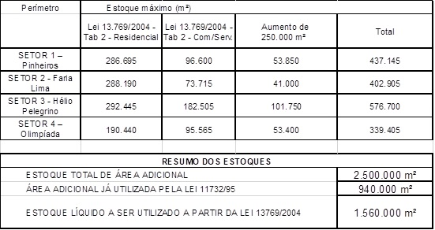

LEI Nº 18.175, DE 25 DE JULHO DE 2024

([Projeto de Lei nº 028/22](https://www.saopaulo.sp.leg.br/cgi-bin/wxis.bin/iah/scripts/?IsisScript=iah.xis&form=A&navBar=OFF&hits=200&lang=pt&nextAction=search&base=proje&conectSearch=init&exprSearch=%22PROJETO%20DE%20LEI%22&indexSearch=%5EnCm%5ELTipo+de+projeto%5Etshort%5Ex%2F20%5EyDATABASE&conectSearch=and&exprSearch=28&indexSearch=%5EnPj%5ELN%FAmero+do+projeto%5Ex%2F30%5EyDATABASE&conectSearch=and&exprSearch=2022&indexSearch=%5EnDp%5ELAno+do+projeto%5Ex%2F40%5Etshort%5EyDATABASE), do Executivo, aprovado na forma de Substitutivo do Legislativo)

Dispõe sobre a introdução na Operação Urbana Consorciada Faria Lima de dispositivos criados pela [Lei nº 16.050, de 31 de julho de 2014](https://legislacao.prefeitura.sp.gov.br/leis/lei-16050-de-31-de-julho-de-2014), modificada pela [Lei nº 17.975, de 8 de julho de 2023](https://legislacao.prefeitura.sp.gov.br/leis/lei-17975-de-8-de-julho-de-2023) e pela [Lei](https://legislacao.prefeitura.sp.gov.br/leis/lei-16402-de-22-de-marco-de-2016) [nº 16.402, de 22 de março de 2016](https://legislacao.prefeitura.sp.gov.br/leis/lei-16402-de-22-de-marco-de-2016), modificada pela [Lei nº 18.081, de 19 de janeiro de 2024](https://legislacao.prefeitura.sp.gov.br/leis/lei-18081-de-19-de-janeiro-de-2023), e sobre a criação de perímetro expandido para incluir o Complexo de Paraisópolis e altera a [Lei nº 13.769, de 26 de janeiro de 2004](https://legislacao.prefeitura.sp.gov.br/leis/lei-13769-de-26-de-janeiro-de-2004), modificada pelas: [Leis nº 13.871, de 08 de julho de 2004](https://legislacao.prefeitura.sp.gov.br/leis/lei-13871-de-8-de-julho-de-2004); [nº](https://legislacao.prefeitura.sp.gov.br/leis/lei-15519-de-29-de-dezembro-de-2011) [15.519, de 29 de dezembro de 2011](https://legislacao.prefeitura.sp.gov.br/leis/lei-15519-de-29-de-dezembro-de-2011) e [nº 16.242, de 31 de julho de 2015](https://legislacao.prefeitura.sp.gov.br/leis/lei-16242-de-31-de-julho-de-2015).

RICARDO NUNES, Prefeito do Município de São Paulo, no uso das atribuições que lhe são conferidas por lei, faz saber que a Câmara Municipal, em sessão de 3 de julho de 2024, decretou e eu promulgo a seguinte lei:

Art. 1º Fica definido perímetro expandido na Operação Urbana Consorciada Faria Lima, que inclui as favelas Paraisópolis, Jardim Colombo, Porto Seguro, Real Parque e Panorama, no qual serão realizados investimentos, com recursos da própria Operação Urbana Consorciada, que atendam às necessidades habitacionais da população de baixa renda e melhorem as condições dos sistemas ambientais, de drenagem, de saneamento e de mobilidade.

§ 1º Deverão ser aplicados, no mínimo, 35% (trinta e cinco por cento) dos recursos que vierem a ser arrecadados pela Operação Urbana Consorciada Faria Lima, no perímetro de abrangência ou em seu perímetro expandido, em Habitação de Interesse Social, de forma prioritária dentro do programa de intervenções, preferencialmente para habitação de interesse social, a aquisição de glebas e lotes, ações de urbanização e regularização fundiária em assentamentos precários e locação social previstos no programa de intervenções.

§ 2º O art. 1º da [Lei nº 13.769, de 26 de janeiro de 2004](https://legislacao.prefeitura.sp.gov.br/leis/lei-13769-de-26-de-janeiro-de-2004), para a vigorar acrescido dos §§ 5°e 6º, com a seguinte redação:

“Art. 1º ......................................................................................

....................................................................................................

§ 5º Para efeito da presente Operação Urbana Consorciada, fica criado o perímetro expandido composto pelas seguintes áreas, delimitadas no Mapa 4 anexo à [Lei nº 16.050, de 31 de julho de 2014](https://legislacao.prefeitura.sp.gov.br/leis/lei-16050-de-31-de-julho-de-2014):

1. ZEIS-1/W044 (BT) - Favela do Real Parque;

2. ZEIS-1/W043 (BT) - Favela Panorama;

3. ZEIS-1/W050 (CL) - Favela Paraisópolis;

4. ZEIS-1/045 (BT) - Favela Jardim Colombo;

5. ZEIS-1/W046, ZEIS-1/W047 e ZEIS-1/W048 (BT) - Favela Porto Seguro.

§ 6º Para as áreas integrantes do perímetro expandido, mencionadas no § 5º, prevalecem as disposições das [Leis nº 16.050, de 31 de julho de 2014](https://legislacao.prefeitura.sp.gov.br/leis/lei-16050-de-31-de-julho-de-2014), e [nº 16.402, de 22 de março de 2016](https://legislacao.prefeitura.sp.gov.br/leis/lei-16402-de-22-de-marco-de-2016), ou daquelas que vierem a substituí-las, sendo esses perímetros destinados exclusivamente para a recepção de investimentos relacionados a provisão habitacional, melhoramentos e reurbanização, incluindo-se a melhoria dos sistemas existentes e implantação de novos sistemas de transporte coletivo, nos termos do disposto no parágrafo único do Art. 5º da [Lei nº 13.769, de 2004](https://legislacao.prefeitura.sp.gov.br/leis/lei-13769-de-26-de-janeiro-de-2004).”

Art. 2º § 4º do art. 1º da [Lei nº 13.769, de 26 de janeiro de 2004](https://legislacao.prefeitura.sp.gov.br/leis/lei-13769-de-26-de-janeiro-de-2004), passa a vigorar com a seguinte redação:

“Art. 1º ...................................................................................

................................................................................................

§ 4º Para os efeitos da presente Operação Urbana Consorciada, fica excluída da área descrita no parágrafo primeiro deste artigo, a parte remanescente da antiga zona de uso Z9-022 exceto as faixas:

I – De 90,00 (noventa) metros de profundidade contados a partir de seu alinhamento, lindeira à Avenida Presidente Juscelino Kubitschek, e situada entre as Ruas Clodomiro Amazonas e Ramos Batista;

II – De 90,00 (noventa) metros de cada lado da Avenida Faria Lima, medidas do alinhamento da Avenida Faria Lima, no trecho compreendido entre o ponto distante 90,00 (noventa) metros da Avenida Juscelino Kubitschek até, pelo lado par a Rua Fiandeiras e pelo lado ímpar a Rua Santa Justina.” (NR)

Art. 3º O inciso V, do Anexo 2 – Programa de Investimentos, da [Lei nº 13.769, de 26 de janeiro de 2004](https://legislacao.prefeitura.sp.gov.br/leis/lei-13769-de-26-de-janeiro-de-2004), passa a vigorar com a seguinte redação:

“V – Provisão de Habitações de Interesse Social, melhoramento e reurbanização, nos termos do disposto no parágrafo único do Art. 5º em locais definidos pelos órgãos competentes da Municipalidade, destinadas à população favelada residente na área da presente Operação Urbana e na região de seu entorno, incluindo-se a melhoria das condições de infraestrutura urbana existentes e transportes existentes e a implantação de novos sistemas de transporte coletivo, de acordo com as seguintes prioridades de atendimento:

a) Favela da Rua Coliseu;

b) Favela do Real Parque;

c) Favela Panorama;

d) Favela Paraisópolis;

e) Favela Jardim Colombo;

f) Favela Porto Seguro.” (NR)

Art. 4º O Anexo 2 – Programa de Investimentos, da [Lei nº 13.769, de 26 de janeiro de 2004](https://legislacao.prefeitura.sp.gov.br/leis/lei-13769-de-26-de-janeiro-de-2004), passa ser acrescido dos incisos XII, XIII, XIV, XV, XVI e parágrafo único, com as seguintes redações:

“XII - construção de equipamentos públicos e comunitários de saúde e educação, de acordo com a demanda indicada pelas secretarias competentes, na área da presente Operação Urbana, e na região de seu entorno, de acordo com as seguintes prioridades de atendimento:

a) Favela da Rua Coliseu;

b) Favela do Real Parque;

c) Favela Panorama;

d) Favela Paraisópolis;

e) Favela Jardim Colombo;

f) Favela Porto Seguro.

XIII - melhorias nas condições de infraestrutura urbana e transportes existentes e implantação de novos sistemas de transporte coletivo;

XIV - urbanização de favelas;

XV - compensação ambiental, ampliação de áreas verdes lindeiras e desapropriações necessárias para a implantação de parques;

XVI - melhoramentos viários.

Parágrafo único. As despesas de estudos, projetos e licitações referentes aos itens V, XII e XIII do Programa de Investimentos no perímetro expandido poderão ser custeadas com recursos já existentes na Operação Urbana Consorciada Faria Lima e o uso desses atuais recursos nas despesas para a execução desses investimentos precisarão ser aprovadas pelo Grupo de Gestão da Operação Urbana Consorciada Faria Lima.” (NR)

Art. 5º Ficam incluídos os incisos XIV, XV, XVI, XVII e XVIII ao Art. 5º da [Lei nº 13.769, de 26 de janeiro de 2004](https://legislacao.prefeitura.sp.gov.br/leis/lei-13769-de-26-de-janeiro-de-2004), com as seguintes redações:

“Art. 5º .......................................................................................

....................................................................................................

XIV – construção de equipamentos públicos e comunitários de saúde e educação, de acordo com a demanda indicada pelas secretarias competentes, na área da presente Operação Urbana, e na região de seu entorno, de acordo com as seguintes prioridades de atendimento:

a) Favela da Rua Coliseu;

b) Favela do Real Parque;

c) Favela Panorama;

d) Favela Paraisópolis;

e) Favela Jardim Colombo;

f) Favela Porto Seguro;

XV – Melhorias nas condições de infraestrutura urbana e transportes existentes e implantação de novos sistemas de transporte coletivo, inclusive no perímetro expandido;

XVI – urbanização de favelas, inclusive no perímetro expandido;

XVII – ampliação de áreas verdes, abarcando ações necessárias para a implantação de áreas verdes lindeiras e parques, bem como compensação ambiental, inclusive no perímetro expandido;

XVIII – melhoramentos viários, inclusive no perímetro expandido.” (NR)

Art. 6º O art. 6º da [Lei nº 13.769, de 2004](https://legislacao.prefeitura.sp.gov.br/leis/lei-13769-de-26-de-janeiro-de-2004), e seu parágrafo único que passa a ser numerado como parágrafo primeiro, passam a vigorar com a seguinte redação:

“Art. 6º Fica o Executivo autorizado a efetuar, de forma onerosa, a outorga de potencial adicional de construção, alteração de usos e parâmetros urbanísticos, estabelecidos na legislação de uso e ocupação do solo vigente à data de protocolamento do processo, nos lotes contidos no perímetro de abrangência definido nos parágrafos 1º ao 4º do art. 1º desta Lei, na conformidade dos valores, critérios e condições nesta estabelecidos, como forma de obtenção dos meios e recursos destinados para conta específica da Operação Urbana Consorciada Faria Lima junto à SP Urbanismo, para realização da Operação Urbana Consorciada Faria Lima.

§ 1º O total de potencial adicional de construção, outorgado para utilização nos lotes contidos no interior do perímetro descrito nos §§ 1º a 4º do Art. 1º fica limitado a 2.500.000 (dois milhões e quinhentos mil) metros quadrados, autorizados pelo EIA-RIMA, como originalmente previsto no estudo, devendo ser deduzidos todos os metros quadrados de área adicional de construção já outorgados conforme dispositivos da Lei nº 11.732, de 1995 e até a data da presente Lei, no âmbito da [Lei nº 13.769, de 2004](https://legislacao.prefeitura.sp.gov.br/leis/lei-13769-de-26-de-janeiro-de-2004).” (NR)

Art. 7º Ficam incluídos os §§2º e 3º no art. 6º da [Lei nº 13.769, de 2004](https://legislacao.prefeitura.sp.gov.br/leis/lei-13769-de-26-de-janeiro-de-2004), com a seguinte redação:

“Art. 6º .......................................................................................

...................................................................................................

§ 2º O estoque líquido a ser utilizado para outorga de potencial adicional de construção no âmbito da [Lei nº 13.769, de 2004](https://legislacao.prefeitura.sp.gov.br/leis/lei-13769-de-26-de-janeiro-de-2004), modificada pela Lei nº 13.781, de 2004, passa a ser de 1.560.000m² (Um milhão quinhentos e sessenta mil metros quadrados), correspondentes aos 2.500.000m² (dois milhões e quinhentos mil metros quadrados) autorizados pelo EIA, descontados o estoque de 940.000m² (novecentos e quarenta mil metros quadrados) consumidos na vigência da lei 11.732, 1995.

§ 3º O estoque de 250.000m² (duzentos e cinquenta mil metros quadrados) autorizados pela presente Lei ficam distribuídos pelos setores da OUCFL, conforme abaixo descrito, e poderá ser utilizado para os usos: Residencial e não Residencial.

a) Setor 1 – Pinheiros – 53.850m² (cinquenta e três mil, oitocentos e cinquenta metros quadrados);

b) Setor 2 - Faria Lima – 41.000m² (quarenta e um mil metros quadrados);

c) Setor 3 – Hélio Pelegrino – 101.750m² (cento e um mil, setecentos e cinquenta metros quadrados);

d) Setor 4 - Olimpíadas – 53.400m² (cinquenta e três mil e quatrocentos metros quadrados.”(NR)

Art. 8º O art. 8º da [Lei nº 13.769, de 2004](https://legislacao.prefeitura.sp.gov.br/leis/lei-13769-de-26-de-janeiro-de-2004), com as alterações introduzidas pelas [Leis nº 13.871, de 08 de julho de 2.004](https://legislacao.prefeitura.sp.gov.br/leis/lei-13871-de-8-de-julho-de-2004), e [15.519, de 29 de dezembro de 2011](https://legislacao.prefeitura.sp.gov.br/leis/lei-15519-de-29-de-dezembro-de-2011), passa a vigorar com as seguintes alterações:

“Art. 8º O Executivo fica autorizado a emitir até 1.000.000 (um milhão) de Certificados de Potencial Adicional de Construção – CEPAC, obedecendo sempre o limite total de metros quadrados de construção estabelecidos na Tabela 2 deste artigo, para a outorga onerosa de potencial adicional de construção, modificação de uso e parâmetros urbanísticos, que serão convertidos de acordo com a Tabela 1 deste artigo, de equivalência a seguir descrita.

<table cellspacing="0" cellpadding="0"><tbody><tr><td colspan="7" nowrap="nowrap"> TABELA 1 - TABELA DE EQUIVALÊNCIA DO CEPAC </td><td> &nbsp; </td></tr><tr><td colspan="2" nowrap="nowrap"> PERÍMETRO </td><td colspan="2" nowrap="nowrap"> COLUNA A </td><td nowrap="nowrap"> COLUNA B </td><td colspan="3" nowrap="nowrap"> COLUNA C </td></tr><tr><td rowspan="2" nowrap="nowrap"> SETOR </td><td rowspan="2" nowrap="nowrap"> SUB SETORES </td><td colspan="2"> Equivalência de 1 CEPAC em m² de área adicional de construção computável </td><td rowspan="2"> Equivalência de 1 CEPAC em m² de área de terreno referente a mudança de uso e parâmetros urbanísticos </td><td colspan="3"> Equivalência de 1 CEPAC em m² de terreno para taxa de ocupação adicional (acima de 50% até 70%) </td></tr><tr><td nowrap="nowrap"> Residencial </td><td nowrap="nowrap"> Com/Serv </td><td nowrap="nowrap"> Residencial </td><td colspan="2" nowrap="nowrap"> Com/Serv </td></tr><tr><td rowspan="4" nowrap="nowrap"> SETOR 1 - Pinheiros </td><td nowrap="nowrap"> 1a (frente F. Lima) </td><td nowrap="nowrap"> 1,2 </td><td nowrap="nowrap"> 0,8 </td><td nowrap="nowrap"> 2 </td><td nowrap="nowrap"> 1,2 </td><td colspan="2" nowrap="nowrap"> 0,8 </td></tr><tr><td nowrap="nowrap"> 1b </td><td nowrap="nowrap"> 1,8 </td><td nowrap="nowrap"> 1,5 </td><td nowrap="nowrap"> 2 </td><td nowrap="nowrap"> 1,8 </td><td colspan="2" nowrap="nowrap"> 1,2 </td></tr><tr><td nowrap="nowrap"> 1c </td><td nowrap="nowrap"> 2,6 </td><td nowrap="nowrap"> 1,7 </td><td nowrap="nowrap"> 2 </td><td nowrap="nowrap"> 2,6 </td><td colspan="2" nowrap="nowrap"> 1,7 </td></tr><tr><td nowrap="nowrap"> 1d </td><td nowrap="nowrap"> 2,8 </td><td nowrap="nowrap"> 1,8 </td><td nowrap="nowrap"> 2 </td><td nowrap="nowrap"> 2,3 </td><td colspan="2" nowrap="nowrap"> 1,5 </td></tr><tr><td rowspan="5" nowrap="nowrap"> SETOR 2 - Faria Lima </td><td> 2a (frente F. Lima, entre Rebouças e C. Jardim) </td><td nowrap="nowrap"> 0,8 </td><td nowrap="nowrap"> 0,5 </td><td nowrap="nowrap"> 1,5 </td><td nowrap="nowrap"> 0,8 </td><td colspan="2" nowrap="nowrap"> 0,5 </td></tr><tr><td> 2b (frente F. Lima, entre C. Jardim e Juscelino) </td><td nowrap="nowrap"> 0,9 </td><td nowrap="nowrap"> 0,6 </td><td nowrap="nowrap"> 1,5 </td><td nowrap="nowrap"> 0,9 </td><td colspan="2" nowrap="nowrap"> 0,6 </td></tr><tr><td> 2c (incluindo frente C. Jardim) </td><td nowrap="nowrap"> 1,1 </td><td nowrap="nowrap"> 0,8 </td><td nowrap="nowrap"> 1,5 </td><td nowrap="nowrap"> 1,2 </td><td colspan="2" nowrap="nowrap"> 0,8 </td></tr><tr><td nowrap="nowrap"> 2d </td><td nowrap="nowrap"> 1,3 </td><td nowrap="nowrap"> 0,5 </td><td nowrap="nowrap"> 1,5 </td><td nowrap="nowrap"> 0,8 </td><td colspan="2" nowrap="nowrap"> 0,5 </td></tr><tr><td nowrap="nowrap"> 2e </td><td nowrap="nowrap"> 1,8 </td><td nowrap="nowrap"> 1,2 </td><td nowrap="nowrap"> 1,5 </td><td nowrap="nowrap"> 1,8 </td><td colspan="2" nowrap="nowrap"> 1 </td></tr><tr><td rowspan="5" nowrap="nowrap"> SETOR 3 - Hélio Pelegrino </td><td nowrap="nowrap"> 3a (frente F. Lima) </td><td nowrap="nowrap"> 1,2 </td><td nowrap="nowrap"> 0,8 </td><td nowrap="nowrap"> 1,5 </td><td nowrap="nowrap"> 1,2 </td><td colspan="2" nowrap="nowrap"> 0,8 </td></tr><tr><td nowrap="nowrap"> 3b (frente Juscelino) </td><td nowrap="nowrap"> 1,2 </td><td nowrap="nowrap"> 1 </td><td nowrap="nowrap"> 1,5 </td><td nowrap="nowrap"> 1,2 </td><td colspan="2" nowrap="nowrap"> 0,8 </td></tr><tr><td nowrap="nowrap"> 3c </td><td nowrap="nowrap"> 2,5 </td><td nowrap="nowrap"> 1 </td><td nowrap="nowrap"> 1,5 </td><td nowrap="nowrap"> 1,5 </td><td colspan="2" nowrap="nowrap"> 1 </td></tr><tr><td nowrap="nowrap"> 3d </td><td nowrap="nowrap"> 1,5 </td><td nowrap="nowrap"> 1 </td><td nowrap="nowrap"> 1,5 </td><td nowrap="nowrap"> 1,5 </td><td colspan="2" nowrap="nowrap"> 1 </td></tr><tr><td nowrap="nowrap"> 3e </td><td nowrap="nowrap"> 2,5 </td><td nowrap="nowrap"> 1,5 </td><td nowrap="nowrap"> 1,5 </td><td nowrap="nowrap"> 2,3 </td><td colspan="2" nowrap="nowrap"> 1,5 </td></tr><tr><td rowspan="4" nowrap="nowrap"> SETOR 4 - Olimpíadas &nbsp; &nbsp; </td><td nowrap="nowrap"> 4a (frente F. Lima) </td><td nowrap="nowrap"> 0,9 </td><td nowrap="nowrap"> 0,6 </td><td nowrap="nowrap"> 2 </td><td nowrap="nowrap"> 0,9 </td><td colspan="2" nowrap="nowrap"> 0,6 </td></tr><tr><td nowrap="nowrap"> 4b </td><td nowrap="nowrap"> 2 </td><td nowrap="nowrap"> 0,9 </td><td nowrap="nowrap"> 2 </td><td nowrap="nowrap"> 1,4 </td><td colspan="2" nowrap="nowrap"> 0,9 </td></tr><tr><td nowrap="nowrap"> 4c </td><td nowrap="nowrap"> 2 </td><td nowrap="nowrap"> 1,2 </td><td nowrap="nowrap"> 2 </td><td nowrap="nowrap"> 1,8 </td><td colspan="2" nowrap="nowrap"> 1,2 </td></tr><tr><td nowrap="nowrap"> 4d </td><td nowrap="nowrap"> 2 </td><td nowrap="nowrap"> 1 </td><td nowrap="nowrap"> 2 </td><td nowrap="nowrap"> 1,5 </td><td colspan="2" nowrap="nowrap"> 1 </td></tr></tbody></table>

<table border="1" cellspacing="0" cellpadding="0" align="center"><tbody><tr><td valign="top">

TABELA 2 - DISTRIBUIÇÃO GERAL DOS ESTOQUES DE ÁREA ADICIONAL DE CONSTRUÇÃO

</td></tr></tbody></table>

§ 1º O aumento de estoque de 250.000m² (duzentos e cinquenta mil metros quadrados) autorizados conforme artigo 7º da presente Lei ficam distribuídos pelos setores da OUCFL, e poderá ser utilizado para os usos: Residencial e não Residencial.

§ 2º Para aplicação da Tabela de Equivalência, os setores criados no Art. 3º ficam subdivididos nos subsetores abaixo descritos, delimitados pelos perímetros constantes da planta nº FL017B003A, que integra o Anexo A da [Lei nº 13.769, de 2004](https://legislacao.prefeitura.sp.gov.br/leis/lei-13769-de-26-de-janeiro-de-2004), e o arquivo da São Paulo Urbanismo – SP Urbanismo.

§ 3º A emissão de Certificados de Potencial Adicional de Construção - CEPAC fica condicionada à existência de saldo no limite total de metros quadrados de construção estabelecidos na Tabela 2 deste artigo, considerando os fatores de conversão previstos na referida Tabela 2.

....................................................................................................

Subsetor 4a: compreende aos imóveis com frente para a Avenida Faria Lima incluídos na faixa de 90,00 (noventa) metros do alinhamento, lindeiro à Av. Presidente Juscelino Kubitschek, e situada entre as Ruas Clodomiro Amazonas e Ramos Batista.

Subsetor 4b: inicia no cruzamento da Avenida das Nações Unidas com a Avenida Juscelino Kubitschek, segue pela Avenida Juscelino Kubitschek até a Rua Clodomiro Amazonas, segue pela Rua Clodomiro Amazonas numa distância de 90,00 (noventa) metros, medida a partir do alinhamento da Avenida Juscelino Kubitschek, segue em linha paralela à Avenida Juscelino Kubitschek até a Rua Ramos Batista, Rua Olimpíadas, Rua Gomes de Carvalho, Rua Tenerife, Avenida dos Bandeirantes, Avenida das Nações Unidas até o ponto inicial, além dos imóveis inseridos nas faixas de 90,00 (noventa) metros de cada lado da Avenida Faria Lima, medidas do alinhamento da Avenida Faria Lima, no trecho compreendido entre o ponto distante 90,00 (noventa) metros da Avenida Juscelino Kubitschek até, pelo lado par a Rua Fiandeiras e pelo lado ímpar a Rua Santa Justina.”

Art. 9º Ficam incluídos os §§ 3º e 4º ao art. 8º da [Lei nº 13.769, de 2004](https://legislacao.prefeitura.sp.gov.br/leis/lei-13769-de-26-de-janeiro-de-2004), com a seguinte redação:

“Art. 8º .......................................................................................

....................................................................................................

§ 3º Caberá à São Paulo Urbanismo, ouvido Grupo de Gestão definido no Art. 17 desta Lei, a decisão sobre eventual ajuste do estoque de potencial construtivo adicional, disponibilizado nesta Lei, para o uso residencial, respeitado o percentual dentro de cada setor, previsto na Tabela 2.

§ 4º Nos casos de reforma com aumento de área, o cálculo da quantidade de CEPAC por m² de área computável adicional considerará a área computável regular existente no empreendimento como parte da área construída computável total pretendida (Ac).”

Art. 10. Os incisos II, III, IV e VI do art. 13 da [Lei nº 13.769, de 2004](https://legislacao.prefeitura.sp.gov.br/leis/lei-13769-de-26-de-janeiro-de-2004), passam a vigorar com as seguintes redações:

“Art. 13. .....................................................................................

....................................................................................................

II - aos empreendimentos que aderirem à Operação Urbana Consorciada com a vinculação de CEPAC, situados em lotes com área igual ou superior a 2.000m² (dois mil metros quadrados), limitado a área de 20.000 m² (vinte mil metros quadrados) de terreno, será concedido, de forma gratuita, um incentivo, em área computável, igual a 20% (vinte por cento) da área do lote, desde que a edificação disponha de área localizada junto ao alinhamento da via, ao nível do passeio público, destinada à fruição pública com frente para mais de um logradouro público, que tenha no mínimo 250m² (duzentos e cinquenta metros quadrados), esteja sem fechamento e não ocupada por construções ou estacionamento de veículos, permaneça permanentemente aberta e seja devidamente averbada em Cartório de Registro de Imóveis;

a) ([VETADO](https://legislacao.prefeitura.sp.gov.br/leis/razoes-do-veto-ao-projeto-de-lei-28-2022-oficio-de-25-de-julho-de-2024))

III - o lote mínimo para adesão à Operação Urbana Consorciada Faria Lima é de 500m² (quinhentos metros quadrados). Para os lotes com área igual ou superior a do lote mínimo será concedido de forma onerosa, aumento de potencial construtivo acima do potencial básico, estabelecido para o lote na legislação vigente de uso e ocupação do solo, até atingir o coeficiente de aproveitamento máximo de 4,0 (quatro) ou, no caso de pagamento da cota de solidariedade, 4,8 (quatro e oito décimos), atendidas as demais exigências da legislação vigente e as disposições estabelecidas nesta Lei;

IV - ([VETADO](https://legislacao.prefeitura.sp.gov.br/leis/razoes-do-veto-ao-projeto-de-lei-28-2022-oficio-de-25-de-julho-de-2024))

a) a área destinada aos usos não residenciais, até o limite de 20% (vinte por cento) da área construída computável total nos empreendimentos de uso misto com fachada ativa, desde que seja respeitada a proporção mínima de 20% (vinte por cento) de área computável destinada ao uso residencial.

b) aplicam-se também, no que couber, as disposições dos arts. 62, 67, 70, 71 da [Lei nº 16.402, de 2016](https://legislacao.prefeitura.sp.gov.br/leis/lei-16402-de-22-de-marco-de-2016), com as alterações da [Lei nº 18.081, de 2024](https://legislacao.prefeitura.sp.gov.br/leis/lei-18081-de-19-de-janeiro-de-2023), do Art. 82-A da [Lei nº 16.050, de 2014](https://legislacao.prefeitura.sp.gov.br/leis/lei-16050-de-31-de-julho-de-2014), acrescido pela [Lei nº 17.975, de 2023](https://legislacao.prefeitura.sp.gov.br/leis/lei-17975-de-8-de-julho-de-2023,/leis/decreto-17975-de-10-de-maio-de-1982) e do Art. 5º da [Lei nº 18.081, de 2024](https://legislacao.prefeitura.sp.gov.br/leis/lei-18081-de-19-de-janeiro-de-2023) no perímetro da Operação Urbana Consorciada Faria Lima, ressalvadas as disposições especificas da presente Lei;

c) não serão consideradas computáveis as áreas comuns de circulação vertical até o limite de 20% (vinte por cento) da área construída computável de cada pavimento tipo.

....................................................................................................

VI - os incentivos estabelecidos neste artigo poderão ser aplicados cumulativamente, respeitado o coeficiente de aproveitamento máximo de 4,0 (quatro) ou, no caso de pagamento da cota de solidariedade, o coeficiente de aproveitamento poderá chegar a 4,8 (quatro e oito décimos).

..................................................................................................”

Art. 11. Ficam incluídos os incisos VII, VIII, IX e §§ 5º, 6º e 7º ao art. 13 º da [Lei nº 13.769, de 26 de janeiro de 2004](https://legislacao.prefeitura.sp.gov.br/leis/lei-13769-de-26-de-janeiro-de-2004), com as seguintes redações:

“Art. 13. .....................................................................................

....................................................................................................

VII - Para novas construções e reformas com ampliação de área construída de hospitais e estabelecimentos de ensino localizados no perímetro da Operação Urbana Consorciada Faria Lima, será concedido, de forma gratuita, um incentivo em área de construção computável igual a 20% (vinte por cento) da área do computável do respectivo uso;

VIII – Aos imóveis com área superior a 500m2 (quinhentos metros quadrados) e inferior a 20.000m² (vinte mil metros quadrados), além do benefício constante do inciso III que aderirem à Operação Urbana Consorciada com a vinculação de CEPAC para aumento de área adicional de construção, serão consideradas como áreas não computáveis:

a) a área destinada aos usos não residenciais, até o limite de 20% vinte por cento) da área construída computável total nos empreendimentos de uso misto com fachada ativa, desde que seja respeitada a proporção mínima de 20% (vinte por cento) de área computável total destinada ao uso residencial;

b) aplicam-se também as disposições dos arts. 62, 67, 70, 71 da [Lei](https://legislacao.prefeitura.sp.gov.br/leis/lei-16402-de-22-de-marco-de-2016) [nº 16.402, de 22 de março de 2016](https://legislacao.prefeitura.sp.gov.br/leis/lei-16402-de-22-de-marco-de-2016), com as alterações da [Lei nº 18.081, de 2024](https://legislacao.prefeitura.sp.gov.br/leis/lei-18081-de-19-de-janeiro-de-2023), do Art. 82-A da [Lei nº 16.050, de 2014](https://legislacao.prefeitura.sp.gov.br/leis/lei-16050-de-31-de-julho-de-2014), acrescido pela [Lei nº 17.975, de 2023](https://legislacao.prefeitura.sp.gov.br/leis/lei-17975-de-8-de-julho-de-2023,/leis/decreto-17975-de-10-de-maio-de-1982) e do Art. 5º da [Lei nº 18.081, de 2024](https://legislacao.prefeitura.sp.gov.br/leis/lei-18081-de-19-de-janeiro-de-2023) no perímetro da Operação Urbana Consorciada Faria Lima, ressalvadas as disposições especificas da presente Lei;

IX – Além do benefício constante do inciso III deste artigo, e desde que atendidas suas exigências, serão concedidos, de forma onerosa, de acordo com as colunas B e C da Tabela 1 do art. 8º desta Lei, os seguintes incentivos:

a) aumento da taxa de ocupação até o limite de 70% (setenta por cento) da área do lote;

b) aumento do gabarito de altura previsto na zona de uso da zona de uso, respeitadas as disposições do art. 14º e demais disposições desta Lei, limitadas a anuência do COMAER;

c) permissão de uso misto, no mesmo lote, respeitada a equivalência de valores de CEPAC previstos na Tabela 1 do art. 8º, sem a necessidade de previsão de acessos independentes e compartimentação das áreas destinadas a carga e descarga, circulação, manobra e estacionamento de veículos.

d) alteração de uso em todas as zonas, desde que, respeitadas as restrições específicas previstas nesta Lei, e conforme coluna B da Tabela de Equivalência de CEPAC constante nesta Lei.

....................................................................................................

§ 5º Os imóveis que passaram, a partir da presente Lei, a integrar o perímetro da Operação Urbana Consorciada Faria Lima, descritos no §2º do art. 8º da presente Lei, que possuam Alvará de Execução válidos e não tenham Auto de conclusão já emitido, poderão aderir à OUCFL, considerando como coeficiente de aproveitamento básico, o coeficiente de aproveitamento total já aprovado no Alvará de Execução.

§ 6º Os empreendimentos propostos para os lotes localizados dentro do perímetro da Operação Urbana Consorciada Faria Lima serão considerados pertencentes às áreas de influência dos sistemas de transporte nas quadras compreendidas, total ou parcialmente, conforme regramento dado nos incisos I e II deste parágrafo, poderão atingir o coeficiente máximo igual a 4,0 (quatro), sem limite de gabarito, na seguinte conformidade:

I - As quadras inseridas nas áreas de influência dos eixos de transporte são aquelas localizadas:

a) nas áreas de influência correspondentes às estações de trem, metrô, monotrilho, VLT e VLP elevadas, que incluem quadras alcançadas em um raio de 400m (quatrocentos metros) das estações que compreendem as Estações de Metro Faria Lima e Pinheiros e Estações de Trem da CPTM Vila Olímpia, Cidade Jardim, Hebraica – Rebouças e Pinheiros;

b) nas áreas de influência correspondentes aos corredores de ônibus em nível que incluam as quadras alcançadas na faixa definida por linhas paralelas a 250m (duzentos e cinquenta metros) do eixo das vias que compreendem os corredores de ônibus da Avenida Cidade Jardim (trecho entre Passarela Miguel Reale e Avenida Brigadeiro Faria Lima), Rua Funchal e Chedid Jafet (Trecho entre Avenida dos Bandeirantes até Avenida Juscelino Kubitschek), Avenida Santo Amaro (Trecho entre a Rua Cabo Verde e Avenida Juscelino Kubitschek) e Avenida Eusébio Matoso (trecho entre Avenida Lineu de Paula Machado até Avenida Brigadeiro Faria Lima).

II - Estão excluídas das áreas de influência dos eixos de transporte os imóveis:

a) enquadrados como Zona Especial de Preservação Cultural (ZEPEC);

b) contidos em vilas, ou que possuam acesso para rua sem saída;

c) com acesso de veículos para rua, com largura menor ou igual a 10m (dez metros);

d) que contenham Áreas de Preservação Permanente de nascentes e olhos d’água;

e) que possuam remanescentes de Mata Atlântica conforme levantamento do Plano Municipal da Mata Atlântica (PMMA);

f) para os quais conste previsão de Parques conforme Quadro 7, Quadro 15 e Mapa 5 anexos à [Lei nº 16.050, de 2014](https://legislacao.prefeitura.sp.gov.br/leis/lei-16050-de-31-de-julho-de-2014), alterada pela [Lei nº 17.975, de 2023](https://legislacao.prefeitura.sp.gov.br/leis/lei-17975-de-8-de-julho-de-2023,/leis/decreto-17975-de-10-de-maio-de-1982);

g) para os quais conste previsão de área de reservatório de águas pluviais conforme Mapa 12, anexo à [Lei nº 16.050, de 2014](https://legislacao.prefeitura.sp.gov.br/leis/lei-16050-de-31-de-julho-de-2014), alterada pela [Lei nº 17.975, de 2023](https://legislacao.prefeitura.sp.gov.br/leis/lei-17975-de-8-de-julho-de-2023,/leis/decreto-17975-de-10-de-maio-de-1982), e Quadro 6 anexo à [Lei nº 16.402, de 2016](https://legislacao.prefeitura.sp.gov.br/leis/lei-16402-de-22-de-marco-de-2016), até a conclusão da obra de infraestrutura.

III - Os empreendimentos previstos no caput deste parágrafo estão sujeitos aos demais parâmetros urbanísticos previstos na [Lei nº 13.769, de 2004](https://legislacao.prefeitura.sp.gov.br/leis/lei-13769-de-26-de-janeiro-de-2004), observados os estoques de potencial construtivo previstos na Tabela 2 para cada Setor.

IV - O atendimento ao requisito de localização previsto no caput deste parágrafo deverá ser demonstrado graficamente no projeto apresentado para fins de licenciamento edilício do empreendimento e nos pedidos de emissão ou revisão de Certidão de Pagamento de Outorga Onerosa em CEPAC;

V - Ficam autorizados os usos R2v-2, R2v-3 e R2v-4 sem a necessidade de vinculação de CEPAC para mudança de uso e parâmetros urbanísticos;

VI - Para efeito do cálculo da quantidade de CEPAC necessário para aquisição de Área Adicional de Construção, aos fatores da Coluna A da TABELA 1 do Art. 8º da presente Lei, serão majorados em 30% (trinta por cento);

a) Não se aplica cumulativamente a este benefício o disposto no inciso IX do Art. 14 da [Lei nº 13.769, de 2004](https://legislacao.prefeitura.sp.gov.br/leis/lei-13769-de-26-de-janeiro-de-2004), incluído pela [Lei nº 15.519/2011](https://legislacao.prefeitura.sp.gov.br/leis/lei-15519-de-29-de-dezembro-de-2011).

VII – Aplicam-se também as disposições do Art. 71 da [Lei](https://legislacao.prefeitura.sp.gov.br/leis/lei-16402-de-22-de-marco-de-2016) [nº 16.402, de 22 de março de 2016](https://legislacao.prefeitura.sp.gov.br/leis/lei-16402-de-22-de-marco-de-2016), com as alterações da [Lei nº 18.081/24](https://legislacao.prefeitura.sp.gov.br/leis/lei-18081-de-19-de-janeiro-de-2023) até o limite de 50% (cinquenta por cento) da área do lote independente da zona de uso;

VIII - Os empreendimentos que ainda não tenham Certificado de Conclusão emitido e aderirem à Operação Urbana Consorciada Faria Lima com a vinculação de CEPAC para o aumento de área adicional de construção, e se localizarem nas áreas de influência das áreas de influência dos sistemas de transporte, ficam dispensados do limite de gabarito máximo de altura de forma onerosa, as áreas computáveis resultantes de benefícios auferidos de forma gratuita.

IX - ([VETADO](https://legislacao.prefeitura.sp.gov.br/leis/razoes-do-veto-ao-projeto-de-lei-28-2022-oficio-de-25-de-julho-de-2024))

§ 7º As áreas computáveis resultantes de benefícios auferidos de forma gratuita não serão descontados dos estoques de área construída adicional previstos para os setores da Operação Urbana Consorciada Faria Lima.”

Art. 12. Os incisos VI, VII e VIII do artigo 14 da [Lei nº 13.769, de 26 de janeiro de 2004](https://legislacao.prefeitura.sp.gov.br/leis/lei-13769-de-26-de-janeiro-de-2004), passam a figurar na forma abaixo, incluindo parágrafo único:

“VI - Todos os empreendimentos destinados aos usos residenciais ou não residenciais que fizerem uso dos dispositivos das leis da Operação Urbana Consorciada Faria Lima deverão atender o Quadro 4A - Condições de Instalação por Subcategoria de uso anexo à [Lei n° 16.402, de 22 de março de 2016](https://legislacao.prefeitura.sp.gov.br/leis/lei-16402-de-22-de-marco-de-2016)."

VII - Nas quadras que contenham vilas, reconhecidas pelo poder público, ou via sem saída com largura inferior a 10m (dez metros), aplicam-se as disposições do Art. 64 da [Lei nº 16.402, de 2016](https://legislacao.prefeitura.sp.gov.br/leis/lei-16402-de-22-de-marco-de-2016), com as alterações promovidas pelo Art. 35 da [Lei nº 18.081, de 2024](https://legislacao.prefeitura.sp.gov.br/leis/lei-18081-de-19-de-janeiro-de-2023);

VIII - para empreendimentos a serem implantados com frente para vias com largura inferior a 10 m (10 metros) deverá ser mantido o gabarito de 25,00 m (vinte e cinco metros).

Parágrafo único. A adesão a OUFL realizada através da certidão de vinculação de potencial, não sendo permitido sua expedição sem a vinculação de CEPAC no lote.”

Art. 13. O § 1º do art. 15 da [Lei nº 13.769, de 26 de janeiro de 2004](https://legislacao.prefeitura.sp.gov.br/leis/lei-13769-de-26-de-janeiro-de-2004), passa a vigorar com a seguinte redação:

"§ 1º O Grupo de Gestão estabelecerá o Plano de Prioridades para a implantação do Programa de Investimentos, em função dos recursos disponíveis para a sua realização e do qual o valor correspondente a 35% (trinta e cinco por cento) do total dos recursos que serão arrecadados deverá sempre ser destinados à construção de Habitação de Interesse Social e à urbanização de favelas, em conta vinculada a esse fim.”

Art. 14. Os empreendimentos que aderirem à Operação Urbana Consorciada Faria Lima e pagarem a Cota de Solidariedade conforme o disposto no Art. 112 da [Lei nº 16.050, de 31 de julho de 2014](https://legislacao.prefeitura.sp.gov.br/leis/lei-16050-de-31-de-julho-de-2014), conforme redação dada pela [Lei nº 17.975, de 2023](https://legislacao.prefeitura.sp.gov.br/leis/lei-17975-de-8-de-julho-de-2023,/leis/decreto-17975-de-10-de-maio-de-1982), depositarão esses valores diretamente no Fundo de Desenvolvimento Urbano - FUNDURB, em sua conta segregada para Habitação de Interesse Social, e o acréscimo de 20% (vinte por cento) na área computável, previsto no Art. 112 da [Lei nº 16.050, de 31 de julho de 2014](https://legislacao.prefeitura.sp.gov.br/leis/lei-16050-de-31-de-julho-de-2014), conforme redação dada pela [Lei nº 17.975, de 2023](https://legislacao.prefeitura.sp.gov.br/leis/lei-17975-de-8-de-julho-de-2023,/leis/decreto-17975-de-10-de-maio-de-1982), será pago com CEPAC, de acordo com as equações de conversão de CEPAC definidas nesta Lei e o coeficiente de aproveitamento será acrescido além do C.A. máximo, podendo chegar até 4,8 (quatro e oito décimos).

Parágrafo único. Os projetos de reforma com aumento de área que aderirem à Cota de Solidariedade poderão se beneficiar do acréscimo do coeficiente máximo, chegando a 4,8 (quatro e oito décimos).

Art. 15. Em conformidade com o § 10 do Art. 117 da [Lei nº 16.050, de 31 de julho de 2014](https://legislacao.prefeitura.sp.gov.br/leis/lei-16050-de-31-de-julho-de-2014), conforme redação dada pela [Lei nº 17.975, de 2023](https://legislacao.prefeitura.sp.gov.br/leis/lei-17975-de-8-de-julho-de-2023,/leis/decreto-17975-de-10-de-maio-de-1982), no caso de demolição total de imóvel regular, no perímetro da Operação Urbana Faria Lima, com ou sem mudança de uso, os índices e taxas poderão ser mantidos mesmo que maiores que o permitido pela legislação vigente, mediante pagamento de outorga onerosa em CEPAC a partir do C.A. básico.

§ 1º ([VETADO](https://legislacao.prefeitura.sp.gov.br/leis/razoes-do-veto-ao-projeto-de-lei-28-2022-oficio-de-25-de-julho-de-2024))

§ 2º Para a parcela de área adicional computável que vier a ser construída além do previsto no § 1º, o cálculo de conversão considerará as conversões definidas no art.8º desta Lei e será abatido do estoque da Tabela 2, conforme fórmulas de cálculo vigentes.

§ 3º Após o encerramento da Operação Urbana Faria Lima a outorga será paga conforme LPUOS, respeitados o período de transição de 5 (cinco) anos, para revisão do zoneamento da área.

§ 4º Disposto no § 1º deste artigo não se aplica aos imóveis cuja certidão de Pagamento de outorga onerosa em CEPACs foi obtida anteriormente, ficando assegurado que o potencial construtivo permanecerá vinculado ao lote, mesmo após a demolição parcial ou total da edificação existente não sendo cabível o pagamento de nova contrapartida financeira.

Art. 16. Nos casos de reformas com ou sem aumento de área construída aplicam-se os seguintes regramentos:

I – Quando a alteração de áreas computáveis e não computáveis não alterar o total de área computável anteriormente licenciado, não será devida contrapartida financeira relativa à Outorga Onerosa em CEPAC, respeitado o limite máximo de 59% (cinquenta e nove por cento) e área não computável, conforme definido no §2º do Art. 62 da [Lei nº 16.402, de 2016](https://legislacao.prefeitura.sp.gov.br/leis/lei-16402-de-22-de-marco-de-2016);

II – Não será devida contrapartida financeira relativa à Outorga Onerosa em CEPAC para a área existente regular computável nos termos da legislação vigente à época de seu licenciamento ou regularização, sendo permitida sua conversão em áreas não computáveis pela legislação atual, conforme inciso II do Art. 8º da [Lei nº 18.081, de 2024](https://legislacao.prefeitura.sp.gov.br/leis/lei-18081-de-19-de-janeiro-de-2023);

III – Não haverá contrapartida financeira relativa à Outorga Onerosa em CEPAC no caso de mudança de uso, categoria de uso, subcategoria de uso de edificações existentes que não foram objeto de contrapartida financeira relativa à OODC ou de benefícios de leis específicas, para fins de aplicação do inciso III do §6º do art. 117 do PDE;

IV – É admitida a anexação de novos lotes, edificados ou não, nos termos do inciso III do art. 8º da [Lei nº 18.081, de 2024](https://legislacao.prefeitura.sp.gov.br/leis/lei-18081-de-19-de-janeiro-de-2023), devendo-se considerar no cálculo do potencial construtivo adicional a área de terreno total resultante da anexação de lotes, inclusive observado o saldo do potencial construtivo básico não utilizado dos lotes anexados, atendidos os demais parâmetros de uso e ocupação para o lote resultante.

V - os imóveis em regularização não podem se beneficiar dos incentivos I e II do art. 13 da [Lei nº 13.769, de 2004](https://legislacao.prefeitura.sp.gov.br/leis/lei-13769-de-26-de-janeiro-de-2004), alterada pelo art. 10 desta Lei.

§ 1º Os regramentos definidos neste artigo, estão vinculados a adesão a OUCFL, com pagamento em CEPAC.

§ 2º Nos casos em que no projeto aprovado não estejam discriminadas as áreas computáveis e não computáveis, deve ser aplicado o disposto no § 4º do artigo 8º da [Lei nº 18.081, de 2024](https://legislacao.prefeitura.sp.gov.br/leis/lei-18081-de-19-de-janeiro-de-2023).

Art. 17. Em conformidade com o Art. 32, inciso II do § 2º, da [Lei Federal nº 10.257, de 10 de julho de 2001](https://www.planalto.gov.br/ccivil_03/leis/leis_2001/l10257.htm), Estatuto da Cidade, e com o Art. 139, inciso II, da [Lei Municipal nº 16.050, de 31 de julho de 2014](https://legislacao.prefeitura.sp.gov.br/leis/lei-16050-de-31-de-julho-de-2014), PDE, fica permitida a regularização de edificações existentes dentro da Operação Urbana Consorciada Faria Lima, que tenham sido objeto de construções, reformas ou ampliações em desacordo com a legislação vigente, desde que os projetos passem a atender integralmente à legislação pertinente vigente e concluídas até a data de publicação desta Lei. 

Parágrafo único. Fica autorizado o pagamento da outorga onerosa de potencial construtivo adicional para a regularização da área adicional irregular em CEPAC, utilizando-se exclusivamente dos critérios e fatores de conversão da Tabela 1 vigente da [Lei nº 13.871, de 08 de julho de 2004](https://legislacao.prefeitura.sp.gov.br/leis/lei-13871-de-8-de-julho-de-2004), válidos na data da irregularidade, majorada em 45% (quarenta e cinco por cento).

Art. 18. Nos termos dos incisos XVI e XVII do Art. 141 e o § 4º do Art. 382 da [Lei nº 16.050, de 31 de julho de 2014](https://legislacao.prefeitura.sp.gov.br/leis/lei-16050-de-31-de-julho-de-2014), conforme redação dada pela [Lei nº 17.975, de 2023](https://legislacao.prefeitura.sp.gov.br/leis/lei-17975-de-8-de-julho-de-2023,/leis/decreto-17975-de-10-de-maio-de-1982), a Operação Urbana Consorciada Faria Lima iniciará o período de transição para o regime jurídico ordinário da Lei de Parcelamento, Uso e Ocupação do Solo após o estoque consumido atingir o limite de 95% (noventa e cinco por cento) do estoque de potencial adicional de construção de 2.500.000 m² (dois milhões e quinhentos mil metros quadrados) e terá duração total de 5 (cinco) anos.

§ 1º ([VETADO](https://legislacao.prefeitura.sp.gov.br/leis/razoes-do-veto-ao-projeto-de-lei-28-2022-oficio-de-25-de-julho-de-2024))

§ 2º A SP Urbanismo divulgará aviso de fato relevante apresentando o estoque de potencial adicional disponível quando vier a ser iniciado o período de transição.

§ 3º Durante o período de transição, a critério do interessado, os novos empreendimentos poderão ser licenciados:

I - Segundo as regras da Operação Urbana Consorciada, com sua contrapartida financeira paga com CEPAC;

II - Segundo as regras da legislação ordinária de parcelamento, uso e ocupação do solo, com sua contrapartida financeira paga com Outorga Onerosa, somente os lotes de tamanho inferior ao mínimo definido para adesão à Operação Urbana Consorciada Faria Lima, desde que mantenham coeficiente de aproveitamento máximo 2,0 (dois).

§ 4º Os processos de licenciamento iniciados no período de transição com base nas regras da Operação Urbana Consorciada, sem despacho decisório até o encerramento, serão apreciados integralmente de acordo com as regras da Operação Urbana Consorciada, exceto nos casos de manifestação formal do interessado, a qualquer tempo, optando pela análise integral nos termos da legislação ordinária de parcelamento, uso e ocupação do solo vigente à época do protocolo do projeto.

§ 5º ([VETADO](https://legislacao.prefeitura.sp.gov.br/leis/razoes-do-veto-ao-projeto-de-lei-28-2022-oficio-de-25-de-julho-de-2024))

§ 6º ([VETADO](https://legislacao.prefeitura.sp.gov.br/leis/razoes-do-veto-ao-projeto-de-lei-28-2022-oficio-de-25-de-julho-de-2024))

§ 7º ([VETADO](https://legislacao.prefeitura.sp.gov.br/leis/razoes-do-veto-ao-projeto-de-lei-28-2022-oficio-de-25-de-julho-de-2024))

§ 8º ([VETADO](https://legislacao.prefeitura.sp.gov.br/leis/razoes-do-veto-ao-projeto-de-lei-28-2022-oficio-de-25-de-julho-de-2024))

§ 9º O Grupo de Gestão será mantido até aplicação integral dos recursos arrecadados com a Operação nas intervenções previstas no Programa de Investimentos.

Art. 19. Os parâmetros urbanísticos das leis específicas de Operação Urbana Consorciada continuarão vigentes nos seus perímetros até a expedição da Declaração de Encerramento da Operação pela SP Urbanismo, que atestará tal condição.

§ 1º Após o encerramento da Operação Urbana Consorciada será aplicado aos seus perímetros o regramento ordinário previsto na legislação de parcelamento, uso e ocupação do solo vigente à época do protocolo do projeto.

§ 2º Após o encerramento da Operação Urbana Consorciada ficam incluídas nas áreas de influência dos eixos de estruturação da transformação urbana os imóveis que atendam as condições previstas nos arts. 77 e 77-A da [Lei nº 16.050, de 2014](https://legislacao.prefeitura.sp.gov.br/leis/lei-16050-de-31-de-julho-de-2014), com as alterações promovidas pelo Art. 26 da [Lei nº 17.975, de 8 de julho de 2023](https://legislacao.prefeitura.sp.gov.br/leis/lei-17975-de-8-de-julho-de-2023).

§ 3º A partir da publicação dessa Lei, poderão ser desenvolvidos estudos urbanísticos tendentes a revisar o zoneamento da região, considerando sua capacidade de adensamento e suporte, de modo após o encerramento da Operação Urbana Consorciada Faria Lima, caso necessário, alterar os parâmetros urbanísticos da legislação então vigente, mediante Projeto de Intervenção Urbana – PIU, pela SP Urbanismo, ou a partir de requerimento apresentado por meio de Manifestação de Interesse Privado.

§ 4º Ficam garantidos todos os índices e parâmetros ao lote pago pelas Certidões de Pagamento de Outorga Onerosa em CEPACs já expedidas, assegurado o potencial construtivo já vinculado ao lote.

§ 5º Na hipótese do montante arrecadado pelos leilões de CEPAC, realizados com a finalidade de custear o Programa de Investimentos previstos da Operação Urbana Consorciada Faria Lima, exceder o numerário necessário ao seu integral cumprimento, os valores remanescentes da conta vinculada prevista no art. 16 da [Lei nº 13.769, de 2004](https://legislacao.prefeitura.sp.gov.br/leis/lei-13769-de-26-de-janeiro-de-2004), serão destinados ao Fundo de Desenvolvimento Urbano - FUNDURB.

I - A medida prevista no caput deste parágrafo será realizada nos termos do regulamento, garantida a execução integral das obras constantes no Programa de Investimentos previsto pela [Lei nº 13.769, de 2004](https://legislacao.prefeitura.sp.gov.br/leis/lei-13769-de-26-de-janeiro-de-2004);

II - Ficam mantidos os procedimentos de comercialização de CEPAC previstos na [Lei nº 13.769, de 2004](https://legislacao.prefeitura.sp.gov.br/leis/lei-13769-de-26-de-janeiro-de-2004), inclusive aqueles disciplinados em regulamentação posterior.

§ 6º A OUCFL será considerada encerrada após a execução integral do Programa de Investimentos previsto pela [Lei nº 13.769, de 2004](https://legislacao.prefeitura.sp.gov.br/leis/lei-13769-de-26-de-janeiro-de-2004), cabendo à SP-Urbanismo expedir a Declaração de Encerramento da Operação, que atestará tal condição.

I - A declaração de encerramento prevista no caput deste parágrafo acarreta o cancelamento de eventual estoque de CEPAC ainda remanescente em poder da Administração Municipal, bem como a dissolução do Grupo de Gestão da OUCFL.

§ 7º As Certidões de Outorga Onerosa em CEPAC já emitidas poderão ser alteradas considerando os dispositivos da presente Lei, desde que não tenha sido emitido o Certificado de Conclusão do empreendimento.

Art. 20. Todas as plantas referidas na [Lei nº 13.769, de 26 de janeiro de 2004](https://legislacao.prefeitura.sp.gov.br/leis/lei-13769-de-26-de-janeiro-de-2004), e na [Lei nº 13.871, de 8 de julho de 2004](https://legislacao.prefeitura.sp.gov.br/leis/lei-13871-de-8-de-julho-de-2004), deverão, em 90 (noventa) dias contados da publicação da presente Lei, ser atualizadas conforme o disposto na presente Lei podendo ser prorrogado uma única vez por igual período.

Art. 21. Os valores da contrapartida financeira advindos da regularização da Operação Urbana Faria Lima deverão ser transferidos na sua totalidade para a construção ou a aquisição de unidades prontas de Habitação de Interesse Social (HIS) direcionados a população de baixa renda e fixadas de acordo com a tabela dos valores de referência da Caixa Econômica Federal para HIS-1.

Parágrafo único. Somente após a conclusão da HIS, com a posse de todas as unidades ao município e a devida transferência de titularidade, mencionadas no parágrafo acima, os certificados de regularização poderão ser emitidos.

Art. 22. As despesas decorrentes da execução desta Lei correrão por conta de dotações orçamentárias próprias, suplementadas se necessário.

Art. 23. Esta Lei entra em vigor na data da sua publicação.

PREFEITURA DO MUNICÍPIO DE SÃO PAULO, aos 25 de julho de 2024, 471º da fundação de São Paulo.

RICARDO NUNES

PREFEITO

FERNANDO JOSÉ DA COSTA

Secretário Municipal De Justiça

FABRICIO COBRA ARBEX

Secretário Municipal da Casa Civil

Publicada na Casa Civil, em 25 de julho de 2024.

Documento original assinado nº  [107501539](https://diariooficial.prefeitura.sp.gov.br/md_epubli_visualizar.php?E17MFcBdVupnUA_U9M8K61li1B9bSLsKZ_Ur-R1OeJ9Ptqcv6I9yR5-GwcYFG8Vxlvui9l_ZBm1qplrDdeO9nKSMA-e5PDRaOkt-pPzcPqXRJhEZTdH4lZ9bQa4AUC0T)
