LEI MUNICIPAL Nº 3.820, DE 16 DE JANEIRO DE 2025.

Dispõe sobre a estrutura administrativa da Câmara Municipal de Aparecida de Goiânia e dá outras providências.

FAÇO SABER QUE A CÂMARA MUNICIPAL DE APARECIDA DE GOIÂNIA APROVOU E EU, PREFEITO MUNICIPAL, SANCIONO A SEGUINTE LEI:

TÍTULO I

DAS DISPOSIÇÕES GERAIS

CAPÍTULO I

DAS DISPOSIÇÕES PRELIMINARES

Art. 1º Esta Lei dispõe sobre a estrutura organizacional da Câmara Municipal de Aparecida de Goiânia com os cargos de provimento efetivos e em comissão que lhes são correspondentes.

§ 1º Para cumprimento de suas atribuições institucionais e legais, o Poder Legislativo será exercido pela Mesa Diretora por meio de seu Presidente, auxiliado pelos titulares de cargos da estrutura administrativa e de assessoramento parlamentar de que trata esta Lei.

§ 2º Os integrantes da Mesa Diretora estão definidos no Regimento Interno da Câmara Municipal de Aparecida Goiânia.

TÍTULO II

DA ORGANIZAÇÃO ADMINISTRATIVA

CAPÍTULO I

DA ESTRUTURA ADMINISTRATIVA

Art. 2º A estrutura administrativa da Câmara Municipal de Aparecida de Goiânia compreende a organização institucional de unidades administrativas e respectivos cargos, encarregada da prestação de serviços públicos legislativos, em sintonia com a função constitucional do Poder Legislativo municipal, executando atividades de forma integrada, nas seguintes áreas de atuação:

I - Desenvolvimento Político-Parlamentar, representado pelas unidades administrativas que atuam nas atividades de articulação e gestão político-parlamentar do Poder Legislativo com a finalidade de dar sustentação técnica, política e operacional ao exercício das atribuições legais e regimentais da Mesa Diretora;

II - Desenvolvimento da Gestão Legislativa, representado pelas unidades administrativas encarregadas da gestão dos recursos legislativos, humanos, financeiros, administrativos e tecnológicos, bem como do provimento dos meios de suporte operacionais necessários ao exercício de suas atividades próprias, visando à consecução dos objetivos do Poder Legislativo municipal.

Art. 3º A estrutura organizacional da Câmara Municipal de Aparecida de Goiânia é composta pelas seguintes unidades administrativas, subordinadas à Mesa Diretora por área de atuação:

I - Desenvolvimento Político-Parlamentar:

a) Gabinete da Presidência

1\. Chefia de Gabinete da Presidência

2\. Assessoria Especial da Presidência

3\. Secretária Executiva

4\. Assistente Administrativo I

5\. Assistente Administrativo II

6\. Assistente Administrativo III

6\. Assessoria de Segurança da Presidência

b) Procuradoria Geral

1\. Assessor Chefe da Procuradoria

2\. Procurador(es)

3\. Chefia do Núcleo de Assistência Jurídica

4\. Assessoria Jurídica da Procuradoria

5\. Procuradoria Especial da Mulher

c) Controladoria Geral

1\. Assessor Chefe da Diretoria

2\. Assessoria de Gestão de Documentos e Contratos

d) Diretoria de Contabilidade

1\. Assessor Chefe da Diretoria

2\. Assessoria Jurídica de Contas

e) Gabinete dos Vereadores

1\. Assessor Chefe de Gabinete

2\. Assessor Especial de Gabinete

3\. Assessor Parlamentar de Gabinete I

4\. Assessor Parlamentar de Gabinete II

5\. Assessor Parlamentar de Gabinete III

6\. Assessor Parlamentar de Gabinete IV

II - Desenvolvimento de Gestão Legislativa

a) Diretoria Financeira

1\. Assessor Chefe da Diretoria

b) Diretoria Legislativa

1\. Assessor Chefe da Diretoria

1.1 Agente de Segurança do Plenário

1.2 Assessor Especial de Comissões

1.3 Operador de Som

1.4 Operador de Vídeo

1.5 Secretaria Geral

1.6 Agente Administrativo

1.7 Gerência de Apoio ao Legislativo

1.8 Auxílio de Redação de Atas

1.9 Assessoria Jurídica de Comissões

1.10 Coordenadoria Legislativa de Plenário

1.11 Assessoria de Segurança do Plenário

1.12 Chefia do Núcleo de Áudio e Vídeo

c) Diretoria Geral

1\. Assessor Chefe da Diretoria

d) Diretoria Administrativa

1\. Assessor Chefe da Diretoria

2\. Assessor Administrativo

3\. Atendente de Recepção

4\. Auxiliar de Administração

5\. Auxiliar de Serviços Gerais

6\. Coordenação de Almoxarifado

7\. Coordenação de Serviço de Copa

8\. Coordenação de Manutenção e Serviços Gerais

9\. Telefonia

10\. Vigilante

11\. Auxílio de Apoio Administrativo

12\. Supervisor de Manutenção Predial

e) Diretor de Compras e Licitação

1\. Assessor Chefe da Diretoria

f) Diretoria de Comunicação

1\. Assessor Chefe da Diretoria

2\. Assessor de Comunicação

3\. Redator

4\. Coordenadoria de Imprensa e Comunicação

g) Diretoria de Recursos Humanos

1\. Assessor Chefe da Diretoria

2\. Assessoria de Arquivo e Documentação

3\. Auxílio de Apoio Administrativo

h) Diretoria de Cerimonial

1\. Assessor Chefe da Diretoria

i) Diretoria de Planejamento Estratégico

1\. Assessor Chefe da Diretoria

j) Diretoria de Assuntos Institucionais

1\. Assessor Chefe da Diretoria

k) Diretoria de Articulação Política

1\. Assessor Chefe da Diretoria

l) Diretoria de Informação e Marketing

1\. Assessor Chefe da Diretoria

m) Diretoria de Patrimônio

1\. Assessor Chefe da Diretoria

n) Diretoria de Participação Popular

1\. Assessor Chefe da Diretoria

Art. 4º As unidades básicas da estrutura administrativa com os seus respectivos cargos são os criados e constantes do Anexo I desta Lei.

Parágrafo único. No Anexo I, também constam as unidades complementares criadas por esta Lei e remuneradas por Adicional de Função de Confiança – AFC.

CAPÍTULO II

DAS COMPETÊNCIAS DAS UNIDADES ADMINISTRATIVAS

Seção I

Do Gabinete da Presidência

Art. 5º O Gabinete da Presidência é a unidade administrativa superior da Mesa Diretora que tem por objetivo apoiar, com suporte técnico e funcional, o Presidente da Câmara Municipal no exercício de suas funções de representação do Poder Legislativo municipal, com as prerrogativas e responsabilidades atribuídas por lei e pelo Regimento Interno.

Parágrafo único. Compete ainda ao Gabinete da Presidência, por representação da Mesa Diretora:

I - a coordenação das atividades administrativa, financeira, patrimonial e legislativa da Câmara Municipal;

II - o assessoramento jurídico, administrativo, legislativo e parlamentar ao Presidente;

III - a interação do Poder Legislativo municipal com a sociedade organizada, com os Poderes constituídos, com as instituições públicas ou privadas e com os cidadãos;

IV - o assessoramento de imprensa e a divulgação das atividades da Presidência, bem como a coordenação do cerimonial nas solenidades e eventos sociais do Poder Legislativo;

V - a gestão de atendimento ao público, visando ao recebimento de demandas, reclamações, denúncias relacionadas à mulher vítima de violência, com o encaminhamento e acompanhamento das respostas e soluções junto aos órgãos e entidades da Administração Pública municipal, estadual e federal;

VI - a coordenação das atividades culturais e comunitárias da Câmara Municipal;

VII - a determinação para a formalização, a publicação e o registro dos atos oficiais;

VIII - a supervisão, a orientação e o controle dos serviços de apoio legislativo.

Art. 6º À Chefia de Gabinete da Presidência compete supervisionar o funcionamento do Gabinete e fazer cumprir as determinações da Presidência em assuntos políticos e administrativos.

Parágrafo único. Cabe ainda à Chefia de Gabinete a coordenação, juntamente à Assessoria Especial da Presidência, da organização da agenda, do expediente e dos despachos do Gabinete da Presidência.

Seção II

Da Procuradoria Geral

Art. 7º A Procuradoria Geral é a unidade administrativa de assessoramento jurídico, vinculada à Mesa Diretora e subordinada à Presidência, que tem por finalidade prestar consultoria em questões de natureza jurídica, legislativa e administrativa, sendo orientada pelos princípios da legalidade e do interesse público, tendo, entre outras competências, as seguintes atribuições legais:

I - a representação judicial e extrajudicial da Câmara Municipal de Aparecida de Goiânia perante qualquer ente, órgão, instância ou tribunal;

II - o assessoramento técnico-legislativo à Mesa Diretora da Câmara Municipal de Aparecida de Goiânia e aos Vereadores;

III - a consultoria e a assessoria jurídica aos setores integrantes da estrutura da Câmara Municipal em questões que envolvam matéria de natureza jurídica, com análise e emissão de informações e de pareceres que subsidiem a tomada de decisões;

IV - a orientação na elaboração de projetos de leis, decretos e outros atos normativos de competência do Presidente da Câmara Municipal ou dos Vereadores;

V - o acompanhamento e o controle das ações cuja representação judicial do Poder Legislativo tenha sido conferida a terceiros;

VI - a defesa, em juízo ou fora dele, ativa ou passivamente, dos atos e das prerrogativas do Presidente da Câmara Municipal com relação ao exercício do cargo e à representação judicial da Câmara;

VII - a elaboração de minutas de correspondências ou documentos para prestar informações ao Judiciário em mandados de segurança impetrados contra ato do Presidente da Câmara Municipal de Aparecida de Goiânia e de outras autoridades que forem indicadas em norma regulamentar;

VIII - a análise de processos administrativos e a emissão de parecer jurídico sobre projetos de lei, benefícios, direitos, vantagens, deveres e obrigações dos servidores públicos do quadro próprio, ocupantes de cargos em comissão e à disposição da Câmara Municipal de Aparecida de Goiânia, desde que não sujeitos à competência específica de outros órgãos integrantes da Administração municipal;

IX - a elaboração e a atualização de normas e procedimentos pertinentes à área de atuação;

X - a proposição de atos de natureza geral e de medidas de caráter jurídico que visem proteger o patrimônio público em atendimento à decisão da Mesa Diretora;

XI - a proposição da declaração de nulidade ou a revogação de quaisquer atos administrativos manifestadamente contrários ao interesse público em atendimento à Presidência;

XII - a prestação de assistência jurídica à Diretoria de Compras e Licitação;

XIII - o exercício de outras atividades correlatas, tendo como objeto o interesse jurídico do Poder Legislativo.

Parágrafo único. A Advocacia Pública da Câmara Municipal de Aparecida de Goiânia é exercida, judicial e extrajudicialmente, pelos ocupantes dos cargos de Procurador-Geral e Procurador.

Seção III

Da Controladoria Geral

Art. 8º A Controladoria Geral é a unidade administrativa de direção executiva, vinculada diretamente à Mesa Diretora e subordinada ao Presidente, que tem a finalidade de planejar e executar as funções de controle interno, com as seguintes atribuições:

I - a verificação da legalidade e a avaliação dos resultados quanto à economicidade, à eficácia e à eficiência das gestões orçamentária, financeira, operacional e patrimonial das unidades que compõem a estrutura do Poder Legislativo;

II - o apoio aos órgãos de controle externo no exercício de sua missão institucional;

III - a supervisão e a avaliação dos processos licitatórios e contratuais no âmbito do Poder Legislativo;

IV - o monitoramento do cumprimento das recomendações e determinações dos órgãos de controle externo e interno;

V - o assessoramento direto ao Presidente em assuntos de controle interno, relativos ao funcionamento do Poder Legislativo;

VI - a realização de auditorias internas, inclusive de avaliação do sistema de controle interno e de avaliação da política de gerenciamento de riscos;

VII - a articulação das atividades relacionadas ao sistema de controle interno com a sugestão de elaboração dos atos normativos sobre procedimentos de controle;

VIII - o exercício de outras atividades correlatas de coordenação e aperfeiçoamento do sistema de controle interno.

Seção IV

Da Diretoria Financeira

Art. 9º A Diretoria Financeira é a unidade administrativa de direção executiva, vinculada diretamente à Mesa Diretora e subordinada à Presidência, que tem por finalidade de planejar e coordenar a execução financeira da Câmara Municipal, tendo, entre outras competências, as seguintes atribuições legais:

I - o planejamento, a coordenação, a orientação e o controle das atividades relacionadas ao processo de execução financeira, bem como a gestão das despesas, dos serviços de tesouraria e prestação de contas do Poder Legislativo;

II - a supervisão dos serviços financeiros da Câmara Municipal;

III - o processamento do pagamento de despesas e da movimentação das contas bancárias da Câmara Municipal;

IV - o controle do repasse do duodécimo do Poder Legislativo;

V - a coordenação das atividades relativas à execução financeira; e o estabelecimento e o acompanhamento da programação financeira de desembolso, em conformidade com determinações da Lei de Responsabilidade Fiscal e normas legais pertinentes;

VI - a proposição de normas e procedimentos para controle e acompanhamento dos gastos públicos do Poder Legislativo;

VII - a promoção de medidas asseguradoras do equilíbrio orçamentário e financeiro das contas públicas da Câmara Municipal;

VIII - o acompanhamento dos gastos com pessoal, materiais, serviços, encargos diversos, instalações e equipamentos, para proposição da programação das despesas de custeio e de capital do Poder Legislativo;

IX - a guarda de valores da Câmara ou a ela caucionados;

X - o acompanhamento dos processos relativos à execução financeira no âmbito dos órgãos de controle interno e externo;

XI - o desenvolvimento de outras atividades atribuídas pelo Presidente e demais membros da Mesa.

Parágrafo único. O Chefe do Poder Legislativo municipal poderá designar o Diretor Financeiro como gestor para ordenar despesas, o qual prestará conta de seus atos.

Seção V

Da Diretoria de Contabilidade

Art. 10. A Diretoria de Contabilidade é a unidade administrativa de direção executiva, vinculada diretamente à Mesa Diretora e subordinada à Presidência, que tem por finalidade planejar e coordenar a execução orçamentária da Câmara Municipal, tendo, entre outras competências, as seguintes atribuições legais:

I - Elaborar todas as demonstrações contábeis mensais a serem apresentadas aos órgãos de fiscalização e controle interno e externo;

II - Preparação e apresentação de prestações de contas de receitas e despesas que integram os balancetes do Poder Legislativo;

III - auxiliar a Mesa Diretora quando necessário para esclarecimento de questões relacionadas à Contabilidade;

IV - Auxiliar o Poder Executivo quando da elaboração do Plano Plurianual, Lei de Diretrizes Orçamentárias e Orçamento Anual;

V - a avaliação do cumprimento das metas previstas no Plano Plurianual, na Lei de Diretrizes Orçamentárias e na Lei Orçamentária Anual;

VI - o acompanhamento sobre a observância dos limites constitucionais, da Lei de Responsabilidade Fiscal e dos estabelecidos nos demais instrumentos legais;

VII - a avaliação das medidas para o enquadramento da despesa total com pessoal aos limites previstos na Lei de Responsabilidade Fiscal;

VIII - a análise da consistência dos dados contidos no Relatório de Gestão Fiscal, conforme a Lei de Responsabilidade Fiscal;

IV - a avaliação da observância dos limites e das condições para realização de inscrição em restos a pagar, bem como a destinação de recursos obtidos com alienação de ativos em face das restrições da LRF;

X - o acompanhamento dos prazos para apresentação das prestações de contas aos órgãos de controle externo;

XI - a avaliação da aplicação da legislação concernente à execução orçamentária, financeira e patrimonial;

XII- o controle das operações de crédito, avais e garantias, bem como dos direitos e haveres do Poder Legislativo;

XIII - a manifestação sobre os aspectos técnicos, econômicos, financeiros e orçamentários das contratações da Câmara Municipal;

XIV - a elaboração, a emissão e a assinatura de balancetes, balanços patrimoniais e a prestação de contas relativas à gestão financeira e orçamentária da Câmara Municipal e demais atividades inerentes à contabilidade, observando a legislação vigente;

XV - o registro e o controle contábeis da administração financeira e patrimonial, bem como a execução orçamentária;

XVI - a formalização do empenho e ordem de pagamento das despesas e o acompanhamento da execução orçamentária e financeira em todas as suas fases;

XVII - a elaboração das propostas para o Plano Plurianual, para a Lei de Diretrizes Orçamentárias e para a Lei do Orçamento Anual, a serem encaminhadas com as propostas do Poder Executivo;

Seção VI

Da Diretoria Legislativa

Art. 11. A Diretoria Legislativa é a unidade administrativa de direção executiva, vinculada diretamente à Mesa Diretora e subordinada à Presidência, que tem por finalidade planejar, organizar e coordenar a execução das atividades de apoio ao processo legislativo, às sessões plenárias, às comissões legislativas permanentes, temporárias, especiais e de inquérito, bem como elaborar atos legislativos e acompanhar as proposições em tramitação, os prazos regimentais e as votações em Plenário, tendo, entre outras competências, as seguintes atribuições legais:

I - o fornecimento de suporte ao processo legislativo com execução das tarefas relativas ao expediente e à preparação da ordem do dia das reuniões plenárias, objetivando o assessoramento de natureza técnico-legislativa à Mesa Diretora na condução e direção dos trabalhos legislativos;

II - a coordenação do andamento dos serviços relacionados ao processo legislativo e das atividades de secretaria a ele relativos;

III - a supervisão da expedição de atos da Mesa, da Presidência e das comissões, resoluções, decretos legislativos, autógrafos de lei, certidões, leis promulgadas pelo Legislativo, convocações em geral, avisos e demais documentos;

IV - a organização dos serviços de registro e referência legislativa, de biblioteca e de documentação da Câmara Municipal;

V - a supervisão e a manutenção do serviço de efetivação de estudos e elaboração de documentos relacionados com matéria legislativa, de interesse do parlamentar e de suas prerrogativas legiferantes;

VI - o assessoramento técnico e jurídico aos membros da Mesa e aos demais Vereadores;

VII - a promoção de medidas para dar sequência à tramitação de processos legislativos;

VIII - a revisão periódica de processos e documentos legislativos arquivados, propondo destinação adequada;

IX - a expedição de certidões a respeito de decisões legislativas que lhe sejam determinadas pelo Diretor Geral, pelo Presidente e por demais membros da Mesa;

X - a coordenação das atividades de assessoramento técnico-administrativo e jurídico às comissões e ao Plenário;

XI - a supervisão da elaboração da pauta da ordem do dia das sessões da Câmara;

XII - a expedição de relatórios sobre o andamento de processos legislativos aos Vereadores;

XIII - a ordenação da divulgação dos atos de Plenário por meio da imprensa;

XIV - a supervisão da taquigrafia e a redação das atas das sessões da Câmara;

XV - o acompanhamento do andamento de quaisquer reuniões ou sessões especiais, quando realizadas no recinto do Plenário;

XVI - a coordenação do protocolo de papéis, documentos e processos encaminhados à Câmara;

XVII - a orientação para registro, recebimento e envio da correspondência oficial da Câmara;

XVIII - o cumprimento e a promoção de medidas para fazer cumprir as determinações do Presidente e dos demais membros da Mesa;

XIX - o desenvolvimento de outras atividades atribuídas pelo Presidente.

XX - coordenação e orientação das atividades de protocolo da Câmara Municipal de Aparecida de Goiânia.

Seção VII

Da Diretoria Geral

Art. 12. A Diretoria Geral é a unidade administrativa de gestão e planejamento, subordinada à Presidência, que tem por finalidade planejar, coordenar, orientar e controlar as atividades relacionadas aos serviços logísticos, administrativos, às compras, às licitações e aos contratos, bem como realizar a gestão de pessoas, de frotas, de comunicação, de patrimônio, de almoxarifado, de zeladoria e de tecnologia da informação, tendo, entre outras competências, as seguintes atribuições legais:

I - o assessoramento ao Presidente e aos demais membros da Mesa na organização e na coordenação das atividades da Câmara;

II - o assessoramento e a prestação de apoio às atividades legislativas e político institucionais da Câmara Municipal;

III - a supervisão e o controle das atividades dos gabinetes dos Vereadores;

IV - o repasse aos demais diretores das informações e solicitações do Presidente e dos outros membros da Mesa Diretora;

V - o planejamento e a supervisão das atividades administrativas em geral, do controle patrimonial, dos serviços de engenharia e manutenção, do almoxarifado, da gestão do transporte e dos serviços de tecnologia;

VI - a ordenação das atividades do pessoal da Câmara;

VII - a promoção de medidas e a implantação de mecanismos, visando ao planejamento, à coordenação, à orientação, ao controle e à fiscalização dos serviços administrativos da Câmara Municipal, de maneira a otimizar o desempenho das unidades administrativas e servidores;

VIII - a supervisão, a orientação e o controle dos serviços de apoio administrativo;

IX - a elaboração de minutas e a expedição de certidões, à vista de despacho da autoridade competente;

X - a determinação para iniciar os processos de compras e licitações da Câmara Municipal;

XI - a supervisão da gestão de pessoal, da elaboração da folha de pagamento e das atividades de medicina ocupacional da Câmara Municipal;

XII - a supervisão dos requerimentos administrativos e demandas da sociedade organizada endereçadas ao Presidente;

XIII - a coordenação das reuniões de Diretoria;

XIV - a gestão dos convênios e contratos de compras e prestação de serviços da Câmara Municipal;

XV - a fiscalização da execução dos contratos e convênios mantidos pela Câmara Municipal;

XVI - a supervisão das ações de comunicação social e relação com a sociedade;

XVII - o desenvolvimento de outras atividades atribuídas pelo Presidente.

Seção VIII

Da Diretoria Administrativa

Art. 13. A Diretoria de Administração é a unidade administrativa de direção executiva, subordinada à Diretoria Geral da Câmara, que tem por finalidade a coordenação e a execução de atividades relacionadas aos serviços administrativos, tendo, entre outras competências, as seguintes atribuições legais:

I - a coordenação dos serviços de implementação, manutenção e controle da estrutura física de bens do patrimônio mobiliário e imobiliário da Câmara Municipal;

II - a gestão dos serviços de expediente, logística, almoxarifado, arquivo e documento da Câmara Municipal;

III - a coordenação e o controle dos serviços de segurança e vigilância nas áreas internas e externas da Câmara Municipal;

IV - a supervisão dos serviços de recepção, copa e zeladoria da Câmara Municipal;

V - a supervisão e o controle da prestação de serviço de apoio administrativo, do suprimento de material de expediente e manutenção de instalações e equipamentos nas unidades administrativas da Câmara Municipal;

VI - a promoção do tombamento de bens patrimoniais da Câmara, mantendo-os devidamente cadastrados;

VII - a coordenação e o controle dos estágios, Programa Jovem Aprendiz e outros;

VIII - o desenvolvimento de outras atividades atribuídas pelo Diretor Geral e pelo Presidente.

Seção IX

Da Diretoria de Compras e Licitações

Art. 14. A Diretoria de Compras e Licitações é a unidade administrativa de direção executiva, subordinada à Diretoria Geral da Câmara, que tem por finalidade planejar, organizar, coordenar e controlar a execução dos atos administrativos relativos aos processos de compras e licitações, visando à aquisição de materiais e insumos e/ou à contratação de bens e serviços para a Câmara Municipal, tendo, entre outras competências, as seguintes atribuições legais:

I - a sistematização das demandas de compras e a contratação de serviços das unidades administrativas da Câmara;

II - a execução das atividades de fiscalização dos contratos, bem como o gerenciamento dos convênios para atender as necessidades da Câmara Municipal;

III - a execução dos procedimentos legais para a aquisição de materiais, bens, equipamentos e contratação de serviços para a Câmara;

IV - a adoção de medidas, visando manter atualizado o cadastro de fornecedores e o catálogo de materiais de uso da Câmara;

V - o aferimento da qualidade dos artigos empregados nos serviços da Câmara, verificando os que melhor atendem às suas necessidades;

VI - o acompanhamento dos trabalhos da Comissão Permanente de Licitação;

VII - o desenvolvimento de outras atividades atribuídas pelo Diretor Geral e pelo Presidente.

Seção X

Da Diretoria de Comunicação

Art. 15. A Diretoria de Comunicação é a unidade administrativa de direção executiva, subordinada à Diretoria Geral, com a finalidade de coordenar a divulgação das atividades da Câmara nos meios de comunicação, inclusive mídias eletrônicas e sociais, tendo, entre outras competências, as seguintes atribuições legais:

I - o planejamento, a coordenação e a execução da política de comunicação da Câmara Municipal, em articulação com a Mesa Diretora;

II - o assessoramento aos membros da Mesa Diretora, aos Vereadores e aos dirigentes da Câmara na interação com os veículos de comunicação, bem como sobre os fatos de interesse da Câmara repercutidos na mídia;

III - a divulgação de informações e atos oficiais do Poder Legislativo em todas as áreas e níveis, por meio de veículos próprios ou terceirizados;

IV - o oferecimento de informações precisas sobre atividades da Câmara aos órgãos de comunicação, atendendo às exigências conceituais e operacionais de cada veículo;

V - a manutenção de contato diário com os meios de comunicação para garantir o fluxo de informações institucionais e tornar públicos os atos da Mesa Diretora;

VI - o estabelecimento de estratégias de comunicação e a execução de eventos voltados para a promoção e a divulgação das atividades da Câmara Municipal;

VII - o acompanhamento das sessões da Câmara e dos eventos com a participação de membros da Mesa Diretora;

VIII - a coordenação da cobertura pela imprensa dos trabalhos da Câmara;

IX - a edição de informativos sobre os assuntos pautados pela Câmara;

X - a gestão de veículos próprios de comunicação da Câmara, bem como de suas redes sociais;

XI - a gestão do Portal de Transparência da Câmara e do Canal da Cidadania;

XII - o registro em mídia eletrônica e fotográfica das audiências, sessões e eventos da Câmara;

XIII - a produção e a divulgação da publicidade institucional da Câmara;

XIV - a interação e o monitoramento das redes sociais, visando à divulgação de informações de interesse do Poder Legislativo municipal;

XV - a manutenção e a alimentação de dados e informações do sítio oficial da Câmara Municipal;

XVI - o desenvolvimento de outras atividades atribuídas pelo Diretor Geral e pelo Presidente.

Parágrafo único. Cabe à Diretoria de Comunicação a uniformização das informações que serão divulgadas na mídia, devendo as demais unidades administrativas acatar a sua orientação.

Seção XI

Da Diretoria de Recursos Humanos

Art. 16. A Diretoria de Recursos Humanos é a unidade administrativa de direção executiva, subordinada à Diretoria Geral da Câmara, que tem por finalidade de planejar, organizar e coordenar a execução das atividades de gestão de pessoas, avaliação de desempenho, recrutamento, seleção e treinamento, bem como a manutenção e a atualização dos registros funcionais e execução de todo o ato formal para a geração da folha de pagamento dos servidores da Câmara Municipal de Aparecida de Goiânia, tendo, entre outras competências, as seguintes atribuições legais:

I - o planejamento, a coordenação, a formulação e a execução de programas de desenvolvimento de recursos humanos na Câmara Municipal de Aparecida de Goiânia;

II - a programação e execução de atividades técnico-educativas voltadas para atualização, aperfeiçoamento e especialização dos servidores da Câmara Municipal de Aparecida de Goiânia;

III - a execução de programas de avaliação de desempenho dos servidores, em decorrência do Plano de Cargos e Remuneração dos Servidores da Câmara Municipal de Aparecida de Goiânia;

IV - a promoção dos estudos e pesquisas no campo técnico-educativo, difundindo seus resultados, especialmente no que se refere à promoção do desenvolvimento de recursos humanos e aperfeiçoamento da administração da Câmara Municipal;

V - a orientação para realização de cursos, seminários, palestras e demais atividades pertinentes;

VI - a prestação de serviço de recrutamento e seleção de servidores, realizando cursos, responsabilizando-se pela inscrição de candidatos, publicação de editais, aplicação de provas e classificação dos aprovados;

VII - a manutenção e a atualização do acervo de legislação pertinente ao pessoal;

VIII - a promoção da análise periódica dos documentos constantes dos assentamentos funcionais dos servidores sob sua guarda, com o objetivo de assegurar sua conservação;

IX - a promoção de medidas para dar curso ao processo de administração de pessoal da Câmara com aplicação da legislação pertinente;

X - a elaboração, a vista dos relatórios de frequência, da folha de pagamento do pessoal da Câmara;

XI - a promoção da inspeção médica periódica dos servidores da Câmara para os fins de política de pessoal e desenvolvimento de recursos humanos;

XII - a gestão do Plano de Cargos e Remuneração dos Servidores da Câmara Municipal de Aparecida de Goiânia;

XIII - a gestão do Serviço Especializado em Segurança e Medicina do Trabalho;

XIV - o desenvolvimento de outras atividades atribuídas pelo Diretor Geral e pelo Presidente.

Seção XII

Da Diretoria de Cerimonial

Art. 17. A Diretoria de Cerimonial é a unidade administrativa de planejar, coordenar e supervisionar, de acordo com a orientação da Mesa Diretora, recepções, solenidades, Audiências Públicas e comemorações, internas e externas, e prestar assessoramento em Sessões Solenes, Especiais e Itinerantes, tendo, entre outras competências, as seguintes atribuições legais:

I - orientar os parlamentares e as autoridades quanto ao protocolo a ser seguido, de acordo com o tipo de evento ou solenidade existente;

II - manter interação com entidades e órgãos dos Poderes Públicos federal e estaduais, quando assim se fizer necessário;

III - acompanhar o Presidente e demais parlamentares em missões oficiais, em âmbito nacional ou internacional;

IV - manter cadastro atualizado dos parlamentares para atendimento à imprensa e ao público em geral;

V - zelar pela ambientação, à Câmara Municipal de Aparecida de Goiânia, dos novos parlamentares e suplentes que assumam mandato;

VI - recepcionar autoridades em visita ao Poder Legislativo;

VII - manter um cadastro atualizado das autoridades dos três Poderes, tanto no âmbito local como no federal;

VIII - tomar as providências necessárias por ocasião de solenidades fúnebres de parlamentares e ex- parlamentares;

IX - controlar e coordenar a utilização dos auditórios, do Salão Nobre e dos Saguões;

X - realizar a interlocução junto ao público interno e externo;

XI - elaborar a ordem de serviço/autorização de compras para a aquisição de Medalhas, Comendas e prêmios.

Seção XIII

Da Diretoria de Planejamento Estratégico

Art. 18. A Diretoria de Planejamento Estratégico é a unidade administrativa que compete elaborar o planejamento estratégico da Câmara Municipal e acompanhar a sua execução obtendo informações de todas as áreas envolvidas e emitir relatórios e indicadores, tendo, entre outras competências, as seguintes atribuições legais:

I - desenvolver e implementar a gestão por resultados em áreas estratégicas da Câmara, por meio da definição e monitoramento de indicadores;

II - promover as transformações políticas e culturais necessárias à desburocratização no âmbito do Poder Legislativo;

III - institucionalizar o núcleo de escritório de projetos da Câmara para a utilização de boas práticas de gestão;

IV - promover a inovação da gestão de todas as áreas da Câmara Municipal, buscando boas práticas reconhecidas na Administração Pública.

V - apoiar as diversas áreas da Câmara Municipal para promover a otimização dos processos, visando maior eficiência, eficácia, economia e transparência dos serviços prestados;

VI - promover o desenvolvimento e na implementação do processo de avaliação e melhoria da gestão da Câmara;

Seção XIV

Da Diretoria de Assuntos Institucionais

Art. 19. A Diretoria de Assuntos Institucionais é a unidade administrativa que compete coordenar as relações institucionais com entidades representativas da sociedade civil e desenvolver políticas de valorização do Poder Legislativo Municipal, dentre outras competências, as seguintes atribuições legais:

I - sugerir programas e projetos de modernização da Câmara Municipal;

II - assessorar a Diretoria-Geral em assuntos de interesses institucionais;

III - preparar cronogramas, formas de execução e metodologias para a efetivação dos projetos especiais da Câmara Municipal de Aparecida de Goiânia;

IV - requisitar recursos humanos, instrumentos e materiais de consumo necessários para o desempenho de suas funções;

V - relatar ao Diretor-Geral, de forma detalhada, os projetos e atividades de responsabilidade da Secretaria para Assuntos Institucionais.

Seção XV

Da Diretoria de Articulação Política

Art. 20. A Diretoria de Articulação Política é a unidade administrativa que compete coordenar as relações institucionais, no contexto político, com órgãos públicos municipais, estaduais e federais, além de assessorar a Diretoria-Geral e a Presidência em missões de representação junto a outras instituições.

Seção XVI

Da Diretoria de Informação e Marketing

Art. 21. A Diretoria de Informação e Marketing é a unidade administrativa que compete criar e planejar toda a estratégia de marketing da Câmara Municipal, coordenar o planejamento gráfico e visual da Presidência, supervisionar a produção de materiais gráficos para a comunicação institucional da Câmara, dentre outras competências, as seguintes atribuições legais:

I - supervisionar a criação do conteúdo das redes sociais oficiais da Câmara;

II - supervisionar a produção de vídeos e informes audiovisuais com temas relativos à atuação institucional da Câmara;

III - gerir a marca da Câmara Municipal e suas aplicações e mudanças;

IV - gerir a identidade visual da Casa, determinando as diretrizes de uso de layout, imagens, linguagem, redação oficial, fontes, cores e outros, de forma a garantir a transmissão de mensagem única e proposital através de todos os seus canais de comunicação e todas as campanhas e ações realizadas em seu nome;

V - coordenar as atividades de planejamento e execução de campanhas de comunicação interna direcionadas aos servidores, para obter seu engajamento, seja por meio do uso de mídia impressa ou eletrônica;

Seção XVII

Da Diretoria de Patrimônio

Art. 22. A Diretoria de Patrimônio é a unidade administrativa que compete organizar e manter cadastro atualizado dos bens móveis e imóveis da Câmara Municipal, bem como da sua localização no Sistema de Controle de Patrimônio, mantendo os registros analíticos da depreciação e amortização atualizados e encaminhando os relatórios ao setor competente para a realização dos registros sintéticos nos demonstrativos contábeis, dentre outras competências, as seguintes atribuições legais:

I - elaborar demonstrativo mensal das entradas e saídas de materiais de bens permanentes, bem como realizar inventário geral anual e, sempre que necessário, inventários parciais do material estocado;

II - controlar o patrimônio da Câmara Municipal, por meio de inventário, atualização de inventário, emissão de termos de responsabilidade, de movimentação de bens, de atualização de valores;

III - afixar adesivo metálico com o respectivo número de identificação em cada unidade do material permanente adquirido;

IV - propor a conservação e a recuperação de equipamento em uso na Câmara Municipal;

V - manter o controle e a fiscalização dos bens patrimoniais.

Seção XVIII

Da Diretoria de Participação Popular

Art. 23. A Diretoria de Participação Popular é a unidade administrativa que compete:

I - conscientizar, apoiar, mobilizar e estimular a participação cidadã ao pleno exercício da cidadania através de ações socioeducativas, artístico-culturais e de promoção social, tornando-se um canal de integração e diálogo entre a população e o Poder Legislativo municipal;

II - promover a inserção social através das ações e dos serviços, possibilitando a transformação e a organização dos movimentos sociais, visando à melhoria da qualidade de vida e ao desenvolvimento econômico-social;

III - realizar parcerias com órgãos públicos e entidades da sociedade civil atinentes ao objeto da Diretoria, visando à consecução de iniciativas que estimulem a participação popular nos atos da vida comunitária;

IV - estimular a participação popular nas atividades promovidas pela Câmara Municipal, bem como no acompanhamento de suas sessões plenárias;

V - participar de Mutirões realizados pela Prefeitura de Aparecida de Goiânia;

VI - exercer outras atividades correlatas à sua área de atuação e as que forem determinadas pelo Presidente;

VII - organizar cadastros de entidades relacionadas ao objeto da Diretoria, bem como de cidadãos que serão convidados para as atividades a serem promovidas pelo órgão;

VIII - colaborar na organização de audiências públicas, dentro e fora da Câmara.

Seção XVIII

Da Procuradoria Especial da Mulher

Art. 24. A Procuradoria Especial da Mulher da Câmara Municipal de Aparecida de Goiânia, é um órgão político e institucional, constituído por Vereadoras no exercício do mandato, com a finalidade de atuar em defesa dos direitos das mulheres.

§ 1º A Procuradoria Especial da Mulher será composta por uma Procuradora Especial da Mulher para mandato de dois anos.

§ 2º Compete à Procuradoria Especial da Mulher:

I - zelar pela defesa dos direitos da mulher;

II - receber, analisar e encaminhar denúncias, sugestões e críticas referentes aos direitos das mulheres, inclusive denúncias de violência e discriminação contra a mulher;

III - elaborar relatórios e pareceres técnicos sobre as questões recebidas, a fim de subsidiar ações e decisões politicas que promovam a igualdade de gênero;

IV - promover ações e campanhas de conscientização sobre os direitos das mulheres, com o objetivo de sensibilizar a sociedade e as entidades públicas e privadas para a necessidade de se combater a discriminação de gênero; e privadas para a necessidade de se combater a discriminação de gênero;

V - realizar parcerias com organizações da sociedade civil e outras instituições públicas e privadas para a implementação de projetos e ações voltados à promoção da igualdade de gênero;

VI - promover pesquisas e estudos sobre direitos da mulher, violência e discriminação contra a mulher, e sobre o défice da sua representação na política, inclusive para fins de divulgação pública e fornecimento de subsídio às Comissões da Câmara Municipal de Aparecida de Goiânia;

VII - propor medidas destinadas à preservação e à promoção da imagem e da atuação da mulher na Câmara Municipal de Aparecida de Goiânia;

VIII - monitorar e avaliar os projetos de lei e pautas voltadas para as mulheres;

§ 3º A Procuradoria Especial da Mulher deverá apresentar relatórios anuais de suas atividades à Mesa Diretora da Câmara Municipal de Aparecida de Goiânia.

§ 4º A Mesa Diretora assegurará à Procuradoria Especial da Mulher apoio necessária ao desempenho de suas atividades.

§ 5º A Procuradoria Especial da Mulher contará com a assessoria jurídica a ser prestada pela Procuradoria Geral da Câmara Municipal de Aparecida de Goiânia.

CAPÍTULO III

DOS CARGOS DE PROVIMENTO EM COMISSÃO

Seção I

Das Disposições Gerais

Art. 25. Os cargos de provimento em comissão são de livre escolha, nomeação e exoneração da Mesa Diretora e requerem dedicação exclusiva de seus ocupantes, exceto para os casos de acumulação legal quando não houver incompatibilidade de horário.

§ 1º Compete ao Presidente da Câmara a nomeação para os cargos de provimento em comissão previstos nesta Lei.

§ 2º Os cargos de provimento em comissão são destinados ao desempenho de funções de direção, chefia e assessoramento para serem ocupados nas unidades administrativas, nas comissões permanentes e nos gabinetes dos parlamentares.

§ 3º Para fins de cumprimento do disposto no § 2º, considera-se:

I - direção: conjunto de atribuições que, desempenhadas nas posições hierárquicas mais elevadas da Câmara de Aparecida Goiânia, dizem respeito ao cumprimento de atividades de dirigir, coordenar, controlar equipes, processos e projetos;

II - chefia: conjunto de atribuições que, desempenhadas na posição hierárquica mais elevada de unidade administrativa integrante da estrutura básica ou complementar, dizem respeito ao cumprimento de atividades de dirigir, coordenar, supervisionar, controlar equipes, processos e projetos;

III - assessoramento: conjunto de atribuições concernentes à aptidão para auxiliar na execução das atividades administrativas, em razão de determinado conhecimento ou qualificação.

§ 4º Os servidores nomeados nos cargos de provimento em comissão receberão a sua remuneração pela unidade administrativa de sua lotação e exercício.

Seção II

Dos Cargos da Estrutura Administrativa

Art. 26. Os cargos da estrutura administrativa são os criados e especificados no Anexo I desta Lei, com os respectivos símbolos e quantitativos.

§ 1º Os valores da remuneração mensal dos cargos de provimento efetivo e em comissão dos titulares de unidades administrativas são os fixados no Anexo II desta Lei.

§ 2º As atribuições gerais dos cargos de que trata este artigo estão dispostas no Anexo V e VII desta Lei.

§ 3º A posição hierárquica e o símbolo remuneratório são atribuídos a cada cargo de provimento em comissão da estrutura administrativa, levando em consideração, entre outros, os seguintes critérios:

I - a complexidade das funções exercidas e o correspondente poder decisório;

II - o grau de responsabilidade atribuído ao titular;

III - o número de unidades administrativas e servidores subordinados;

IV - o volume de processos administrativos em tramitação na respectiva unidade.

§ 4º Os servidores nomeados para cargos das unidades administrativas básicas farão declaração de bens nos termos da legislação vigente.

§ 5º Os titulares de unidades administrativas da Câmara Municipal serão substituídos nas suas faltas e impedimentos por outro integrante da estrutura administrativa designado pelo Chefe do Poder Legislativo.

§ 6º Quando o período da substituição de que trata o § 5º ultrapassar 15 (quinze) dias, o substituto perceberá o valor da remuneração do substituído a título de gratificação por substituição, equivalente aos dias em que ocupar as funções, não cumulativo com a sua remuneração de origem se for titular de cargo em comissão.

§ 7º A carga horária do servidor nomeado para os cargos de provimento em comissão constantes do Anexo I desta Lei será de 40 (quarenta) horas semanais.

Seção III

Dos Cargos de Assessoramento Parlamentar

Art. 27. Os cargos de provimento em comissão em nível de assessoramento parlamentar são os criados e especificados no Anexo III desta Lei para lotação nos gabinetes dos Vereadores.

§ 1º Os símbolos e valores da remuneração mensal dos cargos de provimento em comissão de assessoramento parlamentar são os fixados no Anexo III desta Lei.

§ 2º Os cargos de que trata este artigo, no desempenho de suas funções, exercerão, entre outras, as atribuições especificadas no Anexo VI desta Lei.

§ 3º O ato de nomeação de servidores para cargos de assessoramento parlamentar deve conter o gabinete de lotação.

§ 4º A indicação de pessoa para ocupar os cargos de provimento em comissão de assessoramento parlamentar é de competência única e exclusiva dos Vereadores.

§ 5º O Vereador poderá indicar para nomeação, no mínimo, 7 (sete) assessores, incluído o Assessor-Chefe de Gabinete, sendo o gabinete composto da seguinte forma:

I - 01 (um) Assessor Chefe de Gabinete;

II - 02 (dois) Assessores Parlamentares de Gabinete I;

III - 02 (dois) Assessores Parlamentares de Gabinete II;

IV - 02 (dois) Assessores Parlamentares de Gabinete III.

§ 6º A composição de gabinete do parágrafo anterior é um direito do Vereador, sendo as nomeações acima do mínimo legal descrito nos incisos supramencionados do referido parágrafo, um ato discricionário e de competência exclusiva do Presidente da Casa Legislativa.

Art. 28. O servidor ocupante de cargo de provimento efetivo da Câmara Municipal ou de outro órgão à sua disposição, quando nomeado para cargo de provimento em comissão de assessoramento parlamentar previsto no Anexo III desta Lei, receberá 90% (noventa por cento) do valor do vencimento do cargo para o qual foi nomeado, a título de gratificação de representação de cargo comissionado, sem prejuízo de sua remuneração e vantagens pessoais incorporadas.

§ 1º A carga horária do servidor nomeado para os cargos de assessoramento parlamentar constantes do Anexo III desta Lei será de 30 (trinta) horas, exceto para o cargo de Assessor-Chefe de Gabinete, que cumprirá jornada de 40 (quarenta) horas semanais.

§ 3º Os servidores efetivos nomeados para cargos de assessoramento parlamentar constantes do Anexo III desta Lei cumprirão jornada de 40 (quarenta) horas semanais.

Seção IV

Dos Requisitos para Ocupação de Cargos Comissionados

Art. 29. Além do vínculo de confiança, a escolha para a ocupação de cargo de provimento em comissão poderá exigir escolaridade específica, qualificação técnica e/ou experiência profissional.

§ 1º Os cargos de provimento em comissão previstos nesta Lei exigem grau de escolaridade mínima de ensino fundamental para a sua nomeação e preferencialmente:

I - a escolaridade de nível superior para os servidores ocupantes de cargos de provimento em comissão com os símbolos ANS I.

II - a escolaridade de nível fundamental para DAS-I, DAS-II, DAS-III, DAS IV, DAI-I, DAI-II, DAI-III, DAI-IV; ACG-I, AEG-I, APG-1, APG-2, APG-3, APG-4.

§ 2º Para os servidores designados a exercerem função de confiança remunerada com os adicionais de símbolo AFC-3, AFC-4, AFC-5, AFC-6, AFC-7, AFC-8, AFC-9 e AFC-10, a escolaridade mínima deverá ser preferencialmente de nível superior.

§ 3º Ato do Chefe do Poder Legislativo poderá estipular exigências específicas para o preenchimento de cargos de provimento em comissão de direção, chefia e assessoramento, quando a necessidade do serviço justificar que, no recrutamento, deva ser considerado certo tipo de qualificação técnica e experiência profissional.

§ 4º O servidor nomeado para ocupar cargo de provimento em comissão da Câmara Municipal de Aparecida de Goiânia deverá apresentar documentação probatória de sua escolaridade, qualificação técnica e experiência profissional, no ato da posse.

§ 5º Fica dispensado de apresentar a documentação referida nos § 4º deste artigo o servidor que ocupou cargo comissionado na Câmara Municipal de Aparecida de Goiânia nos últimos 30 (trinta) dias, contados da data da nova nomeação, podendo ser aproveitados os documentos do cargo anterior, se estiverem atualizados.

Seção V

Do Comissionamento de Servidores Efetivos

Art. 30. O servidor que acumular licitamente 2 (dois) cargos efetivos, quando investido em cargo de provimento em comissão, ficará afastado de ambos os cargos efetivos, salvo na hipótese em que houver compatibilidade de horário e local com exercício de um deles, declarada pela chefia imediata de lotação e ratificada pela Diretoria Geral.

Art. 31. O servidor ocupante de cargo de provimento efetivo, quando nomeado para cargo de provimento em comissão da estrutura administrativa, receberá 80% (oitenta por cento) do valor do vencimento do cargo para o qual foi nomeado, a título de gratificação de representação de cargo comissionado, sem prejuízo de sua remuneração e vantagens pessoais incorporadas.

§ 1º A gratificação de representação de cargo comissionado equivalente ao percentual disposto no caput deste artigo aplica-se inclusive aos cargos destinados à ocupação exclusiva de servidores efetivos.

§ 2º Em qualquer hipótese, os servidores remunerados por adicional de função de confiança receberão os valores integrais previstos no Anexo IV desta Lei.

§ 3º O disposto no caput deste artigo aplica-se aos servidores efetivos pertencentes a outros órgãos e entidades da União, Estado, Distrito Federal e outros municípios, colocados à disposição da Câmara Municipal de Aparecida de Goiânia.

Seção VI

Das Competências Comuns dos Titulares de Cargos em Comissão

Art. 32. As atribuições e competências comuns dos cargos de provimento em comissão de direção, chefia e assessoramento de que trata esta Lei são as descritas a seguir:

I - programar, organizar, orientar, dirigir, coordenar e supervisionar a execução de todas as tarefas de sua responsabilidade;

II - promover os meios adequados ao suprimento das necessidades, de modo a assegurar o desempenho da unidade que dirige;

III - assessorar o superior imediato no planejamento e na organização das atividades e dos serviços que lhe forem solicitados;

IV - responsabilizar-se e prestar contas junto à unidade administrativa hierarquicamente superior dos resultados alcançados;

V - cumprir e fazer cumprir, na área de sua atuação, as normas e regulamentos vigentes;

VI - zelar, em sua área de atuação, pela implantação, implementação e funcionamento das normas de controle interno estabelecidas para todas as unidades administrativas da Câmara Municipal;

VII - distribuir os serviços ao pessoal sob sua direção, examinando o andamento dos trabalhos e providenciando sua pronta conclusão;

VIII - promover a sistematização das formas de execução dos serviços de sua competência;

IX - informar e instruir processos de sua área de atuação, encaminhando aqueles que dependem de solução de autoridade imediatamente superior;

X - proferir despachos interlocutórios em processos cuja decisão caiba ao nível imediatamente superior e decisório em processos de sua competência;

XI - manter a disciplina do pessoal de sua unidade de trabalho;

XII - despachar com o superior hierárquico imediato os assuntos de sua competência.

CAPÍTULO IV

DO ADICIONAL DE FUNÇÃO DE CONFIANÇA

Seção I

Das Funções de Confiança

Art. 33. O servidor ocupante de cargos de provimento efetivo da Câmara Municipal poderá ser designado para exercer funções de confiança com atribuições de direção, chefia e assessoramento ou responsabilidades extras conferidas por esta Lei ou pela Mesa Diretora.

Parágrafo único. Considera-se função de confiança o exercício de funções para as quais se exija esforço extra em relação às atribuições originais do cargo do servidor efetivo e/ou de sua jornada de trabalho.

Seção II

Do Adicional de Função de Confiança

Art. 34. Fica criado o Adicional de Função de Confiança - AFC, com símbolo e valor previstos no Anexo IV desta Lei, destinado a retribuir servidores da Câmara Municipal de Aparecida de Goiânia que exerçam funções de confiança nos termos do art. 33 desta Lei.

§ 1º Os servidores efetivos designados para o exercício de função de confiança serão remunerados por AFC, com quantitativo criado e descrito na forma dos Anexos I e IV desta Lei.

§ 2º O provimento do AFC é privativo de servidor ocupante de cargo efetivo, inclusive de outras esferas de governo ou Poderes que esteja à disposição da Câmara Municipal de Aparecida de Goiânia.

§ 3º Aos servidores da Câmara Municipal aplica-se as normas do instituto da Função de Confiança prevista no art.33 desta Lei, afastando qualquer acúmulo ou aplicação isolada da previsão contida na Lei Complementar nº 003/01 (Estatuto dos Servidores da Prefeitura e Câmara Municipal de Aparecida de Goiânia).

§ 4º O AFC previsto nesta Lei é de livre escolha, atribuição e destituição pelo Chefe do Poder Legislativo.

§ 5º O AFC reveste-se de natureza transitória, sendo dispensável, a qualquer tempo, o servidor nele investido, bem como:

I - não é atribuível nem cumulativo com a remuneração de servidor comissionado;

II - o valor dele decorrente será percebido cumulativamente à remuneração do cargo de provimento efetivo;

III - somente será devido em razão do efetivo exercício das atividades ou funções de confiança a ele correspondentes nos termos desta Lei ou ato do Chefe do Poder Legislativo;

IV - consideram-se de efetivo exercício das funções de confiança somente os afastamentos em razão de férias, luto, licença paternidade, casamento e, até o limite de 180 (cento e oitenta) dias, os casos de licença maternidade ou para tratamento da própria saúde;

V - não será incorporado à remuneração do servidor e também não integra a base de cálculo para efeito de concessão de qualquer outra vantagem pecuniária, inclusive para aposentadoria e contribuição previdenciária, salvo para efeitos de percepção de férias e gratificação de décimo terceiro;

§ 5º Os servidores efetivos designados para o exercício de função de confiança deverão cumprir jornada de trabalho de 40 (quarenta) horas semanais.

CAPÍTULO V

DA GRATIFICAÇÃO ESPECIAL DE SEGURANÇA

Art. 35. Fica criada a Gratificação Especial de Segurança para retribuir servidores requisitados e designados para exercer funções em gabinetes específicos de assessoramento de segurança no âmbito da Presidência da Câmara Municipal de Aparecida de Goiânia, com quantitativo especificado no Anexo IX desta Lei.

§ 1º A Gratificação Especial de Segurança de que trata este artigo corresponderá a 1/3 (um terço) da remuneração percebida no órgão de origem para os policiais, bombeiros militares e guardas civis metropolitanos.

§ 2º A Gratificação Especial de Segurança será atribuída por ato do Presidente da Câmara Municipal de Aparecida de Goiânia.

§ 3º Os servidores de que trata este artigo deverão cumprir jornada de trabalho de 40 (quarenta) horas semanais.

TÍTULO III

DAS DISPOSIÇÕES FINAIS E TRANSITÓRIAS

CAPÍTULO I

DAS DISPOSIÇÕES FINAIS

Art. 36. As competências das unidades administrativas básicas descritas nesta Lei, quando necessário, serão detalhadas nos termos do regulamento por meio de resolução.

Parágrafo único. O regulamento disporá sobre as competências das unidades administrativas complementares.

Art. 37. Os servidores comissionados, os efetivos ocupantes de cargos comissionados, os designados para exercer função de confiança e função relativa à Gratificação Especial de Segurança poderão ser convocados sempre que houver interesse da Administração, não lhes sendo devido pagamento por serviço extraordinário.

Art. 38. Os servidores comissionados que tiverem jornada de trabalho de 30 (trinta) horas semanais exercerão suas atividades com carga horária contínua de 6 (seis) horas diárias, com intervalo de 15 (quinze) minutos após 4 (quatro) horas de trabalho.

Art. 39. Os servidores que forem requisitados para auxiliar os trabalhos das Comissões Especiais de Inquérito (CEI) e designados para comissões temporárias de estudos, avaliação, técnicas e de execução de trabalhos, nos termos do Regimento Interno da Câmara Municipal de Aparecida de Goiânia no primeiro caso e de regulamentação expedida pela Mesa Diretora no segundo, poderão receber até 100 (cem) Unidades Padrão de Vencimento (UPV’s) da administração pública municipal, pelo prazo de sua duração, a título de indenização por jornada extra de serviço.

§ 1º Para fins do disposto no caput deste artigo, somente serão liberados 3 (três) servidores para cada CEI e, no máximo, 5 (cinco) servidores efetivos para as comissões de estudo, avaliação, técnicas e execução de trabalhos.

§ 2º O valor da Unidade Padrão de Vencimento - UPV da administração pública municipal fica fixado em R$ 20,00 (vinte reais).

Art. 40. Aos titulares do mandato de Vereador é assegurado o pagamento do décimo terceiro salário em valor não superior ao seu subsídio, bem como o terço de férias.

Art. 41. Sempre que houver atualização salarial em decorrência da data-base, os valores da remuneração dos cargos de provimento em comissão e do Adicional de Função de Confiança de que trata esta Lei serão reajustados na mesma proporção.

CAPÍTULO II

DAS DISPOSIÇÕES TRANSITÓRIAS

Art. 42. As despesas decorrentes desta Lei correrão à conta das dotações orçamentárias alocadas ao orçamento de 2025 da Câmara Municipal de Aparecida de Goiânia.

Art. 43. Esta Lei entrará em vigor na data de sua publicação, produzindo seus efeitos a partir de 1º de janeiro de 2025.

Art. 44. Revogam- se as disposições em contrário, especialmente as seguintes:

I - Resolução nº 002, de 05 de julho de 2011 e todas as suas modificações posteriores;

II - Lei Complementar nº 213, de 12 de junho de 2023.

MUNICÍPIO DE APARECIDA DE GOIÂNIA, aos 16 de janeiro de 2025.

LEANDRO VILELA VELLOSO

Prefeito Municipal

ANEXO I

UNIDADES ADMINISTRATIVAS DA ESTRUTURA, SEUS RESPECTIVOS CARGOS SÍMBOLOS E QUANTITATIVOS

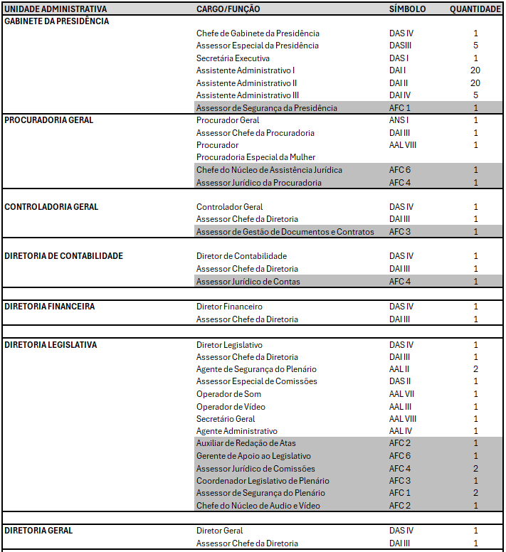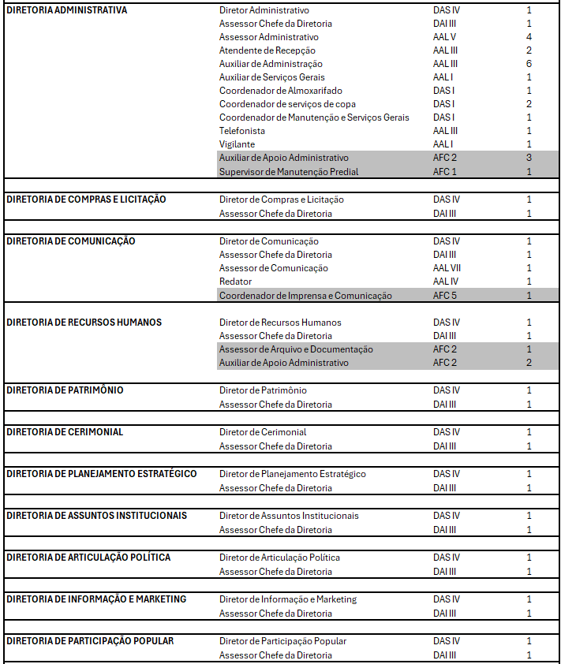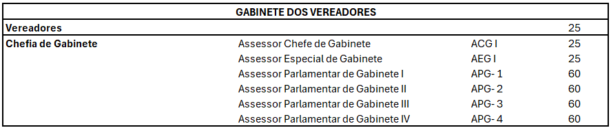

ANEXO II

TABELA DE SÍMBOLOS E VALORES DA REMUNERAÇÃO DOS CARGOS DA ESTRUTURA ADMINISTRATIVA

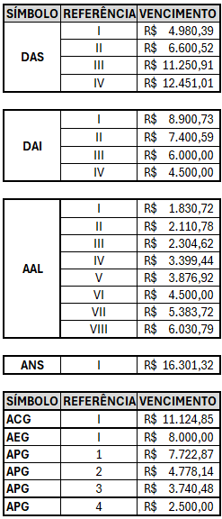

ANEXO III

CARGOS DE ASSESSORAMENTO PARLAMENTAR DE PROVIMENTO EM COMISSÃO COM SEUS RESPECTIVOS QUANTITATIVOS, SÍMBOLOS E VALORES DE REMUNERAÇÃO

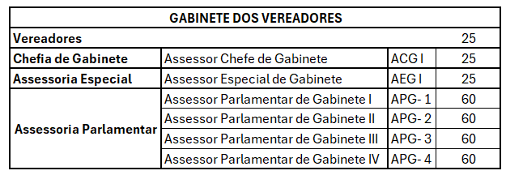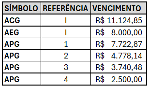

ANEXO IV

ADICIONAIS DE FUNÇÕES DE CONFIANÇA COM SÍMBOLOS E VALORES

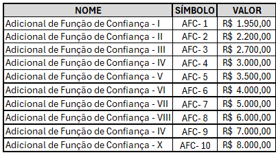

ANEXO V

QUADRO DE ATRIBUIÇÕES BÁSICAS DOS CARGOS COMISSIONADOS DA ESTRUTURA ADMINISTRATIVA DA CÂMARA MUNICIPAL DE GOIÂNIA

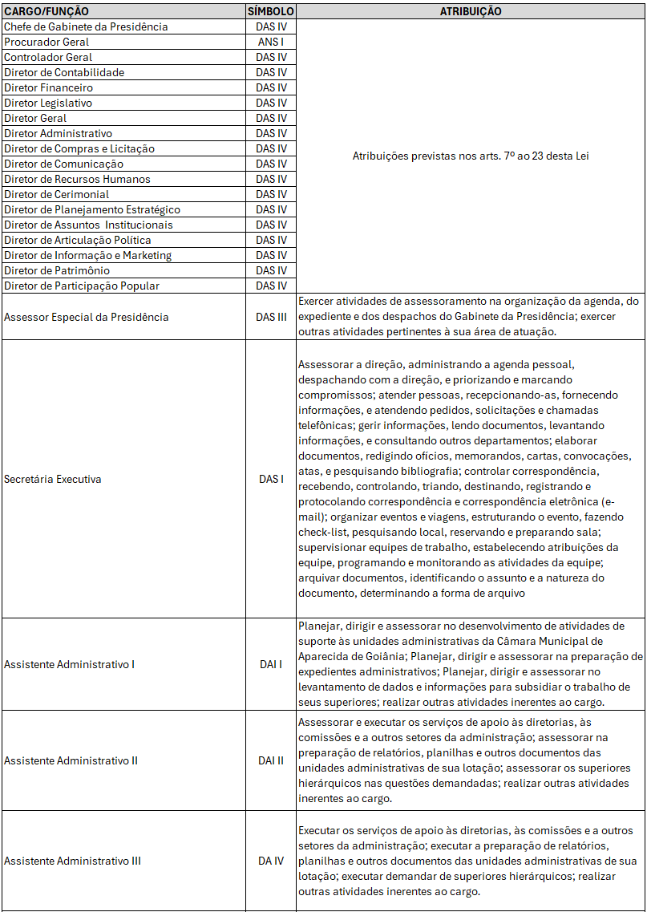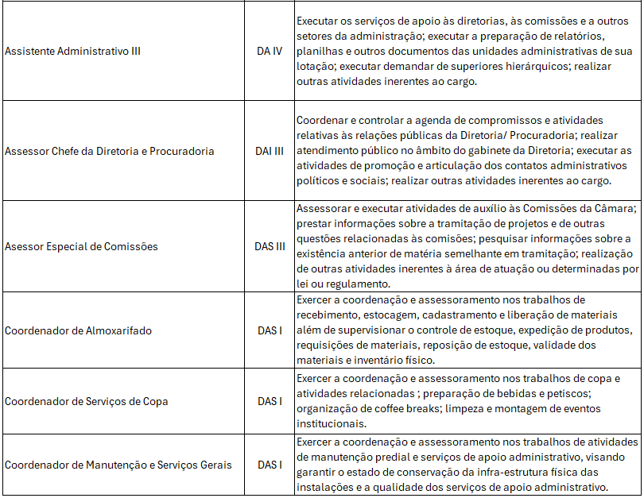

ANEXO VI

QUADRO DE ATRIBUIÇÕES BÁSICAS DOS CARGOS COMISSIONADOS DE ASSESSORAMENTO PARLAMENTAR

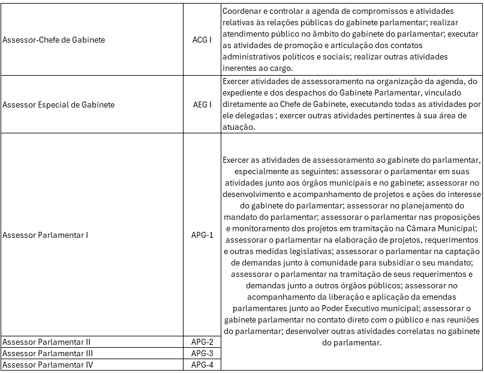

ANEXO VII

QUADRO DE ATRIBUIÇÕES BÁSICAS DOS CARGOS EFETIVOS

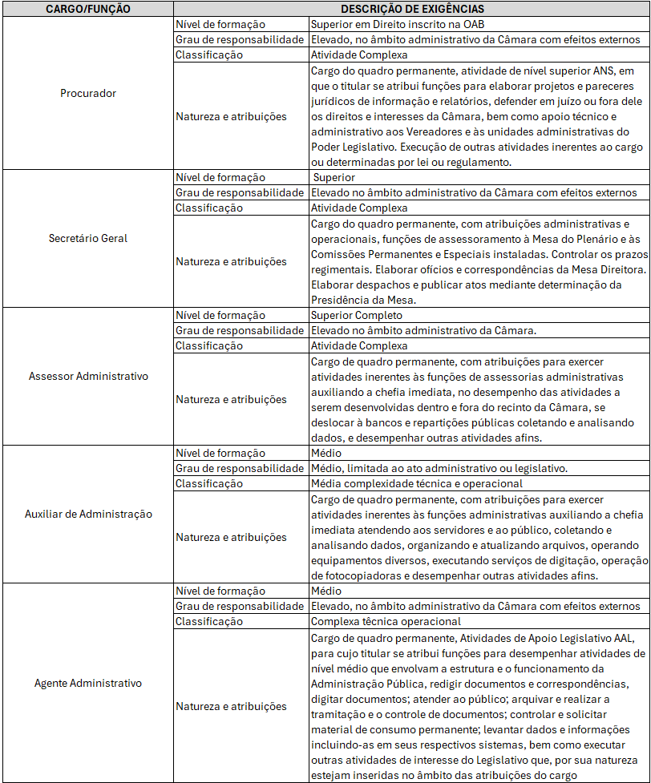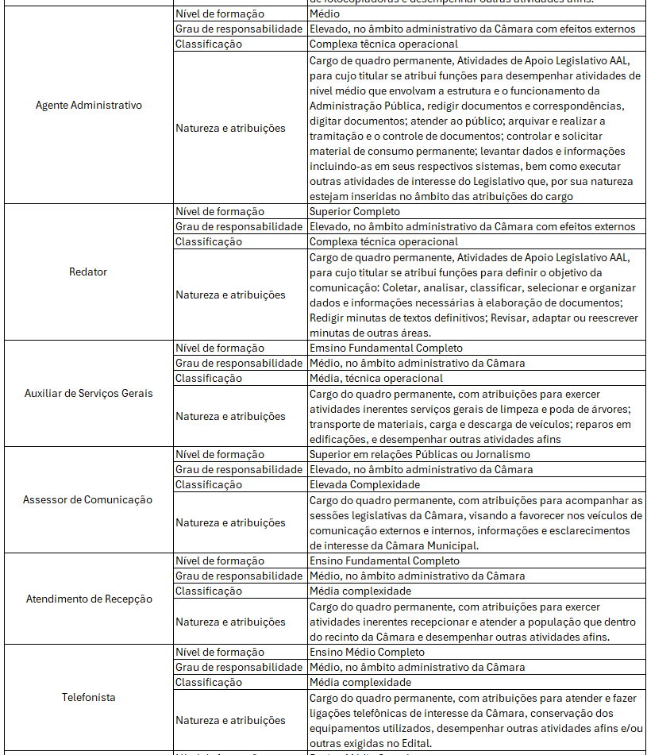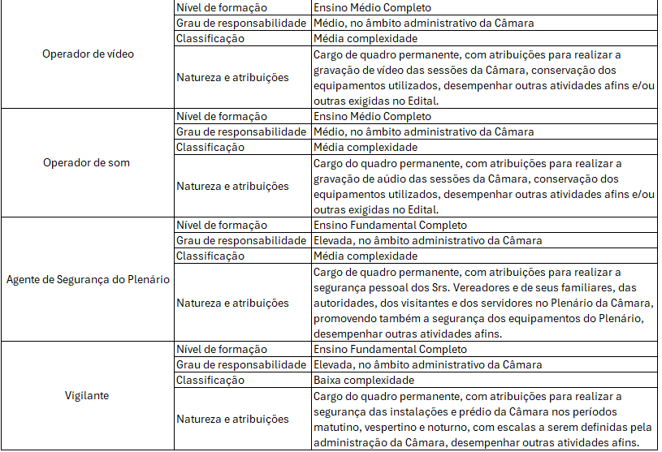

ANEXO VIII

QUADRO DE ATRIBUIÇÕES BÁSICAS DAS FUNÇÕES DE CONFIANÇA

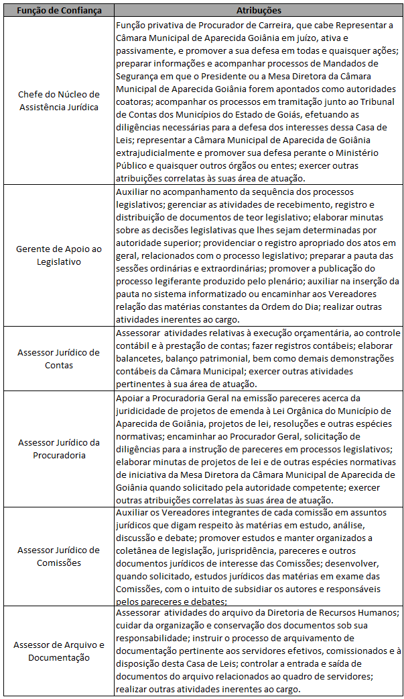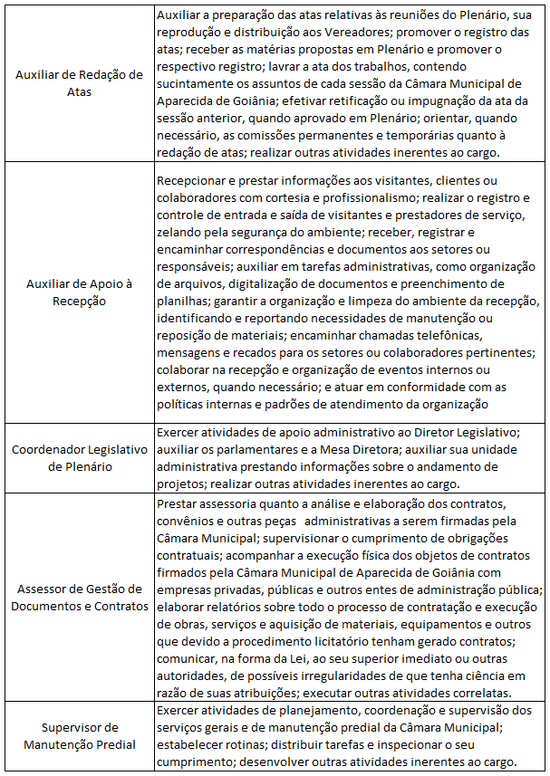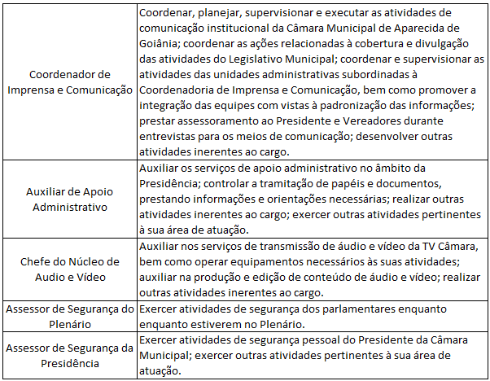

ANEXO IX

GRATIFICAÇÃO ESPECIAL DE SEGURANÇA COM SEUS RESPECTIVOS QUANTITATIVOS

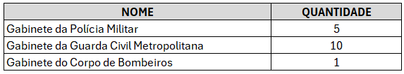
