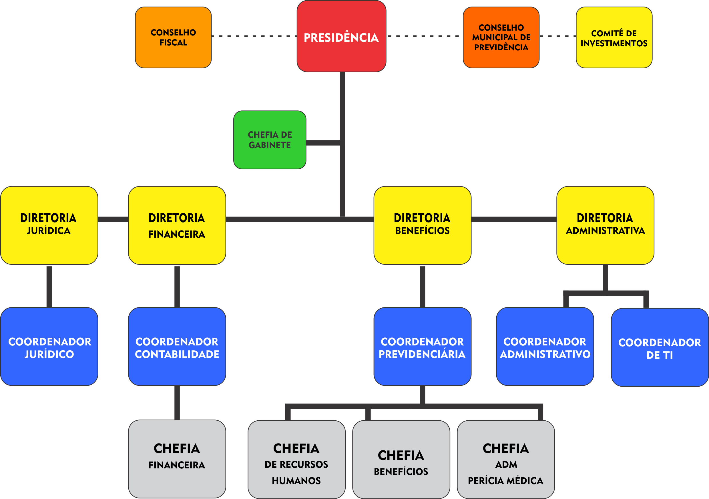

LEI COMPLEMENTAR Nº 127, DE 24 DE FEVEREIRO DE 2017

Institui a estrutura administrativa do Instituto de Previdência de Aparecida de Goiânia - APARECIDAPREV e dá outras providências.

FAÇO SABER QUE A CAMARA MUNICIPAL DE APARECIDA DE GOIÂNIA APROVOU E EU, PREFEITO MUNICIPAL, SANCIONO A SEGUINTE LEI COMPLEMENTAR:

Art. 1º Fica instituída a estrutura administrativa do Instituto de Previdência de Aparecida de Goiânia - APARECIDAPREV, autarquia pública criada pela Lei complementar nº 001 de 1º de novembro de 2001, com as alterações trazidas pela Lei Complementar n° 125, de 11 de janeiro de 2017, conforme organograma previsto no Anexo I desta Lei.

Art. 2º Ficam criados os cargos em comissão de Presidente, Diretor Financeiro, Diretor Benefícios, Diretor Jurídico e Diretor Administrativo na estrutura do APARECIDAPREV, com os vencimentos constantes no Anexo II dessa Lei.

§ 1º Para ocupar o cargo de Presidente do APARECIDAPREV, o servidor deverá possuir Diploma ou Certificado de conclusão em curso superior, devidamente reconhecido pelo Ministério da Educação e atender aos seguintes requisitos mínimos:

§1º. Para ocupar o cargo de Presidente do APARECIDAPREV, o servidor deverá possuir Diploma ou Certificado de conclusão em curso superior em Direito, Administração, Economia ou Contabilidade, com experiência mínima comprovada de 03 (três) anos de exercício na área de atuação, competindo ao mesmo:

I) Não ter sofrido condenação criminal ou incidido em alguma das demais situações de inelegibilidade previstas no inciso I do caput do art. 1º da Lei Complementar nº 64, de 18 de maio de 1990, observados os critérios e prazos previstos na referida Lei Complementar;

(Redação alterada pela Lei Complementar nº 172, de 3 de julho de 2020).

~~I – gerir e representar, inclusive juridicamente, o APARECIDAPREV;~~

II) Possuir certificação e habilitação comprovadas, nos termos definidos em parâmetros gerais;

(Redação alterada pela Lei Complementar nº 172, de 3 de julho de 2020).

~~II – gerir os recursos do APARECIDAPREV.~~

III) possuir comprovada experiência no exercício de atividade nas áreas financeiras, administrativa, contábil, jurídica, de fiscalização, atuarial ou de auditoria; Parágrafo único. Os requisitos a que se referem os incisos I e II do caput deste artigo aplicam-se aos membros dos conselhos deliberativos e fiscal e do comitê de investimentos da unidade gestora do regime próprio de previdência social.

(Redação alterada pela Lei Complementar nº 172, de 3 de julho de 2020).

~~III - organizar administrativa, contábil e financeiramente o APARECIDAPREV;~~

IV – assinar, em conjunto com Diretor Financeiro, todas as movimentações bancárias e financeiras;

V - desenvolver políticas estratégicas para aprimorar bom funcionamento do APARECIDAPREV.

§2º. Para ocupar o cargo de Diretor Financeiro, o servidor deverá possuir Diploma ou Certificado de conclusão em curso superior em Direito, Administração, Economia ou Contabilidade, com experiência mínima comprovada de 03 (três) anos de exercício na área de atuação, competindo ao mesmo:

I - assessorar o Presidente, arrecadar as contribuições previdenciárias do Ente e dos servidores junto ao órgão de lotação do segurado, além de calcular, conferir seu recolhimento e proceder as devidas cobranças;

II – gerir financeiramente os recursos, em conjunto com o Presidente;

III - prestar contas perante os órgãos competentes e seus segurados;

IV - em conjunto com Presidente, assinar todas as movimentações bancárias e financeiras;

V - pagar os benefícios previdenciários dos segurados e dos servidores do APARECIDAPREV.

(Redação acrescentada pela Lei Complementar nº 132, de 20 de outubro de 2017).

§3º. Para ocupar o cargo de Diretor de Benefícios, o servidor deverá possuir Diploma ou Certificado de conclusão em curso superior em Direito, com experiência mínima comprovada de 03 (três) anos de exercício na área de atuação, competindo ao mesmo:

~~I - pagar os benefícios previdenciários dos segurados e dos servidores do APARECIDAPREV;~~

(Revogado pela Lei Complementar nº 132, de 20 de outubro de 2017).

II - operacionalizar e fazer tramitar dos processos administrativos de concessão de benefícios previdenciários;

III - Gerenciar a Perícia Médica;

(Redação alterada pela Lei Complementar nº 132, de 20 de outubro de 2017).

~~III – Gerenciar a Perícia Médica;~~

IV – administrar a compensação financeira entre regimes;

V – realizar o recadastramento, prova de vida e revisão dos benefícios previdenciários;

V - prestar contas dos benefícios previdenciários perante os órgãos competentes.

§4º. Para ocupar o cargo de Diretor Jurídico, o servidor deverá possuir Diploma ou Certificado de conclusão em curso superior em Direito, com experiência mínima comprovada de 03 (três) anos de exercício na área de atuação, competindo ao mesmo:

I - assessorar o Presidente na representação jurídica e administrativa do APARECIDAPREV;

II - acompanhar todos os processos e procedimentos judiciais e administrativos em que for parte ou interessado o APARECIDAPREV;

III - assessorar os demais Diretores em suas competências específicas e a orientação jurídica em geral.

§5º. Para ocupar o cargo de Diretor Administrativo, o servidor deverá possuir Diploma ou Certificado de conclusão em curso superior em Direito, Administração, Economia ou Contabilidade, com experiência mínima comprovada de 03 (três) anos de exercício na área de atuação, competindo ao mesmo:

I – gerir as licitações e compras do APARECIDAPREV;

II - em conjunto com Presidente, administrar o patrimônio o APARECIDAPREV;

III – organizar os eventos e o cerimonial do APARECIDAPREV;

IV - prestar contas perante os órgãos competentes;

V - gerenciar o pessoal e as folhas de pagamento do APARECIDAPREV.

(Redação acrescentada pela Lei Complementar nº 132, de 20 de outubro de 2017).

Art. 3º Ficam criados os cargos em comissão de Coordenador Previdenciário, Coordenador Administrativo, Coordenador de Contabilidade, Coordenador de TI, Coordenador Jurídico, Chefe de Benefícios, Chefe de Financeiro, Chefe de Recursos Humanos, Chefe Administrativo de Perícia Médica, Chefe de Gabinete, Assessor Especial I e II, na estrutura administrativa do APARECIDAPREV, com vencimentos, requisitos e atribuições constantes no Anexo II desta Lei.

Parágrafo único. Quando a natureza do cargo exigir formação em nível superior, a referida formação deverá ser diretamente relacionada às atribuições dos cargos a serem ocupados.

Art. 4º - Ficam criados os cargos de provimento efetivo de Médico Perito Previdenciário, Contador, Analista Previdenciário, Assessor Jurídico, Analista Financeiro, Analista de Tecnologia da Informação, Técnico Previdenciário, Assistente Administrativo, Auxiliar Administrativo, Motorista e Auxiliar de Serviços Gerais, na estrutura administrativa do APARECIDAPREV, com vencimentos, requisitos e atribuições constantes no Anexo III desta Lei. 

(Redação alterada pela Lei Complementar nº 132, de 20 de outubro de 2017).

~~Art. 4º Ficam criados os cargos de provimento efetivo de Médico Perito Previdenciário, Contador, Analista Previdenciário, Assessor Jurídico, Assistente Administrativo e Financeiro, Analista de Tecnologia da Informação, Técnico Previdenciário, Assistente Administrativo, Auxiliar Administrativo, Motorista e Auxiliar de Serviços Gerais, na estrutura administrativa do APARECIDAPREV, com vencimentos, requisitos e atribuições constantes no Anexo III desta Lei.~~

Art. 5º As remunerações dos cargos previstos nos artigos 3º, 4º e 5º ficarão a cargo do APARECIDAPREV.

Art. 6º O subsídio do Presidente do APARECIDAPREV será reajustado na mesma data e percentual dos Secretários Municipais, sendo que os demais servidores serão reajustadas anualmente na mesma data e com os mesmos índices dos reajustes aplicados aos servidores do Município de Aparecida de Goiânia.

Art. 7º Até a realização de concurso público para o provimento do cargo efetivo de Médico Perito Previdenciário, poderá ser contratado profissional devidamente habilitado, conforme requisitos previstos no Anexo III desta Lei, por um período de 02 (dois) anos, prorrogável por mais 02 (dois) anos, de acordo com o que dispõe o inciso IX do art. 37, da Constituição Federal.

Art. 8º Os cargos públicos constantes do Anexo III criados por esta Lei serão ocupados gradativamente à medida que se realizarem concursos públicos e as nomeações só serão efetivadas quando houver disponibilidade orçamentária do APARECIDAPREV.

Art. 9º Esta Lei entrará em vigor na data de sua publicação.

Art. 10 Revoga-se a Lei Complementar nº 112, de 11 de dezembro de 2015 e demais disposições em contrário. Gabinete do Prefeito Municipal de Aparecida de Goiânia, aos 16 dias do mês de fevereiro de 2017.

GUSTAVO MENDANHA MELO

Prefeito Municipal

AFONSO BOAVENTURA

Chefe da Casa Civil

TARCÍSIO FRANCISCO DOS SANTOS

Presidente do APARECIDAPREV

ANEXO I

ORGANOGRAMA

ANEXO II

Cargos em Comissão

**CODIGO**

**QUANT.**

**CARGO**

**VENCIMENTO**

**DS1**

**01**

**Presidente**

**Equivalente à Secretário Municipal**

**DS2**

**04**

**Diretor**

**6.500,00**

**CC2**

**04**

**Coordenador**

**4.300,00**

**CC2**

**02**

**Coordenador Jurídico**

**4.300,00**

**CC3**

**04**

**Chefe**

**3.100,00**

**CC4**

**01**

**Chefe de Gabinete**

**3.100,00**

**ASE1**

**04**

**Assessor Especial I**

**2.100,00**

**ASE2**

**02**

**Assessor Especial II**

**1.700,00**

ANEXO II

Cargos em Comissão

COORDENADOR PREVIDENCIÁRIO

REQUISITOS: Diploma ou certificado de conclusão em curso superior em Direito.

ATRIBUIÇÕES: Supervisionar, organizar, processar e controlar todas as atividades referentes a benefícios concedidos pelo fundo de previdência; Receber e analisar todos os processos de inativações e pensões; Prestar informações aos servidores sobre o cálculo e as formas de inativações de acordo com as normas constitucionais vigentes; Manter registros e cadastros atualizados de inativos e pensionistas do Instituto; Enviar, acompanhar e responder diligências junto ao Tribunal de Contas dos Municípios - TCM de todos os processos de inativações e pensões; Promover exame, cálculo e partilha para pagamento de pensão mensal; Expedir certidões decorrentes de seus registros e assentamentos; Emitir pareceres técnicos sobre questões de natureza previdenciária; Elaborar relatórios de gestão previdenciária entregues ao Ministério da Previdência Social; Supervisionar e controlar as atividades do setor de compensação previdenciária; Supervisionar e controlar as atividades relativas ao senso previdenciário; Assessorar o Diretor de Benefícios relativos à sua área de atuação.

COORDENADOR DE CONTABILIDADE

REQUISITOS: Diploma ou certificado de curso superior área de Contabilidade, com registro no Conselho Regional de Contabilidade.

ATRIBUIÇÕES: Fechamento dos balancetes mensais do APARECIDAPREV para o Tribunal de Contas dos Municípios - TCM; Fechamento dos balancetes mensais do APARECIDAPREV para o Ministério da Previdência - MSP; Declaração de Débitos e Créditos Tributários Federais - DCTF e Declaração do Imposto sobre a Renda Retido na Fonte - DIRF, junto à Receita Federal. Fornecimento dos dados contábeis para transmissão semestral do Relatório de Gestão Fiscal (RGF), em cumprimento a Leis Complementar nº 101/2000; Fornecimento dos dados contábeis para transmissão bimestral do Relatório Resumido de Execução Orçamentária (RREO), em cumprimento a Leis Complementar nº 101/2000; Acompanhamentos e atendimento aos itens do CAUC/SIAFI, pertinentes ao Instituto de Previdência; Formalização e Acompanhamento de Procedimentos Licitatórios; Elaboração do Plano Orçamentário do APARECIDAPREV, facilitando a elaboração do Orçamento Geral. Assessorar o Diretor Financeiro em suas atribuições legais.

COORDENADOR JURÍDICO

REQUISITOS: Diploma ou certificado de conclusão em curso de graduação de nível superior em Direito, com inscrição na Ordem dos Advogados do Brasil.

ATRIBUIÇÕES: Coordenar e executar atividades da área, em assuntos sobre questões judiciais e extrajudiciais; Emissão de pareceres relativos a processos administrativos de concessão de benefícios previdenciários e consultas jurídicas diversas relativas a área; Executar atividades específicas de acordo com as determinações da alta administração; Elaborar e acompanhar ações judiciais contra terceiros, defendendo os interesses do Instituto de Previdência de Aparecida de Goiânia - APARECIDAPREV; Assessorar o Diretor Jurídico em suas atribuições legais.

COORDENADOR ADMINISTRATIVO

REQUISITOS: Diploma ou Certificado de conclusão em curso superior nas áreas de: Direito, Administração, Economia, Gestão Pública. 

ATRIBUIÇÕES: Assessorar do Diretor Administrativo; Supervisionar, organizar, processar e controlar todas as atividades referentes a área administrativa do APARECIDAPREV; montar e analisar todos os processos de licitação e compras para aquisição de bens e serviços.

COORDENADOR DE TECNOLOGIA DA INFORMAÇÃO

REQUISITOS: Diploma ou certificado de conclusão no curso superior na área de: Sistema de Informação, Ciência da Computação, Engenharia da Computação ou Equivalentes.

ATRIBUIÇÕES: Apoio aos usuários em suas necessidades que envolvem o uso de serviços oferecidos pela Gerência; esclarecimento de dúvidas, respostas a consultas e atendimento de solicitações dos usuários; Administração de dados; Administração de banco de dados; Projeto, desenvolvimento, implantação e manutenção de sistemas de informações; Administração, projeto e implantação da rede de comunicação de dados e serviços associados; Implantação e suporte à sistemas operacionais; Manutenção técnica, monitoramento e operação dos equipamentos de informática; Manutenção técnica, monitoramento e operação da rede de comunicação de dados e serviços associados; Execução de rotinas de salvamento de dados; Assessorar a aquisição de bens e contratação de serviços na área de informática do APARECIDAPREV.

CHEFE DE FINANCEIRO

REQUISITOS: Diploma ou Certificado de conclusão em curso superior em Direito, Administração, Economia, Contabilidade ou Gestão Pública.

ATRIBUIÇÕES: Montagem e acompanhamentos de processos; Controle e liquidações de pagamentos; Controle da frota; Protocolo, envio e remessa processos de Licitação; Arquivo da contabilidade; Assessorar o Diretor Financeiro; Referendar os atos do Coordenador de Contabilidade relativos à sua área de atuação.

CHEFE DE RECURSOS HUMANOS

REQUISITOS: Diploma ou Certificado de conclusão em curso superior em: Direito, Administração, Economia, Contabilidade, Gestão Pública ou Gestão de Recursos Humanos.

ATRIBUIÇÕES: Coordenar lançamentos de licenças (auxilio doença e salario maternidade), aposentadorias e pensões no sistema, inerentes a folha de pagamento dos beneficiários do RPPS, Execução das folhas de pagamentos e Informação ao RH da Prefeitura de Aparecida de Goiânia; Geração da remessa de pagamento dos funcionários do APARECIDAPREV, inativos e pensionistas, com envio de dados para a rede Bancaria com emissão de relatórios aos Diretores e Contabilidade; Geração e tratamento do arquivo da folha de pagamento para envio ao Tribunal de Contas dos Municípios – TCM;  Elaboração de portarias para os benefícios auxílio-doença e salario maternidade concedidos; Gerar relatórios de todos atividades, sempre que solicitado;  Assessorar o Diretor de Benefícios relativos à sua área de atuação.

CHEFE DE BENEFICIOS

REQUISITOS: Diploma ou Certificado de conclusão em curso superior em Direito, Administração, Serviço Social ou Gestão Pública.

ATRIBUIÇÕES: Organizar, processar e controlar todas as atividades referentes a benefícios concedidos pelo fundo de previdência; Prestar informações aos servidores sobre o cálculo e as formas de inativações de acordo com as normas constitucionais vigentes; Manter registros e cadastros atualizados de inativos e pensionistas do Instituto; Registrar e manter atualizados os assentamentos dos segurados e pensionistas, com a documentação correspondente e o arquivo dos respectivos processos e outros expedientes; Enviar ao Tribunal de Contas do Estado - TCE todos os processos de inativações e pensões; Receber da Perícia Médica os processos de inativações por invalidez; Orientar beneficiários de segurados falecidos e realizar investigações socioeconômicas para a comprovação de vínculo de dependência; Proceder quaisquer diligências à residência de beneficiários, com o objetivo de verificar o cumprimento de exigências; Assessorar o Diretor de Benefícios; Referendar os atos do Coordenador Previdenciário relativos à sua área de atuação.

CHEFE ADMINISTRATIVO DA PERÍCIA MÉDICA

REQUISITOS: Diploma ou Certificado de conclusão em curso superior em: Serviço Social, Administração, Gestão Pública ou Gestão Hospitalar.

ATRIBUIÇÕES: Agendamento e atendimento ao servidor na perícia médica; assessorar os profissionais de saúde; Encaminhamento de processos de aposentadoria por invalidez; Prestar esclarecimentos dos benefícios concedidos pela Perícia Médica ao Diretor de Benefícios; Zelar pelo Prontuário Médico e arquivo da Perícia Medica; Assessorar o Diretor de Benefícios; Referendar os atos do Coordenador Previdenciário relativos à sua área de atuação.

CHEFE DE GABINETE

Requisitos: Possuir Diploma, Certificado e/ ou Histórico Escolar que comprove a conclusão do 2º grau, nível médio;

(Redação alterada pela Lei Complementar nº 172, de 3 de julho de 2019).

~~REQUISITOS: Diploma ou certificado de conclusão de nível superior em: Administração, Economia, Direito, Secretariado ou Gestão Pública.~~

ATRIBUIÇÕES: Assistir à Presidência em suas representações política e social; revisar e encaminhar os atos administrativos e normativos da Presidência; encaminhar, revisar e controlar a documentação e a correspondência, no âmbito do Gabinete; Controlar a agenda diária da Presidência; Coordenar as atividades administrativas do Gabinete; zelar pela manutenção dos bens patrimoniais do Gabinete; responsabilizar-se pelo cerimonial e eventos da Presidência.

ASSESSOR ESPECIAL I

REQUISITOS: Certificado de conclusão de curso de nível médio (antigo 2.º grau) expedido por instituição oficial de ensino reconhecida pelo Ministério da Educação.

ATRIBUIÇÕES: auxiliar no controle das atividades e tarefas da Diretoria do APARECIDAPREV; auxiliar na implantação e execução em dados apurados, localizar os desvios, erros e omissões em dados apurados, revendo os serviços executados; receber, registrar e encaminhar documentos em geral; receber, conferir e expedir malotes; executar serviços administrativos inerentes à área de atuaçã; elaborar e digitar tabelas, gráficos, mapas, quadros demonstrativos, relatórios, planilhas e outros expedientes administrativos; controlar suprimentos de materiais; instruir processos diversos, preparar processos de prestação de contas e prestar atendimento a fornecedores e ao público em geral; desempenhar outras tarefas semelhantes.

ASSESSOR ESPECIAL II

REQUISITOS: Certificado de conclusão de curso de nível médio (antigo 2.º grau) expedido por instituição oficial de ensino reconhecida pelo Ministério da Educação.

ATRIBUIÇÕES: auxiliar no controle das atividades e tarefas dos membros da Diretoria do APARECIDAPREV; auxiliar na implantação e execução em dados apurados, revendo os serviços executados; localizar os desvios, erros e omissões em dados apurados, revendo os serviços executados; receber, registrar e encaminhar documentos em geral; receber, conferir e expedir malotes; desempenhar outras tarefas semelhantes.

ANEXO III

Cargos Efetivos

 

**CARGA HORARIASEMANAL**

**QUANT.**

**CARGO**

**VENCIMENTO**

20h

03

Médico Perito Previdenciário

4.000,00

40h

01

Contador

4.000,00

40h

02

Analista Previdenciário

4.000,00

40h

02

Assessor Jurídico

4.000,00

40h

01

Analista Financeiro

4.000,00

40h

01

Analista de TI

3.000,00

40h

04

Técnico Previdenciário

2.200,00

40h

06

Assistente Administrativo

2.200,00

40h

02

Motorista

1.600,00

40h

03

Auxiliar Administrativo

1.300,00

40h

04

Auxiliar de Serviços Gerais

937,00

MÉDICO PERITO PREVIDENCIÁRIO

REQUISITOS: Diploma ou certificado de conclusão de curso de graduação em medicina inscrito do Conselho Federal de Medicina ou suas Regionais. 

REFERÊNCIAS: Deve ter boa formação médica, manter-se atualizado com as diversas técnicas utilizadas nas investigações médico-periciais, visando a conclusões seguras, e acompanhar a evolução da legislação que define os procedimentos nessa área.

ATRIBUIÇÕES: Compete ao médico perito realizar exame médico-pericial visando definir o nexo de causalidade (causa e efeito) entre:

I - doença ou lesão;

II - doença ou sequela de acidente e a incapacidade ou invalidez física e/ou mental;

III - o acidente e a lesão;

IV - doença ou acidente e o exercício da atividade laboral;

V - doença ou acidente e sequelas temporária ou permanente;

VI - desempenho de atividade e riscos para si e para terceiros.

VII - O médico perito, através de competente inspeção médica, pode concluir se a pessoa portadora ou não de doença ou vítima de sequela resultante de acidente reúne condições para exercer determinada atividade (ocupação); é o denominado exame de aptidão/inaptidão física e/ou mental.

CONTADOR

REQUISITOS: Diploma ou certificado de conclusão de curso de graduação em contabilidade inscrito no Conselho Regional de Contabilidade. 

REFERÊNCIAS: Deve ter boa formação, manter-se atualizado com as diversas técnicas utilizadas, visando a conclusões seguras, e acompanhar a evolução da legislação que define os procedimentos nessa área.

ATRIBUIÇÕES: Fechamento dos balancetes mensais do APARECIDAPREV para o Tribunal de Contas dos Municípios – TCM; Fechamento dos balancetes mensais do APARECIDAPREV para o Ministério da Previdência; Fornecimento dos dados contábeis para transmissão semestral do Relatório de Gestão Fiscal (RGF), em cumprimento a Leis Complementar 101/2000; Fornecimento dos dados contábeis para transmissão bimestral do Relatório Resumido de Execução Orçamentária (RREO), em cumprimento a Leis Complementar 101/2000; Elaboração do Plano Orçamentário do Instituto, facilitando a elaboração do Orçamento Geral; análise de registro de operações e rotinas contábeis.

ANALISTA PREVIDENCIÁRIO

REQUISITOS: Diploma ou certificado de conclusão em curso de graduação de nível superior em Direito.

ATRIBUIÇÕES: Executar atividades de instrução e de análise de processos, de cálculos previdenciários, de manutenção e de revisão de direitos ao recebimento de benefícios previdenciários; proceder à orientação previdenciária e ao atendimento aos usuários; realizar estudos técnicos e estatísticos; executar, em caráter geral, as demais atividades inerentes às competências do APARECIDAPREV.

ASSESSOR JURÍDICO

REQUISITOS: Diploma ou certificado de conclusão em curso de graduação de nível superior em Direito, com inscrição na Ordem dos Advogados do Brasil.

ATRIBUIÇÕES: Executar as atividades jurídicas do RPPS; Opinar e executar atividades da área, em assuntos sobre questões judiciais e extrajudiciais; Emissão de pareceres relativos a processos administrativos de concessão de benefícios previdenciários e consultas jurídicas diversas relativas a área; Executar atividades específicas de acordo com as determinações da alta administração e do Coordenador Jurídico; Elaborar e acompanhar, junto com o Presidente, Diretor Jurídico e/ou Coordenador Jurídico, ações judiciais contra terceiros, defendendo os interesses do Instituto de Previdência de Aparecida de Goiânia - APARECIDAPREV; Assessorar o Diretor Jurídico e o Coordenador Jurídico em suas atribuições legais.

ANALISTA FINANCEIRO

REQUISITOS: Certificado ou Certificado de conclusão de curso de nível superior em Administração, Ciências Econômicas ou Ciências Contábeis.

ATRIBUIÇÕES: Responsável por auxiliar nas atividades da Diretoria Administrativa Financeira do APARECIDAPREV; Preparar, organizar, analisar, controlar e arquivar documentos; Emissão de relatórios em geral, planilha, elaboração de gráficos e documentos para analise gerencial; Planejamento orçamentário com acompanhamento das receitas e despesas prevista; Preenchimento de cheques, realizar conciliação bancária, emissão de extratos; Prestação de contas perante aos órgãos competentes e seus segurados; Controlar e conferir os processos de pagamento (fornecedores, folha de pagamento, impostos, encargos, contribuições previdenciárias, etc.); Colaborar na redação, geração, conferência de cartas, ofícios e relatórios financeiros; Acompanhar as reuniões administrativas com os Conselhos: Suporte e atualização aos procedimentos e nos processos internos; Auxiliar em todas as fases do processo de compras; Controle de matérias de expedientes e contratos; Receber e respeitar orientações sobre ética, responsabilidade social e Princípios  Constitucionais aplicados ao Direito da Administração da atividade pública; Possuir domínio da matemática básica e financeira, domínio nas ferramentas de informática, ser proativo, organizado, paciente, ter espirito de liderança, saber gerir crises, ser concentrado e trabalhar em equipe.

ANALISTA DE TECNOLOGIA DA INFORMAÇÃO

REQUISITOS: Diploma ou certificado de conclusão em curso de graduação de nível superior em Ciências da Computação, Sistema de Informação, Análise e Desenvolvimento de Sistemas, Engenharia da Computação ou curso equivalente.

 

ATRIBUIÇÕES: Apoio aos usuários em suas necessidades que envolvem o uso de serviços oferecidos pela autarquia, esclarecimento de dúvidas, respostas a consultas e atendimento de solicitações dos usuários; Administração de dados; Administração de bancos de dados; Projetos, desenvolvimento, implantação e manutenção de sistemas de informações; Administração, projeto e implantação da rede de comunicação de dados e serviços associados; implantação e suporte a sistemas operacionais; Manutenção técnica, monitoramento e operação dos equipamentos de informática; Manutenção técnica, monitoramento e operação da rede de comunicação de dados e serviços associados; Execução de rotinas de salvamento de dados.  

TÉCNICO PREVIDENCIÁRIO

REQUISITOS: Certificado de conclusão de curso de nível médio (antigo 2.º grau) expedido por instituição oficial de ensino reconhecida pelo Ministério da Educação.

ATRIBUIÇÕES: Executar atividades de suporte e de apoio técnico especializado quanto a orientação previdenciária e ao atendimento aos usuários, abertura e tramitação de processos de benefícios previdenciários e pensões, inerentes às atividades previdenciárias de competência do APARECIDAPREV.

ASSISTENTE ADMINISTRATIVO

REQUISITOS: Certificado de conclusão de curso de nível médio (antigo 2º grau), expedido por instituição oficial de ensino reconhecida pelo Ministério da Educação.

ATRIBUIÇÕES: Executar as atividades rotineiras e no controle de gestão da administração, organização de arquivos, gerência de informações, revisão de documentos entre outras atividades, atender telefonemas e esclarecer dúvidas sobre a administração, elaborar e apresentar relatório administrativo coordenando o departamento de compras e sempre manter organizados arquivos e cadastros da autarquia e atendimento ao público em geral.

MOTORISTA

REQUISITOS: Certificado de conclusão de curso de nível fundamental (antigo 1.º grau) expedido por instituição oficial de ensino reconhecida pelo Ministério da Educação.

ATRIBUIÇÕES: Possuir Carteira nacional de Habilitação - CNH, na categoria mínima “B”.

AUXILIAR ADMINISTRATIVO

REQUISITOS: Certificado de conclusão de curso de nível fundamental (antigo 1.º grau) expedido por instituição oficial de ensino reconhecida pelo Ministério da Educação.

ATRIBUIÇÕES: Auxiliar as atividades de suporte e de apoio técnico especializado quanto as rotinas administrativas e ao atendimento aos usuários, abertura e tramitação de processos de competência do APARECIDAPREV.

AUXILIAR DE SERVIÇOS GERAIS

REQUISITOS: Certificado de conclusão de curso de nível fundamental (antigo 1.º grau) expedido por instituição oficial de ensino reconhecida pelo Ministério da Educação.

ATRIBUIÇÕES: Proceder a limpeza, conservação e arrumação dos locais de trabalho e instalações, mantendo limpos os equipamentos, materiais e maquinas da autarquia, de acordo com a necessidade; realizar trabalhos de natureza manual ou braçal.

 ANEXO III

Cargos Efetivos

CARGA HORARIA SEMANAL

QUANT.

CARGO

VENCIMENTO

20h

03

Médico Perito Previdenciário

4.000,00

40h

01

Contador

4.000,00

40h

02

Analista Previdenciário

4.000,00

40h

02

Assessor Jurídico

4.000,00

40h

01

Analista Financeiro

4.000,00

40h

01

Analista de TI

3.000,00

40h

04

Técnico Previdenciário

2.200,00

40h

06

Assistente Administrativo

2.200,00

40h

02

Motorista

1.600,00

40h

03

Auxiliar Administrativo

1.300,00

40h

04

Auxiliar de Serviços Gerais

937,00

(Redação alterada pela Lei Complementar nº 132, de 20 de outubro de 2017).

MÉDICO PERITO PREVIDENCIÁRIO

REQUISITOS: Diploma ou certificado de conclusão de curso de graduação em medicina inscrito do Conselho Federal de Medicina ou suas Regionais. 

REFERÊNCIAS: Deve ter boa formação médica, manter-se atualizado com as diversas técnicas utilizadas nas investigações médico-periciais, visando a conclusões seguras, e acompanhar a evolução da legislação que define os procedimentos nessa área.

ATRIBUIÇÕES: Compete ao médico perito realizar exame médico-pericial visando definir o nexo de causalidade (causa e efeito) entre:

I - doença ou lesão;

II - doença ou sequela de acidente e a incapacidade ou invalidez física e/ou mental;

III - o acidente e a lesão;

IV - doença ou acidente e o exercício da atividade laboral;

V - doença ou acidente e sequelas temporária ou permanente;

VI - desempenho de atividade e riscos para si e para terceiros.

VII - O médico perito, através de competente inspeção médica, pode concluir se a pessoa portadora ou não de doença ou vítima de sequela resultante de acidente reúne condições para exercer determinada atividade (ocupação); é o denominado exame de aptidão/inaptidão física e/ou mental.

(Redação alterada pela Lei Complementar nº 132, de 20 de outubro de 2017).

CONTADOR

REQUISITOS: Diploma ou certificado de conclusão de curso de graduação em contabilidade inscrito no Conselho Regional de Contabilidade. 

REFERÊNCIAS: Deve ter boa formação, manter-se atualizado com as diversas técnicas utilizadas, visando a conclusões seguras, e acompanhar a evolução da legislação que define os procedimentos nessa área.

ATRIBUIÇÕES: Fechamento dos balancetes mensais do APARECIDAPREV para o Tribunal de Contas dos Municípios – TCM; Fechamento dos balancetes mensais do APARECIDAPREV para o Ministério da Previdência; Fornecimento dos dados contábeis para transmissão semestral do Relatório de Gestão Fiscal (RGF), em cumprimento a Leis Complementar 101/2000; Fornecimento dos dados contábeis para transmissão bimestral do Relatório Resumido de Execução Orçamentária (RREO), em cumprimento a Leis Complementar 101/2000; Elaboração do Plano Orçamentário do Instituto, facilitando a elaboração do Orçamento Geral; análise de registro de operações e rotinas contábeis.

(Redação alterada pela Lei Complementar nº 132, de 20 de outubro de 2017).

ANALISTA PREVIDENCIÁRIO

REQUISITOS: Diploma ou certificado de conclusão em curso de graduação de nível superior em Direito.

ATRIBUIÇÕES: Executar atividades de instrução e de análise de processos, de cálculos previdenciários, de manutenção e de revisão de direitos ao recebimento de benefícios previdenciários; proceder à orientação previdenciária e ao atendimento aos usuários; realizar estudos técnicos e estatísticos; executar, em caráter geral, as demais atividades inerentes às competências do APARECIDAPREV.

(Redação alterada pela Lei Complementar nº 132, de 20 de outubro de 2017).

ASSESSOR JURÍDICO

REQUISITOS: Diploma ou certificado de conclusão em curso de graduação de nível superior em Direito, com inscrição na Ordem dos Advogados do Brasil, além da aprovação em concurso público de provas e títulos.

(Redação alterada pela Lei Complementar nº 145, de 10 de setembro de 2018).

~~REQUISITOS: Diploma ou certificado de conclusão em curso de graduação de nível superior em Direito, com inscrição na Ordem dos Advogados do Brasil.~~

ATRIBUIÇÕES: Executar as atividades jurídicas do RPPS; Opinar e executar atividades da área, em assuntos sobre questões judiciais e extrajudiciais; Emissão de pareceres relativos a processos administrativos de concessão de benefícios previdenciários e consultas jurídicas diversas relativas a área; Executar atividades específicas de acordo com as determinações da alta administração e do Coordenador Jurídico; Elaborar e acompanhar, junto com o Presidente, Diretor Jurídico e/ou Coordenador Jurídico, ações judiciais contra terceiros, defendendo os interesses do Instituto de Previdência de Aparecida de Goiânia - APARECIDAPREV; Assessorar o Diretor Jurídico e o Coordenador Jurídico em suas atribuições legais.

(Redação alterada pela Lei Complementar nº 132, de 20 de outubro de 2017).

ANALISTA FINANCEIRO

REQUISITOS: Certificado ou Certificado de conclusão de curso de nível superior em Administração, Ciências Econômicas ou Ciências Contábeis.

ATRIBUIÇÕES: Responsável por auxiliar nas atividades da Diretoria Administrativa Financeira do APARECIDAPREV; Preparar, organizar, analisar, controlar e arquivar documentos; Emissão de relatórios em geral, planilha, elaboração de gráficos e documentos para analise gerencial; Planejamento orçamentário com acompanhamento das receitas e despesas prevista; Preenchimento de cheques, realizar conciliação bancária, emissão de extratos; Prestação de contas perante aos órgãos competentes e seus segurados; Controlar e conferir os processos de pagamento (fornecedores, folha de pagamento, impostos, encargos, contribuições previdenciárias, etc.); Colaborar na redação, geração, conferência de cartas, ofícios e relatórios financeiros; Acompanhar as reuniões administrativas com os Conselhos: Suporte e atualização aos procedimentos e nos processos internos; Auxiliar em todas as fases do processo de compras; Controle de matérias de expedientes e contratos; Receber e respeitar orientações sobre ética, responsabilidade social e Princípios  Constitucionais aplicados ao Direito da Administração da atividade pública; Possuir domínio da matemática básica e financeira, domínio nas ferramentas de informática, ser proativo, organizado, paciente, ter espirito de liderança, saber gerir crises, ser concentrado e trabalhar em equipe.

(Redação alterada pela Lei Complementar nº 132, de 20 de outubro de 2017).

ANALISTA DE TECNOLOGIA DA INFORMAÇÃO

REQUISITOS: Diploma ou certificado de conclusão em curso de graduação de nível superior em Ciências da Computação, Sistema de Informação, Análise e Desenvolvimento de Sistemas, Engenharia da Computação ou curso equivalente.

 

ATRIBUIÇÕES: Apoio aos usuários em suas necessidades que envolvem o uso de serviços oferecidos pela autarquia, esclarecimento de dúvidas, respostas a consultas e atendimento de solicitações dos usuários; Administração de dados; Administração de bancos de dados; Projetos, desenvolvimento, implantação e manutenção de sistemas de informações; Administração, projeto e implantação da rede de comunicação de dados e serviços associados; implantação e suporte a sistemas operacionais; Manutenção técnica, monitoramento e operação dos equipamentos de informática; Manutenção técnica, monitoramento e operação da rede de comunicação de dados e serviços associados; Execução de rotinas de salvamento de dados.  

(Redação alterada pela Lei Complementar nº 132, de 20 de outubro de 2017).

TÉCNICO PREVIDENCIÁRIO

REQUISITOS: Certificado de conclusão de curso de nível médio (antigo 2.º grau) expedido por instituição oficial de ensino reconhecida pelo Ministério da Educação.

ATRIBUIÇÕES: Executar atividades de suporte e de apoio técnico especializado quanto a orientação previdenciária e ao atendimento aos usuários, abertura e tramitação de processos de benefícios previdenciários e pensões, inerentes às atividades previdenciárias de competência do APARECIDAPREV.

(Redação alterada pela Lei Complementar nº 132, de 20 de outubro de 2017).

ASSISTENTE ADMINISTRATIVO

REQUISITOS: Certificado de conclusão de curso de nível médio (antigo 2º grau), expedido por instituição oficial de ensino reconhecida pelo Ministério da Educação.

ATRIBUIÇÕES: Executar as atividades rotineiras e no controle de gestão da administração, organização de arquivos, gerência de informações, revisão de documentos entre outras atividades, atender telefonemas e esclarecer dúvidas sobre a administração, elaborar e apresentar relatório administrativo coordenando o departamento de compras e sempre manter organizados arquivos e cadastros da autarquia e atendimento ao público em geral.

(Redação alterada pela Lei Complementar nº 132, de 20 de outubro de 2017).

MOTORISTA

REQUISITOS: Certificado de conclusão de curso de nível fundamental (antigo 1.º grau), expedido por instituição oficial de ensino reconhecida pelo Ministério da Educação e Carteira nacional de Habilitação - CNH, na categoria mínima “B”.

ATRIBUIÇÕES: Conduzir os veículos da frota do APARECIDAPREV em deslocamentos municipais, intermunicipais e interestaduais, com ou sem passageiros, inclusive em finais de semana, feriados e horários fora do expediente, de acordo com as demandas administrativas do órgão.

(Redação alterada pela Lei Complementar nº 141, de 16 de abril de 2018).

 

~~MOTORISTA~~

~~REQUISITOS: Certificado de conclusão de curso de nível fundamental (antigo 1.º grau) expedido por instituição oficial de ensino reconhecida pelo Ministério da Educação.~~

~~ATRIBUIÇÕES: Possuir Carteira nacional de Habilitação - CNH, na categoria mínima “B”.~~

~~(Redação alterada pela Lei Complementar nº 132, de 20 de outubro de 2017).~~

AUXILIAR ADMINISTRATIVO

REQUISITOS: Certificado de conclusão de curso de nível fundamental (antigo 1.º grau) expedido por instituição oficial de ensino reconhecida pelo Ministério da Educação.

ATRIBUIÇÕES: Auxiliar as atividades de suporte e de apoio técnico especializado quanto as rotinas administrativas e ao atendimento aos usuários, abertura e tramitação de processos de competência do APARECIDAPREV.

(Redação alterada pela Lei Complementar nº 132, de 20 de outubro de 2017).

AUXILIAR DE SERVIÇOS GERAIS

REQUISITOS: Certificado de conclusão de curso de nível fundamental (antigo 1.º grau) expedido por instituição oficial de ensino reconhecida pelo Ministério da Educação.

ATRIBUIÇÕES: Proceder a limpeza, conservação e arrumação dos locais de trabalho e instalações, mantendo limpos os equipamentos, materiais e maquinas da autarquia, de acordo com a necessidade; realizar trabalhos de natureza manual ou braçal.

(Redação alterada pela Lei Complementar nº 132, de 20 de outubro de 2017).

~~C.H.S.~~

~~QUANT.~~

~~CARGO~~

~~VENCIMENTO~~

~~20h~~

~~03~~

~~Médico Perito Previdenciário~~

~~4.000,00~~

~~40h~~

~~01~~

~~Contador~~

~~4.000,00~~

~~40h~~

~~02~~

~~Analista Previdenciário~~

~~4.000,00~~

~~40h~~

~~02~~

~~Assessor Jurídico~~

~~4.000,00~~

~~40H~~

~~01~~

~~Assistente Administrativo e Financeiro~~

~~4.000,00~~

~~40h~~

~~01~~

~~Analista de Tecnologia da Informação~~

~~3.000,00~~

~~40h~~

~~04~~

~~Técnico Previdenciário~~

~~2.200,00~~

~~40h~~

~~06~~

~~Assistente Administrativo~~

~~2.200,00~~

~~40h~~

~~02~~

~~Motorista~~

~~1.600,00~~

~~40h~~

~~03~~

~~Auxiliar Administrativo~~

~~1.300,00~~

~~40h~~

~~04~~

~~Auxiliar de Serviços Gerais~~

~~937,00~~

~~MÉDICO PERITO PREVIDENCIÁRIO~~

~~REQUISITOS: Diploma ou certificado de conclusão de curso de graduação em medicina inscrito do Conselho Federal de Medicina ou suas Regionais.~~ 

~~Deve ter boa formação médica, manter-se atualizado com as diversas técnicas utilizadas nas investigações médico-periciais, visando a conclusões seguras, e acompanhar a evolução da legislação que define os procedimentos nessa área.~~

~~ATRIBUIÇÕES: Compete ao médico perito realizar exame médico-pericial visando definir o nexo de causalidade (causa e efeito) entre:~~

~~I - doença ou lesão;~~

~~II - doença ou sequela de acidente e a incapacidade ou invalidez física e/ou mental;~~

~~III - o acidente e a lesão;~~

~~IV - doença ou acidente e o exercício da atividade laboral;~~

~~V - doença ou acidente e sequelas temporária ou permanente;~~

~~VI - desempenho de atividade e riscos para si e para terceiros.~~

~~VII - O médico perito, através de competente inspeção médica, pode concluir se a pessoa portadora ou não de doença ou vítima de sequela resultante de acidente reúne condições para exercer determinada atividade (ocupação); é o denominado exame de aptidão/inaptidão física e/ou mental.~~

~~CONTADOR~~

~~REQUISITOS: Diploma ou certificado de conclusão de curso de graduação em contabilidade inscrito no Conselho Regional de Contabilidade.~~ 

~~Deve ter boa formação, manter-se atualizado com as diversas técnicas utilizadas, visando a conclusões seguras, e acompanhar a evolução da legislação que define os procedimentos nessa área.~~

~~ATRIBUIÇÕES: Fechamento dos balancetes mensais do APARECIDAPREV para o Tribunal de Contas dos Municípios – TCM; Fechamento dos balancetes mensais do APARECIDAPREV para o Ministério da Previdência; Fornecimento dos dados contábeis para transmissão semestral do Relatório de Gestão Fiscal (RGF), em cumprimento a Leis Complementar 101/2000; Fornecimento dos dados contábeis para transmissão bimestral do Relatório Resumido de Execução Orçamentária (RREO), em cumprimento a Leis Complementar 101/2000; Elaboração do Plano Orçamentário do Instituto, facilitando a elaboração do Orçamento Geral; análise de registro de operações e rotinas contábeis.~~

~~ANALISTA PREVIDENCIÁRIO~~

~~REQUISITOS: Diploma ou certificado de conclusão em curso de graduação de nível superior em Direito.~~

~~ATRIBUIÇÕES: Executar atividades de instrução e de análise de processos, de cálculos previdenciários, de manutenção e de revisão de direitos ao recebimento de benefícios previdenciários; proceder à orientação previdenciária e ao atendimento aos usuários; realizar estudos técnicos e estatísticos; executar, em caráter geral, as demais atividades inerentes às competências do APARECIDAPREV.~~

~~ASSESSOR JURÍDICO~~

~~REQUISITOS: Diploma ou certificado de conclusão em curso de graduação de nível superior em Direito, com inscrição na Ordem dos Advogados do Brasil.~~

~~ATRIBUIÇÕES: Executar as atividades jurídicas do RPPS; Opinar e executar atividades da área, em assuntos sobre questões judiciais e extrajudiciais; Emissão de pareceres relativos a processos administrativos de concessão de benefícios previdenciários e consultas jurídicas diversas relativas a área; Executar atividades específicas de acordo com as determinações da alta administração e do Coordenador Jurídico; Elaborar e acompanhar, junto com o Presidente, Diretor Jurídico e/ou Coordenador Jurídico, ações judiciais contra terceiros, defendendo os interesses do Instituto de Previdência de Aparecida de Goiânia - APARECIDAPREV; Assessorar o Diretor Jurídico e o Coordenador Jurídico em suas atribuições legais.~~

~~ASSISTENTE ADMINISTRATIVO E  FINANCEIRO~~

~~REQUISITOS: Certificado ou Certificado de conclusão de curso de nível superior em Administração, Ciências Econômicas ou Ciências Contábeis.~~

~~ATRIBUIÇÕES: Responsável por auxiliar nas atividades da Diretoria Administrativa Financeira do APARECIDAPREV; Preparar, organizar, analisar, controlar e arquivar documentos; Emissão de relatórios em geral, planilha, elaboração de gráficos e documentos para analise gerencial; Planejamento orçamentário com acompanhamento das receitas e despesas prevista; Preenchimento de cheques, realizar conciliação bancária, emissão de extratos; Prestação de contas perante aos órgãos competentes e seus segurados; Controlar e conferir os processos de pagamento (fornecedores, folha de pagamento, impostos, encargos, contribuições previdenciárias, etc.); Colaborar na redação, geração, conferência de cartas, ofícios e relatórios financeiros; Acompanhar as reuniões administrativas com os Conselhos: Suporte e atualização aos procedimentos e nos processos internos; Auxiliar em todas as fases do processo de compras; Controle de matérias de expedientes e contratos; Receber e respeitar orientações sobre ética, responsabilidade social e Princípios  Constitucionais aplicados ao Direito da Administração da atividade pública; Possuir domínio da matemática básica e financeira, domínio nas ferramentas de informática, ser proativo, organizado, paciente, ter espirito de liderança, saber gerir crises, ser concentrado e trabalhar em equipe.~~

~~ANALISTA DE TECNOLOGIA DA INFORMAÇÃO~~

~~REQUISITOS: Diploma ou certificado de conclusão em curso de graduação de nível superior em Ciências da Computação.~~ 

~~ATRIBUIÇÕES: Apoio aos usuários em suas necessidades que envolvem o uso de serviços oferecidos pela autarquia, esclarecimento de dúvidas, respostas a consultas e atendimento de solicitações dos usuários; Administração de dados; Administração de bancos de dados; Projetos, desenvolvimento, implantação e manutenção de sistemas de informações; Administração, projeto e implantação da rede de comunicação de dados e serviços associados; implantação e suporte a sistemas operacionais; Manutenção técnica, monitoramento e operação dos equipamentos de informática; Manutenção técnica, monitoramento e operação da rede de comunicação de dados e serviços associados; Execução de rotinas de salvamento de dados.~~  

~~TÉCNICO PREVIDENCIÁRIO~~

~~REQUISITOS: Certificado de conclusão de curso de nível médio (antigo 2.º grau) expedido por instituição oficial de ensino reconhecida pelo Ministério da Educação.~~

~~ATRIBUIÇÕES: Executar atividades de suporte e de apoio técnico especializado quanto a orientação previdenciária e ao atendimento aos usuários, abertura e tramitação de processos de benefícios previdenciários e pensões, inerentes às atividades previdenciárias de competência do APARECIDAPREV.~~

~~MOTORISTA~~

~~REQUISITOS: Certificado de conclusão de curso de nível fundamental (antigo 1.º grau) expedido por instituição oficial de ensino reconhecida pelo Ministério da Educação.~~

~~ATRIBUIÇÕES: Possuir Carteira nacional de Habilitação - CNH, na categoria mínima “B”.~~

~~AUXILIAR ADMINISTRATIVO~~

~~REQUISITOS: Certificado de conclusão de curso de nível fundamental (antigo 1.º grau) expedido por instituição oficial de ensino reconhecida pelo Ministério da Educação.~~

~~ATRIBUIÇÕES: Auxiliar as atividades de suporte e de apoio técnico especializado quanto as rotinas administrativas e ao atendimento aos usuários, abertura e tramitação de processos de competência do APARECIDAPREV.~~

~~AUXILIAR DE SERVIÇOS GERAIS~~

~~REQUISITOS: Certificado de conclusão de curso de nível fundamental (antigo 1.º grau) expedido por instituição oficial de ensino reconhecida pelo Ministério da Educação.~~

~~ATRIBUIÇÕES: Proceder a limpeza, conservação e arrumação dos locais de trabalho e instalações, mantendo limpos os equipamentos, materiais e maquinas da autarquia, de acordo com a necessidade; realizar trabalhos de natureza manual ou braçal.~~
