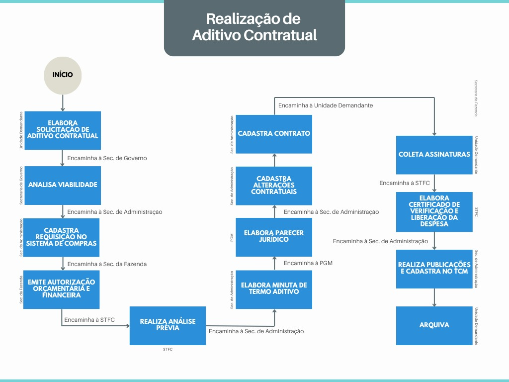

DECRETO Nº 2.338, DE 2 DE OUTUBRO DE 2025

Dispõe sobre o procedimento de tramitação dos processos de aditivos contratuais no âmbito da Administração Pública diretas, autárquicas e fundacionais do Município de Aparecida de Goiânia e dá outras providências.

O PREFEITO DO MUNICÍPIO DE APARECIDA DE GOIÂNIA, no uso das atribuições legais que lhe confere a Lei Orgânica do Município de Aparecida de Goiânia; e tendo em vista o disposto na Lei Federal nº 14.133, de 1º de abril de 2021,

**DECRETA:**

Art. 1º Este Decreto dispõe sobre o procedimento de tramitação dos processos de aditivos contratuais no âmbito da Administração Pública diretas, autárquicas e fundacionais do Município de Aparecida de Goiânia.

Art. 2º Compete à Secretaria Municipal de Governo a análise da viabilidade das solicitações de alterações contratuais dos órgãos e entidades do Município de Aparecida de Goiânia.

Art. 3º As solicitações de aditivos contratuais devem ser encaminhadas pela unidade demandante à Secretaria Municipal de Governo com antecedência de, no mínimo, 120 (cento e vinte) dias ao término da vigência do contrato.

Parágrafo único. Caso o processo não seja encaminhado no prazo determinado no caput deste artigo, o aditivo não será autorizado.

Art. 4º O requerimento de aditivo contratual deve ser instruído com:

I - justificativa das alterações explanada pelo gestor do órgão ou ente requisitante;

II - instrumento contratual;

III - termos de aditivos anteriores, se houver; e

IV - especificação detalhada das alterações, tais como: inclusão, modificação ou exclusão de cláusulas, valores, prazos, sem prejuízo de eventual documentação exigida pela Secretaria Municipal de Administração ou Procuradoria Geral do Município.

Parágrafo único. Os processos encaminhados pela unidade demandante que não forem instruídos com os documentos relacionados no caput deste artigo serão devolvidos sem análise.

Art. 5º Os contratos firmados no âmbito da administração pública municipal somente poderão ser alterados nas hipóteses e termos previstos na Lei Federal nº 14.133, de 1º de abril de 2021.

Art. 6º Após autorização da Secretaria Municipal de Governo, o processo será remetido à Secretaria Municipal de Administração, que realizará o cadastro da requisição no sistema de compras e encaminhará para a Secretaria Municipal de Fazenda para, havendo impacto financeiro, emitir autorização orçamentária e financeira.

Art. 7º Ato contínuo, a Secretaria Municipal de Fazenda submeterá à análise prévia da Secretaria Municipal de Transparência, Fiscalização e Controle que, concluindo pela viabilidade, encaminhará para a Secretaria Municipal de Administração para fins de elaboração da minuta do termo aditivo contratual.

Art. 8º A minuta do termo aditivo do instrumento contratual será encaminhada à Procuradoria-Geral do Município, que deverá emitir parecer jurídico e, posteriormente, encaminhar o processo para a Secretaria Municipal de Administração para providenciar o devido cadastro das alterações contratuais.

Art. 9º O processo será remetido à unidade demandante para coleta de assinaturas no termo aditivo contratual.

Art. 10. Providenciadas as assinaturas, a unidade demandante solicitará à Secretaria Municipal de Transparência, Fiscalização e Controle a emissão do certificado de verificação e liberação da despesa.

Art. 11. Recebido o certificado de verificação e liberação da despesa, a Secretaria Municipal de Administração providenciará o cadastro do aditivo contratual perante o Tribunal de Contas dos Municípios do Estado de Goiás – TCM/GO, bem como a publicação do termo aditivo contratual, nos termos da legislação vigente e arquivará o processo.

Art. 12. O procedimento descrito nos artigos anteriores é ilustrado no fluxograma contido no Anexo a este Decreto.

Art. 13. Em nenhuma hipótese será admitida modificação do contrato, ainda que por acordo entre as partes, que importe transfiguração do objeto da contratação ou acarrete frustração aos princípios da isonomia e da obrigatoriedade de licitação.

Art. 14. Fica revogado o art. 68 do Decreto “N” nº 149, de 09 de março de 2023.

Art. 15. Este Decreto entra em vigor na data de sua publicação.

Aparecida de Goiânia, 2 de outubro de 2025.

 

LEANDRO VILELA VELLOSO

Prefeito de Aparecida de Goiânia

ANEXO

