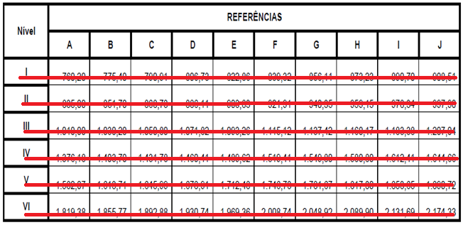

LEI COMPLEMENTAR Nº 95, DE 17 DE OUTUBRO DE 2014.

INSTITUI O PLANO DE CARGOS, CARREIRAS E VENCIMENTOS DOS TRABALHADORES ADMINISTRATIVOS DA SECRETARIA DE EDUCAÇÃO DO MUNICÍPIO DE APARECIDA DE GOIÂNIA E DÁ OUTRAS PROVIDÊNCIAS.

FAÇO SABER QUE A CÂMARA MUNICIPAL DE APARECIDA DE GOIÂNIA APROVOU E EU, PREFEITO MUNICIPAL, SANCIONO A SEGUINTE LEI COMPLEMENTAR:

CAPÍTULO I

DAS DISPOSIÇÕES GERAIS

Art. 1º - Esta Lei Complementar institui o Plano de Cargos, Carreiras e Vencimentos dos Trabalhadores Administrativos da Secretaria de Educação, com lotação exclusiva na Secretaria Municipal de Educação, sob o regime do Estatuto dos Servidores Públicos Municipais de Aparecida de Goiânia, e legislação complementar pertinente.

Art. 2º - Este Plano fundamenta-se em princípios que visam assegurar aos Trabalhadores Administrativos da Secretaria de Educação a profissionalização e o desenvolvimento de suas competências e atribuições legais com eficiência, eficácia e efetividade, buscando sempre a melhoria da qualidade da educação básica do Município.

Art. 3º - A concepção da carreira dos Trabalhadores Administrativos da Secretaria de Educação do Município de Aparecida de Goiânia, instituída por esta Lei, orienta-se pelos seguintes preceitos e diretrizes básicas:

I – gestão partilhada da carreira, entendida como participação de seus integrantes na formulação e gestão deste Plano, por meio de mecanismos legitimamente constituídos;

II – flexibilidade, importando na garantia da permanente atualização e adequação deste Plano, conforme a dinâmica do Sistema Educacional e das necessidades e condições do Município;

III – profissionalização e educação permanente, centrada no desenvolvimento das potencialidades dos servidores, em sua qualificação e realização profissional, articulada e vinculada ao planejamento e ao alcance dos objetivos institucionais da Administração Municipal;

IV – avaliação de desempenho entendida como processo pedagógico, realizada mediante critérios objetivos decorrentes das metas institucionais e focada no desenvolvimento profissional;

V – progressão funcional na carreira por meio da valorização dos servidores decorrente de cursos de formação e capacitações, do tempo de efetivo exercício do cargo e de avaliação de desempenho positiva;

VI – condições ambientais de trabalho adequadas;

VII – promoção de saúde do trabalhador, no sentido de erradicar e prevenir a incidência de doenças profissionais, por meio da implementação de programa permanente para este fim;

VIII – incentivo à dedicação exclusiva em um único local de trabalho;

IX – remuneração que assegure situação condigna nos aspectos econômico e social, considerando a complexidade, a experiência e o nível educacional exigido para o exercício das atribuições e responsabilidades do cargo e as condições do mercado de trabalho;

X – compromisso solidário, compreendendo que este Plano é um instrumento firmado entre o gestor e servidores em prol do profissionalismo, da eficiência, da eficácia e da melhoria da qualidade da educação básica do Município.

Parágrafo único. A Administração Municipal, para a implementação deste Plano de Cargos, Carreiras e Vencimentos, adotará, no que couber, as recomendações e diretrizes previstas na Resolução nº 05, de 03 de agosto de 2010, do Conselho Nacional de Educação, relativa aos Trabalhadores em Educação, previstos no inciso III, do Art. 61, da Lei Federal nº 9.394, de 20 de dezembro de 1996, com redação dada pela Lei Federal nº 12.014, de 06 de agosto de 2009.

Art. 4º - Para os fins desta Lei entende-se por:

I – Trabalhador Administrativo da Secretaria de Educação: pessoa legalmente investida em cargo de provimento efetivo, previsto no Art. 8º e Anexo I, desta Lei.

II – Cargo de Provimento Efetivo: o conjunto de atribuições e responsabilidades cometidas a servidor público e que tenha como características essenciais à criação por lei, número certo, denominação própria, provimento por concurso público e remuneração pelo Município.

III – Carreira: é a trajetória proposta ao servidor no cargo que ocupa, desde o seu ingresso no cargo até o desligamento, segundo o desempenho profissional, a escolaridade e/ou profissionalização e o tempo de exercício no cargo.

IV - Nível: o conjunto de Referências que compõem uma mesma faixa de vencimentos, identificados por algarismos romanos (I, II e III), previstos no Anexo II – Tabela de Vencimentos. 

(Redação alterada pela Lei Complementar nº 166, de 9 de outubro de 2019).

~~IV – Nível: o conjunto de Referências que compõem uma mesma faixa de vencimentos, identificados por algarismos romanos (I, II, III, IV, V e VI), previstos no Anexo~~

II – Tabela de Vencimentos.

V – Referência: a posição distinta na faixa de vencimentos dentro de cada Nível, identificada pelas letras A, B, C, D, E, F, G, H, I, J correspondente ao posicionamento do servidor na carreira, em razão do desempenho e do tempo de exercício no cargo.

VI – Quadro Permanente: o conjunto de cargos de provimento efetivo, estruturados em carreira, na forma do Art. 8º e do Anexo I, desta Lei.

Art. 5º - Integram este Plano de Cargos, Carreiras e Vencimentos os seguintes anexos:

I – Anexo I: Cargos de Provimento Efetivo;

II – Anexo II: Tabela de Vencimentos;

III – Anexo III: Enquadramento – Correlação de Cargos;

IV – Anexo IV: Tabela de Progressão Vertical; e

V – Anexo V: Descrição Sumária dos Cargos e Requisitos para o Ingresso

§1º - O quantitativo dos cargos do Quadro Permanente será o resultante do enquadramento dos servidores efetivos neste Plano de Cargos, Carreiras e Vencimentos.

§2º - Anualmente, serão fixados, em Lei de iniciativa do Chefe do Poder Executivo, os quantitativos dos cargos previstos nesta Lei.

§3º - Ato do Secretário Municipal de Educação definirá o quantitativo de servidores necessários a cada unidade educacional, de acordo com o número de alunos matriculados e os turnos de funcionamento da unidade de ensino.

§4º - A descrição detalhada das atribuições dos cargos do Quadro Permanente será objeto de Decreto do Chefe do Poder Executivo, podendo os mesmos ser desdobrados em funções, sem diferenciação de vencimentos.

Art. 6º - A área de atuação dos Trabalhadores Administrativos da Secretaria de Educação engloba funções de apoio pedagógico, técnico-administrativo e operacional, as quais se desenvolvem complementarmente à ação docente nos Centros Municipais de Educação Infantil (CMEIs), nas instituições educacionais de Ensino Fundamental de Tempo Integral e demais unidades educacionais municipais, compreendendo:

I – preparação e distribuição de merenda ou alimentação para os alunos da Rede;

II – limpeza, higiene, conservação e manutenção da infraestrutura física/material do meio ambiente educacional;

III – operação de multimeios didáticos (informática, laboratórios, salas de leitura e biblioteca) e apoio operacional necessário ao funcionamento da unidade educacional;

IV – cuidados com alunos em geral, envolvendo a higiene, o descanso, a alimentação, a convivência, o bem estar, a locomoção, entre outras necessidades de apoio para o desenvolvimento de suas atividades no ambiente educacional e a recepção e entrega dos mesmos aos pais e responsáveis;

V – interpretação, de Sinais, das atividades didático-pedagógicas e culturais desenvolvidas nas instituições de ensino;

VI – atendimento à comunidade, elaboração e execução de projetos de leitura e pesquisa, visando o uso adequado dos recursos disponibilizados na biblioteca;

VII – organização do acervo bibliográfico, bem como empréstimo de obras literárias e disseminação de informações pertinentes ao ambiente escolar;

VIII – secretaria escolar e controle de gestão.

Art. 7º - Para garantir a efetivação dos princípios e diretrizes estabelecidos nesta Lei, deverá ser instituída, pelo Chefe do Poder Executivo, uma Comissão Paritária, composta por gestores da Administração Municipal e pela representação dos servidores da Secretaria Municipal de Educação, indicados pelo Sindicato dos Trabalhadores em Educação de Goiás – Sintego.

Parágrafo único. A participação na Comissão Paritária de que trata o caput deste artigo será considerada como serviço público relevante.

CAPÍTULO II

DOS CARGOS E ESTRUTURA DA CARREIRA

Art. 8º - Integram o Quadro Permanente dos Trabalhadores Administrativos da Secretaria de Educação do Município de Aparecida de Goiânia, criado por essa Lei, os seguintes cargos de provimento efetivo, com a respectiva estruturação de carreira:

I – Merendeiro (Níveis I, II e III / Referências A até J);

(Redação alterada pela Lei Complementar nº 166, de 9 de outubro de 2019).

~~I – Agente Administrativo Educacional (Níveis I, II e III / Referências A até J);~~

II – Agente de Serviços Diversos (Níveis I, II e III / Referências A até J);

(Redação alterada pela Lei Complementar nº 166, de 9 de outubro de 2019).

~~II – Agente de Apoio Educacional (Níveis IV e V / Referências A até J);~~

III – Auxiliar de Serviços Diversos (Níveis I, II e III / Referências A até J);

(Redação alterada pela Lei Complementar nº 166, de 9 de outubro de 2019).

~~III – Agente de Apoio Pedagógico (Níveis V e VI / Referências A até J);~~

IV – Auxiliar de Secretaria (Níveis I, II e III / Referências A até J);

(Redação acrescentada pela Lei Complementar nº 166, de 9 de outubro de 2019).

V – Agente Educativo (Níveis I, II e III / Referências A até J);

(Redação acrescentada pela Lei Complementar nº 166, de 9 de outubro de 2019).

VI – Intérprete de Libras (Níveis I, II, III / Referências A até J);

(Redação acrescentada pela Lei Complementar nº 166, de 9 de outubro de 2019).

VII – Instrutor Surdo (Níveis I, II e III / Referências A até J);

(Redação acrescentada pela Lei Complementar nº 166, de 9 de outubro de 2019).

VIII – Bibliotecário (Níveis I, II e III / Referências A até J);

(Redação acrescentada pela Lei Complementar nº 166, de 9 de outubro de 2019).

IX – Analista de Cultura e Desporto (Níveis I, II e III / Referências A até J);

(Redação acrescentada pela Lei Complementar nº 166, de 9 de outubro de 2019).

X – Professor de Informática (Níveis I e III / Referências A até J).

(Redação acrescentada pela Lei Complementar nº 166, de 9 de outubro de 2019).

Art. 9º - Os cargos criados por esta Lei serão providos mediante concurso público de provas ou de provas e títulos, conforme disposições do Estatuto dos Servidores Públicos Municipais de Aparecida de Goiânia e legislação complementar pertinente.

§1º - O concurso público de provas ou de provas e títulos pode ser compreendido como a única forma de ingresso no serviço para o exercício de cargo de provimento efetivo e acesso à carreira dos cargos criados por esta Lei.

§2º - Além da comprovação de outros requisitos legais, para o provimento e exercício dos cargos efetivos, o candidato deverá satisfazer, ainda, os requisitos previstos no Anexo V, desta Lei, bem como, atender as exigências estabelecidas em Regulamento e/ou Edital de concurso público.

Art. 10 – Para o ingresso nos cargos que integram o Quadro Permanente dos Trabalhadores Administrativos da Secretaria de Educação serão exigidos os seguintes níveis de escolaridade, respectivamente:

I- Merendeiro – Ensino Fundamental Completo.

(Redação alterada pela Lei Complementar nº 153, de 9 de outubro de 2018).

~~I – Agente Administrativo Educacional: Ensino Fundamental completo;~~

II- Agente de Serviços Diversos – Ensino Fundamental Completo.

(Redação alterada pela Lei Complementar nº 153, de 9 de outubro de 2018).

~~II – Agente de Apoio Educacional: Ensino Médio Completo na modalidade Magistério ou Ensino Médio Completo e certificado do Prolibras ou CAS (Centro de Capacitação de Profissionais da Educação e Atendimento às Pessoas com Surdez) ou Ensino Médio Completo, certificado do Prolibras ou CAS (Centro de Capacitação de Profissionais da Educação e Atendimento às Pessoas com Surdez) e laudo médico (audiometria) que comprove surdez; e~~

III- Auxiliar de Serviços Diversos – Ensino Fundamental Completo.

(Redação alterada pela Lei Complementar nº 153, de 9 de outubro de 2018).

~~III – Agente de Apoio Pedagógico: Curso Superior Completo em Biblioteconomia.~~

IV- Auxiliar de Secretaria – Ensino Médio Completo.

(Redação acrescentada pela Lei Complementar nº 153, de 9 de outubro de 2018).

V- Agente Educativo – Ensino Médio Completo na modalidade Magistério.

(Redação acrescentada pela Lei Complementar nº 153, de 9 de outubro de 2018).

VI- Intérprete de Libras – Ensino Médio Completo e Certificado do Prolibras ou CAS (Centro de Capacitação de Profissionais da Educação e Atendimento às Pessoas com Surdez).

(Redação acrescentada pela Lei Complementar nº 153, de 9 de outubro de 2018).

VII- Instrutor Surdo - Ensino Médio Completo e Certificado do Prolibras ou CAS (Centro de Capacitação de Profissionais da Educação e Atendimento às Pessoas com Surdez) e laudo médico (audiometria) que comprove a surdez.

(Redação acrescentada pela Lei Complementar nº 153, de 9 de outubro de 2018).

VIII- Bibliotecário – Ensino Curso Superior em Biblioteconomia.

(Redação acrescentada pela Lei Complementar nº 153, de 9 de outubro de 2018).

IX- Analista de Cultura e Desporto – Ensino Curso Superior em Biblioteconomia.

(Redação acrescentada pela Lei Complementar nº 153, de 9 de outubro de 2018).

Art. 11 – O ingresso na Carreira dar-se-á no Nível e na Referência inicial do cargo.

CAPÍTULO III

DA JORNADA DE TRABALHO

Art. 12 – A jornada de trabalho dos ocupantes dos cargos de que trata esta Lei será de 30 (trinta) horas semanais.

CAPÍTULO IV

DA PROGRESSÃO NA CARREIRA

Art. 13 – A Progressão Funcional é a movimentação do servidor na carreira prevista para o cargo que ocupa e poderá ocorrer mediante:

I – Progressão Horizontal;

II – Progressão Vertical.

Art. 14 – A Progressão Horizontal do servidor na carreira dar-se-á por merecimento, a cada 2 (dois) anos, de uma Referência para a subsequente, dentro de um mesmo Nível, em virtude do tempo de efetivo exercício do cargo, participação efetiva no Programa de Saúde do Trabalhador e avaliação de desempenho positiva no período, exceto a primeira que deverá ocorrer logo após o término do período do Estágio Probatório, sendo que:

I – considerar-se-á resultado positivo nas avaliações de desempenho média anual não inferior a 7.0 (sete).

§1º - Fica assegurado aos servidores que já obtiveram Progressão Horizontal, a contagem do prazo previsto no caput deste artigo, a partir da data da última Progressão Horizontal, que fizeram jus.

§2º - Para fins da primeira Progressão Horizontal, os servidores enquadrados neste Plano na Referência A, oriundos de cargos da Lei Municipal nº 2.606/2006 e admitidos após a data de sua vigência ou que não tenham adquirido Progressão Horizontal na referida Lei, terão o prazo previsto no caput deste artigo, computado a partir da data de sua admissão.

Art. 15 – O Programa Saúde do Trabalhador tem por objetivo o desenvolvimento das ações de vigilância, prevenção, promoção e educação em saúde do servidor.

§1º - O servidor deverá realizar, anualmente, avaliação médica, comprovada por meio de laudo médico competente, visando o diagnóstico e a prevenção de doenças ocupacionais.

§2º - No caso da Administração Municipal não implementar o Programa de Saúde do Trabalhador, ficará o servidor dispensado do cumprimento da exigência de participação no referido Programa, para fins de Progressão Funcional.

Art. 16 – A Progressão Vertical nos Níveis do cargo constitui-se em instrumento de valorização do servidor no efetivo exercício de suas atribuições legais e decorre de sua opção e iniciativa de desenvolvimento profissional e/ou de sua escolaridade, conforme Anexo IV, desta Lei.

§1º - O Curso de Formação e/ou Aperfeiçoamento, devidamente comprovado para fins de concessão do Adicional de Titulação, Formação e Aperfeiçoamento não poderá ser utilizado para fins de progressão vertical.

§2º - Para fins de progressão vertical, o servidor não pode ter sofrido pena disciplinar nos últimos 02 (dois) anos anteriores à progressão.

§3º - Considerar-se-á resultado positivo, nas avaliações de desempenho, média anual não inferior a 7.0 (sete).

Art. 17 – A Progressão Vertical ocorrerá de um Nível para outro subsequente da Tabela de Vencimentos, mediante requerimento do servidor em atividade, em razão do tempo de efetivo exercício do cargo, evolução da escolaridade e/ou da profissionalização e avaliação de desempenho positiva no período, nas seguintes condições:

I – o servidor que evoluir na escolaridade e/ou profissionalização exigida para o ingresso no cargo, ao completar 3 (três) anos de efetivo exercício, poderá pleitear a Progressão Vertical para o Nível seguinte ao que se encontra, conforme requisitos para o cargo que ocupa, previstos no Anexo IV;

II - Após uma Progressão Vertical, o servidor poderá solicitar uma nova Progressão Vertical no prazo de 02 (dois) anos. 

(Redação alterada pela Lei Complementar nº 166, de 9 de outubro de 2019).

~~II – após uma Progressão Vertical, o servidor não poderá solicitar uma nova Progressão Vertical no prazo de 3 (três) anos;~~

III – o servidor promovido por escolaridade e/ou profissionalização manterá a mesma Referência, em que se encontrava no Nível anterior.

§1º - Fica assegurado, aos servidores em efetivo exercício dos cargos da Lei nº 2.606/2006 que não obtiveram Progressão Vertical no cargo até a data de publicação desta Lei, a contagem do prazo previsto no inciso I, deste artigo, a partir da data de sua admissão.

§2º - Fica assegurada a contagem do prazo previsto no inciso II deste artigo, ao servidor enquadrado nesta Lei, a partir da data da última Progressão Vertical que fez jus.

Art. 18 – O tempo em que o servidor se encontrar afastado do exercício do cargo não se computará para o período de que tratam os artigos 14 e 17 desta Lei, exceto:

I – afastamento remunerado inferior a 90 (noventa) dias;

II – licença maternidade de 120 (cento e vinte) dias;

III – exercício de cargo em Comissão e Função de Confiança, desde que desempenhada na Prefeitura Municipal de Aparecida de Goiânia.

IV – enquanto cedido a outro órgão da Administração Pública Federal, Estadual ou Municipal, desde que com ônus ao cessionário.

(Redação acrescentada pela Lei Complementar nº 139, de 14 de dezembro de 2017).

Parágrafo único. Os afastamentos remunerados não previstos nos incisos deste artigo suspenderão a contagem do tempo de exercício no cargo para fins de Progressão Vertical.

SEÇÃO ÚNICA

DA AVALIAÇÃO DE DESEMPENHO

Art. 19 – A avaliação é o aferimento do desempenho do servidor no cumprimento das atribuições do cargo, permitindo o seu desenvolvimento funcional na carreira.

Art. 20 – A Avaliação de Desempenho será feita de forma contínua e formalizada anualmente, sob a instrução e orientação da Secretaria Municipal de Administração/Diretoria de Recursos Humanos e da Secretaria Municipal de Educação do Município de Aparecida de Goiânia.

CAPÍTULO V

DO VENCIMENTO E DA REMUNERAÇÃO

Art. 21 – Vencimento é a retribuição pecuniária mensal devida ao servidor pelo efetivo exercício do cargo que ocupa, no Nível e na Referência em que se posiciona na carreira e pelo cumprimento da carga horária estabelecida.

§ 1° - A Administração Municipal deverá respeitar, garantir e manter os percentuais de diferenciação entre os níveis estabelecidos no Anexo II – Tabela de Vencimentos, parte integrante desta Lei, para efeito de correção e/ou atualização salarial, de modo a evitar sua defasagem ao longo dos anos.

§ 2° - Os valores constantes no Anexo II - Tabela de Vencimentos, parte integrante desta Lei, deverão ser atualizados/reajustados anualmente, conforme estabelecido no art. 37, inciso X, da constituição Federal de 1988, de acordo om os índices oficiais, instituindo-se como data-base da categoria o mês de maio.

Art. 22 – Além do vencimento e outras vantagens elencadas no Estatuto dos Servidores Públicos do Município de Aparecida de Goiânia, o ocupante de cargo efetivo previsto nesta Lei, em atividade, poderá receber o Adicional de Titularidade, Formação e Aperfeiçoamento.

Art. 23 – O Adicional de Titularidade, Formação e Aperfeiçoamento de que trata o artigo anterior será calculado sobre o vencimento do servidor no cargo efetivo que ocupa, à razão de:

I – 5,0% (cinco por cento) para curso ou cursos de duração total igual ou superior a 180 (cento e oitenta) horas;

II – 10,0% (dez por cento) para curso ou cursos de duração total igual ou superior a 360 (trezentos e sessenta) horas;

III – 15,0% (quinze por cento) para curso ou cursos de duração total igual ou superior a 540 (quinhentas e quarenta) horas;

IV – 20,0% (vinte por cento) para curso ou cursos de duração total igual ou superior a 720 (setecentos e vinte) horas;

V – 25,0% (vinte e cinco por cento) para curso ou cursos de duração total igual ou superior a 900 (novecentas) horas;

VI – 30,0% (trinta por cento) para curso ou cursos de duração total igual ou superior a 1080 (mil e oitenta) horas;

§1º - Para efeito de concessão do Adicional de que trata este artigo, o servidor não poderá utilizar o título/certificado que tenha resultado em concessão de Progressão Vertical nos Graus/Níveis do cargo em que se encontra posicionado.

§2º - Somente serão considerados para efeito do Adicional de que trata este Artigo, os cursos com duração mínima de 40 (quarenta) horas, nos quais o servidor tenha obtido aproveitamento igual ou superior a 70 % (setenta por cento) e frequência mínima de 75% (setenta e cinco por cento) da carga horária total do curso e que sejam devidamente comprovados mediante certificado de conclusão, realizados após a data da posse, exceto os de graduação e especialização.

§ 3º - O(s) curso(s) apresentado(s) para fins de concessão do Adicional de Titulação, Formação e Aperfeiçoamento deverá(ão) ter relação com as atribuições do cargo, e devidamente reconhecido pelos órgãos competentes (Conselhos Municipais, Estaduais e Federais de educação), para fim de comprovação de validade do certificado. 

(Redação alterada pela Lei Complementar nº 166, de 9 de outubro de 2019).

~~§3º - O(s) curso(s) apresentado(s) para fins de concessão do Adicional de Titulação, Formação e Aperfeiçoamento deverá(ão) ter relação com as atribuições do cargo ou função desempenhados pelo servidor.~~

§4º -Os totais de horas de que tratam os incisos I e II, deste Artigo, poderão ser alcançados em um só curso ou pela soma de duração de vários cursos, desde que observado o limite mínimo previsto no §2º, deste Artigo.

§5º - Os percentuais constantes dos incisos I, II, III, IV, V e VI, deste Artigo não são cumulativos, sendo que o maior exclui o menor.

§6º - Não fará jus ao Adicional de Titularidade, Formação e Aperfeiçoamento o servidor

§7º - Fica assegurado aos servidores abarcados por esta Lei que assim optarem a manutenção da percepção do Adicional de Titularidade, previsto no art. 48 da Lei Municipal nº 2.606, de 26 de setembro de 2006, nos termos e percentuais já percebidos no momento da publicação desta Lei.

Art. 24 – O Adicional de Titularidade, Formação e Aperfeiçoamento integra a remuneração do servidor para efeito de férias, licenças e afastamentos remunerados, incorporando-se aos vencimentos para efeito de aposentadoria e disponibilidade.

Art. 25 – Decreto do Chefe do Poder Executivo regulamentará, no que couber, a concessão do Adicional de Titularidade, Formação e Aperfeiçoamento aos servidores integrantes deste Plano.

CAPÍTULO VI

DO ENQUADRAMENTO

Art. 26 Servidores lotados e prestando serviço na Secretaria Municipal de Educação, ocupantes dos cargos de Merendeiro, Agente de Serviços Diversos, Auxiliar de Serviços Diversos, Auxiliar de Secretaria, Agente Educativo, Intérprete de Libras, Instrutor Surdo, Bibliotecário, Analista de Cultura e Desporto e Professor de Informática poderão ser enquadrados nesta Lei, mantidas as funções/atribuições dos respectivos cargos que exercem, o Grau/Nível correspondente e a Referência, computada a partir da data de admissão, para fins de enquadramento, resguardando ao servidor todos os seus direitos e benefícios. 

(Redação alterada pela Lei Complementar nº 166, de 9 de outubro de 2019).

~~Art. 26 – Os servidores lotados e prestando serviço na Secretaria Municipal de Educação, ocupantes de cargos de Auxiliar de Serviços Diversos, Intérprete de Libras, Instrutor Surdo e Analista de Cultura e Desporto poderão ser enquadrados, respectivamente, nos cargos de Agente Administrativo Educacional, Agente de Apoio Educacional e Agente de Apoio Pedagógico, mantidas as funções/atribuições dos respectivos cargos que exercem, o Grau/Nível correspondente e a Referência, computada a partir da data de admissão, para fins de enquadramento, resguardando ao servidor todos os seus direitos e benefícios adquiridos.~~

Parágrafo único. O enquadramento a que se refere o caput deste artigo dar-se-á mediante opção expressa do servidor, em caráter definitivo, por meio de um Termo de Opção, no prazo máximo de 120 (cento e vinte) dias, a partir da data de publicação desta Lei.

Art. 27 - Caberá ao servidor que se julgar prejudicado com o enquadramento, o direito de requerer revisão do ato que o enquadrou, no prazo de 120 (cento e vinte) dias, a contar da data que teve ciência, cujos pedidos de revisão serão avaliados e definidos pelo Secretário Municipal de Educação, após instrução de processo próprio e parecer da Procuradoria Geral do Município.

Art. 28 – No enquadramento dos aposentados e pensionistas, deverá ser considerado o cargo que o servidor exercia ao ato de sua aposentadoria, observado o disposto nos artigos 26 e 27, desta Lei.

Art. 29 – As dúvidas e casos omissos porventura observados na efetivação do enquadramento dos servidores serão analisados, mediante requerimento do servidor ao Secretário Municipal de Educação.

CAPÍTULO VII

DAS DISPOSIÇÕES FINAIS

Art. 30 – Os servidores de que trata esta Lei farão jus aos direitos e vantagens pecuniárias previstas no Estatuto dos Servidores Públicos Municipais de Aparecida de Goiânia, sem prejuízo de outros adicionais relacionados a indenizações, gratificações, auxílios, previdência ou assistência social, previstos em legislação específica.

Art. 31 – As licenças remuneradas e as concedidas para o exercício de mandato eletivo ou de dirigente de entidade sindical serão consideradas como efetivo exercício do cargo, nos termos do Estatuto dos Servidores Públicos Municipais, vedada a suspensão do pagamento de adicionais salariais permanentes.

Art. 32 – Os ocupantes de cargos criados por esta Lei, que percebam até 2 (dois) salários mínimos, com lotação exclusiva na Secretaria Municipal da Educação, farão jus ao Auxílio Transporte, conforme disposto em Lei específica.

Art. 33 – A função de Secretário-Geral de instituição educacional deverá ser exercida por servidor efetivo e estável, podendo ser professor ou ocupante de cargo criado por esta Lei, com, no mínimo, Ensino Médio completo e lotação há mais de 1 (um) ano na respectiva unidade, desde que obedecidos os demais requisitos da Lei Municipal nº 2.861/2009 que institui normas para a gestão democrática nas Unidades Escolares e Centros Municipais de Educação Infantil do Município de Aparecida de Goiânia.

Art. 34 - Os servidores ocupantes dos cargos de Agente Educativo, Intérprete de Libras, Instrutor Surdo, Bibliotecário, Analista de Cultura e Desporto e Professor de Informática, em decorrência da função que exercem, farão jus, anualmente, a 30 (trinta) dias consecutivos de férias e de 15 (quinze) dias de recesso escolar.

(Redação alterada pela Lei Complementar nº 166, de 9 de outubro de 2019).

~~Art. 34 – O servidor ocupante dos cargos de Agente de Apoio Educacional e Agente de Apoio Pedagógico, em decorrência da função que exercem, farão jus, anualmente, a 30 (trinta) dias consecutivos de férias e 15 (quinze) dias de recesso escolar.~~

§1º - Os servidores enquadrados nesta Lei deverão gozar férias coletivas anuais no mês de julho, desde que lotados em uma das Instituições de Ensino da Rede.

(Redação alterada pela Lei Complementar nº 166, de 9 de outubro de 2019).

~~§1º - Desde que, no exercício exclusivo de atividades de apoio e auxílio à docência nas Instituições de Ensino da Rede, o Agente de Apoio Educacional e o Agente de Apoio Pedagógico deverão gozar férias anuais no mês de julho.~~

§2º - Só fará jus ao recesso escolar previsto no caput deste artigo, o Agente Educativo, Intérprete de Libras, Instrutor Surdo, Bibliotecário, Analista de Cultura e Desporto e Professor de Informática que estiverem em efetivo exercício de atividades de apoio e de auxílio à docência nas Escolas Municipais, nos Centros Municipais de Educação Infantil, bem como, nas Unidades de Ensino Conveniadas ao Município.

(Redação alterada pela Lei Complementar nº 166, de 9 de outubro de 2019).

~~§2º - Só fará jus ao recesso escolar previsto no caput deste artigo, o Agente de Apoio Educacional e o Agente de Apoio Pedagógico que estiverem em efetivo exercício de atividades de apoio e de auxílio à docência nas Escolas Municipais, nos Centros Municipais de Educação Infantil, bem como, nas Unidades de Ensino Conveniadas ao Município.~~

§3º - O recesso escolar do Agente Educativo, Intérprete de Libras, Instrutor Surdo, Bibliotecário, Analista de Cultura e Desporto e Professor de Informática deverá ocorrer entre os meses de dezembro e janeiro, antes do início de um novo período letivo; podendo o servidor ser convocado ao trabalho a qualquer momento.

(Redação alterada pela Lei Complementar nº 166, de 9 de outubro de 2019).

~~§3º - O recesso escolar do Agente de Apoio Educacional e do Agente de Apoio Pedagógico deverá ocorrer no mês de janeiro, antes do início de um novo período letivo.~~

Art. 35 – Nenhuma redução de vencimento acrescido de vantagens pecuniárias permanentes, provento ou pensão poderá resultar da aplicação desta Lei.

Art. 36 – No estrito interesse da Administração, poderá haver, mediante contrato temporário, substituição do Trabalhador Administrativo da Educação, de que trata esta Lei, nos casos de licença à gestante e à adotante, licença médica superior a 15 (quinze) dias e licença prêmio por assiduidade.

Parágrafo único. Na contratação de substituto, observar-se-á o que dispõe a Constituição Federal e a legislação municipal que disciplina a matéria.

Art. 37 – O Chefe do Poder Executivo regulamentará esta Lei no que couber no prazo de 90 (noventa) dias, contados da data de sua publicação.

Art. 38 – É vedado o remanejamento ou a cessão de servidor ocupante de cargo de que trata este Plano para outros Órgãos ou Entidades da Administração Municipal, exceto para o exercício de cargo em comissão de direção e assessoramento superior.

Art. 39 - As despesas decorrentes da aplicação desta Lei serão custeadas à conta do Orçamento Geral do Município, ficando o Chefe do Poder Executivo autorizado a abrir créditos adicionais de natureza suplementar ou especial e remanejar as dotações orçamentárias necessárias ao cumprimento desta Lei.

(Redação alterada pela Lei Complementar nº 166, de 9 de outubro de 2019).

~~Art. 39 – As despesas decorrentes da aplicação desta Lei serão custeadas à conta do Orçamento Geral do Município, ficando o Chefe do Poder Executivo autorizado a abrir os créditos adicionais de natureza suplementar ou especial e remanejar as dotações orçamentárias do exercício de 2014 necessários ao cumprimento desta Lei.~~

Art. 40 – Esta Lei Complementar entrará em vigor na data de sua publicação, ficando revogadas as disposições contrárias.

Gabinete do Prefeito Municipal de Aparecida Goiânia, Estado de Goiás, aos 17 dias do mês de Outubro do ano de 2014.

LUIZ ALBERTO MAGUITO VILELA

Prefeito Municipal

EULER MORAIS

Secretário Municipal de Governo e Integração Institucional

DOMINGOS PEREIRA DA SILVA

Secretário Municipal de Educação

ANEXO I

CARGOS DE PROVIMENTO EFETIVO TRABALHADORES ADMINISTRATIVOS DA EDUCAÇÃO – TAE

QUADRO PERMANENTE

Cargos de Provimento Efetivo

**Denominação dos Cargos**

**Nível Inicial do Cargo**

Merendeiro

I

Agente de Serviços Diversos

I

Auxiliar de Serviços Diversos

I

Auxiliar de Secretaria

I

Agente Educativo

I

Intérprete de Libras

I

Instrutor Surdo

I

Bibliotecário

I

Analista de Cultura e Desporto

I

Professor de Informática

I

(Redação alterada pela Lei Complementar nº 166, de 9 de outubro de 2019).

~~**Denominação dos Cargos**~~

~~**Nível Inicial do Cargo**~~

~~Agente Administrativo Educacional~~

~~I~~

~~Agente de Apoio Educacional~~

~~IV~~

~~Agente de Apoio Pedagógico~~

~~V~~

ANEXO II – TABELA DE VENCIMENTOS

TRABALHADORES ADMINISTRATIVOS DA EDUCAÇÃO – TAE

TABELA DE VENCIMENTOS

Carga Horária - 30 horas semanais 

 

<table><tbody><tr><td rowspan="2">**CARGO**</td><td rowspan="2">**NÍVEL**</td><td colspan="10">**&nbsp;&nbsp;&nbsp;&nbsp;&nbsp;&nbsp;&nbsp;&nbsp;&nbsp;&nbsp;&nbsp;&nbsp;&nbsp;&nbsp;&nbsp;&nbsp;&nbsp;&nbsp;&nbsp;&nbsp;&nbsp;&nbsp;&nbsp;&nbsp;&nbsp;&nbsp;&nbsp;&nbsp;&nbsp;&nbsp;&nbsp;&nbsp;&nbsp;&nbsp;&nbsp;&nbsp;&nbsp;&nbsp;&nbsp;&nbsp;&nbsp;&nbsp;&nbsp;&nbsp;&nbsp;&nbsp;&nbsp;&nbsp;&nbsp;&nbsp;&nbsp;&nbsp;&nbsp;&nbsp;&nbsp;&nbsp;&nbsp;&nbsp;&nbsp;&nbsp;&nbsp;&nbsp;&nbsp;&nbsp;&nbsp;&nbsp;&nbsp;&nbsp;&nbsp;&nbsp;&nbsp;&nbsp;&nbsp;&nbsp;&nbsp;&nbsp;&nbsp;&nbsp;&nbsp;&nbsp;&nbsp;&nbsp;&nbsp;&nbsp;&nbsp;&nbsp;&nbsp;&nbsp;&nbsp;&nbsp;&nbsp;&nbsp;&nbsp;&nbsp;&nbsp;&nbsp;&nbsp;&nbsp;&nbsp;&nbsp;&nbsp;&nbsp;&nbsp;&nbsp;&nbsp;&nbsp;&nbsp;&nbsp;&nbsp;&nbsp;&nbsp;&nbsp;&nbsp;&nbsp;&nbsp;&nbsp;&nbsp;&nbsp;&nbsp;&nbsp;&nbsp;&nbsp;&nbsp;&nbsp;&nbsp;&nbsp;&nbsp; REFERÊNCIAS**</td></tr><tr><td>**A**</td><td>**B**</td><td>**C**</td><td>**D**</td><td>**E**</td><td>**F**</td><td>**G**</td><td>**H**</td><td>**I**</td><td>**J**</td></tr><tr><td rowspan="3">**MERENDEIRO**</td><td>**I**</td><td>&nbsp;R$&nbsp; 1.500,00</td><td>&nbsp;R$&nbsp; 1.530,00</td><td>&nbsp;R$&nbsp; 1.560,60</td><td>&nbsp;R$&nbsp; 1.591,81</td><td>&nbsp;R$&nbsp; 1.623,65</td><td>&nbsp;R$&nbsp; 1.656,12</td><td>&nbsp;R$&nbsp; 1.689,24</td><td>&nbsp;R$&nbsp; 1.723,03</td><td>&nbsp;R$&nbsp; 1.757,49</td><td>&nbsp;R$&nbsp; 1.792,64</td></tr><tr><td>**II**</td><td>&nbsp;R$&nbsp; 1.725,00</td><td>&nbsp;R$&nbsp; 1.759,50</td><td>&nbsp;R$&nbsp; 1.794,69</td><td>&nbsp;R$&nbsp; 1.830,58</td><td>&nbsp;R$&nbsp; 1.867,20</td><td>&nbsp;R$&nbsp; 1.904,54</td><td>&nbsp;R$&nbsp; 1.942,63</td><td>&nbsp;R$&nbsp; 1.981,48</td><td>&nbsp;R$&nbsp; 2.021,11</td><td>&nbsp;R$&nbsp; 2.061,53</td></tr><tr><td>**III**</td><td>&nbsp;R$&nbsp; 1.983,75</td><td>&nbsp;R$&nbsp; 2.023,43</td><td>&nbsp;R$&nbsp; 2.063,89</td><td>&nbsp;R$&nbsp; 2.105,17</td><td>&nbsp;R$&nbsp; 2.147,27</td><td>&nbsp;R$&nbsp; 2.190,22</td><td>&nbsp;R$&nbsp; 2.234,02</td><td>&nbsp;R$&nbsp; 2.278,71</td><td>&nbsp;R$&nbsp; 2.324,28</td><td>&nbsp;R$&nbsp; 2.370,76</td></tr><tr><td rowspan="3">**AGENTE DE SERVIÇOS DIVERSOS**</td><td>**I**</td><td>&nbsp;R$&nbsp; 1.500,00</td><td>&nbsp;R$&nbsp; 1.530,00</td><td>&nbsp;R$&nbsp; 1.560,60</td><td>&nbsp;R$&nbsp; 1.591,81</td><td>&nbsp;R$&nbsp; 1.623,65</td><td>&nbsp;R$&nbsp; 1.656,12</td><td>&nbsp;R$&nbsp; 1.689,24</td><td>&nbsp;R$&nbsp; 1.723,03</td><td>&nbsp;R$&nbsp; 1.757,49</td><td>&nbsp;R$&nbsp; 1.792,64</td></tr><tr><td>**II**</td><td>&nbsp;R$&nbsp; 1.725,00</td><td>&nbsp;R$&nbsp; 1.759,50</td><td>&nbsp;R$&nbsp; 1.794,69</td><td>&nbsp;R$&nbsp; 1.830,58</td><td>&nbsp;R$&nbsp; 1.867,20</td><td>&nbsp;R$&nbsp; 1.904,54</td><td>&nbsp;R$&nbsp; 1.942,63</td><td>&nbsp;R$&nbsp; 1.981,48</td><td>&nbsp;R$&nbsp; 2.021,11</td><td>&nbsp;R$&nbsp; 2.061,53</td></tr><tr><td>**III**</td><td>&nbsp;R$&nbsp; 1.983,75</td><td>&nbsp;R$&nbsp; 2.023,43</td><td>&nbsp;R$&nbsp; 2.063,89</td><td>&nbsp;R$&nbsp; 2.105,17</td><td>&nbsp;R$&nbsp; 2.147,27</td><td>&nbsp;R$&nbsp; 2.190,22</td><td>&nbsp;R$&nbsp; 2.234,02</td><td>&nbsp;R$&nbsp; 2.278,71</td><td>&nbsp;R$&nbsp; 2.324,28</td><td>&nbsp;R$&nbsp; 2.370,76</td></tr><tr><td rowspan="3">**AUXILIAR DE SERVIÇOS DIVERSOS**</td><td>**I**</td><td>&nbsp;R$&nbsp; 1.500,00</td><td>&nbsp;R$&nbsp; 1.530,00</td><td>&nbsp;R$&nbsp; 1.560,60</td><td>&nbsp;R$&nbsp; 1.591,81</td><td>&nbsp;R$&nbsp; 1.623,65</td><td>&nbsp;R$&nbsp; 1.656,12</td><td>&nbsp;R$&nbsp; 1.689,24</td><td>&nbsp;R$&nbsp; 1.723,03</td><td>&nbsp;R$&nbsp; 1.757,49</td><td>&nbsp;R$&nbsp; 1.792,64</td></tr><tr><td>**II**</td><td>&nbsp;R$&nbsp; 1.725,00</td><td>&nbsp;R$&nbsp; 1.759,50</td><td>&nbsp;R$&nbsp; 1.794,69</td><td>&nbsp;R$&nbsp; 1.830,58</td><td>&nbsp;R$&nbsp; 1.867,20</td><td>&nbsp;R$&nbsp; 1.904,54</td><td>&nbsp;R$&nbsp; 1.942,63</td><td>&nbsp;R$&nbsp; 1.981,48</td><td>&nbsp;R$&nbsp; 2.021,11</td><td>&nbsp;R$&nbsp; 2.061,53</td></tr><tr><td>**III**</td><td>&nbsp;R$&nbsp; 1.983,75</td><td>&nbsp;R$&nbsp; 2.023,43</td><td>&nbsp;R$&nbsp; 2.063,89</td><td>&nbsp;R$&nbsp; 2.105,17</td><td>&nbsp;R$&nbsp; 2.147,27</td><td>&nbsp;R$&nbsp; 2.190,22</td><td>&nbsp;R$&nbsp; 2.234,02</td><td>&nbsp;R$&nbsp; 2.278,71</td><td>&nbsp;R$&nbsp; 2.324,28</td><td>&nbsp;R$&nbsp; 2.370,76</td></tr><tr><td rowspan="3">**AUXILIAR DE SECRETARIA**</td><td>**I**</td><td>&nbsp;R$&nbsp; 2.482,97</td><td>&nbsp;R$&nbsp; 2.532,63</td><td>&nbsp;R$&nbsp; 2.583,29</td><td>&nbsp;R$&nbsp; 2.634,95</td><td>&nbsp;R$&nbsp; 2.687,65</td><td>&nbsp;R$&nbsp; 2.741,40</td><td>&nbsp;R$&nbsp; 2.796,23</td><td>&nbsp;R$&nbsp; 2.852,16</td><td>&nbsp;R$&nbsp; 2.909,20</td><td>&nbsp;R$&nbsp; 2.967,38</td></tr><tr><td>**II**</td><td>&nbsp;R$&nbsp; 2.855,42</td><td>&nbsp;R$&nbsp; 2.912,53</td><td>&nbsp;R$&nbsp; 2.970,78</td><td>&nbsp;R$&nbsp; 3.030,19</td><td>&nbsp;R$&nbsp; 3.090,80</td><td>&nbsp;R$&nbsp; 3.152,61</td><td>&nbsp;R$&nbsp; 3.215,67</td><td>&nbsp;R$&nbsp; 3.279,98</td><td>&nbsp;R$&nbsp; 3.345,58</td><td>&nbsp;R$&nbsp; 3.412,49</td></tr><tr><td>**III**</td><td>&nbsp;R$&nbsp; 3.283,73</td><td>&nbsp;R$&nbsp; 3.349,41</td><td>&nbsp;R$&nbsp; 3.416,40</td><td>&nbsp;R$&nbsp; 3.484,72</td><td>&nbsp;R$&nbsp; 3.554,42</td><td>&nbsp;R$&nbsp; 3.625,51</td><td>&nbsp;R$&nbsp; 3.698,02</td><td>&nbsp;R$&nbsp; 3.771,98</td><td>&nbsp;R$&nbsp; 3.847,42</td><td>&nbsp;R$&nbsp; 3.924,37</td></tr><tr><td rowspan="3">**AGENTE EDUCATIVO**</td><td>**I**</td><td>&nbsp;R$&nbsp; 2.698,87</td><td>&nbsp;R$&nbsp; 2.752,85</td><td>&nbsp;R$&nbsp; 2.807,90</td><td>&nbsp;R$&nbsp; 2.864,06</td><td>&nbsp;R$&nbsp; 2.921,34</td><td>&nbsp;R$&nbsp; 2.979,77</td><td>&nbsp;R$&nbsp; 3.039,37</td><td>&nbsp;R$&nbsp; 3.100,15</td><td>&nbsp;R$&nbsp; 3.162,16</td><td>&nbsp;R$&nbsp; 3.225,40</td></tr><tr><td>**II**</td><td>&nbsp;R$&nbsp; 3.103,70</td><td>&nbsp;R$&nbsp; 3.165,77</td><td>&nbsp;R$&nbsp; 3.229,09</td><td>&nbsp;R$&nbsp; 3.293,67</td><td>&nbsp;R$&nbsp; 3.359,55</td><td>&nbsp;R$&nbsp; 3.426,74</td><td>&nbsp;R$&nbsp; 3.495,27</td><td>&nbsp;R$&nbsp; 3.565,18</td><td>&nbsp;R$&nbsp; 3.636,48</td><td>&nbsp;R$&nbsp; 3.709,21</td></tr><tr><td>**III**</td><td>&nbsp;R$&nbsp; 3.569,26</td><td>&nbsp;R$&nbsp; 3.640,64</td><td>&nbsp;R$&nbsp; 3.713,45</td><td>&nbsp;R$&nbsp; 3.787,72</td><td>&nbsp;R$&nbsp; 3.863,48</td><td>&nbsp;R$&nbsp; 3.940,75</td><td>&nbsp;R$&nbsp; 4.019,56</td><td>&nbsp;R$&nbsp; 4.099,95</td><td>&nbsp;R$&nbsp; 4.181,95</td><td>&nbsp;R$&nbsp; 4.265,59</td></tr><tr><td rowspan="3">**INTERPRETE DE LIBRAS**</td><td>**I**</td><td>&nbsp;R$&nbsp; 2.482,97</td><td>&nbsp;R$&nbsp; 2.532,63</td><td>&nbsp;R$&nbsp; 2.583,29</td><td>&nbsp;R$&nbsp; 2.634,95</td><td>&nbsp;R$&nbsp; 2.687,65</td><td>&nbsp;R$&nbsp; 2.741,40</td><td>&nbsp;R$&nbsp; 2.796,23</td><td>&nbsp;R$&nbsp; 2.852,16</td><td>&nbsp;R$&nbsp; 2.909,20</td><td>&nbsp;R$&nbsp; 2.967,38</td></tr><tr><td>**II**</td><td>&nbsp;R$&nbsp; 2.855,42</td><td>&nbsp;R$&nbsp; 2.912,53</td><td>&nbsp;R$&nbsp; 2.970,78</td><td>&nbsp;R$&nbsp; 3.030,19</td><td>&nbsp;R$&nbsp; 3.090,80</td><td>&nbsp;R$&nbsp; 3.152,61</td><td>&nbsp;R$&nbsp; 3.215,67</td><td>&nbsp;R$&nbsp; 3.279,98</td><td>&nbsp;R$&nbsp; 3.345,58</td><td>&nbsp;R$&nbsp; 3.412,49</td></tr><tr><td>**III**</td><td>&nbsp;R$&nbsp; 3.283,73</td><td>&nbsp;R$&nbsp; 3.349,41</td><td>&nbsp;R$&nbsp; 3.416,40</td><td>&nbsp;R$&nbsp; 3.484,72</td><td>&nbsp;R$&nbsp; 3.554,42</td><td>&nbsp;R$&nbsp; 3.625,51</td><td>&nbsp;R$&nbsp; 3.698,02</td><td>&nbsp;R$&nbsp; 3.771,98</td><td>&nbsp;R$&nbsp; 3.847,42</td><td>&nbsp;R$&nbsp; 3.924,37</td></tr><tr><td rowspan="3">**INSTRUTOR DE SURDO**</td><td>**I**</td><td>&nbsp;R$&nbsp; 2.482,97</td><td>&nbsp;R$&nbsp; 2.532,63</td><td>&nbsp;R$&nbsp; 2.583,29</td><td>&nbsp;R$&nbsp; 2.634,95</td><td>&nbsp;R$&nbsp; 2.687,65</td><td>&nbsp;R$&nbsp; 2.741,40</td><td>&nbsp;R$&nbsp; 2.796,23</td><td>&nbsp;R$&nbsp; 2.852,16</td><td>&nbsp;R$&nbsp; 2.909,20</td><td>&nbsp;R$&nbsp; 2.967,38</td></tr><tr><td>**II**</td><td>&nbsp;R$&nbsp; 2.855,42</td><td>&nbsp;R$&nbsp; 2.912,53</td><td>&nbsp;R$&nbsp; 2.970,78</td><td>&nbsp;R$&nbsp; 3.030,19</td><td>&nbsp;R$&nbsp; 3.090,80</td><td>&nbsp;R$&nbsp; 3.152,61</td><td>&nbsp;R$&nbsp; 3.215,67</td><td>&nbsp;R$&nbsp; 3.279,98</td><td>&nbsp;R$&nbsp; 3.345,58</td><td>&nbsp;R$&nbsp; 3.412,49</td></tr><tr><td>**III**</td><td>&nbsp;R$&nbsp; 3.283,73</td><td>&nbsp;R$&nbsp; 3.349,41</td><td>&nbsp;R$&nbsp; 3.416,40</td><td>&nbsp;R$&nbsp; 3.484,72</td><td>&nbsp;R$&nbsp; 3.554,42</td><td>&nbsp;R$&nbsp; 3.625,51</td><td>&nbsp;R$&nbsp; 3.698,02</td><td>&nbsp;R$&nbsp; 3.771,98</td><td>&nbsp;R$&nbsp; 3.847,42</td><td>&nbsp;R$&nbsp; 3.924,37</td></tr><tr><td rowspan="3">**BIBLIOTECÁRIO**</td><td>**I**</td><td>&nbsp;R$&nbsp; 2.854,42</td><td>&nbsp;R$&nbsp; 2.911,51</td><td>&nbsp;R$&nbsp; 2.969,74</td><td>&nbsp;R$&nbsp; 3.029,13</td><td>&nbsp;R$&nbsp; 3.089,71</td><td>&nbsp;R$&nbsp; 3.151,51</td><td>&nbsp;R$&nbsp; 3.214,54</td><td>&nbsp;R$&nbsp; 3.278,83</td><td>&nbsp;R$&nbsp; 3.344,40</td><td>&nbsp;R$&nbsp; 3.411,29</td></tr><tr><td>**II**</td><td>&nbsp;R$&nbsp; 3.282,58</td><td>&nbsp;R$&nbsp; 3.348,23</td><td>&nbsp;R$&nbsp; 3.415,20</td><td>&nbsp;R$&nbsp; 3.483,50</td><td>&nbsp;R$&nbsp; 3.553,17</td><td>&nbsp;R$&nbsp; 3.624,23</td><td>&nbsp;R$&nbsp; 3.696,72</td><td>&nbsp;R$&nbsp; 3.770,65</td><td>&nbsp;R$&nbsp; 3.846,07</td><td>&nbsp;R$&nbsp; 3.922,99</td></tr><tr><td>**III**</td><td>&nbsp;R$&nbsp; 3.774,97</td><td>&nbsp;R$&nbsp; 3.850,47</td><td>&nbsp;R$&nbsp; 3.927,48</td><td>&nbsp;R$&nbsp; 4.006,03</td><td>&nbsp;R$&nbsp; 4.086,15</td><td>&nbsp;R$&nbsp; 4.167,87</td><td>&nbsp;R$&nbsp; 4.251,23</td><td>&nbsp;R$&nbsp; 4.336,25</td><td>&nbsp;R$&nbsp; 4.422,98</td><td>&nbsp;R$&nbsp; 4.511,44</td></tr><tr><td rowspan="3">**ANALISTA DE CULTURA E DESPORTO**</td><td>**I**</td><td>&nbsp;R$&nbsp; 2.854,42</td><td>&nbsp;R$&nbsp; 2.911,51</td><td>&nbsp;R$&nbsp; 2.969,74</td><td>&nbsp;R$&nbsp; 3.029,13</td><td>&nbsp;R$&nbsp; 3.089,71</td><td>&nbsp;R$&nbsp; 3.151,51</td><td>&nbsp;R$&nbsp; 3.214,54</td><td>&nbsp;R$&nbsp; 3.278,83</td><td>&nbsp;R$&nbsp; 3.344,40</td><td>&nbsp;R$&nbsp; 3.411,29</td></tr><tr><td>**II**</td><td>&nbsp;R$&nbsp; 3.282,58</td><td>&nbsp;R$&nbsp; 3.348,23</td><td>&nbsp;R$&nbsp; 3.415,20</td><td>&nbsp;R$&nbsp; 3.483,50</td><td>&nbsp;R$&nbsp; 3.553,17</td><td>&nbsp;R$&nbsp; 3.624,23</td><td>&nbsp;R$&nbsp; 3.696,72</td><td>&nbsp;R$&nbsp; 3.770,65</td><td>&nbsp;R$&nbsp; 3.846,07</td><td>&nbsp;R$&nbsp; 3.922,99</td></tr><tr><td>**III**</td><td>&nbsp;R$&nbsp; 3.774,97</td><td>&nbsp;R$&nbsp; 3.850,47</td><td>&nbsp;R$&nbsp; 3.927,48</td><td>&nbsp;R$&nbsp; 4.006,03</td><td>&nbsp;R$&nbsp; 4.086,15</td><td>&nbsp;R$&nbsp; 4.167,87</td><td>&nbsp;R$&nbsp; 4.251,23</td><td>&nbsp;R$&nbsp; 4.336,25</td><td>&nbsp;R$&nbsp; 4.422,98</td><td>&nbsp;R$&nbsp; 4.511,44</td></tr><tr><td rowspan="3">**PORFESSOR DE INFORMÁTICA**</td><td>**I**</td><td>&nbsp;R$&nbsp; 2.854,42</td><td>&nbsp;R$&nbsp; 2.911,51</td><td>&nbsp;R$&nbsp; 2.969,74</td><td>&nbsp;R$&nbsp; 3.029,13</td><td>&nbsp;R$&nbsp; 3.089,71</td><td>&nbsp;R$&nbsp; 3.151,51</td><td>&nbsp;R$&nbsp; 3.214,54</td><td>&nbsp;R$&nbsp; 3.278,83</td><td>&nbsp;R$&nbsp; 3.344,40</td><td>&nbsp;R$&nbsp; 3.411,29</td></tr><tr><td>**II**</td><td>&nbsp;R$&nbsp; 3.282,58</td><td>&nbsp;R$&nbsp; 3.348,23</td><td>&nbsp;R$&nbsp; 3.415,20</td><td>&nbsp;R$&nbsp; 3.483,50</td><td>&nbsp;R$&nbsp; 3.553,17</td><td>&nbsp;R$&nbsp; 3.624,23</td><td>&nbsp;R$&nbsp; 3.696,72</td><td>&nbsp;R$&nbsp; 3.770,65</td><td>&nbsp;R$&nbsp; 3.846,07</td><td>&nbsp;R$&nbsp; 3.922,99</td></tr><tr><td>**III**</td><td>&nbsp;R$&nbsp; 3.774,97</td><td>&nbsp;R$&nbsp; 3.850,47</td><td>&nbsp;R$&nbsp; 3.927,48</td><td>&nbsp;R$&nbsp; 4.006,03</td><td>&nbsp;R$&nbsp; 4.086,15</td><td>&nbsp;R$&nbsp; 4.167,87</td><td>&nbsp;R$&nbsp; 4.251,23</td><td>&nbsp;R$&nbsp; 4.336,25</td><td>&nbsp;R$&nbsp; 4.422,98</td><td>&nbsp;R$&nbsp; 4.511,44</td></tr></tbody></table>

(Redação alterada pela lei Complementar nº 229, de 9 de janeiro de 2024).

<table><tbody><tr><td rowspan="2"><s>**cargo**</s></td><td rowspan="2"><s>**Carga Horárias**</s></td><td colspan="10"><s>**&nbsp;REFERÊNCIAS**</s></td></tr><tr><td><s>**A**</s></td><td><s>**B**</s></td><td><s>**C**</s></td><td><s>**D**</s></td><td><s>**&nbsp;E**</s></td><td><s>**F**</s></td><td><s>**G**</s></td><td><s>**&nbsp;H**</s></td><td><s>**&nbsp;I**</s></td><td><s>**J**</s></td></tr><tr><td rowspan="3"><s>**MERENDEIRO**</s></td><td><s>**I**</s></td><td><s>R$ 1.144,84</s></td><td><s>R$ 1.167,73</s></td><td><s>R$ 1.191,08</s></td><td><s>R$ 1.214,91</s></td><td><s>R$ 1.239,20</s></td><td><s>R$ 1.263,99</s></td><td><s>R$ 1.289,27</s></td><td><s>R$ 1.315,05</s></td><td><s>R$ 1.341,35</s></td><td><s>R$ 1.368,18</s></td></tr><tr><td><s>**II**</s></td><td><s>R$ 1.257,47</s></td><td><s>R$ 1.282,62</s></td><td><s>R$ 1.308,27</s></td><td><s>R$ 1.334,44</s></td><td><s>R$ 1.361,13</s></td><td><s>R$ 1.388,35</s></td><td><s>R$ 1.416,12</s></td><td><s>R$ 1.444,44</s></td><td><s>R$ 1.473,33</s></td><td><s>R$ 1.502,80</s></td></tr><tr><td><s>**III**</s></td><td><s>R$ 1.521,01</s></td><td><s>R$ 1.551,44</s></td><td><s>R$ 1.582,47</s></td><td><s>R$ 1.614,12</s></td><td><s>R$ 1.646,40</s></td><td><s>R$ 1.679,33</s></td><td><s>R$ 1.712,91</s></td><td><s>R$ 1.747,17</s></td><td><s>R$ 1.782,11</s></td><td><s>R$ 1.817,76</s></td></tr><tr><td rowspan="3"><s>**AGENTE DE SERVIÇOS DIVERSOS**</s></td><td><s>**I**</s></td><td><s>R$ 1.144,84</s></td><td><s>R$ 1.167,73</s></td><td><s>R$ 1.191,08</s></td><td><s>R$ 1.214,91</s></td><td><s>R$ 1.239,20</s></td><td><s>R$ 1.263,99</s></td><td><s>R$ 1.289,27</s></td><td><s>R$ 1.315,05</s></td><td><s>R$ 1.341,35</s></td><td><s>R$ 1.368,18</s></td></tr><tr><td><s>**II**</s></td><td><s>R$ 1.257,47</s></td><td><s>R$ 1.282,62</s></td><td><s>R$ 1.308,27</s></td><td><s>R$ 1.334,44</s></td><td><s>R$ 1.361,13</s></td><td><s>R$ 1.388,35</s></td><td><s>R$ 1.416,12</s></td><td><s>R$ 1.444,44</s></td><td><s>R$ 1.473,33</s></td><td><s>R$ 1.502,80</s></td></tr><tr><td><s>**III**</s></td><td><s>R$ 1.521,01</s></td><td><s>R$ 1.551,44</s></td><td><s>R$ 1.582,47</s></td><td><s>R$ 1.614,12</s></td><td><s>R$ 1.646,40</s></td><td><s>R$ 1.679,33</s></td><td><s>R$ 1.712,91</s></td><td><s>R$ 1.747,17</s></td><td><s>R$ 1.782,11</s></td><td><s>R$ 1.817,76</s></td></tr><tr><td rowspan="3"><s>**AUXILIAR DE SERVIÇOS DIVERSOS**</s></td><td><s>**I**</s></td><td><s>R$ 1.144,84</s></td><td><s>R$ 1.167,73</s></td><td><s>R$ 1.191,08</s></td><td><s>R$ 1.214,91</s></td><td><s>R$ 1.239,20</s></td><td><s>R$ 1.263,99</s></td><td><s>R$ 1.289,27</s></td><td><s>R$ 1.315,05</s></td><td><s>R$ 1.341,35</s></td><td><s>R$ 1.368,18</s></td></tr><tr><td><s>**II**</s></td><td><s>R$ 1.257,47</s></td><td><s>R$ 1.282,62</s></td><td><s>R$ 1.308,27</s></td><td><s>R$ 1.334,44</s></td><td><s>R$ 1.361,13</s></td><td><s>R$ 1.388,35</s></td><td><s>R$ 1.416,12</s></td><td><s>R$ 1.444,44</s></td><td><s>R$ 1.473,33</s></td><td><s>R$ 1.502,80</s></td></tr><tr><td><s>**III**</s></td><td><s>R$ 1.521,01</s></td><td><s>R$ 1.551,44</s></td><td><s>R$ 1.582,47</s></td><td><s>R$ 1.614,12</s></td><td><s>R$ 1.646,40</s></td><td><s>R$ 1.679,33</s></td><td><s>R$ 1.712,91</s></td><td><s>R$ 1.747,17</s></td><td><s>R$ 1.782,11</s></td><td><s>R$ 1.817,76</s></td></tr><tr><td rowspan="3"><s>**AUXILIAR DE SECRETARIA**</s></td><td><s>**I**</s></td><td><s>R$ 2.072,47</s></td><td><s>R$ 2.113,92</s></td><td><s>R$ 2.156,20</s></td><td><s>R$ 2.199,32</s></td><td><s>R$ 2.243,31</s></td><td><s>R$ 2.288,17</s></td><td><s>R$ 2.333,94</s></td><td><s>R$ 2.380,62</s></td><td><s>R$ 2.428,23</s></td><td><s>R$ 2.476,79</s></td></tr><tr><td><s>**II**</s></td><td><s>R$ 2.383,35</s></td><td><s>R$ 2.431,01</s></td><td><s>R$ 2.479,63</s></td><td><s>R$ 2.529,22</s></td><td><s>R$ 2.579,81</s></td><td><s>R$ 2.631,40</s></td><td><s>R$ 2.684,03</s></td><td><s>R$ 2.737,71</s></td><td><s>R$ 2.792,47</s></td><td><s>R$ 2.848,32</s></td></tr><tr><td><s>**III**</s></td><td><s>R$ 2.740,85</s></td><td><s>R$ 2.795,66</s></td><td><s>R$ 2.851,57</s></td><td><s>R$ 2.908,60</s></td><td><s>R$ 2.966,78</s></td><td><s>R$ 3.026,11</s></td><td><s>R$ 3.086,63</s></td><td><s>R$ 3.148,37</s></td><td><s>R$ 3.211,33</s></td><td><s>R$ 3.275,56</s></td></tr><tr><td rowspan="3"><s>**AGENTE EDUCATIVO**</s></td><td><s>**I**</s></td><td><s>R$ 2.072,47</s></td><td><s>R$ 2.113,92</s></td><td><s>R$ 2.156,20</s></td><td><s>R$ 2.199,32</s></td><td><s>R$ 2.243,31</s></td><td><s>R$ 2.288,17</s></td><td><s>R$ 2.333,94</s></td><td><s>R$ 2.380,62</s></td><td><s>R$ 2.428,23</s></td><td><s>R$ 2.476,79</s></td></tr><tr><td><s>**II**</s></td><td><s>R$ 2.383,35</s></td><td><s>R$ 2.431,01</s></td><td><s>R$ 2.479,63</s></td><td><s>R$ 2.529,22</s></td><td><s>R$ 2.579,81</s></td><td><s>R$ 2.631,40</s></td><td><s>R$ 2.684,03</s></td><td><s>R$ 2.737,71</s></td><td><s>R$ 2.792,47</s></td><td><s>R$ 2.848,32</s></td></tr><tr><td><s>**III**</s></td><td><s>R$ 2.740,85</s></td><td><s>R$ 2.795,66</s></td><td><s>R$ 2.851,57</s></td><td><s>R$ 2.908,60</s></td><td><s>R$ 2.966,78</s></td><td><s>R$ 3.026,11</s></td><td><s>R$ 3.086,63</s></td><td><s>R$ 3.148,37</s></td><td><s>R$ 3.211,33</s></td><td><s>R$ 3.275,56</s></td></tr><tr><td rowspan="3"><s>**INTERPRETE DE LIBRAS**</s></td><td><s>**I**</s></td><td><s>R$ 2.072,47</s></td><td><s>R$ 2.113,92</s></td><td><s>R$ 2.156,20</s></td><td><s>R$ 2.199,32</s></td><td><s>R$ 2.243,31</s></td><td><s>R$ 2.288,17</s></td><td><s>R$ 2.333,94</s></td><td><s>R$ 2.380,62</s></td><td><s>R$ 2.428,23</s></td><td><s>R$ 2.476,79</s></td></tr><tr><td><s>**II**</s></td><td><s>R$ 2.383,35</s></td><td><s>R$ 2.431,01</s></td><td><s>R$ 2.479,63</s></td><td><s>R$ 2.529,22</s></td><td><s>R$ 2.579,81</s></td><td><s>R$ 2.631,40</s></td><td><s>R$ 2.684,03</s></td><td><s>R$ 2.737,71</s></td><td><s>R$ 2.792,47</s></td><td><s>R$ 2.848,32</s></td></tr><tr><td><s>**III**</s></td><td><s>R$ 2.740,85</s></td><td><s>R$ 2.795,66</s></td><td><s>R$ 2.851,57</s></td><td><s>R$ 2.908,60</s></td><td><s>R$ 2.966,78</s></td><td><s>R$ 3.026,11</s></td><td><s>R$ 3.086,63</s></td><td><s>R$ 3.148,37</s></td><td><s>R$ 3.211,33</s></td><td><s>R$ 3.275,56</s></td></tr><tr><td rowspan="3"><s>**INSTRUTOR SURDO**</s></td><td><s>**I**</s></td><td><s>R$ 2.072,47</s></td><td><s>R$ 2.113,92</s></td><td><s>R$ 2.156,20</s></td><td><s>R$ 2.199,32</s></td><td><s>R$ 2.243,31</s></td><td><s>R$ 2.288,17</s></td><td><s>R$ 2.333,94</s></td><td><s>R$ 2.380,62</s></td><td><s>R$ 2.428,23</s></td><td><s>R$ 2.476,79</s></td></tr><tr><td><s>**II**</s></td><td><s>R$ 2.383,35</s></td><td><s>R$ 2.431,01</s></td><td><s>R$ 2.479,63</s></td><td><s>R$ 2.529,22</s></td><td><s>R$ 2.579,81</s></td><td><s>R$ 2.631,40</s></td><td><s>R$ 2.684,03</s></td><td><s>R$ 2.737,71</s></td><td><s>R$ 2.792,47</s></td><td><s>R$ 2.848,32</s></td></tr><tr><td><s>**III**</s></td><td><s>R$ 2.740,85</s></td><td><s>R$ 2.795,66</s></td><td><s>R$ 2.851,57</s></td><td><s>R$ 2.908,60</s></td><td><s>R$ 2.966,78</s></td><td><s>R$ 3.026,11</s></td><td><s>R$ 3.086,63</s></td><td><s>R$ 3.148,37</s></td><td><s>R$ 3.211,33</s></td><td><s>R$ 3.275,56</s></td></tr><tr><td rowspan="3"><s>**BIBLIOTECARIO**</s></td><td><s>**I**</s></td><td><s>R$ 2.382,51</s></td><td><s>R$ 2.430,16</s></td><td><s>R$ 2.478,76</s></td><td><s>R$ 2.528,34</s></td><td><s>R$ 2.578,90</s></td><td><s>R$ 2.630,48</s></td><td><s>R$ 2.683,09</s></td><td><s>R$ 2.736,75</s></td><td><s>R$ 2.791,49</s></td><td><s>R$ 2.847,32</s></td></tr><tr><td><s>**II**</s></td><td><s>R$ 2.739,89</s></td><td><s>R$ 2.794,69</s></td><td><s>R$ 2.850,58</s></td><td><s>R$ 2.907,59</s></td><td><s>R$ 2.965,74</s></td><td><s>R$ 3.025,06</s></td><td><s>R$ 3.085,56</s></td><td><s>R$ 3.147,27</s></td><td><s>R$ 3.210,21</s></td><td><s>R$ 3.274,42</s></td></tr><tr><td><s>**III**</s></td><td><s>R$ 3.150,88</s></td><td><s>R$ 3.213,90</s></td><td><s>R$ 3.278,17</s></td><td><s>R$ 3.343,74</s></td><td><s>R$ 3.410,61</s></td><td><s>R$ 3.478,83</s></td><td><s>R$ 3.548,40</s></td><td><s>R$ 3.619,37</s></td><td><s>R$ 3.691,76</s></td><td><s>R$ 3.765,59</s></td></tr><tr><td rowspan="3"><s>**ANALISTA DE CULTURA E DESPORTO**</s></td><td><s>**I**</s></td><td><s>R$ 2.382,51</s></td><td><s>R$ 2.430,16</s></td><td><s>R$ 2.478,76</s></td><td><s>R$ 2.528,34</s></td><td><s>R$ 2.578,90</s></td><td><s>R$ 2.630,48</s></td><td><s>R$ 2.683,09</s></td><td><s>R$ 2.736,75</s></td><td><s>R$ 2.791,49</s></td><td><s>R$ 2.847,32</s></td></tr><tr><td><s>**II**</s></td><td><s>R$ 2.739,89</s></td><td><s>R$ 2.794,69</s></td><td><s>R$ 2.850,58</s></td><td><s>R$ 2.907,59</s></td><td><s>R$ 2.965,74</s></td><td><s>R$ 3.025,06</s></td><td><s>R$ 3.085,56</s></td><td><s>R$ 3.147,27</s></td><td><s>R$ 3.210,21</s></td><td><s>R$ 3.274,42</s></td></tr><tr><td><s>**III**</s></td><td><s>R$ 3.150,88</s></td><td><s>R$ 3.213,90</s></td><td><s>R$ 3.278,17</s></td><td><s>R$ 3.343,74</s></td><td><s>R$ 3.410,61</s></td><td><s>R$ 3.478,83</s></td><td><s>R$ 3.548,40</s></td><td><s>R$ 3.619,37</s></td><td><s>R$ 3.691,76</s></td><td><s>R$ 3.765,59</s></td></tr><tr><td rowspan="3"><s>**PROFESSOR DE INFORMATIVA**</s></td><td><s>**I**</s></td><td><s>R$ 2.382,51</s></td><td><s>R$ 2.430,16</s></td><td><s>R$ 2.478,76</s></td><td><s>R$ 2.528,34</s></td><td><s>R$ 2.578,90</s></td><td><s>R$ 2.630,48</s></td><td><s>R$ 2.683,09</s></td><td><s>R$ 2.736,75</s></td><td><s>R$ 2.791,49</s></td><td><s>R$ 2.847,32</s></td></tr><tr><td><s>**II**</s></td><td><s>R$ 2.739,89</s></td><td><s>R$ 2.794,69</s></td><td><s>R$ 2.850,58</s></td><td><s>R$ 2.907,59</s></td><td><s>R$ 2.965,74</s></td><td><s>R$ 3.025,06</s></td><td><s>R$ 3.085,56</s></td><td><s>R$ 3.147,27</s></td><td><s>R$ 3.210,21</s></td><td><s>R$ 3.274,42</s></td></tr><tr><td><s>**III**</s></td><td><s>R$ 3.150,88</s></td><td><s>R$ 3.213,90</s></td><td><s>R$ 3.278,17</s></td><td><s>R$ 3.343,74</s></td><td><s>R$ 3.410,61</s></td><td><s>R$ 3.478,83</s></td><td><s>R$ 3.548,40</s></td><td><s>R$ 3.619,37</s></td><td><s>R$ 3.691,76</s></td><td><s>R$ 3.765,59</s></td></tr></tbody></table>

(Redação dada pela Lei Complementar nº 206, de 14 de abril de 2023).

<table><tbody><tr><td rowspan="2"><s>**Cargo**</s></td><td rowspan="2"><s>**Nível**</s></td><td colspan="10"><s>**Referências**</s></td></tr><tr><td><s>**A**</s></td><td><s>**B**</s></td><td><s>**C**</s></td><td><s>**D**</s></td><td><s>**E**</s></td><td><s>**F**</s></td><td><s>**G**</s></td><td><s>**H**</s></td><td><s>**I**</s></td><td><s>**J**</s></td></tr><tr><td rowspan="3"><s>**Merendeiro**</s> <s>(Escolaridade exigida: Fundamental completo)</s></td><td><s>I</s></td><td><s>928,68</s></td><td><s>947,25</s></td><td><s>966,2</s></td><td><s>985,52</s></td><td><s>1.005,23</s></td><td><s>1.025,34</s></td><td><s>1.045,84</s></td><td><s>1.066,76</s></td><td><s>1.088,10</s></td><td><s>1.109,86</s></td></tr><tr><td><s>II</s></td><td><s>1.020,05</s></td><td><s>1.040,45</s></td><td><s>1.061,26</s></td><td><s>1.082,49</s></td><td><s>1.104,13</s></td><td><s>1.126,22</s></td><td><s>1.148,74</s></td><td><s>1.171,72</s></td><td><s>1.195,15</s></td><td><s>1.219,05</s></td></tr><tr><td><s>III</s></td><td><s>1.233,83</s></td><td><s>1.258,51</s></td><td><s>1.283,68</s></td><td><s>1.309,35</s></td><td><s>1.335,54</s></td><td><s>1.362,25</s></td><td><s>1.389,49</s></td><td><s>1.417,28</s></td><td><s>1.445,63</s></td><td><s>1.474,54</s></td></tr><tr><td rowspan="3"><s>**Agente de Serviços Diversos**</s> <s>(Escolaridade exigida: Fundamental completo)</s></td><td><s>I</s></td><td><s>928,68</s></td><td><s>947,25</s></td><td><s>966,2</s></td><td><s>985,52</s></td><td><s>1.005,23</s></td><td><s>1.025,34</s></td><td><s>1.045,84</s></td><td><s>1.066,76</s></td><td><s>1.088,10</s></td><td><s>1.109,86</s></td></tr><tr><td><s>II</s></td><td><s>1.020,05</s></td><td><s>1.040,45</s></td><td><s>1.061,26</s></td><td><s>1.082,49</s></td><td><s>1.104,13</s></td><td><s>1.126,22</s></td><td><s>1.148,74</s></td><td><s>1.171,72</s></td><td><s>1.195,15</s></td><td><s>1.219,05</s></td></tr><tr><td><s>III</s></td><td><s>1.233,83</s></td><td><s>1.258,51</s></td><td><s>1.283,68</s></td><td><s>1.309,35</s></td><td><s>1.335,54</s></td><td><s>1.362,25</s></td><td><s>1.389,49</s></td><td><s>1.417,28</s></td><td><s>1.445,63</s></td><td><s>1.474,54</s></td></tr><tr><td rowspan="3"><s>**Auxiliar de Serviços Diversos**</s> <s>(Escolaridade exigida: Fundamental completo)</s></td><td><s>I</s></td><td><s>928,68</s></td><td><s>947,25</s></td><td><s>966,2</s></td><td><s>985,52</s></td><td><s>1.005,23</s></td><td><s>1.025,34</s></td><td><s>1.045,84</s></td><td><s>1.066,76</s></td><td><s>1.088,10</s></td><td><s>1.109,86</s></td></tr><tr><td><s>II</s></td><td><s>1.020,05</s></td><td><s>1.040,45</s></td><td><s>1.061,26</s></td><td><s>1.082,49</s></td><td><s>1.104,13</s></td><td><s>1.126,22</s></td><td><s>1.148,74</s></td><td><s>1.171,72</s></td><td><s>1.195,15</s></td><td><s>1.219,05</s></td></tr><tr><td><s>III</s></td><td><s>1.233,83</s></td><td><s>1.258,51</s></td><td><s>1.283,68</s></td><td><s>1.309,35</s></td><td><s>1.335,54</s></td><td><s>1.362,25</s></td><td><s>1.389,49</s></td><td><s>1.417,28</s></td><td><s>1.445,63</s></td><td><s>1.474,54</s></td></tr><tr><td rowspan="3"><s>**&nbsp;Auxiliar de Secretaria**</s> <s>(Escolaridade exigida: Ensino Médio completo)</s></td><td><s>I</s></td><td><s>**1.350,61**</s></td><td><s>**1.377,62**</s></td><td><s>**1.405,17**</s></td><td><s>**1.433,28**</s></td><td><s>**1.461,94**</s></td><td><s>**1.491,18**</s></td><td><s>**1.521,01**</s></td><td><s>**1.551,43**</s></td><td><s>**1.582,45**</s></td><td><s>**1.614,10**</s></td></tr><tr><td><s>II</s></td><td><s>**1.553,20**</s></td><td><s>**1.584,26**</s></td><td><s>**1.615,95**</s></td><td><s>**1.648,27**</s></td><td><s>**1.681,23**</s></td><td><s>**1.714,86**</s></td><td><s>**1.749,16**</s></td><td><s>**1.784,14**</s></td><td><s>**1.819,82**</s></td><td><s>**1.856,22**</s></td></tr><tr><td><s>III</s></td><td><s>**1.786,18**</s></td><td><s>**1.821,90**</s></td><td><s>**1.858,34**</s></td><td><s>**1.895,51**</s></td><td><s>**1.933,42**</s></td><td><s>**1.972,09**</s></td><td><s>**2.011,53**</s></td><td><s>**2.051,76**</s></td><td><s>**2.092,79**</s></td><td><s>**2.134,65**</s></td></tr><tr><td rowspan="3"><s>**Agente Educativo**</s> <s>(Escolaridade: Ensino Médio completo na modalidade Magistério ou Ensino Médio completo)</s></td><td><s>I</s></td><td><s>1.681,17</s></td><td><s>1.714,79</s></td><td><s>1.749,09</s></td><td><s>1.784,07</s></td><td><s>1.819,75</s></td><td><s>1.856,15</s></td><td><s>1.893,27</s></td><td><s>1.931,14</s></td><td><s>1.969,76</s></td><td><s>2.009,15</s></td></tr><tr><td><s>II</s></td><td><s>1.933,35</s></td><td><s>1.972,01</s></td><td><s>2.011,45</s></td><td><s>2.051,68</s></td><td><s>2.092,72</s></td><td><s>2.134,57</s></td><td><s>2.177,26</s></td><td><s>2.220,81</s></td><td><s>2.265,22</s></td><td><s>2.310,53</s></td></tr><tr><td><s>III</s></td><td><s>2.223,35</s></td><td><s>2.267,81</s></td><td><s>2.313,17</s></td><td><s>2.359,43</s></td><td><s>2.406,62</s></td><td><s>2.454,76</s></td><td><s>2.503,85</s></td><td><s>2.553,93</s></td><td><s>2.605,01</s></td><td><s>2.657,11</s></td></tr><tr><td rowspan="3"><s>**&nbsp;Intérprete de Libras**</s> <s>(Escolaridade exigida: Ensino Médio completo)</s></td><td><s>I</s></td><td><s>1.681,17</s></td><td><s>1.714,79</s></td><td><s>1.749,09</s></td><td><s>1.784,07</s></td><td><s>1.819,75</s></td><td><s>1.856,15</s></td><td><s>1.893,27</s></td><td><s>1.931,14</s></td><td><s>1.969,76</s></td><td><s>2.009,15</s></td></tr><tr><td><s>II</s></td><td><s>1.933,35</s></td><td><s>1.972,01</s></td><td><s>2.011,45</s></td><td><s>2.051,68</s></td><td><s>2.092,72</s></td><td><s>2.134,57</s></td><td><s>2.177,26</s></td><td><s>2.220,81</s></td><td><s>2.265,22</s></td><td><s>2.310,53</s></td></tr><tr><td><s>III</s></td><td><s>2.223,35</s></td><td><s>2.267,81</s></td><td><s>2.313,17</s></td><td><s>2.359,43</s></td><td><s>2.406,62</s></td><td><s>2.454,76</s></td><td><s>2.503,85</s></td><td><s>2.553,93</s></td><td><s>2.605,01</s></td><td><s>2.657,11</s></td></tr><tr><td rowspan="3"><s>**Instrutor Surdo**</s> <s>(Escolaridade exigida: Ensino Médio completo)</s></td><td><s>I</s></td><td><s>1.681,17</s></td><td><s>1.714,79</s></td><td><s>1.749,09</s></td><td><s>1.784,07</s></td><td><s>1.819,75</s></td><td><s>1.856,15</s></td><td><s>1.893,27</s></td><td><s>1.931,14</s></td><td><s>1.969,76</s></td><td><s>2.009,15</s></td></tr><tr><td><s>II</s></td><td><s>1.933,35</s></td><td><s>1.972,01</s></td><td><s>2.011,45</s></td><td><s>2.051,68</s></td><td><s>2.092,72</s></td><td><s>2.134,57</s></td><td><s>2.177,26</s></td><td><s>2.220,81</s></td><td><s>2.265,22</s></td><td><s>2.310,53</s></td></tr><tr><td><s>III</s></td><td><s>2.223,35</s></td><td><s>2.267,81</s></td><td><s>2.313,17</s></td><td><s>2.359,43</s></td><td><s>2.406,62</s></td><td><s>2.454,76</s></td><td><s>2.503,85</s></td><td><s>2.553,93</s></td><td><s>2.605,01</s></td><td><s>2.657,11</s></td></tr><tr><td rowspan="3"><s>**Bibliotecário**</s> <s>(Escolaridade exigida: Curso Superior completo)</s></td><td><s>I</s></td><td><s>1.932,67</s></td><td><s>1.971,32</s></td><td><s>2.010,75</s></td><td><s>2.050,96</s></td><td><s>2.091,98</s></td><td><s>2.133,82</s></td><td><s>2.176,50</s></td><td><s>2.220,03</s></td><td><s>2.264,43</s></td><td><s>2.309,72</s></td></tr><tr><td><s>II</s></td><td><s>2.222,57</s></td><td><s>2.267,02</s></td><td><s>2.312,36</s></td><td><s>2.358,61</s></td><td><s>2.405,78</s></td><td><s>2.453,90</s></td><td><s>2.502,98</s></td><td><s>2.553,03</s></td><td><s>2.604,10</s></td><td><s>2.656,18</s></td></tr><tr><td><s>III</s></td><td><s>2.555,96</s></td><td><s>2.607,08</s></td><td><s>2.659,22</s></td><td><s>2.712,40</s></td><td><s>2.766,65</s></td><td><s>2.821,98</s></td><td><s>2.878,42</s></td><td><s>2.935,99</s></td><td><s>2.994,71</s></td><td><s>3.054,60</s></td></tr><tr><td rowspan="3"><s>**Analista de Cultura e Desporto**</s> <s>(Escolaridade exigida: Curso Superior completo)</s></td><td><s>I</s></td><td><s>1.932,67</s></td><td><s>1.971,32</s></td><td><s>2.010,75</s></td><td><s>2.050,96</s></td><td><s>2.091,98</s></td><td><s>2.133,82</s></td><td><s>2.176,50</s></td><td><s>2.220,03</s></td><td><s>2.264,43</s></td><td><s>2.309,72</s></td></tr><tr><td><s>II</s></td><td><s>2.222,57</s></td><td><s>2.267,02</s></td><td><s>2.312,36</s></td><td><s>2.358,61</s></td><td><s>2.405,78</s></td><td><s>2.453,90</s></td><td><s>2.502,98</s></td><td><s>2.553,03</s></td><td><s>2.604,10</s></td><td><s>2.656,18</s></td></tr><tr><td><s>III</s></td><td><s>2.555,96</s></td><td><s>2.607,08</s></td><td><s>2.659,22</s></td><td><s>2.712,40</s></td><td><s>2.766,65</s></td><td><s>2.821,98</s></td><td><s>2.878,42</s></td><td><s>2.935,99</s></td><td><s>2.994,71</s></td><td><s>3.054,60</s></td></tr><tr><td rowspan="3"><s>**Professor de Informática**</s> <s>(Escolaridade exigida: Curso Superior completo)</s></td><td><s>I</s></td><td><s>**1.698,84**</s></td><td><s>**1.732,82**</s></td><td><s>**1.767,47**</s></td><td><s>**1.802,82**</s></td><td><s>**1.838,88**</s></td><td><s>**1.875,66**</s></td><td><s>**1.913,17**</s></td><td><s>**1.951,43**</s></td><td><s>**1.990,46**</s></td><td><s>**2.030,27**</s></td></tr><tr><td><s>II</s></td><td><s>**1.953,66**</s></td><td><s>**1.992,73**</s></td><td><s>**2.032,59**</s></td><td><s>**2.073,24**</s></td><td><s>**2.114,70**</s></td><td><s>**2.157,00**</s></td><td><s>**2.200,14**</s></td><td><s>**2.244,14**</s></td><td><s>**2.289,02**</s></td><td><s>**2.334,80**</s></td></tr><tr><td><s>III</s></td><td><s>**2.246,71**</s></td><td><s>**2.291,64**</s></td><td><s>**2.337,48**</s></td><td><s>**2.384,23**</s></td><td><s>**2.431,91**</s></td><td><s>**2.480,55**</s></td><td><s>**2.530,16**</s></td><td><s>**2.580,76**</s></td><td><s>**2.632,38**</s></td><td><s>**2.685,03**</s></td></tr></tbody></table>

~~(Redação alterada pela Lei Complementar nº 166, de 9 de outubro de 2019).~~

ANEXO III – ENQUADRAMENTO/CORRELAÇÃO DE CARGOS

TRABALHADORES ADMINISTRATIVOS DA EDUCAÇÃO – TAE

TABELA DE ENQUADRAMENTO

Nova Denominação

Merendeiro

Agente de Serviços Diversos

Auxiliar de Serviços Diversos

Auxiliar de Secretaria

Agente Educativo

Intérprete de Libras

Instrutor Surdo

Bibliotecário

Analista de Cultura e Desporto

Professor de Informática

(Redação alterada pela Lei Complementar nº 166, de 9 de outubro de 2019).

~~**Lei nº 2.606/2006**~~

~~**Nova Denominação**~~

~~Merendeiro Agente de Serviços Diversos **(Lei nº 025/2010)** Auxiliar de Serviços Diversos **(Lei nº 2.229/2001)** Auxiliar de Secretaria~~

~~Agente Administrativo Educacional~~

~~Agente Educativo **(Lei nº 025/2010)** Intérprete de Libras Instrutor Surdo~~

~~Agente de Apoio Educacional~~

~~Bibliotecário Analista de Cultura e Desporto (Lei nº 2.229/2001)~~

~~Agente de Apoio Pedagógico~~

ANEXO IV – TABELA DE PROGRESSÃO VERTICAL

TRABALHADORES ADMINISTRATIVOS DA EDUCAÇÃO – TAE

TABELA DE PROGRESSÃO VERTICAL

<table><tbody><tr><td>Denominação dos Cargos</td><td>Escolaridade/Profissionalização</td><td>Nível</td></tr><tr><td rowspan="3">Merendeiro</td><td>Ensino Fundamental Completo.</td><td>I</td></tr><tr><td>Ensino Médio.</td><td>II</td></tr><tr><td>Curso Técnico de Formação em área afim, com duração mínima de 200 horas, com certificado reconhecido por órgão competente.</td><td>III</td></tr><tr><td colspan="3">&nbsp;</td></tr><tr><td rowspan="3">Agente de Serviços Diversos</td><td>Ensino Fundamental Completo.</td><td>I</td></tr><tr><td>Ensino Médio.</td><td>II</td></tr><tr><td>Curso Técnico de Formação em área afim, com duração mínima de 200 horas, com certificado reconhecido por órgão competente.</td><td>III</td></tr><tr><td colspan="3">&nbsp;</td></tr><tr><td rowspan="3">Auxiliar de Serviços Diversos</td><td>Ensino Fundamental Completo.</td><td>I</td></tr><tr><td>Ensino Médio.</td><td>II</td></tr><tr><td>Curso Técnico de Formação em área afim, com duração mínima de 200 horas, com certificado reconhecido por órgão competente.</td><td>III</td></tr><tr><td colspan="3">&nbsp;</td></tr><tr><td rowspan="3">Auxiliar de Secretaria</td><td>Ensino Médio Completo e Certificado de Informática Básica.</td><td>I</td></tr><tr><td>Curso Superior Completo ou Curso Superior Tecnólogo Completo, com duração mínima de 1.600 horas, com certificado reconhecido pelo MEC. Em áreas afins com o cargo.</td><td>II</td></tr><tr><td>Curso de Pós-Graduação Lato Sensu – Especialização em áreas afins com o cargo, com duração de no mínimo 360 (trezentos e sessenta) horas, com certificado reconhecido pelo MEC.</td><td>III</td></tr><tr><td colspan="3">&nbsp;</td></tr><tr><td rowspan="3">Agente Educativo</td><td>Ensino Médio Completo e Certificado de Curso de Extensão na área da educação, especialmente na área da Educação Infantil com duração mínima 120 horas.</td><td>I</td></tr><tr><td>Curso Superior Completo na área da Educação (licenciatura), com duração mínima de 1.600 horas, com certificado reconhecido pelo MEC.</td><td>II</td></tr><tr><td>Curso de Pós-Graduação Lato Sensu – Especialização em áreas afins com o cargo, com duração de no mínimo 360 (trezentos e sessenta) horas, com certificado reconhecido pelo MEC.</td><td>III</td></tr><tr><td colspan="3">&nbsp;</td></tr><tr><td rowspan="3">Intérprete de Libras</td><td>Ensino Médio Completo e Certificado do Prolibras ou CAS (Centro de Capacitação de Profissionais da Educação e Atendimento às Pessoas com Surdez).</td><td>I</td></tr><tr><td>Curso Superior Completo em área afim, com duração mínima de 1.600 horas, com certificado reconhecido pelo MEC.</td><td>II</td></tr><tr><td>Curso de Pós-Graduação Lato Sensu – Especialização em áreas afins com o cargo, com duração de no mínimo 360 (trezentos e sessenta) horas, com certificado reconhecido pelo MEC.</td><td>III</td></tr><tr><td colspan="3">&nbsp;</td></tr><tr><td rowspan="3">Instrutor Surdo</td><td>Ensino Médio Completo e Certificado do Prolibras ou CAS (Centro de Capacitação de Profissionais da Educação e Atendimento às Pessoas com Surdez) e laudo médico (audiometria) que comprove a surdez.</td><td>I</td></tr><tr><td>Curso Superior Completo em área afim, com duração mínima de 1.600 horas, com certificado reconhecido pelo MEC.</td><td>II</td></tr><tr><td>Curso de Pós-Graduação Lato Sensu – Especialização em áreas afins com o cargo, com duração de no mínimo 360 (trezentos e sessenta) horas, com certificado reconhecido pelo MEC.</td><td>III</td></tr><tr><td colspan="3">&nbsp;</td></tr><tr><td rowspan="3">Bibliotecário</td><td>Curso Superior Completo em Biblioteconomia.</td><td>I</td></tr><tr><td>Curso de Pós-Graduação Lato Sensu – Especialização em Biblioteconomia, Educação ou áreas afins, com duração de no mínimo 360 (trezentos e sessenta) horas, com certificado reconhecido pelo MEC.</td><td>II</td></tr><tr><td>Curso de Mestrado Stricto Sensu – em Biblioteconomia, Educação ou áreas afins, com certificado do MEC.</td><td>III</td></tr><tr><td colspan="3">&nbsp;</td></tr><tr><td rowspan="3">Analista de Cultura e Desporto</td><td>Curso Superior Completo em Biblioteconomia.</td><td>I</td></tr><tr><td>Curso de Pós-Graduação Lato Sensu – Especialização em Biblioteconomia, Educação ou áreas afins, com duração de no mínimo 360 (trezentos e sessenta) horas, com certificado reconhecido pelo MEC.</td><td>II</td></tr><tr><td>Curso de Mestrado Stricto Sensu – em Biblioteconomia, Educação ou áreas afins, com certificado do MEC.</td><td>III</td></tr><tr><td colspan="3">&nbsp;</td></tr><tr><td rowspan="3">Professor de Informática</td><td>Curso Superior Completo na Área de Informática.</td><td>I</td></tr><tr><td>Curso de Pós-Graduação Lato Sensu – Especialização na área de atuação, com duração de no mínimo 360 (trezentos e sessenta) horas, com certificado reconhecido pelo MEC.</td><td>II</td></tr><tr><td>Curso de Mestrado Stricto Sensu – Especialização em nível de mestrado na área de atuação, com certificado do MEC.</td><td>III</td></tr></tbody></table>

(Redação alterada pela Lei Complementar nº 166, de 9 de outubro de 2019). 

<table><tbody><tr><td><s>**Denominação dos Cargos**</s></td><td><s>**Escolaridade/Profissionalização**</s></td><td><s>**Nível**</s></td></tr><tr><td rowspan="3"><s>Agente Administrativo Educacional</s></td><td><s>Ensino Fundamental Completo</s></td><td><s>I</s></td></tr><tr><td><s>Ensino Médio Completo</s></td><td><s>II</s></td></tr><tr><td><s>Curso Técnico de Formação em área afim, com duração mínima de 360 horas, com certificado reconhecido pelo MEC.</s></td><td><s>III</s></td></tr><tr><td>&nbsp;</td><td>&nbsp;</td><td>&nbsp;</td></tr><tr><td rowspan="2"><s>Agente de Apoio Educacional</s></td><td><s>Ensino Médio Completo na modalidade Magistério **ou** Ensino Médio Completo e certificado do Prolibras ou CAS (Centro de Capacitação de Profissionais da Educação e Atendimento às Pessoas com Surdez) **ou **Ensino Médio Completo, certificado do Prolibras ou CAS (Centro de Capacitação de Profissionais da Educação e Atendimento às Pessoas com Surdez) e laudo médico (audiometria) que comprove surdez.</s></td><td><s>IV</s></td></tr><tr><td><s>Curso Superior completo em área da Educação.</s></td><td><s>V</s></td></tr><tr><td>&nbsp;</td><td>&nbsp;</td><td>&nbsp;</td></tr><tr><td rowspan="2"><s>Agente de Apoio Pedagógico</s></td><td><s>Curso Superior completo em Biblioteconomia.</s></td><td><s>V</s></td></tr><tr><td><s>Curso de Pós-Graduação *Lato Sensu* – Especialização em Biblioteconomia, Educação ou áreas afins, com duração de, no mínimo, 360 (trezentos e sessenta) horas.</s></td><td><s>VI</s></td></tr></tbody></table>

ANEXO V – DESCRIÇÃO SUMÁRIA DOS CARGOS E REQUISITOS PARA O INGRESSO

TRABALHADORES ADMINISTRATIVOS DA EDUCAÇÃO – TAE

DESCRIÇÃO SUMÁRIA DOS CARGOS DO QUADRO PERMANENTE E REQUISITOS PARA INGRESSO

**Cargo**

**Escolaridade/Profissionalização**

**Descrição Sumária**

**Merendeiro**

Ensino Fundamental Completo

Exerce atividades de preparo de lanches e refeições, de acordo com o cardápio e providencia sua adequada distribuição, na forma e nos horários estabelecidos; Executa procedimentos de armazenamento e higienização dos gêneros alimentícios.

**Agente de Serviços Diversos**

Ensino Fundamental Completo

Lava e passa roupas; Realiza serviços de conservação de bens permanentes, manutenção e limpeza em geral dos ambientes de trabalho, utensílios e equipamentos; Auxilia no controle da portaria e na execução de outros serviços de natureza braçal e manual.

**Auxiliar de Serviços Diversos**

Ensino Fundamental Completo

Lava e passa roupas; Realiza serviços de conservação de bens permanentes, manutenção e limpeza em geral dos ambientes de trabalho, utensílios e equipamentos; Auxilia no controle da portaria e na execução de outros serviços de natureza braçal e manual.

**Auxiliar de Secretaria**

Ensino Médio Completo

Exerce atividades administrativas relacionadas com a gestão educacional, apoio técnico operacional e de secretariado escolar, tais como: escrituração, digitação, arquivo, documentação e protocolo, elaboração de planilhas, estatísticas e relatórios; Assistência e/ou administração dos serviços de almoxarifado, de planejamento, orçamento e finanças, de manutenção e controle da infraestrutura; controle e operação de multimeios didáticos, equipamentos audiovisuais e eletrônicos (computador, calculadora, fotocopiadora, projetor e outros recursos didáticos de uso especial), atuando, ainda, na organização e controle dos laboratórios, ambientes informatizados, salas de ciências e de leitura ou bibliotecas.

**Agente Educativo**

Ensino Médio Completo na modalidade Magistério.

Contribuir com a realização de todas as atividades da rotina com a criança ou relativas ao trabalho pedagógico para melhor qualidade do ensino às crianças, como: momento do lanche; do banho; do almoço; da escovação dos dentes; do acompanhamento das crianças ao banheiro; das brincadeiras; das atividades pedagógicas; das apresentações teatrais; dos passeios; dos eventos diversos; do sono; etc. Participar do planejamento e da realização das atividades voltadas para o desenvolvimento integral das crianças, sendo elas atividades pedagógicas, esportivas, culturais e outras inerentes ao trabalho escolar; Cuidar da alimentação, descanso e higienização dos alunos e dos utensílios de uso comum; Receber e entregar as crianças aos pais ou responsáveis; Organizar os materiais pedagógicos e equipamentos utilizados nas aulas e oficinas; Acompanhar os educandos em traslados, quando for o caso e, de forma mais individualizada, cuidar dos alunos com necessidades de apoio nas atividades de higiene, alimentação e locomoção que exijam auxílio constante no cotidiano escolar.

**Intérprete de Libras**

Ensino Médio Completo e Certificado do Prolibras ou CAS (Centro de Capacitação de Profissionais da Educação e Atendimento às Pessoas com Surdez).

Intermedia a comunicação entre surdos e ouvintes, surdos e surdos, surdos e surdos cegos e ouvintes por meio da Língua Brasileira de Sinais; Interpreta o conteúdo exposto pelo professor regente, garantindo a mediação no processo de ensino e aprendizagem; Interpreta e participa de cursos, encontros, palestras, seminários, reuniões e demais eventos promovidos pela escola e/ou Secretaria Municipal da Educação.

**Instrutor Surdo**

Ensino Médio Completo e Certificado do Prolibras ou CAS (Centro de Capacitação de Profissionais da Educação e Atendimento às Pessoas com Surdez) e laudo médico (audiometria) que comprove a surdez.

Acompanha e participa das atividades pedagógicas, esportivas, culturais e outras inerentes ao trabalho escolar; Favorece o aprendizado da Língua de Sinais pelo aluno surdo e sua família; Auxilia os professores na compreensão da diversidade lingüística e cultural dos surdos; favorece a comunicação dos alunos surdos com os professores, integra-se no processo ensino aprendizagem desenvolvido pela escola, mantendo-se informado sobre a metodologia e recursos utilizados pelos professores; Contribui com os profissionais da educação e comunidade em geral quanto ao aprendizado de um novo vocabulário. Trabalhar com o ensino da LIBRAS na turma em que o aluno surdo está matriculado e/ou na Sala de AEE, com o atendimento no contra turno.

**Bibliotecário**

Curso Superior Completo em Biblioteconomia

Atende aos alunos, bem como a comunidade, orientando no uso da biblioteca; Elabora a desenvolve projetos de leitura e pesquisa, em parceria com os professores; Orienta na busca de material de pesquisa e leitura; Controla a entrada e saída de livros, bem como o empréstimo dos mesmos; Cuida da conservação e segurança do acervo; Dissemina informações; Cataloga o acervo e registra em livro próprio; Organiza e mantém arquivos fotográficos e/ou outros da história da escola; Mantém registrado e atualizado o arquivo eletrônico do acervo e movimento da biblioteca.

**Analista de Cultura e Desporto**

Curso Superior Completo em Biblioteconomia

Atende aos alunos, bem como a comunidade, orientando no uso da biblioteca; Elabora a desenvolve projetos de leitura e pesquisa, em parceria com os professores; Orienta na busca de material de pesquisa e leitura; Controla a entrada e saída de livros, bem como o empréstimo dos mesmos; Cuida da conservação e segurança do acervo; Dissemina informações; Cataloga o acervo e registra em livro próprio; Organiza e mantém arquivos fotográficos e/ou outros da história da escola; Mantém registrado e atualizado o arquivo eletrônico do acervo e movimento da biblioteca.

**Professor de Informática**

Curso Superior Completo na Área de Informática.

Estimular o uso da tecnologia da informação; Treinar os alunos no uso de softwares aplicativos como editores de texto, planilhas eletrônicas e editores de imagens; Zelar pelos equipamentos, procurando manter sempre em bom estado de uso; Fazer uso de tecnologias multimídia no processo de ensino e aprendizagem de informática como: projetores de imagem e recursos de áudio; Possuir conhecimentos gerais de escritório, secretariado e rotinas administrativas diversas; Assessorar e acompanhar as unidades escolares na implementação de inovações e tecnologias educacionais, como: Robótica, Inteligência Artificial e Softwares Educacionais.

(Redação alterada pela Lei Complementar nº 166, de 9 de outubro de 2019).

~~**Cargo**~~

~~**Escolaridade/Profissionalização**~~

~~**Descrição Sumária**~~

~~**Nível**~~

~~**Merendeiro**~~

~~Ensino Fundamental Completo~~

~~Exerce atividades de preparo de lanches e refeições, de acordo com o cardápio e providencia sua adequada distribuição, na forma e nos horários estabelecidos; Executa procedimentos de armazenamento e higienização dos gêneros alimentícios.~~

~~I a III~~

~~**Agente de Serviços Diversos**~~

~~Ensino Fundamental Completo~~

~~Lava e passa roupas; Realiza serviços de conservação de bens permanentes, manutenção e limpeza em geral dos ambientes de trabalho, utensílios e equipamentos; Auxilia no controle da portaria e na execução de outros serviços de natureza braçal e manual.~~

~~I a III~~

~~**Auxiliar de Serviços Diversos**~~

~~Ensino Fundamental Completo~~

~~Exerce atividades de lavagem e passação de roupas, preparação de lanches e refeições e merendas, limpeza e conservação dos próprios públicos, estabelecimentos escolares, unidades de ensino, atendimento a crianças das creches públicas ou conveniadas.~~

~~I a III~~

~~**Auxiliar de Secretaria**~~

~~Ensino Médio Completo e Certificado de Curso de Informática Básico~~

~~Exerce atividades administrativas relacionadas com a gestão educacional, apoio técnico operacional e de secretariado escolar, tais como: escrituração, digitação, arquivo, documentação e protocolo, elaboração de planilhas, estatísticas e relatórios; Assistência e/ou administração dos serviços de almoxarifado, de planejamento, orçamento e finanças, de manutenção e controle da infraestrutura; controle e operação de multimeios didáticos, equipamentos audiovisuais e eletrônicos (computador, calculadora, fotocopiadora, projetor e outros recursos didáticos de uso especial), atuando, ainda, na organização e controle dos laboratórios, ambientes informatizados, salas de ciências e de leitura ou bibliotecas.~~

~~I a III~~

~~**Função**~~

~~**Escolaridade/Profissionalização**~~

~~**Descrição Sumária**~~

~~**Nível**~~

~~**Agente Educativo**~~

~~Ensino Médio Completo na modalidade Magistério.~~

~~Auxilia os professores nas atividades voltadas para o desenvolvimento integral das crianças e/ou educandos, responsabilizando-se pelo: cuidado com a alimentação, descanso e higienização dos alunos e dos utensílios de uso comum; Recebimento e entrega das crianças aos pais ou responsáveis; Organização de materiais Pedagógicos e equipamentos utilizados nas aulas e oficinas: acompanhamento de educando em traslados, quando for o caso e, de forma mais individualizada, cuidado aos alunos com necessidades de apoio nas atividades de higiene, alimentação e locomoção que exijam auxilio constante no cotidiano escolar.~~

~~IV a V~~

~~**Intérprete de Libras**~~

~~Ensino Médio Completo e Certificado do Prolibas ou CAS (Centro de Capacitação de Profissionais da Educação e Atendimento às Pessoas com Surdez).~~

~~Intermedia a comunicação entre surdos e ouvintes, surdos e surdos, surdos e surdos cegos e ouvintes por meio da Língua Brasileira de Sinais; Interpreta o conteúdo exposto pelo professor regente, garantindo a mediação no processo de ensino e aprendizagem; Interpreta e participa de cursos, encontros, palestras, seminários, reuniões e demais eventos promovidos pela escola e/ou Secretaria Municipal da Educação.~~

~~IV a V~~

~~**Instrutor Surdo**~~

~~Ensino Médio Completo e Certificado do Prolibas ou CAS (Centro de Capacitação de Profissionais da Educação e Atendimento às Pessoas com Surdez) e laudo médico (audiometria) que comprove a surdez.~~

~~Acompanha e participa das atividades pedagógicas, esportivas, culturais e outras inerentes ao trabalho escolar; Favorece o aprendizado da Língua de Sinais pelo aluno surdo e sua família; Auxilia os professores na compreensão da diversidade lingüística e cultural dos surdos; favorece a comunicação dos alunos surdos com os professores, integra-se no processo ensino aprendizagem desenvolvido pela escola, mantendo-se informado sobre a metodologia e recursos utilizados pelos professores; Contribui com os profissionais da educação e comunidade em geral quanto ao aprendizado de um novo vocabulário.~~

~~IV a V~~

~~            **Função**~~

~~**Escolaridade/Profissionalização**~~

~~**Descrição Sumária**~~

~~**Nível**~~

~~**Bibliotecário**~~

~~Curso Superior Completo em Biblioteconomia~~

~~Atende aos alunos, bem como a comunidade, orientando no uso da biblioteca; Elabora a desenvolve projetos de leitura e pesquisa, em parceria com os professores; Orienta na busca de material de pesquisa e leitura; Controla a entrada e saída de livros, bem como o empréstimo dos mesmos; Cuida da conservação e segurança do acervo; Dissemina informações; Cataloga o acervo e registra em livro próprio; Organiza e mantém arquivos fotográficos e/ou outros da história da escola; Mantém registrado e atualizado o arquivo eletrônico do acervo e movimento da biblioteca.~~

~~V a VI~~

~~**Analista de Cultura e Desporto**~~

~~Curso Superior Completo em Biblioteconomia~~

~~Atende aos alunos, bem como a comunidade, orientando no uso da biblioteca; Elabora a desenvolve projetos de leitura e pesquisa, em parceria com os professores; Orienta na busca de material de pesquisa e leitura; Controla a entrada e saída de livros, bem como o empréstimo dos mesmos; Cuida da conservação e segurança do acervo; Dissemina informações; Cataloga o acervo e registra em livro próprio; Organiza e mantém arquivos fotográficos e/ou outros da história da escola; Mantém registrado e atualizado o arquivo eletrônico do acervo e movimento da biblioteca.~~

~~V a VI~~

~~(Redação alterada pela Lei Complementar nº 153, de 9 de outubro de 2018).~~

~~**\- Denominação do cargo: Agente Administrativo Educacional**~~

~~\- Descrição sumária: Exerce atividades de preparo de lanches e refeições, de acordo com o cardápio e providencia sua adequada distribuição, na forma e nos horários estabelecidos; Executa procedimentos de armazenamento e higienização dos gêneros alimentícios; Lava e passa roupas; Realiza serviços de conservação de bens permanentes, manutenção e limpeza em geral dos ambientes de trabalho, utensílios e equipamentos; Auxilia no controle da portaria e na execução de outros serviços de natureza braçal e manual. Exerce atividades administrativas relacionadas com a gestão educacional, apoio técnico operacional e de secretariado escolar, tais como: escrituração, digitação, arquivo, documentação e protocolo, elaboração de planilhas, estatísticas e relatórios; Assistência e/ou administração  dos serviços de almoxarifado, de planejamento, orçamento e finanças, de manutenção e controle da infraestrutura; controle e operação de multimeios didáticos, equipamentos audiovisuais e eletrônicos (computador, calculadora, fotocopiadora, projetor e outros recursos didáticos de uso especial), atuando, ainda, na organização e controle dos laboratórios, ambientes informatizados, salas de ciências e de leitura ou bibliotecas.~~

~~\- Requisitos para Ingresso no Cargo: Ensino Fundamental completo ou Ensino Médio completo e aprovação em concurso público.~~

~~**\- Denominação do cargo: Agente de Apoio Educacional**~~

~~\- Descrição sumária: Auxilia os professores nas atividades voltadas para o desenvolvimento integral das crianças e/ou educandos, responsabilizando-se pelo: cuidado com a alimentação, descanso e higienização dos alunos e dos utensílios de uso comum; Recebimento e entrega das crianças aos pais ou responsáveis; Organização dos materiais pedagógicos e equipamentos utilizados nas aulas e oficinas; Acompanhamento de educandos em traslados, quando for o caso e, de forma mais individualizada, cuidado aos alunos com necessidades de apoio nas atividades de higiene, alimentação e locomoção que exijam auxílio constante no cotidiano escolar. Intermedia a comunicação entre surdos e ouvintes, surdos e surdos, surdos e surdos cegos e ouvintes por meio da Língua Brasileira de Sinais; Interpreta as atividades didático-pedagógicas e culturais desenvolvidas nas instituições de ensino; Interpreta o conteúdo exposto pelo professor regente, garantindo a mediação no processo de ensino e aprendizagem; Interpreta e participa de cursos, encontros, palestras, seminários, reuniões e demais eventos promovidos pela escola e/ou Secretaria Municipal da educação. Acompanha e participa das atividades pedagógicas, esportivas, culturais e outras inerentes ao trabalho escolar; Favorece o aprendizado da Língua de Sinais pelo aluno surdo e sua família; Auxilia os professores na compreensão da diversidade linguística e cultural dos surdos; favorece a comunicação dos alunos surdos com os professores, integra-se no processo ensino aprendizagem desenvolvido pela escola, mantendo-se informado sobre a metodologia e recursos utilizados pelos professores; Contribui com os profissionais da educação e comunidade em geral quanto ao aprendizado de um novo vocabulário.~~

~~\- Requisitos para Ingresso no Cargo: Ensino Médio Completo na modalidade Magistério ou Ensino Médio Completo e certificado do Prolibras ou CAS (Centro de Capacitação de Profissionais da Educação e Atendimento às Pessoas com Surdez) ou Ensino Médio Completo, certificado do Prolibras ou CAS (Centro de Capacitação de Profissionais da Educação e Atendimento às Pessoas com Surdez) e laudo médico (audiometria) que comprove surdez.~~

~~\- **Denominação do cargo: Agente de Apoio Pedagógico**~~

~~\- Descrição sumária: Atende aos alunos, bem como a comunidade, orientando no uso da biblioteca; Elabora a desenvolve projetos de leitura e pesquisa, em parceria com os professores; Orienta na busca de material de pesquisa e leitura; Controla a entrada e saída de livros, bem como o empréstimo dos mesmos; Cuida da conservação e segurança do acervo; Dissemina informações; Cataloga o acervo e registra em livro próprio; Organiza e mantém arquivos fotográficos e/ou outros da história da escola; Mantém registrado e atualizado o arquivo eletrônico do acervo e movimento da biblioteca.~~

~~\- Requisitos para Ingresso no Cargo: Curso Superior completo em Biblioteconomia e aprovação em concurso público.~~
