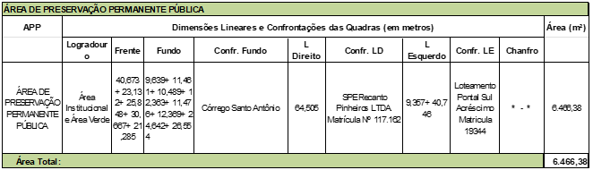
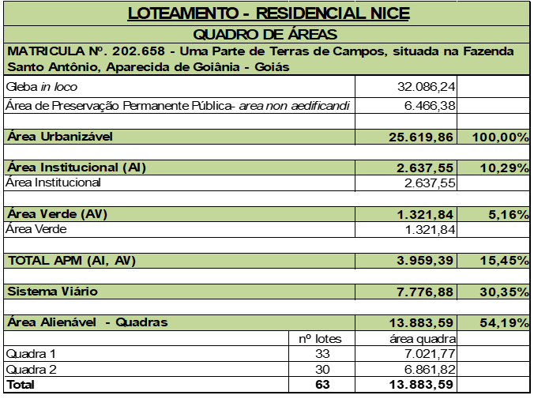
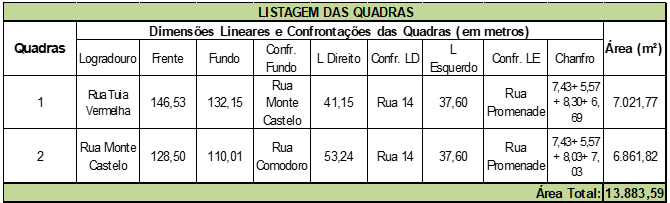
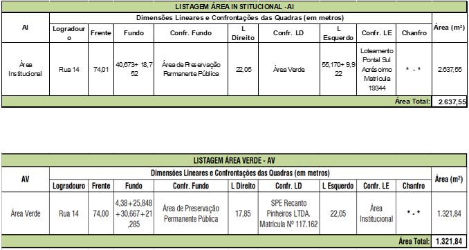
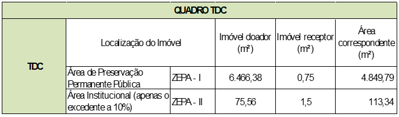

DECRETO Nº 1.874, DE 1º DE AGOSTO DE 2025

Dispõe sobre a aprovação do loteamento Residencial Nice, situado na Fazenda Santo Antônio, no âmbito do Município de Aparecida de Goiânia.

O PREFEITO DE APARECIDA DE GOIÂNIA, no uso das atribuições que lhe confere o art. 71, incisos III e VII, da Lei Orgânica do Município de Aparecida de Goiânia; art. 300, da Lei Complementar nº 124, de 14 de dezembro de 2016; tendo em vista o disposto na Lei federal nº 6.766, de 19 de dezembro de 1979; na Lei federal nº 10.257, de 10 de julho de 2001; e o contido nos Processos nºs 2023.010.757 e 2023.124.926,

**DECRETA:**

Art. 1º Fica aprovado o loteamento Residencial Nice, situado na Fazenda Santo Antônio, com área documental de 32.086,24m² (trinta e dois mil oitenta e seis metros quadrados e vinte e quatro decímetros quadrados), objeto da matrícula nº 202.658, do Registro de Imóveis e Tabelionato 1º de Notas de Aparecida de Goiânia, de propriedade da SPE Residencial Nice Ltda.

Art. 2º A descrição do projeto de parcelamento do solo urbano e o quadro geral de distribuição de áreas, com a indicação dos equipamentos públicos que passarão ao domínio do município, constam no Anexo I deste Decreto.

Art. 3º De acordo com o Plano Diretor do Município de Aparecida de Goiânia, Lei Complementar nº 124, de 14 de dezembro de 2016, o loteamento está inserido nas seguintes zonas:

I – ZEPA I – Zona Especial de Proceção Ambiental I – faixa de largura de 50,00m ao longo do curso d’água, nessa faixa não há terrenos edificáveis. A mesma encontra-se agregada à áreas institucionais e áreas verdes, e também compõe a Zona Parque do Córrego Santo Antônio;

II – ZEPA II – Zona Especial de Proteção Ambiental II – terrenos contidos na faixa de largura de 50,00m ao longo da ZEPA I, localizados às Quadras 01 e 02, sendo o lote 14 da Quadra 02 e os lotes 16, 17, 18 e 19 da Quadra 01; e

III – ZUM I – Zona de Uso Misto I – todos os demais terrenos.

Art. 4º Passa a integrar o sistema viário básico da cidade:

I – Via coletora: Rua 14, com caixa de 20,00m que ladeia a área verde, área institucional e área de preservação permanente pública, as quais compõem a Zona Parque;

II – Rua Comodoro do loteamento vizinho deverá ser pavimentada sobre a gleba do loteamento Residencial Nice de forma a constituir 30,00m de largura;

III – As Ruas Pomodoro e Tuia Vermelha, fazem o contorno do loteamento completando com 6,00m as vias previstas para a Fazenda João P. Lemes e prevista no loteamento vizinho Recanto Pinheiros; e

IV – A Rua Monte Castelo é uma via central no loteamento, pertence à categoria das vias locais e, dessa forma, tem 12,00m de largura.

Art. 5º O empreendedor deverá implantar no prazo de 02 (dois) anos, a contar da data de emissão do Alvará de Implantação, as seguintes obras:

I - rede de energia elétrica e pontos de iluminação pública;

II - rede de distribuição e abastecimento de água potável;

III - sistema de esgotamento sanitário;

IV - abertura de vias de circulação;

V - demarcação dos lotes, quadras e áreas públicas;

VI - obras de escoamento de águas pluviais e drenagem urbana;

VII - pavimentação asfáltica, guias e sarjetas; e

VIII - instalações fixas de combate a incêndio.

Art. 6º Em garantia à execução das obras e serviços de que trata o art. 5º, o empreendedor oferece os lotes 01 ao 33, da Quadra 1 e os lotes 01 ao 30, da Quadra 2, avaliados em R$ 4.373.330,85 (quatro milhões trezentos e setenta e três mil trezentos e trinta reais e oitenta e cinco centavos), conforme assentado no Termo de Caução.

Art. 7º O loteador se compromete a complementar o valor assegurado, seja em lotes ou fiança bancária, ou outra modalidade, caso o valor do orçamento apresentado sofra alteração durante a análise final de aprovação dos projetos complementares pelos respectivos órgãos competentes.

Art. 8º Findo o prazo previsto no art. 5º, caso o empreendedor não tenha realizado as obras e os serviços, tornar-se-á devedor da importância necessária à sua implantação.

Art. 9º Realizadas todas as obras e serviços exigidos, a administração pública municipal, a requerimento do loteador, após vistoria de seu órgão próprio, dará plena quitação da obrigação assumida.

Art. 10. Fica autorizada a aplicação da Transferência do Direito de Construir, na forma e condições previstas no Plano Diretor vigente, e conforme estabelecido no Anexo II.

Art. 11. A implantação do loteamento é de total responsabilidade e obrigação do responsável Técnico, juntamente com o proprietário do mesmo.

Art. 12. O empreendedor deverá submeter o Decreto de aprovação do remanejamento ao registro imobiliário no prazo de 180 (cento e oitenta) dias, sob pena de caducidade, conforme dispõe o art. 18 da Lei federal nº 6.766, de 19 de dezembro de 1979.

Art. 13. Este Decreto entra em vigor na data de sua publicação.

Aparecida de Goiânia, 1º de agosto de 2025.

LEANDRO VILELA VELLOSO

Prefeito de Aparecida de Goiânia

ANEXO I

QUADRO DE DISCRIMINAÇÃO DA ÁREA:

Poprietário:

SPE RESIDENCIAL NICE LTDA, CNPJ: 40.735.028/0001-91

Endereço:

Uma parte de terra de Campos, situada na Fazenda Santo Antônio, com área total de 32.086,24m² (trinta e dois mil oitenta e seis mil metros quadrados e vinte e quatro decímetros quadrados), sob a matrícula nº 202.658.

Profissional:

Janaína de Holanda Camilo – Arquiteta e Urbanista – CAU A-34957-7

2.    DESCRIÇÃO DO IMÓVEL

Inicia-se a descrição deste perímetro no vértice P1, de coordenadas N=8.142.339,821m e E=681.936,965m, situado na confrontação com a Parte Integrante da Vila Oliveira, de propriedade da SPE Recanto Pinheiro Ltda; deste, segue confrontando com o referido imóvel Parte Integrante da Vila Oliveira de propriedade da SPE Recanto Pinheiro Ltda, com os seguintes azimutes e distâncias: 169°53'00" e 133,174m até o vértice P2, de coordenadas N=8.142.208,718m e E=681.960,358m; 169°52'30" e 135,183m até o vértice P3, de coordenadas N=8.142.075,640m e E=681.984,122m; situado à margem esquerda do Córrego Santo Antônio; deste, segue pela margem esquerda do referido Córrego à montante com os seguintes azimutes e distâncias: 302°55'47" e 26,554m até o vértice P4, de coordenadas N=8.142.090,075m e E=681.961,834m; 276°54'35" e 24,642m até o vértice P5, de coordenadas N=8.142.093,039m e E=681.937,372m; 295°51'33" e 12,369m até o vértice P6, de coordenadas N=8.142.098,434m e E=681.926,241m; 287°48'09" e 11,476m até o vértice P7, de coordenadas N=8.142.101,943m e E=681.915,314m; 269°10'11" e 12,363m até o vértice P8, de coordenadas N=8.142.101,764m e E=681.902,952m; 257°06'30" e 10,489m até o vértice P9, de coordenadas N=8.142.099,424m e E=681.892,728m; 240°21'36" e 11,461m até o vértice P10, de coordenadas N=8.142.093,755m e E=681.882,766m; 242°50'15" e 9,639m até o vértice P11, de coordenadas N=8.142.089,355m e E=681.874,190m; deste, segue confrontando com Loteamento Pontal Sul com os seguintes azimutes e distâncias: 316°47'45" e 40,746m até o vértice P12, de coordenadas N=8.142.119,056m e E=681.846,295m; 313°53'27" e 9,357m até o vértice P13, de coordenadas N=8.142.125,543m e E 681.839,552m; 322°2'10" e 9,922m até o vértice P14, de coordenadas N=8.142.133,365m e E=681.833,448m; 351°7'40" e 55,170m até o vértice P15, de coordenadas N=8.142.187,875m e E=681.824,940m; 355°18'21" e 132,532m até o vértice P16, de coordenadas N=8.142.319,963m e E=681.814,094m; 355°24'07" e 10,983m até o vértice P17, de coordenadas N=8.142.330,911m e E=681.813,213m; deste, segue confrontando com o imóvel de João P. Lemes com os seguintes azimutes e distâncias: 85°52'55" e 124,072m até o vértice P1, ponto inicial da descrição deste perímetro.    

2.1 DESCRIÇÃO DA ÁREA DE PRESERVAÇÃO PERMANENTE PÚBLICA

 

3.    QUADRO GERAL DAS  ÁREAS

4.    QUADRAS

5.    ÁREAS PÚBLICAS MUNICIPAIS

ANEXO II

TRANSFERÊNCIA DE DIREITO DE CONSTRUIR

Conforme artigo 427 da Lei Complementar nº 124 de 14 de Dezembro de 2016 é reservado ao proprietário o direito ao potencial construtivo a ser utilizado quando da sua conveniência nas proporções abaixo descritas.

