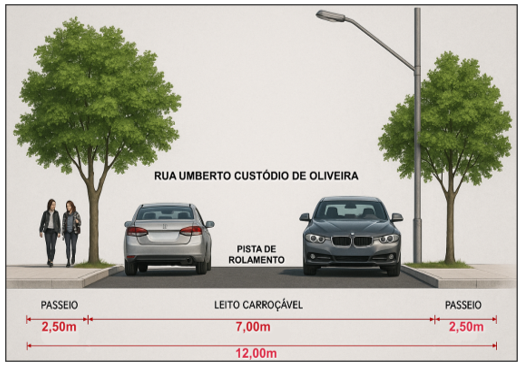

DECRETO Nº 2.674, DE 19 DE NOVEMBRO DE 2025

Dispõe sobre a aprovação do Loteamento Setor Araguaia Acréscimo I, no âmbito do Município de Aparecida de Goiânia.

O PREFEITO DE APARECIDA DE GOIÂNIA, no uso das atribuições que lhe confere o art. 71, incisos III e VII, da Lei Orgânica do Município de Aparecida de Goiânia; art. 300, da Lei Complementar nº 124, de 14 de dezembro de 2016; tendo em vista o disposto na Lei federal nº 6.766, de 19 de dezembro de 1979; na Lei federal nº 10.257, de 10 de julho de 2001; e o contido no Processo Administrativo nº 2025.173.694,

**DECRETA:**

Art. 1º Fica aprovado o Loteamento Setor Araguaia Acréscimo I, situado na Macrozona Urbana de Aparecida de Goiânia, com área documental de 21.920,572m² (vinte e um mil novecentos e vinte metros quadrados e quinhentos e setenta e dois milésimos de metro quadrado), objeto da matrícula nº 306.315, do Registro de Imóveis e 1º Tabelionato de Notas de Aparecida de Goiânia, de propriedade da R4 Engenharia Ltda.

Art. 2º A descrição do projeto de parcelamento do solo urbano e o quadro geral de distribuição de áreas, com a indicação dos equipamentos públicos que passarão ao domínio do município, constam no Anexo deste Decreto.

Art. 3º De acordo com o Plano Diretor do Município de Aparecida de Goiânia, Lei Complementar nº 124, de 14 de dezembro de 2016, o loteamento está inserido no Eixo de Desenvolvimento Econômico - EDE.

Art. 4º O empreendedor deverá implantar no prazo de 02 (dois) anos, a contar da data de emissão do Alvará de Implantação, as seguintes obras:

I - rede de energia elétrica e pontos de iluminação pública;

II - rede de distribuição e abastecimento de água potável;

III - sistema de esgotamento sanitário;

IV - abertura de vias de circulação;

V - demarcação dos lotes, quadras e áreas públicas;

VI - obras de escoamento de águas pluviais e drenagem urbana;

VII - pavimentação asfáltica, guias e sarjetas; e

VIII – medidas mitigadoras apresentadas e aprovadas no Estudo de Impacto de Trânsito.

Art. 5º Em garantia à execução das obras e serviços de que trata o art. 4º, o empreendedor oferece seguro garantia, no valor de R$ 325.000,00 (trezentos e vinte e cinco mil reais), conforme o disposto na Apólice nº 0306920259907751629348000, emitida pela Pottencial Seguradora S/A.

Parágrafo único. O empreendedor deverá assegurar a manutenção do seguro garantia enquanto houver risco a ser coberto.

Art. 6º O loteador se compromete a complementar o valor assegurado, seja em lotes ou fiança bancária, ou outra modalidade, caso o valor do orçamento apresentado sofra alteração durante a análise final de aprovação dos projetos complementares pelos respectivos órgãos competentes.

Art. 7º Findo o prazo previsto no art. 4º, caso o empreendedor não tenha realizado as obras e os serviços, tornar-se-á devedor da importância necessária à sua implantação.

Art. 8º Realizadas todas as obras e serviços exigidos, a administração pública municipal, a requerimento do loteador, após vistoria de seu órgão próprio, dará plena quitação da obrigação assumida.

Art. 9º A implantação do loteamento é de total responsabilidade e obrigação do responsável Técnico, juntamente com o proprietário do mesmo.

Art. 10. O empreendedor deverá submeter o Decreto de aprovação do loteamento ao registro imobiliário no prazo de 180 (cento e oitenta) dias, sob pena de caducidade, conforme dispõe o art. 18 da Lei federal nº 6.766, de 19 de dezembro de 1979.

Art. 11. Este Decreto entra em vigor na data de sua publicação.

Aparecida de Goiânia, 19 de novembro de 2025.

 

LEANDRO VILELA VELLOSO

Prefeito de Aparecida de Goiânia

ANEXO AO DECRETO Nº 2.674/2025

1\. caracterização do Loteamento

O Loteamento Setor Araguaia Acréscimo I será um LOTEAMENTO CONVENCIONAL ABERTO com finalidade INDUSTRIAL, COMERCIAL E PRESTAÇÃO DE SERVIÇO, com acesso pelas vias: Rodovia BR-153, Rua de São Bernardo e Rua Umberto Custódio de Oliveira, que será instituída juntamente com o loteamento. O loteamento proposto possui apenas lote único denominado Lote 01 com metragem de 20.064,88m², e uma única rua denominada Rua Umberto Custódio de Oliveira com caixa viária de largura de 12,00 metros que fará a conexão da Rodovia BR-153 com a Rua de São Bernardo.

A área é circundada pelos loteamentos Setor Araguaia, Setor Industrial Araguaia e por outra gleba remanescente da matricula mãe que originou esta matricula, e está próxima dos loteamentos Centro de Aparecida (Perímetro Urbano, Residencial Village Garavelo, Setor Oeste, Setor Expansul, Conjunto Ana Rosa, Vila Irmãos Souza, dentre outros. E no raio de 1km existem cerca de 30 áreas públicas municipais, sendo que destas, mais de 20 possuem equipamentos públicos instalados, dentre estes, alguns de destaque como: Unidade de Saúde Centro, Estádio Municipal, Delegacia da Policia Civil 2 DP, Ginásio de Esportes, Escola Estadual Machado de Assis, Escola Estadual Dom Pedro I, Escola Municipal O pequenino, Centro de Imunização, Cemitério Central, Secretaria Municipal de Saúde, no Centro de Aparecida; Unidade Básica de Saúde (UBS) Expansul, no Setor Expansul; Corpo de Bombeiros Militar de Goiás (CBMGO), Fórum TJGO, terminal de transporte coletivo Araguaia, Secretaria Municipal de Assistência Social, Secretaria Municipal de Educação no Setor Araguaia, Parque Lafaiete Campos no loteamento Residencial Village Garavelo e a Escola Estadual Olímpio Alves no loteamento Vila Irmãos Souza. Destaca-se pela proximidade à Praça da Matriz, importante marco para o surgimento do Município.

O projeto tem como objetivo a regularização da gleba para uso urbano, e tem como princípio urbanístico o atendimento integral a legislação federal, conforme Lei Federal 6766/1976, legislação municipal, por meio da Lei Municipal 124/2016, Lei Complementar 152/2018 e demais legislações correlatas.

A área se encontra classificada conforme Lei Municipal 124/2016 e leis complementares como Eixo de Desenvolvimento Econômico – EDE.

2\. IDENTIFICAÇÃO DA ÁREA DO IMÓVEL

Propriedade: GLEBA II, situada na FAZENDA SANTO ANTÔNIO.

Matrícula: 306.315

Município: Aparecida de Goiânia – GO

Proprietário: R4 Engenharia Ltda.

CNPJ: 44.832.407/0001-50

Área: 21.920,572m²

3\. descrição da gleba

A Gleba objeto do parcelamento do solo possui a seguinte descrição conforme a certidão de matrícula nº 306.315.

GLEBA II, situada na FAZENDA SANTO ANTÔNIO, com área de 21.920,572 m²: Inicia-se a descrição deste perímetro no vértice M-01, de coordenadas (Longitude: 49º14’29,63”W Latitude: 16º48’56,18”S - Coordenadas UTM 687.380,326 N 8.140.011,110 E; cravado na Rua de São Bernardo e a Matrícula: 51.804, situada na Fazenda Santo Antônio, deste, segue confrontando com a Matrícula: 51.804, com o seguinte azimute e distância: 106°33'21" e 114,88 m até o vértice M-02 de coordenadas (Longitude: 49º14’25,90”W Latitude: 16º48’57,22”S) - Coordenadas UTM 687.490,441 N 8.139.978,376 E, cravado na faixa de limite com a Rodovia BR-153; deste, segue confrontando com a faixa de limite com a Rodovia BR153 no sentido Hidrolândia, com os seguintes azimutes e distâncias: 191°34'22" e 165,14 m até o vértice M-02A de coordenadas (Longitude: 49º14’26,97”W Latitude: 16º49’02,49”S) - Coordenadas UTM 687.457,313 N 8.139.816,596 E, cravado na Gleba I Matrícula: 306.314, deste, segue confrontando com a Gleba I Matrícula: 306.314, com o seguinte azimute e distância: 281º34’18” e 142,43 m até o vértice M-02B de coordenadas (Longitude: 49º14’31,69”W Latitude: 16º49’01,60”S) - Coordenadas UTM 687.317,776 N 8.139.845,167 E, cravado na Rua São Bernardo; deste, segue confrontando com a Rua São Bernardo, com o seguinte azimute e distância: 20º39’12” e 177,34 m até o vértice M-01, ponto inicial da descrição deste perímetro. Todas as coordenadas aqui descritas estão georreferenciadas ao Sistema Geodésico Brasileiro tendo como datum o SIRGAS2000. Todos os azimutes foram calculados pela fórmula do Problema Geodésico Inverso (Puissant). Perímetro e Distâncias foram calculados pelas coordenadas cartesianas geocêntricas.

FAIXA DE DOMÍNIO: 35,00 metros a partir do eixo da pista

FAIXA NON AEDIFICANDI 15,00 metros após a Faixa de Domínio

4\. QUADRO GERAL DE ÁREAS:

<table><tbody><tr><td colspan="3">**QUADRO DE ÁREAS**</td><td>&nbsp;</td></tr><tr><td rowspan="2">**DESCRIÇÃO**</td><td rowspan="2">**ÁREA (m²)**</td><td rowspan="2">**PERCENTUAL (%)**</td><td>&nbsp;</td></tr><tr><td>&nbsp;</td></tr><tr><td>GLEBA</td><td>21.920,572</td><td>&nbsp;</td><td>&nbsp;</td></tr><tr><td>Faixa Non Aedficandi da gleba</td><td>880,700</td><td>&nbsp;</td><td>&nbsp;</td></tr><tr><td>**ÁREA URBANIZÁVEL da gleba**</td><td>**21.039,872**</td><td>**100%**</td><td>&nbsp;</td></tr><tr><td>**ÁREA ALIENÁVEL**</td><td>**20.064,880**</td><td>&nbsp;</td><td>&nbsp;</td></tr><tr><td>Quadra 01 - Lote 01</td><td>20.064,880</td><td>&nbsp;</td><td>&nbsp;</td></tr><tr><td>Área Urbanizável do lote 01</td><td>19.263,070</td><td>**91,56%**</td><td>&nbsp;</td></tr><tr><td>Faixa Non Aedficandi do lote 01</td><td>801,810</td><td>&nbsp;</td><td>&nbsp;</td></tr><tr><td>**Sistema Viário**</td><td>**1.855,692**</td><td>**8,46%**</td><td>&nbsp;</td></tr><tr><td colspan="3">**ÁREAS PÚBLICAS MUNICIPAIS (APM) EXTRA GLEBA**</td><td>&nbsp;</td></tr><tr><td>**DESCRIÇÃO**</td><td>**ÁREA DOADA**</td><td>**%**</td><td>&nbsp;</td></tr><tr><td>ÁREA INSTITUCIONAL</td><td>3.766,84</td><td>17,90</td><td>&nbsp;</td></tr><tr><td>ÁREA VERDE</td><td>1.157,50</td><td>5,50</td><td>&nbsp;</td></tr></tbody></table>

4.1 – Área Alienável

O loteamento Setor Araguaia Acréscimo I será constituído por lote único com metragem de 20.064,88m². Este lote possui uma faixa non aedificandi com 801,81m², definida com 15,00 metros após a Faixa de Domínio de BR-153 (35,00 metros do eixo da pista) e área útil de 19.263,070m² de área útil, equivalente a 91,56% do total da área urbanizável da gleba.

4.2 – Áreas Públicas Municipais

São as áreas públicas institucionais são aquelas destinadas à instalação de equipamentos públicos para educação, saúde, assistência social, segurança pública, esporte, lazer, cultura e outras atividades de interesse coletivo ou de atividades públicas Estaduais e Federais de interesse do Município e as áreas verdes são as que se caracterizam como espaço aberto, não edificado e com arborização e paisagem cultivada ou nativa.

4.2.1 - Área Institucional

As áreas públicas do loteamento Setor Araguaia Acréscimo I serão doadas extra gleba conforme previsão legal nos Artigo 224B que garante autonomia ao poder público, mediante análise de conveniência e interesse público, receber área institucional em outro local, desde que sejam de valor equivalente, mediante laudos de avaliação elaborados pela Prefeitura através do processo administrativo n° 2025140261, e recebimento pela Comissão de Análise de Áreas Públicas através do Parecer 02/2025-CAAP,  conforme o empreendimento finalizado, urbanização e acessibilidade. 

As áreas para doação extra gleba do loteamento Setor Araguaia Acréscimo I, serão:

<table><tbody><tr><td>**Loteamento**</td><td>**Quadra**</td><td>**Lote**</td><td>**Matrícula**</td><td>**CCI**</td><td>**Área**</td></tr><tr><td>Setor Conde Dos Arcos Complemento</td><td>39</td><td>09</td><td>182.280</td><td>180247</td><td>400,56m²</td></tr><tr><td>Setor Conde Dos Arcos Complemento</td><td>39</td><td>10</td><td>182.281</td><td>180248</td><td>400,56m²</td></tr><tr><td>Setor Conde Dos Arcos Complemento</td><td>39</td><td>11</td><td>182.306</td><td>180249</td><td>400,56m²</td></tr><tr><td>Setor Conde Dos Arcos Complemento</td><td>39</td><td>12</td><td>182.282</td><td>180250</td><td>418,70m²</td></tr><tr><td>Setor Conde Dos Arcos Complemento</td><td>39</td><td>16</td><td>182.629</td><td>180254</td><td>427,28 M²</td></tr><tr><td>Setor Conde Dos Arcos Complemento</td><td>39</td><td>17</td><td>182.650</td><td>180255</td><td>517,50 M²</td></tr><tr><td>Setor Conde Dos Arcos Complemento</td><td>39</td><td>18</td><td>186.651</td><td>180256</td><td>400,56m²</td></tr><tr><td>Setor Conde Dos Arcos Complemento</td><td>39</td><td>19</td><td>186.652</td><td>180257</td><td>400,56m²</td></tr><tr><td>Setor Conde Dos Arcos Complemento</td><td>39</td><td>20</td><td>186.653</td><td>180258</td><td>400,56m²</td></tr><tr><td colspan="5">**ÁREA TOTAL DA PROPOSTA DE DOAÇÃO DE ÁREA INSTITUCIONAL**</td><td>**3.766,84M²**</td></tr><tr><td colspan="6">**CORRESPONDENDE A 17,90% DA ÁREA URBANIZÁVEL**</td></tr></tbody></table>

4.2.2 - Área Verde

A área verde do loteamento Setor Araguaia Acréscimo I será doada extra gleba, de acordo com laudos de avaliação elaborado pela Prefeitura através do processo administrativo n° 2025140261, e recebimento pela Comissão de Análise de Áreas Públicas através do Parecer 01/2025-CAAP no loteamento Setor Araguaia, conforme descrição abaixo:

<table><tbody><tr><td>**Loteamento**</td><td>**Quadra**</td><td>**Lote**</td><td>**Matrícula**</td><td>**CCI**</td><td>**Área**</td></tr><tr><td>Setor Araguaia</td><td>N</td><td>21-23</td><td>313.585</td><td>564891</td><td>1.157,50m²</td></tr><tr><td colspan="5">**ÁREA TOTAL DA PROPOSTA DE DOAÇÃO DE ÁREA VERDE**</td><td>**1.157,50m²**</td></tr><tr><td colspan="6">CORRESPONDENDE A **5,50%** DA ÁREA URBANIZÁVEL</td></tr></tbody></table>

5\. SISTEMA VIÁRIO

O sistema viário do empreendimento foi desenvolvido a partir da definição das vias locais, seguindo as Diretrizes de parcelamento em conformidade com as diretrizes viárias traçadas pela legislação municipal.

5.1 - Via Local

O empreendimento possui acesso consolidado pela Rodovia BR-153 e Rua de São Bernardo, e realizará a implantação da Rua Umberto Custódio de Oliveira, sendo uma via local com caixa viária de 12,00 metros, sendo 2,5 metros de calçada para cada lado e 7,00 metros de via carroçável.

 

6\. PLANO DE COMPOSIÇÃO DA QUADRA

Quadra 01: Com área de 20.064,88m² composta por lote único, denominado lote 01. Sendo: 148,14 metros pela Rodovia BR-153; 129,30 metros pela Rua Umberto Custódio de Oliveira; 45,08 metros mais 114,94 metros pela Rua de São Bernardo; 114,66 metros com Área - matrícula 51.804; chanfrados de 7,07 metros e 6,50 metros.

Faixa Non Aedificandi com área de 801,81m²: Inicia no M-02 de coordenadas N8.139.978,376 e E687.490,441, e segue com distância de 148,14m e azimute 191º34'22" até o M-3 de coordenadas N8139833,251 e E685176,522; deste segue com distância de 7,07m e azimute 236º34'20" até o M-4 de coordenadas N8139829,355 e E685170,620; deste segue com distância de 0,50m e azimute 281º34'18" até o M-5 de coordenadas N8139829,457 e E685170,126; deste segue com distância de 131,67m e azimute 11º53'2"; deste segue até o M-6 de coordenadas N=8139958,301 e E685197,240; deste segue com com distância de 22,35m e azimute 3º52'19" até o M-7 de coordenadas N8139980,602 e E685198,752; deste segue com distância de 7,81m e azimute 106º33'9" até o M-2 ponto inicial dessa descrição.

7\. LISTAGEM DOS LOTES

<table><tbody><tr><td colspan="11">**LISTAGEM DOS LOTES - QUADRA 01**</td><td>&nbsp;</td></tr><tr><td rowspan="3">**Lote**</td><td colspan="9">**Dimensões Lineares e Confrontações dos Lotes (em metros)**</td><td rowspan="3">**Área&nbsp;&nbsp;&nbsp;&nbsp;&nbsp;&nbsp;&nbsp;&nbsp;&nbsp;&nbsp;&nbsp;&nbsp;&nbsp;&nbsp;&nbsp;&nbsp; (m²)**</td><td>&nbsp;</td></tr><tr><td rowspan="2">**Logradouro**</td><td rowspan="2">**Frente**</td><td rowspan="2">**Fundo**</td><td rowspan="2">**Confr. Fundo**</td><td rowspan="2">**L. D.**</td><td rowspan="2">**Confr. LD**</td><td rowspan="2">**L.E.**</td><td rowspan="2">**Confr. L.E.**</td><td rowspan="2">**Chanfro**</td><td>&nbsp;</td></tr><tr><td>&nbsp;</td></tr><tr><td>01</td><td>Rodovia BR-153</td><td>148,14</td><td>45,08 + 114,94</td><td>Rua de São Bernardo</td><td>129,30</td><td>Rua Umberto Custódio de Oliveira</td><td>114,66</td><td>Área - matrícula 51804</td><td>7,07 e 6,50</td><td>20.064,88</td><td>&nbsp;</td></tr><tr><td colspan="11">Faixa Non Aedificandi com área de 880,70m²: Inicia no M-02 de coordenadas N8.139.978,376 e E687.490,441, e segue com distância de 148,14m e azimute 191º34'22" até o M-3 de coordenadas N8139833,251 e E685176,522; deste segue com distância de 7,07m e azimute 236º34'20" até o M-4 de coordenadas N8139829,355 e E685170,620; deste segue com distância de 0,50m e azimute 281º34'18" até o M-5 de coordenadas N8139829,457 e E685170,126; deste segue com distância de 131,67m e azimute 11º53'2"; deste segue até o M-6 de coordenadas N=8139958,301 e E685197,240; deste segue com com distância de 22,35m e azimute 3º52'19" até o M-7 de coordenadas N8139980,602 e E685198,752; deste segue com distância de 7,81m e azimute 106º33'9" até o M-2 ponto inicial dessa descrição.</td><td>&nbsp;</td></tr><tr><td colspan="10">**ÁREA TOTAL DA QUADRA (*m²*)**</td><td>**20.064,88**</td><td>&nbsp;</td></tr><tr><td colspan="10">**ÁREA TOTAL DE LOTES (*m²*)**</td><td>**20.064,88**</td><td>&nbsp;</td></tr><tr><td colspan="10">**ÁREA TOTAL ÁREAS PUBLICAS (*m²*)**</td><td>**0,00**</td><td>&nbsp;</td></tr><tr><td colspan="10">**NÚMERO DE LOTES**</td><td>**1**</td><td>&nbsp;</td></tr><tr><td colspan="11">**ÁREA PÚBLICAS SERÃO DOADAS EXTRA GLEBA**</td><td>&nbsp;</td></tr></tbody></table>
