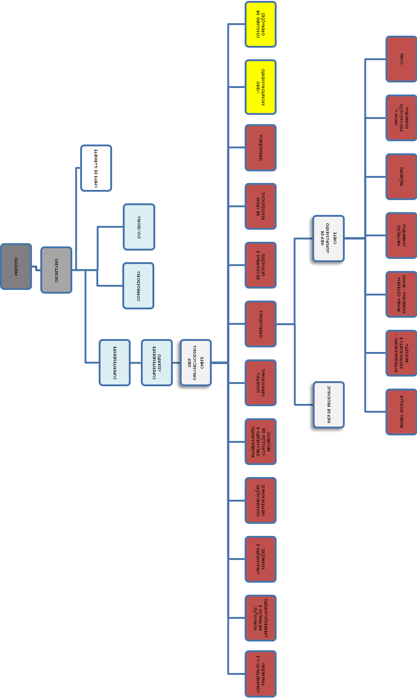
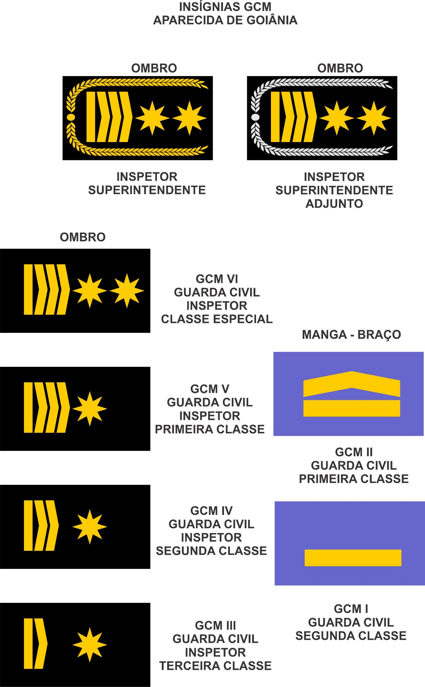

LEI COMPLEMENTAR Nº 111, DE 08 DE DEZEMBRO DE 2015.

Institui a estrutura hierárquica da Carreira da Guarda Civil Municipal de Aparecida de Goiânia e dá outras providências.

FAÇO SABER QUE A CÂMARA MUNICIPAL DE APARECIDA DE GOIÂNIA APROVOU E EU, PREFEITO MUNICIPAL, SANCIONO A SEGUINTE LEI:

CAPÍTULO I

DAS DISPOSIÇÕES GERAIS

Art. 1º Esta lei institui a estrutura hierárquica da Carreira da Guarda Civil Municipal de Aparecida de Goiânia, sob o regime jurídico estatutário previsto na Lei Complementar nº 003, de e alterações posteriores.

Art. 2º Para os fins previstos nesta Lei, considera-se:

I – servidor público: a pessoa legalmente investida em cargo público de provimento efetivo na carreira da Guarda Civil Municipal de Aparecida de Goiânia;

II – cargo público: é o conjunto de atribuições e responsabilidades previstas na estrutura organizacional que devem ser cometidas a um servidor;

III – função pública: a atribuição ou conjunto de atribuições conferidas aos titulares de cargo público na carreira da Guarda Civil Municipal de Aparecida de Goiânia, remunerada através de gratificação quando de natureza eventual;

IV – quadro de carreira: o agrupamento de cargos e classes do mesmo cargo, escalonadas segundo a hierarquia da Guarda Civil Municipal de Aparecida de Goiânia, cujo provimento é privativo dos titulares dos cargos que a integram, podendo ser de natureza efetiva ou comissionada;

V – classe: a posição ocupada pelo servidor público na carreira da Guarda Civil Municipal de Aparecida de Goiânia;

VI – padrão: a posição ocupada pelo servidor público dentro de uma mesma classe;

VII – hierarquia: a posição ocupada pelo servidor em relação ao Prefeito Municipal, ao Secretário Municipal de Defesa Social e Guarda Civil, bem como aos demais servidores que ocupam cargo público efetivo na carreira da Guarda Civil Municipal de Aparecida de Goiânia, considerando-se, para tanto, além da classe e do padrão, eventual função de confiança exercida;

VIII – progressão horizontal: a passagem do servidor público para o padrão imediatamente superior dentro de uma mesma classe;

IX – progressão vertical: a passagem do servidor público de uma classe para a classe imediatamente superior.

Parágrafo único. Os cargos públicos, acessíveis a todos os brasileiros, são criados por lei, com denominação própria e vencimento pago pelos cofres públicos, para provimento em caráter efetivo ou em comissão.

Art. 3º É proibida a prestação de serviços gratuitos, salvo os casos previstos em lei.

CAPÍTULO II

DA CARREIRA

Art. 4º Fica instituída a carreira da Guarda Civil Municipal de Aparecida de Goiânia composta pelos cargos de provimento efetivo da Guarda Civil Municipal, respectivas classes e padrões.

Art. 5º A carreira única da Guarda Civil Municipal de Aparecida de Goiânia é composta pelas seguintes classes:

I – Guarda Civil Municipal de Classe II;

II – Guarda Civil Municipal de Classe I;

III – Guarda Civil Municipal Inspetor de Classe III;

IV – Guarda Civil Municipal Inspetor de Classe II;

V – Guarda Civil Municipal Inspetor de Classe I;

VI – Guarda Civil Municipal Inspetor de Classe Especial.

Parágrafo único. O cargo de Guarda Civil Municipal de Classe II constitui a classe inicial da carreira única da Guarda Civil Municipal de Aparecida de Goiânia.

Art. 6º São princípios mínimos de atuação da Guarda Civil Municipal de Aparecida de Goiânia:

I - proteção dos direitos humanos fundamentais, do exercício da cidadania e das liberdades públicas;

II - preservação da vida, redução do sofrimento e diminuição das perdas;

III - patrulhamento preventivo;

IV - compromisso com a evolução social da comunidade; e

V - uso progressivo da força, pautada na razoabilidade e proporcionalidade.

CAPÍTULO III

DO INGRESSO NA CARREIRA

Art. 7º O ingresso na carreira da Guarda Civil Municipal de Aparecida de Goiânia far-se-á mediante concurso público de provas ou provas e títulos, exigido o ensino médio completo, sempre na classe e padrão iniciais da carreira.

Art. 8º Constituem requisitos de provimento do cargo inicial da carreira da Guarda Civil Municipal de Aparecida de Goiânia:

I – a nacionalidade brasileira;

II – o gozo dos direitos políticos;

III – a quitação com as obrigações militares e eleitorais;

IV – o ensino médio completo;

V – a idade mínima de dezoito anos;

VI – a aptidão física, mental e psicológica;

VII – a idoneidade moral comprovada por investigação social e certidões expedidas perante o Poder Competente;

VIII – não estar incompatibilizado para o serviço público, em razão de penalidade sofrida;

IX – a prévia aprovação em concurso público.

§ 1º A aptidão psicológica a que se refere o inciso VI será aferida em avaliação psicológica, mediante instrumentos psicológicos específicos destinados a verificar as características pessoais do candidato e sua adequabilidade às atribuições do cargo, com especial atenção ao registro de porte de arma, em conformidade com a legislação vigente, apondo-se o indicativo de “Apto” ou “Inapto” ao exercício das funções.

§ 2º A idoneidade moral ilibada a que se refere o inciso VII deverá ser comprovada mediante a apresentação dos seguintes documentos:

I – certidão dos distribuidores criminais da Justiça Estadual, da Justiça Federal, da Justiça Militar e da Justiça Eleitoral do domicílio do candidato;

II – certidão de exercício, com declaração, positiva ou negativa, de aplicação de penalidade decorrente de processo administrativo disciplinar, na hipótese de o candidato ser ou ter sido servidor público, no âmbito das administrações direta ou indireta, federal, estadual ou municipal ou declaração subscrita pelo candidato de não ter exercido serviço público, sob as penas da lei;

III – atestados de antecedentes criminais emitidos pela Polícia Civil do domicílio do candidato, bem como pelo Departamento de Polícia Federal.

§ 3º A idade mínima de 18 (dezoito) anos será exigida para participação do Curso de Formação, em função do manuseio de arma de fogo.

§ 4º Durante o Programa de Formação Inicial, mediante a assinatura de termo de compromisso específico, o candidato deverá observar o regime disciplinar da Guarda Civil Municipal de Aparecida de Goiânia, cujo descumprimento ocasionará a eliminação do candidato.

CAPÍTULO IV

DO CONCURSO PÚBLICO

Art. 9º A investidura em cargo inicial da Guarda Civil Municipal de Aparecida de Goiânia de provimento efetivo será feita mediante aprovação em concurso público, de caráter eliminatório e classificatório, compreendendo provas ou provas e títulos.

§ 1° O concurso público destinado a apurar a qualificação profissional exigida para o ingresso na carreira da Guarda Civil Municipal de Aparecida de Goiânia poderá ser desenvolvido em etapas, conforme dispuser o edital, observadas as características e o perfil do cargo a ser provido, compreendendo:

I - provas ou provas e títulos;

II – prova de aptidão física, mediante testes físicos e exames médicos, na forma prevista em edital, de caráter eliminatório; e

III - cumprimento de Programa de Formação Inicial.

§ 2° As provas poderão ser constituídas de questões objetivas e/ou subjetivas, especificando o conteúdo programático no edital, sendo de caráter eliminatório e classificatório.

§ 3º A prova de títulos deverá ser realizada como etapa posterior à prova escrita e somente apresentarão os títulos os candidatos aprovados nas provas anteriores, devendo o edital especificar os tipos de títulos admitidos, formas de apresentação e sua pontuação, sendo estes apenas de caráter classificatório.

§ 4º Os candidatos classificados nas provas ou provas e títulos serão convocados para prova de aptidão física, devendo o edital indicar o tipo de prova, as técnicas admitidas e o desempenho mínimo para a classificação.

§ 5º Os candidatos classificados nas provas serão matriculados no Programa de Formação Inicial, em número determinado no edital de abertura de concurso público.

§ 6º O candidato classificado nas provas e matriculado no Programa de Formação Inicial perceberá, a título de ajuda financeira, oitenta por cento do vencimento inicial do cargo pleiteado, salvo opção pelo vencimento e vantagens pecuniárias do cargo que estiver exercendo, caso seja servidor do Município.

§ 7º A classificação final será resultante do somatório dos pontos obtidos pelos candidatos nas etapas que terão pesos estabelecidos em edital.

§ 8º Concluído o concurso público e homologados os seus resultados, terão direito à nomeação os candidatos aprovados dentro do limite de vagas do cargo estabelecido em edital, obedecida a ordem de classificação, ficando os demais candidatos mantidos no cadastro de reserva de concursados.

Art. 10 O concurso público terá validade de até dois anos, podendo ser prorrogado uma única vez, por igual período.

Art. 11 Na realização dos concursos serão observadas as seguintes normas básicas:

I - o prazo de validade do concurso, as condições de sua realização, as exigências ou condições que possibilitem a comprovação, pelo candidato, das qualificações e requisitos constantes das especificações do cargo serão fixados em edital, que será publicado em jornal diário local de grande circulação;

II - não se abrirá novo concurso enquanto houver candidato aprovado em concurso anterior, com prazo de validade ainda não expirado;

III - aos candidatos assegurar-se-ão meios amplos de recursos, nas fases de homologação das inscrições, publicação de resultados parciais ou globais, homologação do concurso e nomeação dos aprovados.

CAPÍTULO V

DA HIERARQUIA

Art. 12 A hierarquia da Guarda Civil Municipal de Aparecida de Goiânia compreende:

I – Prefeito Municipal;

II – Secretário Municipal da Defesa Social e Guarda Civil;

III – Comandante da Guarda Municipal;

(Redação alterada pela Lei Complementar nº 125, de 11 de janeiro de 2017).

~~III – Guarda Civil Municipal Inspetor Superintendente;~~

IV – Subcomandante da Guarda Municipal;

(Redação alterada pela Lei Complementar nº 125, de 11 de janeiro de 2017).

~~IV – Guarda Civil Municipal Inspetor Superintendente Adjunto;~~

V – Guarda Civil Municipal Inspetor Organizacional;

VI – Guarda Civil Municipal Inspetor Regional;

VII – Guarda Civil Municipal Inspetor de Agrupamento;

VIII – Guarda Civil Municipal Inspetor de Classe Especial;

IX – Guarda Civil Municipal Inspetor de Classe I;

X – Guarda Civil Municipal Inspetor de Classe II;

XI – Guarda Civil Municipal Inspetor de Classe III;

XII – Guarda Civil Municipal de Classe I;

XIII – Guarda Civil Municipal de Classe II.

§ 1º O alto comando da Guarda Civil Municipal de Aparecida de Goiânia compete ao Secretário Municipal de Defesa Social e Guarda Civil, que se subordina ao Prefeito Municipal.

§ 2º A cada uma das classes na hierarquia da Guarda Civil Municipal corresponderá uma única insígnia, conforme Anexo desta lei.

CAPÍTULO VI

DA CORREGORIA GERAL E DA OUVIDORIA

Art. 13 A Corregedoria-Geral da Guarda Civil Municipal de Aparecida de Goiânia será independente no exercício de sua competência, principalmente na apuração de infrações disciplinares dos seus servidores, mediante processo administrativo disciplinar específico, a ser conduzido por Comissão Especial Processante determinada pelo Corregedor-Geral, seguindo o procedimento descrito na Lei Complementar 003/2001, bem como na apreciação de representações relativas aos seus servidores, procedendo, inclusive, investigações sobre a conduta ética, social e funcional de seus servidores.

Parágrafo único. São atribuições do Corregedor Geral:

I - apurar as infrações disciplinares atribuídas aos integrantes da Guarda Civil Municipal;

II – realizar visitas de inspeção e correições extraordinárias da Guarda;

III - apreciar as representações, bem como a investigação de denúncias sobre o comportamento ético, social e funcional dos candidatos e dos que já ocupam cargos na Corporação.

Art. 14 O Corregedor-Geral da Guarda Civil Municipal de Aparecida de Goiânia será um servidor estável integrante de carreira, com curso superior em Direito, obtido em instituição reconhecida pelo MEC e, preferencialmente, com curso de qualificação em segurança pública, nomeado pelo Chefe do Poder Executivo, para um mandato de 02 (dois) anos, permitindo uma única recondução por igual período.

§ 1º Caso não haja, na entrada de vigor desta Lei Complementar, servidor de carreira com as qualificações exigidas no caput do art. 13, poderá o Chefe do Poder Executivo, excepcionalmente, nomear outro servidor do Quadro de Pessoal do Município, com formação jurídica para exercer o referido cargo de Corregedor-Geral, até que sejam atendidos os requisitos do referido cargo.

§ 2º Caberá à Secretaria de Defesa Social e Guarda Civil a responsabilidade de averiguar todos os requisitos para preenchimento da vaga de Corregedor-Geral, devendo emitir declaração de compatibilidade para indicação ao cargo para ser anexada ao assentamento do servidor (Anexo IX).

§ 3º A Corregedoria Geral será um órgão autônomo, independente e permanente.

Art. 15 O serviço de Ouvidoria da Guarda Civil Municipal de Aparecida de Goiânia será conduzido por um servidor de carreira, de idoneidade moral e conduta ilibada, com qualificação superior em qualquer área, preferencialmente, na área de segurança e/ou afim, sendo nomeado pelo Chefe do Poder Executivo para um mandato de 02 (dois) anos, permitindo uma única recondução por igual período.

§ 1º A Ouvidora receberá denúncias e reclamações relativas aos atos praticados por servidores da Guarda Municipal e procederá a fiscalização e auditoria preliminar ou sindicâncias e poderá, para melhor atender a sociedade de Aparecida de Goiânia – GO, disponibilizar um serviço de “disque-denúncia”.

§ 2º A ouvidoria será um órgão autônomo, independente e permanente.

§ 3º Caberá à Secretaria de Defesa Social e Guarda Civil a responsabilidade de averiguar todos os requisitos para preenchimento da vaga de Ouvidor da Guarda Civil, devendo emitir declaração de compatibilidade para indicação ao cargo para ser anexada ao assentamento do servidor (Anexo IX).

CAPÍTULO VII

DO DESENVOLVIMENTO NA CARREIRA

Art. 16 O desenvolvimento na carreira da Guarda Civil Municipal de Aparecida de Goiânia far-se-á mediante progressão horizontal e progressão vertical, observadas as regras previstas neste capítulo.

Seção I

Da Progressão Horizontal

Art. 17 Fica assegurada aos servidores ocupantes de cargo na carreira da Guarda Civil Municipal de Aparecida de Goiânia, a cada ano de efetivo exercício, a progressão horizontal na carreira.

Parágrafo único. Os padrões da progressão horizontal de que trata este artigo são os constantes no Anexo VI desta Lei.

Art. 18 Terá direito à progressão horizontal o servidor ocupante de cargo na carreira única da Guarda Civil Municipal de Aparecida de Goiânia que:

I – houver completado 01 (um) ano de efetivo exercício no respectivo padrão, inclusive no período do estágio probatório;

II – houver obtido resultado favorável na última avaliação de desempenho.

§ 1º Os afastamentos e as licenças considerados como de efetivo exercício serão computados para o período de que trata o inciso I.

§ 2º A contagem de tempo para um novo período será sempre iniciada no dia seguinte àquele em que o servidor houver completado o período anterior.

§ 3º Não fará jus à progressão horizontal o servidor ocupante de cargo na carreira da Guarda Civil Municipal de Aparecida de Goiânia que, no respectivo ano, houver sofrido penalidades disciplinares.

Art. 19 A Administração concederá a progressão horizontal anualmente, de forma coletiva, após formalização do resultado da avaliação de desempenho realizada pela Comissão a que aduz o art. 18 desta Lei.

Seção II

Da Progressão Vertical

Art. 20 Fica assegurada aos servidores ocupantes de cargo na carreira da Guarda Civil Municipal de Aparecida de Goiânia a progressão vertical na carreira, observada a existência de vaga na respectiva classe, bem como o seguinte:

I – a progressão de Guarda Civil Municipal de Classe II para Guarda Civil Municipal de Classe I deverá observar o interstício de 04 (quatro) anos de efetivo exercício na respectiva classe, incluído o período de estágio probatório, além da juntada de certificados de cursos na área de segurança pública e/ou administrativa de no mínimo 120 (cento e vinte) horas, além de Programa de Formação realizado pela própria instituição que o habilite para a nova função, Certidão Negativa expedida emitida pela Corregedoria da Guarda Civil do Município, Certidão de Antecedentes Cíveis e Criminais;

II – a progressão de Guarda Civil Municipal de Classe I para Guarda Civil Municipal Inspetor de Classe III deverá obervar o interstício de 04 (quatro) anos de efetivo exercício na respectiva classe, bem como haver o servidor concluído 360 (trezentos e sessenta) horas de cursos na área de segurança pública e/ou administrativa, além de programa de formação de inspetores realizado pela própria instituição que o habilite para a nova função, Certidão Negativa expedida emitida pela Corregedoria da Guarda Civil do Município, Certidão de Antecedentes Cíveis e Criminais;

III - a progressão de Guarda Civil Municipal Inspetor de Classe III para Guarda Civil Municipal Inspetor de Classe II deverá obervar o interstício de 04 (quatro) anos de efetivo exercício na respectiva classe, bem como haver o servidor concluído 720 (setecentos e vinte) horas de cursos na área de segurança pública e/ou administrativa, além de Programa de Formação realizado pela própria instituição que o habilite para a nova função, Certidão Negativa expedida emitida pela Corregedoria da Guarda Civil do Município, Certidão de Antecedentes Cíveis e Criminais;

IV – a progressão de Guarda Civil Municipal Inspetor de Classe II para Guarda Civil Municipal Inspetor de Classe I deverá obervar o interstício de 04 (quatro) anos de efetivo exercício na respectiva classe, bem como haver o servidor concluído 1.080 (mil e oitenta) horas de cursos na área de segurança pública e/ou administrativa, além de Programa de Formação realizado pela própria instituição que o habilite para a nova função, Certidão Negativa expedida emitida pela Corregedoria da Guarda Civil do Município, Certidão de Antecedentes Cíveis e Criminais;

V – a progressão de Guarda Civil Municipal Inspetor de Classe I para Guarda Civil Municipal Inspetor de Classe Especial deverá obervar o interstício de 04 (quatro) anos de efetivo exercício na respectiva classe, bem como haver o servidor concluído curso de graduação em qualquer área do conhecimento, além de Programa de Formação realizado pela própria instituição que o habilite para a nova função, Certidão Negativa expedida emitida pela Corregedoria da Guarda Civil do Município, Certidão de Antecedentes Cíveis e Criminais.

§ 1º Não poderá progredir verticalmente na carreira o servidor que houver sofrido penas disciplinares nos dois anos que antecedem a progressão.

§ 2º Somente poderá progredir verticalmente na carreira o servidor que houver obtido resultado positivo nas duas últimas avaliações de desempenho.

§ 3º Os certificados de cursos de capacitação deverão ser chancelados por instituição oficial ou devidamente credenciada perante órgão oficial, necessariamente devendo conter, no mínimo, nome da instituição promotora, o nome do aluno participante, o quantitativo de horas-aulas, o conteúdo programático ministrado, o período de realização do curso, assinaturas e/ou selos pertinentes.

§ 4º Para efeito da progressão de que trata os incisos I, II, III, IV e V deste artigo, somente serão aceitos cursos promovidos por instituição oficial ou devidamente credenciada perante órgão oficial, além do respectivo certificado.

§ 5º Para efeito da progressão de que trata os incisos II, III e IV deste artigo, serão aceitos os cursos realizados após o ingresso na Guarda Civil Municipal.

§ 6º Caberá à Secretaria de Defesa Social e Guarda Civil a responsabilidade de averiguar todos os requisitos para preenchimento das vagas, devendo emitir declaração de compatibilidade para indicação ao cargo, além de ser anexada ao assentamento do servidor (Anexo IX).

§ 7º Os totais das horas referidas nos incisos I, II, III e IV deste artigo poderão ser alcançados em um só curso ou pela soma da duração de vários cursos, observado o limite mínimo de 15 (quinze) horas por curso.

§ 8º Caberá à Secretaria de Defesa Social e Guarda Civil regulamentar, mediante Portaria, o Regimento Interno do Centro de Formação, Instrução e Aperfeiçoamento da Guarda Civil Municipal, estabelecendo o Programa de Ações de Capacitação de Guardas Civis Municipais que será desenvolvido através de:

a) cursos nas modalidades presencial, semipresencial e à distância;

b) projetos de treinamento em serviço e visitas técnicas;

c) atividades de atualização e aperfeiçoamento de pessoal através de cursos de formação, seminários, congressos, dinâmicas de grupo, “workshop” ou eventos similares;

d) outras atividades correlatas às ações de capacitação.

§ 9º O Programa de Ações de Capacitação de Guardas Civis Municipais comportará:

a) a elaboração e desenvolvimento de projetos com foco no aprimoramento dos sistemas dos recursos humanos e materiais da Secretaria de Defesa Social e Guarda Civil;

b) a execução de ações de fortalecimento através da participação de instituições públicas e privadas, Instituições de Ensino Superior e Fundações das áreas relacionadas ao programa;

c) a participação dos Guardas Civis Municipais no Plano de Fortalecimento Institucional e Capacitação dos Servidores do Município de Aparecida de Goiânia – CAPAZ, instituído pelo Decreto nº 281, de 11 de novembro de 2015.

Art. 21 As progressões verticais serão processadas anualmente no mês de dezembro de cada ano.

Parágrafo único. Para as promoções com vigência a partir de 1º de janeiro serão consideradas as vagas ocorridas até 30 de novembro imediatamente anterior.

Art. 22 A vacância do cargo a ser preenchido por progressão vertical ocorrerá na data:

I – do falecimento do integrante da carreira;

II – da publicação do ato que exonerar ou demitir o integrante da carreira;

III - do início da vigência do ato de progressão vertical;

IV – da publicação do ato de aposentadoria;

V – da readaptação;

VI – posse em outro cargo inacumulável;

VII - perda do cargo por decisão judicial.

Art. 23 Os efeitos financeiros das progressões verticais serão computados a partir do primeiro dia do mês de janeiro de cada ano.

Art. 24 Terá preferência para efeito de progressão vertical o servidor mais antigo na carreira única da Guarda Civil Municipal de Aparecida de Goiânia.

§ 1º Será considerado o mais antigo na carreira aquele que primeiro tomou posse no cargo de Guarda Municipal de Classe II.

§ 2º Entre os que tomaram posse na mesma data será considerado mais antigo aquele que tiver o maior tempo de efetivo serviço na Guarda Civil Municipal de Aparecida de Goiânia.

§ 3º Se persistir o empate será considerado mais antigo aquele que obteve o melhor desempenho no respectivo Programa de Formação Inicial.

§ 4º Se ainda persistir o empate será considerado mais antigo aquele mais idoso.

§ 5º Em igualdade de classe, terá precedência aquele que contar com maior tempo de efetivo serviço na respectiva classe.

§ 6º A listagem de antiguidade dos servidores da Guarda Municipal deverá ser atualizada anualmente no mês de Janeiro e ser divulgada para notoriedade de todos os interessados.

§ 7º Para efeito da progressão de que trata este artigo consideram-se como de efetivo exercício os períodos de licenças e afastamentos remunerados, em conformidade com a Lei Complementar nº 003/2001, porém não serão considerados os períodos de cessão para órgãos da Administração direta ou indireta do Município ou de outras esferas de poder ou governo.

Seção III

Da Avaliação de Desempenho

Art. 25 A avaliação de desempenho dos servidores ocupantes de cargo na carreira da Guarda Civil Municipal de Aparecida de Goiânia será realizada de forma contínua e formalizada anualmente por comissão, composta por:

I – Guarda Civil Municipal Inspetor na função de Superintendente;

II – Guarda Civil Municipal Inspetor na função de Organizacional - Operacional;

III – representante da Secretaria Municipal de Administração e Recursos Humanos;

IV – representantes dos servidores ocupantes de cargo na carreira da Guarda Civil Municipal de Aparecida de Goiânia.

§ 1º O Guarda Civil Municipal Inspetor na função de Superintendente e o Guarda Civil Municipal Inspetor Organizacional função de Operacional são membros natos da Comissão, cabendo ao primeiro presidi-la e ao segundo secretariá-la.

§ 2º O representante da Secretaria Municipal de Administração e Recursos Humanos será indicado pelo Secretário da referida pasta.

§ 3º Os representantes dos servidores ocupantes de cargo na carreira da Guarda Civil Municipal de Aparecida de Goiânia, em número de 02 (dois), serão eleitos entre aqueles que ocupam os cargos de Guarda Civil Municipal Inspetor.

§ 4º A participação na comissão de que trata este artigo não será por qualquer forma ou pretexto remunerada, constituindo, contudo, relevante serviço público municipal.

Art. 26 Caberá à Inspetoria Organizacional - Administrativa e Financeira fornecer os relatórios e demais informações necessárias à avaliação de desempenho do servidor ocupante de cargo na carreira da Guarda Civil Municipal de Aparecida de Goiânia.

§ 1º Os relatórios de que trata este artigo serão elaborados pelos servidores ocupantes dos cargos de Guarda Civil Municipal Inspetor e dele deverá conter a descrição minuciosa dos fatos relatados.

§ 2º Os relatórios de que trata este artigo deverão ser elaborados no prazo máximo de 72 (setenta e duas) horas a contar do fato relatado, sob pena de não ser considerado para fins de avaliação de desempenho.

§ 3º O servidor avaliado deverá ser informado do resultado de sua avaliação, podendo oferecer Pedido de Reconsideração no prazo de 10 (dez) dias a contar da informação cientificada, findo o prazo o relatório será encaminhado ao Superintendente para aprovação ou rejeição em despacho fundamentado.

§ 4º Caso seja relatada conduta irregular e incompatível com a conduta da Guarda Municipal de Aparecida de Goiânia, esta deverá ser, formalmente, encaminhada à Comissão Disciplinar para a devida apuração e o, respectivo, processo disciplinar, quando for o caso.

§ 5º Será responsabilizado civil, criminal e administrativamente o inspetor que incluir informações falsas em seu relatório ou que deixar, por qualquer motivo, de relatar fato relevante para fins de avaliação de desempenho.

§ 6º A conduta descrita no parágrafo anterior constitui infração disciplinar punível com a pena de suspensão por 90 (noventa) dias, devendo esta ser apurada , em conformidade com a Lei Complementar nº 003/2001.

§ 7º Os relatórios relativos às atividades dos inspetores serão elaborados pelo Inspetor Organizacional - Operacional.

§ 8º Da decisão do Superintendente quanto à aprovação ou rejeição do relatório caberá recurso para o Secretário de Defesa Social e Guarda Municipal no prazo de 10 (dez) dias, a contar da cientificação da decisão.

§ 9º As faltas disciplinares ensejadoras de punição através de Processo Administrativo Disciplinar serão apuradas e conduzidas de acordo com a Lei Complementar nº 003/2001.

Art. 27 Os critérios para a avaliação de desempenho dos servidores ocupantes de cargo na carreira da Guarda Civil Municipal de Aparecida de Goiânia são:

I - Assiduidade/Pontualidade;

II - Compromisso com Qualidade;

III - Conhecimento;

IV - Cooperação/Envolvimento;

V - Iniciativa;

VI - Organização/Planejamento;

VII - Produtividade/Eficiência;

VIII - Responsabilidade.

§ 1º Considerar-se-á positiva a Avaliação de Desempenho em que o servidor obtiver no mínimo 56 (cinquenta e seis) pontos.

§ 2º O Anexo VIII desta Lei fixa os parâmetros da Avaliação de Desempenho e estabelece seus formulários.

CAPÍTULO VIII

DO VENCIMENTO E DA REMUNERAÇÃO

Art. 28 Sem prejuízo de outros adicionais e vantagens previstos na Lei Complementar Municipal nº 003, de ou em outras leis especiais, a remuneração dos servidores públicos ocupantes dos cargos da carreira da Guarda Civil Municipal de Aparecida de Goiânia compreende o vencimento e a gratificação pelo regime especial de trabalho da Guarda Civil Municipal previsto nesta Lei e legislações municipais pertinentes.

Art. 29 Os vencimentos das diferentes classes dos cargos que compõem a carreira única da Guarda Civil Municipal de Aparecida de Goiânia são aqueles descritos no Anexo VI desta lei.

§ 1º Os vencimentos serão reajustados na mesma data e percentual dos reajustes efetuados aos demais servidores municipais.

§ 2º O vencimento de cada classe da carreira única da Guarda Civil Municipal de Aparecida de Goiânia, na progressão vertical, será fixado com diferença não inferior a 5% (cinco por cento).

§ 3º O vencimento de cada padrão da carreira única da Guarda Civil Municipal de Aparecida de Goiãnia, na progressão horizontal, será fixado com diferença não inferior a 0,5% (meio por cento).

Art. 30 O servidor público integrante da carreira da Guarda Civil Municipal de Aparecida de Goiânia que for designado para o exercício de função de confiança fará jus a gratificação correspondente, conforme valores previstos no Anexo VII desta Lei.

Art. 31 Fica assegurada a Guarda Civil Municipal de Aparecida de Goiânia o aumento anual que for repassado para os demais servidores públicos municipais.

Parágrafo único. Aos vencimentos que tiverem incorporado o Regime Especial de Trabalho da Guarda Civil Municipal de Aparecida de Goiânia – R.E.T.G.M. adotar-se-á, anualmente, o aumento oferecido a todos os servidores públicos municipais, calculada pela porcentagem.

CAPÍTULO IX

DAS FUNÇÕES DE CONFIANÇA

Art. 32 A Guarda Civil Municipal de Aparecida de Goiânia terá por comandante o Guarda Civil Municipal Inspetor Superintendente, escolhido dentre os servidores públicos que ocupam o cargo de Guarda Civil Municipal Inspetor de Classe Especial.

Art. 33 A Guarda Civil Municipal de Aparecida de Goiânia terá por subcomandante o Guarda Civil Municipal Inspetor Superintendente Adjunto, escolhido dentre os servidores públicos que ocupam o cargo de Guarda Civil Municipal Inspetor de Classe Especial, a quem incumbirá assessorar e substituir o Guarda Civil Municipal Superintendente em ausências e impedimentos.

Art. 34 As Inspetorias Organizacionais da Guarda Civil Municipal de Aparecida de Goiânia serão chefiadas por um Guarda Civil Municipal Inspetor Organizacional escolhido dentre os servidores públicos que ocupam o cargo de Guarda Civil Municipal Inspetor.

Art. 35 As Regionais da Guarda Civil Municipal de Aparecida de Goiânia serão chefiadas por um Guarda Civil Municipal Inspetor Regional escolhido dentre os servidores públicos que ocupam o cargo de Guarda Civil Municipal Inspetor.

§ 1º As Regionais da Guarda Civil Municipal de Aparecida de Goiânia é uma divisão territorial de atuação da GCM, que realizará suas atribuições nos limites do Município, devendo esta atuação ser regulamentada mediante Decreto do Chefe do Executivo.

§ 2º O quantitativo de Regionais poderá atingir, pelo menos, 10 (dez) dependendo das necessidades do Município e do quantitativo de Guardas Civis Municipais.

Art. 36 Os Agrupamentos da Guarda Civil Municipal de Aparecida de Goiânia serão chefiadas por um Guarda Civil Municipal Inspetor de Agrupamento escolhido dentre os servidores públicos que ocupam o cargo de Guarda Civil Municipal Inspetor.

Art. 37 A função de Chefe de Gabinete da Guarda Civil Municipal de Aparecida de Goiânia será escolhida dentre os servidores públicos que ocupam o cargo de Guarda Civil Municipal.

Art. 38 A Ronda Ostensiva Municipal – ROMU será um grupo de patrulhamento tático, de controle de distúrbios coletivos e segurança de munícipes, que será chefiada por um Guarda Civil Municipal Inspetor de Agrupamento escolhido dentre os servidores públicos que ocupam o cargo de Guarda Civil Municipal Inspetor.

§ 1º Para integrar a ROMU, os Guardas Civis Municipais, obrigatoriamente, deverão cursar e ser aprovados no Curso de Intervenções Táticas Especiais, com no mínimo 360 horas/aula, e ter, pelo menos, 02 (dois) anos de efetivo exercício no cargo de Guarda Civil Municipal.

§ 2º A equipe que integrar a ROMU deverá obediência à Legislação Municipal, além das Doutrinas e Normas Gerais de Ações Próprias que serão desenvolvidas mediante Portaria interna que regule as atividades.

§ 3º A ROMU será regulamentada no prazo de 180 (cento e oitenta) dias, mediante Decreto expedido pelo Chefe do Executivo Municipal.

Art. 39 As funções relacionadas no Anexo II farão jus a gratificação pelo exercício de função de confiança, na forma e valores previstos no Anexo VII desta Lei.

Art. 39-A Fica instituída e destinada a Gratificação Especial aos profissionais integrantes da carreira dos cargos efetivos da guarda civil municipal, no âmbito da Secretaria de Mobilidade e Defesa Social com as seguintes características:

I.    Será devida e exclusiva para o exercício da atividade de carreira mencionada no caput deste artigo.

II.    A Gratificação Especial será devida aos servidores efetivos pertencentes a outras esferas do governo, desde que seja integrante de carreira da guarda Municipal.

Parágrafo Único. Os valores da Gratificação Especial são aqueles estabelecidos nesta lei, conforme Anexo VIII-A.

(Artigo acrescentado pela Lei Complementar nº 160, de 12 de abril de 2019).

 

CAPÍTULO X

DAS DISPOSIÇÕES FINAIS E TRANSITÓRIAS

Art. 40 Os servidores ocupantes de cargo da carreira da Guarda Civil Municipal de Aparecida de Goiânia farão jus aos direitos e vantagens pecuniárias previstas no Estatuto dos Servidores Públicos do Município de Aparecida de Goiânia, sem prejuízo de outras parcelas remuneratórias e indenizatórias previstas em legislação específica.

Art. 41 Será exigida a avaliação de desempenho na primeira progressão vertical a ser processada na forma desta lei, devendo-se formalizá-la para devida efetivação daqueles que já possuem tempo de efetivo serviço no Município.

§ 1º Dever-se-á atualizar os assentamentos funcionais dos servidores da Guarda Civil Municipal de Aparecida, para efetivação das progressões já adquiridas por tempo de efetivo exercício.

§ 2º A listagem de antiguidade dos servidores da Guarda Municipal deverá ser atualizada anualmente no mês de Janeiro e ser divulgada para notoriedade de todos os interessados.

Art. 42 Computar-se-á o tempo de efetivo exercício no cargo de Guarda Municipal, anterior ao enquadramento previsto no art. 45 desta Lei, para efeito de Progressão Vertical e Horizontal. 

(Redação alterada pela Lei Complementar nº 205, de 8 de março de 2023).

~~Art. 42 Para efeito de progressão vertical, computar-se-á o tempo de efetivo exercício no cargo de Guarda Municipal anterior ao enquadramento previsto no art. 37 desta Lei.~~

Parágrafo único. Aos Guardas Municipais que já completaram todos os requisitos exigidos para fins de progressão descritos nos arts. 22 da Lei Municipal n° 1.397, de , ser-lhes-ão aplicados, unicamente para fins de progressão vertical de que trata esta Lei, os critérios de desempate previsto no art. 30 da Lei Municipal n° 1.397, de para apurar-se o mais antigo na carreira única da Guarda Civil Municipal.

Art. 43 Os cargos de Guarda Municipal existentes no atual quadro de pessoal do Município serão todos destinados à classe inicial da carreira, na forma do Anexo III desta Lei, devendo após a formalização do tempo de antiguidade, dos assentamentos funcionais e demais averiguações legais, efetuar-se as progressões pertinentes para as demais classes.

Parágrafo único. O quantitativo de cargos de Guarda Civil Municipal fica fixado em 513 (quinhentos e treze) servidores, conforme Anexo I desta Lei.

(Redação acrescentada pela Lei Complementar nº 129, de 26 de junho de 2017).

Art. 44 Todos os servidores ocupantes de cargo na carreira da Guarda Civil Municipal de Aparecida de Goiânia serão enquadrados na classe e padrão iniciais da carreira.

Art. 45 A Secretaria Municipal de Defesa Social e Guarda Civil Municipal deverá promover toda adequação e ações pertinentes para o enquadramento dos membros da Guarda Civil Municipal, devendo promover todo esforço para sua realização no prazo máximo de 12 (doze) meses a contar da publicação desta lei.

Parágrafo único. As funções de confiança existentes hoje, serão gradualmente extintas e desocupadas a partir do momento que existirem Guardas Civis Municipais qualificados, capacitados e enquadrados de acordo com a presente Lei.

Art. 46 Ficam extintos os cargos de Inspetor previstos no Anexo VIII da Lei Municipal nº 2.229, de .

Art. 47 Ficam extintos os cargos de Coordenador Administrativo e Financeiro, Coordenador Operacional e Coordenador do Centro de Formação, Estudos e Aperfeiçoamento previstos na Lei Complementar nº 23, de , passando as coordenadorias, juntamente com a Superintendência e a Superintendência Adjunta, a compor as funções de confiança da Guarda Civil Municipal de Aparecida de Goiânia, na forma do Anexo II desta Lei.

~~Art. 48 Fica extinto o cargo de Comandante da Guarda Civil Municipal previsto na Lei Complementar nº 54, de , passando o comando da Guarda a ser exercido como função de confiança, com a denominação de Guarda Civil Municipal Inspetor Superintendente, na forma desta Lei

~~(Redação alterada pela Lei Complementar nº 125, de 11 de janeiro de 2017).

Art. 49 Fica extinto o Cargo Comissionado de Chefe de Gabinete, previsto na Lei Complementar nº 023, de 24 de junho de 2010, passando o assessoramento ao Secretário Municipal de Defesa Social e Guarda Civil a ser exercido como função de confiança, com a denominação de Chefe de Gabinete, na forma desta Lei.

Art. 50 As disposições que tratam da Corregedoria Geral e da Ouvidoria da Guarda Civil Municipal de Aparecida de Goiânia passam a ser regidas pela presente Lei, ficando revogada a Lei Complementar nº 23, de .

Art. 51 Até que sejam providos todos os cargos de Guarda Civil Municipal Inspetor poderão as funções de confiança, previstas nesta lei, serem desempenhadas por aqueles que ainda não acenderam às classes hierarquicamente superiores, observada, em todo caso, a hierarquia da Guarda Civil Municipal de Aparecida de Goiânia.

Art. 52 Os servidores ocupantes dos cargos da carreira da Guarda Civil Municipal de Aparecida de Goiânia farão jus aos valores dos vencimentos previstos no Anexo VI desta Lei.

Art. 53 Nenhuma redução de vencimentos poderá resultar da aplicação desta Lei.

Art. 54 A Secretaria Municipal de Defesa Social e Guarda Civil Municipal poderá instituir a Guarda Mirim, como projeto social, protegendo os direitos e garantias das crianças e adolescentes.

Parágrafo único. A Guarda Mirim deverá ser regulamentada, mediante Decreto do Chefe do Executivo.

Art. 55 Secretaria Municipal de Defesa Social e Guarda Civil Municipal fica autorizada a firmar Contratos, Convênios, Termos de Cooperação ou Termos de Parcerias com outros entes públicos municipais, estaduais e federais para consecução de suas atribuições de forma eficaz e eficiente.

Art. 56 A Secretaria Municipal de Defesa Social e Guarda Municipal, por sua Inspetoria de Formação, Instrução e Aperfeiçoamento promoverá, no prazo de 12 (doze) meses, a contar da publicação desta Lei, o programa de formação de inspetores referido no art. 19, II, desta Lei, que não poderá ter carga horária inferior a 60 (sessenta) horas.

Parágrafo único. A formatação do programa de formação de inspetores será realizada de acordo com as atribuições do cargo de Guarda Civil Municipal Inspetor de Classe III e deverá ser aplicado por profissionais com comprovada capacitação na respectiva área.

Art. 57 As despesas decorrentes desta Lei correrão por conta do Tesouro Municipal, ficando o Chefe do poder Executivo autorizado a remanejar os recursos orçamentários contidos na administração municipal, constantes do orçamento vigente, bem como abrir crédito extraordinário, de forma a atender as disposições da Lei.

Art. 58 Esta lei entra em vigor na data de sua publicação, revogando as disposições em contrário, em especial a Lei Complementar nº 54, de 15 de junho de 2012 e a Lei Complementar nº 23, de 24 de junho de 2010.

Gabinete do Prefeito Municipal de Aparecida de Goiânia, Estado de Goiás, aos 08 dias do mês de dezembro do ano de 2015.

LUIZ ALBERTO MAGUITO VILELA

Prefeito Municipal

EULER DE MORAIS

Secretario Municipal de Governo e Integração Institucional

JÓRIO COELHO RIOS

Secretário Municipal de Administração e Recursos Humanos

JONAS ALVES CACHOEIRA

Secretário Municipal de Defesa Social e Guarda Civil

ANEXO I

CARGOS DE PROVIMENTO EFETIVO DA CARREIRA ÚNICA DA GUARDA CIVIL MUNICIPAL DE APARECIDA DE GOIÂNIA

CARGO

JORNADA

QUANTITATIVO

Guarda Civil Municipal de Classe II

40 horas semanais

513 - 100%

Guarda Civil Municipal de Classe I

41 horas semanais

128 - 25%

Guarda Civil Municipal Inspetor de Classe III

42 horas semanais

51 - 10%

Guarda Civil Municipal Inspetor de Classe II

43 horas semanais

36 - 7%

Guarda Civil Municipal Inspetor de Classe I

44 horas semanais

26 - 5%

Guarda Civil Municipal Inspetor de Classe Especial

45 horas semanais

15 - 3%

(Redação alterada pela Lei Complementar nº 129, de 26 de junho de 2017).

| ~~Cargo~~ | ~~Jornada~~ | ~~Quantitativo~~ |
| --- | --- | --- |
| ~~Guarda Civil Municipal de Classe II~~ | ~~40 horas semanais~~ | ~~500 – 100%~~ |
| ~~Guarda Civil Municipal de Classe I~~ | ~~40 horas semanais~~ | ~~125 – 25%~~ |
| ~~Guarda Civil Municipal Inspetor de Classe III~~ | ~~40 horas semanais~~ | ~~50 – 10%~~ |
| ~~Guarda Civil Municipal Inspetor de Classe II~~ | ~~40 horas semanais~~ | ~~35 – 7%~~ |
| ~~Guarda Civil Municipal Inspetor de Classe I~~ | ~~40 horas semanais~~ | ~~25 – 5%~~ |
| ~~Guarda Civil Municipal Inspetor de Classe Especial~~ | ~~40 horas semanais~~ | ~~15 – 3%~~ |

ANEXO II

QUANTITATIVO E VENCIMENTOS 

CARGOS DE DIREÇÃO, CHEFIA E ASSESSORAMENTO

**NÍVEL**

**DENOMINAÇÃO**

**QUANT.**

**SUBSÍDIO**

DS-1

Secretário Municipal

25

14.519,41

DS-1

Procurador Geral

1

14.519,41

DS-1

Chefe de Gabinete do Prefeito

1

14.519,41

DS-1

Presidente de Autarquia

1

14.519,41

DS-1

Presidente de Empresa Publica

1

14.519,41

DSE-1

Secretário Executivo

30

11.018,38

DSE-1

Comandante da Guarda Municipal

1

11.018,38

DSS-1

Superintendente de Saúde

1

9.457,71

DS-2

Assessor Especial do Gabinete do Prefeito

12

8.630,53

DS-2

Superintendente

29

8.630,53

DSS-2

Diretor de Saúde

9

8.796,96

DS-3

Diretor

69

6.041,74

DSS-3

Diretor de Unidade de Saúde

14

7.116,71

DS-4

Contador

1

10.357,60

CC-1

Coordenador

144

4.314,65

CC-1

Subprocurador

5

4.314,65

CC-1

Assessor Jurídico

11

4.314,65

CCS-1

Coordenador de Saúde

18

7.069,86

CC-2

Chefe

135

2.588,79

CC-2

Chefe de Gabinete

28

2.588,79

CCS-2

Coordenador de Unidade de Saúde

7

6.381,98

CCS-3

Chefe de Saúde

16

4.654,89

CCS-4

Chefe de Unidade de Saúde

70

3.976,87

APA

Assessor de Planejamento

28

3.451,72

AS

Assessor Superior

60

3.797,82

AS

Presidente do Conselho Tutelar

4

3.797,82

AES-1

Conselheiro Tutelar

16

3.107,31

AES-1

Assessor Especial I

300

3.107,31

AES-2

Assessor Especial II

300

1.726,27

AED-1

Assessor Especial III

300

1.553,66

AEC-1

Assessor Especial IV

2650

1.359,02

(Redação alterada pela Lei Complementar nº 203, de 9 de fevereiro de 2023).

~~ANEXO II~~

~~FUNÇÕES GRATIFICADAS DA CARREIRA ÚNICA DA GUARDA CIVIL MUNICIPAL DE APARECIDA DE GOIÂNIA~~

~~**Função**~~

~~**Quantitativo**~~

~~Comandante da Guarda Municipal~~

~~01~~

~~Corregedor Geral~~

~~01~~

~~Ouvidor~~

~~01~~

~~Guarda Civil Municipal Inspetor Chefe~~

~~01~~

~~Guarda Civil Municipal Inspetor~~

~~13~~

~~(Redação alterada pela Lei Complementar nº 183, de 4 de janeiro de 2021).~~

~~**Função**~~

~~**Quantitativo**~~

~~Comandante da Guarda Municipal~~

~~01~~

~~Subcomandante da Guarda Municipal~~

~~01~~

~~Corregedor Geral~~

~~01~~

~~Ouvidor~~

~~01~~

~~Guarda Civil Municipal Inspetor Organizacional~~

~~13~~

~~Guarda Civil Municipal Inspetor Regional~~

~~06~~

~~Guarda Civil Municipal Inspetor de Agrupamento~~

~~08  ~~

(Redação alterada pela Lei Complementar nº 125, de 11 de janeiro de 2017).

|   | ~~Quantitativo~~ |
| --- | --- |
| ~~Guarda Civil Municipal Inspetor Superintendente~~ | ~~01~~ |
| ~~Guarda Civil Municipal Inspetor Superintendente Adjunto~~ | ~~01~~ |
| ~~Corregedor Geral~~ | ~~01~~ |
| ~~Ouvidor~~ | ~~01~~ |
| ~~Chefe de Gabinete~~ | ~~01~~ |
| ~~Guarda Civil Municipal Inspetor Organizacional~~ | ~~13~~ |
| ~~Guarda Civil Municipal Inspetor Regional~~ | ~~06~~ |
| ~~Guarda Civil Municipal Inspetor de Agrupamento~~ | ~~08~~ |
| ~~Função Guarda Civil Municipal Inspetor Organizacional~~ | ~~Quantitativo vagas~~ |
| ~~Administrativo e Financeiro~~ | ~~01~~ |
| ~~Formação, Instrução e Aperfeiçoamento~~ | ~~01~~ |
| ~~Armamentos e Munições~~ | ~~01~~ |
| ~~Comunicações Institucionais~~ | ~~01~~ |
| ~~Planejamento, Orçamento e Captação de Recursos~~ | ~~01~~ |
| ~~Logística Operacional~~ | ~~01~~ |
| ~~Função Guarda Civil Municipal Inspetor Organizacional~~ | ~~Quantitativo vagas~~ |
| ~~Comando Operacional~~ | ~~01~~ |
| ~~De Compras e Licitações~~ | ~~01~~ |
| ~~Apoio Psicossocial~~ | ~~01~~ |
| ~~Inteligência~~ | ~~01~~ |
| ~~VideoMonitoramento~~ | ~~01~~ |
| ~~Centro de Comando e Operações~~ | ~~01~~ |
| ~~Função Guarda Civil Municipal Inspetor de Agrupamento~~ | ~~Quantitativo vagas~~ |
| ~~Grupamento de Ronda Escolar~~ | ~~01~~ |
| ~~Grupamento de Apoio de Motocicleta e Bicicleta~~ | ~~01~~ |
| ~~Grupamento de Ronda Ostensiva Municipal – ROMU~~ | ~~01~~ |
| ~~Grupamento de Proteção Ambiental~~ | ~~01~~ |
| ~~Grupamento de Trânsito~~ | ~~01~~ |
| ~~Grupamento de Apoio a Fiscalização Municipal~~ | ~~01~~ |
| ~~Grupamento de Cães da Guarda~~ | ~~01~~ |

**FunçãoGuarda Civil Municipal Inspetor Organizacional**

**Quantitativo vagas**

Administrativo e Financeiro

01

Formação, Instrução e Aperfeiçoamento

01

Armamentos e Munições

01

Comunicações Institucionais

01

Planejamento, Orçamento e Captação de Recursos

01

Logística Operacional

01

(Redação alterada pela Lei Complementar nº 125, de 11 de janeiro de 2017).

**FunçãoGuarda Civil Municipal Inspetor Organizacional**

**Quantitativo vagas**

Comando Operacional

01

De Compras e Licitações

01

Apoio Psicossocial

01

Inteligência

01

Videomonitoramento

01

Centro de Comando e Operações

01

(Redação alterada pela Lei Complementar nº 125, de 11 de janeiro de 2017).

**FunçãoGuarda Civil Municipal Inspetor de Agrupamento**

**Quantitativo vagas**

Grupamento de Ronda Escolar

01

Grupamento de Apoio de Motocicleta e Bicicleta

01

Grupamento de Ronda Ostensiva Municipal – ROMU

01

Grupamento de Proteção Ambiental

01

Grupamento de Trânsito

01

Grupamento de Apoio a Fiscalização Municipal

01

Grupamento de Cães da Guarda

01

(Redação acrescentada pela Lei Complementar nº 125, de 11 de janeiro de 2017).

| Função |
| --- |
| Guarda Civil Municipal Inspetor Superintendente |
| --- |

| Cargo a ser Transformado | Novo Cargo |
| --- | --- |
| Guarda Municipal | Guarda Civil Municipal de Classe I |

| Denominação do Cargo | Quantitativo |
| --- | --- |
| Inspetor | 15 |

| Denominação do Cargo | Quantitativo |
| --- | --- |
| Comandante | 01 |
| Coordenador Operacional | 01 |
| Coordenador Administrativo e Financeiro | 01 |
| Coordenador do Centro de Formação, Estudos e Aperfeiçoamento | 01 |
| Chefe de Gabinete | 01 |

ANEXO III

QUADRO DE CARGOS TRANSFORMADOS E EXTINTOS

A) Cargos que serão transformados por esta lei

**Cargo a ser Transformado**

**Novo Cargo**

Guarda Municipal

Guarda Civil Municipal de Classe I

 B) Cargos efetivos extintos

**Denominação do Cargo**

**Quantitativo**

Inspetor

15

C) Cargos em comissão extintos

**Denominação do Cargo**

**Quantitativo**

Comandante

01

Coordenador Operacional

01

Coordenador Administrativo e Financeiro

01

Coordenador do Centro de Formação, Estudos e Aperfeiçoamento

01

Chefe de Gabinete

01

ANEXO IV

DESCRIÇÃO DOS CARGOS E REQUSISTOS PARA A SUA OCUPAÇÃO

<table><tbody><tr><td colspan="2">**Guarda CIVIL Municipal de Classe II**</td></tr><tr><td>**Descrição:**</td><td>**Descrição sumária:** Exercer funções de segurança pessoal e patrimonial no Município, desenvolvendo ações de segurança, vigilância e proteção dos munícipes, dos bens, serviços e instalações públicas municipais, incluindo os de natureza cultural e ambiental, com vistas à preservação do patrimônio, nos termos da Legislação Municipal. **Descrição pormenorizada:** Exercer a segurança interna e externa dos órgãos, prédios e instalações públicas municipais; guardando as suas dependências nos períodos diurnos e noturnos, inclusive fazendo rondas; fiscalizar portões de entrada e saída de órgãos, prédios e instalações públicas municipais, controlando pessoas e veículos, inclusive nos eventos e festividades promovidos pelo Município; garantir o exercício das atividades de polícia administrativa no âmbito do Município; prestar auxílio ao órgão municipal de trânsito na orientação; prestar auxílio à Defesa Civil; colaborar na prevenção e combate a incêndios e inundações no Município; colaborar com os diversos órgãos públicos municipais na execução de suas atividades; desempenhar outras atividades correlatas.</td></tr><tr><td rowspan="4">**Requisitos para a ocupação:**</td><td>Existência de vaga.</td></tr><tr><td>Ensino médio completo.</td></tr><tr><td>Aprovação em concurso público, com aproveitamento no respectivo curso de formação.</td></tr><tr><td>Demais condições legais necessárias para o provimento originário.</td></tr><tr><td colspan="2">**Guarda CIVIL Municipal de Classe I**</td></tr><tr><td>**Descrição:**</td><td>**Descrição sumária:** Exercer funções de segurança pessoal e patrimonial no Município, desenvolvendo ações de segurança, vigilância e proteção dos munícipes, dos bens, serviços e instalações públicas municipais, incluindo os de natureza cultural e ambiental, com vistas à preservação do patrimônio, nos termos da Legislação Municipal. **Descrição pormenorizada:** Exercer comando, coordenação e controle de guardas de classe I; atuar na função de motorista em atividades de segurança relacionadas ao cargo; auxiliar nas atividades e funções administrativas internas da Guarda, elaborando e organizando documentos e realizando outras rotinas administrativas, exceto aquelas reservadas aos inspetores; atuar como auxiliar de inspetor de classe II; exercer a segurança interna e externa dos órgãos, prédios e instalações públicas municipais; guardando as suas dependências nos períodos diurnos e noturnos, inclusive fazendo rondas; fiscalizar portões de entrada e saída de órgãos, prédios e instalações públicas municipais, controlando pessoas e veículos, inclusive nos eventos e festividades promovidos pelo Município; garantir o exercício das atividades de polícia administrativa no âmbito do Município; prestar auxílio ao órgão municipal de trânsito na orientação; prestar auxílio à Defesa Civil; colaborar na prevenção e combate a incêndios e inundações no Município; colaborar com os diversos órgãos públicos municipais na execução de suas atividades; desempenhar outras atividades correlatas.</td></tr><tr><td rowspan="5">**Requisitos para a ocupação:**</td><td>Existência de vaga.</td></tr><tr><td>04 (quatro) anos de efetivo exercício na classe anterior.</td></tr><tr><td>Haver obtido resultado positivo nas duas últimas avaliações de desempenho.</td></tr><tr><td>Haver concluído, com aproveitamento, 120 (cento e vinte) horas de cursos na área de segurança pública e/ou administrativa.</td></tr><tr><td>Não haver sofrido pena de suspensão nos dois anos que antecedem a progressão.</td></tr><tr><td colspan="2">**Guarda Municipal Inspetor de Classe III**</td></tr><tr><td>**Descrição:**</td><td>**Descrição sumária:** Exercer funções de segurança pessoal e patrimonial no Município, desenvolvendo ações de segurança, vigilância e proteção dos munícipes, dos bens, serviços e instalações públicas municipais, incluindo os de natureza cultural e ambiental, com vistas à preservação do patrimônio, nos termos da Legislação Municipal. Des**crição pormenorizada:** Exercer fiscalização, avaliação, comando, coordenação e controle de guardas de classe I e II; exercer cargos e funções de chefia e comando na Guarda, exceto quando preterido por superior hierárquico; atuar como auxiliar de inspetor de classe II; substituir inspetor nível II em suas ausências; desempenhar atividades de supervisão e distribuição de tarefas aos integrantes da Guarda sob seu comando; exercer atividades de controle, fiscalização e ronda ostensiva motorizada ou não motorizada; fiscalizar o trato dos guardas para com o público; fiscalizar o trato dos guardas no cumprimento de suas atribuições legais; inspecionar o emprego do armamento e seu mal uso quando necessário; coordenar o serviço de segurança das repartições públicas municipais; dar apoio operacional ao guarda quando solicitado; encaminhar à chefia imediata as dúvidas e os conflitos que não possa solucionar; prestar assistência às chefias de inspetorias ou bases regionais quando solicitado; elaborar relatórios de avaliação mensais e relativos às atividades desenvolvidas na sua área; exercer funções de coordenação administrativa interna em uma das divisões administrativas da guarda municipal caso não haja inspetor de nível mais elevado apto para exercer a função; desempenhar outras atividades correlatas.</td></tr><tr><td rowspan="6">**Requisitos para a ocupação:**</td><td>Existência de vaga.</td></tr><tr><td>04 (quatro) anos de efetivo exercício na classe anterior.</td></tr><tr><td>Haver concluído, com aproveitamento, 360 (trezentos e sessenta) horas de cursos na área de segurança pública e/ou administrativa.</td></tr><tr><td>Haver obtido resultado positivo nas duas últimas avaliações de desempenho.</td></tr><tr><td>Não haver sofrido penalidades disciplinares nos dois anos que antecedem a progressão.</td></tr><tr><td>Haver concluído, com aproveitamento, programa de formação de inspetores.</td></tr><tr><td colspan="2">**Guarda CIVIL Municipal Inspetor de Classe II**</td></tr><tr><td>**Descrição:**</td><td>**Descrição sumária:** Exercer funções de segurança pessoal e patrimonial no Município, desenvolvendo ações de segurança, vigilância e proteção dos munícipes, dos bens, serviços e instalações públicas municipais, incluindo os de natureza cultural e ambiental, com vistas à preservação do patrimônio, nos termos da Legislação Municipal. **Descrição pormenorizada:** Exercer fiscalização, comando, avaliação, coordenação e controle dos guardas de classe I e II, além dos inspetores classe III; exercer cargos e funções de chefia e comando, exceto quando preterido por superior hierárquico; atuar como auxiliar de inspetor de classe I; substituir inspetor classe I em suas ausências; desempenhar atividades de supervisão e distribuição de tarefas aos integrantes da Guarda sob seu comando; exercer atividades de controle, fiscalização e ronda ostensiva motorizada ou não motorizada; fiscalizar o trato dos guardas para com o público; fiscalizar o guarda no cumprimento de suas atribuições legais; inspecionar o emprego do armamento e seu mal uso quando necessário; coordenar o serviço de segurança das repartições públicas municipais; dar apoio operacional a guarda quando solicitado; encaminhar à chefia imediata as dúvidas e os conflitos que não possa solucionar; prestar assistência às chefias de inspetorias regionais quando solicitado; elaborar relatórios de avaliação mensais e relativos às atividades desenvolvidas na sua área; exercer funções de coordenação administrativa interna em uma das divisões administrativas da Guarda caso não haja inspetor nível mais elevado apto para exercer a função; desempenhar outras atividades correlatas.</td></tr><tr><td rowspan="5">**Requisitos para a ocupação:**</td><td>Existência de vaga.</td></tr><tr><td>04 (quatro) anos de efetivo exercício na classe anterior.</td></tr><tr><td>Haver concluído, com aproveitamento, 720 (setecentos e vinte) horas de cursos na área de segurança pública e/ou administrativa.</td></tr><tr><td>Haver obtido resultado positivo nas duas últimas avaliações de desempenho.</td></tr><tr><td>Não haver sofrido penalidades disciplinares anos que antecedem a progressão.</td></tr><tr><td colspan="2">**Guarda CIVIL Municipal Inspetor de Classe I**</td></tr><tr><td>**Descrição:**</td><td>**Descrição sumária:** Exercer funções de segurança pessoal e patrimonial no Município, desenvolvendo ações de segurança, vigilância e proteção dos munícipes, dos bens, serviços e instalações públicas municipais, incluindo os de natureza cultural e ambiental, com vistas à preservação do patrimônio, nos termos da Legislação Municipal. **Descrição pormenorizada:** Exercer fiscalização, comando, avaliação, coordenação e controle dos guardas municipais de classe I e II, além dos inspetores classe II e III; exercer cargos e funções de chefia e comando, exceto quando preterido por superior hierárquico; atuar como auxiliar de inspetor de classe II, substituir inspetor classe especial em suas ausências; desempenhar atividades de supervisão e distribuição de tarefas aos integrantes da Guarda sob seu comando; exercer atividades de controle, fiscalização e ronda ostensiva motorizada ou não motorizada; fiscalizar o trato dos guardas para com o público; fiscalizar o trato dos guardas no cumprimento de suas atribuições legais; inspecionar o emprego do armamento e seu mal uso quando necessário; coordenar o serviço de segurança das repartições públicas; dar apoio operacional a guarda quando solicitado; encaminhar à chefia imediata as dúvidas e os conflitos que não possa solucionar; prestar assistência às chefias de inspetorias regionais quando solicitado; elaborar relatórios de avaliação mensais e relativos às atividades desenvolvidas na sua área; exercer funções de coordenação administrativa interna em uma das divisões administrativas da guarda municipal caso não haja inspetor nível mais elevado apto para exercer a função; desempenhar outras atividades correlatas</td></tr><tr><td rowspan="5">**Requisitos para a ocupação:**</td><td>Existência de vaga.</td></tr><tr><td>04 (quatro) anos de efetivo exercício na classe anterior.</td></tr><tr><td>Haver concluído, com aproveitamento, 1080 (um mil e oitenta) horas de cursos na área de segurança pública e/ou administrativa.</td></tr><tr><td>Haver obtido resultado positivo nas duas últimas avaliações de desempenho.</td></tr><tr><td>Não haver sofrido pena de suspensão nos dois anos que antecedem a progressão.</td></tr><tr><td colspan="2">**Guarda CIVIL Municipal Inspetor de Classe Especial**</td></tr><tr><td>**Descrição:**</td><td>**Descrição sumária:** exercer funções de segurança pessoal e patrimonial no Município, desenvolvendo ações de segurança, vigilância e proteção dos munícipes, dos bens, serviços e instalações públicas municipais, incluindo os de natureza cultural e ambiental, com vistas à preservação do patrimônio, nos termos da Legislação Municipal. **Descrição pormenorizada:** exercer fiscalização, comando, avaliação, coordenação e controle de guardas municipais de classe II e I além dos inspetores classe III, II e I; desempenhar atividades de supervisão e distribuição de tarefas aos integrantes da Guarda Municipal sob seu comando; prestar assistência e participar das reuniões administrativas junto ao Inspetor Superintendente e ao Secretário Municipal, exercendo papel de apoio administrativo e de conselheiro nas decisões administrativas do comando; realizar atividades de planejamento das atividades exercidas pela guarda municipal; elaborar relatórios mensais de suas atividades ao Inspetor Superintendente Adjunto.</td></tr><tr><td rowspan="5">**Requisitos para a ocupação:**</td><td>Existência de vaga.</td></tr><tr><td>Ensino superior completo.</td></tr><tr><td>04 (quatro) anos de efetivo exercício na classe anterior.</td></tr><tr><td>Haver obtido resultado positivo nas duas últimas avaliações de desempenho.</td></tr><tr><td>Não haver sofrido penalidade disciplinar dois anos que antecedem a progressão.</td></tr></tbody></table>

ANEXO V

DESCRIÇÃO DAS FUNÇÕES E REQUISITOS PARA O SEU EXERCÍCIO

<table><tbody><tr><td colspan="2">**Guarda CIVIL Municipal Inspetor Superintendente**</td></tr><tr><td>**Descrição:**</td><td>**Descrição sumária:** O inspetor, na função de superintendente, atuará no comando, coordenação e controle administrativo e operacional geral da Guarda Municipal, exercendo suas funções hierarquicamente logo abaixo do Secretário Municipal e atuando sob suas diretrizes. **Descrição pormenorizada:** Atuar como substituto do Secretário Municipal na sua ausência ou impedimento ou sob sua delegação; comandar a Guarda nas atividades diárias e nos serviços operacionais, resolvendo problemas do serviço diário; controlar o ponto de todos os guardas municipais que atuam em funções administrativas, inclusive os inspetores organizacionais; cobrar relatórios mensais de produtividade dos coordenadores de departamentos da Guarda e dos demais chefes e inspetores e por meio deles elaborar estratégias de melhor gestão da guarda municipal; auxiliar na tomada de decisões elaborando relatórios mensais com dados, estatísticas do serviço e outras informações importantes, encaminhando-os ao Secretário Municipal com suas sugestões de ação; participar e opinar em todas as reuniões administrativas que envolvam interesses da Guarda; participar junto ao Secretário Municipal da elaboração do orçamento da Guarda; comandar a Guarda em operações especiais externas, eventos especiais e festividades cívicas; comandar e dar instruções durante as reuniões gerais da Guarda; recomendar condecorações de honra ao mérito na forma que dispuser a lei; revisar e aprovar a folha de pagamento da guarda municipal, enviando-a ao Secretário Municipal com suas recomendações; fiscalizar e aprovar a escala de férias da Guarda, enviando-a ao Secretário Municipal com suas recomendações; fiscalizar e emitir relatórios detalhados sobre o cumprimento do orçamento e gastos da guarda municipal, encaminhando-os para avaliação do Secretário Municipal juntamente com as respectivas notas fiscais; elaborar, com o auxílio de sua equipe, todos os projetos de licitações, convênios, orçamento e outros projetos especiais da Guarda; programar, orientar, fiscalizar e controlar os serviços de segurança e proteção dos munícipes, dos bens públicos municipais, inclusive de trânsito; orientar, fiscalizar e controlar os serviços de proteção contra danos, roubos e furtos em praças, bosques, parques e jardins do município; programar, orientar, fiscalizar e controlar os serviços de vigilância interna dos edifícios da Prefeitura; programar, orientar, fiscalizar e controlar os serviços de segurança contra incêndios em edifícios, praças, bosques, parques, logradouros e jardins públicos; zelar pelos critérios de conduta e pela disciplina pessoal dos Guardas; manter, com o auxílio do inspetor organizacional e da corregedoria, o sistema de controle do pessoal da Guarda, para fins disciplinares e de promoção; promover a inspeção permanente dos serviços de guarda, segurança e vigilância; manter o controle das chaves dos prédios e escolas públicas, com auxílio do inspetor operacional; cumprir e fazer cumprir as normas legais relativas à Guarda, bem como as determinações das autoridades superiores; manter articulação permanente com os demais órgãos da Secretaria Municipal; manter articulação permanente com os órgãos e entidades de segurança pública, visando maior eficiência e integração dos serviços da Guarda; acompanhar, orientar, avaliar e controlar o trabalho e o desempenho de seus subordinados; requisitar junto ao inspetor organizacional o material de consumo necessário ao serviço; baixar instruções e expedir ordens de serviço referentes ao funcionamento do órgão que dirige; exercer outras atividades que lhe forem consignadas através de regulamentos ou pelo Secretario Municipal.</td></tr><tr><td rowspan="3">**Requisitos para o exercício:**</td><td>Ocupar o cargo de Guarda Civil Municipal Inspetor de Classe Especial;</td></tr><tr><td>Ser indicado para o exercício da função pelo Secretário de Defesa Social e Guarda Municipal.</td></tr><tr><td>Ser nomeado para o exercício da função pelo Prefeito Municipal.</td></tr><tr><td>&nbsp;</td><td>Ser ocupante de cargo efetivo.</td></tr><tr><td colspan="2">**Guarda CIVIL Municipal Inspetor Superintendente Adjunto**</td></tr><tr><td>**Descrição:**</td><td>**Descrição sumária:** O Inspetor, na função de Superintendente Adjunto, atua como auxiliar do Superintendente, substituindo-o em suas ausências e impedimentos e agindo sob sua delegação; **Descrição pormenorizada:** Atuar como conselheiro na tomada de decisões administrativas; administrar o Gabinete do Superintendente, redigindo e arquivando documentos e realizando outras rotinas administrativas; receber e encaminhar relatórios mensais ao Superintendente, dando conta do trabalho e do desempenho das atividades realizadas pelos inspetores; receber do departamento administrativo as folhas de pagamento e de férias da Guarda, enviando-a ao Superintendente para aprovação, com relatório contendo suas recomendações; auxiliar o Superintendente na elaboração da documentação necessária para convênios, licitações, orçamentos e outros projetos especiais da Guarda; substituir o Superintendente em suas ausências e impedimentos, bem como agir sob sua delegação.</td></tr><tr><td rowspan="3">**Requisitos para o exercício:**</td><td>Ocupar o cargo de Guarda Civil Municipal Inspetor de Classe Especial.</td></tr><tr><td>Ser indicado para o exercício da função pelo Secretário de Defesa Social e Guarda Municipal.</td></tr><tr><td>Ser nomeado para o exercício da função pelo Prefeito Municipal.</td></tr><tr><td>&nbsp;</td><td>Ser ocupante de cargo efetivo.</td></tr><tr><td colspan="2">**Guarda CIVIL Municipal Inspetor ORGANIZACIONAL**</td></tr><tr><td>**Descrição:**</td><td>**Descrição sumária:** O inspetor, na função organizacional, atua no comando, coordenação e controle de uma Inspetoria Organizacional da Guarda.O inspetor atua como gestor de um departamento da Guarda e deve exercer sua gestão sob o comando e diretrizes administrativas do Secretário Municipal, bem como do Inspetor Superintendente e do Inspetor Superintendente Adjunto. O inspetor é responsável pelo bom funcionamento e por toda atividade administrativa e de gestão do seu departamento e isso inclui controle do horário de trabalho dos servidores sob sua supervisão, cumprimento das atribuições específicas de seu departamento, abertura e fechamento de seu departamento no horário correto do expediente, organização e preservação de forma organizada de toda documentação sob seu poder, cumprimento de seu horário de trabalho na repartição em que atua exceto quando estiver atuando em atividades externas relativas à sua função autorizadas pelo Inspetor Superintendente. &nbsp; **Descrição pormenorizada:** &nbsp; **Inspetoria Organizacional - Administrativa e Financeira:** Atuar na elaboração da folha de pagamento e na escala de férias de todos os servidores da Guarda, remetendo-as, após aprovação do Inspetor Superintendente, ao Departamento de Recursos Humanos da Prefeitura; fazer o controle e a atualização mensal das fichas funcionais; atuar na resolução de todos os problemas envolvendo recursos humanos na Guarda, incluindo avaliação funcional e promoções funcionais, controle das identidades funcionais; auxiliar o Secretário Municipal em assuntos relativos a licitações para programação, orientação e controle das atividades pertinentes à aquisição de material, aquisição de patrimônio e serviços gerais na Guarda; requisitar e controlar o material usado nos serviços da Guarda; receber e armazenar, fazendo o devido registro de controle de entrada e saída, em perfeita ordem o material destinado aos serviços da Guarda; manter registros e controles do patrimônio de uso ou responsabilidade da Guarda; controlar fundos rotativos, adiantamentos e outros atos administrativos e financeiros como fontes de receitas ou de despesas para a Secretaria; coordenar a execução dos serviços de limpeza a conservação das instalações e equipamentos da sede da Secretaria de Defesa Social e Guarda Municipal; controlar a utilização dos veículos e demais equipamentos móveis a serviço da guarda municipal; expedir requisição de combustíveis e lubrificantes para os veículos a serviço da Guarda; manter fichários, registros e arquivos do pessoal da Guarda, visando à manutenção dos controles funcionais; manter registros atualizados do comportamento do desempenho e da qualificação funcional dos servidores da Guarda de acordo com as normas pertinentes; verificar as necessidades de pessoal para o serviço da Guarda e opinar sobre provimento, remoção, designação, seleção, promoção e cessão do pessoal lotado na guarda municipal; colaborar na elaboração da escala e na concessão de férias ao pessoal; manter serviço de controle de freqüência do pessoal da Guarda, tomando as providências necessárias nos casos de ausências,atrasos e retiradas antecipadas; manter o controle de ocorrências com o pessoal da Guarda, tomando as providências necessárias em casos como acidentes em serviço ou doenças manter permanente acompanhamento das condições de saúde dos servidores da Guarda, em especial dos que estejam submetidos a licenças e afastamentos para tratamento médico hospitalar; coordenar os serviços de assistência médica e odontológicas prestadas diretamente à Guarda; exercer outras atribuições correlatas que lhe forem cometidas pelo Inspetor Superintendente. &nbsp; **Inspetoria Organizacional - Centro de Formação, Instrução E Aperfeiçoamento:** Responsabilizar-se pela qualificação profissional continuada dos guardas municipais; promover e realizar cursos, palestras, seminários e outras atividades e eventos de cunho educacional e de formação profissional continuada, mantendo o servidor atualizado para o exercício de suas funções; manter e promover atividades de recrutamento, seleção e treinamento do pessoal articulando-se, para tanto, com as autoridades próprias da área; informar das necessidades de treinamento do pessoal lotado no órgão que dirige; promover o treinamento do pessoal lotado no órgão que dirige; elaborar e submeter à apreciação do Inspetor Superintendente os planos de cursos a que devem ser submetidos os servidores da Guarda; manter a supervisão e o treinamento em serviço do pessoal, tomando as medidas administrativas cabíveis previstas em regulamento; exercer outras atribuições correlatas que lhe forem cometidas pelo Inspetor Superintendente. &nbsp; **Inspetoria Organizacional - Operacional: **Atuar na elaboração da escala de serviço de todos os guardas exceto os administrativos; realizar transferências de lotação e de horários de escala conforme a necessidade do serviço público; receber os relatórios de ocorrências atípicas como furtos e depredações nos postos de serviço e, após análise, enviá-los, no prazo de 24 horas, ao Inspetor Superintendente Adjunto com suas recomendações; ensaiar e coordenar os guardas nos desfiles cívicos; zelar e fiscalizar o cumprimento das normas do estatuto da Guarda, relatando irregularidades ao Inspetor Superintendente Adjunto; possuir e controlar, de forma organizada, as chaves de todos os postos de serviço onde atua a Guarda, fornecendo-a ao guarda transferido; enviar relatórios mensais de produtividade ao Inspetor Superintendente Adjunto contendo estatísticas das transferências realizadas e de todas as demais atividades realizadas; assistir o Inspetor Superintendente Adjunto na programação, execução e supervisão das atividades de guarda, vigilância e de treinamento; coordenar as atividades de vigilância em geral; solicitar à divisão de instrução, sempre que necessário, a reciclagem de conhecimentos técnicos e de condicionamento de seu pessoal; elaborar relatórios mensais e anuais relativos às suas atividades; manter sistema de avaliação e controle dos serviços de guarda, propondo ajustamento e programas especiais de vigilância, sempre que necessário; promover estudo e propor ao Inspetor Superintendente Adjunto a implantação, manutenção e controle dos serviços de guarda e segurança dos bens patrimoniais do Município; manter registros e mapas atualizados dos locais dos postos de serviços da Guarda e os planos de emprego operacional do pessoal e de manutenção das condições básicas de apoio e segurança aos serviços; preparar os atos relacionados com os serviços a seu cargo e a manutenção da disciplina do pessoal; programar, orientar e controlar as atividades de inspeção dos serviços da Guarda; manter controle operacional sobre o pessoal, sugerindo alteração nas escalas de serviços, substituições e mudanças de inspetores e guardas; supervisionar as diversas inspetorias, formando ou gerindo a tomada de providências nos casos de irregularidades; informar ao Inspetor Superintendente Adjunto sobre todas as ocorrências anormais ou extraordinárias do serviço, que exijam pronta solução ou fujam de sua competência; elaborar mapas, gráficos, relatórios de serviços&nbsp; periódicos determinando e evidenciando o desenvolvimento regular e os fatos irregulares do trabalho da Guarda; exercer outras atribuições que lhe sejam atribuídas pelo Inspetor Superintendente Adjunto. &nbsp; **Inspetoria Organizacional - Armamento e Munições: **Reporta-se direto ao Superintendente da Secretaria de Defesa Social e Guarda Civil Municipal de Aparecida de Goiânia, tem como objetivo a responsabilidade da guarda, controle e normatização de uso dos equipamentos de controle de tumulto, materiais bélicos utilizados pela da Secretaria de Defesa Social e Guarda Civil Municipal de Aparecida de Goiânia e demais produtos controlados pelo Exército, Policia Federal e Policia Civil, devendo em especial desenvolver: controlar e normatizar, internamente, cautelas de armas, munições e demais produtos controlados, providenciando sua manutenção adequada, cumprindo as disposições legais municipais, estaduais e federais; providenciar a autorização de aquisição e uso de materiais e equipamentos controlados junto aos Órgãos competentes; manter dados cadastrais atualizados de todos os produtos controlados sob sua responsabilidade; informar e justificar a utilização de equipamentos desta natureza sempre que solicitado, através de relatórios; informar alterações e demais sinistros que possam acontecer envolvendo o uso de armas de fogos, munições, similares, coletes balísticos, algemas, espargidores e demais documentos referentes a estes materiais; propor medidas que ampliem a segurança na utilização destes equipamentos; propor à chefia imediata providências para a consecução plena de suas atividades, inclusive indicando a necessidade de aquisição, substituição, reposição, manutenção e reparo de materiais e equipamentos; realizar procedimentos de controle de estoque, inclusive verificando o manuseio de materiais, os prazos de validade, as condições de armazenagem e efetivando o registro e o controle patrimonial dos bens públicos; participar de cursos de qualificação e requalificação profissional, mantendo-se atualizado sobre as normativas internas e as demais legislações especifica ao setor, para repassar as informações e conhecimentos técnicos proporcionados pela da Secretaria de Defesa Social e Guarda Civil Municipal de Aparecida de Goiânia aos demais usuários dos equipamentos; manter conduta profissional compatível com os princípios reguladores da administração Pública; efetuar e orientar o preenchimento de cautelas, termos de entrega e outros impressos técnicos administrativos do setor; auxiliar na instauração do inquérito policial, por designação, em caráter especial do Delegado Geral, notadamente quando o fato criminal a investigar versar sobre armas de fogo, acessórios e/ou munição; realizar outras atribuições pertinentes ao cargo e conforme orientação da Secretaria de Defesa Social e Guarda Civil Municipal de Aparecida de Goiânia. &nbsp; **Inspetoria Organizacional – Comunicação Institucional: **Ter graduação superior na área de Comunicação, ou estar cursando nível superior na área de Comunicação por instituição de ensino reconhecida pelo MEC; administrar as atividades de comunicação, assessoria de imprensa, visitas e delegações, correspondência eletrônica e tradicional, administração interna da seção, controle de escalas, patrimônio, verbas, viaturas e estagiários, mantendo controle sobre o efetivo e serviços sob sua responsabilidade; manter ligação com os órgãos civis, governamentais e militares, a fim de propiciar estreito relacionamento e perfeita sintonia no desenvolvimento das atividades de relações públicas; manter atividades em consonância com a Secretaria de Comunicação, visando padronizar informações e lay outs veiculados com matérias sobre a Prefeitura de Aparecida de Goiânia; fornecer informações e matérias para a Secretaria de Comunicação a fim de manter atualizado o site do Município e os meios de comunicação; manter, organizar e viabilizar a comunicação interna da Secretaria Municipal de Defesa Social e Guarda Civil Municipal; organizar e manter um serviço de atendimento ao público externo, visitantes, delegações e comissões oficiais, disponibilizando atendimento preferencial e informações necessárias, confeccionando roteiros de visitas, além de indicar locais de hospedagem e itinerários; promover estudos e propor sugestões e normas relacionadas às áreas de sua atuação; buscar entendimento com organizações governamentais, outras unidades e serviços da GCM e entidades civis no que se refere a relações públicas, participando de eventos e discussões, além de propor ações, políticas e estratégias; realizar pesquisas de clima e de opinião, a fim de verificar índices e níveis de interesse da GCM; analisar, debater, propor políticas, estratégias, programas, projetos e questões relativos à atividade de relações públicas; propor, organizar e coordenar feiras, exposições e outros eventos, viabilizando a participação da GCM; propor atividades sociais e festivas; elaborar informações e respostas às consultas formuladas à GCM, e quando não competente para respostas técnicas, viabilizar o envio ao setor competente e reunir as informações; promover&nbsp; a&nbsp; efetiva&nbsp; interação,&nbsp; de&nbsp; maneira&nbsp; permanente&nbsp; e&nbsp; duradoura,&nbsp; entre&nbsp; a&nbsp; população&nbsp; e&nbsp; a&nbsp; Guarda&nbsp; Civil&nbsp; Municipal, objetivo&nbsp; que&nbsp; deve&nbsp; ser&nbsp; constantemente&nbsp; discutido&nbsp; e&nbsp; praticado&nbsp; em todos&nbsp; os&nbsp; níveis&nbsp; da corporação, inclusive com canais de comunicação abertos à participação popular; desenvolver&nbsp;&nbsp; programas de&nbsp; esclarecimentos sobre o que seja crime, contravenção e os problemas que acarretam o envolvimento com a polícia e a justiça, bem com para instruir a população sobre os seus direitos como cidadão e como acionar o poder público para solução dos seus&nbsp; problemas e da coletividade relativos à área de atuação da GCM; preparar e organizar&nbsp; material de divulgação da Guarda Civil Municipal para distribuição apresentação a&nbsp; imprensa, comunidade e visitantes, em consonância com as diretrizes da Secretaria de Comunicação; manter entrosamento permanente e parcerias necessárias com os Secretários Municipais; coletar e manter organizado arquivo jornalístico da corporação; criar e manter atualizado calendário anual para desenvolvimento das atividades de comunicação social junto à comunidade; exercer as atividades de coordenação de imprensa e comunicação, relacionadas à execução dos serviços de divulgação, sistematização, redação final, registro e publicação jornalística dos atos da Secretaria Municipal de Defesa Social e Guarda Civil&nbsp; Municipal, em consonância com as atribuições e diretrizes da Secretaria de Comunicação; assessoramento ao Secretario e ao Superintendente em suas relações públicas, funções sociais e representação em solenidades e atos oficiais;&nbsp; planejar e executar as ações de marketing&nbsp;institucional; exercer atividades correlatas. &nbsp; **Inspetoria Organizacional - Planejamento, Orçamento E Captação De Recursos: **Assegurar a plena e eficiente prestação de contas dos convênios e contratos firmados pela Administração Municipal que envolvam a Secretaria Municipal&nbsp; de Defesa Social e Guarda Civil Municipal; prestar assessoramento ao Secretário Municipal de Defesa Social e Guarda Civil Municipal e aos demais órgãos da administração municipal, direta e descentralizada, em assuntos de sua competência e que nesta condição lhe forem cometidos e o fornecimento de dados e informações a fim de subsidiar o processo decisório relativos às atribuições da GCM; captar recursos, elaborar, propostas, desenvolver e acompanhar projetos, buscando recursos junto a organismos federais, estaduais e municipais, não governamentais, internacionais e entidades de classe, em consonância com outros órgãos da administração municipal e aprovação pelos entes municipais competentes; elaborar projetos, programas, planos de trabalho e demais documentos necessários à viabilização de recursos para Secretaria de Defesa Social e Guarda Civil Municipal de Aparecida de Goiânia; efetuar o planejamento das atividades anuais no âmbito da Secretaria Municipal de Defesa Social e Guarda Civil Municipal; realizar estudos e pesquisas para o planejamento das atividades da Secretaria&nbsp; Municipal&nbsp; de&nbsp; Defesa&nbsp; Social&nbsp; e&nbsp; Guarda&nbsp; Civil&nbsp; Municipal; elaborar plano financeiro estratégico que compreenda a previsão de receitas e despesas futuras; exercer atividades correlatas. &nbsp; **Inspetoria Organizacional - Apoio Logístico Operacional: **Coordenar, fiscalizar e controlar as atividades de apoio logístico da Corporação; propor normas sobre prioridades, distribuição e critérios diversos para os materiais, apresentando os dados necessários ao planejamento da GCM; controlar os bens patrimoniais da Corporação; controlar e fiscalizar a manutenção do material bélico, de seções, de obras, de saúde e outros; coletar e fornecer sumários e relatórios sobre o estado de conservação e utilização de material e instalações; propor a realização de licitações para compras, obras e serviços, de acordo com a legislação em vigor; controlar as solicitações de material, serviços, transportes e obras no âmbito da Corporação; controlar as quotas de consumo de combustível, material de expediente e outros, constantes do plano da GCM; controlar a padronização, o reaproveitamento, a qualidade e a disponibilidade de materiais e de instalações; auxiliar, quando for o caso, nos inquéritos técnicos realizados na Corporação, assessorando na elaboração da decisão do Superintendente da GCM; estudar e propor a celebração de contratos, convênios e ajustes relacionados à logística; solicitar os recursos destinados a suprimento e manutenção, efetivando os repasses necessários; elaborar o boletim reservado do Superintendente da GCM em assuntos de logística; executar o plano de aquisição de materiais, em consonância com o cronograma financeiro; manter o controle do estoque e distribuir os materiais de acordo com os planos existentes; propor normas técnicas para a utilização e modernização das redes de comunicações da Corporação; emitir parecer técnico sobre edificações a serem utilizadas pela Corporação antes de sua ocupação; acompanhar o cronograma de obras da Corporação; propor normas para utilização dos meios de transportes da CGM; supervisionar diretamente os Serviços de Controle de Uniformes, de Transportes e Comunicações, com finalidade prover e manter a logística, referente a uniformes, transportes caracterizados, comunicações, e demais equipamentos, necessários para o exercício das atividades de segurança municipal, cumprindo especificações técnicas e legais; requisitar materiais, serviços e equipamentos de segurança, observando especificações técnicas e legais; controlar e normatizar, internamente, o uso e aplicação adequados de uniformes, materiais e equipamentos de segurança, supervisionando sua estocagem, distribuição e manutenção; controlar e manter os veículos caracterizados destinados exclusivamente à atividade de segurança municipal; propor padrões e especificações técnicas, buscando a melhoria dos uniformes utilizados pelos guardas municipais; controlar os equipamentos de comunicação da Guarda Municipal, observando as normas e legislação específica; realizar pesquisas de materiais, equipamentos e tecnologias para aprimoramento e modernização dos serviços da atividade de segurança; realizar outras atividades correlatas. &nbsp; **Inspetoria Organizacional – Compras E Licitações: **Fica incumbido de planejar e coordenar as atividades que visem à aquisição de materiais e serviços da Secretaria de Defesa Social e Guarda Civil Municipal de Aparecida de Goiânia, competindo-lhe as seguintes atribuições: organizar e manter atualizado o cadastro de fornecedores; executar todos os procedimentos para montagem dos processos de aquisição de materiais ou serviços, conforme normas e Leis em vigor; executar todos os procedimentos para montagem dos processos de compra com dispensa e inexigibilidade de licitação, conforme dispositivos em Lei; encaminhar à contabilidade notas fiscais, solicitação de empenho e demais documentos necessários a contabilização e pagamento; elaborar pesquisas de preços para a instauração de processos de licitação; auxiliar a Secretaria de Licitação e Compras em todos os processos de aquisição de bens e serviços da Guarda Civil Municipal de acordo com todas as legislações municipal, estadual e federal, além dos normativos do Tribunal de Contas; responsabilizar-se pela elaboração dos projetos básicos e executivos, termos de referência; responsabilizar-se pela elaboração de minutas de contratos administrativos e convênios que integrarão os processos licitatórios; auxiliar a Secretaria de Licitação e Compras em todos os procedimentos que integrem os processos licitatórios de interesse da Secretaria de Defesa Social e Guarda Civil Municipal; responsabilizar-se pela gestão e fiscalização dos contratos e convênios de interesse da Secretaria da Guarda Civil; manter um cadastro de fornecedores de materiais e serviços de interesse da Secretaria de Defesa Social e Guarda Civil; auxiliar nas diligências e providências solicitadas pelo Tribunais de Contas; prestar assistência e assessoramento direto e imediato ao Secretario de Defesa Social e Guarda Civil Municipal, na revisão e implantação de normas e procedimentos relativos às atividades de compras e aquisições da secretaria; programar, executar, supervisionar, controlar e coordenar os procedimentos de compras da secretaria, de acordo com as normas e diretrizes superiores do Governo Municipal, pertinentes à Secretaria de Compras e Licitações; prestar suporte administrativo necessário para o funcionamento eficaz da Comissão de Licitação; desempenhar outras atividades afins, sempre por determinação do Secretario de Defesa Social e Guarda Civil Municipal; em coordenação com as Secretarias de Planejamento e Gestão e de Finanças, realizar os procedimentos administrativos e de gestão orçamentária e financeira necessários para a execução de suas atividades e atribuições, dentro das normas superiores de delegações de competências; responsabilizar-se, por seu titular, e em conjunto com o Secretario de Defesa Social e Guarda Civil Municipal, pelas autorizações para abertura dos processos licitatórios, em consonância, com a Secretaria de Licitações e Compras; assinar, por seu titular e em conjunto com o Secretario de Defesa Social e Guarda Civil Municipal, quando necessário, os contratos e convênios administrativos diretamente vinculados à Secretaria; cumprir todas as obrigações assemelhadas, que forem dispostas em Decretos Municipais e Ordens de Serviço; desempenhar outras atividades afins, sempre por determinação do Secretario de Defesa Social e Guarda Civil Municipal. &nbsp; &nbsp; **Inspetoria Organizacional – Apoio Psicossocial: **Ter graduação superior em qualquer área, preferencialmente, em Serviço Social ou Psicologia por instituição de ensino reconhecida pelo MEC, ou ainda, pós-graduação em áreas assistenciais afins; fiscalizar a execução dos trabalhos técnicos e administrativos da Secretaria Municipal de Defesa Social e Guarda Civil Municipal; coordenar, fiscalizar, controlar e promover as atividades de assistência psicológica, assistência social e assistência religiosa aos integrantes da GCM; orientar e estimular atividades que promovam bem-estar social, psicológico e espiritual dos integrantes da GCM, da ativa e inativos, visando à melhoria da qualidade de vida;&nbsp; manter o acompanhamento de pacientes e auxiliá-los durante o tempo em que estiverem em tratamento, em consonância com as atribuições da Secretaria de Assistência Social; coordenar as atividades, projetos e programas sociais da GCM; providenciar o encaminhamento de paciente aos diversos órgãos e entidades após o diagnóstico social e psicológico; fazer contatos com outros órgãos, visando ao intercâmbio do serviço de assistência social e Psicológico; elaborar, implementar, executar e avaliar projetos relativos ao serviço de assistência social e psicológico, bem como pesquisas que contribuam para a análise da realidade social dos GCM’S; informar, esclarecer e divulgar o trabalho realizado pela GCM; providenciar as abordagens necessárias sempre que tiver conhecimento de fatos de interesse da Secretaria Municipal de Defesa Social e Guarda Civil Municipal, realizando visitas domiciliares e hospitalares, quando necessário, para melhor diagnóstico e intervenção social; orientar os dependentes de GCM’S falecidos, promovendo as medidas necessárias, quando for o caso, em relação a direitos definidos em leis e regulamentos; promover atividades voltadas à orientação sobre a qualidade de vida do GCM, buscando aperfeiçoar as relações familiares, sociais e profissionais; providenciar o atendimento biopsicológico aos GCM’S envolvidos em ocorrências de alto risco; promover a participação de GCM’S, em processo de transferência para a inatividade, em atividades de reconstrução acerca da rede das estruturas biopsicológicas e ambientais do ser humano; promover campanhas na Corporação para prevenir problemas de ordem biopsicológica; assistir os GCM’S nos casos de desequilíbrio emocional situacional, com recursos próprios ou por meio de parcerias; realizar ou, quando impedido pelo vínculo terapêutico, supervisionar a realização de exames psicológicos para ingresso na corporação e a confecção de laudo psicológico para fins de expedição de porte de arma de fogo e avaliação medica de componentes da GCM; dar assistência, ao GCM, ferido, enfermo, acompanhando seu estado de saúde juntos ao profissional da área da saúde; acompanhar, orientar e auxiliar o GCM, nas providências necessárias quando este falecer; exercer outras atribuições correlatas. &nbsp; **Inspetoria Organizacional – Inteligência: Obter, coletar e analisar dados, influenciando sobre a salvaguarda e a segurança dos prédios públicos e da sociedade do município; promover ações especializadas voltadas para a produção de conhecimentos oportunos sobre o ambiente municipal, com o objetivo precípuo de fomentar uma adequada política de administração de segurança publica; planejar e coordenar a realização de atividades destinadas a neutralizar, coibir e reprimir atos criminosos de qualquer natureza, colaborando com os órgãos responsáveis pela segurança publica com dados e informações de interesse público; promover e produzir conhecimentos, salvaguardar os assuntos sigilosos que o município interesse preservar, projeções de cenários, elaborações de perfis diversos dentro da área de atuação da GCM; antecipar, sempre que possível, os fatos nocivos à segurança pública do município; colher informações para a elucidação de crimes, recepção, proteção e escolta de autoridades; apoiar os demais Departamentos da&nbsp; GCM desde que se faça necessário, garantindo o desempenho de suas funções e segurança de seus Agentes; executar atividades correlatas.** &nbsp; **Inspetoria Organizacional – Central De Videomonitoramento: **Controlar o cumprimento das Ordens de Serviço relativas à Central de Videomonitoramento; coordenar o emprego dos meios da Guarda Civil Municipal em missões; atender às solicitações do Poder Judiciário, para remeter as imagens gravadas no sistema para elucidações de fatos ou ocorrências; chefiar os Guardas Civis Municipais que exercem as suas atribuições na Central de Videomonitoramento; agendar e controlar a escala de folgas, de férias e de Licença Prêmio dos Guardas Civis Municipais que integram a Central de Videomonitoramento; responsabilizar-se pelo material patrimoniado distribuído na Central de Videomonitoramento; planejar e realizar a seleção dos Guardas Civis Municipais da Central de Videomonitoramento, que devam ser matriculados nos diversos cursos oferecidos; atender às solicitações dos munícipes encaminhadas por intermédio do Sistema de Telefonia nº 153; executar atividades correlatas. &nbsp; **Inspetoria Organizacional – Comando De Operações: **O Inspetor do CCO é o responsável pelas atividades de atendimento e despacho de ocorrências policiais de emergência; Coordenar, dirigir e orientar as atividades do CCO; exercer, dentro dos limites regulamentares, a competência disciplinar; conceder direitos e atribuir responsabilidades, dentro de sua competência, àqueles que lhe estiverem subordinados; corresponder-se diretamente com as autoridades civis ou militares, quando o assunto não exigir a intervenção da autoridade superior, ressalvadas as restrições regulamentares; reportar, imediatamente, à autoridade superior, fatos de natureza grave ocorridos no CCO, solicitando-lhe intervenção, se não estiver entre suas atribuições providenciar a respeito; elaborar relatórios e sumários relativos às atividades do CCO; supervisionar o material e o equipamento distribuídos ao CCO, de forma que estejam em condições de uso e sejam apropriadamente utilizados, manutenidos, guardados, estocados e controlados; propor ao escalão superior a movimentação dos Guardas Civis Municipais, sempre que essas modificações atenderem melhor ao interesse público; providenciar para que sejam ministradas instruções aos integrantes do CCO, junto ao Centro de Formação, Instrução e Aperfeiçoamento ou outras instituições congêneres; providenciar a elaboração ou a atualização dos planos de segurança do CCO, de combate a incêndios, de chamada e outros; estabelecer normas gerais internas de ação; providenciar os meios materiais necessários ao CCO; zelar assiduamente pela conduta dos GCM’S do CCO; escalar os GCM’S&nbsp; para as atividades do CCO; exercer atividades correlatas.</td></tr><tr><td rowspan="4">**Requisitos para o exercício:**</td><td>Ocupar o cargo de Guarda Civil Municipal Inspetor.</td></tr><tr><td>Ser indicado para o exercício da função pelo Secretário de Defesa Social e Guarda Municipal.</td></tr><tr><td>Ser nomeado para o exercício da função pelo Prefeito Municipal.</td></tr><tr><td>Ser ocupante de Cargo Efetivo.</td></tr><tr><td colspan="2">**Guarda CIVIL Municipal Inspetor de Agrupamento**</td></tr><tr><td>**Descrição:**</td><td>**Descrição sumária:** O inspetor, na função de inspetor de Agrupamento, auxilia o inspetor superintendente adjunto em suas atividades administrativas diárias, atuando como seu substituto em suas ausências e impedimentos, bem como atuando por sua delegação. &nbsp; **Descrição pormenorizada:** &nbsp; Aconselhar na tomada de decisões; executar atividades administrativas, tais como expedir ofícios, atender ao telefone, anotar recados, atender ao público e controlar o arquivamento de documentos e outras rotinas; participar de reuniões de planejamento e elaborar relatórios sobre o andamento do serviço interno do departamento, entregando-o ao superior imediato. Exercer a Chefia da Unidade para qual for designado; cumprir e fiscalizar seus subordinados quando o cumprimento das ordens emanadas, a fim de garantir a boa qualidade e a eficácia das missões exercidas pela Guarda Civil Municipal; realizar, em conjunto com os inspetores subordinados, o planejamento e o controle das missões exercidas pela Guarda Civil Municipal; manter informado seus superior imediato quanto ao desenvolvimento dos trabalhos realizados bem como sobre as necessidades logísticas para o desempenho das atividades; zelar pela disciplina do efetivo subordinado; quando designado: prestar assistência as Unidades da Inspetorias; exercer a função de instrutor nos cursos de formação e aperfeiçoamento&nbsp; para inspetor Regional, Inspetor, Inspetor Superintender e Guarda Civil Municipal ministrados pelo Centro de Formação. &nbsp; **Inspetoria de Agrupamento - Ronda Escolar: **Elaborar e apresentar o seu Plano Anual de Ação, observadas as diretrizes do Inspetor Operacional; proteger as escolas públicas municipais, seus bens e instalações; levantar, vistoriar e monitorar as escolas públicas pertencentes ao Município quanto a ameaças, vulnerabilidade e/ou riscos relativos à segurança patrimonial; prevenir e inibir atos delituosos que atentem contra os bens, serviços e instalações das escolas pertencentes ao Município; controlar e coordenar as condições de acesso da Guarda Civil Municipal nas escolas da rede pública pertencentes ao Município; proteger os servidores e usuários da rede púbica de ensino pertencente ao Município; desenvolver e participar de campanhas educacionais e/ou preventivas voltadas à criança e ao adolescente; realizar vigilância das escolas pertencentes ao Município, em especial nos horários de entrada e saída de alunos; aplicar a mediação de conflitos e o respeito aos direitos fundamentais dos cidadãos dentro de sua área de atuação; interagir com a direção de cada unidade escolar para o desenvolvimento e aprimoramento de suas atribuições; estabelecer procedimentos e rotinas de sua área de atuação; zelar e responder pelo patrimônio público colocado à sua disposição; articular e colaborar com outras unidades da Secretaria Municipal de Defesa Social e Guarda Civil Municipal em assuntos de sua competência; assessorar o Inspetor Operacional em assuntos de sua competência; atuar mediante ações preventivas na segurança escolar, zelando pelo entorno e participando de ações educativas com o corpo discente e docente das unidades de ensino municipal, de forma a colaborar com a implantação da cultura de paz na comunidade local; executar outras atividades correlatas. &nbsp; **Inspetoria de Agrupamento - Patrulhamento De Motocicleta E Bicicleta: **Realizar rondas periódicas seguindo os procedimentos e técnicas de segurança; possibilitar a ampliação ao alcance dos locais de patrulhamento que, pela extensão, não possibilita e emprego do homem a pé, ou pelas características do terreno, impossibilite o acesso de viaturas de quatro rodas, para maior eficiência do trabalho; comunicar, sobre qualquer irregularidade que tenha conhecimento, na sua área de serviço, via rádio (HT) ou via telefone e registrar o fato em documento específico; executar todas as atribuições pertinentes ao GCM; executar atividades correlatas. &nbsp; **Inspetoria de Agrupamento - Ronda Ostensiva Municipal – ROMU: **Patrulhamento eminentemente preventivo; atendimento de das ocorrências com as quais se deparar ou para as quais for escalada; dar apoio às demais unidades de atendimento da GCM, motorizada ou não, bem como às polícias estadual e federal, ao Ministério Público e aos órgãos locais dos Poderes Executivo, Legislativo e Judiciário; fazer rondas ostensivas especialmente nas imediações dos próprios públicos municipais, praças, parques, bosques e jardins contribuindo com a Segurança Pública Municipal; contribuir com a segurança não só do próprio público, mas com a segurança dos munícipes e dos próprios GCM’s, direcionando o seu foco de atuação a rondas preventivas e apoio operacional nos postos de serviço, servindo como auxílio a ocorrências em que por ventura excedam a capacidade do Guarda Civil Municipal; visar o pronto-emprego de GCM’s especializados para a solução de problemas imediatos e específicos, como controle de distúrbios civis, emergências de alto risco, pequenos delitos, combate às drogas, calamidades públicas e no auxílio a população; desempenhar outras atividades de supervisão, inspeção e de Ronda que lhe forem determinadas por seus superiores hierárquicos correlatas às suas competências; executar outras atividades correlatas.&nbsp; **Inspetoria de Agrupamento - Proteção Ambiental: **Propor convênio, contrato ou Termo de Parceria com os entes municipais competentes para exercício de atribuições correlatas; executar policiamento ostensivo de forma preventiva e repressiva, com a finalidade de coibir e dissuadir ações que representem ameaças ou depredações da natureza, em consonância com as atribuições da Secretaria Municipal de Meio Ambiente; auxiliar os órgãos municipais e estaduais competentes no cumprimento da legislação ambiental de defesa da fauna e flora silvestre, observando os dispositivos das Leis Federais, Estaduais e Municipais bem como as Portarias e Resoluções em vigor; acompanhar, sempre que necessário, na autuação dos infratores ambientais, instrumentalizando, ainda, o Ministério Público nas Ações Civis de recuperação dos danos provocados contra a natureza, sempre que solicitado; acompanhar na nas prisões de infratores, que sejam flagrados no cometimento de crimes ambientais e encaminhá-los a presença da autoridade policial, para a lavratura do auto de prisão em flagrante delito e ou inquérito policial, bem como prestar as devidas informações que, posteriormente, se façam necessárias; orientar, em conjunto com a Secretaria Municipal de Meio Ambiente, a população acerca da legislação ambiental e da importância do seu cumprimento, relacionando-a com a necessidade de criação, conservação e proteção das Unidades de Conservação e Áreas de Preservação; executar outras atividades correlatas. &nbsp; **Inspetoria de Agrupamento – Trânsito: **Propor convênio, contrato ou Termo de Parceria com os entes municipais, estaduais e federais competentes para exercício de atribuições correlatas; orientar e prestar informações a qualquer cidadão sobre normas de trânsito; executar as atribuições de fiscalização do trânsito em geral, em conjunto ou não com os Agentes de Trânsitos e Transportes da Superintendência Municipal de Trânsitos e Transportes de Aparecida de Goiânia; auxiliar a SMTA, quando necessário, na fiscalização do cumprimento das normas regulamentares e da programação operacional estabelecidas para o sistema de transporte público; realizar as fiscalizações que forem pertinentes para manutenção da segurança das vias públicas e logradouros municipais; fiscalizar e promover a retirada de qualquer elemento que prejudique a visibilidade, segurança ou que possa gerar transtornos à sinalização viária, ou que venha obstruir ou interromper a livre circulação ou comprometer a segurança do trânsito; providenciar a sinalização de emergência e/ou medidas de reorientação do trânsito em casos de acidentes, alagamentos e modificações temporárias da circulação; auxiliar através de apoio operacional/fiscalização na realização de eventos em vias públicas por parte da comunidade, órgãos públicos e outros; trabalhar, sempre que possível, em conjunto com o Departamento de Educação para o Trânsito e a SMTA, na realização de palestras e atividades educativas; possibilitar o controle e orientação ao trânsito e o tráfego de veículos no Município de Aparecida de Goiânia; participar de projetos e programas de educação e segurança no trânsito,&nbsp; de acordo com as&nbsp; diretrizes&nbsp; estabelecidas&nbsp; pelo&nbsp; Conselho&nbsp; Nacional, atuando em consonância com a SMTA; garantir a segurança no trânsito coibindo-se os&nbsp; comportamentos&nbsp; irregulares&nbsp; e possibilitando&nbsp; o&nbsp; convívio harmônico&nbsp; dos&nbsp; usuários&nbsp; das&nbsp; vias&nbsp; públicas; orientar, operar, fiscalizar e zelar pelo cumprimento das normas de circulação e conduta de trânsito e transporte de acordo com o CTB e demais legislação, sempre que possível em consonância com os entes públicos municipais, estaduais e federais de atuação no trânsito; operar o trânsito, zelando pela fluidez e segurança na circulação de veículos e pedestres; exercer as competências de trânsito que lhes forem conferidas, nas vias e logradouros municipais, nos termos da Lei nº&nbsp;9.503/ 1997 - Código de Trânsito Brasileiro e outras legislações pertinentes; exercer&nbsp; atividades&nbsp; correlatas. &nbsp; **Inspetoria de Agrupamento - Fiscalização Municipal: **Propor convênio, contrato ou Termo de Parceria com os entes municipais competentes para exercício de atribuições correlatas; chefiar apoio às Secretarias que trabalham com as equipes de fiscalização que atuam no município de Aparecida de Goiânia, promovendo a segurança dos fiscais, da equipe num todo e da população em geral, podendo atuar também em apoio às Regionais; atuar como colaboradores na Segurança Pública, dar apoio às Secretarias de fiscalização do município,&nbsp; bem como atuar prontamente em ocorrências que por ventura se deparar; atuar de forma eficiente, eficaz e, acima de tudo, de maneira preventiva, em condições adversas, sob forte pressão psicológica&nbsp;&nbsp; e/ou emocional&nbsp; e stress físico, respeitando acima de tudo os princípios de ética, cidadania e direitos humanos; apoiar nas&nbsp; notificações, atuações e apreensões realizadas pelas fiscalizações, garantir a integridade física de fiscais em interdições de comércios, colaborar na ordem e paz pública em feiras de atuação da Secretaria de Defesa&nbsp; Social e Guarda Civil Municipal de Aparecida de Goiânia; integrar-se com os demais órgãos de poder de polícia administrativa, visando contribuir para a normatização e a fiscalização das posturas e ordenamento urbano municipal; estabelecer a ordem nos passeios públicos, na prevenção do comércio ilegal e informal; exercer atividades correlatas. &nbsp; **Inspetoria de Agrupamento – Canil: **Possibilitar a complementação da proteção aos bens, serviços e instalações do Município, com emprego de Cães, atuando mediante planejamento da GCM, isoladamente ou em apoio às outras unidades da Guarda Civil Municipal; possibilitar o emprego de cães nas seguintes situações: Patrulhamento dos Órgãos Municipais, Operações de Busca, Resgate e Salvamento, como apoio à Defesa Civil e demais situações de socorro, Demonstrações de cunho educacional e recreativo, Provas oficiais de trabalho e estrutura, Formaturas e desfiles de caráter cívico-militar,&nbsp; em outras situações para as quais estejam&nbsp; treinados, desde que relacionadas às atividades constitucionais da Guarda Civil Municipal; executar atividades correlatas.</td></tr><tr><td rowspan="4">**Requisitos para o exercício:**</td><td>Ocupar o cargo de Guarda Civil Municipal Inspetor.</td></tr><tr><td>Ser indicado para o exercício da função pelo Secretário de Defesa Social e Guarda Municipal.</td></tr><tr><td>Ser nomeado para o exercício da função pelo Prefeito Municipal.</td></tr><tr><td>Ser ocupante de Cargo Efetivo.</td></tr><tr><td colspan="2">**Guarda CIVIL Municipal Inspetor Regional**</td></tr><tr><td>**Descrição:**</td><td>**Descrição sumária:** O inspetor, na função de inspetor regional, auxilia o inspetor organizacional em suas atividades administrativas diárias, atuando como seu substituto em suas ausências e impedimentos, bem como atuando por sua delegação. &nbsp; **Descrição pormenorizada** &nbsp; Aconselhar na tomada de decisões; executar atividades administrativas, tais como expedir ofícios, atender ao telefone, anotar recados, atender ao público e controlar o arquivamento de documentos e outras rotinas; participar de reuniões de planejamento e elaborar relatórios sobre o andamento do serviço interno do departamento, entregando-o ao superior imediato. Planejar, coordenar e supervisionar as atividades administrativas e operacionais da área de sua circunscrição; exercer a chefia da unidade para a qual for designado; cumprir e fiscalizar seus subordinados quanto ao cumprimento das ordens emanadas, a fim de garantir a boa qualidade e eficácia das missões exercidas pela Guarda Civil Municipal; realizar o planejamento e o controle das atividades exercidas nos órgãos municipais existentes na sua área de circunscrição; elaborando relatório ao superior hierárquico sobre as necessidades a serem supridas para o desempenho das missões; gerenciar o emprego do efetivo de acordo com as diretrizes fixadas pela inspetoria; zelar pelo bom relacionamento entre os órgãos municipais, estaduais e federais existentes na sua circunscrição; zelar pela disciplina do efetivo subordinado; quando designado substituir o Inspetor de Organizacional em seus impedimentos legais; prestar assistência administrativa e operacional ao inspetor organizacional, ao inspetor Superintende e ao Secretário da Guarda Civil Municipal; prestar assistência às Unidades da Inspetoria; exercer função de instrutor nos cursos de formação e aperfeiçoamento para Inspetores da Guarda Civil Municipal ministrados pelo Centro de formação.</td></tr><tr><td rowspan="4">**Requisitos para o exercício:**</td><td>Ocupar o cargo de Guarda Civil Municipal Inspetor.</td></tr><tr><td>Ser indicado para o exercício da função pelo Secretário de Defesa Social e Guarda Municipal.</td></tr><tr><td>Ser nomeado para o exercício da função pelo Prefeito Municipal.</td></tr><tr><td>Ser ocupante de Cargo Efetivo.</td></tr><tr><td colspan="2">**OUVIDOR**</td></tr><tr><td>**Descrição:**</td><td>**Descrição Sumária:** &nbsp; Órgão autônomo, independente e permanente; receberá denúncias e reclamações relativas aos atos praticados por servidores da Guarda Municipal; procederá a fiscalização e auditoria preliminar; atendimento à sociedade de Aparecida de Goiânia – GO. &nbsp; **Descrição Pormenorizada:** &nbsp; Representar o cidadão junto à Secretaria Municipal de Defesa Social; agilizar a remessa de informações do usuário ao seu destinatário; facilitar ao máximo o acesso do cidadão ao serviço da Ouvidoria, simplificando seus procedimentos; encaminhar a questão ou sugestão apresentada à área competente, acompanhando a sua apreciação; identificar os problemas no atendimento do cidadão usuário; solicitar informações e documentos necessários junto à Secretaria Municipal de Defesa Social para esclarecimento de questão suscitada por cidadão usuário; elaborar projetos para a formação de comitês de usuários do serviço da Ouvidoria, para apurar a opinião sobre os trabalhos realizados pelos integrantes da Secretaria Municipal de Defesa Social; sugerir soluções de problemas identificados ao Secretário Municipal de Defesa Social, aos seus Diretores e ao Prefeito, conforme o caso; propor a correção de erros ou omissões cometidos no atendimento ao cidadão usuário; desenvolver outras atribuições de que lhe sejam incumbidas pelo Chefe do Executivo Municipal ou pelo Secretário Municipal de Defesa Social.</td></tr><tr><td rowspan="5">**Requisitos para o exercício:**</td><td>1. Ocupar o cargo de Guarda Civil Municipal Inspetor.</td></tr><tr><td>Ser indicado para o exercício da função pelo Secretário de Defesa Social e Guarda Municipal.</td></tr><tr><td>Ser nomeado para o exercício da função pelo Prefeito Municipal.</td></tr><tr><td>Ser ocupante de cargo efetivo.</td></tr><tr><td>Graduação superior em qualquer área, em instituição devidamente reconhecida pelo MEC.</td></tr><tr><td colspan="2">**CORREGEDOR GERAL**</td></tr><tr><td>**Descrição:**</td><td>**Descrição Sumária:** &nbsp; Órgão autônomo, independente e permanente; atuar, principalmente, na apuração de infrações disciplinares dos seus servidores, mediante processo administrativo disciplinar específico, a ser conduzido por Comissão Especial Processante, seguindo o procedimento descrito na Lei Complementar 003/2001; apreciar representações relativas aos servidores da GCM’s; realizar investigações sobre a conduta ética, social e funcional dos servidores da GCM; realizar visitas de inspeção e correições extraordinárias em qualquer Unidade da Guarda. &nbsp; **Descrição Pormenorizada:** &nbsp; Proibir, forma preventiva e provisória, o uso de uniforme ao integrante da Corporação da Guarda Civil Municipal de Aparecida de Goiânia que cometer infração disciplinar ou ato que comprometa a imagem da Corporação ou os seus princípios éticos; receber relatório circunstanciado do servidor da GCM que se envolver em evento de disparo de arma de fogo; expedir recomendação, motivada e circusntanciada, que impeça, preventivamente, qualquer integrante da Corporação de utilizar material bélico em serviço; iniciar investigação imediata dos fatos e circunstâncias decorrentes do emprego da força ou quaisquer instrumentos de armamento; providenciar, junto às unidades competentes, o devido acompanhamento psicológico dos servidores da Corporação envolvidos em eventos com armamento; indicar, quando for o caso e em observância à legislação pertinente, após avaliação de junta médica oficial, a readaptação e reintegração ao trabalho dos servidores da Corporação que adquirirem deficiência física ou mental em decorrência do desempenho de suas funções; realizar a apuração de infrações disciplinares, mediante processo administrativo disciplinar específico, a ser conduzido por Comissão Especial, determinada pelo seu titular, nos termos legais, e apreciar representações relativas aos servidores da Corporação da Guarda Civil Municipal de Aparecida de Goiânia; realizar investigações sobre a conduta ética, social e funcional dos GCM’s; cumprir e fazer cumprir Código de Ética da Guarda Civil Municipal, o Estatuto dos Servidores Públicos Municipais e suas alterações posteriores, e demais legislações e normas pertinentes aos servidores da Corporação.</td></tr><tr><td rowspan="6">**Requisitos para o exercício:**</td><td>1. Ocupar o cargo efetivo de Guarda Civil Municipal Inspetor.</td></tr><tr><td>Ser indicado para o exercício da função pelo Secretário de Defesa Social e Guarda Municipal.</td></tr><tr><td>Ser nomeado para o exercício da função pelo Prefeito Municipal.</td></tr><tr><td>Ter, pelo menos, 03 anos de efetivo exercício do cargo de GCM.</td></tr><tr><td>Graduação superior em Direito, em instituição devidamente reconhecida pelo MEC.</td></tr><tr><td>Possuir, preferencialmente, curso de qualificação em segurança pública.</td></tr><tr><td colspan="2">**CHEFE DE GABINETE**</td></tr><tr><td>**Descrição:**</td><td>**Descrição Sumária:** &nbsp; Assessorar o Secretário Municipal de Defesa Social e Guarda Civil na execução de todas as atividades da Secretaria. &nbsp; **Descrição Pormenorizada:** &nbsp; Assessoramento ao Secretário de Municipal de Defesa Social, por intermédio da elaboração de documentos e do acompanhamento de expedientes endereçados àquela autoridade; dirigir os trabalhos do Gabinete, estabelecendo normas e prioridades para os diversos encargos e trabalhos especiais; assegurar as ligações indispensáveis com os órgãos da Administração Federal, Estadual e Municipal e com outros necessários ao desempenho de suas atribuições; praticar os atos administrativos de sua competência, bem como os que lhe forem delegados pelo Secretario Municipal de Defesa e Guarda Civil Municipal; submeter ao Secretário Municipal de Defesa Social e Guarda Civil Municipal as sínteses necessárias às suas decisões e os documentos finais objetos de decisão dessa autoridade; estudar e informar os assuntos que lhe forem atribuídos pelo Secretário Municipal de Defesa Social e Guarda Civil Municipal; representar o Secretário Municipal de Defesa Social e Guarda Civil Municipal, quando determinado; acompanhar o Secretário Municipal de Defesa Social e Guarda Civil Municipal em viagens e inspeções, quando determinado; controlar as escalas dos GCM’S classificados no Gabinete; coordenar diretamente o recebimento e a retirada de materiais, equipamentos e armamentos do Gabinete, controlando a respectiva carga; confeccionar, por ordem, todos os documentos pessoais do Comandante-Geral e fazê-los tramitar conforme a praxe usual e administrativa, bem como elaborar os atos oficiais a serem expedidos por aquela autoridade; coordenar diretamente a manutenção, distribuição e utilização das viaturas destinadas ao Gabinete; determinar junto à Secretaria o protocolo de entrada de todos e quaisquer documentos destinados ao Secretário Municipal de Defesa Social e Guarda Civil Municipal; distribuir os documentos determinados pelo Secretário Municipal de Defesa Social e Guarda Civil Municipal aos setores e pessoas previamente definidas; supervisionar o encaminhamento aos órgãos da Corporação dos documentos que exijam pareceres e informações que tenham sido endereçados ao Secretário Municipal de Defesa Social e Guarda Civil Municipal; executar atividades correlatas. &nbsp;</td></tr><tr><td rowspan="3">**Requisitos para o exercício:**</td><td>1. Ocupar do cargo efetivo de Guarda Civil Municipal.</td></tr><tr><td>Ser indicado para o exercício da função pelo Secretário de Defesa Social e Guarda Municipal.</td></tr><tr><td>Ser nomeado para o exercício da função pelo Prefeito Municipal.</td></tr></tbody></table>

ANEXO VI

TABELA DE VENCIMENTOS

**DENOMINAÇÃO**

**GRATIFICAÇÃO**

Comandante da Guarda Civil Municipal

R$ 4.000,00

Subcomandante da Guarda Civil Municipal

R$ 3.000,00

Corregedor Geral

R$ 2.500,00

Ouvidor

R$ 2.000,00

Guarda Civil Municipal Inspetor Organizacional

R$ 1.500,00

Guarda Civil Municipal Inspetor Regional

R$ 1.200,00

Guarda Civil Municipal Inspetor de Agrupamento

R$ 1.200,00

(Redação alterada pela Lei Complementar nº 125, de 11 de janeiro de 2017).

<table><tbody><tr><td rowspan="2"><s>**CLASSES**</s></td><td colspan="10"><s>**PADRÕES**</s></td></tr><tr><td><s>**AR$**</s></td><td><s>**BR$**</s></td><td><s>**CR$**</s></td><td><s>**DR$**</s></td><td><s>**ER$**</s></td><td><s>**FR$**</s></td><td><s>**GR$**</s></td><td><s>**HR$**</s></td><td><s>**IR$**</s></td><td><s>**JR$**</s></td></tr><tr><td><s>**Guarda Civil Municipal de Classe II**</s></td><td><s>788,00</s></td><td><s>791,94</s></td><td><s>795,90</s></td><td><s>799,88</s></td><td><s>803,88</s></td><td><s>807,90</s></td><td><s>811,94</s></td><td><s>816,00</s></td><td><s>820,08</s></td><td><s>824,18</s></td></tr><tr><td><s>**Guarda Civil Municipal de Classe I**</s></td><td><s>827,40</s></td><td><s>831,54</s></td><td><s>835,69</s></td><td><s>839,87</s></td><td><s>844,07</s></td><td><s>848,29</s></td><td><s>852,53</s></td><td><s>856,80</s></td><td><s>861,08</s></td><td><s>865,39</s></td></tr><tr><td><s>**Guarda Civil Municipal Inspetor de Classe III**</s></td><td><s>868,77</s></td><td><s>873,11</s></td><td><s>877,48</s></td><td><s>881,87</s></td><td><s>886,28</s></td><td><s>890,71</s></td><td><s>895,16</s></td><td><s>899,64</s></td><td><s>908,66</s></td><td><s>908,66</s></td></tr><tr><td><s>**Guarda Civil Municipal Inspetor de Classe II**</s></td><td><s>912,21</s></td><td><s>916,77</s></td><td><s>921,35</s></td><td><s>925,96</s></td><td><s>930,59</s></td><td><s>935,24</s></td><td><s>939,92</s></td><td><s>944,62</s></td><td><s>949,34</s></td><td><s>954,09</s></td></tr><tr><td><s>**Guarda Civil Municipal Inspetor de Classe I**</s></td><td><s>957,82</s></td><td><s>962,61</s></td><td><s>967,42</s></td><td><s>972,26</s></td><td><s>977,12</s></td><td><s>982,01</s></td><td><s>986,92</s></td><td><s>991,85</s></td><td><s>996,81</s></td><td><s>1.001,79</s></td></tr><tr><td><s>**Guarda Civil Municipal Inspetor de Classe Especial**</s></td><td><s>1.005,71</s></td><td><s>1.010,74</s></td><td><s>1.015,79</s></td><td><s>1.020,87</s></td><td><s>1.025,98</s></td><td><s>1.031,11</s></td><td><s>1.036,26</s></td><td><s>1.041,44</s></td><td><s>1.046,65</s></td><td><s>1.051,88</s></td></tr></tbody></table>

ANEXO VII

ORGANOGRAMA DA GUARDA CIVIL MUNICIPAL

 

ANEXO VIII

TABELA DE GRATIFICAÇÕES FUNCIONAIS

**DENOMINAÇÃO**

Comandante da Guarda Civil Municipal

Corregedor Geral

Ouvidor

Guarda Civil Municipal Inspetor Chefe

Guarda Civil Municipal Inspetor

(Redação alterada pela Lei Complementar nº 183, de 4 de janeiro de 2021).

~~**DENOMINAÇÃO**~~

~~**GRATIFICAÇÃO**~~

~~Guarda Civil Municipal Inspetor Superintendente~~

~~R$ 4.000,00~~

~~Guarda Civil Municipal Inspetor Superintendente Adjunto~~

~~R$ 3.000,00~~

~~Corregedor Geral~~

~~R$ 2.500,00~~

~~Guarda Civil Municipal Inspetor Organizacional~~

~~R$ 1.500,00~~

~~Guarda Civil Municipal Inspetor Regional~~

~~R$ 1.200,00~~

~~Guarda Civil Municipal Inspetor de Agrupamento~~

~~R$ 1.200,00~~

~~Ouvidor~~

~~R$ 2.000,00~~

~~Chefe de Gabinete~~

~~R$ 2.000,00~~

CARGOS DE PROVIMENTO EFETIVO DA CARREIRA ÚNICA DA GUARDA CIVIL 

MUNICIPAL DE APARECIDA DE GOIÂNIA

**Cargo**

**GRATIFICAÇÃO ESPECIAL (VALOR)**

Guarda Civil Municipal de Classe II

92,09

Guarda Civil Municipal de Classe I

92,09

Guarda Civil Municipal Inspetor de Classe III

92,09

Guarda Civil Municipal Inspetor de Classe II

92,09

Guarda Civil Municipal Inspetor de Classe I

92,09

Guarda Civil Municipal Inspetor de Classe Especial

92,09

(Anexo acrescentado pela Lei Complementar nº 160, de 12 de abril de 2019).

ANEXO IX

DAS DIVISAS DA GUARDA CIVIL MUNICIPAL DE APARECIDA DE GOIÂNIA 

 

AVALIAÇÃO DE DESEMPENHO

Quais são os objetivos da Avaliação de Desempenho:

•    Promover a movimentação funcional no Quadro de Carreira;

•    Salientar a necessidade e a eficácia de programas de treinamento e desenvolvimento;

•    Fornecer subsídios para o planejamento de recursos humanos: realização de concursos, cursos, programas etc;

•    Promover o melhor aproveitamento das potencialidades dos servidores.

Como será feita a avaliação:

•    A avaliação de desempenho será feita com a aplicação da Folha de Avaliação, que especifica os 08 fatores que devem ser avaliados.

Quais são esses fatores a serem avaliados:

•    Assiduidade/Pontualidade;

•    Compromisso com Qualidade;

•    Conhecimento;

•    Cooperação/Envolvimento;

•    Iniciativa;

•    Organização/Planejamento;

•    Produtividade/Eficiência;

•    Responsabilidade.

Como serão apurados os resultados da avaliação:

•    Para cada fator de avaliação constante no formulário, será atribuída pelos avaliadores – Inspetor Superintendente, Inspetor Organizacional Operacional, representante da Secretaria Municipal de Administração e Recursos Humanos e  2 (dois) servidores ocupantes do cargo de Guarda Civil Municipal Inspetor – uma pontuação variável de 1 (um) a 15 (quinze) pontos, levando-se em conta o referencial de desempenho constante da “Folha de Avaliação de Despenho da GCM”, sempre com base nos relatórios elaborados pelos inspetores de carreira;

•    Considerar-se-á positiva a avaliação de desempenho em que o servidor obtiver o mínimo de 56 (cinquenta e seis) pontos, levando-se em conta, para tanto, a média aritmética da pontuação obtida em relação a cada um dos avaliadores.

Como Fazer para bem avaliar o desempenho de seu pessoal:

É necessário:

•    Conhecer as atribuições de cada um dos servidores, para avaliar se elas estão sendo corretamente executadas;

•    Ser um observador astuto, detectando as origens das falhas apresentadas no trabalho;

•    Ser criterioso, não se deixando impressionar pelo desempenho mais recente;

•    Ser, sobretudo imparcial, não levando em consideração questões pessoais;

•    Ater-se exclusivamente às informações constantes dos relatórios elaborados pelos inspetores;

ANEXO XI

DECLARAÇÃO DE PREENCHIMENTO DE REQUISITOS PARA PROGRESSÃO

NOME    

Cargo Ocupado    

Função de Confiança    

Declaro para os devidos fins que o servidor, acima identificado, preenche os requisitos para progressão de acordo com a Lei Complementar nº XXXX, de XX de XXXXX de 2015, atestando sua capacidade e idoneidade para o exercício das atribuições.

Aparecida de Goiânia, \_\_\_\_de \_\_\_\_\_\_\_\_\_\_\_\_\_\_\_\_\_\_ de \_\_\_\_\_\_\_\_\_\_\_\_\_.

SECRETÁRIO MUNICIPAL DE DEFESA SOCIAL E GUARDA MUNICIPAL
