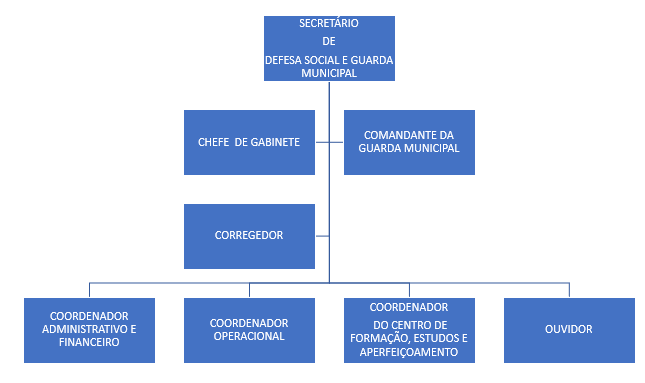
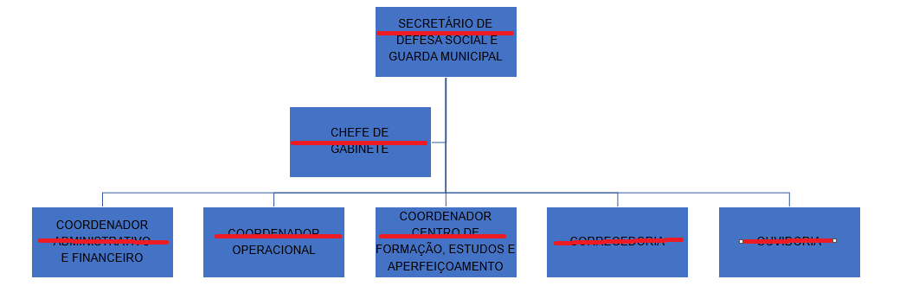

LEI COMPLEMENTAR Nº. 023, DE 24 DE JUNHO DE 2010.

(Revogada pela Lei Complementar nº 125, de 11 de janeiro de 2017).

~~Altera a estrutura administrativa e dá outra denominação à Secretaria Municipal descrita no artigo 1º, XXI, e artigo 23, da Lei Municipal nº 2.555/2005, revoga a Lei Complementar nº 020, de 27 de outubro de 2009, que criou a Superintendência da Guarda Municipal e dá outras providências.~~

~~FAÇO SABER QUE A CÂMARA MUNICIPAL DE APARECIDA DE GOIÂNIA APROVOU E EU, PREFEITO MUNICIPAL, SANCIONO A SEGUINTE LEI COMPLEMENTAR:~~

~~Art. 1º A estrutura administrativa e a nova denominação da Secretaria Municipal descrita no artigo 1º, XXI, e artigo 23, da Lei Municipal nº 2.555, de 23/12/2005, passa a ser descrita da seguinte forma:~~

~~“Art. 1º- Omissis~~

~~...............................~~

~~XXI – Secretaria de Defesa Social e Guarda Municipal;~~

~~...............................~~

~~Art. 23 – A estrutura da Secretaria de Defesa Social e Guarda Municipal, é composta conforme o Anexo Único, e tem a seguinte competência:~~

~~I – desenvolver ações de segurança, vigilância e proteção dos bens, serviços e instalações públicas municipais, com vistas à preservação do patrimônio;~~

~~II – exercer a segurança interna e externa dos prédios públicos municipais e de eventos promovidos pelo poder público municipal no sentido de:~~

~~a) prevenir a ocorrência de atos que resultem em danos ao patrimônio público ou ilícitos penais;~~

~~b) prevenir sinistros e atos de vandalismos;~~

~~c) prevenir atentados contra a pessoa.~~

~~III – proteger os documentos, as obras e outros bens de valor histórico, artístico e cultural do Município;~~

~~IV – proteger o patrimônio ecológico, ambiental, mananciais e recursos hídricos do Município;~~

~~V – monitorar e fazer rondas ostensivas, nas imediações dos prédios públicos municipais, praças, parques, bosques e jardins, de forma preventiva e comunitária;~~

~~VI – atuar, juntamente com o órgão estadual de Defesa Civil, na proteção e defesa da população do Município e de seu patrimônio, em casos de calamidade pública;~~

~~VII – prestar auxílio nos serviços de combate a incêndio, salvamento e pronto socorro;~~

~~VIII – prestar assistência aos demais órgãos municipais, no exercício do poder de polícia administrativa, visando o cumprimento da legislação municipal de posturas, saúde pública, meio ambiente, trânsito e transportes e relativa ao ordenamento e o uso adequado dos espaços urbanos;~~

~~IX – participar nas ações de reintegração de posse de bem municipal;~~

~~X – promover a adoção de procedimentos básicos de segurança nos espaços dos prédios municipais e promover a segurança ambiental urbana;~~

~~XI – prover a segurança das autoridades municipais;~~

~~XII – zelar pelo regular funcionamento dos serviços de responsabilidade do Município, cumprindo as leis e assegurando o exercício dos poderes constituídos, no âmbito de suas competências;~~

~~XIII – atender situações excepcionais, de interesse público do Município;~~

~~XIV – auxiliar, nos limites de suas atribuições, as Polícias Estadual e Federal, assim como formular uma política de cooperação e integração na área de segurança pública;~~

~~XV – colaborar, quando solicitada, na fiscalização do uso do solo municipal e nas tarefas inerentes à Defesa Civil do Município, na ocorrência de calamidades e grandes sinistros;~~

~~XVI – auxiliar no serviço de patrulhamento escolar;~~

~~XVII – exercer obrigatória e diuturnamente, nas rondas normais, a fiscalização de espaços vazios, agindo prontamente para evitar invasões ou impedir as iniciadas, especialmente de áreas verdes, reservas técnicas e áreas de preservação ambiental;~~

~~XVIII – firmar convênio com a iniciativa privada e demais órgãos da administração pública, especialmente com a Secretaria de Estado de Segurança Pública, para implementar suas metas e atribuições;~~

~~XIX – representação junto aos Conselhos Municipais e demais órgãos colegiados;~~

~~XX – garantir a realização das prioridades definidas pelos órgãos que, nos termos da Lei, são responsáveis pela segurança pública;~~

~~XXI – credenciar voluntários necessários e determinar suas funções;~~

~~XXII – acompanhar e controlar os convênios de cooperação técnica e administrativa com órgãos e instituições públicas ou privadas, estaduais, nacionais ou internacionais;~~

~~XXIII – manter constante contato com órgãos externos à Prefeitura Municipal, com vistas à consecução dos fins definidos neste artigo;~~

~~XXIV – assessoramento ao Prefeito Municipal nos assuntos de sua competência e que nesta condição lhe forem cometidos e o fornecimento de dados e informações a fim de subsidiar o processo decisório;~~

~~XXV – o porte de arma de fogo é deferido aos ocupantes de cargos da carreira da Guarda Municipal, por força e condições estabelecidas no artigo 6º, inciso III, e §§ 1º e 3º, da Lei Federal nº 10.826/2003 e alterações posteriores, regulamentada pelos artigos 40 a 44, do Decreto Federal nº 5.123/2004, além das normatizações do Departamento da Polícia Federal e demais normas pertinentes;~~

~~XXVI – outras atividades correlatas.~~

~~§ 1º - São diretrizes de atuação da Secretaria de Defesa Social e Guarda Municipal:~~

~~I – desenvolver mecanismos de participação da comunidade na proteção do patrimônio público e na prevenção da violência;~~

~~II – promover a integração e a coordenação das ações de segurança dos órgãos, bens e prédios públicos municipais, serviços e demais áreas de competência do Município, com a utilização racional dos recursos públicos disponíveis;~~

~~III – atuar, em colaboração com órgãos estaduais e federais, no desenvolvimento e provimento da segurança urbana no Município, visando prevenir ou cessar atividades que violem as normas de saúde, higiene, segurança, funcionalidade, moralidade e quaisquer outros interesses do Município;~~

~~IV – cooperar com outras esferas de governo, compartilhando institucionalmente informações relevantes à segurança urbana e patrimonial, inclusive com a integração das comunidades;~~

~~V – implantar postos fixos em pontos estratégicos, de acordo com o interesse Municipal;~~

~~VI – desenvolver serviço de “disque-denúncia”, a respeito de atos de vandalismos praticados contra os equipamentos públicos e o meio ambiente;~~

~~VII – integrar e desenvolver ações de defesa civil no âmbito municipal;~~

~~VIII – acionar os órgãos de segurança pública estadual e federal, nos casos que excedam à sua competência específica.~~

~~§ 2º - Fica criada a Corregedoria-Geral da Secretaria de Defesa Social e Guarda Municipal, que será independente no exercício de sua competência, principalmente na apuração de infrações disciplinares dos seus servidores, mediante processo administrativo disciplinar específico, a ser conduzido por Comissão Especial determinada pelo Corregedor-Geral, nos termos legais, bem como na apreciação de representações relativas aos seus servidores, procedendo, inclusive, investigações sobre a conduta ética, social e funcional de seus servidores.~~

~~I – O Corregedor-Geral da Secretaria Municipal de Defesa Social e Guarda Municipal, será um servidor estável integrante de carreira, com formação jurídica e curso de qualificação em segurança pública, nomeado pelo Chefe do Poder Executivo;~~

~~II – Caso não haja, na entrada de vigor desta Lei Complementar, servidor de carreira com as qualificações do inciso anterior, poderá o Chefe do Poder Executivo, excepcionalmente, nomear outro servidor do Quadro de Pessoal do Município, com formação jurídica para exercer o referido cargo de Corregedor-Geral, até que sejam atendidos os requisitos do referido cargo;~~

~~III – O serviço de Ouvidoria da Secretaria de Defesa Social e Guarda Municipal será conduzido por um servidor de carreira, de idoneidade moral e conduta ilibada, com qualificação na área de segurança e/ou afim, sendo nomeado pelo Chefe do Poder Executivo para um mandato de 02 (dois) anos, permitindo uma única recondução por igual período.~~

~~Art. 2º. As despesas decorrentes desta Lei, correrão por conta do Tesouro Municipal, ficando o Chefe do Poder Executivo autorizado a remanejar os recursos orçamentários contidos na Secretaria Municipal de Administração, constantes do orçamento vigente, bem como abrir créditos extraordinários, de forma a atender as disposições desta Lei.~~

~~Art. 3º - Ficam criados os cargos em comissão constantes no Anexo Único, desta Lei.~~

~~Art. 4º - Esta Lei Complementar entrará em vigor na data de sua publicação, revogando-se as demais disposições em contrário e especialmente a Lei Complementar nº. 020/2009.~~

~~Gabinete do Prefeito Municipal de Aparecida de Goiânia, aos vinte e quatro dias do mês de junho de 2010.~~

~~LUIZ ALBERTO MAGUITO VILELA

PREFEITO MUNICIPAL~~

~~ANEXO ÚNICO~~

~~LEI COMPLEMENTAR Nº. 023/2010.~~

| ~~DENOMINAÇÃO~~ | ~~CÓDIGO/SÍMBOLO~~ | ~~QUANTIDADE~~ |
| --- | --- | --- |
| ~~Secretário~~ | ~~DS-1~~ | ~~01~~ |
| ~~Chefe de Gabinete~~ | ~~DS-3~~ | ~~01~~ |
| ~~Corregedor-Geral~~ | ~~CC-1~~ | ~~01~~ |
| ~~Coordenador Administrativo e Financeiro~~ | ~~CC-1~~ | ~~01~~ |
| ~~Coordenador Operacional~~ | ~~CC-1~~ | ~~01~~ |
| ~~Coordenador do Centro de Formação, Estudos e Aperfeiçoamento~~ | ~~CC-1~~ | ~~01~~ |
| ~~Ouvidor~~ | ~~CC-1~~ | ~~01~~ |

~~ORGANOGRAMA~~

~~~~

~~(Organograma alterado pela Lei Complementar nº 54, de 15 de junho de 2012).~~

~~~~
