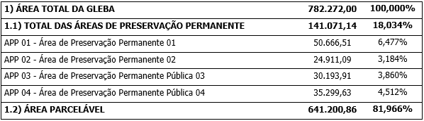
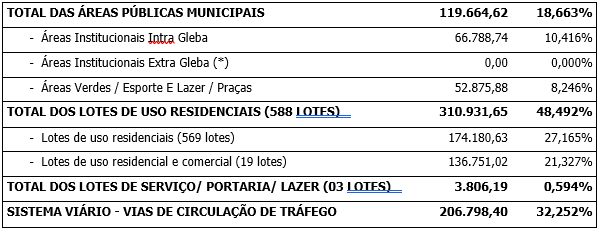

DECRETO “N” Nº 1074, DE 11 DE DEZEMBRO DE 2024.

Dispõe sobre aprovação do Parcelamento de Solo Loteamento de Uso Misto Cidade do Amanhã Aparecida, neste Município, e dá outras providências.

O PREFEITO MUNICIPAL DE APARECIDA DE GOIÂNIA, no uso de suas atribuições legais e,

CONSIDERANDO que o loteamento foi aprovado conforme a Lei Complementar nº 124 de 14 dezembro de 2016, que institui o Plano Diretor e Lei Complementar nº 152 de 09 de outubro de 2018 que instituiu os instrumentos de Controle de Uso e Ocupação do Solo; Lei Complementar nº 176 de 05 de agosto de 2020 que altera a Lei Complementar nº 124/2016 e 152/2018 e os critérios urbanísticos;

CONSIDERANDO os documentos acostados ao processo administrativo nº 2024.141.492, especialmente os Pareceres Técnicos da Secretaria de Planejamento e Regulação Urbana nº 95/2024/SPRU; da Secretaria de Infraestrutura nº 062/2024; e, ainda, o parecer jurídico nº 5950/2024 da Procuradoria Geral do Município.

**DECRETA:**

Art. 1º Fica aprovado o Parcelamento de Solo Loteamento de Uso Misto Cidade do Amanhã Aparecida, neste Município, de propriedade da sociedade SPE 19 CINQDI EMPREENDIMENTOS IMOBILIÁRIOS LTDA, pessoa jurídica de direito privado, com sede e foro na Alameda Das Rosas, nº 1505, Setor Oeste, na cidade de Goiânia/GO, devidamente inscrita no CNPJ/MF sob nº 28.877.155/0001-20, conforme abaixo:

I- IDENTIFICAÇÃO DA ÁREA DO IMÓVEL:

Uma área denominada GLEBA 01 – FAZENDA CAPÃO CHATO, LOCALIZADA NO MUNICIPIO DE APARECIDA DE GOIÂNIA, com a área de 78,2272 hectares, Certidão de Registro de Imóveis sob matrícula nº 304.719, com os seguintes limites e confrontações:

Inicia-se a descrição deste perímetro no vértice AIH-M-A583, de coordenadas Long.: 49°15'56,838”W, Lat.: 16°49'46,630”S e Altitude 789,732 m, cravado na divisa comum com o Setor Serra Dourada 2ª Etapa e terras de Haroldo José da Silva; deste, segue por uma linha seca, divisa com as referidas terras de Haroldo José da Silva, matrícula: 68.939 - CRI de Aparecida de Goiânia/GO, com os seguintes azimutes e distâncias: 166°56' e 70,26m, até o vértice AIH-M-A584, de coordenadas Long.: 49°15'56,302”W, Lat.: 16°49'48,856”S e Altitude 785,052 m, 113°08' e 125,24m, até o vértice AIH-M-A585, de coordenadas Long.: 49°15'52,413”W, Lat.: 16°49'50,457”S e Altitude 769,100 m, cravado na margem direita do Córrego do Meio; deste, segue atravessando o referido córrego, com o azimute de 115°24' e distância de 23,65m, até o vértice AIH-M-A505, de coordenadas Long.: 49°15'51,692”W, Lat.: 16°49'50,787”S e Altitude 766,745 m, cravado na divisa com terras de João Gomes da Silva; deste, segue por uma linha seca, divisa com as referidas terras de João Gomes da Silva, matrícula: 68.938 - CRI de Aparecida de Goiânia/GO, com o azimute de 112°01' e distância de 166,13m, até o vértice AIH-M-A506, de coordenadas Long.: 49°15'46,491”W, Lat.: 16°49'52,814”S e Altitude 784,734 m, cravado na divisa com terras do Setor Serra Dourada 3ª Etapa; deste, segue pela Rua Projetada Alexandre Fleming com os seguintes azimutes e distâncias: 183°44' e 144,13m, até o vértice AIH-M-A507, de coordenadas Long.: 49°15'46,808”W, Lat.: 16°49'57,492”S e Altitude 783,605 m, 191°01' e 62,67m, até o vértice AIH-M-A508, de coordenadas Long.: 49°15'47,213”W, Lat.: 16°49'59,493”S e Altitude 782,693 m, 168°35' e 52,79m, até o vértice AIH-M-AA509, de coordenadas Long.: 49°15'46,860”W, Lat.: 16°50'01,176”S e Altitude 781,538 m, 99°37' e 6,43m até o vértice AIH-M-A509, de coordenadas Long.: 49°15'46,646”W, Lat.: 16°50'3,193”S e Altitude 791,557 m, cravado na divisa com terras da Chácara Santa Luzia; deste, segue por uma linha seca, divisa com as referidas terras da Chácara Santa Luzia com o azimute de 190°30' e distância de 588,39 metros, chega-se ao vértice BNZM- 2235, de coordenadas Long.: 49°15'37,183”W, Lat.: 16°50'22,010”S e Altitude 764,419 m, cravado na divisa com terras de FGR Urbanismo Fazenda Santo Antônio SPE Ltda; deste, segue por uma linha seca, divisa com as referidas terras de FGR Urbanismo Fazenda Santo Antônio SPE Ltda, matrícula: 232.462 - CRI de Aparecida de Goiânia/GO, com o azimute de 147°38' e distância de 183,73 metros, chega-se ao vértice BNZ-M-2236, de coordenadas Long.: 49°15'33,862”W, Lat.: 16°50'27,058”S e Altitude 758,570 m, cravado na margem direita de uma Grota; deste, segue pela margem direita da referida Grota a jusante com os seguintes azimutes e distâncias: 226°17' e 32,04 metros, chega-se ao vértice AIH-P-AK64, de coordenadas Long.: 49°15'34,644”W, Lat.: 16°50'27,778”S e Altitude 756,969 m, 226°42' e 50,35 metros, chega-se ao vértice AIHP- AK65, de coordenadas Long.: 49°15'35,882”W, Lat.: 16°50'28,901”S e Altitude 753,752 m, 208°22' e 41,28 metros, chega-se ao vértice AIH-P-AK66, de coordenadas Long.: 49°15'36,545”W, Lat.: 16°50'30,082”S e Altitude 750,582 m, 207°36' e 44,68 metros, chega-se ao vértice AIH-P-AK67, de coordenadas Long.: 49°15'37,244”W, Lat.: 16°50'31,370”S e Altitude 747,048 m, 211°23' e 85,88 metros, chega-se ao vértice AIHP-AK68, de coordenadas Long.: 49°15'38,755”W, Lat.: 16°50'33,755”S e Altitude 738,818 m, 254°51' e 9,46 metros, chega-se ao vértice AIH-M-A513, de coordenadas Long.: 49°15'39,063”W, Lat.: 16°50'33,835”S e Altitude 736,662 m, cravado na margem direita de uma Grota e na confluência com o Córrego Galhardo; deste, segue pela margem esquerda do referido Córrego Galhardo, a montante, com os azimutes e distâncias: 330°15' e 100,11 metros, chega-se ao vértice AIH-P-AK69, de coordenadas Long.: 49°15'40,741”W, Lat.: 16°50'31,008”S e Altitude 739,087 m, 284°47' e 39,75 metros, chega-se ao vértice AIH-P-AK70, de coordenadas Long.: 49°15'42,039”W, Lat.: 16°50'30,678”S e Altitude 736,630 m, 15°12' e 20,83 metros, chega-se ao vértice AIH-PAK71, de coordenadas Long.: 49°15'41,854”W, Lat.: 16°50'30,024”S e Altitude 738,572 m, 16°36' e 25,72 metros, chega-se ao vértice AIH-P-AK72, de coordenadas Long.: 49°15'41,606”W, Lat.: 16°50'29,223”S e Altitude 742,284 m, 28°34' e 13,58 metros, chega-se ao vértice AIH-P-AK73, de coordenadas Long.: 49°15'41,386”W, Lat.: 16°50'28,835”S e Altitude 744,381 m, 327°05' e 17,73 metros, chega-se ao vértice AIHP-AK74, de coordenadas Long.: 49°15'41,712”W, Lat.: 16°50'28,350”S e Altitude 744,967 m, 261°12' e 21,77 metros, chega-se ao vértice AIH-P-AK75, de coordenadas Long.: 49°15'42,438”W, Lat.: 16°50'28,459”S e Altitude 736,317 m, 311°59' e 103,03m, até o vértice AIH-M-A688, de coordenadas Long.: 49°15'45,025”W, Lat.: 16°50'26,217”S e Altitude 740,350 m, cravado na margem esquerda do Córrego Galhardo; deste, segue pela margem esquerda, a montante, com os seguintes azimutes e distâncias: 329°21' e 36,85 metros, até o vértice AIH-P-AK79, de coordenadas Long.: 49°15'45,659”W, Lat.: 16°50'25,185”S e Altitude 744,936 m, 316°07' e 36,42 metros, chega-se ao vértice AIHP- AK80, de coordenadas Long.: 49°15'46,512”W, Lat.: 16°50'24,331”S e Altitude 745,236 m, 314°02' e 32,47 metros, chega-se ao vértice AIH-P-AK81, de coordenadas Long.: 49°15'47,300”W, Lat.: 16°50'23,597”S e Altitude 736,705 m, 322°39' e 35,41 metros, chega-se ao vértice AIH-P-AK82, de coordenadas Long.: 49°15'48,025”W, Lat.:16°50'22,682”S e Altitude 737,123 m, 284°06' e 36,67 metros, chega-se ao vértice AIH P-AK83, de coordenadas Long.: 49°15'49,227”W, Lat.: 16°50'22,391”S e Altitude 738,314 m, 315°28' e 42,13 metros, chega-se ao vértice AIH-P-AK84, de coordenadas Long.: 49°15'50,225”W, Lat.: 16°50'21,414”S e Altitude 742,000 m, 53°51' e 13,22 metros, chega-se ao vértice AIH-P-AK85, de coordenadas Long.: 49°15'49,864”W, Lat.: 16°50'21,160”S e Altitude 745,642 m, 25°29' e 12,44 metros, chega-se ao vértice AIH-PAK86, de coordenadas Long.: 49°15'49,683”W, Lat.: 16°50'20,795”S e Altitude 747,574 m, 09°07' e 12,07 metros, chega-se ao vértice AIH-P-AK87, de coordenadas Long.: 49°15'49,619”W, Lat.: 16°50'20,408”S e Altitude 748,677 m, 285°53' e 46,56 metros, chega-se ao vértice AIH-P-AK88, de coordenadas Long.: 49°15'51,131”W, Lat.: 16°50'19,993”S e Altitude 747,541 m, 248°20' e 20,64 metros, chega-se ao vértice AIHM- A514, de coordenadas Long.: 49°15'51,779”W, Lat.: 16°50'20,241”S e Altitude 741,589 m, 316°07' e 64,49 metros, chega-se ao vértice AIH-P-AN20, de coordenadas Long.: 49°15'53,289”W, Lat.: 16°50'18,729”S e Altitude 739,437 m, 289°40' e 29,90 metros, chega-se ao vértice AIH-P-AN19, de coordenadas Long.: 49°15'54,240”W, Lat.: 16°50'18,401”S e Altitude 739,284 m, 270°54' e 50,10 metros, chega-se ao vértice AIHP-AN18, de coordenadas Long.: 49°15'55,932”W, Lat.: 16°50'18,376”S e Altitude 740,569 m, 332°30' e 16,99 metros, chega-se ao vértice AIH-P-AN17, de coordenadas Long.: 49°15'56,196”W, Lat.: 16°50'17,885”S e Altitude 740,314 m, 329°38' e 25,06 metros, chega-se ao vértice AIH-P-AN16, de coordenadas Long.: 49°15'56,624”W, Lat.: 16°50'17,182”S e Altitude 741,802 m, 318°40' e 11,86 metros, chega-se ao vértice AIHP- AN15, de coordenadas Long.: 49°15'56,888”W, Lat.: 16°50'16,893”S e Altitude 741,128 m, 288°14' e 18,29 metros, chega-se ao vértice AIH-P-AN14, de coordenadas Long.: 49°15'57,475”W, Lat.: 16°50'16,706”S e Altitude 742,745 m, 286°28' e 33,37 metros, chega-se ao vértice AIH-M-A694, de coordenadas Long.: 49°15'58,556”W, Lat.: 16°50'16,399”S e Altitude 744,032 m, cravado na confluência do Córrego do Meio com o Córrego Galhardo, margem esquerda; deste, segue pelo álveo do referido Córrego Galhardo, à montante com os seguintes azimute e distâncias: 284°18' e 7,75m, até o vértice AIH-P-AN13, de coordenadas Long.: 49°15'58,809”W, Lat.: 16°50'16,336”S e Altitude 746,536 m, 263°53' e 10,96m, até o vértice AIH-M-A693, de coordenadas Long.: 49°15'59,178”W, Lat.: 16°50'16,374”S e Altitude 774,128 m, cravado na margem direita do Córrego Galhardo; deste, segue pelo álveo do referido Córrego Galhardo, com os seguintes azimutes e distâncias: 236°55' e 64,07m, até o vértice AIH-V-4006, de coordenadas Long.: 49°16'01,329”W, Lat.: 16°50'16,595”S e Altitude 742,305 m, 342°18' e 24,91m, até o vértice AIH-V-4007, de coordenadas Long.: 49°16'01,585”W, Lat.: 16°50'15,823”S e Altitude 742,010 m; 300°09' e 12,82m, até o vértice AIH-V-4008, de coordenadas Long.: 49°16'01,960”W, Lat.: 16°50'15,613”S e Altitude 741,631 m; 287°58' e 27,83m, até o vértice AIH-V-4009, de coordenadas Long.: 49°16'02,854”W, Lat.: 16°50'15,334”S e Altitude 748,100 m; 261°29' e 101,63m, até o vértice AIH-V-4010, de coordenadas Long.: 49°16'06,248”W, Lat.: 16°50'15,823”S e Altitude 749,009 m; 277°23' e 112,89m, até o vértice AIH-V-4011, de coordenadas Long.: 49°16'10,029”W,Lat.: 16°50'15,351”S e Altitude 751,017 m; cravado margem direita do Córrego Galhardo; deste, segue atravessando o referido Córrego Galhardo, com o azimute de 25°31' e distância de 6,57m, até o vértice AIH-M-A572, de coordenadas Long.: 49°16'09,938”W, Lat.: 16°50'15,167”S e Altitude 750,585 m, cravado na divisa com terras do Setor Jardim Girassóis; deste, segue por uma linha seca, divisa com a Área Verde - (APM-3) do Setor Jardim Girassóis, com o azimute de 16°25' e distância de 368,50m, até o vértice AIH-M-A573, de coordenadas Long.: 49°16'06,420”W, Lat.: 16°50'3,670”S e Altitude 774,574 m, cravado na divisa com a Rua Bouganville – Setor Jardim Girassóis; deste, segue pela referida rua, com o azimute de 12°06' e distância de 80,77m, até o vértice AIH-M-A589, de coordenadas Long.: 49°16'05,847”W, Lat.: 16°50'01,102”S e Altitude 777,811 m, cravado na divisa com o Equipamento Comunitário – (APM-2) - Setor Jardim Girassóis; deste, segue por uma linha seca, divisa com o referido equipamento comunitário, com os seguintes azimutes e distâncias: 14°37' e 100,22m, até o vértice AIH-M-A588, de coordenadas Long.: 49°16'04,992”W, Lat.: 16°49'57,948”S e Altitude 780,334 m, 19°21' e 164,44m, até o vértice AIH-M-A587, de coordenadas Long.: 49°16'3,151”W, Lat.: 16°49'52,902”S e Altitude 786,001 m, 38°16' e 101,27m, até o vértice AIH-M-A697, de coordenadas Long.: 49°16'01,033”W, Lat.: 16°49'50,316”S e Altitude 788,090 m, cravado na divisa com terras do Setor Serra Dourada 1ª Etapa; deste, segue dividindo com o Lote 18 da Quadra 35; dai segue atravessando a Rua Jovino Borges; dai segue dividindo com o Lote 4 da Quadra 34; dai segue dividindo com o Lote 3 da Quadra 34; dai segue dividindo com o Lote 2 da Quadra 34; todos no azimute de 38°16' com a distância de 98,59m, até o vértice AIH-M-A586, de coordenadas Long.: 49°15'58,970”W, Lat.: 16°49'47,798”S e Altitude 790,183 m, cravado com terras do Setor Serra Dourada 1ª Etapa; deste, segue, dividindo com o Lote 1 da Quadra 34; dai segue atravessando a Rua Joaquim Camara Filho; dai segue dividindo com o Lote 13 da Quadra 32; dai segue atravessando a Rua Ignácio Campos até a sua interseção com a Rua Beltrão; dai segue confrontando com a referida Rua Beltrão, todos no azimute de 60°21' com a distância de 72,63m, até o vértice AIH-MA583, de coordenadas Long.: 49°15'56,838”W, Lat.: 16°49'46,630”S e Altitude 789,732 m, vértice inicial da descrição deste perímetro.. Todas as coordenadas aqui descritas estão georreferenciadas ao Sistema Geodésico Brasileiro, Coordenadas: Latitude, Longitude e Altitude geodésicas., tendo como Datum o SIRGAS2000. Todos os azimutes, distâncias, área e perímetro foram calculados no Sistema Geodésico Local (SGL).

II – CLASSIFICAÇÃO E DISTRIBUIÇÃO DE ÁREAS

III- TABELA DE DISTRIBUIÇÃO DAS QUADRAS – ÁREA VENDÁVEL

<table><tbody><tr><td colspan="3">**2) TOTAL DA ÁREA PARCELADA**</td><td>**&nbsp;**</td><td>**&nbsp;**</td><td>**&nbsp;**</td><td>**&nbsp;**</td><td>**&nbsp;**</td><td colspan="2">**641.200,86**</td><td colspan="4">**100,000%**</td></tr><tr><td>**&nbsp;**</td><td>&nbsp;</td><td>&nbsp;</td><td>&nbsp;</td><td>&nbsp;</td><td>&nbsp;</td><td>&nbsp;</td><td>&nbsp;</td><td>&nbsp;</td><td colspan="2">&nbsp;</td><td>&nbsp;</td><td colspan="2">**&nbsp;**</td></tr><tr><td rowspan="2">**3) QUADRAS**</td><td colspan="2">**Residenciais**</td><td colspan="2">**Residenciais / Comerciais**</td><td colspan="2">**Lotes de serviço / portaria/ lazer**</td><td colspan="2">**A.P.M**</td><td colspan="2" rowspan="2">**ÁREA TOTAL DA QUADRA&nbsp;&nbsp;&nbsp;&nbsp;&nbsp;&nbsp;&nbsp;&nbsp;&nbsp;&nbsp;&nbsp;&nbsp;&nbsp;&nbsp;&nbsp;&nbsp;&nbsp;&nbsp;&nbsp;&nbsp;&nbsp;&nbsp;&nbsp;&nbsp;&nbsp;&nbsp;&nbsp;&nbsp;&nbsp;&nbsp;&nbsp;&nbsp;&nbsp;&nbsp;&nbsp;&nbsp;&nbsp;&nbsp;&nbsp; (m²)**</td><td colspan="3" rowspan="2">**%**</td></tr><tr><td>**Nº de lote**</td><td>**Área lotes**</td><td>**Nº de lote**</td><td>**Área lotes**</td><td>**Nº de lote**</td><td>**Área lotes**</td><td>**Nº de a.p.m.**</td><td>**Área a.p.m.**</td></tr><tr><td>QUADRA 01 - Parqville Cerejeira</td><td>18</td><td>5.382,54</td><td>0</td><td>0,00</td><td>0</td><td>0,00</td><td>1</td><td>82,76</td><td colspan="2">5.465,30</td><td colspan="3">0,852%</td></tr><tr><td>QUADRA 02 - Parqville Cerejeira</td><td>15</td><td>4.581,39</td><td>0</td><td>0,00</td><td>0</td><td>0,00</td><td>2</td><td>184,55</td><td colspan="2">4.765,94</td><td colspan="3">0,743%</td></tr><tr><td>QUADRA 03 - Parqville Cerejeira</td><td>15</td><td>4.664,07</td><td>0</td><td>0,00</td><td>0</td><td>0,00</td><td>1</td><td>41,59</td><td colspan="2">4.705,66</td><td colspan="3">0,734%</td></tr><tr><td>QUADRA 04 - Parqville Cerejeira</td><td>44</td><td>13.371,02</td><td>0</td><td>0,00</td><td>0</td><td>0,00</td><td>2</td><td>539,33</td><td colspan="2">13.910,35</td><td colspan="3">2,169%</td></tr><tr><td>QUADRA 05 - Parqville Cerejeira</td><td>27</td><td>7.598,12</td><td>0</td><td>0,00</td><td>0</td><td>0,00</td><td>2</td><td>216,57</td><td colspan="2">7.814,69</td><td colspan="3">1,219%</td></tr><tr><td>QUADRA 06 - Parqville Cerejeira</td><td>39</td><td>11.697,63</td><td>0</td><td>0,00</td><td>0</td><td>0,00</td><td>1</td><td>130,19</td><td colspan="2">11.827,82</td><td colspan="3">1,845%</td></tr><tr><td>QUADRA 07 - Parqville Cerejeira</td><td>28</td><td>8.089,62</td><td>0</td><td>0,00</td><td>0</td><td>0,00</td><td>2</td><td>230,70</td><td colspan="2">8.320,32</td><td colspan="3">1,298%</td></tr><tr><td>QUADRA 08 - Parqville Cerejeira</td><td>21</td><td>6.356,32</td><td>0</td><td>0,00</td><td>0</td><td>0,00</td><td>1</td><td>135,96</td><td colspan="2">6.492,28</td><td colspan="3">1,013%</td></tr><tr><td>QUADRA 09 - Parqville Cerejeira</td><td>37</td><td>10.111,78</td><td>0</td><td>0,00</td><td>0</td><td>0,00</td><td>1</td><td>80,36</td><td colspan="2">10.192,14</td><td colspan="3">1,590%</td></tr><tr><td>QUADRA 10 - Parqville Cerejeira</td><td>35</td><td>9.440,02</td><td>0</td><td>0,00</td><td>0</td><td>0,00</td><td>1</td><td>76,40</td><td colspan="2">9.516,42</td><td colspan="3">1,484%</td></tr><tr><td>QUADRA 11 - Parqville Cerejeira</td><td>26</td><td>8.230,63</td><td>0</td><td>0,00</td><td>0</td><td>0,00</td><td>1</td><td>78,28</td><td colspan="2">8.308,91</td><td colspan="3">1,296%</td></tr><tr><td>QUADRA 12 - Parqville Cerejeira</td><td>32</td><td>10.609,19</td><td>0</td><td>0,00</td><td>0</td><td>0,00</td><td>0</td><td>0,00</td><td colspan="2">10.609,19</td><td colspan="3">1,655%</td></tr><tr><td>QUADRA 13 - Parqville Cerejeira</td><td>33</td><td>10.477,06</td><td>0</td><td>0,00</td><td>0</td><td>0,00</td><td>1</td><td>145,13</td><td colspan="2">10.622,19</td><td colspan="3">1,657%</td></tr><tr><td>QUADRA 14 - Parqville Cerejeira</td><td>19</td><td>5.923,69</td><td>0</td><td>0,00</td><td>0</td><td>0,00</td><td>2</td><td>290,26</td><td colspan="2">6.213,95</td><td colspan="3">0,969%</td></tr><tr><td>QUADRA 15 - Parqville Cerejeira</td><td>25</td><td>7.962,21</td><td>0</td><td>0,00</td><td>0</td><td>0,00</td><td>2</td><td>201,79</td><td colspan="2">8.164,00</td><td colspan="3">1,273%</td></tr><tr><td>QUADRA 16 - Parqville Cerejeira</td><td>28</td><td>8.492,11</td><td>0</td><td>0,00</td><td>0</td><td>0,00</td><td>2</td><td>234,83</td><td colspan="2">8.726,94</td><td colspan="3">1,361%</td></tr><tr><td>QUADRA 17 - Parqville Cerejeira</td><td>21</td><td>6.475,42</td><td>0</td><td>0,00</td><td>0</td><td>0,00</td><td>2</td><td>284,26</td><td colspan="2">6.759,68</td><td colspan="3">1,054%</td></tr><tr><td>QUADRA 18 - Parqville Cerejeira</td><td>33</td><td>9.881,86</td><td>0</td><td>0,00</td><td>0</td><td>0,00</td><td>1</td><td>142,13</td><td colspan="2">10.023,99</td><td colspan="3">1,563%</td></tr><tr><td>QUADRA 19 - Parqville Cerejeira</td><td>59</td><td>19.072,26</td><td>0</td><td>0,00</td><td>0</td><td>0,00</td><td>1</td><td>306,18</td><td colspan="2">19.378,44</td><td colspan="3">3,022%</td></tr><tr><td>QUADRA 20 - Parqville Cerejeira</td><td>8</td><td>3.129,65</td><td>0</td><td>0,00</td><td>0</td><td>0,00</td><td>1</td><td>98,38</td><td colspan="2">3.228,03</td><td colspan="3">0,503%</td></tr><tr><td>QUADRA 21 - Parqville Cerejeira</td><td>6</td><td>2.634,04</td><td>0</td><td>0,00</td><td>0</td><td>0,00</td><td>1</td><td>111,48</td><td colspan="2">2.745,52</td><td colspan="3">0,428%</td></tr><tr><td>QUADRA 22 - Parqville Cerejeira</td><td>0</td><td>0,00</td><td>4</td><td>5.030,50</td><td>0</td><td>0,00</td><td>2</td><td>2.086,23</td><td colspan="2">7.116,73</td><td colspan="3">1,110%</td></tr><tr><td>QUADRA 23 - Parqville Cerejeira</td><td>0</td><td>0,00</td><td>0</td><td>0,00</td><td>1</td><td>499,73</td><td>2</td><td>1.073,46</td><td colspan="2">1.573,19</td><td colspan="3">0,245%</td></tr><tr><td>QUADRA 24 - Parqville Cerejeira</td><td>0</td><td>0,00</td><td>6</td><td>9.526,46</td><td>1</td><td>578,93</td><td>3</td><td>8.346,55</td><td colspan="2">18.451,94</td><td colspan="3">2,878%</td></tr><tr><td>QUADRA LAZER - Parqville Cerejeira</td><td>0</td><td>0,00</td><td>0</td><td>0,00</td><td>1</td><td>2.727,53</td><td>0</td><td>0,00</td><td colspan="2">2.727,53</td><td colspan="3">0,425%</td></tr><tr><td>QUADRA MISTA 01 - Cidade do Amanhã Aparecida</td><td>0</td><td>0,00</td><td>1</td><td>17.524,92</td><td>0</td><td>0,00</td><td>0</td><td>0,00</td><td colspan="2">17.524,92</td><td colspan="3">2,733%</td></tr><tr><td>QUADRA MISTA 02 - Cidade do Amanhã Aparecida</td><td>0</td><td>0,00</td><td>1</td><td>17.416,47</td><td>0</td><td>0,00</td><td>0</td><td>0,00</td><td colspan="2">17.416,47</td><td colspan="3">2,716%</td></tr><tr><td>QUADRA MISTA 03 - Cidade do Amanhã Aparecida</td><td>0</td><td>0,00</td><td>1</td><td>7.498,11</td><td>0</td><td>0,00</td><td>0</td><td>0,00</td><td colspan="2">7.498,11</td><td colspan="3">1,169%</td></tr><tr><td>QUADRA MISTA 04 - Cidade do Amanhã Aparecida</td><td>0</td><td>0,00</td><td>1</td><td>17.418,41</td><td>0</td><td>0,00</td><td>0</td><td>0,00</td><td colspan="2">17.418,41</td><td colspan="3">2,717%</td></tr><tr><td>QUADRA MISTA 05 - Cidade do Amanhã Aparecida</td><td>0</td><td>0,00</td><td>1</td><td>17.438,60</td><td>0</td><td>0,00</td><td>0</td><td>0,00</td><td colspan="2">17.438,60</td><td colspan="3">2,720%</td></tr><tr><td>QUADRA MISTA 06 - Cidade do Amanhã Aparecida</td><td>0</td><td>0,00</td><td>1</td><td>12.683,96</td><td>0</td><td>0,00</td><td>0</td><td>0,00</td><td colspan="2">12.683,96</td><td colspan="3">1,978%</td></tr><tr><td>QUADRA MISTA 07 - Cidade do Amanhã Aparecida</td><td>0</td><td>0,00</td><td>2</td><td>23.999,41</td><td>0</td><td>0,00</td><td>1</td><td>1.135,60</td><td colspan="2">25.135,01</td><td colspan="3">3,920%</td></tr><tr><td>QUADRA MISTA 08 - Cidade do Amanhã Aparecida</td><td>0</td><td>0,00</td><td>1</td><td>8.214,18</td><td>0</td><td>0,00</td><td>0</td><td>0,00</td><td colspan="2">8.214,18</td><td colspan="3">1,281%</td></tr><tr><td>TOTAL</td><td>569</td><td>174.180,63</td><td>19</td><td>136.751,02</td><td>3</td><td>3.806,19</td><td>36</td><td>16.252,97</td><td colspan="2">330.990,81</td><td colspan="3">51,620%</td></tr></tbody></table>

\* (Cidade do Amanhã Aparecida - Loteamento Aberto; Parqville Cerejeira - Loteamento de Acesso Restrito)

<table><tbody><tr><td colspan="2">**4) ÁREA TOTAL DE LOTES DE SERVIÇO**</td><td>**&nbsp;**</td><td>**3**</td><td>**3.806,19**</td><td>**0,594%**</td></tr><tr><td colspan="3">QUADRA 24 - LOTE A PORTARIA - Parqville Cerejeira</td><td>1</td><td>578,93</td><td>0,090%</td></tr><tr><td colspan="3">QUADRA 23 - LOTE B PORTARIA - Parqville Cerejeira</td><td>1</td><td>499,73</td><td>0,078%</td></tr><tr><td>QUADRA LAZER - Parqville Cerejeira</td><td>&nbsp;</td><td>**&nbsp;**</td><td>1</td><td>2.727,53</td><td>0,425%</td></tr></tbody></table>

IV- TABELA DE DISTRIBUIÇÃO DAS ÁREAS PÚBLICAS MUNICIPAIS 

<table><tbody><tr><td colspan="9">**5) ÁREAS PÚBLICAS MUNICIPAIS**</td></tr><tr><td colspan="9">**ÁREAS DESTINADAS A ÁREAS INSTITUCIONAIS E ÁREAS VERDES/PRAÇAS**</td></tr><tr><td colspan="4" rowspan="2">**DISCRIMINAÇÃO**</td><td colspan="2">**ÁREAS INSTITUCIONAIS**</td><td colspan="3">**ÁREAS VERDES/ PRAÇAS**</td></tr><tr><td>**ÁREA (m²)**</td><td>**%**</td><td colspan="2">**ÁREA (m²)**</td><td>**%**</td></tr><tr><td>A.P.M. 01</td><td>-</td><td>ÁREA VERDE</td><td>Cidade do Amanhã Aparecida</td><td>-</td><td>-</td><td colspan="2">953,34</td><td>0,149%</td></tr><tr><td>A.P.M. 02</td><td>-</td><td>ÁREA VERDE</td><td>Cidade do Amanhã Aparecida</td><td>-</td><td>-</td><td colspan="2">496,06</td><td>0,077%</td></tr><tr><td>A.P.M. 03</td><td>-</td><td>ÁREA VERDE</td><td>Cidade do Amanhã Aparecida</td><td>-</td><td>-</td><td colspan="2">1.135,60</td><td>0,177%</td></tr><tr><td>A.P.M. 04</td><td>-</td><td>ÁREA VERDE</td><td>Cidade do Amanhã Aparecida</td><td>-</td><td>-</td><td colspan="2">561,50</td><td>0,088%</td></tr><tr><td>A.P.M. 05</td><td>-</td><td>ÁREA VERDE</td><td>Cidade do Amanhã Aparecida</td><td>-</td><td>-</td><td colspan="2">728,48</td><td>0,114%</td></tr><tr><td>A.P.M. 06</td><td>-</td><td>ÁREA VERDE</td><td>Cidade do Amanhã Aparecida</td><td>-</td><td>-</td><td colspan="2">794,36</td><td>0,124%</td></tr><tr><td>A.P.M. 07</td><td>-</td><td>ÁREA VERDE</td><td>Parqville Cerejeira</td><td>-</td><td>-</td><td colspan="2">344,98</td><td>0,054%</td></tr><tr><td>A.P.M. 08</td><td>-</td><td>ÁREA VERDE</td><td>Parqville Cerejeira</td><td>-</td><td>-</td><td colspan="2">2.720,11</td><td>0,424%</td></tr><tr><td>A.P.M. 09</td><td>-</td><td>ÁREA VERDE</td><td>Parqville Cerejeira</td><td>-</td><td>-</td><td colspan="2">1.839,55</td><td>0,287%</td></tr><tr><td>A.P.M. 10</td><td>-</td><td>ÁREA VERDE</td><td>Parqville Cerejeira</td><td>-</td><td>-</td><td colspan="2">1.524,73</td><td>0,238%</td></tr><tr><td>A.P.M. 11</td><td>-</td><td>ÁREA VERDE</td><td>Parqville Cerejeira</td><td>-</td><td>-</td><td colspan="2">82,76</td><td>0,013%</td></tr><tr><td>A.P.M. 12</td><td>-</td><td>ÁREA VERDE</td><td>Parqville Cerejeira</td><td>-</td><td>-</td><td colspan="2">102,90</td><td>0,016%</td></tr><tr><td>A.P.M. 13</td><td>-</td><td>ÁREA VERDE</td><td>Parqville Cerejeira</td><td>-</td><td>-</td><td colspan="2">81,65</td><td>0,013%</td></tr><tr><td>A.P.M. 14</td><td>-</td><td>ÁREA VERDE</td><td>Parqville Cerejeira</td><td>-</td><td>-</td><td colspan="2">669,36</td><td>0,104%</td></tr><tr><td>A.P.M. 15</td><td>-</td><td>ÁREA VERDE</td><td>Parqville Cerejeira</td><td>-</td><td>-</td><td colspan="2">41,59</td><td>0,006%</td></tr><tr><td>A.P.M. 16</td><td>-</td><td>ÁREA VERDE</td><td>Parqville Cerejeira</td><td>-</td><td>-</td><td colspan="2">86,41</td><td>0,013%</td></tr><tr><td>A.P.M. 17</td><td>-</td><td>ÁREA VERDE</td><td>Parqville Cerejeira</td><td>-</td><td>-</td><td colspan="2">452,92</td><td>0,071%</td></tr><tr><td>A.P.M. 18</td><td>-</td><td>ÁREA VERDE</td><td>Parqville Cerejeira</td><td>-</td><td>-</td><td colspan="2">469,33</td><td>0,073%</td></tr><tr><td>A.P.M. 19</td><td>-</td><td>ÁREA VERDE</td><td>Parqville Cerejeira</td><td>-</td><td>-</td><td colspan="2">130,19</td><td>0,020%</td></tr><tr><td>A.P.M. 20</td><td>-</td><td>ÁREA VERDE</td><td>Parqville Cerejeira</td><td>-</td><td>-</td><td colspan="2">130,14</td><td>0,020%</td></tr><tr><td>A.P.M. 21</td><td>-</td><td>ÁREA VERDE</td><td>Parqville Cerejeira</td><td>-</td><td>-</td><td colspan="2">86,43</td><td>0,013%</td></tr><tr><td>A.P.M. 22</td><td>-</td><td>ÁREA VERDE</td><td>Parqville Cerejeira</td><td>-</td><td>-</td><td colspan="2">94,57</td><td>0,015%</td></tr><tr><td>A.P.M. 23</td><td>-</td><td>ÁREA VERDE</td><td>Parqville Cerejeira</td><td>-</td><td>-</td><td colspan="2">136,13</td><td>0,021%</td></tr><tr><td>A.P.M. 24</td><td>-</td><td>ÁREA VERDE</td><td>Parqville Cerejeira</td><td>-</td><td>-</td><td colspan="2">135,96</td><td>0,021%</td></tr><tr><td>A.P.M. 25</td><td>-</td><td>ÁREA VERDE</td><td>Parqville Cerejeira</td><td>-</td><td>-</td><td colspan="2">2.129,14</td><td>0,332%</td></tr><tr><td>A.P.M. 26</td><td>-</td><td>ÁREA VERDE</td><td>Parqville Cerejeira</td><td>-</td><td>-</td><td colspan="2">7.710,69</td><td>1,203%</td></tr><tr><td>A.P.M. 27</td><td>-</td><td>ÁREA VERDE</td><td>Parqville Cerejeira</td><td>-</td><td>-</td><td colspan="2">80,36</td><td>0,013%</td></tr><tr><td>A.P.M. 28</td><td>-</td><td>ÁREA VERDE</td><td>Parqville Cerejeira</td><td>-</td><td>-</td><td colspan="2">76,40</td><td>0,012%</td></tr><tr><td>A.P.M. 29</td><td>-</td><td>ÁREA VERDE</td><td>Parqville Cerejeira</td><td>-</td><td>-</td><td colspan="2">78,28</td><td>0,012%</td></tr><tr><td>A.P.M. 30</td><td>-</td><td>ÁREA VERDE</td><td>Parqville Cerejeira</td><td>-</td><td>-</td><td colspan="2">5.517,67</td><td>0,861%</td></tr><tr><td>A.P.M. 30A</td><td>-</td><td>ÁREA VERDE</td><td>Parqville Cerejeira</td><td>-</td><td>-</td><td colspan="2">929,89</td><td>0,145%</td></tr><tr><td>A.P.M. 31</td><td>-</td><td>ÁREA VERDE</td><td>Parqville Cerejeira</td><td>-</td><td>-</td><td colspan="2">145,13</td><td>0,023%</td></tr><tr><td>A.P.M. 32</td><td>-</td><td>ÁREA VERDE</td><td>Parqville Cerejeira</td><td>-</td><td>-</td><td colspan="2">142,13</td><td>0,022%</td></tr><tr><td>A.P.M. 33</td><td>-</td><td>ÁREA VERDE</td><td>Parqville Cerejeira</td><td>-</td><td>-</td><td colspan="2">142,13</td><td>0,022%</td></tr><tr><td>A.P.M. 34</td><td>-</td><td>ÁREA VERDE</td><td>Parqville Cerejeira</td><td>-</td><td>-</td><td colspan="2">145,13</td><td>0,023%</td></tr><tr><td>A.P.M. 35</td><td>-</td><td>ÁREA VERDE</td><td>Parqville Cerejeira</td><td>-</td><td>-</td><td colspan="2">145,13</td><td>0,023%</td></tr><tr><td>A.P.M. 36</td><td>-</td><td>ÁREA VERDE</td><td>Parqville Cerejeira</td><td>-</td><td>-</td><td colspan="2">142,13</td><td>0,022%</td></tr><tr><td>A.P.M. 37</td><td>-</td><td>ÁREA VERDE</td><td>Parqville Cerejeira</td><td>-</td><td>-</td><td colspan="2">142,13</td><td>0,022%</td></tr><tr><td>A.P.M. 38</td><td>-</td><td>ÁREA VERDE</td><td>Parqville Cerejeira</td><td>-</td><td>-</td><td colspan="2">145,13</td><td>0,023%</td></tr><tr><td>A.P.M. 39</td><td>-</td><td>ÁREA VERDE</td><td>Parqville Cerejeira</td><td>-</td><td>-</td><td colspan="2">306,18</td><td>0,048%</td></tr><tr><td>A.P.M. 40</td><td>-</td><td>ÁREA VERDE</td><td>Parqville Cerejeira</td><td>-</td><td>-</td><td colspan="2">92,70</td><td>0,014%</td></tr><tr><td>A.P.M. 41</td><td>-</td><td>ÁREA VERDE</td><td>Parqville Cerejeira</td><td>-</td><td>-</td><td colspan="2">56,66</td><td>0,009%</td></tr><tr><td>A.P.M. 42</td><td>-</td><td>ÁREA VERDE</td><td>Parqville Cerejeira</td><td>-</td><td>-</td><td colspan="2">15.583,77</td><td>2,430%</td></tr><tr><td>A.P.M. 43</td><td>-</td><td>ÁREA VERDE</td><td>Parqville Cerejeira</td><td>-</td><td>-</td><td colspan="2">4.210,29</td><td>0,657%</td></tr><tr><td>A.P.M. 44</td><td>-</td><td>ÁREA VERDE</td><td>Parqville Cerejeira</td><td>-</td><td>-</td><td colspan="2">111,48</td><td>0,017%</td></tr><tr><td>A.P.M. 45</td><td>-</td><td>ÁREA VERDE</td><td>Parqville Cerejeira</td><td>-</td><td>-</td><td colspan="2">98,38</td><td>0,015%</td></tr><tr><td>A.P.M. 46</td><td>-</td><td>ÁREA VERDE</td><td>Cidade do Amanhã Aparecida</td><td>-</td><td>-</td><td colspan="2">556,47</td><td>0,087%</td></tr><tr><td>A.P.M. 47</td><td>-</td><td>ÁREA VERDE</td><td>Cidade do Amanhã Aparecida</td><td>-</td><td>-</td><td colspan="2">337,16</td><td>0,053%</td></tr><tr><td>A.P.M. 48</td><td>-</td><td>ÁREA INSTITUCIONAL</td><td>Cidade do Amanhã Aparecida</td><td>9.825,65</td><td>1,532%</td><td colspan="2">-</td><td>-</td></tr><tr><td>A.P.M. 49</td><td>-</td><td>ÁREA VERDE</td><td>Cidade do Amanhã Aparecida</td><td>-</td><td>-</td><td colspan="2">52,27</td><td>0,008%</td></tr><tr><td>A.P.M. 50</td><td>-</td><td>ÁREA INSTITUCIONAL 02</td><td>Cidade do Amanhã Aparecida</td><td>4.413,81</td><td>0,688%</td><td colspan="2">-</td><td>-</td></tr><tr><td>A.P.M. 51</td><td>-</td><td>ÁREA INSTITUCIONAL 03</td><td>Parqville Cerejeira</td><td>4.832,08</td><td>0,754%</td><td colspan="2">-</td><td>-</td></tr><tr><td>A.P.M. 52</td><td>-</td><td>ÁREA INSTITUCIONAL 04</td><td>Cidade do Amanhã Aparecida</td><td>5.841,49</td><td>0,911%</td><td colspan="2">-</td><td>-</td></tr><tr><td>A.P.M. 53</td><td>-</td><td>ÁREA INSTITUCIONAL 05</td><td>Cidade do Amanhã Aparecida</td><td>4.519,19</td><td>0,705%</td><td colspan="2">-</td><td>-</td></tr><tr><td>A.P.M. 54</td><td>-</td><td>ÁREA INSTITUCIONAL 06</td><td>Cidade do Amanhã Aparecida</td><td>17.756,22</td><td>2,769%</td><td colspan="2">-</td><td>-</td></tr><tr><td>A.P.M. 55</td><td>-</td><td>ÁREA INSTITUCIONAL 07</td><td>Cidade do Amanhã Aparecida</td><td>17.818,27</td><td>2,779%</td><td colspan="2">-</td><td>-</td></tr><tr><td>A.P.M. 56</td><td>-</td><td>ÁREA INSTITUCIONAL 08</td><td>Cidade do Amanhã Aparecida</td><td>1.782,03</td><td>0,278%</td><td>&nbsp;-</td><td>&nbsp;</td><td>&nbsp;-</td></tr><tr><td colspan="4">**5.1) TOTAL DAS ÁREAS INSTITUCIONAIS INTRA GLEBA**</td><td>**66.788,74**</td><td>**10,416%**</td><td colspan="2">-</td><td>-</td></tr><tr><td colspan="6">**5.2) TOTAL DAS ÁREAS VERDES/ LAZER / PRAÇAS**</td><td colspan="2">**52.875,88**</td><td>**8,246%**</td></tr><tr><td colspan="6">**5.3) TOTAL DAS ÁREAS PÚBLICAS MUNICIPAIS**</td><td colspan="2">**119.664,62**</td><td>**18,663%**</td></tr></tbody></table>

<table><tbody><tr><td colspan="9">**7) ÁREAS INSTITUCIONAIS**</td></tr><tr><td>**DISCRIMINAÇÃO**</td><td colspan="2">**ÁREAS MÍNIMAS **&nbsp;&nbsp;&nbsp;&nbsp;&nbsp;&nbsp;&nbsp;&nbsp;&nbsp;&nbsp;&nbsp;&nbsp;&nbsp;&nbsp;&nbsp;&nbsp;&nbsp;&nbsp;&nbsp;&nbsp;&nbsp;&nbsp;&nbsp;&nbsp;&nbsp;&nbsp;&nbsp;&nbsp;&nbsp;&nbsp;&nbsp;&nbsp;&nbsp;&nbsp;&nbsp;&nbsp;&nbsp;&nbsp;&nbsp;&nbsp;&nbsp;&nbsp;&nbsp;&nbsp;&nbsp;&nbsp;&nbsp;(Conforme lei complementar nº 176 de 05 de agosto de 2020, artigo 224-A)</td><td colspan="2">**EXTRA GLEBA (**)**</td><td colspan="2">**NA GLEBA**&nbsp;</td><td colspan="2">**TOTAL (*)&nbsp; **&nbsp;&nbsp;&nbsp;&nbsp;&nbsp;&nbsp;&nbsp;&nbsp;&nbsp;&nbsp;&nbsp;&nbsp;&nbsp;&nbsp;&nbsp;&nbsp;&nbsp;&nbsp;&nbsp;&nbsp;&nbsp;&nbsp;&nbsp;&nbsp;&nbsp;&nbsp;&nbsp;&nbsp;&nbsp;&nbsp;&nbsp;&nbsp;&nbsp;&nbsp;&nbsp;&nbsp;&nbsp;&nbsp;&nbsp;&nbsp;&nbsp;&nbsp;&nbsp;&nbsp;&nbsp;&nbsp;&nbsp;&nbsp;&nbsp;&nbsp;&nbsp;&nbsp;&nbsp;&nbsp;&nbsp;&nbsp;&nbsp;DOAÇÃO</td></tr><tr><td rowspan="2">ÁREAS INSTITUCIONAIS</td><td>**m²**</td><td>**%**</td><td>**m²**</td><td>**%**</td><td>**m²**</td><td>**%**</td><td>**m²**</td><td>**%**</td></tr><tr><td>64.120,09</td><td>10,00%</td><td>0,00</td><td>0,000%</td><td>66.788,74</td><td>10,42%</td><td>0,00</td><td>0,000%</td></tr><tr><td colspan="9">**(*) As Áreas Públicas Municipais com destinação para equipamentos comunitários (Áreas Institucionais), será doado conforme acordo com os Órgãos Municipais.**</td></tr><tr><td colspan="9">**&nbsp;**</td></tr></tbody></table>

Art. 2º. Como garantia de implantação para aprovação do Loteamento e de toda a infraestrutura correspondente, o loteador apresenta o Termo de Caução e Termo de Compromisso de Implantação do Loteamento (anexos), ambos assinados entre as partes, conforme demonstrativo de lotes abaixo:

 

<table><tbody><tr><td colspan="2">QM-04</td><td>17.418,41</td><td>&nbsp;R$&nbsp;&nbsp;&nbsp;&nbsp;&nbsp;&nbsp;&nbsp;&nbsp;&nbsp;&nbsp;&nbsp;&nbsp;&nbsp;&nbsp;&nbsp;&nbsp;&nbsp;&nbsp;&nbsp;&nbsp;&nbsp;&nbsp;&nbsp;&nbsp;&nbsp;&nbsp;&nbsp;&nbsp;&nbsp; 4.615.878,65</td></tr><tr><td colspan="2">QM-01</td><td>17.524,92</td><td>&nbsp;R$&nbsp;&nbsp;&nbsp;&nbsp;&nbsp;&nbsp;&nbsp;&nbsp;&nbsp;&nbsp;&nbsp;&nbsp;&nbsp;&nbsp;&nbsp;&nbsp;&nbsp;&nbsp;&nbsp;&nbsp;&nbsp;&nbsp;&nbsp;&nbsp;&nbsp;&nbsp;&nbsp;&nbsp;&nbsp; 4.644.103,80</td></tr><tr><td colspan="2">QM-02</td><td>17.416,47</td><td>&nbsp;R$&nbsp;&nbsp;&nbsp;&nbsp;&nbsp;&nbsp;&nbsp;&nbsp;&nbsp;&nbsp;&nbsp;&nbsp;&nbsp;&nbsp;&nbsp;&nbsp;&nbsp;&nbsp;&nbsp;&nbsp;&nbsp;&nbsp;&nbsp;&nbsp;&nbsp;&nbsp;&nbsp;&nbsp;&nbsp; 4.615.364,55</td></tr><tr><td colspan="2">QM-03</td><td>7.498,11</td><td>&nbsp;R$&nbsp;&nbsp;&nbsp;&nbsp;&nbsp;&nbsp;&nbsp;&nbsp;&nbsp;&nbsp;&nbsp;&nbsp;&nbsp;&nbsp;&nbsp;&nbsp;&nbsp;&nbsp;&nbsp;&nbsp;&nbsp;&nbsp;&nbsp;&nbsp;&nbsp;&nbsp;&nbsp;&nbsp;&nbsp; 1.986.999,15</td></tr><tr><td colspan="2">QM-05</td><td>17.438,60</td><td>&nbsp;R$&nbsp;&nbsp;&nbsp;&nbsp;&nbsp;&nbsp;&nbsp;&nbsp;&nbsp;&nbsp;&nbsp;&nbsp;&nbsp;&nbsp;&nbsp;&nbsp;&nbsp;&nbsp;&nbsp;&nbsp;&nbsp;&nbsp;&nbsp;&nbsp;&nbsp;&nbsp;&nbsp;&nbsp;&nbsp; 4.621.229,00</td></tr><tr><td colspan="2">QM-08</td><td>8.214,18</td><td>&nbsp;R$&nbsp;&nbsp;&nbsp;&nbsp;&nbsp;&nbsp;&nbsp;&nbsp;&nbsp;&nbsp;&nbsp;&nbsp;&nbsp;&nbsp;&nbsp;&nbsp;&nbsp;&nbsp;&nbsp;&nbsp;&nbsp;&nbsp;&nbsp;&nbsp;&nbsp;&nbsp;&nbsp;&nbsp;&nbsp; 2.176.757,70</td></tr><tr><td>Q-22</td><td>LOTE 01</td><td>1.422,50</td><td>&nbsp;R$&nbsp;&nbsp;&nbsp;&nbsp;&nbsp;&nbsp;&nbsp;&nbsp;&nbsp;&nbsp;&nbsp;&nbsp;&nbsp;&nbsp;&nbsp;&nbsp;&nbsp;&nbsp;&nbsp;&nbsp;&nbsp;&nbsp;&nbsp;&nbsp;&nbsp;&nbsp;&nbsp;&nbsp;&nbsp;&nbsp;&nbsp;&nbsp;&nbsp; 376.962,50</td></tr><tr><td>Q-22</td><td>LOTE 02</td><td>1.168,50</td><td>&nbsp;R$&nbsp;&nbsp;&nbsp;&nbsp;&nbsp;&nbsp;&nbsp;&nbsp;&nbsp;&nbsp;&nbsp;&nbsp;&nbsp;&nbsp;&nbsp;&nbsp;&nbsp;&nbsp;&nbsp;&nbsp;&nbsp;&nbsp;&nbsp;&nbsp;&nbsp;&nbsp;&nbsp;&nbsp;&nbsp;&nbsp;&nbsp;&nbsp;&nbsp; 309.652,50</td></tr><tr><td>Q-22</td><td>LOTE 03</td><td>1.168,50</td><td>&nbsp;R$&nbsp;&nbsp;&nbsp;&nbsp;&nbsp;&nbsp;&nbsp;&nbsp;&nbsp;&nbsp;&nbsp;&nbsp;&nbsp;&nbsp;&nbsp;&nbsp;&nbsp;&nbsp;&nbsp;&nbsp;&nbsp;&nbsp;&nbsp;&nbsp;&nbsp;&nbsp;&nbsp;&nbsp;&nbsp;&nbsp;&nbsp;&nbsp;&nbsp; 309.652,50</td></tr><tr><td>Q-22</td><td>LOTE 04</td><td>1.271,00</td><td>&nbsp;R$&nbsp;&nbsp;&nbsp;&nbsp;&nbsp;&nbsp;&nbsp;&nbsp;&nbsp;&nbsp;&nbsp;&nbsp;&nbsp;&nbsp;&nbsp;&nbsp;&nbsp;&nbsp;&nbsp;&nbsp;&nbsp;&nbsp;&nbsp;&nbsp;&nbsp;&nbsp;&nbsp;&nbsp;&nbsp;&nbsp;&nbsp;&nbsp;&nbsp; 336.815,00</td></tr><tr><td>QM-07</td><td>LOTE 02</td><td>6.417,57</td><td>&nbsp;R$&nbsp;&nbsp;&nbsp;&nbsp;&nbsp;&nbsp;&nbsp;&nbsp;&nbsp;&nbsp;&nbsp;&nbsp;&nbsp;&nbsp;&nbsp;&nbsp;&nbsp;&nbsp;&nbsp;&nbsp;&nbsp;&nbsp;&nbsp;&nbsp;&nbsp;&nbsp;&nbsp;&nbsp;&nbsp; 1.700.656,05</td></tr><tr><td>Q-24</td><td>LOTE 01</td><td>1.685,33</td><td>&nbsp;R$&nbsp;&nbsp;&nbsp;&nbsp;&nbsp;&nbsp;&nbsp;&nbsp;&nbsp;&nbsp;&nbsp;&nbsp;&nbsp;&nbsp;&nbsp;&nbsp;&nbsp;&nbsp;&nbsp;&nbsp;&nbsp;&nbsp;&nbsp;&nbsp;&nbsp;&nbsp;&nbsp;&nbsp;&nbsp;&nbsp;&nbsp;&nbsp;&nbsp; 446.612,45</td></tr><tr><td>Q-24</td><td>LOTE 02</td><td>1.637,39</td><td>&nbsp;R$&nbsp;&nbsp;&nbsp;&nbsp;&nbsp;&nbsp;&nbsp;&nbsp;&nbsp;&nbsp;&nbsp;&nbsp;&nbsp;&nbsp;&nbsp;&nbsp;&nbsp;&nbsp;&nbsp;&nbsp;&nbsp;&nbsp;&nbsp;&nbsp;&nbsp;&nbsp;&nbsp;&nbsp;&nbsp;&nbsp;&nbsp;&nbsp;&nbsp; 433.908,35</td></tr><tr><td>Q-24</td><td>LOTE 03</td><td>1.602,62</td><td>&nbsp;R$&nbsp;&nbsp;&nbsp;&nbsp;&nbsp;&nbsp;&nbsp;&nbsp;&nbsp;&nbsp;&nbsp;&nbsp;&nbsp;&nbsp;&nbsp;&nbsp;&nbsp;&nbsp;&nbsp;&nbsp;&nbsp;&nbsp;&nbsp;&nbsp;&nbsp;&nbsp;&nbsp;&nbsp;&nbsp;&nbsp;&nbsp;&nbsp;&nbsp; 424.694,30</td></tr><tr><td>Q-24</td><td>LOTE 04</td><td>1.602,62</td><td>&nbsp;R$&nbsp;&nbsp;&nbsp;&nbsp;&nbsp;&nbsp;&nbsp;&nbsp;&nbsp;&nbsp;&nbsp;&nbsp;&nbsp;&nbsp;&nbsp;&nbsp;&nbsp;&nbsp;&nbsp;&nbsp;&nbsp;&nbsp;&nbsp;&nbsp;&nbsp;&nbsp;&nbsp;&nbsp;&nbsp;&nbsp;&nbsp;&nbsp;&nbsp; 424.694,30</td></tr><tr><td>Q-24</td><td>LOTE 05</td><td>1.467,91</td><td>&nbsp;R$&nbsp;&nbsp;&nbsp;&nbsp;&nbsp;&nbsp;&nbsp;&nbsp;&nbsp;&nbsp;&nbsp;&nbsp;&nbsp;&nbsp;&nbsp;&nbsp;&nbsp;&nbsp;&nbsp;&nbsp;&nbsp;&nbsp;&nbsp;&nbsp;&nbsp;&nbsp;&nbsp;&nbsp;&nbsp;&nbsp;&nbsp;&nbsp;&nbsp; 388.996,15</td></tr><tr><td>Q-24</td><td>LOTE 06</td><td>1.530,59</td><td>&nbsp;R$&nbsp;&nbsp;&nbsp;&nbsp;&nbsp;&nbsp;&nbsp;&nbsp;&nbsp;&nbsp;&nbsp;&nbsp;&nbsp;&nbsp;&nbsp;&nbsp;&nbsp;&nbsp;&nbsp;&nbsp;&nbsp;&nbsp;&nbsp;&nbsp;&nbsp;&nbsp;&nbsp;&nbsp;&nbsp;&nbsp;&nbsp;&nbsp;&nbsp; 405.606,35</td></tr><tr><td colspan="4">**TOTAL**</td></tr><tr><td colspan="2">AREA TOTAL (M²)</td><td>PERCENTUAL (%)</td><td>VALOR TOTAL</td></tr><tr><td colspan="2">106.485,22</td><td>134%</td><td>&nbsp;R$&nbsp;&nbsp;&nbsp;&nbsp;&nbsp;&nbsp;&nbsp;&nbsp;&nbsp;&nbsp;&nbsp;&nbsp;&nbsp;&nbsp;&nbsp;&nbsp;&nbsp;&nbsp;&nbsp;&nbsp;&nbsp;&nbsp;&nbsp;&nbsp;&nbsp;&nbsp;&nbsp; 28.218.583,30</td></tr></tbody></table>

Art. 3º. O loteador registrará na matrícula de todos imóveis discriminados no Termo de Caução a informação de caucionamento, no ato do registro do loteamento.

Art. 4º. As despesas das transferências dos imóveis para o Município de Aparecida de Goiânia serão suportadas pelo loteador, não gerando quaisquer custos ao ente público, sejam eles de ordem tributária, registral, cartorial, dentre outros.

Art. 5º. O descumprimento de quaisquer obrigações ou condições previstas no Termo de Compromisso e neste Decreto para a conclusão das transferências das Áreas Institucionais ao ente público implicará em incidência de multa de 10% (dez por cento) sob o valor total dos imóveis a serem transferidos, além da rescisão dos termos acordados e revogação imediata deste Decreto, sem a necessidade de qualquer notificação prévia. 

Art. 6º. O Alvará de implantação será expedido após a conclusão das transferências das Áreas Institucionais ao ente público. 

Art. 7º. Este Decreto entrará em vigor na data de sua publicação.

MUNICÍPIO DE APARECIDA DE GOIÂNIA/GO, aos 11 de dezembro de 2024.

VILMAR MARIANO DA SILVA

Prefeito Municipal

ALANNA RITIELLE P. DE ARAÚJO FRANÇA

Secretária de Governo

JÚLIO CÉSAR CHAGAS MENDES

Secretário de Planejamento e Regulação Urbana
