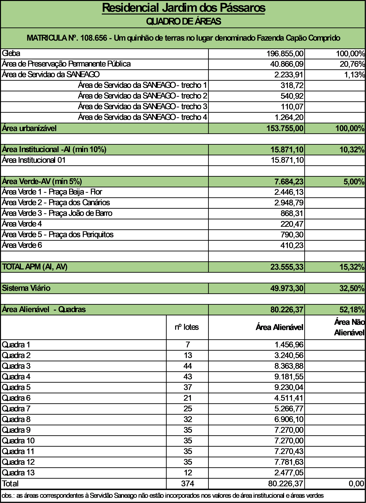
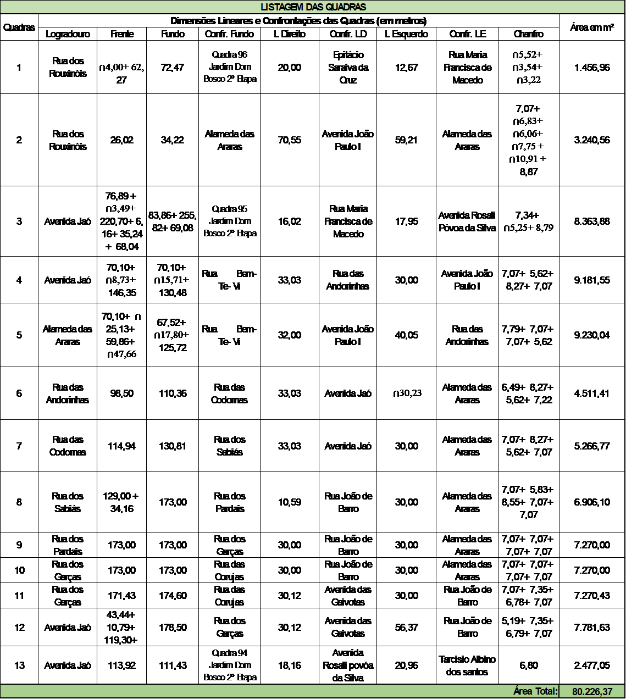
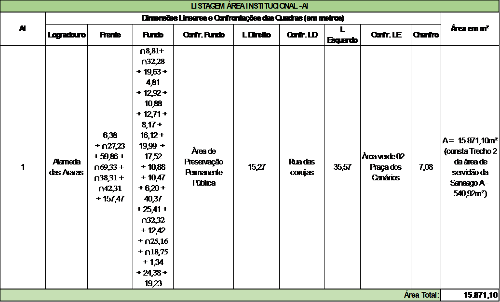
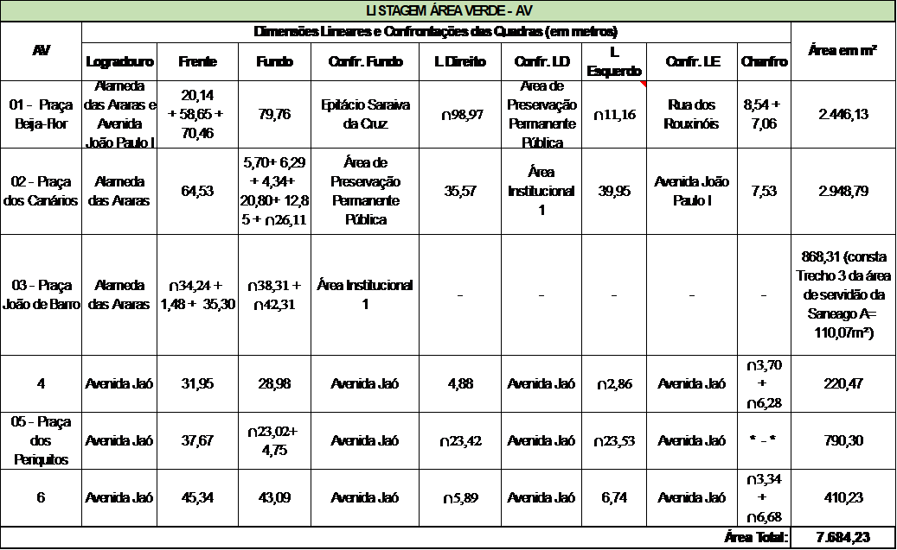
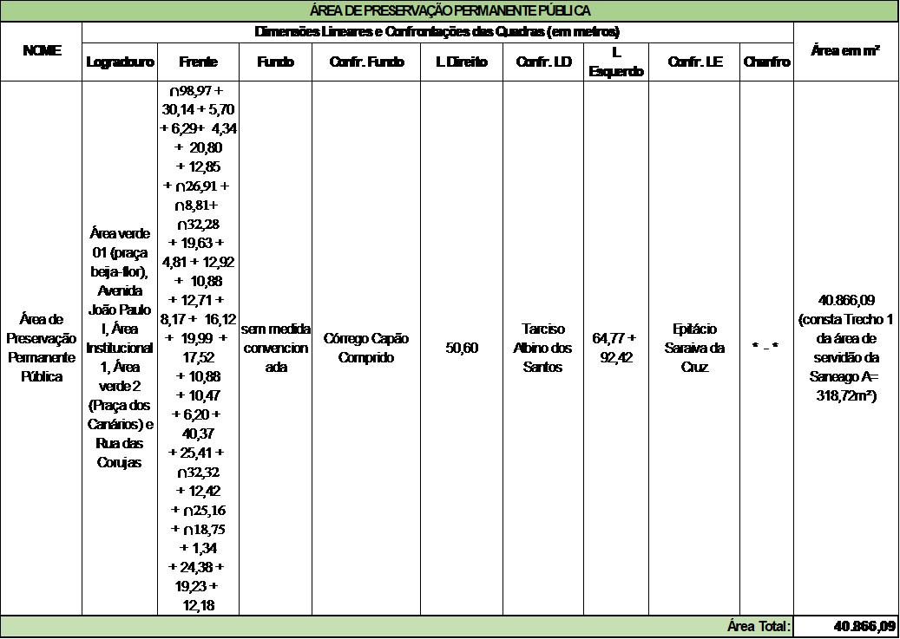

DECRETO "N" N°586, DE 17 DE JULHO DE 2024.

Dispõe sobre aprovação do Loteamento Residencial Jardim dos Pássaros neste Município, e dá outras providências.

O PREFEITO MUNICIPAL DE APARECIDA DE GOIÂNIA, no uso de suas atribuições legais, e

CONSIDERANDO que o loteamento foi aprovado conforme a Lei Complementar nº 124 de 14 dezembro de 2016, que institui o Plano Diretor e Lei Complementar nº 152 de 09 de outubro de 2018 que instituiu os instrumentos de Controle de Uso e Ocupação do Solo; Lei Complementar nº 176 de 05 de agosto de 2020 que altera a Lei Complementar nº 124/2016 e 152/2018 e os critérios urbanísticos.

CONSIDERANDO os documentos acostados aos autos dos processos administrativo nº 2021.022.569, especialmente o Parecer Técnico de Aprovação de Loteamento nº 044/2023/SPRU/DU, emitido pela Secretaria Municipal de Planejamento e Regulação Urbana.

**DECRETA:**

I-    IDENTIFICAÇÃO DA ÁREA DO IMÓVEL:

O imóvel onde será implantado o loteamento está cadastrado perante o 1° Cartório de Registro de Imóveis de Aparecida de Goiânia sob a matrícula de número 108.656, com os seguintes limites e confrontações:

Inicia-se no vértice denominado M.06 (N=8.139.352,361 e E=675.683,679), localizado na confrontação com Epitácio Saraiva da Cruz e na confrontação com o Jardim Dom Bosco - 2ª Etapa, deste, segue confrontando com Jardim Dom Bosco - 2ª Etapa (Quadra 96 - Lote 8, Rua Maria Francisca de Macedo, Quadra 95 - Lotes 1, 2, 3, 4, 5, 6 e 7), com o seguinte azimute e distância de: Az. 146°47'42" - 168,81m, até o vértice M.07 (N=8.139.211,119 e E=675.776,124), deste, segue confrontando com Jardim Dom Bosco - 2ª Etapa (Quadra 95 - Lotes 7, 8, 9, 10, 11, 12, 13, 14, 15, 16, 17, 18, 19, 20, 21, 22, 23, 24 e 25), com o seguinte azimute e distância de: Az. 136°47'39" - 223,91m, até o vértice M.04 (N=8.139.047,910 e E=675.929,418), deste, segue confrontando com Jardim Dom Bosco - 2ª Etapa (Quadra 95 - Lotes 25 e 26), com o seguinte azimute e distância de: Az. 136°47'39" 31,91m, até o vértice M.08 (N=8.139.024,650 e E=675.951,264), deste, segue confrontando com Jardim Dom Bosco - 2ª Etapa (Quadra 95 - Lotes 26, 27, 28, 29, 30 e Avenida Rosali Póvoa da Silva), com o seguinte azimute e distância de: Az. 77°42'42" - 81,85m, até o vértice M.09 (N=8.139.042,071 e E=676.031,244), deste, segue confrontando com Jardim Dom Bosco - 2ª Etapa (Avenida Rosali Póvoa da Silva, Quadra 94 - Lotes 1, 2, 3, 4, 5, 6, 7, 8, 9 e 10), com o seguinte azimute e distância de: Az. 81°18'28" - 120,11m, até o vértice M.05 (N=8.139.060,223 e E=676.149,973), deste, segue confrontando com Tarcisio Albino dos Santos, com os seguintes azimutes e distâncias de: Az. 153°53'54" - 153,87m, até o vértice M.10 (N=8.138.922,042 e E=676.217,672), Az. 248°26'13" - 308,90m, até o vértice M.11 (N=8.138.808,515 e E=675.930,393), Az. 248°17'01" - 100,50m, até o vértice M.12 (N=8.138.771,327 e E=675.837,024), Az. 248°05'47" - 66,03m, até o vértice M.13 (N=8.138.746,697 e E=675.775,764), deste, segue pela margem direita do Córrego Capão Comprido, sentido sua jusante, até o vértice M.14 (N=8.139.211,714 e E=675.456,749), deste, segue confrontando com Epitácio Saraiva da Cruz, com os seguintes azimutes e distâncias de: Az. 38°27'33" - 64,77m, até o vértice M.15 (N=8.139.262,430 e E=675.497,031), Az. 64°28'04" - 77,65m, até o vértice M.16 (N=8.139.295,901 e E=675.567,102), Az. 64°09'30" - 129,53m, até o início desta descrição, no vértice M.06" 

Área de Servidão: SANEAGO, INSTITUEM FAIXA DE SERVIDÃO PARA REDE DE ABASTECIMENTO DE ÁGUA DA ADUTORA DO POÇO PC-01, com área de 2.233,91, metros quadrados - em favor de SANEAMENTO DE GOIAS S/A "Começa no marco M-01, de coordenadas UTM: E 675.705,80 e N-8.139.064.295, cravado nas terras de propriedade do Sr. Osni Gonzaga Pires; daí segue cantoom os seguintes azimutes verdadeiros e distâncias: 156°38'36" - 50,23 metros, até o marco M-02; 78°24°40" - 249,80 metros, até o marco M-03, 13°19'57" - 25,20 metros, até o marco M-04, cravado na confrontação com o lote 25 da quadra 95, Jardim Dom Bosco - 2ª Etapa, ponto final da descrição." 

Reserva Legal 01 Área 3.0647ha: "Inicia-se. no vértice denominado R.01 (N=8.139.318,780 e E-675.614,344), localizado na confrontação com terras de Epitácio Saraiva da Cruz e na confrontação com terras do proprietário deste, segue confrontando com terras do Proprietário, com os seguintes azimutes e distância de: Az. 160°11'17" - 292,35m, até o vértice R.02 (N=8.139.043,732 e E-675.713,432), Az. 250°26'48" - 63,59m, até o vértice R.03 (N=8.139.022,451 e E=675.653,513), deste, segue pela A.P.P. a 30m, da margem direita do Córrego Capão Comprido, sentido sua jusante, até o vértice R.04 (N-8.139.236,178 e E=675.476,179), deste, segue confrontando com terras de Epitácio Saraiva da Cruz, com os seguintes azimutes e distâncias de: Az. 38°27'33" - 33,53m, até o vértice M.15 (N-8.139.262,430 e E-675.497,031), Az. 64°28'04" - 77,65m, até o vértice M.16 (N=8.139.295,901 e E=675.567,102), Az. 64°09'30"- 52,49m, até o início desta descrição, no vértice R.01". 

Reserva Legal 02 Area 00.5790ha: "Inicia-se no vértice denominado R.05 (N=8.138.774,051 e E-675.843,861), localizado na confrontação com terras do Proprietário e na confrontação com terras de Tarcisio Albino dos Santos, deste, segue confrontando com terras de Tarcisio Albino dos Santos, com os seguintes azimutes e distâncias de: Az. 248°17'01" - 7,36m, até o vértice M.12 (N=8.138.771,327 e E-675.837,024), Az. 248°05'47" - 35,66m, até o vértice R.06 (N =8.138.758,023 e E=675.803,934), deste, segue pela A.P.P. a 30m, da margem direita do Córrego Capão Comprido, sentido sua jusante, até o vértice R.07 (N=8.139.013,170 e E=675.656,544), deste, segue confrontando com terras do Proprietário, com os seguintes azimutes e distâncias de: Az. 70°38'45" - 1,68m, até o vértice R.08 (N=8.139.013,728 e E=675.658,133), Az. 156°38'36" - 47,87m, até o vértice R.09 (N=8.138.969,778 e E=675.677,112), Az. 78°24'40" ~ 6,14m, até o vértice R.10 (N=8.138.971,012 e E=675.683,128), Az. 140°11'03" 111,62m, até o vértice R.11 (N=8.138.885,276 e E-675.754,601), Az. 158°00'57" - 106,04m, até o vértice R.12 (N= 8.138.786,951 e E= 675.794,296), Az. 104°35'17" - 51,22m, até o início desta descrição, no vértice R.05". 

Reserva Legal 03 Area 00,2934ha: "Inicia-se no vértice denominado M.05 (N=8.139.060,223 e E=676.149,973), localizado na confrontação com Jardim Dom Bosco - 2ª Etapa Quadra 94 Lote 10 e na confrontação com terras de Tarcisio Albino dos Santos, deste, segue confrontando com terras de Tarcisio Albino dos Santos, com o seguinte azimute e distância de: Az.153°53'54" 23,25m, até o vértice R.13 (N=8.139.039,343 e E-676.160,202), deste, segue confrontando com terras do Proprietário, com os seguintes azimutes e distâncias de: Az. 260°26'42" - 133,00m, até o vértice R.14(N-8.139.017,266 e E-676.029,047), Az. 5°03'42" - 24,90m, até o vértice M.09(N-8.139.042,071 e E-676.031,244), deste, segue confrontando com Jardim Dom Bosco - 2ª Etapa (Avenida Rosali Póvoa da Silva, Quadra 94 - Lotes 1, 2, 3, 4, 5, 6, 7, 8, 9 e 10), com o seguinte azimute e distância de: Az. 81°18'28" - 120,11m, até o início desta descrição, no vértice M.05". 

 Área de Preservação Permanente - A.P.P.: "Inicia-se no vértice denominado R.04 (N=8.139.236,178 e E-675.476,179), localizado na confrontação com terras de Epitácio Saraiva da Cruz e na A.P.P. a 30m da margem direita do Córrego Capão Comprido, deste, segue margeando a A.P.P. a 30m da margem direita do Córrego Capão Comprido, sentido sua montante, até o vértice R.06 (N=8.138.758,023 e E=675.803,934), deste, segue confrontando com terras de Tarcísio Albino dos Santos, com o seguinte azimute e distância de: Az. 248°05'47" - 30,36m, até o vértice M.13 (N=8.138.746,697 e E-675.775,764), deste, segue pela margem direita do Córrego Capão Comprido, sentido sua jusante, até o vértice M.14 (N=8.139.211,714 e E=675.456,749), deste, segue confrontando com terras de Epitácio Saraiva da Cruz, com o seguinte azimute e distância de: 38°27'33" - 31,24m, até o início desta descrição, no vértice R.04".

II- CARACTERIZAÇÃO DO LOTEAMENTO

Loteamento residencial, sendo loteamento convencional, com lotes comerciais/residenciais junto à Avenida Jaó e Avenida João Paulo l.

O trecho de parcelamento restrito contempla área de 196.855,00m² com 374 lotes de 180,00m² a 475,49m² e lotes de serviço destinados a poço e centro de reservação, localizados na quadra 11, lote 02 e quadra 10, lote 11.

O total de lotes é de 374 terrenos, sendo 372 alienáveis e 02 lotes de serviço. 

Os terrenos do loteamento apresentarão zoneamento conforme Lei n. 124, de 14 de dezembro de 2016.

III-CLASSIFICAÇÃO E DISTRIBUIÇÃO DE AREAS

\* A área das vias de pedestres foi computada no sistema viário.

IV - TABELA DE DISTRIBUIÇÃO DAS QUADRAS – ÁREA VENDÁVEL

V- TABELA DE DISTRIBUIÇÃO DAS ÁREAS INSTITUCIONAIS

VI – TABELA DE DISTRIBUIÇAÕ DAS ÁREAS VERDES

VII – TABELA DE DISTRIBUIÇAÕ DA ÁREA DE PRESERVAÇÃO PÚBLICA

Art. 2º - O empreendedor terá o prazo de até 180 (cento e oitenta) dias após a publicação deste Decreto para (registrar) o loteamento.

Art. 3º. Fica a URBANIZA APARECIDA 02 EMPREENDIMENTO IMOBILIÁRIO LTDA, além de se comprometer com a infraestrutura do loteamento, assume o compromisso de executar as infraestruturas: Pavimentação asfáltica das vias de circulação, guias e sarjetas; Implantação do sistema de drenagem pluvial; Implantação de sistema de esgotamento sanitário; Implantação de rede de distribuição de água potável; Implantação de rede de iluminação pública e distribuição de energia elétrica; Sinalização viária; Medidas mitigadoras apresentadas e aprovadas no Estudo de Impacto de Trânsito (EIT).

Art. 4º. O orçamento apresentado, no valor de R$ 10.787.111,62 (dez milhões, setecentos e oitenta e sete mil, cento e onze reais e sessenta e dois centavos) para execução das obras complementares, o qual está sendo utilizado no Seguro Garantia e Termo de Compromisso, poderá ter o seu valor atualizado até a apresentação do orçamento detalhado, podendo os documentos supracitados sofrerem alterações até o final do processo.

Art. 5º. O Alvará de implantação deverá ser expedido após o empreendedor cumprir os requisitos do art. 303 da Lei Complementar nº 124, de 14 de dezembro de 2016.

Art. 6º. Como garantia de implantação do loteamento e de toda a infraestrutura correspondente, o loteador apresenta apólice de seguro garantia n° 056902023000207750003507000000/2023 e Termo de Compromisso de Implantação do Loteamento, ambos assinados entre as partes.

Parágrafo único. O LOTEADOR se compromete a complementar o valor assegurado, seja em lotes ou fiança bancária, ou outra modalidade, caso o valor do orçamento apresentado sofra alteração durante a análise final de aprovação dos projetos complementares pelos respectivos órgãos competentes. 

Art. 7º. A aprovação do parcelamento do solo objeto deste Decreto está em conformidade com os documentos acostados ao processo administrativo nº 2021.022.569, especialmente o Parecer Técnico de Avaliação do Projeto de Loteamento, emitido pela Secretaria Municipal de Planejamento e Regulação Urbana, cuja planta de situação (mapa) é parte integrante deste.

Art. 8º. O descumprimento de quaisquer obrigações ou condições previstas no Termo de Compromisso e neste Decreto e demais normas implicará na rescisão dos termos acordados e revogação imediata deste Decreto, sem a necessidade de qualquer notificação prévia.

Art. 9º Este Decreto entrará em vigor na data de sua publicação, revogando o Decreto “N” nº 722 de 23 de novembro de 2023.

MUNICÍPIO DE APARECIDA DE GOIÂNIA-GO, 17 de julho de 2024.

VILMAR MARIANO DA SILVA

Prefeito 

 

JÚLIO CÉSAR CHAGAS MENDES

Secretário de Planejamento e Regulação Urbana
