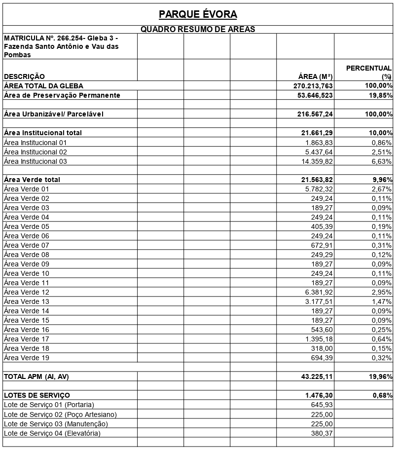
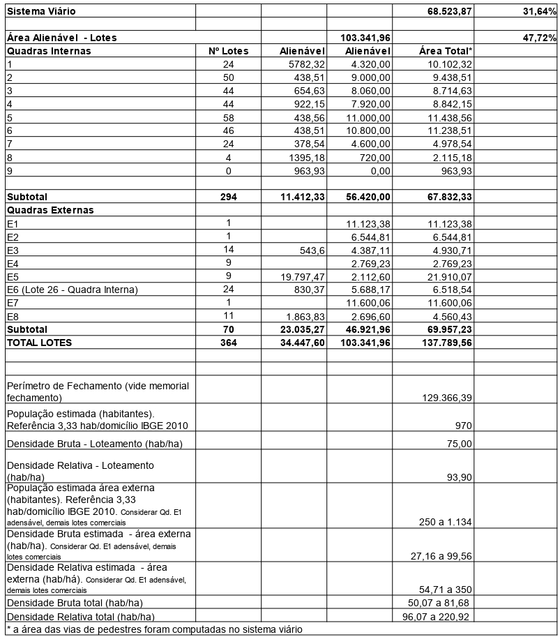
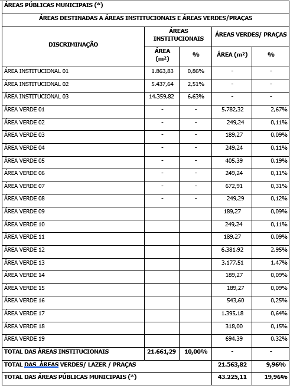

DECRETO "N" N° 274, DE 24 DE ABRIL DE 2023.

Dispõe sobre aprovação do Loteamento Parque Évora neste Município, e dá outras providências.

O PREFEITO MUNICIPAL DE APARECIDA DE GOIÂNIA, no uso de suas atribuições legais, e

CONSIDERANDO que o loteamento foi aprovado conforme a Lei Complementar nº 124 de 14 Dezembro de 2016, que institui o Plano Diretor e Lei Complementar nº 152 de 09 de Outubro de 2018 que instituiu os instrumentos de Controle de Uso e Ocupação do Solo; Lei Complementar nº 176 de 05 de Agosto de 2020 que altera a Lei Complementar nº 124/2016 e 152/2018 e os critérios urbanísticos.

CONSIDERANDO os documentos acostados aos autos dos processos administrativo nº 2019.075.585 e 2022.189.834, especialmente o Parecer Técnico de Aprovação de Loteamento nº 443/2022/SPRU/DU, emitido pela Secretaria Municipal de Planejamento e Regulação Urbana.

**DECRETA:**

Art. 1º Fica aprovado o Loteamento PARQUE ÉVORA, neste Município, de propriedade da EA3 7 URBANISMO LTDA, pessoa jurídica de direito privado, inscrita no CNPJ sob nº 17.436.249/0001-47, com sede no endereço Rua T-55, nº 930, sala 1703 (parte) Ed. Walk Business, St. Bueno, CEP: 74.215-170, Goiânia-GO, conforme abaixo:

I-    IDENTIFICAÇÃO DA ÁREA DO IMÓVEL:

O imóvel onde será implantado o loteamento está cadastrado perante o 1° Cartório de Registro de Imóveis de Aparecida de Goiânia sob a matrícula de número 266.254, com os seguintes limites e confrontações:

Inicia-se a descrição deste perímetro no vértice AY4-P-27.834, de coordenadas N 8.146.857,749m e E 691.917,613m; situado na divisa da Fazenda Santo Antônio e Vau das Pombas – Gleba 02 – Matrícula nº 259.230 com a Avenida Bela Vista; deste, segue confrontando com a Avenida Bela Vista com os seguintes azimutes e distâncias: 136°12'12" e 419,24 m até o vértice AY4-M-H773, de coordenadas N 8.146.555,141 metros e E 692.207,769 metros; 127°44'33" e 11,99 metros até o vértice AY4-M-H772, de coordenadas N 8.146.547,802 metros e E 692.217,250 metros; 134°27'41" e 20,02 metros até o vértice AY4-V-0100, de coordenadas N 8.146.533,782 metros e E 692.231,536 metros; situado na divisa da Avenida Bela Vista com a Fazenda Santo Antônio e Vau das Pombas – Matrícula nº Av. 16-250.804 – Remanescente; deste, segue confrontando com a Matrícula nº Av. 16-250.804 – Remanescente, com os seguintes azimutes e distâncias: 224°58'52" e 143,10 metros até o vértice AY4-V-0101, de coordenadas N 8.146.432,564 metros e E 692.130,384 metros; situado na proximidade da nascente de uma vertente; deste, segue por esta vertente, à jusante, com os seguintes azimutes e distâncias: 243°18'43" e 49,42 metros até o vértice AY4-V-0102, de coordenadas N 8.146.410,367 metros e E 692.086,227 metros; 225°52'36" e 111,42 metros até o vértice AY4-V-0103, de coordenadas N 8.146.332,797 metros e E 692.006,246 metros; 242°57'44" e 117,86 metros até o vértice AY4-V-0104, de coordenadas N 8.146.279,222 metros e E 691.901,270 metros; 155°43'29" e 20,25 metros até o vértice AY4-V-0105, de coordenadas N 8.146.260,763 metros e E 691.909,595 metros; 228°34'40" e 27,57 metros até o vértice AY4-V-0106, de coordenadas N 8.146.242,523 metros e E 691.888,922 metros; 233°56'07" e 34,49 metros até o vértice AY4-V-0107, de coordenadas N 8.146.222,220 metros e E 691.861,044 metros; 339°19'01" e 55,63 metros até o vértice AY4-V-0108, de coordenadas N 8.146.274,263 metros e E 691.841,396 metros; 245°33'02" e 23,01 metros até o vértice AY4-V-0109, de coordenadas N 8.146.264,738 metros e E 691.820,445 metros; 230°25'42" e 31,90 metros até o vértice AY4-V-0110, de coordenadas N 8.146.244,418 metros e E 691.795,858 metros; 256°14'27" e 34,34 metros até o vértice AY4-V-0111, de coordenadas N 8.146.236,250 metros e E 691.762,501 metros; 267°26'00" e 37,99 metros até o vértice AY4-V-0112, de coordenadas N 8.146.234,549 metros e E 691.724,549 metros; deste, segue confrontando com a Fazenda Santo Antônio e Vau das Pombas – Matrícula nº Av.16-250.804 – Remanescente, com os seguintes azimutes e distâncias: 270°27'27" e 115,66 metros até o vértice AY4-V-0113, de coordenadas N 8.146.235,472 metros e E 691.608,895 metros; 343°12'33" e 196,15 metros até o vértice AY4-V-0114, de coordenadas N 8.146.423,261 metros e E 691.552,231 metros; Situado na divisa da Fazenda Santo Antônio e Vau das Pombas – Matrícula nº AV. 16-250.804 – Remanescente com a Rua Crisólito; deste, segue pela Rua Crisólito, com o azimute e distância de 37°43'27" e 84,57 metros até o vértice AY4-M-H770, de coordenadas N 8.146.490,154 metros e E 691.603,977 metros; deste, segue pela Rua Sardônica, com o azimute e distância de 330°24'06" e 156,78 metros até o vértice AY4-P-27.835, de coordenadas N 8.146.626,471 metros e E 691.526,543 metros; situado na divisa da Rua Sardônica com a Fazenda Santo Antônio e Vau das Pombas – Gleba 02 – Matrícula nº 259.230; deste, segue confrontando com a Fazenda Santo Antônio e Vau das Pomba –n Gleba 02 – Matrícula nº 259.230, com o seguinte azimute e distância 59°24' e 454,34 metros até o vértice AY4-P-27.834, ponto inicial da descrição deste perímetro.

II- CARACTERIZAÇÃO DO LOTEAMENTO

Loteamento residencial, sendo parte parcelamento de acesso restrito e parte loteamento convencional, com lotes comerciais/residenciais junto à Avenida Bela Vista.

O trecho de parcelamento restrito contempla área de 129.366,39m² com 294 lotes de 180,00m² a 250,00m² e lotes de serviço destinados a equipamentos/instalações de uso privativo do parcelamento de acesso restrito. 

São 70 lotes externos com área de 200,00m² a 11.600,06m². 

O total de lotes é de 368 terrenos, sendo 364 alienáveis e 04 lotes de serviço. 

Os terrenos do loteamento apresentarão zoneamento conforme Lei n. 124, de 14 de dezembro de 2016.

III-CLASSIFICAÇÃO E DISTRIBUIÇÃO DE AREAS

IV - TABELA DE DISTRIBUIÇÃO DAS QUADRAS – ÁREA VENDÁVEL

<table><tbody><tr><td rowspan="2">**QUADRAS**</td><td colspan="2">**INTERNAS(RESIDENCIAIS)**</td><td colspan="2">**EXTERNAS(RESIDENCIAIS / COMERCIAIS)**</td><td colspan="2">**LOTES DE SERVIÇO / PORTARIA/ EQUIPAMENTO**</td><td colspan="2">**A.P.M.S**</td><td rowspan="2">**ÁREA TOTAL DA QUADRA&nbsp;&nbsp;&nbsp;&nbsp;&nbsp;&nbsp;&nbsp;&nbsp;&nbsp;&nbsp;&nbsp;&nbsp;&nbsp;&nbsp;&nbsp;&nbsp;&nbsp;&nbsp;&nbsp;&nbsp;&nbsp;&nbsp;&nbsp;&nbsp;&nbsp;&nbsp;&nbsp;&nbsp;&nbsp;&nbsp;&nbsp;&nbsp;&nbsp;&nbsp;&nbsp;&nbsp;&nbsp;&nbsp;&nbsp; (m²)**</td><td rowspan="2">**%**</td></tr><tr><td>**Nº DE LOTE**</td><td>**ÁREA LOTES**</td><td>**Nº DE LOTE**</td><td>**ÁREA LOTES**</td><td>**Nº DE LOTE**</td><td>**ÁREA LOTES**</td><td>**Nº DE A.P.M.**</td><td>**ÁREA A.P.M.**</td></tr><tr><td>QUADRA 01</td><td>24</td><td>4.320,00</td><td>0</td><td>0,00</td><td>0</td><td>&nbsp;&nbsp; 0,00</td><td>1</td><td>5.782,32</td><td>10.102,32</td><td>4,665%</td></tr><tr><td>QUADRA 02</td><td>50</td><td>9.000,00</td><td>0</td><td>0,00</td><td>0</td><td>0,00</td><td>2</td><td>&nbsp;438,51</td><td>9.438,51</td><td>4,358%</td></tr><tr><td>QUADRA 03</td><td>44</td><td>&nbsp; 8.060,00</td><td>0</td><td>0,00</td><td>0</td><td>0,00</td><td>2</td><td>&nbsp;654,63</td><td>8.714,63</td><td>4,024%</td></tr><tr><td>QUADRA 04</td><td>44</td><td>7.920,00</td><td>0</td><td>0,00</td><td>0</td><td>0,00</td><td>2</td><td>&nbsp;922,15</td><td>8.842,15</td><td>4,083%</td></tr><tr><td>QUADRA 05</td><td>58</td><td>11.000,00</td><td>0</td><td>0,00</td><td>0</td><td>0,00</td><td>2</td><td>&nbsp;438,56</td><td>11.438,56</td><td>5,282%</td></tr><tr><td>QUADRA 06</td><td>46</td><td>10.800,00</td><td>0</td><td>0,00</td><td>0</td><td>0,00</td><td>2</td><td>&nbsp;438,51</td><td>11.238,51</td><td>5,189%</td></tr><tr><td>QUADRA 07</td><td>24</td><td>4.600,00</td><td>0</td><td>0,00</td><td>0</td><td>0,00</td><td>2</td><td>&nbsp;378,54</td><td>4.978,54</td><td>2,299%</td></tr><tr><td>QUADRA 08</td><td>4</td><td>720,00</td><td>0</td><td>0,00</td><td>0</td><td>0,00</td><td>1</td><td>1.395,18</td><td>2.115,18</td><td>0,977%</td></tr><tr><td>QUADRA 09</td><td>0</td><td>0,00</td><td>0</td><td>0,00</td><td>1</td><td>645,93</td><td>1</td><td>318,00</td><td>&nbsp;963,93</td><td>0,445%</td></tr><tr><td>QUADRA E1</td><td>0</td><td>0,00</td><td>1</td><td>11.123,38</td><td>0</td><td>&nbsp;&nbsp; 0,00</td><td>0</td><td>&nbsp;&nbsp;&nbsp; 0,00</td><td>11.123,38</td><td>5,136%</td></tr><tr><td>QUADRA E2</td><td>&nbsp;&nbsp; 0</td><td>0,00</td><td>1</td><td>6.544,81</td><td>0</td><td>0,00</td><td>0</td><td>0,00</td><td>6.544,81</td><td>3,022%</td></tr><tr><td>QUADRA E3</td><td>&nbsp;&nbsp; 0</td><td>0,00</td><td>&nbsp; 14</td><td>&nbsp;4.387,11</td><td>0</td><td>0,00</td><td>1</td><td>543,60</td><td>4.930,71</td><td>2,277%</td></tr><tr><td>QUADRA E4</td><td>&nbsp;&nbsp; 0</td><td>0,00</td><td>&nbsp;&nbsp; 9</td><td>2.769,23</td><td>0</td><td>0,00</td><td>0</td><td>0,00</td><td>2.769,23</td><td>1,278%</td></tr><tr><td>QUADRA E5</td><td>0</td><td>0,00</td><td>9</td><td>2.112,60</td><td>0</td><td>0,00</td><td>2</td><td>19.797,47</td><td>21.910,07</td><td>10,117%</td></tr><tr><td>QUADRA E6</td><td>0</td><td>0,00</td><td>24</td><td>5.688,17</td><td>3</td><td>830,37</td><td>0</td><td>0,00</td><td>6.518,54</td><td>3,010%</td></tr><tr><td>QUADRA E7</td><td>0</td><td>0,00</td><td>1&nbsp;&nbsp;</td><td>11.600,06</td><td>0</td><td>0,00</td><td>0</td><td>0,00</td><td>11.600,06</td><td>5,356%</td></tr><tr><td>QUADRA E8</td><td>0</td><td>0,00</td><td>11</td><td>2.696,60</td><td>0</td><td>0,00</td><td>1</td><td>1.863,83</td><td>4.560,43</td><td>2,106%</td></tr><tr><td>**TOTAL**</td><td>**294**</td><td>**56.420,00**</td><td>**70**</td><td>**46.921,96**</td><td>**4**</td><td>**1.476,30**</td><td>**19**</td><td>**32.971,30**</td><td rowspan="2">**137.789,56**</td><td rowspan="2">**63,624%**</td></tr><tr><td>**%**</td><td colspan="2">**26,052%**</td><td colspan="2">**21,666%**</td><td colspan="2">**0,682%**</td><td colspan="2">**15,224%**</td></tr></tbody></table>

V- TABELA DE DISTRIBUIÇÃO DAS ÁREAS INSTITUCIONAIS

VI – TABELA DE DISTRIBUIÇAÕ DAS ÁREAS VERDES

<table><tbody><tr><td colspan="11">**LISTAGEM DAS ÁREAS VERDES**</td></tr><tr><td rowspan="3">**ÁREA**</td><td colspan="9">**Dimensões Lineares e Confrontações dos Lotes (em metros)**</td><td rowspan="3">**Área&nbsp;&nbsp;&nbsp;&nbsp;&nbsp;&nbsp;&nbsp;&nbsp;&nbsp;&nbsp;&nbsp;&nbsp;&nbsp;&nbsp;&nbsp;&nbsp; (m²)**</td></tr><tr><td rowspan="2">**Logradouro**</td><td rowspan="2">**Frente**</td><td rowspan="2">**Fundo**</td><td rowspan="2">**Confr. Fundo**</td><td rowspan="2">**L Direito**</td><td rowspan="2">**Confr. LD**</td><td rowspan="2">**L Esquerdo**</td><td rowspan="2">**Confr. LE**</td><td rowspan="2">**Chanfro**</td></tr><tr></tr><tr><td>Área Verde 01</td><td>Avenida Crisolito</td><td>103,44 + D=93,29 + 65,90</td><td>D=28,38 + 20,00 +216,00 + 20,00 + 17,96 + D=26,70 + 30,03 + D=19,29 + D=7,39 +&nbsp; 9,33</td><td>Rua da Moeda, Lote 01 até o Lote 24,Rua dos Penedos e Rua dos Segueiros</td><td>43,71 + D=3,91 + D=1,83 + 5,00 + D=28,20 + 5,00 + D=4,39 + D=5,96 + 34,93 + D=4,96 + D=4,99</td><td>Rua da República, Rua do Velasco e Avenida dos Castelos</td><td>38,93</td><td>Lote 01, Lote 03 e Lote 04 da Quadra E6</td><td>D=2,67 + D=6,13</td><td>5.782,32</td></tr><tr><td>Área Verde 02</td><td>Rua da Trindade</td><td>30,15</td><td>40,00</td><td>Lote 01 e&nbsp;&nbsp; Lote 50</td><td>2,96</td><td>Rua da Moeda</td><td>* - *</td><td>* - *</td><td>D=8,35 + D=7,36</td><td>249,24</td></tr><tr><td>Área Verde 03</td><td>Rua dos Penedos</td><td>30,00</td><td>40,00</td><td>Lote 25 e&nbsp;&nbsp;&nbsp; Lote 26</td><td>* - *</td><td>* - *</td><td>* - *</td><td>* - *</td><td>D=7,85 + D=7,85</td><td>189,27</td></tr><tr><td>Área Verde 04</td><td>Rua da Trindade</td><td>30,15</td><td>40,00</td><td>Lote 01 e&nbsp;&nbsp;&nbsp; Lote 44</td><td>2,96</td><td>Rua dos Mercadores</td><td>* - *</td><td>* - *</td><td>D=8,35 + D=7,36</td><td>249,24</td></tr><tr><td>Área Verde 05</td><td>Rua dos Segueiros e Avenida dos Castelos</td><td>15,18 + D=6,07 + D=16,01</td><td>40,00</td><td>Lote 22 e&nbsp;&nbsp;&nbsp; Lote 23</td><td>* - *</td><td>* - *</td><td>5,03</td><td>Rua dos Mercadores</td><td>D=6,14 + D=6,47</td><td>405,39</td></tr><tr><td>Área Verde 06</td><td>Rua da Trindade</td><td>30,15</td><td>40,00</td><td>Lote 01 e&nbsp;&nbsp;&nbsp; Lote 44</td><td>2,96</td><td>Avenida dos Salesianos</td><td>* - *</td><td>* - *</td><td>D=8,35 + D=7,36</td><td>249,24</td></tr><tr><td>Área Verde 07</td><td>Rua dos Touros e Avenida dos Castelos</td><td>D=21,40 + D=6,10 + 13,20</td><td>40,00</td><td>Lote 22 e&nbsp;&nbsp;&nbsp; Lote 23</td><td>18,11</td><td>Rua das Fontes</td><td>* - *</td><td>* - *</td><td>D=5,72 + D=7,85</td><td>672,91</td></tr><tr><td>Área Verde 08</td><td>Rua da Trindade</td><td>30,15</td><td>40,00</td><td>Lote 01 e&nbsp;&nbsp;&nbsp;&nbsp;&nbsp; Lote 58</td><td>2,96</td><td>Rua das Fontes</td><td>* - *</td><td>* - *</td><td>D=8,35 + D=7,36</td><td>249,29</td></tr><tr><td>Área Verde 09</td><td>Rua do Cenáculo</td><td>30,00</td><td>40,00</td><td>Lote 29 e&nbsp;&nbsp;&nbsp;&nbsp; Lote 30</td><td>* - *</td><td>* - *</td><td>* - *</td><td>* - *</td><td>D=7,85 + D=7,85</td><td>189,27</td></tr><tr><td>Área Verde 10</td><td>Rua da Trindade</td><td>30,15</td><td>40,00</td><td>Lote 01 e&nbsp;&nbsp;&nbsp; Lote 46</td><td>2,96</td><td>Rua das Alcaçárias</td><td>* - *</td><td>* - *</td><td>D=8,35 + D=7,36</td><td>249,24</td></tr><tr><td>Área Verde 11</td><td>Rua do Cenáculo</td><td>30,00</td><td>40,00</td><td>Lote 23&nbsp; e&nbsp;&nbsp; Lote 24</td><td>* - *</td><td>* - *</td><td>* - *</td><td>* - *</td><td>D=7,85 + D=7,85</td><td>189,27</td></tr><tr><td>Área Verde 12</td><td>Avenida Lisboa e Rua da Trindade</td><td>16,62 + 223,38</td><td>Sem Medida Conven-cionada</td><td>A.P.P</td><td>* - *</td><td>* - *</td><td>7,45</td><td>Lote 27 (Lote de Serviço 04) da Quadra E6</td><td>D=25,03</td><td>6.381,92</td></tr><tr><td>Área Verde 13</td><td>Avenida Lisboa</td><td>109,53</td><td>9,94</td><td>Fazenda Santo Antônio – Matrícula 250.804</td><td>105,24</td><td>Rua de Timor</td><td>A.P.P</td><td>Sem medida convencio-nada</td><td>* - *</td><td>3.177,51</td></tr><tr><td>Área Verde 14</td><td>Avenida Lisboa</td><td>30,00</td><td>40,00</td><td>Lote 01&nbsp; e&nbsp;&nbsp; Lote 24</td><td>* - *</td><td>* - *</td><td>* - *</td><td>* - *</td><td>D=7,85 + D=7,85</td><td>189,27</td></tr><tr><td>Área Verde 15</td><td>Rua de Viana</td><td>30,00</td><td>40,00</td><td>Lote 12 e&nbsp;&nbsp;&nbsp; Lote 13</td><td>* - *</td><td>* - *</td><td>* - *</td><td>* - *</td><td>D=7,85 + D=7,85</td><td>189,27</td></tr><tr><td>Área Verde 16</td><td>Rua da República</td><td>35,65</td><td>5,04 + D=3,13 +&nbsp; 9,60 + 20,00</td><td>Rua do Velasco</td><td>31,61</td><td>Rua de Viana e Lote 14</td><td>D=14,04</td><td>Rua do Velasco</td><td>D= 3,91</td><td>543,60</td></tr><tr><td>Área Verde 17</td><td>Rua de Burgos</td><td>19,89 + D=12,83 + 41,69</td><td>6,59 + 20,00 + 36,00 + 20,00 + D=7,85 + 10,96 + D=26,70 + 7,68</td><td>Rua das Fontes, Rua do Cenáculo, Rua de Viana e Lote 01 até o Lote 04</td><td>D=6,46 + 6,42 + D=3,15 + 4,40 + 20,00</td><td>Rua do Velasco</td><td>13,19 + D=6,10 + D=6,71</td><td>Rua dos Touros e Avenida dos Castelos</td><td>D=7,85 + D=2,97 +D=5,63</td><td>1.395,18</td></tr><tr><td>Área Verde 18</td><td>Avenida dos Castelos</td><td>9,01</td><td>10,34</td><td>Rua de Burgos</td><td>D=11,86</td><td>Rua do Velasco</td><td>22,50</td><td>Lote de Serviço 01 (Portaria)</td><td>D=7,69 + D=8,74</td><td>318,00</td></tr><tr><td>Área Verde 19</td><td>Rua da República</td><td>60,59</td><td>D=65,68</td><td>Rua do Velasco</td><td>* - *</td><td>* - *</td><td>* - *</td><td>* - *</td><td>D=8,02 R=3,00 + D=8,02 R=3,00</td><td>694,39</td></tr><tr><td>&nbsp;</td><td>&nbsp;</td><td>&nbsp;</td><td>&nbsp;</td><td>&nbsp;</td><td>&nbsp;</td><td>&nbsp;</td><td>&nbsp;</td><td>&nbsp;</td><td>**Área**</td><td>**21.563,82**</td></tr></tbody></table>

VII – TABELA DE DISTRIBUIÇÃO DOS LOTES DE SERVIÇOS

<table><tbody><tr><td colspan="11">**LISTAGEM DOS LOTES DE SERVIÇO**</td></tr><tr><td rowspan="3">**Lote**</td><td colspan="9">**Dimensões Lineares e Confrontações dos Lotes (em metros)**</td><td rowspan="3">**Área&nbsp;&nbsp;&nbsp;&nbsp;&nbsp;&nbsp;&nbsp;&nbsp;&nbsp;&nbsp;&nbsp;&nbsp;&nbsp;&nbsp;&nbsp;&nbsp; (m²)**</td></tr><tr><td rowspan="2">**Logradouro**</td><td rowspan="2">**Frente**</td><td rowspan="2">**Fundo**</td><td rowspan="2">**Confr. Fundo**</td><td rowspan="2">**L Direito**</td><td rowspan="2">**Confr. LD**</td><td rowspan="2">**L Esquerdo**</td><td rowspan="2">**Confr. LE**</td><td rowspan="2">**Chanfro**</td></tr><tr></tr><tr><td>Lote de Serviço 01(Por-taria)</td><td>Avenida dos Castelos</td><td>20,04</td><td>23,80</td><td>Rua de Burgos</td><td>22,50</td><td>Área Verde 18</td><td>D=9,81 + D=8,55 + 5,74</td><td>Rua de Burgos e Avenida dos Castelos</td><td>D=4,96 + D=4,01</td><td>645,93</td></tr><tr><td>Lote de Serviço 02, destinado ao Poço Artesiano localizado no Lote 17 da Quadra E-6</td><td>Beco dos Açúcares</td><td>9,00</td><td>9,00</td><td>Rua da Trindade</td><td>25,00</td><td>Lote 16</td><td>25,00</td><td>Lote 18</td><td>* - *</td><td>225,00</td></tr><tr><td>Lote de Serviço 03, destinado a Manutenção localizado no Lote 26 da Quadra E-6</td><td>Rua da Trindade</td><td>9,00</td><td>9,00</td><td>Beco dos Açúcares</td><td>25,00</td><td>Lote 27 (Lote de Serviço 04-Elevatória)</td><td>25,00</td><td>Lote 25</td><td>* - *</td><td>225,00</td></tr><tr><td>Lote de Serviço 04, destinado a Elevatória localizado no Lote 27 da Quadra E-6</td><td>Beco dos Açúcares</td><td>15,61</td><td>15,00</td><td>Rua da Trindade</td><td>25,00</td><td>Lote 26 (Lote de Serviço 03-Manutenção)</td><td>17,56 +&nbsp;&nbsp;&nbsp;&nbsp;&nbsp;&nbsp;&nbsp; 7,45</td><td>A.P.P e Área Verde 12</td><td>* - *</td><td>380,37</td></tr><tr><td>&nbsp;</td><td>&nbsp;</td><td>&nbsp;</td><td>&nbsp;</td><td>&nbsp;</td><td>&nbsp;</td><td>&nbsp;</td><td>&nbsp;</td><td>&nbsp;</td><td>**Área**</td><td>**1.476,30**</td></tr></tbody></table>

Art. 2º - O empreendedor terá o prazo de até 180 (cento e oitenta) dias após a publicação deste Decreto para (registrar) o loteamento.

Art. 3º. Fica a EA3 7 URBANISMO LTDA, além de se comprometer com a infraestrutura do loteamento, assume o compromisso de executar as infraestruturas: Pavimentação asfáltica das vias de circulação, guias e sarjetas; Implantação do sistema de drenagem pluvial; Implantação de sistema individual de esgotamento sanitário; Implantação de rede de distribuição de água potável; Implantação de rede de iluminação pública e distribuição de energia elétrica; Sinalização viária; Medidas mitigadoras apresentadas e aprovadas no Estudo de Impacto de Trânsito (EIT).

Art. 4º. O orçamento apresentado, no valor de R$ 8.467.945,03 (oito milhões, quatrocentos e sessenta e sete mil, novecentos e quarenta e cinco reais e três centavos) para execução das obras complementares, o qual está sendo utilizado nos Termos Caução e Compromisso, poderá ter o seu valor atualizado até a apresentação do orçamento detalhado, podendo os documentos supracitados sofrerem alterações até o final do processo.

Art. 5º. O Alvará de implantação deverá ser expedido após o empreendedor cumprir os requisitos do art. 303 da Lei Complementar nº 124, de 14 de dezembro de 2016.

Art. 6º Como garantia de implantação do loteamento e de toda a infraestrutura correspondente, o loteador apresenta os seguintes lotes, conforme os novos Termo de Caução e Termo de Compromisso de Implantação do Loteamento, assinados entre as partes e devidamente publicados:

<table><tbody><tr><td rowspan="2">***N° da Quadra***</td><td rowspan="2">***N° do Lote***</td><td rowspan="2">***&nbsp;Área do Lote (m²)***</td><td>***Valor Venal***</td></tr><tr><td>***Declarado (R$)***</td></tr><tr><td>*E2*</td><td>*1*</td><td>*&nbsp;&nbsp;&nbsp;&nbsp;&nbsp;&nbsp;&nbsp;&nbsp;&nbsp;&nbsp;&nbsp;&nbsp; 6.544,81*</td><td>*R$&nbsp;&nbsp;&nbsp;&nbsp; 2.617.924,00*</td></tr><tr><td>*E5*</td><td>*1*</td><td>*&nbsp;&nbsp;&nbsp;&nbsp;&nbsp;&nbsp;&nbsp;&nbsp;&nbsp;&nbsp;&nbsp;&nbsp;&nbsp;&nbsp;&nbsp; 256,32*</td><td>*R$&nbsp;&nbsp;&nbsp;&nbsp;&nbsp;&nbsp;&nbsp; 102.528,00*</td></tr><tr><td>*E5*</td><td>*2*</td><td>*&nbsp;&nbsp;&nbsp;&nbsp;&nbsp;&nbsp;&nbsp;&nbsp;&nbsp;&nbsp;&nbsp;&nbsp;&nbsp;&nbsp;&nbsp; 281,28*</td><td>*R$&nbsp;&nbsp;&nbsp;&nbsp;&nbsp;&nbsp;&nbsp; 112.512,00*</td></tr><tr><td>*E5*</td><td>*3*</td><td>*&nbsp;&nbsp;&nbsp;&nbsp;&nbsp;&nbsp;&nbsp;&nbsp;&nbsp;&nbsp;&nbsp;&nbsp;&nbsp;&nbsp;&nbsp; 225,00*</td><td>*R$&nbsp;&nbsp;&nbsp;&nbsp;&nbsp;&nbsp;&nbsp;&nbsp;&nbsp; 90.000,00*</td></tr><tr><td>*E5*</td><td>*4*</td><td>*&nbsp;&nbsp;&nbsp;&nbsp;&nbsp;&nbsp;&nbsp;&nbsp;&nbsp;&nbsp;&nbsp;&nbsp;&nbsp;&nbsp;&nbsp; 225,00*</td><td>*R$&nbsp;&nbsp;&nbsp;&nbsp;&nbsp;&nbsp;&nbsp;&nbsp;&nbsp; 90.000,00*</td></tr><tr><td>*E5*</td><td>*5*</td><td>*&nbsp;&nbsp;&nbsp;&nbsp;&nbsp;&nbsp;&nbsp;&nbsp;&nbsp;&nbsp;&nbsp;&nbsp;&nbsp;&nbsp;&nbsp; 225,00*</td><td>*R$&nbsp;&nbsp;&nbsp;&nbsp;&nbsp;&nbsp;&nbsp;&nbsp;&nbsp; 90.000,00*</td></tr><tr><td>*E5*</td><td>*6*</td><td>*&nbsp;&nbsp;&nbsp;&nbsp;&nbsp;&nbsp;&nbsp;&nbsp;&nbsp;&nbsp;&nbsp;&nbsp;&nbsp;&nbsp;&nbsp; 225,00*</td><td>*R$&nbsp;&nbsp;&nbsp;&nbsp;&nbsp;&nbsp;&nbsp;&nbsp;&nbsp; 90.000,00*</td></tr><tr><td>*E5*</td><td>*7*</td><td>*&nbsp;&nbsp;&nbsp;&nbsp;&nbsp;&nbsp;&nbsp;&nbsp;&nbsp;&nbsp;&nbsp;&nbsp;&nbsp;&nbsp;&nbsp; 225,00*</td><td>*R$&nbsp;&nbsp;&nbsp;&nbsp;&nbsp;&nbsp;&nbsp;&nbsp;&nbsp; 90.000,00*</td></tr><tr><td>*E5*</td><td>*8*</td><td>*&nbsp;&nbsp;&nbsp;&nbsp;&nbsp;&nbsp;&nbsp;&nbsp;&nbsp;&nbsp;&nbsp;&nbsp;&nbsp;&nbsp;&nbsp; 225,00*</td><td>*R$&nbsp;&nbsp;&nbsp;&nbsp;&nbsp;&nbsp;&nbsp;&nbsp;&nbsp; 90.000,00*</td></tr><tr><td>*E6*</td><td>*4*</td><td>*&nbsp;&nbsp;&nbsp;&nbsp;&nbsp;&nbsp;&nbsp;&nbsp;&nbsp;&nbsp;&nbsp;&nbsp;&nbsp;&nbsp;&nbsp; 225,00*</td><td>*&nbsp;R$&nbsp;&nbsp;&nbsp;&nbsp;&nbsp;&nbsp;&nbsp;&nbsp;&nbsp; 90.000,00*</td></tr><tr><td>*E6*</td><td>*5*</td><td>*&nbsp;&nbsp;&nbsp;&nbsp;&nbsp;&nbsp;&nbsp;&nbsp;&nbsp;&nbsp;&nbsp;&nbsp;&nbsp;&nbsp;&nbsp; 225,00*</td><td>*&nbsp;R$&nbsp;&nbsp;&nbsp;&nbsp;&nbsp;&nbsp;&nbsp;&nbsp;&nbsp; 90.000,00*</td></tr><tr><td>*E6*</td><td>*6*</td><td>*&nbsp;&nbsp;&nbsp;&nbsp;&nbsp;&nbsp;&nbsp;&nbsp;&nbsp;&nbsp;&nbsp;&nbsp;&nbsp;&nbsp;&nbsp; 225,00*</td><td>*&nbsp;R$&nbsp;&nbsp;&nbsp;&nbsp;&nbsp;&nbsp;&nbsp;&nbsp;&nbsp; 90.000,00*</td></tr><tr><td>*E6*</td><td>*7*</td><td>*&nbsp;&nbsp;&nbsp;&nbsp;&nbsp;&nbsp;&nbsp;&nbsp;&nbsp;&nbsp;&nbsp;&nbsp;&nbsp;&nbsp;&nbsp; 225,00*</td><td>*&nbsp;R$&nbsp;&nbsp;&nbsp;&nbsp;&nbsp;&nbsp;&nbsp;&nbsp;&nbsp; 90.000,00*</td></tr><tr><td>*E6*</td><td>*8*</td><td>*&nbsp;&nbsp;&nbsp;&nbsp;&nbsp;&nbsp;&nbsp;&nbsp;&nbsp;&nbsp;&nbsp;&nbsp;&nbsp;&nbsp;&nbsp; 225,00*</td><td>*&nbsp;R$&nbsp;&nbsp;&nbsp;&nbsp;&nbsp;&nbsp;&nbsp;&nbsp;&nbsp; 90.000,00*</td></tr><tr><td>*E6*</td><td>*9*</td><td>*&nbsp;&nbsp;&nbsp;&nbsp;&nbsp;&nbsp;&nbsp;&nbsp;&nbsp;&nbsp;&nbsp;&nbsp;&nbsp;&nbsp;&nbsp; 225,00*</td><td>*&nbsp;R$&nbsp;&nbsp;&nbsp;&nbsp;&nbsp;&nbsp;&nbsp;&nbsp;&nbsp; 90.000,00*</td></tr><tr><td>*E6*</td><td>*10*</td><td>*&nbsp;&nbsp;&nbsp;&nbsp;&nbsp;&nbsp;&nbsp;&nbsp;&nbsp;&nbsp;&nbsp;&nbsp;&nbsp;&nbsp;&nbsp; 225,00*</td><td>*&nbsp;R$&nbsp;&nbsp;&nbsp;&nbsp;&nbsp;&nbsp;&nbsp;&nbsp;&nbsp; 90.000,00*</td></tr><tr><td>*E6*</td><td>*11*</td><td>*&nbsp;&nbsp;&nbsp;&nbsp;&nbsp;&nbsp;&nbsp;&nbsp;&nbsp;&nbsp;&nbsp;&nbsp;&nbsp;&nbsp;&nbsp; 225,00*</td><td>*&nbsp;R$&nbsp;&nbsp;&nbsp;&nbsp;&nbsp;&nbsp;&nbsp;&nbsp;&nbsp; 90.000,00*</td></tr><tr><td>*E6*</td><td>*12*</td><td>*&nbsp;&nbsp;&nbsp;&nbsp;&nbsp;&nbsp;&nbsp;&nbsp;&nbsp;&nbsp;&nbsp;&nbsp;&nbsp;&nbsp;&nbsp; 225,00*</td><td>*&nbsp;R$&nbsp;&nbsp;&nbsp;&nbsp;&nbsp;&nbsp;&nbsp;&nbsp;&nbsp; 90.000,00*</td></tr><tr><td>*E6*</td><td>*13*</td><td>*&nbsp;&nbsp;&nbsp;&nbsp;&nbsp;&nbsp;&nbsp;&nbsp;&nbsp;&nbsp;&nbsp;&nbsp;&nbsp;&nbsp;&nbsp; 225,00*</td><td>*&nbsp;R$&nbsp;&nbsp;&nbsp;&nbsp;&nbsp;&nbsp;&nbsp;&nbsp;&nbsp; 90.000,00*</td></tr><tr><td>*E6*</td><td>*14*</td><td>*&nbsp;&nbsp;&nbsp;&nbsp;&nbsp;&nbsp;&nbsp;&nbsp;&nbsp;&nbsp;&nbsp;&nbsp;&nbsp;&nbsp;&nbsp; 225,00*</td><td>*&nbsp;R$&nbsp;&nbsp;&nbsp;&nbsp;&nbsp;&nbsp;&nbsp;&nbsp;&nbsp; 90.000,00*</td></tr><tr><td>*E6*</td><td>*15*</td><td>*&nbsp;&nbsp;&nbsp;&nbsp;&nbsp;&nbsp;&nbsp;&nbsp;&nbsp;&nbsp;&nbsp;&nbsp;&nbsp;&nbsp;&nbsp; 225,00*</td><td>*&nbsp;R$&nbsp;&nbsp;&nbsp;&nbsp;&nbsp;&nbsp;&nbsp;&nbsp;&nbsp; 90.000,00*</td></tr><tr><td>*E6*</td><td>*16*</td><td>*&nbsp;&nbsp;&nbsp;&nbsp;&nbsp;&nbsp;&nbsp;&nbsp;&nbsp;&nbsp;&nbsp;&nbsp;&nbsp;&nbsp;&nbsp; 225,00*</td><td>*&nbsp;R$&nbsp;&nbsp;&nbsp;&nbsp;&nbsp;&nbsp;&nbsp;&nbsp;&nbsp; 90.000,00*</td></tr><tr><td>*E6*</td><td>*18*</td><td>*&nbsp;&nbsp;&nbsp;&nbsp;&nbsp;&nbsp;&nbsp;&nbsp;&nbsp;&nbsp;&nbsp;&nbsp;&nbsp;&nbsp;&nbsp; 237,50*</td><td>*&nbsp;R$&nbsp;&nbsp;&nbsp;&nbsp;&nbsp;&nbsp;&nbsp;&nbsp;&nbsp; 95.000,00*</td></tr><tr><td>*E6*</td><td>*19*</td><td>*&nbsp;&nbsp;&nbsp;&nbsp;&nbsp;&nbsp;&nbsp;&nbsp;&nbsp;&nbsp;&nbsp;&nbsp;&nbsp;&nbsp;&nbsp; 237,50*</td><td>*&nbsp;R$&nbsp;&nbsp;&nbsp;&nbsp;&nbsp;&nbsp;&nbsp;&nbsp;&nbsp; 95.000,00*</td></tr><tr><td>*E6*</td><td>*20*</td><td>*&nbsp;&nbsp;&nbsp;&nbsp;&nbsp;&nbsp;&nbsp;&nbsp;&nbsp;&nbsp;&nbsp;&nbsp;&nbsp;&nbsp;&nbsp; 237,50*</td><td>*&nbsp;R$&nbsp;&nbsp;&nbsp;&nbsp;&nbsp;&nbsp;&nbsp;&nbsp;&nbsp; 95.000,00*</td></tr><tr><td>*E6*</td><td>*21*</td><td>*&nbsp;&nbsp;&nbsp;&nbsp;&nbsp;&nbsp;&nbsp;&nbsp;&nbsp;&nbsp;&nbsp;&nbsp;&nbsp;&nbsp;&nbsp; 237,50*</td><td>*&nbsp;R$&nbsp;&nbsp;&nbsp;&nbsp;&nbsp;&nbsp;&nbsp;&nbsp;&nbsp; 95.000,00*</td></tr><tr><td>*E6*</td><td>*22*</td><td>*&nbsp;&nbsp;&nbsp;&nbsp;&nbsp;&nbsp;&nbsp;&nbsp;&nbsp;&nbsp;&nbsp;&nbsp;&nbsp;&nbsp;&nbsp; 237,50*</td><td>*&nbsp;R$&nbsp;&nbsp;&nbsp;&nbsp;&nbsp;&nbsp;&nbsp;&nbsp;&nbsp; 95.000,00*</td></tr><tr><td>*E6*</td><td>*23*</td><td>*&nbsp;&nbsp;&nbsp;&nbsp;&nbsp;&nbsp;&nbsp;&nbsp;&nbsp;&nbsp;&nbsp;&nbsp;&nbsp;&nbsp;&nbsp; 237,50*</td><td>*&nbsp;R$&nbsp;&nbsp;&nbsp;&nbsp;&nbsp;&nbsp;&nbsp;&nbsp;&nbsp; 95.000,00*</td></tr><tr><td>*E6*</td><td>*24*</td><td>*&nbsp;&nbsp;&nbsp;&nbsp;&nbsp;&nbsp;&nbsp;&nbsp;&nbsp;&nbsp;&nbsp;&nbsp;&nbsp;&nbsp;&nbsp; 237,50*</td><td>*&nbsp;R$&nbsp;&nbsp;&nbsp;&nbsp;&nbsp;&nbsp;&nbsp;&nbsp;&nbsp; 95.000,00*</td></tr><tr><td>*E6*</td><td>*25*</td><td>*&nbsp;&nbsp;&nbsp;&nbsp;&nbsp;&nbsp;&nbsp;&nbsp;&nbsp;&nbsp;&nbsp;&nbsp;&nbsp;&nbsp;&nbsp; 237,50*</td><td>*&nbsp;R$&nbsp;&nbsp;&nbsp;&nbsp;&nbsp;&nbsp;&nbsp;&nbsp;&nbsp; 95.000,00*</td></tr><tr><td>*E7*</td><td>*1*</td><td>*&nbsp;&nbsp;&nbsp;&nbsp;&nbsp;&nbsp;&nbsp;&nbsp;&nbsp;&nbsp; 11.600,06*</td><td>*&nbsp;R$&nbsp;&nbsp;&nbsp;&nbsp; 4.640.024,00*</td></tr><tr><td>*E8*</td><td>*1*</td><td>*&nbsp;&nbsp;&nbsp;&nbsp;&nbsp;&nbsp;&nbsp;&nbsp;&nbsp;&nbsp;&nbsp;&nbsp;&nbsp;&nbsp;&nbsp; 200,00*</td><td>*R$&nbsp;&nbsp;&nbsp;&nbsp;&nbsp;&nbsp;&nbsp;&nbsp; 80.000,00*</td></tr><tr><td>*E8*</td><td>*2*</td><td>*&nbsp;&nbsp;&nbsp;&nbsp;&nbsp;&nbsp;&nbsp;&nbsp;&nbsp;&nbsp;&nbsp;&nbsp;&nbsp;&nbsp;&nbsp; 220,50*</td><td>*R$&nbsp;&nbsp;&nbsp;&nbsp;&nbsp;&nbsp;&nbsp;&nbsp; 88.200,00*</td></tr><tr><td>*E8*</td><td>*3*</td><td>*&nbsp;&nbsp;&nbsp;&nbsp;&nbsp;&nbsp;&nbsp;&nbsp;&nbsp;&nbsp;&nbsp;&nbsp;&nbsp;&nbsp;&nbsp; 241,00*</td><td>*R$&nbsp;&nbsp;&nbsp;&nbsp;&nbsp;&nbsp;&nbsp;&nbsp; 96.400,00*</td></tr><tr><td>*E8*</td><td>*4*</td><td>*&nbsp;&nbsp;&nbsp;&nbsp;&nbsp;&nbsp;&nbsp;&nbsp;&nbsp;&nbsp;&nbsp;&nbsp;&nbsp;&nbsp;&nbsp; 292,87*</td><td>*R$&nbsp;&nbsp;&nbsp;&nbsp;&nbsp;&nbsp; 117.148,00*</td></tr><tr><td>*E8*</td><td>*5*</td><td>*&nbsp;&nbsp;&nbsp;&nbsp;&nbsp;&nbsp;&nbsp;&nbsp;&nbsp;&nbsp;&nbsp;&nbsp;&nbsp;&nbsp;&nbsp; 207,36*</td><td>*R$&nbsp;&nbsp;&nbsp;&nbsp;&nbsp;&nbsp;&nbsp;&nbsp; 82.944,00*</td></tr><tr><td>*E8*</td><td>*6*</td><td>*&nbsp;&nbsp;&nbsp;&nbsp;&nbsp;&nbsp;&nbsp;&nbsp;&nbsp;&nbsp;&nbsp;&nbsp;&nbsp;&nbsp;&nbsp; 208,80*</td><td>*R$&nbsp;&nbsp;&nbsp;&nbsp;&nbsp;&nbsp;&nbsp;&nbsp; 83.520,00*</td></tr><tr><td>*E8*</td><td>*7*</td><td>*&nbsp;&nbsp;&nbsp;&nbsp;&nbsp;&nbsp;&nbsp;&nbsp;&nbsp;&nbsp;&nbsp;&nbsp;&nbsp;&nbsp;&nbsp; 210,15*</td><td>*R$&nbsp;&nbsp;&nbsp;&nbsp;&nbsp;&nbsp;&nbsp;&nbsp; 84.060,00*</td></tr><tr><td>*E8*</td><td>*8*</td><td>*&nbsp;&nbsp;&nbsp;&nbsp;&nbsp;&nbsp;&nbsp;&nbsp;&nbsp;&nbsp;&nbsp;&nbsp;&nbsp;&nbsp;&nbsp; 393,02*</td><td>*R$&nbsp;&nbsp;&nbsp;&nbsp;&nbsp;&nbsp; 157.208,00*</td></tr><tr><td>*E8*</td><td>*9*</td><td>*&nbsp;&nbsp;&nbsp;&nbsp;&nbsp;&nbsp;&nbsp;&nbsp;&nbsp;&nbsp;&nbsp;&nbsp;&nbsp;&nbsp;&nbsp; 261,45*</td><td>*R$&nbsp;&nbsp;&nbsp;&nbsp;&nbsp;&nbsp; 104.580,00*</td></tr><tr><td>*E8*</td><td>*10*</td><td>*&nbsp;&nbsp;&nbsp;&nbsp;&nbsp;&nbsp;&nbsp;&nbsp;&nbsp;&nbsp;&nbsp;&nbsp;&nbsp;&nbsp;&nbsp; 240,95*</td><td>*R$&nbsp;&nbsp;&nbsp;&nbsp;&nbsp;&nbsp;&nbsp;&nbsp; 96.380,00*</td></tr><tr><td>*E8*</td><td>*11*</td><td>*&nbsp;&nbsp;&nbsp;&nbsp;&nbsp;&nbsp;&nbsp;&nbsp;&nbsp;&nbsp;&nbsp;&nbsp;&nbsp;&nbsp;&nbsp; 220,50*</td><td>*R$&nbsp;&nbsp;&nbsp;&nbsp;&nbsp;&nbsp;&nbsp;&nbsp; 88.200,00*</td></tr><tr><td colspan="2">***Total***</td><td>***&nbsp;&nbsp;&nbsp;&nbsp;&nbsp;&nbsp;&nbsp;&nbsp;&nbsp;&nbsp; 27.554,07***</td><td>***R$ 11.021.628,00***</td></tr></tbody></table>

(Redação alterada pelo Decreto "N" Nº 805, de 25 de setembro de 2024).

~~Art. 6º. Como garantia de implantação do loteamento e de toda a infraestrutura correspondente, o loteador apresenta alguns lotes, conforme Termo de Caução e Termo de 

Compromisso de Implantação do Loteamento, ambos assinados entre as partes, quais sejam:~~

<table><tbody><tr><td><s>**Nº da quadra**</s></td><td><s>**Nº do lote**</s></td><td><s>**Área do lote (m2)**</s></td><td><s>**Valor venal**</s></td></tr><tr><td><s>E1</s></td><td><s>1</s></td><td><s>&nbsp;11.123,38</s></td><td><s>&nbsp;&nbsp; R$ 4.449.352,00</s></td></tr><tr><td><s>E6</s></td><td><s>4</s></td><td><s>225,00</s></td><td><s>&nbsp;&nbsp; R$ 90.000,00</s></td></tr><tr><td><s>E6</s></td><td><s>5</s></td><td><s>225,00</s></td><td><s>R$ 90.000,00</s></td></tr><tr><td><s>E6</s></td><td><s>6</s></td><td><s>225,00</s></td><td><s>R$ 90.000,00</s></td></tr><tr><td><s>E6</s></td><td><s>7</s></td><td><s>225,00</s></td><td><s>R$ 90.000,00</s></td></tr><tr><td><s>E6</s></td><td><s>8</s></td><td><s>225,00</s></td><td><s>R$ 90.000,00</s></td></tr><tr><td><s>E6</s></td><td><s>9</s></td><td><s>225,00</s></td><td><s>R$ 90.000,00</s></td></tr><tr><td><s>E6</s></td><td><s>10</s></td><td><s>225,00</s></td><td><s>R$ 90.000,00</s></td></tr><tr><td><s>E6</s></td><td><s>11</s></td><td><s>225,00</s></td><td><s>R$ 90.000,00</s></td></tr><tr><td><s>E6</s></td><td><s>12</s></td><td><s>225,00</s></td><td><s>R$ 90.000,00</s></td></tr><tr><td><s>E6</s></td><td><s>13</s></td><td><s>225,00</s></td><td><s>R$ 90.000,00</s></td></tr><tr><td><s>E6</s></td><td><s>14</s></td><td><s>225,00</s></td><td><s>R$ 90.000,00</s></td></tr><tr><td><s>E6</s></td><td><s>15</s></td><td><s>225,00</s></td><td><s>R$ 90.000,00</s></td></tr><tr><td><s>E6</s></td><td><s>16</s></td><td><s>225,00</s></td><td><s>R$ 90.000,00</s></td></tr><tr><td><s>E6</s></td><td><s>18</s></td><td><s>237,50</s></td><td><s>R$ 95.000,00</s></td></tr><tr><td><s>E6</s></td><td><s>19</s></td><td><s>237,50</s></td><td><s>R$ 95.000,00</s></td></tr><tr><td><s>E6</s></td><td><s>20</s></td><td><s>237,50</s></td><td><s>R$ 95.000,00</s></td></tr><tr><td><s>E6</s></td><td><s>21</s></td><td><s>237,50</s></td><td><s>R$ 95.000,00</s></td></tr><tr><td><s>E6</s></td><td><s>22</s></td><td><s>237,50</s></td><td><s>R$ 95.000,00</s></td></tr><tr><td><s>E6</s></td><td><s>23</s></td><td><s>237,50</s></td><td><s>R$ 95.000,00</s></td></tr><tr><td><s>E6</s></td><td><s>24</s></td><td><s>237,50</s></td><td><s>R$ 95.000,00</s></td></tr><tr><td><s>E6</s></td><td><s>25</s></td><td><s>237,50</s></td><td><s>R$ 95.000,00</s></td></tr><tr><td><s>E7</s></td><td><s>1</s></td><td><s>&nbsp;&nbsp;&nbsp;&nbsp;&nbsp; 11.600,06</s></td><td><s>R$ 4.640.024,00</s></td></tr><tr><td colspan="2"><s>**TOTAL**</s></td><td><s>**27.548,44**</s></td><td><s>**R$ 11.019.376,00**</s></td></tr></tbody></table>

§1º Esses lotes não poderão ser comercializados até que sejam liberados pela Prefeitura, através de aditamento a este Termo.

§2º O LOTEADOR se compromete a complementar o valor caucionado, seja em lotes ou fiança bancária, ou outra modalidade, caso o valor do orçamento apresentado sofra alteração durante a análise final de aprovação dos projetos complementares pelos respectivos órgãos competentes. 

Art. 7º. A aprovação do parcelamento do solo objeto deste Decreto está em conformidade com os documentos acostados ao processo administrativo nº 2019.075.585 e 2022.189.834, especialmente o Parecer Técnico de Avaliação do Projeto de Loteamento, emitido pela Secretaria Municipal de Planejamento e Regulação Urbana, cuja planta de situação (mapa) é parte integrante deste.

Art. 8º. O descumprimento de quaisquer obrigações ou condições previstas no Termo de Compromisso e neste Decreto e demais normas implicará na rescisão dos termos acordados e revogação imediata deste Decreto, sem a necessidade de qualquer notificação prévia.

Art. 9º Este Decreto entrará em vigor na data de sua publicação, revogando expressamente o Decreto “N” nº 150, de 13 de março de 2023.

MUNICÍPIO DE APARECIDA DE GOIÂNIA-GO, 24 de Abril de 2023.

VILMAR MARIANO DA SILVA

Prefeito Municipal

 

FÁBIO PASSAGLIA

Secretário de Governo

JÚLIO CÉSAR CHAGAS MENDES

Secretário de Planejamento e Regulação Urbana
