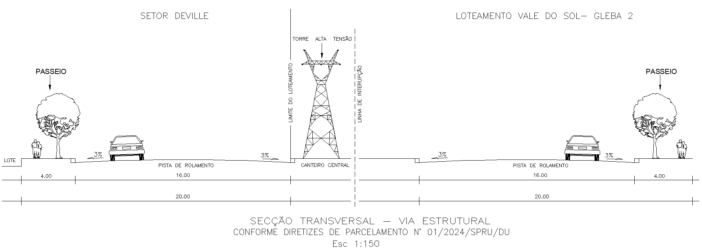
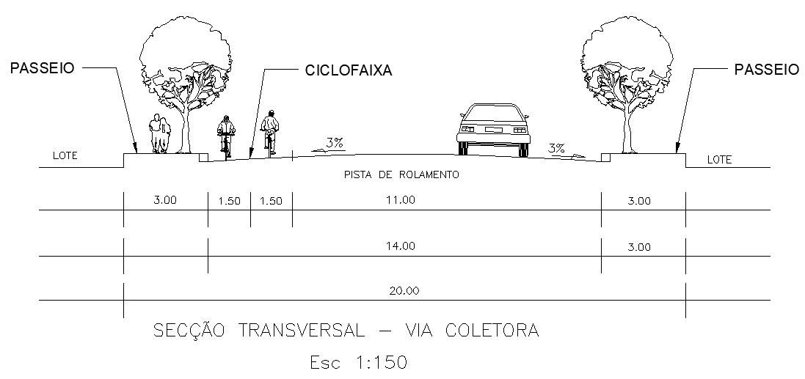
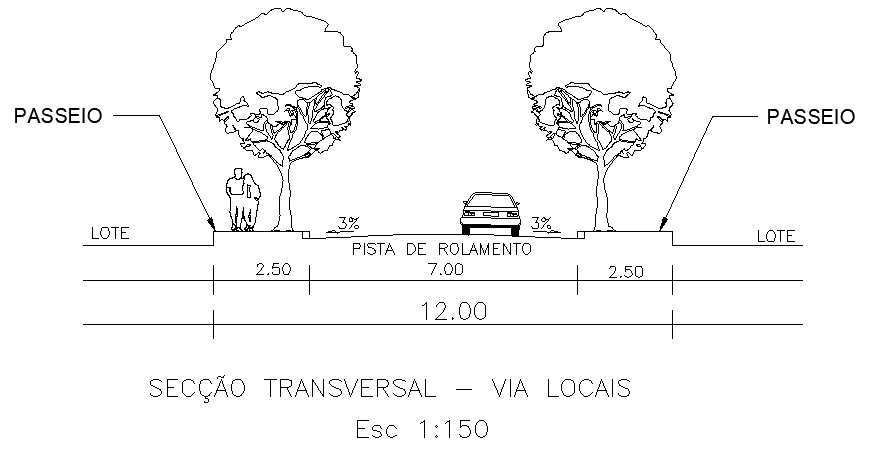

DECRETO Nº 323, DE 30 DE ABRIL DE 2026

Dispõe sobre a aprovação do Loteamento Setor Deville, no âmbito do Município de Aparecida de Goiânia.

O PREFEITO DE APARECIDA DE GOIÂNIA, no uso das atribuições que lhe confere o art. 71, incisos III e VII, da Lei Orgânica do Município de Aparecida de Goiânia; art. 300, da Lei Complementar nº 124, de 14 de dezembro de 2016; tendo em vista o disposto na Lei federal nº 6.766, de 19 de dezembro de 1979; na Lei federal nº 10.257, de 10 de julho de 2001; e o contido no Processo Administrativo nº 2024.123.120,

**DECRETA:**

Art. 1º Fica aprovado o Loteamento Setor Deville, situado na Fazenda Santo Antônio, Gleba I, neste Município, com área documental de 158.296,00m² (cento e cinquenta e oito mil, duzentos e noventa e seis metros quadrados), objeto da matrícula nº 142.214, do Registro de Imóveis e 1º Tabelionato de Notas de Aparecida de Goiânia, de propriedade da SPE 27 Carvalho Elmo LTDA.

Art. 2º A descrição do projeto de parcelamento do solo urbano e o quadro geral de distribuição de áreas, com a indicação dos equipamentos públicos que passarão ao domínio do município, constam no Anexo deste Decreto.

Art. 3º O loteamento está inserido em Zona de Uso Misto I, Eixo de Integração III e Eixo de Desenvolvimento Econômico, de acordo com o Plano Diretor de Aparecida de Goiânia – Lei Complementar nº 124, de 14 de dezembro de 2026 e nos termos do Anexo deste Decreto.

Art. 4º O empreendedor deverá implantar no prazo de 02 (dois) anos, a contar da data de emissão do Alvará de Implantação, as seguintes obras:

I - pavimentação asfáltica em concreto betuminoso usinado, guias e sarjetas;

II - implantação do sistema de drenagem pluvial;

III - implantação de rede coletora de esgoto sanitário;

IV - implantação de rede de distribuição de água potável;

V - implantação de rede de iluminação pública e distribuição de energia elétrica;

VI - sinalização viária;

VII - medidas mitigadoras apresentadas e aprovadas no Estudo de Impacto de Trânsito (EIT).

Art. 5º Como garantia à adequada execução das obras e serviços de que trata o art. 4º, o empreendedor prestará garantia caucionária, no valor de R$ 17.282.641,71 (dezessete milhões, duzentos e oitenta e dois mil, seiscentos e quarenta e um reais e setenta e um centavos), consistente na afetação de 127 (cento e vinte e sete) lotes, que totalizam a área de 31.166,74 m² (trinta e um mil, cento e sessenta e seis vírgula setenta e quatro metros quadrados).

Parágrafo único. Os lotes dados em caução não poderão ser alienados, onerados, prometidos à venda ou objeto de qualquer forma de disposição enquanto perdurar a garantia, salvo após a devida liberação pela Prefeitura, conforme Termo de Caução.

Art. 6º O loteador se compromete a complementar o valor assegurado, seja em lotes ou fiança bancária, ou outra modalidade, caso o valor do orçamento apresentado sofra alteração durante a análise final de aprovação dos projetos complementares pelos respectivos órgãos competentes.

Art. 7º Findo o prazo previsto no art. 4º, caso o empreendedor não tenha realizado as obras e os serviços, tornar-se-á devedor da importância necessária à sua implantação.

Art. 8º Realizadas todas as obras e serviços exigidos, a administração pública municipal, a requerimento do loteador, após vistoria de seu órgão próprio, dará plena quitação da obrigação assumida.

Art. 9º A implantação do loteamento é de total responsabilidade e obrigação do responsável técnico, juntamente com o proprietário do mesmo.

Art. 10. O empreendedor deverá submeter o Decreto de aprovação do loteamento ao registro imobiliário no prazo de 180 (cento e oitenta) dias, sob pena de caducidade, conforme dispõe o art. 18 da Lei federal nº 6.766, de 19 de dezembro de 1979.

Art. 11. Este Decreto entra em vigor na data de sua publicação.

Aparecida de Goiânia, 30 de abril de 2026.

 

LEANDRO VILELA

Prefeito de Aparecida de Goiânia

ANEXO

AO DECRETO Nº 323/2026

1\. CARACTERIZAÇÃO DO LOTEAMENTO

O Empreendimento Setor Deville possui uma área total de 158.296,00 m² (cento e cinquenta e oito mil, duzentos e noventa e seis metros quadrados), será um loteamento residencial, convencional/aberto, ou seja, não haverá fechamento do seu perímetro. Seu acesso se dará pela Rua 07.

Não há qualquer equipamento público localizado nas proximidades do empreendimento. Fazendo com que as áreas institucionais e verdes do empreendimento tenham uma relevância maior ainda, pois em um curto prazo serão as únicas capazes de receberem equipamentos e serviços públicos que atendam a população local.

O projeto tem como princípio urbanístico básico o atendimento integral a legislação federal, conforme Lei federal nº 6.766, de 19 de dezembro de 1979 e a legislação municipal, por meio da Lei nº 124 de dezembro de 2016, da Lei Complementar nº 152, de 9 de outubro de 2018, da Lei Complementar nº 176, de 5 de agosto de 2020 e da Lei Complementar nº 226, de 21 de dezembro de 2023 e demais legislações correlatadas.

O zoneamento conforme Lei Complementar nº 124, de 14 de dezembro de 2016 e demais leis complementares, será:

I – Zona de Uso Misto I:

a)    Quadra 01, Lotes 01 ao 51;

b)    Quadra 02, Lotes 01 ao 34;

c)    Quadra 03, Lotes 01 ao 32;

d)    Quadra 04, Lotes 01 ao 35;

e)    Quadra 05, Lotes 01 ao 41; 

f)    Quadra 06, Lotes 01 ao 21;

g)    Quadra 07, Lotes 01 ao 12 e 15 ao 28;

h)    Quadra 08, Lotes 01 ao 22 e 25 ao 48;

i)    Quadra 09, Lotes 01 ao 23 e 26 ao 49.

II – Eixo de Integração III;

a)    Quadra 10, Lotes 01 ao 20;

b)    Quadra 11, Lotes 01 ao 13.

III – Eixo de Desenvolvimento Econômico: 

a)    Quadra 07, Lotes 13 e 14;

b)    Quadra 08, Lotes 23 e 24;

c)    Quadra 09, Lotes 24 e 25.

2\. IDENTIFICAÇÃO DO IMÓVEL

Propriedade: Gleba I, Situada na Fazenda Santo Antônio

Matricula: 142.214

Município: Aparecida de Goiânia - GO

Proprietário: SPE 27 Carvalho Elmo LTDA

CNPJ: 37.461.750/0001-70

Área: 158.296,00m²

3\. DESCRIÇÃO DA GLEBA

GLEBA I, situada na FAZENDA SANTO ANTÔNIO, neste município, com a área de 158.296,00 metros quadrados; com os seguintes limites e confrontações: “Inicia-se a descrição deste perímetro no ponto M-7A, de coordenadas N=8.144.280,107m e E=690.161,409m, deste segue confrontando com a Chácara Resende - GLEBA II Parte Integrante da Fazenda Santo Antônio, com azimute de 140°40'54'' e distância de 403,06m, até o ponto M-4A, de coordenadas N=8.143.968,284m e E=690.416,799m, deste segue confrontando com a Avenida W-1 do Loteamento Vale do Sol - Gleba 2, com azimute de 213°51'08'' e distância de 396,61m, até o ponto M-04, de coordenadas N=8.143.638,909m e E=690.195,866m, deste segue com azimute de 322°16'56,27'' e distância de 134,56m, até o ponto M-05, de coordenadas N=8.143.745,351m e E=690.113,546m, deste segue com azimute de 214°28'34,27'' e distância de 86,19m, até o ponto M-06, de coordenadas N=8.143.674,299m e E=690.064,757m, deste segue confrontando com a Rua 8 do loteamento Chácaras São Pedro, com azimute de 345°47'31'' e distância de 378,63m, até o ponto M-07, de coordenadas N=8.144.041,347m e E=689.971,825m, deste segue confrontando com a Avenida Izaura Ribeiro Franco do Setor Franco, com azimute de 38°27'03'' e distância de 304,87m, até o ponto M-7A, de coordenadas N=8.144.280,107m e E=690.161,409m, ponto inicial da descrição deste perímetro.

4\. DESCRIÇÃO DA RESERVA LEGAL

A Reserva Legal, com a área de 3,1659ha; com os seguintes limites e confrontações: Inicia-se a descrição deste perímetro no vértice M-7A, de coordenadas N=8.144.275,938m e E=690.159,619m, situado na divisa do Loteamento São Pedro (Setor Franco) com a Chácara Resende Gleba II (Proprietário: Rui Resende); deste, segue confrontando com a Chácara Resende Gleba II, com azimute de 140°33'23" e distância de 262,08m, até o vértice R-1 de Coordenadas N=8.144.073,549m, e E=690.326,121m, situado na divisa da gleba I, Fazenda Santo Antônio, deste segue confrontando com a Gleba I – Fazenda Santo Antônio, com os seguintes azimutes e distâncias: 218°19'32" 119,88m, até o vértice R-2 de Coordenadas N=8.143.979,505m e E=690.251.781m; 318°57'13" 260,60m, até o vértice R-3 de Coordenadas N=8.144.176,042m e E=690.080,654m, situado na divisa do Loteamento São Pedro (Setor Franco), deste, segue confrontando com o referido loteamento com o azimute de 38°19'32" e distância de 127,34m, até o vértice M-7A, ponto inicial da descrição este. 

5\. QUADRO GERAL DE ÁREAS

<table><tbody><tr><td colspan="3">**QUADRO DE ÁREAS**</td></tr><tr><td>**DISCRIMINAÇÃO**</td><td>**ÁREA (m2)**</td><td>**PERCENTUAL (%)**</td></tr><tr><td>**ÁREA TOTAL DO EMPREENDIMENTO**</td><td>**158.296,00**</td><td>**100,000%**</td></tr><tr><td>**TOTAL DE ÁREAS NON AEDIFICANDI**</td><td>**4.942,51**</td><td>**3,122%**</td></tr><tr><td>NON AEDIFICANDI 01</td><td>2.013,08</td><td>1,272%</td></tr><tr><td>NON AEDIFICANDI 02</td><td>2.929,43</td><td>1,851%</td></tr><tr><td>**ÁREA PARCELÁVEL**</td><td>**153.353,49**</td><td>**96,878%**</td></tr><tr><td>&nbsp;</td><td>&nbsp;</td><td>&nbsp;</td></tr><tr><td>**ÁREA PARCELÁVEL**</td><td>**153.353,49**</td><td>**100,000%**</td></tr><tr><td>**TOTAL DE ÁREAS PÚBLICAS MUNICIPAIS**</td><td>**23.004,65**</td><td>**15,001%**</td></tr><tr><td>ÁREA INSTITUCIONAL 1</td><td>15.335,46</td><td>10,000%</td></tr><tr><td>TOTAL ÁREAS VERDES</td><td>7.669,19</td><td>5,001%</td></tr><tr><td>ÁREA VERDE 1</td><td>6.169,14</td><td>4,023%</td></tr><tr><td>ÁREA VERDE 2</td><td>1.500,05</td><td>0,978%</td></tr><tr><td>**TOTAL DE ÁREAS ALIENÁVEIS (372 lotes)**</td><td>**87.359,69**</td><td>**56,966%**</td></tr><tr><td>QUADRA 01 (51 lotes)</td><td>10.623,39</td><td>6,927%</td></tr><tr><td>QUADRA 02 (34 lotes)</td><td>8.155,94</td><td>5,318%</td></tr><tr><td>QUADRA 03 (32 lotes)</td><td>6.545,64</td><td>4,268%</td></tr><tr><td>QUADRA 04 (35 lotes)</td><td>8.240,72</td><td>5,374%</td></tr><tr><td>QUADRA 05 (41 lotes)</td><td>8.112,92</td><td>5,290%</td></tr><tr><td>QUADRA 06 (21 lotes)</td><td>5.307,26</td><td>3,461%</td></tr><tr><td>QUADRA 07 (28 lotes)</td><td>6.506,28</td><td>4,243%</td></tr><tr><td>QUADRA 08 (48 lotes)</td><td>10.385,28</td><td>6,772%</td></tr><tr><td>QUADRA 09 (49 lotes)</td><td>10.405,50</td><td>6,785%</td></tr><tr><td>QUADRA 10 (20 lotes)</td><td>7.744,16</td><td>5,050%</td></tr><tr><td>QUADRA 11 (13 lotes)</td><td>5.332,60</td><td>3,477%</td></tr><tr><td>**SISTEMA VIÁRIO E CANALIZAÇÃO DE TRÁFEGO**</td><td>**42.989,15**</td><td>**28,033%**</td></tr></tbody></table>

5.1 Área Alienável

O Setor Deville será composto por 372 (trezentas e setenta e duas) unidades, totalizando uma área alienável de 87.359,69m² (oitenta e sete mil, trezentos e cinquenta e nove metros quadrados e sessenta e nove decímetros quadrados). Deste total, 354 (trezentos e cinquenta e quatro) lotes serão residenciais, abrangendo 78.585,51m² (setenta e oito mil, quinhentos e oitenta e cinco metros quadrados e cinquenta e um decímetros quadrados), e 18 (dezoito) lotes serão comerciais, com área total de 8.774,18 m² (oito mil, setecentos e setenta e quatro metros quadrados e dezoito decímetros quadrados).

5.2 Áreas Públicas Municipais

As áreas públicas municipais são divididas entre as Áreas Institucional 1 com 15.335,46 m² (quinze mil, trezentos e trinta e cinco metros quadrados e quarenta e seis decímetros quadrados), Área Verde 1 com 6.169,14 m² (seis mil, cento e sessenta e nove metros quadrados e quatorze decímetros quadrados), Área Verde 2 com 1.500,05m² (um mil e quinhentos metros quadrados e cinco decímetros quadrados).

6\. PLANO DE COMPOSIÇÃO DE QUADRAS:

QUADRA 01 - Com área de 10.623,39 m², composta de 51 lotes, logradouro Avenida Izaura Ribeiro Franco com frente 207,26 metros, pelo fundo Rua Boa Viagem com 224,27 metros, pelo lado direito Rua Peruíbe com 37,19 metros, pelo lado esquerdo Rua São Bento com 33,97 metros e chanfros D=14,886 metros R= 16,401, 6,23 metros, D=17,871 metros R=8,00, 6,23 metros e 7,82 metros.

QUADRA 2 - Com área de 8.155,94 m², composta de 34 lotes, logradouro Rua Peruíbe com frente 153,31 metros, pelo fundo Rua Jurerê com 141,38 metros, pelo lado direito Rua Pedro Machado De Carvalho com 42,15 metros, pelo lado esquerdo Rua Boa Viagem com 43,50 metros e chanfros 6,23 metros, 7,07 metros, 7,82 metros e 7,07 metros.

QUADRA 3 - Com área de 6.545,64 m², composta de 32 lotes, logradouro Rua Jurerê com frente 138,63 metros, pelo fundo Rua Ubatuba com 128,11 metros, pelo lado direito Rua Pedro Machado De Carvalho com 36,00 metros, pelo lado esquerdo Rua Boa Viagem com 37,19 metros e chanfros 6,23 metros, 7,07 metros, 7,82 metros e 7,07 metros.

QUADRA 4 - Com área de 8.240,72 m², composta de 35 lotes, logradouro Rua Peruíbe com frente 141,07 metros, pelo fundo Rua Jurerê com 156,84 metros, pelo lado direito Avenida W-1 com 44,48 metros, pelo lado esquerdo Rua Pedro Machado De Carvalho com 42,15 metros e chanfros 7,07 metros, 8,03 metros, 7,07 metros e 5,96 metros.

QUADRA 5 - Com área de 8.112,92 m², composta de 41 lotes, logradouro Rua Jurerê com frente 160,47 metros, pelo fundo Rua Ubatuba com 174,39 metros, pelo lado direito Avenida W-1 com 38,06 metros, pelo lado esquerdo Rua Pedro Machado De Carvalho com 36,00 metros e chanfros 7,07 metros, 8,03 metros, 7,07 metros e 5,96 metros.

QUADRA 6 - Com área de 5.307,26 m², composta de 21 lotes, logradouro Rua Ubatuba com frente 57,64 metros, pelo fundo Rua Arpoador com 99,77 metros, pelo lado direito Avenida W-1 com 69,02 metros, pelo lado esquerdo Rua Itacarezinho com 29,70 metros e chanfros 8,44 metros, 8,03 metros, 7,07 metros e D=18,422 metros R=8,00.

QUADRA 7 - Com área de 6.506,28 m², composta de 28 lotes, logradouro Rua Arpoador com frente 120,61 metros, pelo fundo Rua Ilhabela com 134,65 metros, pelo lado direito Rua W-16 com 24,18 metros, pelo lado esquerdo Rua Itacarezinho com 36,00 metros e chanfros 7,07 metros, D=26,944 metros R=17,686, 7,07 metros e 6,90 metros.

QUADRA 8 - Com área de 10.385,28 m², composta de 48 lotes, logradouro Rua Ilhabela com frente 215,77 metros, pelo fundo Rua Cumbuco com 217,94 metros, pelo lado direito Rua W-16 com 36,05 metros, pelo lado esquerdo Rua Pedro Machado De Carvalho com 36,00 metros e chanfros 7,07 metros, 7,24 metros, 7,07 metros e 6,90 metros.

QUADRA 9 - Com área de 10.405,50 m², composta de 49 lotes, logradouro Rua Cumbuco com frente 218,51 metros, pelo fundo Rua São Bento com 203,67 metros, pelo lado direito Rua W-16 com 22,54 metros mais D=15,960 metros R=15,960, pelo lado esquerdo Rua Pedro Machado De Carvalho com 36,00 metros e chanfros 7,07 metros, 7,24 metros, 7,07 metros e 14,41 metros.

QUADRA 10 - Com área de 7.744,16 m², composta de 20 lotes, logradouro Rua São Bento com frente 159,40 metros, pelo fundo Rua 8 com 159,44 metros, pelo lado direito Rua Sancho com 36,00 metros, pelo lado esquerdo Rua Pedro Machado De Carvalho com 36,00 metros e chanfros 7,07 metros, 7,07 metros, 7,07 metros e 7,07 metros.

QUADRA 11 - Com área de 5.332,60m², composta de 13 lotes, logradouro Rua São Bento com frente 114,53 metros, pelo fundo Rua 8 com 87,00 metros, pelo lado direito Rua Pedro Machado De Carvalho com 36,00 metros, pelo lado esquerdo Avenida Izaura Ribeiro Franco com 33,97 metros e chanfros D=17,871 metros R=8,00, 7,07 metros, D=14,886 metros R=16,400 e 7,07 metros.

ÁREA INSTITUCIONAL 1 - Com área de 15.335,46 m², logradouro Rua Boa Viagem com frente 117,00 metros, pelo fundo Rua Pedro Machado De Carvalho com 94,24 metros mais 59,37 metros, pelo lado direito Rua Ubatuba com 125,36 metros, pelo lado esquerdo Rua São Bento com 61,71 metros e chanfros 6,23 metros, 7,07 metros, 7,07 metros e 8,99 metros.

ÁREA VERDE 1 - Com área de 6.169,14 m², logradouro Rua Pedro Machado De Carvalho com frente 41,49 metros, pelo fundo Rua Itacarezinho com 82,05 metros, pelo lado direito Rua Ubatuba com 97,13 metros, pelo lado esquerdo Rua Ilhabela com 65,15 metros e chanfros 7,07 metros, 5,36 metros, 7,07 metros e 8,44 metros.

ÁREA VERDE 2 - Com área de 1.500,05 m², logradouro Rua Sancho com frente 36,00 metros, pelo fundo Rua Barra Grande com 38,55 metros mais 9,11 metros, pelo lado direito Rua São Bento com 4,63 metros, pelo lado esquerdo Rua 8 com 32,37 metros e chanfros 7,07 metros, D=18,333 metros R=8,00 e 7,07 metros.

ÁREA NON AEDIFICANDI 01 - Com área de 2.013,08 m², com frente 125,94 metros para Rua W-16, pelo fundo área non aedificandi 02 com 96,82 metros, pelo lado direito Faixa de Servidão Equatorial 28,82 metros, pelo lado esquerdo Faixa de Servidão Equatorial 19,15 metros.

ÁREA NON AEDIFICANDI 02 - Com área de 2.929,43 m², com frente 96,82 metros para área non aedificandi 01, pelo lado direito Faixa de Servidão Furnas 95,27 metros, pelo lado esquerdo Faixa de Servidão Furnas 64,82 metros.

7\. SISTEMA VIÁRIO

O Sistema Viário Urbano é o conjunto de vias públicas, hierarquizadas, que constituem o suporte físico da circulação e garantem sua integração ao uso do solo urbano.

Fica estabelecida a Classificação Funcional do Sistema Viário do Município de Aparecida de Goiânia de acordo com as seguintes categorias definidas:

I – vias Estruturais (VE): vias com a função de conduzir, de forma expressa, o tráfego com origem e/ou destino fora do território do Município; 

II – vias Coletoras (VC) - responsáveis pela condução do tráfego entre as vias locais e as demais vias hierarquicamente superiores do Sistema Viário Urbano; 

III – vias Locais (VL) - vias responsáveis prioritariamente para o acesso às atividades locais, à condução de veículos em pequenos percursos que permitam o acesso direto aos lotes.

O sistema viário e canalização total com 42.989,15 m² (quarenta e dois mil, novecentos e oitenta e nove metros quadrados e quinze decímetros quadrados).

7.1 Vias estruturais (VE)

Possuem largura total (caixa) de 40,00 metros, composta por calçadas de 4,00 metros em cada lado e 32,00 metros destinados à faixa carroçável.

Localizada dentro da Gleba do Loteamento Setor Deville a via destinada à extensão do Anel Viário, conforme os parâmetros estabelecidos pelas Diretrizes de Parcelamento nº 01/2024/SPRU/DU, com largura total de 20,00 metros, sendo composta por 4,00 metros de calçada e 16,00 metros de faixa carroçável, além de faixa de servidão destinada à rede elétrica (área non aedificandi 01). Os 20,00 metros restantes ficam sob responsabilidade da área confrontante.

 

7.2 Vias Coletoras (VC)

Possuem largura total (caixa) de 20,00 metros, composta por calçadas de 3,00 metros em cada lado, 3,00 metros destinados à ciclofaixa e 11,00 metros de faixa carroçável.

7.3 Vias Locais (VL)

Possuem largura total (caixa) de 12,00 metros, composta por calçadas de 2,50 metros em cada lado e 7,00 metros destinados à faixa carroçável.

8\. LISTAGEM DE LOTES

<table><tbody><tr><td colspan="11">**LISTAGEM DOS LOTES - QUADRA&nbsp; 01**</td></tr><tr><td rowspan="3">**Lote**</td><td colspan="9">**Dimensões Lineares e Confrontações dos Lotes (em metros)**</td><td rowspan="3">**Área (m²)**</td></tr><tr><td rowspan="2">**Logradouro**</td><td rowspan="2">**Frente**</td><td rowspan="2">**Fundo**</td><td rowspan="2">**Confr.Fundo**</td><td rowspan="2">**L Direito**</td><td rowspan="2">**Confr. LD**</td><td rowspan="2">**L Esquerdo**</td><td rowspan="2">**Confr. LE**</td><td rowspan="2">**Chanfro**</td></tr><tr></tr><tr><td>1</td><td>AVENIDA IZAURA RIBEIRO FRANCO</td><td>D=14,886&nbsp; R=16,401</td><td>10,00 + 14,43</td><td>LOTE 50 E 51</td><td>26,00</td><td>LOTES 2 E 49</td><td>13,72</td><td>RUA SÃO BENTO</td><td>&nbsp;</td><td>381,57</td></tr><tr><td>2</td><td>&nbsp;AVENIDA IZAURA RIBEIRO FRANCO</td><td>8,00</td><td>8,00</td><td>LOTE 49</td><td>23,00</td><td>LOTE 3</td><td>23,00</td><td>LOTE 1</td><td>&nbsp;</td><td>184,00</td></tr><tr><td>3</td><td>&nbsp;AVENIDA IZAURA RIBEIRO FRANCO</td><td>8,00</td><td>8,00</td><td>LOTE 48</td><td>23,00</td><td>LOTE 4</td><td>23,00</td><td>LOTE 2</td><td>&nbsp;</td><td>184,00</td></tr><tr><td>4</td><td>&nbsp;AVENIDA IZAURA RIBEIRO FRANCO</td><td>8,00</td><td>8,00</td><td>LOTE 47</td><td>23,00</td><td>LOTE 5</td><td>23,00</td><td>LOTE 3</td><td>&nbsp;</td><td>184,00</td></tr><tr><td>5</td><td>&nbsp;AVENIDA IZAURA RIBEIRO FRANCO</td><td>8,00</td><td>8,00</td><td>LOTE 46</td><td>23,00</td><td>LOTE 6</td><td>23,00</td><td>LOTE 4</td><td>&nbsp;</td><td>184,00</td></tr><tr><td>6</td><td>&nbsp;AVENIDA IZAURA RIBEIRO FRANCO</td><td>8,00</td><td>8,00</td><td>LOTE 45</td><td>23,00</td><td>LOTE 7</td><td>23,00</td><td>LOTE 5</td><td>&nbsp;</td><td>184,00</td></tr><tr><td>7</td><td>&nbsp;AVENIDA IZAURA RIBEIRO FRANCO</td><td>8,00</td><td>8,00</td><td>LOTE 44</td><td>23,00</td><td>LOTE 8</td><td>23,00</td><td>LOTE 6</td><td>&nbsp;</td><td>184,00</td></tr><tr><td>8</td><td>&nbsp;AVENIDA IZAURA RIBEIRO FRANCO</td><td>8,00</td><td>8,00</td><td>LOTE 43</td><td>23,00</td><td>LOTE 9</td><td>23,00</td><td>LOTE 7</td><td>&nbsp;</td><td>184,00</td></tr><tr><td>9</td><td>&nbsp;AVENIDA IZAURA RIBEIRO FRANCO</td><td>8,00</td><td>8,00</td><td>LOTE 42</td><td>23,00</td><td>LOTE 10</td><td>23,00</td><td>LOTE 8</td><td>&nbsp;</td><td>184,00</td></tr><tr><td>10</td><td>&nbsp;AVENIDA IZAURA RIBEIRO FRANCO</td><td>8,00</td><td>8,00</td><td>LOTE 41</td><td>23,00</td><td>LOTE 11</td><td>23,00</td><td>LOTE 9</td><td>&nbsp;</td><td>184,00</td></tr><tr><td>11</td><td>&nbsp;AVENIDA IZAURA RIBEIRO FRANCO</td><td>8,00</td><td>8,00</td><td>LOTE 40</td><td>23,00</td><td>LOTE 12</td><td>23,00</td><td>LOTE 10</td><td>&nbsp;</td><td>184,00</td></tr><tr><td>12</td><td>&nbsp;AVENIDA IZAURA RIBEIRO FRANCO</td><td>8,00</td><td>8,00</td><td>LOTE 39</td><td>23,00</td><td>LOTE 13</td><td>23,00</td><td>LOTE 11</td><td>&nbsp;</td><td>184,00</td></tr><tr><td>13</td><td>&nbsp;AVENIDA IZAURA RIBEIRO FRANCO</td><td>8,00</td><td>8,00</td><td>LOTE 38</td><td>23,00</td><td>LOTE 14</td><td>23,00</td><td>LOTE 12</td><td>&nbsp;</td><td>184,00</td></tr><tr><td>14</td><td>&nbsp;AVENIDA IZAURA RIBEIRO FRANCO</td><td>8,00</td><td>8,00</td><td>LOTE 37</td><td>23,00</td><td>LOTE 15</td><td>23,00</td><td>LOTE 13</td><td>&nbsp;</td><td>184,00</td></tr><tr><td>15</td><td>&nbsp;AVENIDA IZAURA RIBEIRO FRANCO</td><td>8,00</td><td>8,00</td><td>LOTE 36</td><td>23,00</td><td>LOTE 16</td><td>23,00</td><td>LOTE 14</td><td>&nbsp;</td><td>184,00</td></tr><tr><td>16</td><td>&nbsp;AVENIDA IZAURA RIBEIRO FRANCO</td><td>8,00</td><td>8,00</td><td>LOTE 35</td><td>23,00</td><td>LOTE 17</td><td>23,00</td><td>LOTE 15</td><td>&nbsp;</td><td>184,00</td></tr><tr><td>17</td><td>&nbsp;AVENIDA IZAURA RIBEIRO FRANCO</td><td>8,00</td><td>8,00</td><td>LOTE 34</td><td>23,00</td><td>LOTE 18</td><td>23,00</td><td>LOTE 16</td><td>&nbsp;</td><td>184,00</td></tr><tr><td>18</td><td>&nbsp;AVENIDA IZAURA RIBEIRO FRANCO</td><td>8,00</td><td>8,00</td><td>LOTE 33</td><td>23,00</td><td>LOTE 19</td><td>23,00</td><td>LOTE 17</td><td>&nbsp;</td><td>184,00</td></tr><tr><td>19</td><td>&nbsp;AVENIDA IZAURA RIBEIRO FRANCO</td><td>8,00</td><td>8,00</td><td>LOTE 32</td><td>23,00</td><td>LOTE 20</td><td>23,00</td><td>LOTE 18</td><td>&nbsp;</td><td>184,00</td></tr><tr><td>20</td><td>&nbsp;AVENIDA IZAURA RIBEIRO FRANCO</td><td>8,00</td><td>8,00</td><td>LOTE 31</td><td>23,00</td><td>LOTE 21</td><td>23,00</td><td>LOTE 19</td><td>&nbsp;</td><td>184,00</td></tr><tr><td>21</td><td>&nbsp;AVENIDA IZAURA RIBEIRO FRANCO</td><td>8,00</td><td>8,00</td><td>LOTE 30</td><td>23,00</td><td>LOTE 22</td><td>23,00</td><td>LOTE 20</td><td>&nbsp;</td><td>184,00</td></tr><tr><td>22</td><td>&nbsp;AVENIDA IZAURA RIBEIRO FRANCO</td><td>8,00</td><td>8,00</td><td>LOTE 29</td><td>23,00</td><td>LOTE 23</td><td>23,00</td><td>LOTE 21</td><td>&nbsp;</td><td>184,00</td></tr><tr><td>23</td><td>&nbsp;AVENIDA IZAURA RIBEIRO FRANCO</td><td>8,00</td><td>8,00</td><td>LOTE 28</td><td>23,00</td><td>LOTES 24 E 26</td><td>23,00</td><td>LOTE 22</td><td>&nbsp;</td><td>184,00</td></tr><tr><td>24</td><td>&nbsp;AVENIDA IZAURA RIBEIRO FRANCO</td><td>11,00</td><td>10,95</td><td>LOTE 26</td><td>21,72</td><td>LOTE 25</td><td>20,06</td><td>LOTE 23</td><td>&nbsp;</td><td>227,94</td></tr><tr><td>25</td><td>&nbsp;AVENIDA IZAURA RIBEIRO FRANCO</td><td>20,26</td><td>20,00</td><td>LOTE 26</td><td>20,39</td><td>RUA PERUÍBE</td><td>21,72</td><td>LOTE 24</td><td>6,23</td><td>515,52</td></tr><tr><td>26</td><td>RUA PERUÍBE</td><td>8,80</td><td>8,80</td><td>LOTE 23 E 28</td><td>28,99</td><td>LOTE 27</td><td>30,95</td><td>LOTES 24 E 25</td><td>&nbsp;</td><td>261,92</td></tr><tr><td>27</td><td>RUA PERUÍBE</td><td>8,00</td><td>17,14</td><td>LOTE 28</td><td>20,74</td><td>RUA BOA VIAGEM</td><td>28,99</td><td>LOTE 26</td><td>7,82</td><td>396,41</td></tr><tr><td>28</td><td>RUA BOA VIAGEM</td><td>8,00</td><td>8,00</td><td>LOTE 23</td><td>23,00</td><td>LOTE 29</td><td>23,00</td><td>LOTES 26 E 27</td><td>&nbsp;</td><td>184,00</td></tr><tr><td>29</td><td>RUA BOA VIAGEM</td><td>8,00</td><td>8,00</td><td>LOTE 22</td><td>23,00</td><td>LOTE 30</td><td>23,00</td><td>LOTE 28</td><td>&nbsp;</td><td>184,00</td></tr><tr><td>30</td><td>RUA BOA VIAGEM</td><td>8,00</td><td>8,00</td><td>LOTE 21</td><td>23,00</td><td>LOTE 31</td><td>23,00</td><td>LOTE 29</td><td>&nbsp;</td><td>184,00</td></tr><tr><td>31</td><td>RUA BOA VIAGEM</td><td>8,00</td><td>8,00</td><td>LOTE 20</td><td>23,00</td><td>LOTE 32</td><td>23,00</td><td>LOTE 30</td><td>&nbsp;</td><td>184,00</td></tr><tr><td>32</td><td>RUA BOA VIAGEM</td><td>8,00</td><td>8,00</td><td>LOTE 19</td><td>23,00</td><td>LOTE 33</td><td>23,00</td><td>LOTE 31</td><td>&nbsp;</td><td>184,00</td></tr><tr><td>33</td><td>RUA BOA VIAGEM</td><td>8,00</td><td>8,00</td><td>LOTE 18</td><td>23,00</td><td>LOTE 34</td><td>23,00</td><td>LOTE 32</td><td>&nbsp;</td><td>184,00</td></tr><tr><td>34</td><td>RUA BOA VIAGEM</td><td>8,00</td><td>8,00</td><td>LOTE 17</td><td>23,00</td><td>LOTE 35</td><td>23,00</td><td>LOTE 33</td><td>&nbsp;</td><td>184,00</td></tr><tr><td>35</td><td>RUA BOA VIAGEM</td><td>8,00</td><td>8,00</td><td>LOTE 16</td><td>23,00</td><td>LOTE 36</td><td>23,00</td><td>LOTE 34</td><td>&nbsp;</td><td>184,00</td></tr><tr><td>36</td><td>RUA BOA VIAGEM</td><td>8,00</td><td>8,00</td><td>LOTE 15</td><td>23,00</td><td>LOTE 37</td><td>23,00</td><td>LOTE 35</td><td>&nbsp;</td><td>184,00</td></tr><tr><td>37</td><td>RUA BOA VIAGEM</td><td>8,00</td><td>8,00</td><td>LOTE 14</td><td>23,00</td><td>LOTE 38</td><td>23,00</td><td>LOTE 36</td><td>&nbsp;</td><td>184,00</td></tr><tr><td>38</td><td>RUA BOA VIAGEM</td><td>8,00</td><td>8,00</td><td>LOTE 13</td><td>23,00</td><td>LOTE 39</td><td>23,00</td><td>LOTE 37</td><td>&nbsp;</td><td>184,00</td></tr><tr><td>39</td><td>RUA BOA VIAGEM</td><td>8,00</td><td>8,00</td><td>LOTE 12</td><td>23,00</td><td>LOTE 40</td><td>23,00</td><td>LOTE 38</td><td>&nbsp;</td><td>184,00</td></tr><tr><td>40</td><td>RUA BOA VIAGEM</td><td>8,00</td><td>8,00</td><td>LOTE 11</td><td>23,00</td><td>LOTE 41</td><td>23,00</td><td>LOTE 39</td><td>&nbsp;</td><td>184,00</td></tr><tr><td>41</td><td>RUA BOA VIAGEM</td><td>8,00</td><td>8,00</td><td>LOTE 10</td><td>23,00</td><td>LOTE 42</td><td>23,00</td><td>LOTE 40</td><td>&nbsp;</td><td>184,00</td></tr><tr><td>42</td><td>RUA BOA VIAGEM</td><td>8,00</td><td>8,00</td><td>LOTE 9</td><td>23,00</td><td>LOTE 43</td><td>23,00</td><td>LOTE 41</td><td>&nbsp;</td><td>184,00</td></tr><tr><td>43</td><td>RUA BOA VIAGEM</td><td>8,00</td><td>8,00</td><td>LOTE 8</td><td>23,00</td><td>LOTE 44</td><td>23,00</td><td>LOTE 42</td><td>&nbsp;</td><td>184,00</td></tr><tr><td>44</td><td>RUA BOA VIAGEM</td><td>8,00</td><td>8,00</td><td>LOTE 7</td><td>23,00</td><td>LOTE 45</td><td>23,00</td><td>LOTE 43</td><td>&nbsp;</td><td>184,00</td></tr><tr><td>45</td><td>RUA BOA VIAGEM</td><td>8,00</td><td>8,00</td><td>LOTE 6</td><td>23,00</td><td>LOTE 46</td><td>23,00</td><td>LOTE 44</td><td>&nbsp;</td><td>184,00</td></tr><tr><td>46</td><td>RUA BOA VIAGEM</td><td>8,00</td><td>8,00</td><td>LOTE 5</td><td>23,00</td><td>LOTE 47</td><td>23,00</td><td>LOTE 45</td><td>&nbsp;</td><td>184,00</td></tr><tr><td>47</td><td>RUA BOA VIAGEM</td><td>8,00</td><td>8,00</td><td>LOTE 4</td><td>23,00</td><td>LOTE 48</td><td>23,00</td><td>LOTE 46</td><td>&nbsp;</td><td>184,00</td></tr><tr><td>48</td><td>RUA BOA VIAGEM</td><td>8,00</td><td>8,00</td><td>LOTE 3</td><td>23,00</td><td>LOTE 49</td><td>23,00</td><td>LOTE 47</td><td>&nbsp;</td><td>184,00</td></tr><tr><td>49</td><td>RUA BOA VIAGEM</td><td>8,00</td><td>8,00</td><td>LOTE 2</td><td>23,00</td><td>LOTES 1 E 50</td><td>23,00</td><td>LOTE 48</td><td>&nbsp;</td><td>184,00</td></tr><tr><td>50</td><td>RUA BOA VIAGEM</td><td>10,00</td><td>10,00</td><td>LOTE 1</td><td>20,00</td><td>LOTE 51</td><td>20,00</td><td>LOTE 49</td><td>&nbsp;</td><td>200,00</td></tr><tr><td>51</td><td>RUA BOA VIAGEM</td><td>17,53</td><td>14,43</td><td>LOTE 1</td><td>20,25</td><td>RUA SÃO BENTO</td><td>20,00</td><td>LOTE 50</td><td>D=17,871&nbsp; R=8,00</td><td>544,03</td></tr><tr><td colspan="10">**ÁREA TOTAL**</td><td>**10.623,39**</td></tr></tbody></table>

<table><tbody><tr><td colspan="11">**LISTAGEM DOS LOTES - QUADRA&nbsp; 02**</td></tr><tr><td rowspan="3">**Lote**</td><td colspan="9">**Dimensões Lineares e Confrontações dos Lotes (em metros)**</td><td rowspan="3">**Área&nbsp;&nbsp;&nbsp;&nbsp;&nbsp;&nbsp;&nbsp;&nbsp;&nbsp;&nbsp;&nbsp;&nbsp;&nbsp;&nbsp;&nbsp;&nbsp; (m²)**</td></tr><tr><td rowspan="2">**Logradouro**</td><td rowspan="2">**Frente**</td><td rowspan="2">**Fundo**</td><td rowspan="2">**Confr. Fundo**</td><td rowspan="2">**L Direito**</td><td rowspan="2">**Confr. LD**</td><td rowspan="2">**L Esquerdo**</td><td rowspan="2">**Confr. LE**</td><td rowspan="2">**Chanfro**</td></tr><tr></tr><tr><td>1</td><td>RUA PERUÍBE</td><td>20,40</td><td>19,44</td><td>LOTE 34</td><td>26,08</td><td>LOTE 2</td><td>21,75</td><td>RUA BOA VIAGEM</td><td>6,23</td><td>572,56</td></tr><tr><td>2</td><td>RUA PERUÍBE</td><td>8,35</td><td>8,35</td><td>LOTE 33</td><td>26,08</td><td>LOTE 3</td><td>26,08</td><td>LOTE 1</td><td>&nbsp;</td><td>217,77</td></tr><tr><td>3</td><td>RUA PERUÍBE</td><td>8,35</td><td>8,35</td><td>LOTE 32</td><td>26,08</td><td>LOTE 4</td><td>26,08</td><td>LOTE 2</td><td>&nbsp;</td><td>217,77</td></tr><tr><td>4</td><td>RUA PERUÍBE</td><td>8,35</td><td>8,35</td><td>LOTE 31</td><td>26,08</td><td>LOTE 5</td><td>26,08</td><td>LOTE 3</td><td>&nbsp;</td><td>217,77</td></tr><tr><td>5</td><td>RUA PERUÍBE</td><td>8,35</td><td>8,35</td><td>LOTE 30</td><td>26,08</td><td>LOTE 6</td><td>26,08</td><td>LOTE 4</td><td>&nbsp;</td><td>217,77</td></tr><tr><td>6</td><td>RUA PERUÍBE</td><td>8,35</td><td>8,35</td><td>LOTE 29</td><td>26,08</td><td>LOTE 7</td><td>26,08</td><td>LOTE 5</td><td>&nbsp;</td><td>217,77</td></tr><tr><td>7</td><td>RUA PERUÍBE</td><td>8,35</td><td>8,35</td><td>LOTE 28</td><td>26,08</td><td>LOTE 8</td><td>26,08</td><td>LOTE 6</td><td>&nbsp;</td><td>217,77</td></tr><tr><td>8</td><td>RUA PERUÍBE</td><td>8,35</td><td>8,35</td><td>LOTE 27</td><td>26,08</td><td>LOTE 9</td><td>26,08</td><td>LOTE 7</td><td>&nbsp;</td><td>217,77</td></tr><tr><td>9</td><td>RUA PERUÍBE</td><td>8,35</td><td>8,35</td><td>LOTE 26</td><td>26,08</td><td>LOTE 10</td><td>26,08</td><td>LOTE 8</td><td>&nbsp;</td><td>217,77</td></tr><tr><td>10</td><td>RUA PERUÍBE</td><td>8,35</td><td>8,35</td><td>LOTE 25</td><td>26,08</td><td>LOTE 11</td><td>26,08</td><td>LOTE 9</td><td>&nbsp;</td><td>217,77</td></tr><tr><td>11</td><td>RUA PERUÍBE</td><td>8,35</td><td>8,35</td><td>LOTE 24</td><td>26,08</td><td>LOTE 12</td><td>26,08</td><td>LOTE 10</td><td>&nbsp;</td><td>217,77</td></tr><tr><td>12</td><td>RUA PERUÍBE</td><td>8,35</td><td>8,35</td><td>LOTE 23</td><td>26,08</td><td>LOTE 13</td><td>26,08</td><td>LOTE 11</td><td>&nbsp;</td><td>217,77</td></tr><tr><td>13</td><td>RUA PERUÍBE</td><td>8,35</td><td>8,35</td><td>LOTE 22</td><td>26,08</td><td>LOTE 14</td><td>26,08</td><td>LOTE 12</td><td>&nbsp;</td><td>217,77</td></tr><tr><td>14</td><td>RUA PERUÍBE</td><td>8,35</td><td>8,35</td><td>LOTE 21</td><td>26,08</td><td>LOTE 15</td><td>26,08</td><td>LOTE 13</td><td>&nbsp;</td><td>217,77</td></tr><tr><td>15</td><td>RUA PERUÍBE</td><td>8,35</td><td>8,35</td><td>LOTE 20</td><td>26,08</td><td>LOTES 16 E 17</td><td>26,08</td><td>LOTE 14</td><td>&nbsp;</td><td>217,77</td></tr><tr><td>16</td><td>RUA PEDRO MACHADO DE CARVALHO</td><td>12,50</td><td>17,50</td><td>LOTE 15</td><td>21,00</td><td>LOTE 17</td><td>16,00</td><td>RUA PERUÍBE</td><td>7,07</td><td>355,06</td></tr><tr><td>17</td><td>RUA PEDRO MACHADO DE CARVALHO</td><td>8,58</td><td>8,58</td><td>LOTE 15</td><td>21,00</td><td>LOTE 18</td><td>21,00</td><td>LOTE 16</td><td>&nbsp;</td><td>180,18</td></tr><tr><td>18</td><td>RUA PEDRO MACHADO DE CARVALHO</td><td>8,58</td><td>8,58</td><td>LOTE 20</td><td>21,00</td><td>LOTE 19</td><td>21,00</td><td>LOTE 17</td><td>&nbsp;</td><td>180,18</td></tr><tr><td>19</td><td>RUA PEDRO MACHADO DE CARVALHO</td><td>12,49</td><td>17,49</td><td>LOTE 20</td><td>16,00</td><td>RUA JURERÊ</td><td>21,00</td><td>LOTE 18</td><td>7,07</td><td>354,87</td></tr><tr><td>20</td><td>RUA JURERÊ</td><td>8,35</td><td>8,35</td><td>LOTE 15</td><td>26,07</td><td>LOTE 21</td><td>26,07</td><td>LOTES 18 e 19</td><td>&nbsp;</td><td>217,68</td></tr><tr><td>21</td><td>RUA JURERÊ</td><td>8,35</td><td>8,35</td><td>LOTE 14</td><td>26,07</td><td>LOTE 22</td><td>26,07</td><td>LOTE 20</td><td>&nbsp;</td><td>217,68</td></tr><tr><td>22</td><td>RUA JURERÊ</td><td>8,35</td><td>8,35</td><td>LOTE 13</td><td>26,07</td><td>LOTE 23</td><td>26,07</td><td>LOTE 21</td><td>&nbsp;</td><td>217,68</td></tr><tr><td>23</td><td>RUA JURERÊ</td><td>8,35</td><td>8,35</td><td>LOTE 12</td><td>26,07</td><td>LOTE 24</td><td>26,07</td><td>LOTE 22</td><td>&nbsp;</td><td>217,68</td></tr><tr><td>24</td><td>RUA JURERÊ</td><td>8,35</td><td>8,35</td><td>LOTE 11</td><td>26,07</td><td>LOTE 25</td><td>26,07</td><td>LOTE 23</td><td>&nbsp;</td><td>217,68</td></tr><tr><td>25</td><td>RUA JURERÊ</td><td>8,35</td><td>8,35</td><td>LOTE 10</td><td>26,07</td><td>LOTE 26</td><td>26,07</td><td>LOTE 24</td><td>&nbsp;</td><td>217,68</td></tr><tr><td>26</td><td>RUA JURERÊ</td><td>8,35</td><td>8,35</td><td>LOTE 9</td><td>26,07</td><td>LOTE 27</td><td>26,07</td><td>LOTE 25</td><td>&nbsp;</td><td>217,68</td></tr><tr><td>27</td><td>RUA JURERÊ</td><td>8,35</td><td>8,35</td><td>LOTE 8</td><td>26,07</td><td>LOTE 28</td><td>26,07</td><td>LOTE 26</td><td>&nbsp;</td><td>217,68</td></tr><tr><td>28</td><td>RUA JURERÊ</td><td>8,35</td><td>8,35</td><td>LOTE 7</td><td>26,07</td><td>LOTE 29</td><td>26,07</td><td>LOTE 27</td><td>&nbsp;</td><td>217,68</td></tr><tr><td>29</td><td>RUA JURERÊ</td><td>8,35</td><td>8,35</td><td>LOTE 6</td><td>26,07</td><td>LOTE 30</td><td>26,07</td><td>LOTE 28</td><td>&nbsp;</td><td>217,68</td></tr><tr><td>30</td><td>RUA JURERÊ</td><td>8,35</td><td>8,35</td><td>LOTE 5</td><td>26,07</td><td>LOTE 31</td><td>26,07</td><td>LOTE 29</td><td>&nbsp;</td><td>217,68</td></tr><tr><td>31</td><td>RUA JURERÊ</td><td>8,35</td><td>8,35</td><td>LOTE 4</td><td>26,07</td><td>LOTE 32</td><td>26,07</td><td>LOTE 30</td><td>&nbsp;</td><td>217,68</td></tr><tr><td>32</td><td>RUA JURERÊ</td><td>8,35</td><td>8,35</td><td>LOTE 3</td><td>26,07</td><td>LOTE 33</td><td>26,07</td><td>LOTE 31</td><td>&nbsp;</td><td>217,68</td></tr><tr><td>33</td><td>RUA JURERÊ</td><td>8,35</td><td>8,35</td><td>LOTE 2</td><td>26,07</td><td>LOTE 34</td><td>26,07</td><td>LOTE 32</td><td>&nbsp;</td><td>217,68</td></tr><tr><td>34</td><td>RUA JURERÊ</td><td>8,47</td><td>19,44</td><td>LOTE 1</td><td>21,74</td><td>RUA BOA VIAGEM</td><td>26,07</td><td>LOTE 33</td><td>7,82</td><td>416,79</td></tr><tr><td colspan="10">**ÁREA TOTAL**</td><td>**8.155,94**</td></tr></tbody></table>

<table><tbody><tr><td colspan="11">**LISTAGEM DOS LOTES - QUADRA&nbsp; 03**</td></tr><tr><td rowspan="3">**Lote**</td><td colspan="9">**Dimensões Lineares e Confrontações dos Lotes (em metros)**</td><td rowspan="3">**Área&nbsp;&nbsp;&nbsp;&nbsp;&nbsp;&nbsp;&nbsp;&nbsp;&nbsp;&nbsp;&nbsp;&nbsp;&nbsp;&nbsp;&nbsp;&nbsp; (m²)**</td></tr><tr><td rowspan="2">**Logradouro**</td><td rowspan="2">**Frente**</td><td rowspan="2">**Fundo**</td><td rowspan="2">**Confr.Fundo**</td><td rowspan="2">**L Direito**</td><td rowspan="2">**Confr.LD**</td><td rowspan="2">**L Esquerdo**</td><td rowspan="2">**Confr. LE**</td><td rowspan="2">**Chanfro**</td></tr><tr></tr><tr><td>1</td><td>RUA JURERÊ</td><td>19,63</td><td>19,34</td><td>LOTE 32</td><td>20,95</td><td>LOTE 2</td><td>20,91</td><td>RUA BOA VIAGEM</td><td>6,23</td><td>496,38</td></tr><tr><td>2</td><td>RUA JURERÊ</td><td>8,00</td><td>8,00</td><td>LOTE 31</td><td>23,00</td><td>LOTE 3</td><td>23,00</td><td>LOTES 1 E 32</td><td>&nbsp;</td><td>184,00</td></tr><tr><td>3</td><td>RUA JURERÊ</td><td>8,00</td><td>8,00</td><td>LOTE 30</td><td>23,00</td><td>LOTE 4</td><td>23,00</td><td>LOTE 2</td><td>&nbsp;</td><td>184,00</td></tr><tr><td>4</td><td>RUA JURERÊ</td><td>8,00</td><td>8,00</td><td>LOTE 29</td><td>23,00</td><td>LOTE 5</td><td>23,00</td><td>LOTE 3</td><td>&nbsp;</td><td>184,00</td></tr><tr><td>5</td><td>RUA JURERÊ</td><td>8,00</td><td>8,00</td><td>LOTE 28</td><td>23,00</td><td>LOTE 6</td><td>23,00</td><td>LOTE 4</td><td>&nbsp;</td><td>184,00</td></tr><tr><td>6</td><td>RUA JURERÊ</td><td>8,00</td><td>8,00</td><td>LOTE 27</td><td>23,00</td><td>LOTE 7</td><td>23,00</td><td>LOTE 5</td><td>&nbsp;</td><td>184,00</td></tr><tr><td>7</td><td>RUA JURERÊ</td><td>8,00</td><td>8,00</td><td>LOTE 26</td><td>23,00</td><td>LOTE 8</td><td>23,00</td><td>LOTE 6</td><td>&nbsp;</td><td>184,00</td></tr><tr><td>8</td><td>RUA JURERÊ</td><td>8,00</td><td>8,00</td><td>LOTE 25</td><td>23,00</td><td>LOTE 9</td><td>23,00</td><td>LOTE 7</td><td>&nbsp;</td><td>184,00</td></tr><tr><td>9</td><td>RUA JURERÊ</td><td>8,00</td><td>8,00</td><td>LOTE 24</td><td>23,00</td><td>LOTE 10</td><td>23,00</td><td>LOTE 8</td><td>&nbsp;</td><td>184,00</td></tr><tr><td>10</td><td>RUA JURERÊ</td><td>8,00</td><td>8,00</td><td>LOTE 23</td><td>23,00</td><td>LOTE 11</td><td>23,00</td><td>LOTE 9</td><td>&nbsp;</td><td>184,00</td></tr><tr><td>11</td><td>RUA JURERÊ</td><td>8,00</td><td>8,00</td><td>LOTE 22</td><td>23,00</td><td>LOTE 12</td><td>23,00</td><td>LOTE 10</td><td>&nbsp;</td><td>184,00</td></tr><tr><td>12</td><td>RUA JURERÊ</td><td>8,00</td><td>8,00</td><td>LOTE 21</td><td>23,00</td><td>LOTE 13</td><td>23,00</td><td>LOTE 11</td><td>&nbsp;</td><td>184,00</td></tr><tr><td>13</td><td>RUA JURERÊ</td><td>8,00</td><td>8,00</td><td>LOTE 20</td><td>23,00</td><td>LOTE 14</td><td>23,00</td><td>LOTE 12</td><td>&nbsp;</td><td>184,00</td></tr><tr><td>14</td><td>RUA JURERÊ</td><td>8,00</td><td>8,00</td><td>LOTE 19</td><td>23,00</td><td>LOTES 15 E 16</td><td>23,00</td><td>LOTE 13</td><td>&nbsp;</td><td>184,00</td></tr><tr><td>15</td><td>RUA PEDRO MACHADO DE CARVALHO</td><td>8,00</td><td>13,00</td><td>LOTE 14</td><td>20,00</td><td>LOTE 16</td><td>15,00</td><td>RUA JURERÊ</td><td>7,07</td><td>247,50</td></tr><tr><td>16</td><td>RUA PEDRO MACHADO DE CARVALHO</td><td>10,00</td><td>10,00</td><td>LOTE 14</td><td>20,00</td><td>LOTE 17</td><td>20,00</td><td>LOTE 15</td><td>&nbsp;</td><td>200,00</td></tr><tr><td>17</td><td>RUA PEDRO MACHADO DE CARVALHO</td><td>10,00</td><td>10,00</td><td>LOTE 19</td><td>20,00</td><td>LOTE 18</td><td>20,00</td><td>LOTE 16</td><td>&nbsp;</td><td>200,00</td></tr><tr><td>18</td><td>RUA PEDRO MACHADO DE CARVALHO</td><td>8,00</td><td>13,00</td><td>LOTE 19</td><td>15,00</td><td>RUA UBATUBA</td><td>20,00</td><td>LOTE 17</td><td>7,07</td><td>247,50</td></tr><tr><td>19</td><td>RUA UBATUBA</td><td>8,00</td><td>8,00</td><td>LOTE 14</td><td>23,00</td><td>LOTE 20</td><td>23,00</td><td>LOTES 17 E 18</td><td>&nbsp;</td><td>184,00</td></tr><tr><td>20</td><td>RUA UBATUBA</td><td>8,00</td><td>8,00</td><td>LOTE 13</td><td>23,00</td><td>LOTE 21</td><td>23,00</td><td>LOTE 19</td><td>&nbsp;</td><td>184,00</td></tr><tr><td>21</td><td>RUA UBATUBA</td><td>8,00</td><td>8,00</td><td>LOTE 12</td><td>23,00</td><td>LOTE 22</td><td>23,00</td><td>LOTE 20</td><td>&nbsp;</td><td>184,00</td></tr><tr><td>22</td><td>RUA UBATUBA</td><td>8,00</td><td>8,00</td><td>LOTE 11</td><td>23,00</td><td>LOTE 23</td><td>23,00</td><td>LOTE 21</td><td>&nbsp;</td><td>184,00</td></tr><tr><td>23</td><td>RUA UBATUBA</td><td>8,00</td><td>8,00</td><td>LOTE 10</td><td>23,00</td><td>LOTE 24</td><td>23,00</td><td>LOTE 22</td><td>&nbsp;</td><td>184,00</td></tr><tr><td>24</td><td>RUA UBATUBA</td><td>8,00</td><td>8,00</td><td>LOTE 9</td><td>23,00</td><td>LOTE 25</td><td>23,00</td><td>LOTE 23</td><td>&nbsp;</td><td>184,00</td></tr><tr><td>25</td><td>RUA UBATUBA</td><td>8,00</td><td>8,00</td><td>LOTE 8</td><td>23,00</td><td>LOTE 26</td><td>23,00</td><td>LOTE 24</td><td>&nbsp;</td><td>184,00</td></tr><tr><td>26</td><td>RUA UBATUBA</td><td>8,00</td><td>8,00</td><td>LOTE 7</td><td>23,00</td><td>LOTE 27</td><td>23,00</td><td>LOTE 25</td><td>&nbsp;</td><td>184,00</td></tr><tr><td>27</td><td>RUA UBATUBA</td><td>8,00</td><td>8,00</td><td>LOTE 6</td><td>23,00</td><td>LOTE 28</td><td>23,00</td><td>LOTE 26</td><td>&nbsp;</td><td>184,00</td></tr><tr><td>28</td><td>RUA UBATUBA</td><td>8,00</td><td>8,00</td><td>LOTE 5</td><td>23,00</td><td>LOTE 29</td><td>23,00</td><td>LOTE 27</td><td>&nbsp;</td><td>184,00</td></tr><tr><td>29</td><td>RUA UBATUBA</td><td>8,00</td><td>8,00</td><td>LOTE 4</td><td>23,00</td><td>LOTE 30</td><td>23,00</td><td>LOTE 28</td><td>&nbsp;</td><td>184,00</td></tr><tr><td>30</td><td>RUA UBATUBA</td><td>8,00</td><td>8,00</td><td>LOTE 3</td><td>23,00</td><td>LOTE 31</td><td>23,00</td><td>LOTE 29</td><td>&nbsp;</td><td>184,00</td></tr><tr><td>31</td><td>RUA UBATUBA</td><td>8,00</td><td>8,00</td><td>LOTE 2</td><td>23,00</td><td>LOTE 32</td><td>23,00</td><td>LOTE 30</td><td>&nbsp;</td><td>184,00</td></tr><tr><td>32</td><td>RUA UBATUBA</td><td>9,11</td><td>19,34</td><td>LOTE 1</td><td>16,27</td><td>RUA BOA VIAGEM</td><td>25,05</td><td>LOTES 2 E 31</td><td>7,82</td><td>370,26</td></tr><tr><td colspan="10">**ÁREA TOTAL**</td><td>**6.545,64**</td></tr></tbody></table>

<table><tbody><tr><td colspan="11">**LISTAGEM DOS LOTES - QUADRA&nbsp; 04**</td></tr><tr><td rowspan="3">**Lote**</td><td colspan="9">**Dimensões Lineares e Confrontações dos Lotes (em metros)**</td><td rowspan="3">**Área&nbsp;&nbsp;&nbsp;&nbsp;&nbsp;&nbsp;&nbsp;&nbsp;&nbsp;&nbsp;&nbsp;&nbsp;&nbsp;&nbsp;&nbsp;&nbsp; (m²)**</td></tr><tr><td rowspan="2">**Logradouro**</td><td rowspan="2">**Frente**</td><td rowspan="2">**Fundo**</td><td rowspan="2">**Confr. Fundo**</td><td rowspan="2">**L Direito**</td><td rowspan="2">**Confr. LD**</td><td rowspan="2">**L Esquerdo**</td><td rowspan="2">**Confr. LE**</td><td rowspan="2">**Chanfro**</td></tr><tr></tr><tr><td>1</td><td>RUA PEDRO MACHADO DE CARVALHO</td><td>12,50</td><td>17,50</td><td>LOTE 2</td><td>16,00</td><td>RUA PERUÍBE</td><td>21,00</td><td>LOTE 35</td><td>7,07</td><td>355,06</td></tr><tr><td>2</td><td>RUA PERUÍBE</td><td>8,35</td><td>8,35</td><td>LOTE 32</td><td>26,08</td><td>LOTE 3</td><td>26,08</td><td>LOTES 1 E 35</td><td>&nbsp;</td><td>217,77</td></tr><tr><td>3</td><td>RUA PERUÍBE</td><td>8,35</td><td>8,35</td><td>LOTE 31</td><td>26,08</td><td>LOTE 4</td><td>26,08</td><td>LOTE 2</td><td>&nbsp;</td><td>217,77</td></tr><tr><td>4</td><td>RUA PERUÍBE</td><td>8,35</td><td>8,35</td><td>LOTE 30</td><td>26,08</td><td>LOTE 5</td><td>26,08</td><td>LOTE 3</td><td>&nbsp;</td><td>217,77</td></tr><tr><td>5</td><td>RUA PERUÍBE</td><td>8,35</td><td>8,35</td><td>LOTE 29</td><td>26,08</td><td>LOTE 6</td><td>26,08</td><td>LOTE 4</td><td>&nbsp;</td><td>217,77</td></tr><tr><td>6</td><td>RUA PERUÍBE</td><td>8,35</td><td>8,35</td><td>LOTE 28</td><td>26,08</td><td>LOTE 7</td><td>26,08</td><td>LOTE 5</td><td>&nbsp;</td><td>217,77</td></tr><tr><td>7</td><td>RUA PERUÍBE</td><td>8,35</td><td>8,35</td><td>LOTE 27</td><td>26,08</td><td>LOTE 8</td><td>26,08</td><td>LOTE 6</td><td>&nbsp;</td><td>217,77</td></tr><tr><td>8</td><td>RUA PERUÍBE</td><td>8,35</td><td>8,35</td><td>LOTE 26</td><td>26,08</td><td>LOTE 9</td><td>26,08</td><td>LOTE 7</td><td>&nbsp;</td><td>217,77</td></tr><tr><td>9</td><td>RUA PERUÍBE</td><td>8,35</td><td>8,35</td><td>LOTE 25</td><td>26,08</td><td>LOTE 10</td><td>26,08</td><td>LOTE 8</td><td>&nbsp;</td><td>217,77</td></tr><tr><td>10</td><td>RUA PERUÍBE</td><td>8,35</td><td>8,35</td><td>LOTE 24</td><td>26,08</td><td>LOTE 11</td><td>26,08</td><td>LOTE 9</td><td>&nbsp;</td><td>217,77</td></tr><tr><td>11</td><td>RUA PERUÍBE</td><td>8,35</td><td>8,35</td><td>LOTE 23</td><td>26,08</td><td>LOTE 12</td><td>26,08</td><td>LOTE 10</td><td>&nbsp;</td><td>217,77</td></tr><tr><td>12</td><td>RUA PERUÍBE</td><td>8,35</td><td>8,35</td><td>LOTE 22</td><td>26,08</td><td>LOTE 13</td><td>26,08</td><td>LOTE 11</td><td>&nbsp;</td><td>217,77</td></tr><tr><td>13</td><td>RUA PERUÍBE</td><td>8,35</td><td>8,35</td><td>LOTE 21</td><td>26,08</td><td>LOTE 14</td><td>26,08</td><td>LOTE 12</td><td>&nbsp;</td><td>217,77</td></tr><tr><td>14</td><td>RUA PERUÍBE</td><td>8,35</td><td>8,35</td><td>LOTE 20</td><td>26,08</td><td>LOTE 15</td><td>26,08</td><td>LOTE 13</td><td>&nbsp;</td><td>217,77</td></tr><tr><td>15</td><td>RUA PERUÍBE</td><td>8,35</td><td>8,35</td><td>LOTE 19</td><td>26,08</td><td>LOTE 16</td><td>26,08</td><td>LOTE 14</td><td>&nbsp;</td><td>217,77</td></tr><tr><td>16</td><td>AVENIDA W-1</td><td>16,15</td><td>26,08</td><td>LOTE 15</td><td>20,15</td><td>LOTE 17</td><td>8,17</td><td>RUA PERUÍBE</td><td>8,03</td><td>372,89</td></tr><tr><td>17</td><td>AVENIDA W-1</td><td>12,51</td><td>13,07</td><td>LOTE 19</td><td>23,94</td><td>LOTE 18</td><td>20,15</td><td>LOTE 16</td><td>&nbsp;</td><td>275,82</td></tr><tr><td>18</td><td>AVENIDA W-1</td><td>15,82</td><td>13,00</td><td>LOTE 19</td><td>23,94</td><td>RUA JURERÊ</td><td>23,94</td><td>LOTE 17</td><td>5,96</td><td>425,43</td></tr><tr><td>19</td><td>RUA JURERÊ</td><td>8,35</td><td>8,35</td><td>LOTE 15</td><td>26,07</td><td>LOTE 20</td><td>26,07</td><td>LOTES 17 E 18</td><td>&nbsp;</td><td>217,68</td></tr><tr><td>20</td><td>RUA JURERÊ</td><td>8,35</td><td>8,35</td><td>LOTE 14</td><td>26,07</td><td>LOTE 21</td><td>26,07</td><td>LOTE 19</td><td>&nbsp;</td><td>217,68</td></tr><tr><td>21</td><td>RUA JURERÊ</td><td>8,35</td><td>8,35</td><td>LOTE 13</td><td>26,07</td><td>LOTE 22</td><td>26,07</td><td>LOTE 20</td><td>&nbsp;</td><td>217,68</td></tr><tr><td>22</td><td>RUA JURERÊ</td><td>8,35</td><td>8,35</td><td>LOTE 12</td><td>26,07</td><td>LOTE 23</td><td>26,07</td><td>LOTE 21</td><td>&nbsp;</td><td>217,68</td></tr><tr><td>23</td><td>RUA JURERÊ</td><td>8,35</td><td>8,35</td><td>LOTE 11</td><td>26,07</td><td>LOTE 24</td><td>26,07</td><td>LOTE 22</td><td>&nbsp;</td><td>217,68</td></tr><tr><td>24</td><td>RUA JURERÊ</td><td>8,35</td><td>8,35</td><td>LOTE 10</td><td>26,07</td><td>LOTE 25</td><td>26,07</td><td>LOTE 23</td><td>&nbsp;</td><td>217,68</td></tr><tr><td>25</td><td>RUA JURERÊ</td><td>8,35</td><td>8,35</td><td>LOTE 9</td><td>26,07</td><td>LOTE 26</td><td>26,07</td><td>LOTE 24</td><td>&nbsp;</td><td>217,68</td></tr><tr><td>26</td><td>RUA JURERÊ</td><td>8,35</td><td>8,35</td><td>LOTE 8</td><td>26,07</td><td>LOTE 27</td><td>26,07</td><td>LOTE 25</td><td>&nbsp;</td><td>217,68</td></tr><tr><td>27</td><td>RUA JURERÊ</td><td>8,35</td><td>8,35</td><td>LOTE 7</td><td>26,07</td><td>LOTE 28</td><td>26,07</td><td>LOTE 26</td><td>&nbsp;</td><td>217,68</td></tr><tr><td>28</td><td>RUA JURERÊ</td><td>8,35</td><td>8,35</td><td>LOTE 6</td><td>26,07</td><td>LOTE 29</td><td>26,07</td><td>LOTE 27</td><td>&nbsp;</td><td>217,68</td></tr><tr><td>29</td><td>RUA JURERÊ</td><td>8,35</td><td>8,35</td><td>LOTE 5</td><td>26,07</td><td>LOTE 30</td><td>26,07</td><td>LOTE 28</td><td>&nbsp;</td><td>217,68</td></tr><tr><td>30</td><td>RUA JURERÊ</td><td>8,35</td><td>8,35</td><td>LOTE 4</td><td>26,07</td><td>LOTE 31</td><td>26,07</td><td>LOTE 29</td><td>&nbsp;</td><td>217,68</td></tr><tr><td>31</td><td>RUA JURERÊ</td><td>8,35</td><td>8,35</td><td>LOTE 3</td><td>26,07</td><td>LOTE 32</td><td>26,07</td><td>LOTE 30</td><td>&nbsp;</td><td>217,68</td></tr><tr><td>32</td><td>RUA JURERÊ</td><td>8,35</td><td>8,35</td><td>LOTE 2</td><td>26,07</td><td>LOTES 33 E 34</td><td>26,07</td><td>LOTE 31</td><td>&nbsp;</td><td>217,68</td></tr><tr><td>33</td><td>RUA PEDRO MACHADO DE CARVALHO</td><td>12,49</td><td>17,49</td><td>LOTE 32</td><td>21,00</td><td>LOTE 34</td><td>16,00</td><td>RUA JURERÊ</td><td>7,07</td><td>354,86</td></tr><tr><td>34</td><td>RUA PEDRO MACHADO DE CARVALHO</td><td>8,58</td><td>8,58</td><td>LOTE 32</td><td>21,00</td><td>LOTE 35</td><td>21,00</td><td>LOTE 33</td><td>&nbsp;</td><td>180,18</td></tr><tr><td>35</td><td>RUA PEDRO MACHADO DE CARVALHO</td><td>8,58</td><td>8,58</td><td>LOTE 2</td><td>21,00</td><td>LOTE 1</td><td>21,00</td><td>LOTE 34</td><td>&nbsp;</td><td>180,18</td></tr><tr><td colspan="10">**ÁREA TOTAL**</td><td>**8.240,72**</td></tr></tbody></table>

<table><tbody><tr><td colspan="11">**LISTAGEM DOS LOTES - QUADRA&nbsp; 05**</td></tr><tr><td rowspan="3">**Lote**</td><td colspan="9">**Dimensões Lineares e Confrontações dos Lotes (em metros)**</td><td rowspan="3">**Área&nbsp;&nbsp;&nbsp;&nbsp;&nbsp;&nbsp;&nbsp;&nbsp;&nbsp;&nbsp;&nbsp;&nbsp;&nbsp;&nbsp;&nbsp;&nbsp; (m²)**</td></tr><tr><td rowspan="2">**Logradouro**</td><td rowspan="2">**Frente**</td><td rowspan="2">**Fundo**</td><td rowspan="2">**Confr. Fundo**</td><td rowspan="2">**L Direito**</td><td rowspan="2">**Confr. LD**</td><td rowspan="2">**L Esquerdo**</td><td rowspan="2">**Confr. LE**</td><td rowspan="2">**Chanfro**</td></tr><tr></tr><tr><td>1</td><td>RUA PEDRO MACHADO DE CARVALHO</td><td>8,00</td><td>13,00</td><td>LOTE 2</td><td>15,00</td><td>RUA JURERÊ</td><td>20,00</td><td>LOTE 41</td><td>7,07</td><td>247,50</td></tr><tr><td>2</td><td>RUA JURERÊ</td><td>8,00</td><td>8,00</td><td>LOTE 38</td><td>23,00</td><td>LOTE 3</td><td>23,00</td><td>LOTES 1 E 41</td><td>&nbsp;</td><td>184,00</td></tr><tr><td>3</td><td>RUA JURERÊ</td><td>8,00</td><td>8,00</td><td>LOTE 37</td><td>23,00</td><td>LOTE 4</td><td>23,00</td><td>LOTE 2</td><td>&nbsp;</td><td>184,00</td></tr><tr><td>4</td><td>RUA JURERÊ</td><td>8,00</td><td>8,00</td><td>LOTE 36</td><td>23,00</td><td>LOTE 5</td><td>23,00</td><td>LOTE 3</td><td>&nbsp;</td><td>184,00</td></tr><tr><td>5</td><td>RUA JURERÊ</td><td>8,00</td><td>8,00</td><td>LOTE 35</td><td>23,00</td><td>LOTE 6</td><td>23,00</td><td>LOTE 4</td><td>&nbsp;</td><td>184,00</td></tr><tr><td>6</td><td>RUA JURERÊ</td><td>8,00</td><td>8,00</td><td>LOTE 34</td><td>23,00</td><td>LOTE 7</td><td>23,00</td><td>LOTE 5</td><td>&nbsp;</td><td>184,00</td></tr><tr><td>7</td><td>RUA JURERÊ</td><td>8,00</td><td>8,00</td><td>LOTE 33</td><td>23,00</td><td>LOTE 8</td><td>23,00</td><td>LOTE 6</td><td>&nbsp;</td><td>184,00</td></tr><tr><td>8</td><td>RUA JURERÊ</td><td>8,00</td><td>8,00</td><td>LOTE 32</td><td>23,00</td><td>LOTE 9</td><td>23,00</td><td>LOTE 7</td><td>&nbsp;</td><td>184,00</td></tr><tr><td>9</td><td>RUA JURERÊ</td><td>8,00</td><td>8,00</td><td>LOTE 31</td><td>23,00</td><td>LOTE 10</td><td>23,00</td><td>LOTE 8</td><td>&nbsp;</td><td>184,00</td></tr><tr><td>10</td><td>RUA JURERÊ</td><td>8,00</td><td>8,00</td><td>LOTE 30</td><td>23,00</td><td>LOTE 11</td><td>23,00</td><td>LOTE 9</td><td>&nbsp;</td><td>184,00</td></tr><tr><td>11</td><td>RUA JURERÊ</td><td>8,00</td><td>8,00</td><td>LOTE 29</td><td>23,00</td><td>LOTE 12</td><td>23,00</td><td>LOTE 10</td><td>&nbsp;</td><td>184,00</td></tr><tr><td>12</td><td>RUA JURERÊ</td><td>8,00</td><td>8,00</td><td>LOTE 28</td><td>23,00</td><td>LOTE 13</td><td>23,00</td><td>LOTE 11</td><td>&nbsp;</td><td>184,00</td></tr><tr><td>13</td><td>RUA JURERÊ</td><td>8,00</td><td>8,00</td><td>LOTE 27</td><td>23,00</td><td>LOTE 14</td><td>23,00</td><td>LOTE 12</td><td>&nbsp;</td><td>184,00</td></tr><tr><td>14</td><td>RUA JURERÊ</td><td>8,00</td><td>8,00</td><td>LOTE 26</td><td>23,00</td><td>LOTE 15</td><td>23,00</td><td>LOTE 13</td><td>&nbsp;</td><td>184,00</td></tr><tr><td>15</td><td>RUA JURERÊ</td><td>8,00</td><td>8,00</td><td>LOTE 25</td><td>23,00</td><td>LOTE 16</td><td>23,00</td><td>LOTE 14</td><td>&nbsp;</td><td>184,00</td></tr><tr><td>16</td><td>RUA JURERÊ</td><td>8,00</td><td>8,00</td><td>LOTE 24</td><td>23,00</td><td>LOTE 17</td><td>23,00</td><td>LOTE 15</td><td>&nbsp;</td><td>184,00</td></tr><tr><td>17</td><td>RUA JURERÊ</td><td>8,00</td><td>8,00</td><td>LOTE 23</td><td>23,00</td><td>LOTE 18</td><td>23,00</td><td>LOTE 16</td><td>&nbsp;</td><td>184,00</td></tr><tr><td>18</td><td>RUA JURERÊ</td><td>8,00</td><td>8,00</td><td>LOTE 22</td><td>23,00</td><td>LOTE 19</td><td>23,00</td><td>LOTE 17</td><td>&nbsp;</td><td>184,00</td></tr><tr><td>19</td><td>AVENIDA W-1</td><td>12,82</td><td>23,00</td><td>LOTE 18</td><td>20,51</td><td>LOTE 20</td><td>9,47</td><td>RUA JURERÊ</td><td>8,03</td><td>337,31</td></tr><tr><td>20</td><td>AVENIDA W-1</td><td>8,79</td><td>9,18</td><td>LOTE 22</td><td>23,17</td><td>LOTE 21</td><td>20,51</td><td>LOTE 19</td><td>&nbsp;</td><td>191,90</td></tr><tr><td>21</td><td>AVENIDA W-1</td><td>16,45</td><td>13,82</td><td>LOTE 22</td><td>23,39</td><td>RUA UBATUBA</td><td>23,17</td><td>LOTE 20</td><td>5,96</td><td>432,71</td></tr><tr><td>22</td><td>RUA UBATUBA</td><td>8,00</td><td>8,00</td><td>LOTE 18</td><td>23,00</td><td>LOTE 23</td><td>23,00</td><td>LOTES 20 E 21</td><td>&nbsp;</td><td>184,00</td></tr><tr><td>23</td><td>RUA UBATUBA</td><td>8,00</td><td>8,00</td><td>LOTE 17</td><td>23,00</td><td>LOTE 24</td><td>23,00</td><td>LOTE 22</td><td>&nbsp;</td><td>184,00</td></tr><tr><td>24</td><td>RUA UBATUBA</td><td>8,00</td><td>8,00</td><td>LOTE 16</td><td>23,00</td><td>LOTE 25</td><td>23,00</td><td>LOTE 23</td><td>&nbsp;</td><td>184,00</td></tr><tr><td>25</td><td>RUA UBATUBA</td><td>8,00</td><td>8,00</td><td>LOTE 15</td><td>23,00</td><td>LOTE 26</td><td>23,00</td><td>LOTE 24</td><td>&nbsp;</td><td>184,00</td></tr><tr><td>26</td><td>RUA UBATUBA</td><td>8,00</td><td>8,00</td><td>LOTE 14</td><td>23,00</td><td>LOTE 27</td><td>23,00</td><td>LOTE 25</td><td>&nbsp;</td><td>184,00</td></tr><tr><td>27</td><td>RUA UBATUBA</td><td>8,00</td><td>8,00</td><td>LOTE 13</td><td>23,00</td><td>LOTE 28</td><td>23,00</td><td>LOTE 26</td><td>&nbsp;</td><td>184,00</td></tr><tr><td>28</td><td>RUA UBATUBA</td><td>8,00</td><td>8,00</td><td>LOTE 12</td><td>23,00</td><td>LOTE 29</td><td>23,00</td><td>LOTE 27</td><td>&nbsp;</td><td>184,00</td></tr><tr><td>29</td><td>RUA UBATUBA</td><td>8,00</td><td>8,00</td><td>LOTE 11</td><td>23,00</td><td>LOTE 30</td><td>23,00</td><td>LOTE 28</td><td>&nbsp;</td><td>184,00</td></tr><tr><td>30</td><td>RUA UBATUBA</td><td>8,00</td><td>8,00</td><td>LOTE 10</td><td>23,00</td><td>LOTE 31</td><td>23,00</td><td>LOTE 29</td><td>&nbsp;</td><td>184,00</td></tr><tr><td>31</td><td>RUA UBATUBA</td><td>8,00</td><td>8,00</td><td>LOTE 9</td><td>23,00</td><td>LOTE 32</td><td>23,00</td><td>LOTE 30</td><td>&nbsp;</td><td>184,00</td></tr><tr><td>32</td><td>RUA UBATUBA</td><td>8,00</td><td>8,00</td><td>LOTE 8</td><td>23,00</td><td>LOTE 33</td><td>23,00</td><td>LOTE 31</td><td>&nbsp;</td><td>184,00</td></tr><tr><td>33</td><td>RUA UBATUBA</td><td>8,00</td><td>8,00</td><td>LOTE 7</td><td>23,00</td><td>LOTE 34</td><td>23,00</td><td>LOTE 32</td><td>&nbsp;</td><td>184,00</td></tr><tr><td>34</td><td>RUA UBATUBA</td><td>8,00</td><td>8,00</td><td>LOTE 6</td><td>23,00</td><td>LOTE 35</td><td>23,00</td><td>LOTE 33</td><td>&nbsp;</td><td>184,00</td></tr><tr><td>35</td><td>RUA UBATUBA</td><td>8,00</td><td>8,00</td><td>LOTE 5</td><td>23,00</td><td>LOTE 36</td><td>23,00</td><td>LOTE 34</td><td>&nbsp;</td><td>184,00</td></tr><tr><td>36</td><td>RUA UBATUBA</td><td>8,00</td><td>8,00</td><td>LOTE 4</td><td>23,00</td><td>LOTE 37</td><td>23,00</td><td>LOTE 35</td><td>&nbsp;</td><td>184,00</td></tr><tr><td>37</td><td>RUA UBATUBA</td><td>8,00</td><td>8,00</td><td>LOTE 3</td><td>23,00</td><td>LOTE 38</td><td>23,00</td><td>LOTE 36</td><td>&nbsp;</td><td>184,00</td></tr><tr><td>38</td><td>RUA UBATUBA</td><td>8,00</td><td>8,00</td><td>LOTE 2</td><td>23,00</td><td>LOTES 39 E 40</td><td>23,00</td><td>LOTE 37</td><td>&nbsp;</td><td>184,00</td></tr><tr><td>39</td><td>RUA PEDRO MACHADO DE CARVALHO</td><td>8,00</td><td>13,00</td><td>LOTE 38</td><td>20,00</td><td>LOTE 40</td><td>15,00</td><td>RUA UBATUBA</td><td>7,07</td><td>247,50</td></tr><tr><td>40</td><td>RUA PEDRO MACHADO DE CARVALHO</td><td>10,00</td><td>10,00</td><td>LOTE 38</td><td>20,00</td><td>LOTE 41</td><td>20,00</td><td>LOTE 39</td><td>&nbsp;</td><td>200,00</td></tr><tr><td>41</td><td>RUA PEDRO MACHADO DE CARVALHO</td><td>10,00</td><td>10,00</td><td>LOTE 2</td><td>20,00</td><td>LOTE 1</td><td>20,00</td><td>LOTE 40</td><td>&nbsp;</td><td>200,00</td></tr><tr><td colspan="10">**ÁREA TOTAL**</td><td>**8.112,92**</td></tr></tbody></table>

<table><tbody><tr><td colspan="11">**LISTAGEM DOS LOTES - QUADRA&nbsp; 06**</td></tr><tr><td rowspan="3">**Lote**</td><td colspan="9">**Dimensões Lineares e Confrontações dos Lotes (em metros)**</td><td rowspan="3">**Área&nbsp;&nbsp;&nbsp;&nbsp;&nbsp;&nbsp;&nbsp;&nbsp;&nbsp;&nbsp;&nbsp;&nbsp;&nbsp;&nbsp;&nbsp;&nbsp; (m²)**</td></tr><tr><td rowspan="2">**Logradouro**</td><td rowspan="2">**Frente**</td><td rowspan="2">**Fundo**</td><td rowspan="2">**Confr. Fundo**</td><td rowspan="2">**L Direito**</td><td rowspan="2">**Confr. LD**</td><td rowspan="2">**L Esquerdo**</td><td rowspan="2">**Confr. LE**</td><td rowspan="2">**Chanfro**</td></tr><tr></tr><tr><td>1</td><td>RUA ITACAREZINHO</td><td>14,70</td><td>3,73 + 23,73</td><td>LOTES 19 E 2</td><td>8,01</td><td>RUA UBATUBA</td><td>21,85</td><td>LOTES 20 E 21</td><td>8,44</td><td>399,08</td></tr><tr><td>2</td><td>RUA UBATUBA</td><td>8,00</td><td>8,20</td><td>LOTE 19</td><td>25,51</td><td>LOTE 3</td><td>23,73</td><td>LOTE 1</td><td>&nbsp;</td><td>196,99</td></tr><tr><td>3</td><td>RUA UBATUBA</td><td>8,00</td><td>8,20</td><td>LOTE 18</td><td>27,30</td><td>LOTE 4</td><td>25,51</td><td>LOTE 2</td><td>&nbsp;</td><td>211,25</td></tr><tr><td>4</td><td>RUA UBATUBA</td><td>8,00</td><td>8,20</td><td>LOTE 17</td><td>29,08</td><td>LOTE 5</td><td>27,30</td><td>LOTE 3</td><td>&nbsp;</td><td>225,50</td></tr><tr><td>5</td><td>RUA UBATUBA</td><td>8,00</td><td>8,20</td><td>LOTE 16</td><td>30,86</td><td>LOTE 6</td><td>29,08</td><td>LOTE 4</td><td>&nbsp;</td><td>239,75</td></tr><tr><td>6</td><td>RUA UBATUBA</td><td>8,00</td><td>8,20</td><td>LOTE 15</td><td>32,64</td><td>LOTES 8 E 7</td><td>30,86</td><td>LOTE 5</td><td>&nbsp;</td><td>254,01</td></tr><tr><td>7</td><td>RUA UBATUBA</td><td>9,63</td><td>22,59</td><td>LOTE 8</td><td>19,16</td><td>AVENIDA W-1</td><td>29,67</td><td>LOTE 6</td><td>8,03</td><td>477,99</td></tr><tr><td>8</td><td>AVENIDA W-1</td><td>9,73</td><td>6,88 + 2,98</td><td>LOTES 6 E 14</td><td>23,45</td><td>LOTE 9</td><td>22,59</td><td>LOTE 7</td><td>&nbsp;</td><td>226,98</td></tr><tr><td>9</td><td>AVENIDA W-1</td><td>8,00</td><td>8,00</td><td>LOTES 13 E 14</td><td>23,45</td><td>LOTE 10</td><td>23,45</td><td>LOTE 8</td><td>&nbsp;</td><td>187,60</td></tr><tr><td>10</td><td>AVENIDA W-1</td><td>8,00</td><td>8,00</td><td>LOTE 13</td><td>23,45</td><td>LOTE 11</td><td>23,45</td><td>LOTE 9</td><td>&nbsp;</td><td>187,60</td></tr><tr><td>11</td><td>AVENIDA W-1</td><td>8,00</td><td>8,00</td><td>LOTE 13</td><td>23,45</td><td>LOTE 12</td><td>23,45</td><td>LOTE 10</td><td>&nbsp;</td><td>187,60</td></tr><tr><td>12</td><td>AVENIDA W-1</td><td>16,13</td><td>13,00</td><td>LOTE 13</td><td>13,59</td><td>RUA ARPOADOR</td><td>23,45</td><td>LOTE 11</td><td>D=18,422&nbsp; R=18,422</td><td>482,20</td></tr><tr><td>13</td><td>RUA ARPOADOR</td><td>20,50</td><td>&nbsp;</td><td>&nbsp;</td><td>22,82</td><td>LOTE 14</td><td>30,67</td><td>LOTES 9, 10, 11 E 12</td><td>&nbsp;</td><td>233,89</td></tr><tr><td>14</td><td>RUA ARPOADOR</td><td>8,83</td><td>13,21</td><td>LOTES 8 E 9</td><td>32,64</td><td>LOTE 15</td><td>22,82</td><td>LOTE 13</td><td>&nbsp;</td><td>244,77</td></tr><tr><td>15</td><td>RUA ARPOADOR</td><td>8,00</td><td>8,20</td><td>LOTE 6</td><td>30,86</td><td>LOTE 16</td><td>32,64</td><td>LOTE 14</td><td>&nbsp;</td><td>254,03</td></tr><tr><td>16</td><td>RUA ARPOADOR</td><td>8,00</td><td>8,20</td><td>LOTE 5</td><td>29,08</td><td>LOTE 17</td><td>30,86</td><td>LOTE 15</td><td>&nbsp;</td><td>239,75</td></tr><tr><td>17</td><td>RUA ARPOADOR</td><td>8,00</td><td>8,20</td><td>LOTE 4</td><td>27,30</td><td>LOTE 18</td><td>29,08</td><td>LOTE 16</td><td>&nbsp;</td><td>225,50</td></tr><tr><td>18</td><td>RUA ARPOADOR</td><td>8,00</td><td>8,20</td><td>LOTE 3</td><td>25,51</td><td>LOTE 19</td><td>27,30</td><td>LOTE 17</td><td>&nbsp;</td><td>211,25</td></tr><tr><td>19</td><td>RUA ARPOADOR</td><td>8,00</td><td>8,20</td><td>LOTE 2</td><td>23,73</td><td>LOTES 20 E 1</td><td>25,51</td><td>LOTE 18</td><td>&nbsp;</td><td>196,99</td></tr><tr><td>20</td><td>RUA ARPOADOR</td><td>9,88</td><td>8,81</td><td>LOTE 1</td><td>20,03</td><td>LOTE 21</td><td>20,00</td><td>LOTE 19</td><td>&nbsp;</td><td>186,91</td></tr><tr><td>21</td><td>RUA ARPOADOR</td><td>6,97</td><td>13,04</td><td>LOTE 1</td><td>15,00</td><td>RUA ITACAREZINHO</td><td>20,03</td><td>LOTE 20</td><td>7,07</td><td>237,62</td></tr><tr><td colspan="10">**ÁREA TOTAL**</td><td>**5.307,26**</td></tr></tbody></table>

<table><tbody><tr><td colspan="11">**LISTAGEM DOS LOTES - QUADRA&nbsp; 07**</td></tr><tr><td rowspan="3">**Lote**</td><td colspan="9">**Dimensões Lineares e Confrontações dos Lotes (em metros)**</td><td rowspan="3">**Área&nbsp;&nbsp;&nbsp;&nbsp;&nbsp;&nbsp;&nbsp;&nbsp;&nbsp;&nbsp;&nbsp;&nbsp;&nbsp;&nbsp;&nbsp;&nbsp; (m²)**</td></tr><tr><td rowspan="2">**Logradouro**</td><td rowspan="2">**Frente**</td><td rowspan="2">**Fundo**</td><td rowspan="2">**Confr. Fundo**</td><td rowspan="2">**L Direito**</td><td rowspan="2">**Confr. LD**</td><td rowspan="2">**L Esquerdo**</td><td rowspan="2">**Confr. LE**</td><td rowspan="2">**Chanfro**</td></tr><tr></tr><tr><td>1</td><td>RUA ITACAREZINHO</td><td>8,00</td><td>13,00</td><td>LOTE 2</td><td>15,00</td><td>RUA ARPOADOR</td><td>20,00</td><td>LOTE 28</td><td>7,07</td><td>247,50</td></tr><tr><td>2</td><td>RUA ARPOADOR</td><td>7,95</td><td>7,95</td><td>LOTE 25</td><td>23,00</td><td>LOTE 3</td><td>23,00</td><td>LOTES 1 E 28</td><td>&nbsp;</td><td>182,85</td></tr><tr><td>3</td><td>RUA ARPOADOR</td><td>7,95</td><td>7,95</td><td>LOTE 24</td><td>23,00</td><td>LOTE 4</td><td>23,00</td><td>LOTE 2</td><td>&nbsp;</td><td>182,85</td></tr><tr><td>4</td><td>RUA ARPOADOR</td><td>7,95</td><td>7,95</td><td>LOTE 23</td><td>23,00</td><td>LOTE 5</td><td>23,00</td><td>LOTE 3</td><td>&nbsp;</td><td>182,85</td></tr><tr><td>5</td><td>RUA ARPOADOR</td><td>7,95</td><td>7,95</td><td>LOTE 22</td><td>23,00</td><td>LOTE 6</td><td>23,00</td><td>LOTE 4</td><td>&nbsp;</td><td>182,85</td></tr><tr><td>6</td><td>RUA ARPOADOR</td><td>7,95</td><td>7,95</td><td>LOTE 21</td><td>23,00</td><td>LOTE 7</td><td>23,00</td><td>LOTE 5</td><td>&nbsp;</td><td>182,85</td></tr><tr><td>7</td><td>RUA ARPOADOR</td><td>7,95</td><td>7,95</td><td>LOTE 20</td><td>23,00</td><td>LOTE 8</td><td>23,00</td><td>LOTE 6</td><td>&nbsp;</td><td>182,85</td></tr><tr><td>8</td><td>RUA ARPOADOR</td><td>7,95</td><td>7,95</td><td>LOTE 19</td><td>23,00</td><td>LOTE 9</td><td>23,00</td><td>LOTE 7</td><td>&nbsp;</td><td>182,85</td></tr><tr><td>9</td><td>RUA ARPOADOR</td><td>7,95</td><td>7,95</td><td>LOTE 18</td><td>23,00</td><td>LOTE 10</td><td>23,00</td><td>LOTE 8</td><td>&nbsp;</td><td>182,85</td></tr><tr><td>10</td><td>RUA ARPOADOR</td><td>7,95</td><td>7,95</td><td>LOTE 17</td><td>23,00</td><td>LOTE 11</td><td>23,00</td><td>LOTE 9</td><td>&nbsp;</td><td>182,85</td></tr><tr><td>11</td><td>RUA ARPOADOR</td><td>7,95</td><td>7,95</td><td>LOTE 16</td><td>23,00</td><td>LOTE 12</td><td>23,00</td><td>LOTE 10</td><td>&nbsp;</td><td>182,85</td></tr><tr><td>12</td><td>RUA ARPOADOR</td><td>7,95</td><td>7,95</td><td>LOTE 15</td><td>23,00</td><td>LOTE 13</td><td>23,00</td><td>LOTE 11</td><td>&nbsp;</td><td>182,85</td></tr><tr><td>13</td><td>RUA W-16</td><td>6,37 + D=26,944&nbsp; R=17,686</td><td>24,92</td><td>LOTES 12 E 15</td><td>36,16</td><td>LOTE 14</td><td>18,16</td><td>RUA ARPOADOR</td><td>&nbsp;</td><td>796,38</td></tr><tr><td>14</td><td>RUA W-16</td><td>17,82</td><td>21,08</td><td>LOTE 15</td><td>32,20</td><td>RUA ILHABELA</td><td>36,16</td><td>LOTE 13</td><td>6,90</td><td>792,20</td></tr><tr><td>15</td><td>RUA ILHABELA</td><td>7,95</td><td>7,95</td><td>LOTE 12</td><td>23,00</td><td>LOTE 16</td><td>23,00</td><td>LOTES 13 E 14</td><td>&nbsp;</td><td>182,85</td></tr><tr><td>16</td><td>RUA ILHABELA</td><td>7,95</td><td>7,95</td><td>LOTE 11</td><td>23,00</td><td>LOTE 17</td><td>23,00</td><td>LOTE 15</td><td>&nbsp;</td><td>182,85</td></tr><tr><td>17</td><td>RUA ILHABELA</td><td>7,95</td><td>7,95</td><td>LOTE 10</td><td>23,00</td><td>LOTE 18</td><td>23,00</td><td>LOTE 16</td><td>&nbsp;</td><td>182,85</td></tr><tr><td>18</td><td>RUA ILHABELA</td><td>7,95</td><td>7,95</td><td>LOTE 9</td><td>23,00</td><td>LOTE 19</td><td>23,00</td><td>LOTE 17</td><td>&nbsp;</td><td>182,85</td></tr><tr><td>19</td><td>RUA ILHABELA</td><td>7,95</td><td>7,95</td><td>LOTE 8</td><td>23,00</td><td>LOTE 20</td><td>23,00</td><td>LOTE 18</td><td>&nbsp;</td><td>182,85</td></tr><tr><td>20</td><td>RUA ILHABELA</td><td>7,95</td><td>7,95</td><td>LOTE 7</td><td>23,00</td><td>LOTE 21</td><td>23,00</td><td>LOTE 19</td><td>&nbsp;</td><td>182,85</td></tr><tr><td>21</td><td>RUA ILHABELA</td><td>7,95</td><td>7,95</td><td>LOTE 6</td><td>23,00</td><td>LOTE 22</td><td>23,00</td><td>LOTE 20</td><td>&nbsp;</td><td>182,85</td></tr><tr><td>22</td><td>RUA ILHABELA</td><td>7,95</td><td>7,95</td><td>LOTE 5</td><td>23,00</td><td>LOTE 23</td><td>23,00</td><td>LOTE 21</td><td>&nbsp;</td><td>182,85</td></tr><tr><td>23</td><td>RUA ILHABELA</td><td>7,95</td><td>7,95</td><td>LOTE 4</td><td>23,00</td><td>LOTE 24</td><td>23,00</td><td>LOTE 22</td><td>&nbsp;</td><td>182,85</td></tr><tr><td>24</td><td>RUA ILHABELA</td><td>7,95</td><td>7,95</td><td>LOTE 3</td><td>23,00</td><td>LOTE 25</td><td>23,00</td><td>LOTE 23</td><td>&nbsp;</td><td>182,85</td></tr><tr><td>25</td><td>RUA ILHABELA</td><td>7,95</td><td>7,95</td><td>LOTE 2</td><td>23,00</td><td>LOTES 26 E 27</td><td>23,00</td><td>LOTE 24</td><td>&nbsp;</td><td>182,85</td></tr><tr><td>26</td><td>RUA ITACAREZINHO</td><td>8,00</td><td>13,00</td><td>LOTE 25</td><td>20,00</td><td>LOTE 27</td><td>15,00</td><td>RUA ILHABELA</td><td>7,07</td><td>247,50</td></tr><tr><td>27</td><td>RUA ITACAREZINHO</td><td>10,00</td><td>10,00</td><td>LOTE 25</td><td>20,00</td><td>LOTE 28</td><td>20,00</td><td>LOTE 26</td><td>&nbsp;</td><td>200,00</td></tr><tr><td>28</td><td>RUA ITACAREZINHO</td><td>10,00</td><td>10,00</td><td>LOTE 2</td><td>20,00</td><td>LOTE 1</td><td>20,00</td><td>LOTE 27</td><td>&nbsp;</td><td>200,00</td></tr><tr><td colspan="10">**ÁREA TOTAL**</td><td>**6.506,28**</td></tr></tbody></table>

<table><tbody><tr><td colspan="11">**LISTAGEM DOS LOTES - QUADRA&nbsp; 08**</td></tr><tr><td rowspan="3">**Lote**</td><td colspan="9">**Dimensões Lineares e Confrontações dos Lotes (em metros)**</td><td rowspan="3">**Área&nbsp;&nbsp;&nbsp;&nbsp;&nbsp;&nbsp;&nbsp;&nbsp;&nbsp;&nbsp;&nbsp;&nbsp;&nbsp;&nbsp;&nbsp;&nbsp; (m²)**</td></tr><tr><td rowspan="2">**Logradouro**</td><td rowspan="2">**Frente**</td><td rowspan="2">**Fundo**</td><td rowspan="2">**Confr. Fundo**</td><td rowspan="2">**L Direito**</td><td rowspan="2">**Confr. LD**</td><td rowspan="2">**L Esquerdo**</td><td rowspan="2">**Confr. LE**</td><td rowspan="2">**Chanfro**</td></tr><tr></tr><tr><td>1</td><td>RUA PEDRO MACHADO DE CARVALHO</td><td>8,00</td><td>13,00</td><td>LOTE 2</td><td>15,00</td><td>RUA ILHABELA</td><td>20,00</td><td>LOTE 48</td><td>7,07</td><td>247,50</td></tr><tr><td>2</td><td>RUA ILHABELA</td><td>8,00</td><td>8,00</td><td>LOTE 45</td><td>23,00</td><td>LOTE 3</td><td>23,00</td><td>LOTES 1 E 48</td><td>&nbsp;</td><td>184,00</td></tr><tr><td>3</td><td>RUA ILHABELA</td><td>8,00</td><td>8,00</td><td>LOTE 44</td><td>23,00</td><td>LOTE 4</td><td>23,00</td><td>LOTE 2</td><td>&nbsp;</td><td>184,00</td></tr><tr><td>4</td><td>RUA ILHABELA</td><td>8,00</td><td>8,00</td><td>LOTE 43</td><td>23,00</td><td>LOTE 5</td><td>23,00</td><td>LOTE 3</td><td>&nbsp;</td><td>184,00</td></tr><tr><td>5</td><td>RUA ILHABELA</td><td>8,00</td><td>8,00</td><td>LOTE 42</td><td>23,00</td><td>LOTE 6</td><td>23,00</td><td>LOTE 4</td><td>&nbsp;</td><td>184,00</td></tr><tr><td>6</td><td>RUA ILHABELA</td><td>8,00</td><td>8,00</td><td>LOTE 41</td><td>23,00</td><td>LOTE 7</td><td>23,00</td><td>LOTE 5</td><td>&nbsp;</td><td>184,00</td></tr><tr><td>7</td><td>RUA ILHABELA</td><td>8,00</td><td>8,00</td><td>LOTE 40</td><td>23,00</td><td>LOTE 8</td><td>23,00</td><td>LOTE 6</td><td>&nbsp;</td><td>184,00</td></tr><tr><td>8</td><td>RUA ILHABELA</td><td>8,00</td><td>8,00</td><td>LOTE 39</td><td>23,00</td><td>LOTE 9</td><td>23,00</td><td>LOTE 7</td><td>&nbsp;</td><td>184,00</td></tr><tr><td>9</td><td>RUA ILHABELA</td><td>8,00</td><td>8,00</td><td>LOTE 38</td><td>23,00</td><td>LOTE 10</td><td>23,00</td><td>LOTE 8</td><td>&nbsp;</td><td>184,00</td></tr><tr><td>10</td><td>RUA ILHABELA</td><td>8,00</td><td>8,00</td><td>LOTE 37</td><td>23,00</td><td>LOTE 11</td><td>23,00</td><td>LOTE 9</td><td>&nbsp;</td><td>184,00</td></tr><tr><td>11</td><td>RUA ILHABELA</td><td>8,00</td><td>8,00</td><td>LOTE 36</td><td>23,00</td><td>LOTE 12</td><td>23,00</td><td>LOTE 10</td><td>&nbsp;</td><td>184,00</td></tr><tr><td>12</td><td>RUA ILHABELA</td><td>8,00</td><td>8,00</td><td>LOTE 35</td><td>23,00</td><td>LOTE 13</td><td>23,00</td><td>LOTE 11</td><td>&nbsp;</td><td>184,00</td></tr><tr><td>13</td><td>RUA ILHABELA</td><td>8,00</td><td>8,00</td><td>LOTE 34</td><td>23,00</td><td>LOTE 14</td><td>23,00</td><td>LOTE 12</td><td>&nbsp;</td><td>184,00</td></tr><tr><td>14</td><td>RUA ILHABELA</td><td>8,00</td><td>8,00</td><td>LOTE 33</td><td>23,00</td><td>LOTE 15</td><td>23,00</td><td>LOTE 13</td><td>&nbsp;</td><td>184,00</td></tr><tr><td>15</td><td>RUA ILHABELA</td><td>8,00</td><td>8,00</td><td>LOTE 32</td><td>23,00</td><td>LOTE 16</td><td>23,00</td><td>LOTE 14</td><td>&nbsp;</td><td>184,00</td></tr><tr><td>16</td><td>RUA ILHABELA</td><td>8,00</td><td>8,00</td><td>LOTE 31</td><td>23,00</td><td>LOTE 17</td><td>23,00</td><td>LOTE 15</td><td>&nbsp;</td><td>184,00</td></tr><tr><td>17</td><td>RUA ILHABELA</td><td>8,00</td><td>8,00</td><td>LOTE 30</td><td>23,00</td><td>LOTE 18</td><td>23,00</td><td>LOTE 16</td><td>&nbsp;</td><td>184,00</td></tr><tr><td>18</td><td>RUA ILHABELA</td><td>8,00</td><td>8,00</td><td>LOTE 29</td><td>23,00</td><td>LOTE 19</td><td>23,00</td><td>LOTE 17</td><td>&nbsp;</td><td>184,00</td></tr><tr><td>19</td><td>RUA ILHABELA</td><td>8,00</td><td>8,00</td><td>LOTE 28</td><td>23,00</td><td>LOTE 20</td><td>23,00</td><td>LOTE 18</td><td>&nbsp;</td><td>184,00</td></tr><tr><td>20</td><td>RUA ILHABELA</td><td>8,00</td><td>8,00</td><td>LOTE 27</td><td>23,00</td><td>LOTE 21</td><td>23,00</td><td>LOTE 19</td><td>&nbsp;</td><td>184,00</td></tr><tr><td>21</td><td>RUA ILHABELA</td><td>8,00</td><td>8,00</td><td>LOTE 26</td><td>23,00</td><td>LOTE 22</td><td>23,00</td><td>LOTE 20</td><td>&nbsp;</td><td>184,00</td></tr><tr><td>22</td><td>RUA ILHABELA</td><td>8,00</td><td>8,00</td><td>LOTE 25</td><td>23,00</td><td>LOTE 23</td><td>23,00</td><td>LOTE 21</td><td>&nbsp;</td><td>184,00</td></tr><tr><td>23</td><td>RUA W-16</td><td>17,43</td><td>24,24</td><td>LOTES 22 E 25</td><td>38,87</td><td>LOTE 24</td><td>32,77</td><td>RUA ILHABELA</td><td>7,24</td><td>881,23</td></tr><tr><td>24</td><td>RUA W-16</td><td>18,62</td><td>21,76</td><td>LOTE 25</td><td>34,94</td><td>RUA CUMBUCO</td><td>38,87</td><td>LOTE 23</td><td>6,90</td><td>881,05</td></tr><tr><td>25</td><td>RUA CUMBUCO</td><td>8,00</td><td>8,00</td><td>LOTE 22</td><td>23,00</td><td>LOTE 26</td><td>23,00</td><td>LOTES 23 E 24</td><td>&nbsp;</td><td>184,00</td></tr><tr><td>26</td><td>RUA CUMBUCO</td><td>8,00</td><td>8,00</td><td>LOTE 21</td><td>23,00</td><td>LOTE 27</td><td>23,00</td><td>LOTE 25</td><td>&nbsp;</td><td>184,00</td></tr><tr><td>27</td><td>RUA CUMBUCO</td><td>8,00</td><td>8,00</td><td>LOTE 20</td><td>23,00</td><td>LOTE 28</td><td>23,00</td><td>LOTE 26</td><td>&nbsp;</td><td>184,00</td></tr><tr><td>28</td><td>RUA CUMBUCO</td><td>8,00</td><td>8,00</td><td>LOTE 19</td><td>23,00</td><td>LOTE 29</td><td>23,00</td><td>LOTE 27</td><td>&nbsp;</td><td>184,00</td></tr><tr><td>29</td><td>RUA CUMBUCO</td><td>8,00</td><td>8,00</td><td>LOTE 18</td><td>23,00</td><td>LOTE 30</td><td>23,00</td><td>LOTE 28</td><td>&nbsp;</td><td>184,00</td></tr><tr><td>30</td><td>RUA CUMBUCO</td><td>8,00</td><td>8,00</td><td>LOTE 17</td><td>23,00</td><td>LOTE 31</td><td>23,00</td><td>LOTE 29</td><td>&nbsp;</td><td>184,00</td></tr><tr><td>31</td><td>RUA CUMBUCO</td><td>8,00</td><td>8,00</td><td>LOTE 16</td><td>23,00</td><td>LOTE 32</td><td>23,00</td><td>LOTE 30</td><td>&nbsp;</td><td>184,00</td></tr><tr><td>32</td><td>RUA CUMBUCO</td><td>8,00</td><td>8,00</td><td>LOTE 15</td><td>23,00</td><td>LOTE 33</td><td>23,00</td><td>LOTE 31</td><td>&nbsp;</td><td>184,00</td></tr><tr><td>33</td><td>RUA CUMBUCO</td><td>8,00</td><td>8,00</td><td>LOTE 14</td><td>23,00</td><td>LOTE 34</td><td>23,00</td><td>LOTE 32</td><td>&nbsp;</td><td>184,00</td></tr><tr><td>34</td><td>RUA CUMBUCO</td><td>8,00</td><td>8,00</td><td>LOTE 13</td><td>23,00</td><td>LOTE 35</td><td>23,00</td><td>LOTE 33</td><td>&nbsp;</td><td>184,00</td></tr><tr><td>35</td><td>RUA CUMBUCO</td><td>8,00</td><td>8,00</td><td>LOTE 12</td><td>23,00</td><td>LOTE 36</td><td>23,00</td><td>LOTE 34</td><td>&nbsp;</td><td>184,00</td></tr><tr><td>36</td><td>RUA CUMBUCO</td><td>8,00</td><td>8,00</td><td>LOTE 11</td><td>23,00</td><td>LOTE 37</td><td>23,00</td><td>LOTE 35</td><td>&nbsp;</td><td>184,00</td></tr><tr><td>37</td><td>RUA CUMBUCO</td><td>8,00</td><td>8,00</td><td>LOTE 10</td><td>23,00</td><td>LOTE 38</td><td>23,00</td><td>LOTE 36</td><td>&nbsp;</td><td>184,00</td></tr><tr><td>38</td><td>RUA CUMBUCO</td><td>8,00</td><td>8,00</td><td>LOTE 9</td><td>23,00</td><td>LOTE 39</td><td>23,00</td><td>LOTE 37</td><td>&nbsp;</td><td>184,00</td></tr><tr><td>39</td><td>RUA CUMBUCO</td><td>8,00</td><td>8,00</td><td>LOTE 8</td><td>23,00</td><td>LOTE 40</td><td>23,00</td><td>LOTE 38</td><td>&nbsp;</td><td>184,00</td></tr><tr><td>40</td><td>RUA CUMBUCO</td><td>8,00</td><td>8,00</td><td>LOTE 7</td><td>23,00</td><td>LOTE 41</td><td>23,00</td><td>LOTE 39</td><td>&nbsp;</td><td>184,00</td></tr><tr><td>41</td><td>RUA CUMBUCO</td><td>8,00</td><td>8,00</td><td>LOTE 6</td><td>23,00</td><td>LOTE 42</td><td>23,00</td><td>LOTE 40</td><td>&nbsp;</td><td>184,00</td></tr><tr><td>42</td><td>RUA CUMBUCO</td><td>8,00</td><td>8,00</td><td>LOTE 5</td><td>23,00</td><td>LOTE 43</td><td>23,00</td><td>LOTE 41</td><td>&nbsp;</td><td>184,00</td></tr><tr><td>43</td><td>RUA CUMBUCO</td><td>8,00</td><td>8,00</td><td>LOTE 4</td><td>23,00</td><td>LOTE 44</td><td>23,00</td><td>LOTE 42</td><td>&nbsp;</td><td>184,00</td></tr><tr><td>44</td><td>RUA CUMBUCO</td><td>8,00</td><td>8,00</td><td>LOTE 3</td><td>23,00</td><td>LOTE 45</td><td>23,00</td><td>LOTE 43</td><td>&nbsp;</td><td>184,00</td></tr><tr><td>45</td><td>RUA CUMBUCO</td><td>8,00</td><td>8,00</td><td>LOTE 2</td><td>23,00</td><td>LOTES 46 E 47</td><td>23,00</td><td>LOTE 44</td><td>&nbsp;</td><td>184,00</td></tr><tr><td>46</td><td>RUA PEDRO MACHADO DE CARVALHO</td><td>8,00</td><td>13,00</td><td>LOTE 45</td><td>20,00</td><td>LOTE 47</td><td>15,00</td><td>RUA CUMBUCO</td><td>7,07</td><td>247,50</td></tr><tr><td>47</td><td>RUA PEDRO MACHADO DE CARVALHO</td><td>10,00</td><td>10,00</td><td>LOTE 45</td><td>20,00</td><td>LOTE 48</td><td>20,00</td><td>LOTE 46</td><td>&nbsp;</td><td>200,00</td></tr><tr><td>48</td><td>RUA PEDRO MACHADO DE CARVALHO</td><td>10,00</td><td>10,00</td><td>LOTE 2</td><td>20,00</td><td>LOTE 1</td><td>20,00</td><td>LOTE 47</td><td>&nbsp;</td><td>200,00</td></tr><tr><td colspan="10">**ÁREA TOTAL**</td><td>**10.385,28**</td></tr></tbody></table>

<table><tbody><tr><td colspan="11">**LISTAGEM DOS LOTES - QUADRA&nbsp; 09**</td></tr><tr><td rowspan="3">**Lote**</td><td colspan="9">**Dimensões Lineares e Confrontações dos Lotes (em metros)**</td><td rowspan="3">**Área&nbsp;&nbsp;&nbsp;&nbsp;&nbsp;&nbsp;&nbsp;&nbsp;&nbsp;&nbsp;&nbsp;&nbsp;&nbsp;&nbsp;&nbsp;&nbsp; (m²)**</td></tr><tr><td rowspan="2">**Logradouro**</td><td rowspan="2">**Frente**</td><td rowspan="2">**Fundo**</td><td rowspan="2">**Confr. Fundo**</td><td rowspan="2">**L Direito**</td><td rowspan="2">**Confr. LD**</td><td rowspan="2">**L Esquerdo**</td><td rowspan="2">**Confr. LE**</td><td rowspan="2">**Chanfro**</td></tr><tr></tr><tr><td>1</td><td>RUA PEDRO MACHADO DE CARVALHO</td><td>8,00</td><td>13,00</td><td>LOTE 2</td><td>15,00</td><td>RUA CUMBUCO</td><td>20,00</td><td>LOTE 49</td><td>7,07</td><td>247,50</td></tr><tr><td>2</td><td>RUA CUMBUCO</td><td>7,95</td><td>7,95</td><td>LOTE 46</td><td>23,00</td><td>LOTE 3</td><td>23,00</td><td>LOTES 49 E 1</td><td>&nbsp;</td><td>182,85</td></tr><tr><td>3</td><td>RUA CUMBUCO</td><td>7,95</td><td>7,95</td><td>LOTE 45</td><td>23,00</td><td>LOTE 4</td><td>23,00</td><td>LOTE 2</td><td>&nbsp;</td><td>182,85</td></tr><tr><td>4</td><td>RUA CUMBUCO</td><td>7,95</td><td>7,95</td><td>LOTE 44</td><td>23,00</td><td>LOTE 5</td><td>23,00</td><td>LOTE 3</td><td>&nbsp;</td><td>182,85</td></tr><tr><td>5</td><td>RUA CUMBUCO</td><td>7,95</td><td>7,95</td><td>LOTE 43</td><td>23,00</td><td>LOTE 6</td><td>23,00</td><td>LOTE 4</td><td>&nbsp;</td><td>182,85</td></tr><tr><td>6</td><td>RUA CUMBUCO</td><td>7,95</td><td>7,95</td><td>LOTE 42</td><td>23,00</td><td>LOTE 7</td><td>23,00</td><td>LOTE 5</td><td>&nbsp;</td><td>182,85</td></tr><tr><td>7</td><td>RUA CUMBUCO</td><td>7,95</td><td>7,95</td><td>LOTE 41</td><td>23,00</td><td>LOTE 8</td><td>23,00</td><td>LOTE 6</td><td>&nbsp;</td><td>182,85</td></tr><tr><td>8</td><td>RUA CUMBUCO</td><td>7,95</td><td>7,95</td><td>LOTE 40</td><td>23,00</td><td>LOTE 9</td><td>23,00</td><td>LOTE 7</td><td>&nbsp;</td><td>182,85</td></tr><tr><td>9</td><td>RUA CUMBUCO</td><td>7,95</td><td>7,95</td><td>LOTE 39</td><td>23,00</td><td>LOTE 10</td><td>23,00</td><td>LOTE 8</td><td>&nbsp;</td><td>182,85</td></tr><tr><td>10</td><td>RUA CUMBUCO</td><td>7,95</td><td>7,95</td><td>LOTE 38</td><td>23,00</td><td>LOTE 11</td><td>23,00</td><td>LOTE 9</td><td>&nbsp;</td><td>182,85</td></tr><tr><td>11</td><td>RUA CUMBUCO</td><td>7,95</td><td>7,95</td><td>LOTE 37</td><td>23,00</td><td>LOTE 12</td><td>23,00</td><td>LOTE 10</td><td>&nbsp;</td><td>182,85</td></tr><tr><td>12</td><td>RUA CUMBUCO</td><td>7,95</td><td>7,95</td><td>LOTE 36</td><td>23,00</td><td>LOTE 13</td><td>23,00</td><td>LOTE 11</td><td>&nbsp;</td><td>182,85</td></tr><tr><td>13</td><td>RUA CUMBUCO</td><td>7,95</td><td>7,95</td><td>LOTE 35</td><td>23,00</td><td>LOTE 14</td><td>23,00</td><td>LOTE 12</td><td>&nbsp;</td><td>182,85</td></tr><tr><td>14</td><td>RUA CUMBUCO</td><td>7,95</td><td>7,95</td><td>LOTE 34</td><td>23,00</td><td>LOTE 15</td><td>23,00</td><td>LOTE 13</td><td>&nbsp;</td><td>182,85</td></tr><tr><td>15</td><td>RUA CUMBUCO</td><td>7,95</td><td>7,95</td><td>LOTE 33</td><td>23,00</td><td>LOTE 16</td><td>23,00</td><td>LOTE 14</td><td>&nbsp;</td><td>182,85</td></tr><tr><td>16</td><td>RUA CUMBUCO</td><td>7,95</td><td>7,95</td><td>LOTE 32</td><td>23,00</td><td>LOTE 17</td><td>23,00</td><td>LOTE 15</td><td>&nbsp;</td><td>182,85</td></tr><tr><td>17</td><td>RUA CUMBUCO</td><td>7,95</td><td>7,95</td><td>LOTE 31</td><td>23,00</td><td>LOTE 18</td><td>23,00</td><td>LOTE 16</td><td>&nbsp;</td><td>182,85</td></tr><tr><td>18</td><td>RUA CUMBUCO</td><td>7,95</td><td>7,95</td><td>LOTE 30</td><td>23,00</td><td>LOTE 19</td><td>23,00</td><td>LOTE 17</td><td>&nbsp;</td><td>182,85</td></tr><tr><td>19</td><td>RUA CUMBUCO</td><td>7,95</td><td>7,95</td><td>LOTE 29</td><td>23,00</td><td>LOTE 20</td><td>23,00</td><td>LOTE 18</td><td>&nbsp;</td><td>182,85</td></tr><tr><td>20</td><td>RUA CUMBUCO</td><td>7,95</td><td>7,95</td><td>LOTE 28</td><td>23,00</td><td>LOTE 21</td><td>23,00</td><td>LOTE 19</td><td>&nbsp;</td><td>182,85</td></tr><tr><td>21</td><td>RUA CUMBUCO</td><td>7,95</td><td>7,95</td><td>LOTE 27</td><td>23,00</td><td>LOTE 22</td><td>23,00</td><td>LOTE 20</td><td>&nbsp;</td><td>182,85</td></tr><tr><td>22</td><td>RUA CUMBUCO</td><td>7,95</td><td>7,95</td><td>LOTE 26</td><td>23,00</td><td>LOTE 23</td><td>23,00</td><td>LOTE 21</td><td>&nbsp;</td><td>182,85</td></tr><tr><td>23</td><td>RUA CUMBUCO</td><td>7,95</td><td>7,95</td><td>LOTE 25</td><td>24,19</td><td>LOTE 24</td><td>24,49</td><td>LOTE 22 E 26</td><td>&nbsp;</td><td>193,52</td></tr><tr><td>24</td><td>RUA W-16</td><td>17,93</td><td>24,19</td><td>LOTE 23</td><td>34,71</td><td>LOTE 25</td><td>28,61</td><td>RUA CUMBUCO</td><td>7,24</td><td>792,00</td></tr><tr><td>25</td><td>RUA W-16</td><td>4,61+ D=15,96&nbsp; R=13,215</td><td>21,51</td><td>LOTE 26</td><td>21,72</td><td>RUA SÃO BENTO</td><td>42,67</td><td>LOTE 23 E 24</td><td>14,41</td><td>845,28</td></tr><tr><td>26</td><td>RUA SÃO BENTO</td><td>7,95</td><td>7,95</td><td>LOTE 22</td><td>23,00</td><td>LOTE 27</td><td>23,00</td><td>LOTE 25 E 23</td><td>&nbsp;</td><td>182,85</td></tr><tr><td>27</td><td>RUA SÃO BENTO</td><td>7,95</td><td>7,95</td><td>LOTE 21</td><td>23,00</td><td>LOTE 28</td><td>23,00</td><td>LOTE 26</td><td>&nbsp;</td><td>182,85</td></tr><tr><td>28</td><td>RUA SÃO BENTO</td><td>7,95</td><td>7,95</td><td>LOTE 20</td><td>23,00</td><td>LOTE 29</td><td>23,00</td><td>LOTE 27</td><td>&nbsp;</td><td>182,85</td></tr><tr><td>29</td><td>RUA SÃO BENTO</td><td>7,95</td><td>7,95</td><td>LOTE 19</td><td>23,00</td><td>LOTE 30</td><td>23,00</td><td>LOTE 28</td><td>&nbsp;</td><td>182,85</td></tr><tr><td>30</td><td>RUA SÃO BENTO</td><td>7,95</td><td>7,95</td><td>LOTE 18</td><td>23,00</td><td>LOTE 31</td><td>23,00</td><td>LOTE 29</td><td>&nbsp;</td><td>182,85</td></tr><tr><td>31</td><td>RUA SÃO BENTO</td><td>7,95</td><td>7,95</td><td>LOTE 17</td><td>23,00</td><td>LOTE 32</td><td>23,00</td><td>LOTE 30</td><td>&nbsp;</td><td>182,85</td></tr><tr><td>32</td><td>RUA SÃO BENTO</td><td>7,95</td><td>7,95</td><td>LOTE 16</td><td>23,00</td><td>LOTE 33</td><td>23,00</td><td>LOTE 31</td><td>&nbsp;</td><td>182,85</td></tr><tr><td>33</td><td>RUA SÃO BENTO</td><td>7,95</td><td>7,95</td><td>LOTE 15</td><td>23,00</td><td>LOTE 34</td><td>23,00</td><td>LOTE 32</td><td>&nbsp;</td><td>182,85</td></tr><tr><td>34</td><td>RUA SÃO BENTO</td><td>7,95</td><td>7,95</td><td>LOTE 14</td><td>23,00</td><td>LOTE 35</td><td>23,00</td><td>LOTE 33</td><td>&nbsp;</td><td>182,85</td></tr><tr><td>35</td><td>RUA SÃO BENTO</td><td>7,95</td><td>7,95</td><td>LOTE 13</td><td>23,00</td><td>LOTE 36</td><td>23,00</td><td>LOTE 34</td><td>&nbsp;</td><td>182,85</td></tr><tr><td>36</td><td>RUA SÃO BENTO</td><td>7,95</td><td>7,95</td><td>LOTE 12</td><td>23,00</td><td>LOTE 37</td><td>23,00</td><td>LOTE 35</td><td>&nbsp;</td><td>182,85</td></tr><tr><td>37</td><td>RUA SÃO BENTO</td><td>7,95</td><td>7,95</td><td>LOTE 11</td><td>23,00</td><td>LOTE 38</td><td>23,00</td><td>LOTE 36</td><td>&nbsp;</td><td>182,85</td></tr><tr><td>38</td><td>RUA SÃO BENTO</td><td>7,95</td><td>7,95</td><td>LOTE 10</td><td>23,00</td><td>LOTE 39</td><td>23,00</td><td>LOTE 37</td><td>&nbsp;</td><td>182,85</td></tr><tr><td>39</td><td>RUA SÃO BENTO</td><td>7,95</td><td>7,95</td><td>LOTE 9</td><td>23,00</td><td>LOTE 40</td><td>23,00</td><td>LOTE 38</td><td>&nbsp;</td><td>182,85</td></tr><tr><td>40</td><td>RUA SÃO BENTO</td><td>7,95</td><td>7,95</td><td>LOTE 8</td><td>23,00</td><td>LOTE 41</td><td>23,00</td><td>LOTE 39</td><td>&nbsp;</td><td>182,85</td></tr><tr><td>41</td><td>RUA SÃO BENTO</td><td>7,95</td><td>7,95</td><td>LOTE 7</td><td>23,00</td><td>LOTE 42</td><td>23,00</td><td>LOTE 40</td><td>&nbsp;</td><td>182,85</td></tr><tr><td>42</td><td>RUA SÃO BENTO</td><td>7,95</td><td>7,95</td><td>LOTE 6</td><td>23,00</td><td>LOTE 43</td><td>23,00</td><td>LOTE 41</td><td>&nbsp;</td><td>182,85</td></tr><tr><td>43</td><td>RUA SÃO BENTO</td><td>7,95</td><td>7,95</td><td>LOTE 5</td><td>23,00</td><td>LOTE 44</td><td>23,00</td><td>LOTE 42</td><td>&nbsp;</td><td>182,85</td></tr><tr><td>44</td><td>RUA SÃO BENTO</td><td>7,95</td><td>7,95</td><td>LOTE 4</td><td>23,00</td><td>LOTE 45</td><td>23,00</td><td>LOTE 43</td><td>&nbsp;</td><td>182,85</td></tr><tr><td>45</td><td>RUA SÃO BENTO</td><td>7,95</td><td>7,95</td><td>LOTE 3</td><td>23,00</td><td>LOTE 46</td><td>23,00</td><td>LOTE 44</td><td>&nbsp;</td><td>182,85</td></tr><tr><td>46</td><td>RUA SÃO BENTO</td><td>7,95</td><td>7,95</td><td>LOTE 2</td><td>23,00</td><td>LOTE 47 E 48</td><td>23,00</td><td>LOTE 45</td><td>&nbsp;</td><td>182,85</td></tr><tr><td>47</td><td>RUA PEDRO MACHADO DE CARVALHO</td><td>8,00</td><td>13,00</td><td>LOTE 46</td><td>20,00</td><td>LOTE 48</td><td>15,00</td><td>RUA SÃO BENTO</td><td>7,07</td><td>247,50</td></tr><tr><td>48</td><td>RUA PEDRO MACHADO DE CARVALHO</td><td>10,00</td><td>10,00</td><td>LOTE 46</td><td>20,00</td><td>LOTE 49</td><td>20,00</td><td>LOTE 47</td><td>&nbsp;</td><td>200,00</td></tr><tr><td>49</td><td>RUA PEDRO MACHADO DE CARVALHO</td><td>10,00</td><td>10,00</td><td>LOTE 2</td><td>20,00</td><td>LOTE 1</td><td>20,00</td><td>LOTE 48</td><td>&nbsp;</td><td>200,00</td></tr><tr><td colspan="10">**ÁREA TOTAL**</td><td>**10.405,50**</td></tr></tbody></table>

<table><tbody><tr><td colspan="11">**LISTAGEM DOS LOTES - QUADRA&nbsp; 10**</td></tr><tr><td rowspan="3">**Lote**</td><td colspan="9">**Dimensões Lineares e Confrontações dos Lotes (em metros)**</td><td rowspan="3">**Área&nbsp;&nbsp;&nbsp;&nbsp;&nbsp;&nbsp;&nbsp;&nbsp;&nbsp;&nbsp;&nbsp;&nbsp;&nbsp;&nbsp;&nbsp;&nbsp; (m²)**</td></tr><tr><td rowspan="2">**Logradouro**</td><td rowspan="2">**Frente**</td><td rowspan="2">**Fundo**</td><td rowspan="2">**Confr. Fundo**</td><td rowspan="2">**L Direito**</td><td rowspan="2">**Confr. LD**</td><td rowspan="2">**L Esquerdo**</td><td rowspan="2">**Confr. LE**</td><td rowspan="2">**Chanfro**</td></tr><tr></tr><tr><td>1</td><td>RUA SÃO BENTO</td><td>17,08</td><td>22,08</td><td>LOTE 20</td><td>23,00</td><td>LOTE 2</td><td>18,00</td><td>RUA PEDRO MACHADO DE CARVALHO</td><td>7,07</td><td>495,32</td></tr><tr><td>2</td><td>RUA SÃO BENTO</td><td>15,66</td><td>15,66</td><td>LOTE 19</td><td>23,00</td><td>LOTE 3</td><td>23,00</td><td>LOTE 1</td><td>&nbsp;</td><td>360,18</td></tr><tr><td>3</td><td>RUA SÃO BENTO</td><td>15,66</td><td>15,66</td><td>LOTE 18</td><td>23,00</td><td>LOTE 4</td><td>23,00</td><td>LOTE 2</td><td>&nbsp;</td><td>360,18</td></tr><tr><td>4</td><td>RUA SÃO BENTO</td><td>15,66</td><td>15,66</td><td>LOTE 17</td><td>23,00</td><td>LOTE 5</td><td>23,00</td><td>LOTE 3</td><td>&nbsp;</td><td>360,18</td></tr><tr><td>5</td><td>RUA SÃO BENTO</td><td>15,66</td><td>15,66</td><td>LOTE 16</td><td>23,00</td><td>LOTE 6</td><td>23,00</td><td>LOTE 4</td><td>&nbsp;</td><td>360,18</td></tr><tr><td>6</td><td>RUA SÃO BENTO</td><td>15,66</td><td>15,66</td><td>LOTE 15</td><td>23,00</td><td>LOTE 7</td><td>23,00</td><td>LOTE 5</td><td>&nbsp;</td><td>360,18</td></tr><tr><td>7</td><td>RUA SÃO BENTO</td><td>15,66</td><td>15,66</td><td>LOTE 14</td><td>23,00</td><td>LOTE 8</td><td>23,00</td><td>LOTE 6</td><td>&nbsp;</td><td>360,18</td></tr><tr><td>8</td><td>RUA SÃO BENTO</td><td>15,66</td><td>15,66</td><td>LOTE 13</td><td>23,00</td><td>LOTE 9</td><td>23,00</td><td>LOTE 7</td><td>&nbsp;</td><td>360,18</td></tr><tr><td>9</td><td>RUA SÃO BENTO</td><td>15,66</td><td>15,66</td><td>LOTE 12</td><td>23,00</td><td>LOTE 10</td><td>23,00</td><td>LOTE 8</td><td>&nbsp;</td><td>360,18</td></tr><tr><td>10</td><td>RUA SÃO BENTO</td><td>17,08</td><td>22,08</td><td>LOTE 11</td><td>18,00</td><td>RUA SANCHO</td><td>23,00</td><td>LOTE 9</td><td>7,07</td><td>495,32</td></tr><tr><td>11</td><td>RUA 8</td><td>17,08</td><td>22,08</td><td>LOTE 10</td><td>23,00</td><td>LOTE 12</td><td>18,00</td><td>RUA SANCHO</td><td>7,07</td><td>495,32</td></tr><tr><td>12</td><td>RUA 8</td><td>15,66</td><td>15,66</td><td>LOTE 9</td><td>23,00</td><td>LOTE 13</td><td>23,00</td><td>LOTE 11</td><td>&nbsp;</td><td>360,18</td></tr><tr><td>13</td><td>RUA 8</td><td>15,66</td><td>15,66</td><td>LOTE 8</td><td>23,00</td><td>LOTE 14</td><td>23,00</td><td>LOTE 12</td><td>&nbsp;</td><td>360,18</td></tr><tr><td>14</td><td>RUA 8</td><td>15,66</td><td>15,66</td><td>LOTE 7</td><td>23,00</td><td>LOTE 15</td><td>23,00</td><td>LOTE 13</td><td>&nbsp;</td><td>360,18</td></tr><tr><td>15</td><td>RUA 8</td><td>15,66</td><td>15,66</td><td>LOTE 6</td><td>23,00</td><td>LOTE 16</td><td>23,00</td><td>LOTE 14</td><td>&nbsp;</td><td>360,18</td></tr><tr><td>16</td><td>RUA 8</td><td>15,66</td><td>15,66</td><td>LOTE 5</td><td>23,00</td><td>LOTE 17</td><td>23,00</td><td>LOTE 15</td><td>&nbsp;</td><td>360,18</td></tr><tr><td>17</td><td>RUA 8</td><td>15,66</td><td>15,66</td><td>LOTE 4</td><td>23,00</td><td>LOTE 18</td><td>23,00</td><td>LOTE 16</td><td>&nbsp;</td><td>360,18</td></tr><tr><td>18</td><td>RUA 8</td><td>15,66</td><td>15,66</td><td>LOTE 3</td><td>23,00</td><td>LOTE 19</td><td>23,00</td><td>LOTE 17</td><td>&nbsp;</td><td>360,18</td></tr><tr><td>19</td><td>RUA 8</td><td>15,66</td><td>15,66</td><td>LOTE 2</td><td>23,00</td><td>LOTE 20</td><td>23,00</td><td>LOTE 18</td><td>&nbsp;</td><td>360,18</td></tr><tr><td>20</td><td>RUA 8</td><td>17,08</td><td>22,08</td><td>LOTE 1</td><td>18,00</td><td>RUA PEDRO MACHADO DE CARVALHO</td><td>23,00</td><td>LOTE 19</td><td>7,07</td><td>495,32</td></tr><tr><td colspan="10">**ÁREA TOTAL**</td><td>**7.744,16**</td></tr></tbody></table>

<table><tbody><tr><td colspan="11">**LISTAGEM DOS LOTES - QUADRA&nbsp; 11**</td></tr><tr><td rowspan="3">**Lote**</td><td colspan="9">**Dimensões Lineares e Confrontações dos Lotes (em metros)**</td><td rowspan="3">**Área&nbsp;&nbsp;&nbsp;&nbsp;&nbsp;&nbsp;&nbsp;&nbsp;&nbsp;&nbsp;&nbsp;&nbsp;&nbsp;&nbsp;&nbsp;&nbsp; (m²)**</td></tr><tr><td rowspan="2">**Logradouro**</td><td rowspan="2">**Frente**</td><td rowspan="2">**Fundo**</td><td rowspan="2">**Confr. Fundo**</td><td rowspan="2">**L Direito**</td><td rowspan="2">**Confr. LD**</td><td rowspan="2">**L Esquerdo**</td><td rowspan="2">**Confr. LE**</td><td rowspan="2">**Chanfro**</td></tr><tr></tr><tr><td>1</td><td>RUA SÃO BENTO</td><td>21,23</td><td>15,50</td><td>LOTE 13</td><td>23,00</td><td>LOTE 2</td><td>24,89</td><td>AVENIDA IZAURA RIBEIRO FRANCO</td><td>D=17,871&nbsp;&nbsp; R=17,871</td><td>693,04</td></tr><tr><td>2</td><td>RUA SÃO BENTO</td><td>15,66</td><td>15,66</td><td>LOTE 13</td><td>23,00</td><td>LOTE 3</td><td>23,00</td><td>LOTE 1</td><td>&nbsp;</td><td>360,18</td></tr><tr><td>3</td><td>RUA SÃO BENTO</td><td>15,66</td><td>15,66</td><td>LOTE 12</td><td>23,00</td><td>LOTE 4</td><td>23,00</td><td>LOTE 2</td><td>&nbsp;</td><td>360,18</td></tr><tr><td>4</td><td>RUA SÃO BENTO</td><td>15,66</td><td>15,66</td><td>LOTE 11</td><td>23,00</td><td>LOTE 5</td><td>23,00</td><td>LOTE 3</td><td>&nbsp;</td><td>360,18</td></tr><tr><td>5</td><td>RUA SÃO BENTO</td><td>15,66</td><td>15,66</td><td>LOTE 10</td><td>23,00</td><td>LOTE 6</td><td>23,00</td><td>LOTE 4</td><td>&nbsp;</td><td>360,18</td></tr><tr><td>6</td><td>RUA SÃO BENTO</td><td>15,66</td><td>15,66</td><td>LOTE 9</td><td>23,00</td><td>LOTE7</td><td>23,00</td><td>LOTE 5</td><td>&nbsp;</td><td>360,18</td></tr><tr><td>7</td><td>RUA SÃO BENTO</td><td>15,00</td><td>20,00</td><td>LOTE 8</td><td>18,00</td><td>RUA PEDRO MACHADO DE CARVALHO</td><td>23,00</td><td>LOTE 6</td><td>7,07</td><td>447,50</td></tr><tr><td>8</td><td>RUA 8</td><td>15,00</td><td>20,00</td><td>LOTE 7</td><td>23,00</td><td>LOTE 9</td><td>18,00</td><td>RUA PEDRO MACHADO DE CARVALHO</td><td>7,07</td><td>447,50</td></tr><tr><td>9</td><td>RUA 8</td><td>15,66</td><td>15,66</td><td>LOTE 6</td><td>23,00</td><td>LOTE 10</td><td>23,00</td><td>LOTE 8</td><td>&nbsp;</td><td>360,18</td></tr><tr><td>10</td><td>RUA 8</td><td>15,66</td><td>15,66</td><td>LOTE 5</td><td>23,00</td><td>LOTE 11</td><td>23,00</td><td>LOTE 9</td><td>&nbsp;</td><td>360,18</td></tr><tr><td>11</td><td>RUA 8</td><td>15,66</td><td>15,66</td><td>LOTE 4</td><td>23,00</td><td>LOTE 12</td><td>23,00</td><td>LOTE 10</td><td>&nbsp;</td><td>360,18</td></tr><tr><td>12</td><td>RUA 8</td><td>15,66</td><td>15,66</td><td>LOTE 3</td><td>23,00</td><td>LOTE 13</td><td>23,00</td><td>LOTE 11</td><td>&nbsp;</td><td>360,18</td></tr><tr><td>13</td><td>RUA 8</td><td>9,36 + D=14,886&nbsp; R=16,400 + 9,08</td><td>15,66</td><td>LOTE 2</td><td>15,50</td><td>LOTE 1</td><td>23,00</td><td>LOTE 12</td><td>&nbsp;</td><td>502,94</td></tr><tr><td colspan="10">**ÁREA TOTAL**</td><td>**5.332,60**</td></tr></tbody></table>
