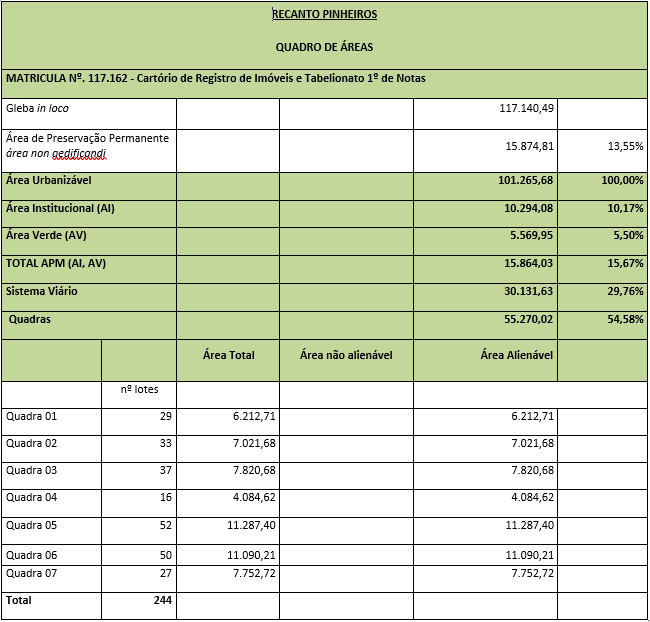
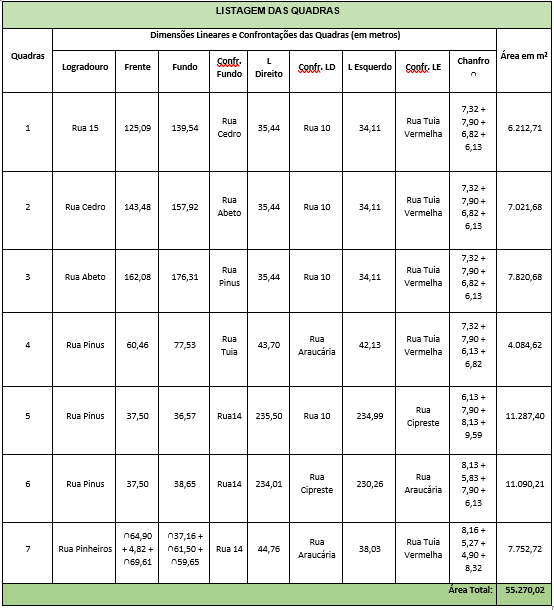
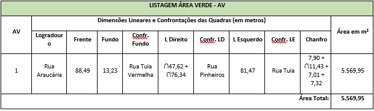
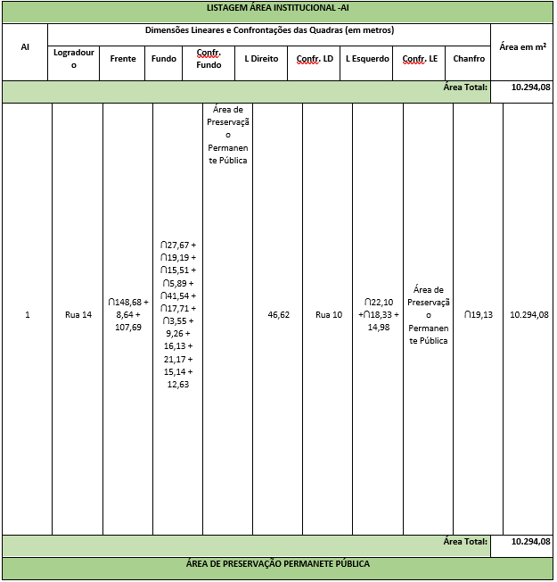
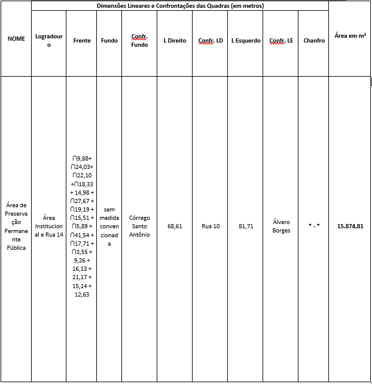

DECRETO “N” Nº 76, DE 08 DE FEVEREIRO DE 2024.

(Revogado pelo Decreto "N" Nº 1.004, de 21 de novembro de 2024).

~~Dispõe sobre aprovação do Parcelamento de Solo Loteamento Recanto Pinheiros, neste Município, e dá outras providências.~~

~~O PREFEITO MUNICIPAL DE APARECIDA DE GOIÂNIA, no uso de suas atribuições legais e,~~

~~CONSIDERANDO que o loteamento foi aprovado conforme a Lei Complementar nº 124 de 14 dezembro de 2016, que institui o Plano Diretor e Lei Complementar nº 152, de 09 de outubro de 2018 que instituiu os instrumentos de Controle de Uso e Ocupação do Solo; Lei Complementar nº 176 de 05 de agosto de 2020 que altera a Lei Complementar nº 124/2016 e 152/2018 e os critérios urbanísticos.~~

~~CONSIDERANDO os documentos acostados ao processo administrativo nº 2019.014.411, especialmente o Parecer Técnico de Avaliação do Projeto de Loteamento, emitido pela Secretaria Municipal de Planejamento e Regulação Urbana,~~

~~**DECRETA:**~~

~~Art. 1º Fica aprovado o Parcelamento de Solo Loteamento Recanto Pinheiros, neste Município, de propriedade da sociedade SPE RECANTO PINHEIROS LTDA, pessoa jurídica de direito privado, com sede e foro na Rua 22, nº 287, Setor Sul, na cidade de Goiânia/GO, devidamente inscrita no CNPJ/MF sob nº 30.747.659/0001-77, conforme abaixo:~~

~~IDENTIFICAÇÃO DA ÁREA DO IMÓVEL: O imóvel onde será implantado o loteamento está cadastrado perante o 1° Cartório de Registro de Imóveis de Aparecida de Goiânia sob a matrícula de número 117.162, com os seguintes limites e confrontações:~~

~~UMA GLEBA SEM DENOMINAÇÃO do loteamento "VILA OLIVEIRA", neste município, com a área de 117.140,49 metros quadrados, começa do marco M1 cravado á margem esquerda do córrego Santo Antônio, M1,(8.142.015,0283; E=682.228,1393) deste segue confrontando com herdeiros de Pedro Joaquim, até marco M2, Azimute 21°48’45’’NE, distância 118,99 metros mais um raio com desenvolvimento 16,01 soma é igual 135,00 metros até o marco M2, do M2(N= 8.142.140,9360, E = 682.271,5836) Deste segue confrontando Com Rua Platão, Azimute 329°45’53’’NW, distância 440,00 metros, até o marco M3, Do marco M3 (N= 8.142.525,5618; E= 682.057,9405 Deste segue confrontando Com Avenida das Nações/Rua - 15, Azimute 256°22’27’’SW, distância 152,00 até o marco M4, Do marco M4 (N= 8.142.489,7539; E= 681.910,2185 Deste segue confrontando Álvaro Borges, Azimute 349°52’50’’NW, distância 420,00 metros, até o marco M5, Do marco M5 (N= 8.142.076,2742; E= 681.984,0143 cravado na margem esquerda do córrego Santo Antônio, descendo por este contornando suas curvas até o marco ponto de partida marco M1.~~

~~O loteamento Recanto Pinheiros será de uso residencial de forma que o mesmo será de acesso aberto/convencional, seu zoneamento foi realizado conforme Lei Complementar nº 124, de 14 de dezembro de 2016, Lei Complementar nº 152, 09 de outubro de 2018 e demais Leis complementares.~~

~~II – CLASSIFICAÇÃO E DISTRIBUIÇÃO DE ÁREAS~~

~~~~

~~III.    TABELA DE COMPOSIÇÃO E DESCRIÇÃO DAS QUADRAS~~ 

~~~~

~~IV- ÁREAS INSTITUCIONAIS E ARÉAS VERDES~~

~~~~

~~~~

~~Art. 2º Como garantia de implantação para aprovação do Loteamento e de toda a infraestrutura correspondente, o loteador apresenta o Termo de Caução e Termo de Compromisso de Implantação do Loteamento (anexos), ambos assinados entre as partes, conforme demonstrativo de lotes abaixo:~~

<table><tbody><tr><td rowspan="2"><s>N° da Quadra</s></td><td rowspan="2"><s>N° do Lote</s></td><td rowspan="2"><s>Área do Lote (m²)</s></td><td rowspan="2"><s>Valor do Imóvel</s></td></tr><tr></tr><tr><td><s>1</s></td><td><s>1</s></td><td><s>289,05</s></td><td><s>R$ 93.941,25</s></td></tr><tr><td><s>1</s></td><td><s>2</s></td><td><s>307,68</s></td><td><s>R$ 99.996,00</s></td></tr><tr><td><s>1</s></td><td><s>3</s></td><td><s>316,92</s></td><td><s>R$ 102.999,00</s></td></tr><tr><td><s>1</s></td><td><s>4</s></td><td><s>198</s></td><td><s>R$ 64.350,00</s></td></tr><tr><td><s>1</s></td><td><s>5</s></td><td><s>198</s></td><td><s>R$ 64.350,00</s></td></tr><tr><td><s>1</s></td><td><s>6</s></td><td><s>198</s></td><td><s>R$ 64.350,00</s></td></tr><tr><td><s>1</s></td><td><s>7</s></td><td><s>198</s></td><td><s>R$ 64.350,00</s></td></tr><tr><td><s>1</s></td><td><s>8</s></td><td><s>198</s></td><td><s>R$ 64.350,00</s></td></tr><tr><td><s>1</s></td><td><s>9</s></td><td><s>198</s></td><td><s>R$ 64.350,00</s></td></tr><tr><td><s>1</s></td><td><s>10</s></td><td><s>198</s></td><td><s>R$ 64.350,00</s></td></tr><tr><td><s>1</s></td><td><s>11</s></td><td><s>198</s></td><td><s>R$ 64.350,00</s></td></tr><tr><td><s>1</s></td><td><s>12</s></td><td><s>198</s></td><td><s>R$ 64.350,00</s></td></tr><tr><td><s>1</s></td><td><s>13</s></td><td><s>198</s></td><td><s>R$ 64.350,00</s></td></tr><tr><td><s>1</s></td><td><s>14</s></td><td><s>198</s></td><td><s>R$ 64.350,00</s></td></tr><tr><td><s>1</s></td><td><s>15</s></td><td><s>198</s></td><td><s>R$ 64.350,00</s></td></tr><tr><td><s>1</s></td><td><s>16</s></td><td><s>290,61</s></td><td><s>R$ 94.448,25</s></td></tr><tr><td><s>1</s></td><td><s>17</s></td><td><s>256,45</s></td><td><s>R$ 83.346,25</s></td></tr><tr><td><s>1</s></td><td><s>18</s></td><td><s>198</s></td><td><s>R$ 64.350,00</s></td></tr><tr><td><s>1</s></td><td><s>19</s></td><td><s>198</s></td><td><s>R$ 64.350,00</s></td></tr><tr><td><s>1</s></td><td><s>20</s></td><td><s>198</s></td><td><s>R$ 64.350,00</s></td></tr><tr><td><s>1</s></td><td><s>21</s></td><td><s>198</s></td><td><s>R$ 64.350,00</s></td></tr><tr><td><s>1</s></td><td><s>22</s></td><td><s>198</s></td><td><s>R$ 64.350,00</s></td></tr><tr><td><s>1</s></td><td><s>23</s></td><td><s>198</s></td><td><s>R$ 64.350,00</s></td></tr><tr><td><s>1</s></td><td><s>24</s></td><td><s>198</s></td><td><s>R$ 64.350,00</s></td></tr><tr><td><s>1</s></td><td><s>25</s></td><td><s>198</s></td><td><s>R$ 64.350,00</s></td></tr><tr><td><s>1</s></td><td><s>26</s></td><td><s>198</s></td><td><s>R$ 64.350,00</s></td></tr><tr><td><s>1</s></td><td><s>27</s></td><td><s>198</s></td><td><s>R$ 64.350,00</s></td></tr><tr><td><s>1</s></td><td><s>28</s></td><td><s>198</s></td><td><s>R$ 64.350,00</s></td></tr><tr><td><s>1</s></td><td><s>29</s></td><td><s>198</s></td><td><s>R$ 64.350,00</s></td></tr><tr><td><s>4</s></td><td><s>3</s></td><td><s>201,88</s></td><td><s>R$ 65.611,00</s></td></tr><tr><td><s>4</s></td><td><s>4</s></td><td><s>332,67</s></td><td><s>R$ 108.117,75</s></td></tr><tr><td><s>4</s></td><td><s>5</s></td><td><s>234</s></td><td><s>R$ 76.050,00</s></td></tr><tr><td><s>4</s></td><td><s>6</s></td><td><s>234</s></td><td><s>R$ 76.050,00</s></td></tr><tr><td><s>4</s></td><td><s>7</s></td><td><s>234</s></td><td><s>R$ 76.050,00</s></td></tr><tr><td><s>4</s></td><td><s>8</s></td><td><s>234</s></td><td><s>R$ 76.050,00</s></td></tr><tr><td><s>4</s></td><td><s>9</s></td><td><s>234</s></td><td><s>R$ 76.050,00</s></td></tr><tr><td><s>4</s></td><td><s>10</s></td><td><s>349,39</s></td><td><s>R$ 113.551,75</s></td></tr><tr><td><s>5</s></td><td><s>23</s></td><td><s>207</s></td><td><s>R$ 67.275,00</s></td></tr><tr><td><s>5</s></td><td><s>24</s></td><td><s>305,49</s></td><td><s>R$ 99.284,25</s></td></tr><tr><td><s>5</s></td><td><s>25</s></td><td><s>356,65</s></td><td><s>R$ 115.911,25</s></td></tr><tr><td><s>5</s></td><td><s>26</s></td><td><s>245,86</s></td><td><s>R$ 79.904,50</s></td></tr><tr><td><s>5</s></td><td><s>27</s></td><td><s>257,07</s></td><td><s>R$ 83.547,75</s></td></tr><tr><td><s>5</s></td><td><s>28</s></td><td><s>207</s></td><td><s>R$ 67.275,00</s></td></tr><tr><td><s>5</s></td><td><s>29</s></td><td><s>207</s></td><td><s>R$ 67.275,00</s></td></tr><tr><td><s>5</s></td><td><s>30</s></td><td><s>207</s></td><td><s>R$ 67.275,00</s></td></tr><tr><td><s>5</s></td><td><s>31</s></td><td><s>207</s></td><td><s>R$ 67.275,00</s></td></tr><tr><td><s>5</s></td><td><s>32</s></td><td><s>207</s></td><td><s>R$ 67.275,00</s></td></tr><tr><td><s>5</s></td><td><s>33</s></td><td><s>207</s></td><td><s>R$ 67.275,00</s></td></tr><tr><td><s>5</s></td><td><s>34</s></td><td><s>207</s></td><td><s>R$ 67.275,00</s></td></tr><tr><td><s>5</s></td><td><s>35</s></td><td><s>207</s></td><td><s>R$ 67.275,00</s></td></tr><tr><td><s>5</s></td><td><s>36</s></td><td><s>207</s></td><td><s>R$ 67.275,00</s></td></tr><tr><td><s>5</s></td><td><s>37</s></td><td><s>207</s></td><td><s>R$ 67.275,00</s></td></tr><tr><td><s>5</s></td><td><s>38</s></td><td><s>207</s></td><td><s>R$ 67.275,00</s></td></tr><tr><td><s>5</s></td><td><s>39</s></td><td><s>207</s></td><td><s>R$ 67.275,00</s></td></tr><tr><td><s>5</s></td><td><s>40</s></td><td><s>207</s></td><td><s>R$ 67.275,00</s></td></tr><tr><td><s>5</s></td><td><s>41</s></td><td><s>207</s></td><td><s>R$ 67.275,00</s></td></tr><tr><td><s>5</s></td><td><s>42</s></td><td><s>207</s></td><td><s>R$ 67.275,00</s></td></tr><tr><td><s>5</s></td><td><s>43</s></td><td><s>207</s></td><td><s>R$ 67.275,00</s></td></tr><tr><td><s>5</s></td><td><s>44</s></td><td><s>207</s></td><td><s>R$ 67.275,00</s></td></tr><tr><td><s>5</s></td><td><s>45</s></td><td><s>207</s></td><td><s>R$ 67.275,00</s></td></tr><tr><td><s>6</s></td><td><s>1</s></td><td><s>425,72</s></td><td><s>R$ 138.359,00</s></td></tr><tr><td><s>6</s></td><td><s>2</s></td><td><s>207</s></td><td><s>R$ 67.275,00</s></td></tr><tr><td><s>6</s></td><td><s>3</s></td><td><s>207</s></td><td><s>R$ 67.275,00</s></td></tr><tr><td><s>6</s></td><td><s>4</s></td><td><s>207</s></td><td><s>R$ 67.275,00</s></td></tr><tr><td><s>6</s></td><td><s>5</s></td><td><s>207</s></td><td><s>R$ 67.275,00</s></td></tr><tr><td><s>6</s></td><td><s>6</s></td><td><s>207</s></td><td><s>R$ 67.275,00</s></td></tr><tr><td><s>6</s></td><td><s>7</s></td><td><s>207</s></td><td><s>R$ 67.275,00</s></td></tr><tr><td><s>6</s></td><td><s>8</s></td><td><s>207</s></td><td><s>R$ 67.275,00</s></td></tr><tr><td><s>6</s></td><td><s>9</s></td><td><s>207</s></td><td><s>R$ 67.275,00</s></td></tr><tr><td><s>6</s></td><td><s>10</s></td><td><s>207</s></td><td><s>R$ 67.275,00</s></td></tr><tr><td><s>6</s></td><td><s>11</s></td><td><s>207</s></td><td><s>R$ 67.275,00</s></td></tr><tr><td><s>6</s></td><td><s>12</s></td><td><s>207</s></td><td><s>R$ 67.275,00</s></td></tr><tr><td><s>6</s></td><td><s>13</s></td><td><s>207</s></td><td><s>R$ 67.275,00</s></td></tr><tr><td><s>6</s></td><td><s>14</s></td><td><s>207</s></td><td><s>R$ 67.275,00</s></td></tr><tr><td><s>6</s></td><td><s>15</s></td><td><s>207</s></td><td><s>R$ 67.275,00</s></td></tr><tr><td><s>6</s></td><td><s>16</s></td><td><s>207</s></td><td><s>R$ 67.275,00</s></td></tr><tr><td><s>6</s></td><td><s>17</s></td><td><s>207</s></td><td><s>R$ 67.275,00</s></td></tr><tr><td><s>6</s></td><td><s>18</s></td><td><s>207</s></td><td><s>R$ 67.275,00</s></td></tr><tr><td><s>6</s></td><td><s>19</s></td><td><s>207</s></td><td><s>R$ 67.275,00</s></td></tr><tr><td><s>6</s></td><td><s>20</s></td><td><s>207</s></td><td><s>R$ 67.275,00</s></td></tr><tr><td><s>6</s></td><td><s>21</s></td><td><s>207</s></td><td><s>R$ 67.275,00</s></td></tr><tr><td><s>6</s></td><td><s>22</s></td><td><s>207</s></td><td><s>R$ 67.275,00</s></td></tr><tr><td><s>6</s></td><td><s>23</s></td><td><s>207</s></td><td><s>R$ 67.275,00</s></td></tr><tr><td><s>6</s></td><td><s>24</s></td><td><s>348,65</s></td><td><s>R$ 113.311,25</s></td></tr><tr><td><s>6</s></td><td><s>25</s></td><td><s>364,98</s></td><td><s>R$ 118.618,50</s></td></tr><tr><td><s>6</s></td><td><s>26</s></td><td><s>280,8</s></td><td><s>R$ 91.260,00</s></td></tr><tr><td><s>6</s></td><td><s>27</s></td><td><s>207</s></td><td><s>R$ 67.275,00</s></td></tr><tr><td><s>6</s></td><td><s>28</s></td><td><s>207</s></td><td><s>R$ 67.275,00</s></td></tr><tr><td><s>6</s></td><td><s>29</s></td><td><s>207</s></td><td><s>R$ 67.275,00</s></td></tr><tr><td><s>6</s></td><td><s>30</s></td><td><s>207</s></td><td><s>R$ 67.275,00</s></td></tr><tr><td><s>6</s></td><td><s>31</s></td><td><s>207</s></td><td><s>R$ 67.275,00</s></td></tr><tr><td><s>6</s></td><td><s>32</s></td><td><s>207</s></td><td><s>R$ 67.275,00</s></td></tr><tr><td><s>6</s></td><td><s>33</s></td><td><s>207</s></td><td><s>R$ 67.275,00</s></td></tr><tr><td><s>6</s></td><td><s>34</s></td><td><s>207</s></td><td><s>R$ 67.275,00</s></td></tr><tr><td><s>6</s></td><td><s>35</s></td><td><s>207</s></td><td><s>R$ 67.275,00</s></td></tr><tr><td><s>6</s></td><td><s>36</s></td><td><s>207</s></td><td><s>R$ 67.275,00</s></td></tr><tr><td><s>6</s></td><td><s>37</s></td><td><s>207</s></td><td><s>R$ 67.275,00</s></td></tr><tr><td><s>6</s></td><td><s>38</s></td><td><s>207</s></td><td><s>R$ 67.275,00</s></td></tr><tr><td><s>6</s></td><td><s>39</s></td><td><s>207</s></td><td><s>R$ 67.275,00</s></td></tr><tr><td><s>6</s></td><td><s>40</s></td><td><s>207</s></td><td><s>R$ 67.275,00</s></td></tr><tr><td><s>6</s></td><td><s>41</s></td><td><s>207</s></td><td><s>R$ 67.275,00</s></td></tr><tr><td><s>6</s></td><td><s>42</s></td><td><s>207</s></td><td><s>R$ 67.275,00</s></td></tr><tr><td><s>6</s></td><td><s>43</s></td><td><s>207</s></td><td><s>R$ 67.275,00</s></td></tr><tr><td><s>6</s></td><td><s>44</s></td><td><s>207</s></td><td><s>R$ 67.275,00</s></td></tr><tr><td><s>6</s></td><td><s>45</s></td><td><s>207</s></td><td><s>R$ 67.275,00</s></td></tr><tr><td><s>6</s></td><td><s>46</s></td><td><s>207</s></td><td><s>R$ 67.275,00</s></td></tr><tr><td><s>6</s></td><td><s>47</s></td><td><s>207</s></td><td><s>R$ 67.275,00</s></td></tr><tr><td><s>6</s></td><td><s>48</s></td><td><s>207</s></td><td><s>R$ 67.275,00</s></td></tr><tr><td><s>6</s></td><td><s>49</s></td><td><s>207</s></td><td><s>R$ 67.275,00</s></td></tr><tr><td><s>6</s></td><td><s>50</s></td><td><s>355,06</s></td><td><s>R$ 115.394,50</s></td></tr><tr><td><s>7</s></td><td><s>1</s></td><td><s>397,32</s></td><td><s>R$ 129.129,00</s></td></tr><tr><td><s>7</s></td><td><s>2</s></td><td><s>275,88</s></td><td><s>R$ 89.661,00</s></td></tr><tr><td><s>7</s></td><td><s>3</s></td><td><s>287,33</s></td><td><s>R$ 93.382,25</s></td></tr><tr><td><s>7</s></td><td><s>4</s></td><td><s>287,23</s></td><td><s>R$ 93.349,75</s></td></tr><tr><td><s>7</s></td><td><s>5</s></td><td><s>250,82</s></td><td><s>R$ 81.516,50</s></td></tr><tr><td><s>7</s></td><td><s>6</s></td><td><s>258,11</s></td><td><s>R$ 83.885,75</s></td></tr><tr><td><s>7</s></td><td><s>7</s></td><td><s>255,45</s></td><td><s>R$ 83.021,25</s></td></tr><tr><td><s>7</s></td><td><s>8</s></td><td><s>253,53</s></td><td><s>R$ 82.397,25</s></td></tr><tr><td><s>7</s></td><td><s>9</s></td><td><s>241,29</s></td><td><s>R$ 78.419,25</s></td></tr><tr><td><s>7</s></td><td><s>10</s></td><td><s>241,68</s></td><td><s>R$ 78.546,00</s></td></tr><tr><td><s>7</s></td><td><s>11</s></td><td><s>240,69</s></td><td><s>R$ 78.224,25</s></td></tr><tr><td><s>7</s></td><td><s>12</s></td><td><s>422,41</s></td><td><s>R$ 132.127,57</s></td></tr><tr><td><s>7</s></td><td><s>13</s></td><td><s>260,73</s></td><td><s>R$ 84.737,25</s></td></tr><tr><td><s>7</s></td><td><s>14</s></td><td><s>455,42</s></td><td><s>R$ 148.011,50</s></td></tr><tr><td><s>7</s></td><td><s>15</s></td><td><s>253,56</s></td><td><s>R$ 82.407,00</s></td></tr><tr><td><s>7</s></td><td><s>16</s></td><td><s>285,92</s></td><td><s>R$ 92.924,00</s></td></tr><tr><td><s>7</s></td><td><s>17</s></td><td><s>286,2</s></td><td><s>R$ 93.015,00</s></td></tr><tr><td><s>7</s></td><td><s>18</s></td><td><s>286,09</s></td><td><s>R$ 92.979,25</s></td></tr><tr><td><s>7</s></td><td><s>19</s></td><td><s>302,38</s></td><td><s>R$ 98.273,50</s></td></tr><tr><td><s>7</s></td><td><s>20</s></td><td><s>308,07</s></td><td><s>R$ 100.122,75</s></td></tr><tr><td><s>7</s></td><td><s>21</s></td><td><s>316,45</s></td><td><s>R$ 102.846,25</s></td></tr><tr><td><s>7</s></td><td><s>22</s></td><td><s>262,46</s></td><td><s>R$ 85.299,50</s></td></tr><tr><td><s>7</s></td><td><s>23</s></td><td><s>252,36</s></td><td><s>R$ 82.017,00</s></td></tr><tr><td><s>7</s></td><td><s>24</s></td><td><s>253,97</s></td><td><s>R$ 82.540,25</s></td></tr><tr><td><s>7</s></td><td><s>25</s></td><td><s>253,16</s></td><td><s>R$ 82.277,00</s></td></tr><tr><td><s>7</s></td><td><s>26</s></td><td><s>299,89</s></td><td><s>R$ 97.464,25</s></td></tr><tr><td><s>7</s></td><td><s>27</s></td><td><s>264,32</s></td><td><s>R$ 85.904,00</s></td></tr><tr><td>&nbsp;</td><td>&nbsp;</td><td><s>TOTAL</s></td><td><s>R$ 10.462.330,57</s></td></tr></tbody></table>

~~Art. 3º O loteador registrará na matrícula de todos imóveis discriminados no Termo de Caução a informação de caucionamento, no ato do registro do loteamento.~~ 

~~Art. 4º As despesas das transferências dos imóveis para o Município de Aparecida de Goiânia serão suportadas pelo loteador, não gerando quaisquer custos ao ente público, sejam eles de ordem tributária, registral, cartorial, dentre outros.~~ 

~~Art. 5º O descumprimento de quaisquer obrigações ou condições previstas no Termo de Compromisso e neste Decreto para a conclusão das transferências das Áreas Institucionais ao ente público implicará em incidência de multa de 10% (dez por cento) sob o valor total dos imóveis a serem transferidos, além da rescisão dos termos acordados e revogação imediata deste Decreto, sem a necessidade de qualquer notificação prévia.~~ 

~~Art. 6º O Alvará de implantação será expedido após a conclusão das transferências das Áreas Institucionais ao ente público.~~ 

~~Art. 7º A parcelamento de solo Loteamento Recanto Pinheiros, objeto deste Decreto está em conformidade com os documentos acostados ao processo administrativo nº 2019.014.411, cuja planta de situação (mapa) é parte integrante deste decreto.~~ 

~~Art. 8º Este Decreto entrará em vigor na data de sua publicação.~~

~~MUNICÍPIO DE APARECIDA DE GOIÂNIA-GO, aos 08 de fevereiro de 2024.~~

~~VILMAR MARIANO DA SILVA

Prefeito~~

~~POLLYANA OLIVEIRA BORGES

Secretária de Governo~~

~~JÚLIO CÉSAR CHAGAS MENDES

Secretário de Planejamento e Regulação Urbana~~
