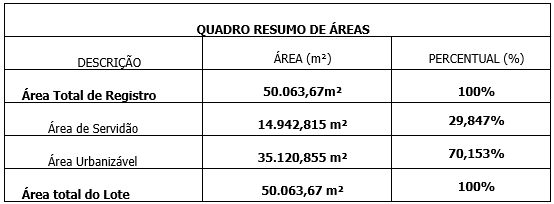
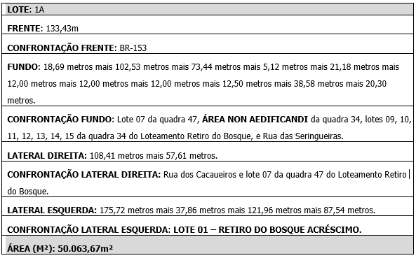

DECRETO “N” Nº 471 DE 18 DE JUNHO DE 2024.

(Revogado pelo Decreto "N" Nº 718, de 2 de setembro de 2024).

~~Dispõe sobre a aprovação da Regularização Fundiária Urbana Específica – REURB-E de imóvel situado no Loteamento denominado Retiro do Bosque - Acréscimo, neste município.~~

~~O PREFEITO DO MUNICÍPIO DE APARECIDA DE GOIÂNIA/GO, usando das atribuições que lhe são conferidas e de acordo com o disposto na Lei Orgânica do Município, Constituição do Estado de Goiás e na Constituição Federal,~~

~~CONSIDERANDO a Lei Federal n° 13.465 de 11 de julho de 2017 e o Decreto Federal n° 9.310, de 15 de março de 2018, que instituiu no território nacional normas gerais e procedimentos aplicáveis à Regularização Fundiária Urbana, a qual abrange medidas jurídicas, urbanísticas, ambientais e sociais destinadas à incorporação dos núcleos urbanos informais ao ordenamento territorial urbano e à titulação de seus ocupantes;~~

~~CONSIDERANDO o parecer técnico, sem número, emitido pela Secretaria Municipal de Planejamento e Regulação Urbana, acostado às fls. 245/248, do procedimento administrativo nº 2019.107.263, que atesta não haver pendências urbanísticas nos documentos técnicos que compõem o presente projeto de Regularização Fundiária de Interesse Específico e o Parecer da Procuradoria Geral do Município nº 1222/2024, que manifestou pela legalidade no prosseguimento da Reurb-E, após a notificação dos confrontantes; juntadas de ART ou RRT dos responsáveis pela planta e memoriais descritivos e, ainda, do Termo de Compromisso com cronograma físico de serviços para implantação da infraestrutura;~~

~~CONSIDERANDO, por fim, que foram juntados às fls. 295/314, toda a documentação solicitada pela douta Procuradoria, cumprindo, assim, com a recomendação;~~

~~**DECRETA:**~~

~~Art. 1º Fica classificado como REGULARIZAÇÃO FUNDIÁRIA URBANA DE INTERESSE ESPECÍFICO – REURB-E, conforme disposto no inciso II, do art. 13, art. 30, art. 31 e art. 32, todos da Lei Federal nº 13.465/2017, o núcleo urbano informal consolidado  situado no Lote 1A, RETIRO DO BOSQUE – ACRÉSCIMO, Aparecida de Goiânia, com área de 50.063,67 metros quadrados, registrada sob a matrícula 194.662, do Cartório de Registro de Imóveis e Tabelionato 1º de Notas de Aparecida de Goiânia, de propriedade de SUÉCIA VEÍCULOS S/A., pessoa jurídica de direito privado, inscrita no CNPJ/MF nº 02.714.977/0001-04, com sede na Rodovia BR 153, quadra Área Lote 1ª, Retiro do Bosque- Acréscimo, em Aparecida de Goiânia/GO, consoante projeto de regularização fundiária aprovado, conforme art. 28, II da Lei nº 13.465/2018, c/c art. 21, II, do Decreto nº 9.310/2018, conforme abaixo:~~

~~I .    IDENTIFICAÇÃO DA ÁREA DO IMÓVEL:~~ 

~~A presente regularização fundiária de interesse específico refere-se ao Lote 1A, do “RETIRO DO BOSQUE - ACRÉSCIMO”, Aparecida de Goiânia, Goiás, matrícula 194.662, com área total de 50.063,67 m².~~

 ~~Onde teremos:~~

~~1.    Loteamento RETIRO DO BOSQUE - ACRÉSCIMO com 50.063,67 m², composto por:  01 (uma) quadra, e 01 (um) lote, com finalidade Comercial.~~

~~II .     LIMITES E CONFRONTAÇÕES – CONFORME MATRÍCULA~~

~~1.    RETIRO DO BOSQUE ACRÉSCIMO – 50.000,00m²~~

~~LOTE 1A do “RETIRO DO BOSQUE – ACRÉSCIMO” neste município, com área de 50.000,00 metros quadrados; sendo 133,71 metros de frente para a BR-153; pelos fundos 20,23 metros com a Rua das Seringueiras; pela direita 166,35 metros mais 321,98 metros com o lote 02; pela esquerda 423,66 metros com o lote 01.~~

~~III .    LIMITES E CONFRONTAÇÕES - RETIFICAÇÃO~~

~~2.    RETIRO DO BOSQUE ACRÉSCIMO – 50.063,67 m²~~

~~Imóvel LOTE 1A da Quadra ÁREA do Loteamento RETIRO DO BOSQUE – ACRÉSCIMO, situado em APARECIDA DE GOIANIA - GO, com a área reconstituída de 5,0006 ha, identificado pelas coordenadas utm, azimutes (expressos em graus e minutos), distâncias (expressas em metros) e confrontações, à saber: 

“Inicia-se a descrição deste perímetro no vértice M-Nº03, de coordenadas N 8.138.575,435 m e E 687.283,327m, deste segue confrontando com Rua Cacaueiros, com os seguintes azimutes e distancia 96°40'03'' e de 108,41 m até o vértice J.&.F-M-001, de coordenadas N 8.138.562,848 m e   E 687.391,007 m; deste, segue confrontando com Lote 07 da quadra 47, matrícula nº 229.683 com os seguintes azimutes e distâncias: 96°40'03'' e 57,61 m até o vértice M-Nº04, de coordenadas  N 8.138.556,159 m e E 687.448,228 m; deste, segue confrontando com ÁREA NON AEDIFICANDI, Matrícula nº R.1 164.394 com os seguintes azimutes e distâncias: 141°45'10'' e 18,69 m até o vértice M-Nº04A, de coordenadas N 8.138.541,483 m e E 687459,796 m, 141°45'10'' e 102,53 m até o vértice J.&.F-M-002, de coordenadas N 8.138.460,963 m e E 687.523,266 m; 141°28’10’’ e 73,44 m até o vértice M-Nº04B, de coordenadas N 8.138.403,516 m e E 687.569,011 m;  141°28’10’’ e 13,69 m até o vértice J.&.F-M-003, de coordenadas N 8.138.392,808 m e E 687.577,538 m; deste, segue confrontando com Lote 09 da quadra 34, matrícula nº 216.534 com os seguintes azimutes e distâncias: 141°28’10’’ e 5,12 m até o vértice J.&.F-M-004, de coordenadas N 8.138.388,803 m e       E 687.580,727 m; deste, segue confrontando com Lote 10 da quadra 34, matrícula nº 242.853 com os seguintes azimutes e distâncias: 141°28’10’’  e 21,18 m até o vértice J.&.F-M-005, de coordenadas N 8.138.372,224 m e E 687.593,929 m; deste, segue confrontando com Lote 11 da quadra 34, matrícula nº 204972 com os seguintes azimutes e distâncias: 141°28’10’’  e 12,00 m até o vértice J.&.F-M-006, de coordenadas N 8.138.362,831 m e E 687.601,409 m; deste, segue confrontando com Lote 12 da quadra 34, matrícula nº 248.104 com os seguintes azimutes e distâncias: 141°28’10’’  e 12,00 m até o vértice J.&.F-M-007, de coordenadas N 8.138.353,438 m e E 687.608,889 m; deste, segue confrontando com Lote 13 da quadra 34, matrícula nº 238.000 com os seguintes azimutes e distâncias: 141°28’10’’  e 12,00 m até o vértice J.&.F-M-008, de coordenadas N 8.138.344,045 m e E 687.616,369 m; deste, segue confrontando com Lote 14 da quadra 34, matrícula nº R.1 164.394 com os seguintes azimutes e distâncias: 141°28’10’’  e 12,50 m até o vértice J.&.F-M-009, de coordenadas N 8.138.334,266 m e E 687.624,155 m; deste, segue confrontando com Lote 15 da quadra 34, matrícula nº R.1 164.394  com os seguintes azimutes e distâncias: 141°28’10’’  e 38,58 m até o vértice M-Nº05, de coordenadas N 8.138.304,080 m e           E 687.648,193 m; deste, segue confrontando com Rua das Seringueiras com os seguintes azimutes e distâncias: 179°49'29’’  e 20,30 m até o vértice M-Nº05A, de coordenadas N 8.138.283,821 m e      E 687.648,255 m; deste, segue confrontando com LOTE 01 – RETIRO DO BOSQUE ACRÉSCIMO, Matrícula nº 194.661 com os seguintes azimutes e distâncias: 292°29'15" e 87,54 m até o vértice M-Nº04C, de coordenadas N 8.138.317,305 m e E 687.567,368 m; deste, segue confrontando com LOTE 01 – RETIRO DO BOSQUE ACRÉSCIMO, Matrícula nº R.1 164.394 com os seguintes azimutes e distâncias: 292°29'15" e 121,96 até o vértice M-Nº04D, de coordenadas N 8.138.363,951 m e E 687.454,685 m , deste, segue confrontando com LOTE 01 – RETIRO DO BOSQUE ACRÉSCIMO, Matrícula nº 194.661 com os seguintes azimutes e distâncias:  292°29'15" e 37,86 m até o vértice J.&.F-M-010, de coordenadas   N 8.138.378,432 m e E 687.419,704 m; 292°08'03" e 175,72 m até o vértice M-Nº02A, de coordenadas N 8.138.444,638 m e E 687.256,936 m; deste, segue confrontando com BR-153 com os seguintes azimutes e distâncias: 11°24'27'' e 133,43 m até o vértice M-Nº03, de coordenadas N 8.138.575,435 m e E 687.283,327 m, ponto inicial da descrição deste perímetro. Todas as coordenadas aqui descritas estão georreferenciadas ao Sistema Geodésico Brasileiro, e encontram-se representadas no sistema UTM, referenciadas ao Meridiano Central 51 WGr, sendo o datum SIRGAS 2000. Todos os azimutes e distâncias, área e perímetro foram calculadas no plano de projeção UTM.”~~

~~IV .    SERVIDÃO – ÁREA NON AEDIFICANDI~~

~~“Inicia-se a descrição do perímetro, de uma Área de Servidão Pública de 14.942,815 m²  e perímetro 561,752 m  denominada “ÁREA NON AEDIFICANDI” no vértice M-Nº04A, de coordenadas N 8.138.541,483 m e E 687.459,796 m , com os seguintes azimutes e distâncias 141°45’10’’ e 102,53m até o vértice J.&.F-M-002, de coordenadas N 8.138.460,963 m e E 687.523,266 m; 141°28’10’’ e 73,44 m até o vértice M-Nº04B, de coordenadas N 8.138.403,516 m e E 687.569,011 m; 181°05'32" e 86,23 m até o vértice M-Nº04C, de coordenadas N 8.138.317,305 m e E 687.567,368 m; 292°29'15" e 121,96m até o vértice M-Nº04D, de coordenadas N 8.138.363,951 m e E 687.454,685 m; 01°38'56" e 177,61m até o vértice M-Nº04A  ponto inicial da descrição deste perímetro. Todas as coordenadas aqui descritas estão georreferenciadas ao Sistema Geodésico Brasileiro, e encontram-se representadas no sistema UTM, referenciadas ao Meridiano Central 51 WGr, sendo o datum SIRGAS 2000. Todos os azimutes e distâncias, área e perímetro foram calculadas no plano de projeção UTM.”~~

~~Todas as coordenadas aqui descritas foram obtidas a partir do serviço disponibilizado pelo IBGE - Posicionamento por Ponto Preciso, e encontram-se representadas no Sistema UTM, referenciadas ao Meridiano Central 51° WGr, tendo como S.G.R. (Sistema Geodésico de Referência) o SIRGAS2000. Todos os azimutes e distâncias, área e perímetro foram calculados no plano de projeção UTM.~~

~~V .    INFRAESTRUTURA EXISTENTE:~~

~~1.    Abastecimento de água através de Poço artesiano.~~ 

~~2.    Meio fio e sarjetas em concreto.~~

~~3.    Pavimentação asfáltica.~~

~~4.    Sinalização de trânsito vertical e horizontal.~~

~~5.    Rede elétrica pública com postes e luminárias.~~

~~6.    Sistema de coleta de esgoto através de fossa séptica, filtro anaeróbio e sumidouro.~~

~~7.    Sistema de captação de águas pluviais, do tipo boca de lobo simples com tampa removível.~~

~~VI .    PLANO DE COMPOSIÇÃO DA QUADRA~~

~~QUADRA ÁREA – com área de 50.063,67 m² composta de um único lote denominado de 1A com área de 50.063,67 m² Sendo: 133,43 metros de frente para a BR-153; 108,41 metros mais 57,61 metros  para Rua dos Cacaueiros e lote 07 da quadra 47 do Loteamento Retiro do Bosque; 18,69 metros mais 102,53 metros mais 73,44 metros mais 13,69 metros mais 5,12 metros mais 21,18 metros mais 12,00 metros mais 12,00 metros mais 12,00 metros mais 12,50 metros mais 38,58 metros mais 20,30 metros com o Lote 07 da quadra 47, ÁREA NON AEDIFICANDI, lotes 09, 10, 11, 12, 13, 14, 15 da quadra 34 do Loteamento Retiro do Bosque, e Rua das Seringueiras; 87,54 metros mais 121,96 metros mais 37,86 metros mais175,72 metros com o LOTE 01 – RETIRO DO BOSQUE ACRÉSCIMO.

A quadra ÁREA possui FAIXA NÃO EDIFICÁVEL NORTE BR-153.~~

~~VII .    QUADRO RESUMO DE ÁREAS~~

~~~~

~~VIII .    LISTAGEM DO LOTE~~

~~~~

~~Art. 2º Fica o Cartório de Registro de Imóveis competente dispensado de realizar as notificações legais uma vez que no procedimento administrativo de aprovação dessa REURB-E foram cumpridas essas obrigações, nos termos do § 9º, do art. 42 do Decreto Federal nº 9.310, de 15 de março de 2018 e o § 6º do art. 44, Lei Federal n° 13.465 de 11 de julho de 2017.~~

~~Art. 3º Com o registro da CRF, serão incorporadas automaticamente ao patrimônio público as vias públicas, as áreas destinadas ao uso comum do povo, os prédios públicos, os equipamentos urbanos, as áreas institucionais e áreas verdes, na forma indicada no projeto de regularização fundiária aprovado, nos termos do art. 53 da Lei Federal n° 13.465 de 11 de julho de 2017.~~

~~Art. 4º As intervenções a serem executadas ficarão a cargo da SUÉCIA VEÍCULOS S/A, proprietária da gleba.~~ 

~~Art. 5º A Regularização Fundiária de Interesse Específico do núcleo urbano informal consolidado denominado Lote 1A, do RETIRO DO BOSQUE – ACRÉSCIMO, está em conformidade com os documentos acostados ao processo administrativo nº 2019.107.263, analisado e aprovado pela Secretaria Municipal de Planejamento e Regulação Urbana.~~

~~Art. 6º Este decreto entrará em vigor na data de sua publicação, revogadas as disposições em contrário.~~

~~MUNICÍPIO DE APARECIDA DE GOIÂNIA/GO, aos 18 de junho de 2024.~~

~~VILMAR MARIANO DA SILVA

Prefeito Municipal~~

~~POLLYANA OLIVERIA BORGES

Secretária de Governo~~

~~JÚLIO CÉSAR CHAGAS MENDES

Secretário Municipal de Planejamento e Regulação Urbana~~
