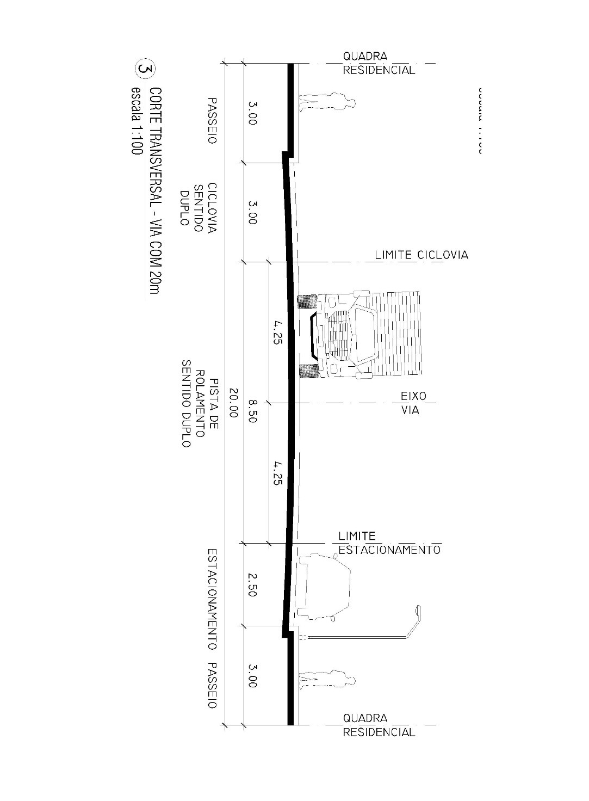
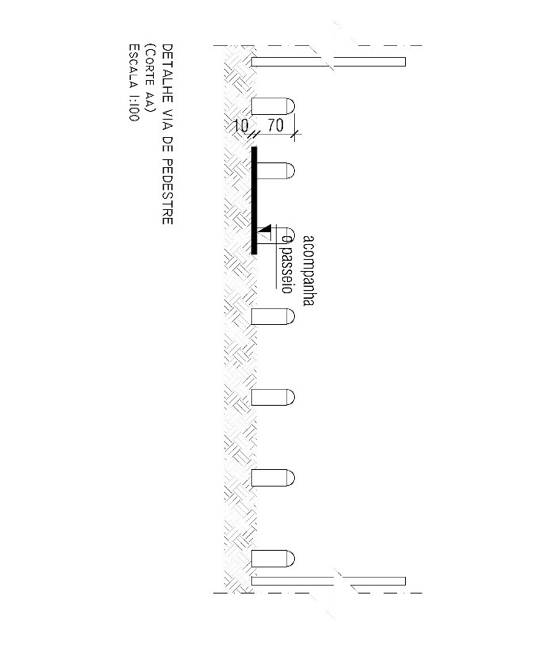

DECRETO Nº 386, DE 14 DE MAIO DE 2026

Dispõe sobre a aprovação do Loteamento Parque Veiga Jardim, no âmbito do Município de Aparecida de Goiânia.

O PREFEITO DE APARECIDA DE GOIÂNIA, no uso das atribuições que lhe confere o art. 71, incisos III e VII, da Lei Orgânica do Município de Aparecida de Goiânia; art. 300, da Lei Complementar nº 124, de 14 de dezembro de 2016; tendo em vista o disposto na Lei federal nº 6.766, de 19 de dezembro de 1979; na Lei federal nº 10.257, de 10 de julho de 2001; e o contido no Processo Administrativo nº 2019.071.746,

**DECRETA:**

Art. 1º Fica aprovado o Loteamento Parque Veiga Jardim, com área documental de 60.057,94m² (sessenta mil, cinquenta e sete metros quadrados e noventa e quatro decímetros quadrados), objeto das matrículas nº 89.627 e nº 89.629, do Cartório de Registro de Imóveis e Tabelionato 1º de Notas de Aparecida de Goiânia, de propriedade da empresa Veiga Jardim Incorporação SPE Ltda.

Parágrafo único. O loteamento aprovado neste artigo será implantado na modalidade de Plano de Urbanização Específica – PUE, nos termos da legislação urbanística municipal vigente e das normas federais aplicáveis à matéria.

Art. 2º A descrição do projeto de parcelamento do solo urbano e o quadro geral de distribuição de áreas, com a indicação dos equipamentos públicos que passarão ao domínio do município, constam no Anexo deste Decreto.

Art. 3º O loteamento está inserido em Zona Parque, Zona de Proteção Ambiental I e Zona de Proteção Ambiental II, de acordo com o Plano Diretor de Aparecida de Goiânia – Lei Complementar nº 124, de 14 de dezembro de 2016, e enquadrado em Área Especial de Interesse Social – AEIS, aprovado pelo Conselho Municipal de Desenvolvimento Sustentável, conforme previsto na Lei nº 2.707, de 18 de dezembro de 2007 e nos termos do Anexo deste Decreto.

Art. 4º Fica reconhecido, nos termos da legislação urbanística municipal, o potencial construtivo passível de utilização mediante Transferência do Direito de Construir, conforme memória de cálculo constante do Anexo deste Decreto.

Art. 5º O empreendedor deverá implantar no prazo de 02 (dois) anos, a contar da data de emissão do Alvará de Implantação, as seguintes obras:

I - pavimentação asfáltica em concreto betuminoso usinado, guias e sarjetas;

II - implantação do sistema de drenagem pluvial;

III - implantação de rede coletora de esgoto sanitário;

IV - implantação de rede de distribuição de água potável;

V - implantação de rede de iluminação pública e distribuição de energia elétrica;

VI - sinalização viária;

VII - medidas mitigadoras apresentadas e aprovadas no Estudo de Impacto de Trânsito (EIT).

Art. 6º Como garantia à adequada execução das obras e serviços de que trata o art. 5º, o empreendedor oferece garantia caucionária, no valor de R$ 2.584.984,65 (dois milhões, quinhentos e oitenta e quatro mil, novecentos e oitenta e quatro reais e sessenta e cinco centavos), nos termos da Apólice Seguro Garantia nº 03.0775-0385601, emitida pela Seguradora Junto Seguro S.A.

Parágrafo único. O empreendedor deverá assegurar a manutenção do seguro garantia enquanto houver risco a ser coberto.

Art. 7º O loteador se compromete a complementar o valor assegurado, seja em lotes ou fiança bancária, ou outra modalidade, caso o valor do orçamento apresentado sofra alteração durante a análise final de aprovação dos projetos complementares pelos respectivos órgãos competentes.

Art. 8º Findo o prazo previsto no art. 5º, sem a conclusão das obras e serviços exigidos, poderá o Município executar as garantias apresentadas, sem prejuízo da responsabilização administrativa, civil e urbanística do empreendedor.

Art. 9º Realizadas todas as obras e serviços exigidos, a administração pública municipal, a requerimento do loteador, após vistoria de seu órgão próprio, dará plena quitação da obrigação assumida.

Art. 10. A implantação do loteamento e execução das obras de infraestrutura são de total responsabilidade do empreendedor e do responsável técnico, na forma da legislação aplicável.

Art. 11. O empreendedor deverá submeter o Decreto de aprovação do loteamento ao registro imobiliário no prazo de 180 (cento e oitenta) dias, sob pena de caducidade, conforme dispõe o art. 18 da Lei federal nº 6.766, de 19 de dezembro de 1979.

Art. 12. Este Decreto entra em vigor na data de sua publicação.

Aparecida de Goiânia, 14 de maio de 2026.

 

LEANDRO VILELA

Prefeito de Aparecida de Goiânia

ANEXO

AO DECRETO Nº 386/2026

1\. CARACTERIZAÇÃO DO LOTEAMENTO

Trata-se de loteamento originado do remembramento da Chácara 01 – Quadra 123 (matrícula nº 89.627) e da Área 01 (matrícula nº 89.629), ambas pertencentes ao loteamento Parque Veiga Jardim. Com a nova aprovação, a área passará a ser composta por 01 quadra residencial, contendo dois lotes, duas áreas destinadas ao sistema viário, 01 área verde e 02 áreas institucionais, destinada à formação de um Plano de Urbanização Específica para a construção de dois condomínios de habitação coletiva de interesse social nas quadras residenciais.

O loteamento foi classificado como Área Especial de Interesse Social – AEIS, aprovado pelo Conselho Municipal de Desenvolvimento Sustentável – COMDAS, conforme as premissas previstas na Lei Municipal nº 2.707, de 18 de dezembro de 2007, que institui as Áreas Especiais de Interesse Social no Município.

O projeto tem como princípio urbanístico básico o atendimento integral conforme a Lei federal nº 6.766, de 19 de dezembro de 1979, a Lei nº 124, de 14 de dezembro de 2016, a Lei Complementar nº 152, de 9 de outubro de 2018, a Lei Complementar nº 176, de 5 de agosto de 2020 e demais legislações correlatas.

2\. IDENTIFICAÇÃO DOS IMÓVEIS

Propriedade: Parque Veiga Jardim

Matriculas: nº 89.627 e nº 89.629

Município: Aparecida de Goiânia - GO

Proprietário: VEIGA JARDIM INCORPORAÇÃO SPE LTDA

CNPJ: 52.781.783/0001-91

Área total: 60.057,94m²

3\. DESCRIÇÃO DA GLEBA

a)    Situação atual:

Chácara 01 da Quadra 123 (matrícula nº 89.627)

Área: 10.407,59m²

Frente: 59,00 metros para a Alameda Joaquim Gustavo da Veiga Jardim

Fundo: sem medida convencionada com o Córrego Poções

Lateral Direita: 155,50 metros com a Área 01 (matrícula nº 89.629)

Lateral Esquerda: 162,46 metros com a APM da Quadra 123 (matrícula nº 222.179) e Chácara 02 (Matrícula nº 89.628)

Área 01 (matrícula nº 89.629)

Área: 49.650,35m²

Frente: 280,56 metros para a Alameda Joaquim Gustavo da Veiga Jardim

Fundo: sem medida convencionada com os Córregos Santo Antônio e Poções

Lateral Direita: 110,00 metros com o Lote Mansão 05 da Quadra 124 (matrícula nº 89.626)

Lateral Esquerda: 155,50 metros com a Chácara 01 da Quadra 123 (matrícula nº 89.627)

b)    Situação intermediária – remembramento:

Chácara 01 da Quadra 123 (matrícula nº 89.627) / Área 01 (matrícula nº 89.629)

Área: 60.057,94m²

Frente: 339,56 metros para a Alameda Joaquim Gustavo da Veiga Jardim

Fundo: sem medida convencionada com os Córregos Santo Antônio e Poções

Lateral Direita: 110,00 metros com o Lote Mansão 05 da Quadra 124 (matrícula nº 89.626)

Lateral Esquerda: 162,46 metros com a Chácara 02 (matrícula nº 89.628) e APM da Quadra 123 (matrícula nº 222.179)

4\. QUADRO GERAL DE ÁREAS

 

<table><tbody><tr><td colspan="5">**PLANO DE URBANIZAÇÃO ESPECÍFICAREMANEJAMENTO - PARQUE VEIGA JARDIM**</td></tr><tr><td colspan="5">**QUADRO DE ÁREAS**</td></tr><tr><td colspan="3">&nbsp;</td><td>**Área (m²)**</td><td>**Percentual (%)**</td></tr><tr><td colspan="3">Chácara 01 Quadra 123 (matrícula nº 89.627)</td><td>10.407,59</td><td>&nbsp;</td></tr><tr><td colspan="3">Área 01 (matrícula nº 89.629)</td><td>49.650,35</td><td>&nbsp;</td></tr><tr><td colspan="3">**Área Total**</td><td>**60.057,94**</td><td>**100%**</td></tr><tr><td colspan="3">**Área de Preservação Permanente Pública**</td><td>**22.394,63**</td><td>37,29%</td></tr><tr><td colspan="5">**&nbsp;**</td></tr><tr><td colspan="3">**Área Urbanizável**</td><td>**37.663,31**</td><td>**100%**</td></tr><tr><td colspan="3">**Área Institucional (AI)**</td><td>**3.884,59**</td><td>**10,31%**</td></tr><tr><td colspan="2">Área Institucional 01</td><td>&nbsp;</td><td>2.276,29</td><td>6,04%</td></tr><tr><td colspan="2">Área Institucional 02</td><td>&nbsp;</td><td>1.608,30</td><td>4,27%</td></tr><tr><td>&nbsp;</td><td>&nbsp;</td><td>&nbsp;</td><td>&nbsp;</td><td>&nbsp;</td></tr><tr><td colspan="3">**Área Verde**</td><td>**2.441,39**</td><td>**6,48%**</td></tr><tr><td colspan="2">Área Verde 01</td><td>&nbsp;</td><td>2.441,39</td><td>6,48%</td></tr><tr><td colspan="5">&nbsp;</td></tr><tr><td colspan="3">**Áreas destinadas ao Sistema Viário**</td><td>**10.167,86**</td><td>**27,00%**</td></tr><tr><td colspan="5">&nbsp;</td></tr><tr><td colspan="3">**Lotes**</td><td>**21.169,47**</td><td>**56,21%**</td></tr><tr><td colspan="2">Quadra 123A - lote 01</td><td>&nbsp;</td><td>9.737,23</td><td>&nbsp;</td></tr><tr><td colspan="2">Quadra 123A - lote 02</td><td>&nbsp;</td><td>11.432,24</td><td>&nbsp;</td></tr><tr><td colspan="2">&nbsp;</td><td>&nbsp;</td><td>&nbsp;</td><td>&nbsp;</td></tr><tr><td colspan="4">**Total de lotes**</td><td>2</td></tr></tbody></table>

5\. PLANO DE QUADRAS

O loteamento forma uma única quadra (123-A), circundada pela Alameda Joaquim Gustavo da Veiga Jardim e Alameda Álvaro da Veiga Jardim, entrecortada por uma via de pedestres de largura 6,00m

<table><tbody><tr><td colspan="11">**LISTAGEM DAS QUADRAS**</td></tr><tr><td rowspan="3">Quadra</td><td colspan="9">**Dimensões Lineares e Confrontações dos Lotes (em metros)**</td><td rowspan="3">**&nbsp;Área em m²**</td></tr><tr><td rowspan="2">**Logradouro**</td><td rowspan="2">**Frente**</td><td rowspan="2">**Fundo**</td><td rowspan="2">**Confr. Fundo**</td><td rowspan="2">**L Direito**</td><td rowspan="2">**Confr. LD**</td><td rowspan="2">**L Esquerdo**</td><td rowspan="2">**Confr. LE**</td><td rowspan="2">**Chanfro**</td></tr><tr></tr><tr><td>123A</td><td>Alameda Joaquim Gustavo da Veiga Jardim</td><td>289,36</td><td>63,82+15,33 (em curva- R 25,00) + 91,61m + 25,88m (em curva - R20,00)</td><td>Alameda Álvaro da Veiga Jardim</td><td>5,50+ 4,45 (em curva- R5,30) +158,67</td><td>Alameda Álvaro da Veiga Jardim</td><td>47,96</td><td>Alameda Álvaro da Veiga Jardim</td><td>7,50(em curva - R5,00), 7,54 e 6,56</td><td>21.169,47</td></tr><tr><td colspan="11">Obs: via de pedestre: 714,03m² ÁREA TOTAL COM A VIA DE PEDESTRE: 21.883,50m²</td></tr></tbody></table>

6\. LISTAGEM DE LOTES:

<table><tbody><tr><td colspan="11">**LISTAGEM DOS LOTES - QUADRA - 123A**</td></tr><tr><td rowspan="3">**Lote**</td><td colspan="9">**Dimensões Lineares e Confrontações dos Lotes (em metros)**</td><td rowspan="3">**&nbsp;Área em m²**</td></tr><tr><td rowspan="2">**Logradouro**</td><td rowspan="2">**Frente**</td><td rowspan="2">**Fundo**</td><td rowspan="2">**Confr. Fundo**</td><td rowspan="2">**L Direito**</td><td rowspan="2">**Confr. LD**</td><td rowspan="2">**L Esquerdo**</td><td rowspan="2">**Confr. LE**</td><td rowspan="2">**Chanfro**</td></tr><tr></tr><tr><td>1</td><td>Alameda Joaquim Gustavo da Veiga Jardim</td><td>150,91</td><td>63,82+15,33 (em curva - R 25,00)+44,62</td><td>Alameda Álvaro da Veiga Jardim</td><td>21,21 + 4,45 (em curva-&nbsp; R 5,0) +50,44 + 9,82(em curva - R 11,03) + 14,99</td><td>via de pedestre</td><td>47,96</td><td>Alameda Álvaro da Veiga Jardim</td><td>7,54 ;6,56; 7,07 e 4,61</td><td>9.737,23</td></tr><tr><td>2</td><td>Alameda Joaquim Gustavo da Veiga Jardim</td><td>122,45</td><td>34,65</td><td>Alameda Álvaro da Veiga Jardim</td><td>158,67 + 4,45 (em curva -R 5,3) +5,50</td><td>Alameda Álvaro da Veiga Jardim</td><td>21,33+9,79 (em curva- R 11,00) + 50,45 + 4,45(em curva - R 5,05) + 24,24</td><td>via de pedestre</td><td>7,07 ; 7,50 (em curva-R 5,00) e&nbsp; 25,88 (em curva - R 20,00)</td><td>11.432,24</td></tr><tr><td colspan="10">**Área dos lotes**</td><td>**21.169,47**</td></tr><tr><td colspan="10">**Área total**</td><td>**21.169,47**</td></tr></tbody></table>

7\. ÁREAS PÚBLICAS

São 02 áreas institucionais e 01 área verde integradas à área de preservação permanente pública

ÁREAS INSTITUCIONAIS:

a)    Área institucional 01 – com área total de 2.276,29m²: frente de 91,83 metros, mais 3,07 metros em curva - R5,00, mais 52,77 metros, para a Alameda Álvaro da Veiga Jardim; fundo de 12,40 metros mais 39,17 metros mais 5,80 metros mais 3,20 metros mais 10,38 metros mais 32,81 metros mais 26,05 metros mais 20,89 metros com Área de Preservação Permanente Pública. Pelo lado esquerdo de 14,94 metros com a Chácara 02 (matrícula nº 89.628).

b)    Área institucional 02 – com área total de 1.608,30m²: frente de 38,83 metros em linha reta mais 47,72 metros em curva R4,00, com a Alameda Álvaro da Veiga Jardim; fundo de 24,40 metros mais 5,46 metros, mais 6,52 metros, mais 17,65 metros, mais 14,30 metros, mais 9,79 metros, mais 2,98 metros, mais 12,48 metros, mais 6,08 metros, mais 2,75 metros, mais 11,74 metros, mais 9,72 metros mais 9,25 metros com Área de Preservação Permanente Pública 01. Pela direita, com 7,66 metros, confrontando com a Área Verde 01.

ÁREA DE PRESERVAÇÃO PERMANENTE PÚBLICA – com área total de 22.394,63m²: frente de 12,40 metros mais 39,17 metros mais 5,80 metros mais 3,20 metros mais 10,38 metros mais 32,81 metros mais 26,05 metros mais 20,89 metros mais 24,40 metros mais 5,46 metros mais 6,52 metros mais 17,65 metros mais 14,30 metros mais 9,79 metros mais 2,98 metros mais 12,48 metros mais 6,08 metros mais 2,75 metros mais 11,74 metros mais 9,72 metros mais 9,25 metros mais 4,14 metros mais 47,01 metros mais 3,30 metros mais 11,66 metros mais 8,80 metros mais 3,67 metros mais 12,02 metros mais 2,53 metros mais 16,18 metros mais 9,94 metros mais 11,06 metros mais 8,82 metros mais 11,88 metros mais 5,77 metros, confrontando com as Áreas Institucionais 01 e 02 e a Área Verde 01, de fundo sem medida convencionada com os Córregos Santo Antônio e Poções. A direita 50,96 metros, com o Lote Mansão 05 da Quadra 124 (matrícula nº 89.626). A direita 69,15 metros com a Chácara 02 (matrícula nº 89.628).

ÁREA VERDE – com área total de 2.441,39m²: frente com 174,62 metros para a Alameda Álvaro da Veiga Jardim; fundo 4,14 metros mais 47,01 metros mais 3,30 metros mais 11,66 metros mais 8,80 metros mais 3,67 metros mais 12,02 metros mais 2,53 metros mais 16,18 metros mais 9,94 metros mais 11,06 metros mais 8,82 metros mais 11,88 metros mais 5,77 metros com a Área de Preservação Permanente Pública. A direita e segue por 36,97 metros, com o Lote Mansão 05 da 124 (matrícula nº 89.626). A esquerda com 7,66 metros com a Área Institucional 02.

8\. DA TRANSFERÊNCIA DE DIREITO DE CONSTRUIR – TDC:

Nos termos do art. 427, da Lei Complementar nº 124 de 14 de dezembro de 2016, é reservado ao proprietário o direito ao potencial construtivo a ser utilizado quando da sua conveniência nas proporções descritas.

<table><tbody><tr><td colspan="5">**TABELA DE CONVERSÃO TRANSFERÊNCIA DO DIREITO DE CONSTRUIR (TDC)&nbsp;**</td></tr><tr><td colspan="5">art. 427, da Lei Complementar nº 124, de 2016 **&nbsp;&nbsp;&nbsp;**</td></tr><tr><td>&nbsp;</td><td>&nbsp;</td><td>**ÁREA**</td><td>**FATOR DE CONVERSÃO**</td><td>**SUBTOTAL**</td></tr><tr><td>ÁREA 01 - MATRÍCULA Nº 89.630</td><td>**&nbsp;**</td><td>2.340,00</td><td>0,75</td><td>**1.755,00**</td></tr><tr><td>ÁREA EM ZONA PARQUE - ZEPA I (imóvel doador)</td><td>**&nbsp;**</td><td>22.394,63</td><td>0,75</td><td>**16.795,97**</td></tr><tr><td>Imóvel Receptor 1 - Lote 01 Qd. 123A</td><td>&nbsp;</td><td>9.737,23</td><td>0,50</td><td>7.302,92</td></tr><tr><td>Imóvel Receptor 2 - Lote 02 Qd. 123A</td><td>&nbsp;</td><td>11.432,24</td><td>0,50</td><td>8.574,18</td></tr><tr><td>&nbsp;</td><td>&nbsp;</td><td>&nbsp;</td><td>&nbsp;</td><td>&nbsp;</td></tr><tr><td>**SALDO TDC**</td><td>**&nbsp;**</td><td>**&nbsp;**</td><td>**&nbsp;**</td><td>**3.565,16**</td></tr><tr><td colspan="5" rowspan="2">&nbsp;</td></tr><tr></tr><tr><td colspan="5" rowspan="2">OBS: ÁREA RESERVADA AOS PROPRIETÁRIOS - MATRÍCULA Nº 89.630 DEVERÁ SER DOADA AO MUNICIPIO NO ATO DO REGISTRO DO LOTEAMENTO</td></tr><tr></tr></tbody></table>

9\. SISTEMA VIÁRIO

O traçado viário do parcelamento inclui uma via coletora, Alameda Álvaro da Veiga Jardim, com caixa de 20,00m que ladeia a Quadra 123A, a Área Institucional 01 e 02 e a Área Verde 01, as quais compõem a Zona Parque. Além desta é prevista uma via de pedestre destinadas exclusivamente a passagem de pedestres, sendo executadas no mesmo nível do passeio e terão estacas, do tipo frade, que impediram a passagem de veículos. 

