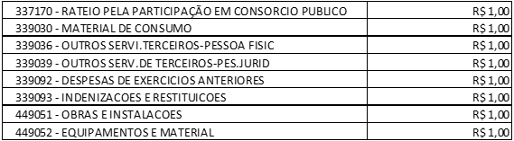

LEI MUNICIPAL Nº 3.693 DE 16 DE DEZEMBRO DE 2022.

Altera-se a lei municipal nº 3.656, de 02 de março de 2022 que estima a receita e fixa a despesa do município de Aparecida de Goiânia-GO para o exercício de 2022.

FAÇO SABER QUE A CÂMARA MUNICIPAL DE APARECIDA DE GOIÂNIA APROVOU E EU, PREFEITO MUNICIPAL, SANCIONO A SEGUINTE LEI:

CAPÍTULO I

DAS INCLUSÕES

Art.1º Ficam incluídos na Unidade Orçamentaria cód. 0319 - Secretaria Municipal de Articulação Metropolitana, o Programa cód. 3062 - TRANSPORTES COLETIVOS, com a Função 04 – administração, o Projeto/Atividade cód. 1335 - MELHORIA DO TRANSPORTE COLETIVO, com a Sub-Função – 122 administração geral na Fonte de Recursos cód. 100 – Recursos Ordinário as dotações abaixo relacionadas;

Parágrafo único. O saldo orçamentário necessário para a criação das dotações orçamentarias citadas terá como cobertura, os saldos da reserva de contingência.

Art.2º A unidade orçamentaria citada no Art. 1°, foi incluída ao Plano Plurianual (PPA) pela Lei Municipal n° 3.685 de 09 de novembro de 2022, que se trata da alteração do PPA.

CAPÍTULO II

DAS DISPOSIÇÕES FINAIS

Art.3° Esta Lei entrará em vigor a partir de sua publicação, revogando disposições ao contrário.

MUNICÍPIO DE APARECIDA DE GOIÂNIA-GO, 16 de Dezembro de 2022.

 

VILMAR MARIANO DA SILVA

Prefeito Municipal
