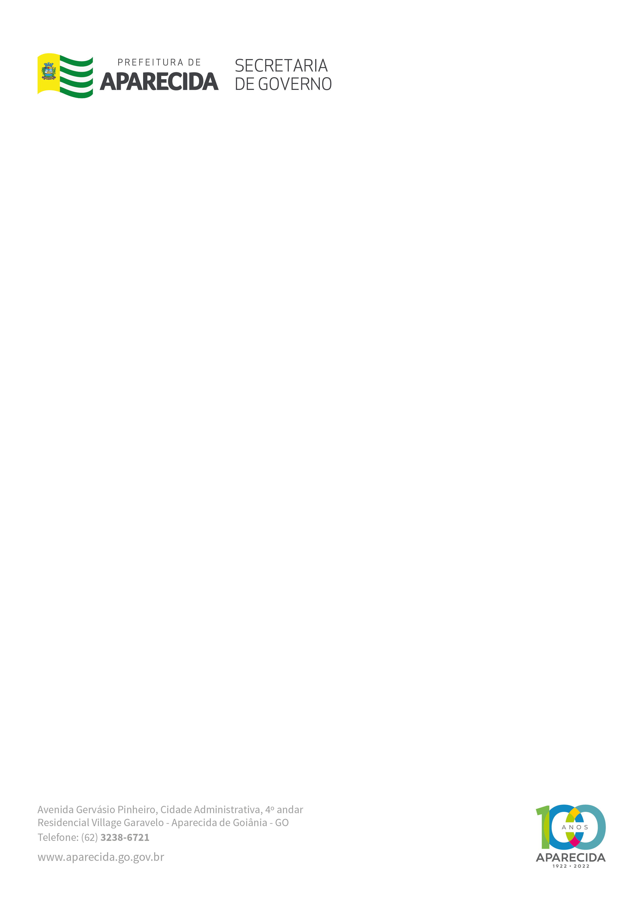

LEI MUNICIPAL Nº 3.629, DE 15 DE OUTUBRO DE 2021.

“Dispõe sobre a denominação da Praça ARACI ROCHA DA SILVA, no Marista Sul, neste município e dá outras providências.”

FAÇO SABER QUE A CÂMARA MUNICIPAL DE APARECIDA DE GOIÂNIA APROVOU E EU, PREFEITO MUNICIPAL, SANCIONO A SEGUINTE LEI:

Art. 1º - Fica denominada como Praça “ARACI ROCHA DA SILVA”, a Praça de Lazer, localizada na Rua 16A e 16B - Setor Marista Sul, Aparecida de Goiânia - Goiás.

Art. 2º - Fica determinada a instalação de uma placa informativa.

Art. 3º- Esta Lei entra em vigor na data de sa publicação, revogando-se as disposições em contrário.

MUNICÍPIO DE APARECIDA DE GOIÂNIA, Aos 15 DE OUTUBRO DE 2021.

 

GUSTAVO MENDANHA MELO

Prefeito Municipal

FÁBIO PASSAGLIA

Secretário de Governo

