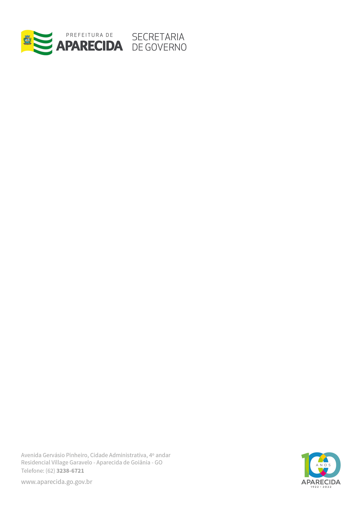

LEI MUNICIPAL Nº 3.631, DE 21 DE OUTUBRO DE 2021.

“Altera a Lei nº 2.861/2009, que institui normas para as eleições de gestores na unidades de ensino vinculadas ao sistema educativo do município de Aparecida de Goiânia.”

FAÇO SABER QUE A CÂMARA MUNICIPAL DE APARECIDA DE GOIÂNIA, APROVOU E EU, PREFEITO MUNICIPAL, SANCIONO A SEGUINTE LEI:

Art. 1º Fica alterada a redação do Art. 15 da Lei nº 2.861 de 13 de novembro de 2009, que institui normas para as eleições de gestores nas unidades de ensino vinculadas ao sistema educativo do município de Aparecida de Goiânia passando a vigorar com a seguinte redação:

“Art. 15 (...)

Parágrafo Único – Os gestores cujos mandatos foram prorrogados pelo período de mais 12 (doze) meses, por força do parágrafo único do artigo 14 desta lei, e contarem com o total de 5 (cinco) anos de mandatos ininterruptos na mesma Unidade Escolar no final do ano de 2021, independente se o primeiro mandato na Unidade Escolar for decorrente de indicação ou eleição, excepcionalmente poderão participar do pleito eleitoral para o biênio 2022/2023, concorrendo para um mandato de 2 (dois) anos, sujeitos ao limite de 7 (sete) anos de mandatos consecutivos na mesma unidade escolar .”

Art. 2º Esta Lei entra em vigor na data de sua publicação.

MUNICÍPIO DE APARECIDA DE GOIÂNIA, Aos 21 de Outubro de 2021.

 

GUSTAVO MENDANHA MELO

Prefeito Municipal

FÁBIO PASSAGLIA

Secretário de Governo

