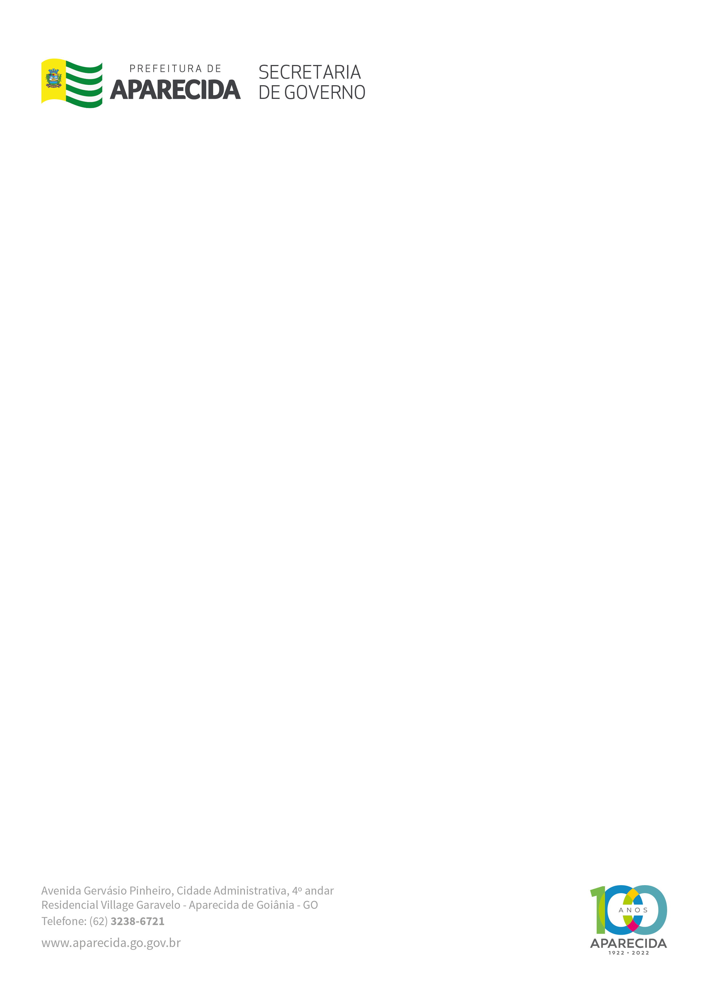

LEI MUNICIPAL Nº 3.634, DE 05 DE NOVEMBRO DE 2021.

Altera a Lei Municipal nº 973-1991 e estabelece a nova denominação de Escola Municipal Professora Cristine Maria de Sousa, no Setor Tocantins.

FAÇO SABER QUE A CÂMARA MUNICIPAL DE APARECIDA DE GOIÂNIA APROVOU E EU, PREFEITO MUNICIPAL, SANCIONO A SEGUINTE LEI:

Art. 1º Fica alterada a Lei Municipal nº 973-1991, que denomina o estabelecimento de ensino primário de Escola Municipal Jardim Olímpico II, passando a vigorar para Escola Municipal Professora CRISTIANE MARIA DE SOUSA, no setor Tocantins.

Art. 2º Esta Lei entrará em vigor a partir de sua aprovação, revogando as disposições em contrário.

MUNICÍPIO DE APARECIDA DE GOIÂNIA, Aos 05 de Novembro de 2021.

 

GUSTAVO MENDANHA MELO

Prefeito Municipal

FÁBIO PASSAGLIA

Secretário de Governo

