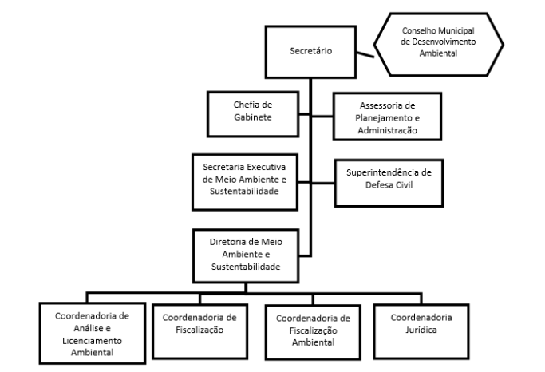

LEI COMPLEMENTAR Nº 174 , DE 03 DE JULHO DE 2020.

Cria cargo e altera a Lei Complementar Municipal nº 125 de 11 de Janeiro de 2017, que dispõe sobre a Estrutura Organizacional Administrativa do Município de Aparecida de Goiânia e dá outras providências.

FAÇO SABER QUE A CÂMARA MUNICIPAL DE APARECIDA DE GOIÂNIA APROVOU E EU, PREFEITO MUNICIPAL, SANCIONO A SEGUINTE LEI:

Art. 1º Fica criado no quadro de servidores do Município, o cargo de provimento Comissionado de Coordenador Jurídico, contido no anexo I-10.1, da Lei Complementar Municipal nº 125 de 11 de janeiro de 2017, conforme o anexo I da presente Lei.

Art. 2º Fica alterado o anexo III da Lei Complementar Municipal nº 125 de 11 de janeiro de 2017, no quantitativo de Coordenador CC-1, para a inclusão do cargo mencionado no artigo anterior, conforme o anexo II da presente lei.

Art. 3º Esta Lei Complementar entra em vigor na data de sua publicação.

Gabinete do Prefeito Municipal de Aparecida de Goiânia, Estado de Goiás, aos 03 dias do mês de Julho de 2020.

GUSTAVO MENDANHA

Prefeito Municipal

FÁBIO PASSAGLIA

Chefe da Casa Civil

ANEXO I

ANEXO I-10.1

ORGANOGRAMA DA SECRETARIA DE MEIO AMBIENTE E SUSTENTABILIDADE

ANEXO II

ANEXO III

QUANTITATIVO E VENCIMENTOS - CARGOS DE DIREÇÃO E ASSESSORAMENTO

<table><tbody><tr><td>**SÍMB.**</td><td>**DENOMINAÇÃO**</td><td>**QUANT.**</td><td>**SUBSÍDIO**</td></tr><tr><td>DS-1</td><td>Chefe da Casa Civil</td><td>1</td><td rowspan="4">Valor fixado para Secretário Muni-cipal, constante da LC nº 62/2012</td></tr><tr><td>DS-1</td><td>Presidente de Autarquia</td><td>1</td></tr><tr><td>DS-1</td><td>Procurador Geral</td><td>1</td></tr><tr><td>DS-1</td><td>Secretário Municipal</td><td>18</td></tr><tr><td>DSE-1</td><td>Secretário Executivo</td><td>24</td><td>R$ 8.000,00</td></tr><tr><td>DS-4</td><td>Contador Geral</td><td>1</td><td>R$ 7.518,73</td></tr><tr><td>DSS-1</td><td>Superintendente de Saúde</td><td>1</td><td>R$ 6.865,64</td></tr><tr><td>DSS-2</td><td>Diretor de Saúde</td><td>2</td><td>R$ 6.385,95</td></tr><tr><td>DS-2</td><td>Assessor Especial do Prefeito</td><td>9</td><td>R$ 6.265,64</td></tr><tr><td>DS-2</td><td>Superintendente</td><td>21</td><td>R$ 6.265,64</td></tr><tr><td>DS-3</td><td>Diretor de Unidade de Saúde</td><td>13</td><td>R$ 5.166,64</td></tr><tr><td>CCS-1</td><td>Coordenador de Saúde</td><td>8</td><td>R$ 5.132,83</td></tr><tr><td>CCS-2</td><td>Coordenador de Unidade de Saúde</td><td>8</td><td>R$ 4.632,83</td></tr><tr><td>DS-3</td><td>Diretor</td><td>58</td><td>R$ 4.385,95</td></tr><tr><td>CCS-3</td><td>Chefe de Saúde</td><td>14</td><td>R$ 3.379,70</td></tr><tr><td>AJU-1</td><td>Assessor Jurídico</td><td>11</td><td>R$ 3.166,64</td></tr><tr><td>CC-1</td><td>Coordenador</td><td>140</td><td>R$ 3.132,83</td></tr><tr><td>CC-1</td><td>Subprocurador</td><td>5</td><td>R$ 3.132,83</td></tr><tr><td>CCS-4</td><td>Chefe de Unidade de Saúde</td><td>62</td><td>R$ 2.887,76</td></tr><tr><td>AS</td><td>Assessor Superior</td><td>60</td><td>R$ 2.756,89</td></tr><tr><td>AS</td><td>Presidente de Conselheiro Tutelar</td><td>3</td><td>R$ 2.756,89</td></tr><tr><td>APA</td><td>Assessor de Planejamento e Administração</td><td>19</td><td>R$ 2.506,26</td></tr><tr><td>CC-2</td><td>Chefe</td><td>130</td><td>R$ 1.879,70</td></tr><tr><td>CC-2</td><td>Chefe de Gabinete</td><td>21</td><td>R$ 1.879,70</td></tr><tr><td>AES-1</td><td>Assessor Especial 1</td><td>300</td><td>R$ 2.255,64</td></tr><tr><td>AES-1</td><td>Conselheiro Tutelar</td><td>12</td><td>R$ 2.255,64</td></tr><tr><td>AES-2</td><td>Assessor Especial 2</td><td>300</td><td>R$ 1.253,13</td></tr><tr><td>AED-1</td><td>Assessor Especial 3</td><td>300</td><td>R$ 1.127,82</td></tr><tr><td>AEC-1</td><td>Assessor Especial 4</td><td>2650</td><td>R$ 937,00</td></tr></tbody></table>
