LEI MUNICIPAL Nº 3.551, DE 05 DE MAIO DE 2020.

Altera a Lei Municipal nº 3.527, de 03 de dezembro de 2019, que Estima a receita e fixa a despesa do Município de Aparecida de Goiânia – Go para o exercício de 2020 e dá outras providências.

FAÇO SABER QUE A CÂMARA MUNICIPAL DE APARECIDA DE GOIÂNIA APROVOU, E EU, PREFEITO MUNICIPAL, SANCIONO A SEGUINTE LEI:

CAPÍTULO I

DO PLANEJAMENTO GOVERNAMENTAL E DO PLANO PLURIANUAL

Art. 1º Fica alterada a Lei Orçamentária Anual referente ao exercício de 2020 do Município de Aparecida de Goiânia, em cumprimento ao estabelecido no art. 51, inciso II, alínea “e” da Lei Orgânica do Município de Aparecida de Goiânia.

CAPÍTULO II

DAS ALTERAÇÕES ESTRUTURAIS E FINANCEIRAS

Art. 2º Fica instituída alteração na Receita Prevista conforme Anexo I;

I. Tabela: 1 – Redução de valores na receita prevista.

II. Tabela: 2 – Inclusão de valores na receita prevista.

Art. 3º Fica acrescido na Unidade Orçamentária código 0301 – GABINETE DO PREFEITO, no Programa código 3001 - GESTAO E MAN. DO GABINETE DO PREFEITO, a Ação código 2368 - GESTAO E MAN. DA CASA CIVIL e suas dotações orçamentárias conforme ANEXO II, com suas devidas metas estabelecidas pela Lei n° 3.449 de 18 de dezembro de 2018, que dispõe sobre as alterações de Plano Plurianual 2018-2021.

Art. 4º Ficam instituídas as seguintes dotações de despesa abaixo relacionadas em conformidade com o ANEXO III, com suas devidas fichas de redução:

Parágrafo Único - Para todas as unidades orçamentárias que não foram contempladas pela lei n° 3.527/19.

319008 - OUTROS BENEFICIOS ASSISTENCIAIS

319009 - SALÁRIO-FAMILIA

319011 - VENCIMENTOS VANTAG. FIXAS-PESSOAL C

319013 - OBRIGACOES PATRONAIS

319034 - OUTRAS DESPESAS DE PESSOAL-CONT.TER

319046 - AUXILIO-ALIMENTACAO

319049 - AUXILIO-TRANSPORTE

319092 - DESPESAS DE EXERCICIOS ANTERIORES

319094 - INDENIZACOES RESTITUICOES

319096 - RESSARCIMENTO DESPESA PESS.

319113 - CONTRIBUICAO PATRONAL PARA O RPPS

335041 - CONTRIBUICOES

335043 - SUBVENCOES SOCIAIS

339008 - OUTROS BENEFICIOS ASSISTENCIAIS

339010 - OUTROS BENEFICIOS DE NATUREZA SOCIAL

339013 - OBRIGACOES PATRONAIS PESSOA FISICA

339014 - DIARIAS - CIVIL

339030 - MATERIAL DE CONSUMO

339031 - PREMIAÇÕES CULTURAIS, ARTISTICAS, C

339032 - MATERIAL DE DISTRIBUICAO GRATUITA

339033 - PASSAGENS E DESPESAS COM LOCOMOCAO

339034 - OUTRAS DESPES.PESSOAL-CONT.TERCERIZ

339035 - SERVICOS DE CONSULTORIA

339036 - OUTROS SERVI.TERCEIROS-PESSOA

339039 - OUTROS SERV.DE TERCEIROS-PES.

339040 - SER. DE TEC. INFORMAÇÃO E COMUNICAÇÃO (TIC) P. J.

339046 - AUXILIO-ALIMENTACAO

339047 - OBRIGACOES TRIBUTARIAS CONTRIBUTIVA

339048 - OUTROS AUXIL. FINAN. PESSOAS FISICA

339049 - AUXILIO-TRANSPORTE

339091 - SETENCAS JUDICIAIS

339092 - DESPESAS DE EXERCICIOS ANTERIORES

339093 - INDENIZACOES E RESTITUICOES

449051 - OBRAS E INSTALACOES

449052 - EQUIPAMENTOS E MATERIAL PERMANENTE

449092 - DESPESAS DE EXERCICIOS ANTERIORES

449093 - INDENIZACOES E RESTITUICOES

469077 - PRINCIPAL CORRIGIDO DIVIDA CONTRA.R

CAPÍTULO III

DAS DISPOSIÇÕES FINAIS

Art. 5º Esta Lei entrará em vigor a partir de sua aprovação retroagindo a 1° de janeiro de 2020, e, ficam mantidos os dispositivos das Leis Municipais Nº 3.385/17, N° 3.449/18 e Nº 3.527/19, não alterados por esta.

Gabinete do Prefeito de Aparecida de Goiânia – GO, aos 05 de Maio de 2020.

 

GUSTAVO MENDANHA

Prefeito Municipal

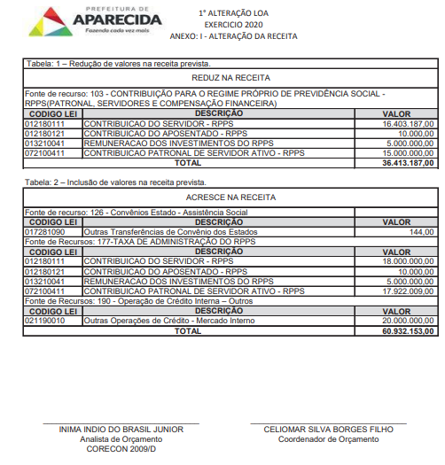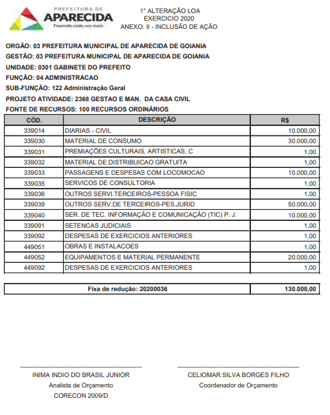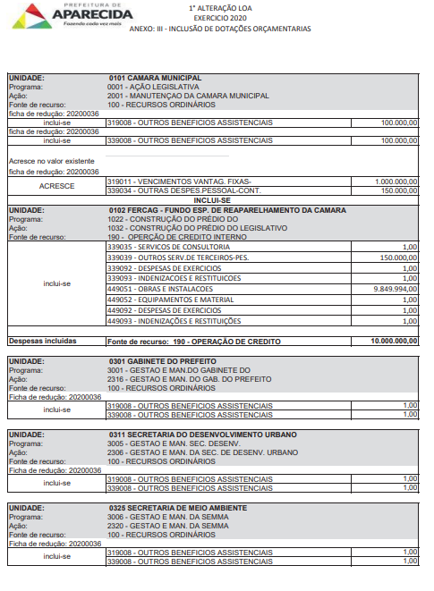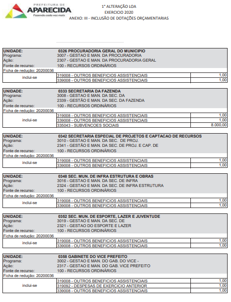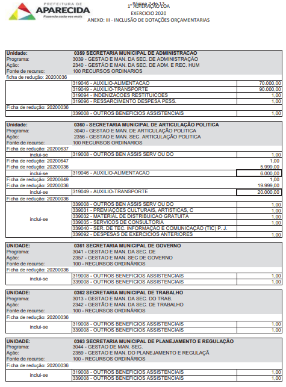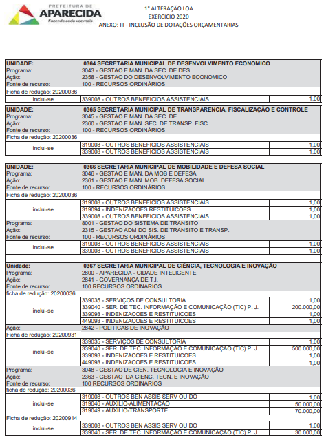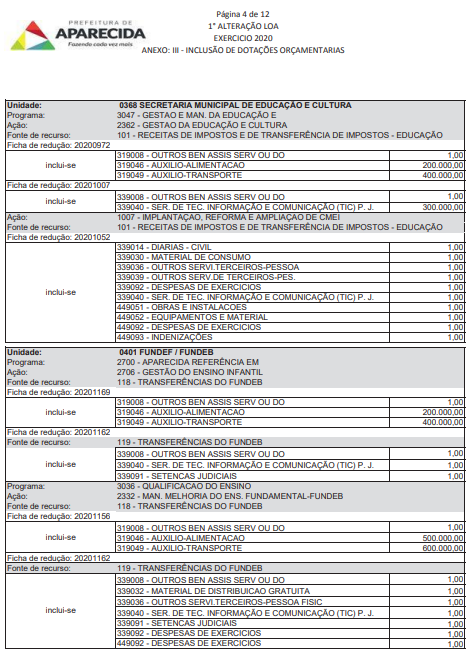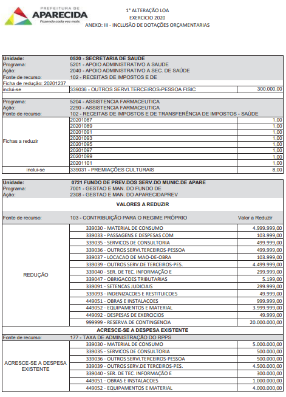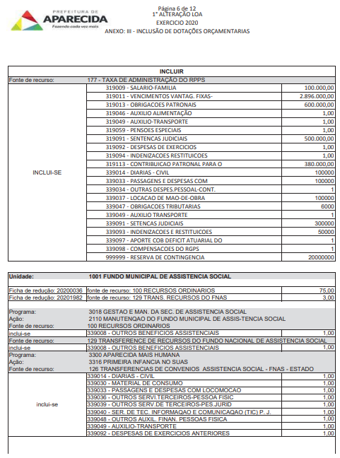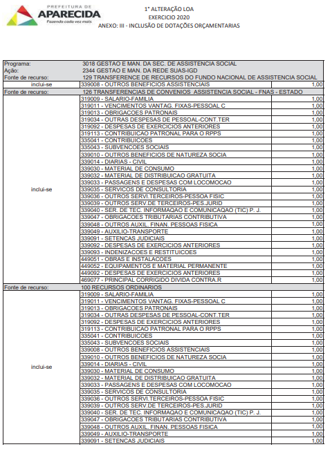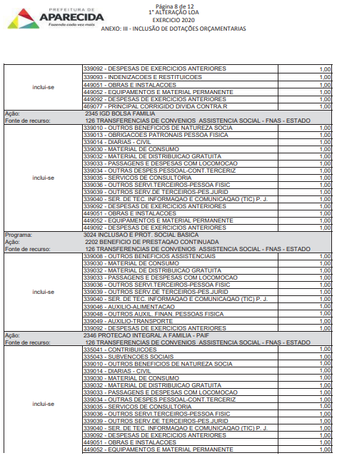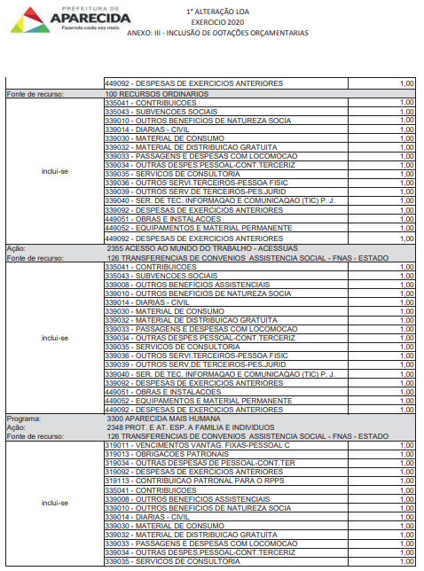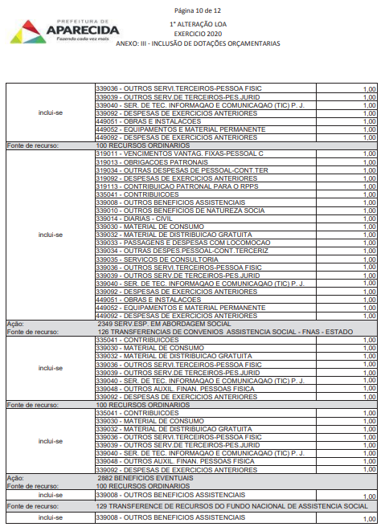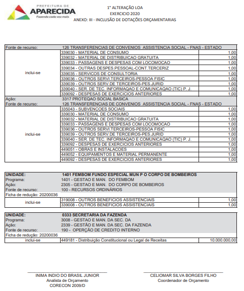
