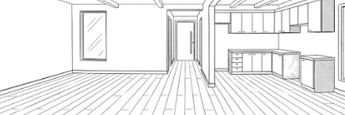
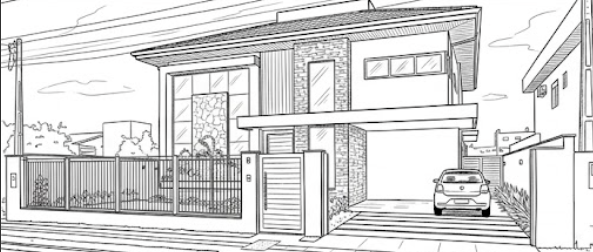
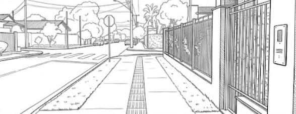
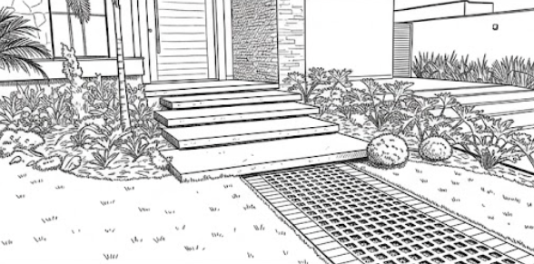
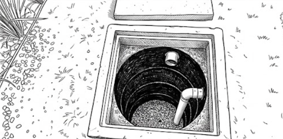

DECRETO Nº 535, DE 31 DE AGOSTO DE 2026

Dispõe sobre os procedimentos simplificados e autodeclaratórios para a emissão do Alvará de Construção Simplificado e da Certidão de Conclusão de Obras (CCO) no âmbito do Município de Aparecida de Goiânia e dá outras providências.

O PREFEITO DE APARECIDA DE GOIÂNIA, no uso da atribuição que lhe confere o art. 71 da Lei Orgânica do Município, tendo em vista o disposto nos arts. 1º, 2º e 3º da Lei federal nº 13.874, de 20 de setembro de 2019, na Lei Complementar nº 171, de 21 de novembro de 2019, e no Decreto nº 1.443, de 23 de maio de 2025, e considerando o contido no Processo Administrativo nº 2026.208.157,

**DECRETA:**

CAPÍTULO I

DAS DISPOSIÇÕES PRELIMINARES

Art. 1º Este Decreto dispõe sobre os procedimentos simplificados e autodeclaratórios para a emissão do Alvará de Construção Simplificado e da Certidão de Conclusão de Obras (CCO) no Município de Aparecida de Goiânia.

Parágrafo único. Os procedimentos previstos neste Decreto aplicam-se exclusivamente às habitações unifamiliares de que trata o inciso I do art. 194 da Lei Complementar nº 171, de 21 de novembro de 2019, consideradas, para os fins deste Decreto, edificações de baixo risco e baixo impacto urbanístico.

Art. 2º Os procedimentos de que trata este Decreto fundamentam-se no princípio da boa-fé e na responsabilidade exclusiva do Responsável Técnico (RT) e do proprietário do imóvel pela veracidade das informações apresentadas e estrita observância das normas legais vigentes.

CAPÍTULO II

DO ALVARÁ DE CONSTRUÇÃO SIMPLIFICADO AUTODECLARATÓRIO

Art. 3º O proprietário ou seu representante legal poderá optar pela modalidade de Alvará de Construção Simplificado Autodeclaratório, por meio de sistema eletrônico de processos, mediante requerimento instruído com os seguintes documentos:

I – Requerimento preenchido no sistema, acompanhado dos documentos de identificação do proprietário e do Responsável Técnico, do número de registro profissional deste perante o CREA ou o CAU, conforme o caso, e dos respectivos contatos telefônicos e endereços eletrônicos;

II – Certidão de Registro atualizada do imóvel (matrícula);

III – Certidão de Uso do Solo do imóvel (válida na data do protocolo);

IV – Projeto Arquitetônico digital completo em formato PDF padrão fornecido pelo Município;

V – Anotação de Responsabilidade Técnica (ART) ou Registro de Responsabilidade Técnica (RRT) referente à autoria do projeto arquitetônico e à execução da obra;

VI – Declaração de Responsabilidade de Projeto (DRP), conforme modelo constante do Anexo I deste Decreto, devidamente assinada digitalmente pelo proprietário e pelo profissional técnico responsável;

VII – Certidão Negativa de Débitos (CND) Municipal do imóvel;

VIII – Comprovante de pagamento das taxas de expediente.

Parágrafo único. Os projetos arquitetônicos submetidos ao rito autodeclaratório deverão atender integralmente a todas as exigências e peças técnicas discriminadas no art. 73 da Lei Complementar nº 171, de 2019.

Art. 4º O Alvará de Construção Simplificado Autodeclaratório dispensa a análise prévia dos parâmetros urbanísticos do projeto arquitetônico, ficando atribuída ao proprietário e ao Responsável Técnico a responsabilidade pela integral observância da legislação urbanística vigente.

Parágrafo único. Verificada a conformidade da documentação estabelecida no art. 3º, o licenciamento da edificação será expedido por meio de sistema eletrônico de processos.

CAPÍTULO III

DA CERTIDÃO DE CONCLUSÃO DE OBRA AUTODECLARATÓRIA

Art. 5º A Certidão de Conclusão de Obra Autodeclaratória (CCO) será emitida para os empreendimentos licenciados na forma do art. 3º deste Decreto, dispensando a vistoria fiscal prévia.

§ 1º O requerimento para a CCO Autodeclaratória será instruído com os seguintes documentos:

I - Requerimento preenchido no sistema, acompanhado dos documentos de identificação do proprietário e do Responsável Técnico, do número de registro profissional deste perante o CREA ou o CAU, conforme o caso, e dos respectivos contatos telefônicos e endereços eletrônicos;

II - Certidão de Registro do imóvel (atualizada), se ocorrer mudança de propriedade após a emissão do alvará de construção;

III - Projeto Arquitetônico digital aprovado pelo Município (última versão);

IV - Declaração de Conclusão de Obra (DCO), conforme modelo constante do Anexo II deste Decreto, assinada digitalmente pelo proprietário e pelo Responsável Técnico pela execução da obra, acompanhada de memorial fotográfico detalhado da edificação;

V - Certidão de Resíduos Sólidos, expedida pelo órgão ambiental do Município;

VI - Certidão Negativa de Débitos (CND) Municipal do imóvel;

VII - Comprovante de pagamento das taxas.

§ 2º O memorial fotográfico exigido no inciso IV deverá conter, obrigatoriamente:

a) 01 (uma) foto nítida de cada ambiente interno do imóvel;

b) 02 (duas) fotos, sendo uma da fachada externa (frente ao imóvel, visualizando os limites laterais do lote/edificação, quando possível) e outra da placa de endereço do imóvel já instalada;

c) 02 (duas) fotos no sentido longitudinal da calçada (uma tirada de cada lado do limite do lote), devendo constar mais 01 (uma) foto de cada rampa para PCD se o imóvel estiver localizado em lote de esquina;

d) 02 (duas) fotos internas que comprovem a destinação e execução das áreas permeáveis;

e) 02 (duas) fotos do poço de infiltração/caixa de recarga com a respectiva tampa aberta, de modo que seja visível a sua profundidade e as tubulações de entrada e de saída de águas pluviais.

§ 3º Verificada a conformidade da documentação estabelecida neste artigo, a CCO será expedida por meio de sistema eletrônico de processos.

CAPÍTULO IV

DA AUDITORIA FISCAL E DAS SANÇÕES ADMINISTRATIVAS

Art. 6º Os imóveis licenciados ou regularizados mediante a emissão de Alvará de Construção Simplificado Autodeclaratório ou de Certidão de Conclusão de Obra Autodeclaratória ficarão sujeitos à Auditoria Fiscal realizada por amostragem.

§ 1º A seleção para auditoria fiscal respeitará o limite mínimo de 20% (vinte por cento) dos alvarás e certidões emitidos mensalmente, cuja seleção ocorrerá de forma aleatória e por critérios de risco sob gestão da Diretoria de Obras e Loteamentos ou da Coordenação de Fiscalização de Obras.

§ 2º A Auditoria Fiscal poderá ser documental ou presencial, consistindo na conferência técnica dos parâmetros urbanísticos executados no local, englobando:

I – exatidão das áreas construídas licenciadas (acréscimo ou decréscimo);

II – cumprimento de recuos frontais e afastamentos laterais e de fundos;

III – taxa de ocupação e gabarito de altura da edificação;

IV – execução e manutenção de taxa de permeabilidade e instalação correta do poço de infiltração;

V – execução correta do alinhamento predial, passeio público e condições de acessibilidade, conforme normas técnicas de acessibilidade aplicáveis, especialmente as normas ABNT NBR 9050 e ABNT NBR 16537, em suas versões vigentes.

Art. 7º Constatada divergência entre o projeto aprovado e a obra executada ou falsidade nas declarações prestadas, o auditor fiscal adotará, observada a ordem abaixo, as seguintes providências:

I – notificação imediata do Responsável Técnico e/ou do proprietário do imóvel para sanar as irregularidades constatadas, estipulando prazo não inferior a 15 (quinze) dias úteis;

II – verificado o descumprimento injustificado das exigências indicadas na notificação prevista no inciso I, lavratura de Auto de Infração e aplicação das multas previstas no art. 335, Tabela VI, e no art. 336, Tabela IX, da Lei Complementar nº 171, de 2019, ao proprietário e/ou ao Responsável Técnico, conforme o caso;

III – anulação do Alvará de Construção Simplificado e da Certidão de Conclusão de Obra Autodeclaratórios, com comunicação ao Cartório de Registro de Imóveis de Aparecida de Goiânia para as providências registrais cabíveis;

IV – instauração de processo administrativo, assegurados o contraditório e a ampla defesa, para aplicação da suspensão do cadastro municipal do profissional pelo prazo de 3 (três) a 12 (doze) meses, em conformidade com o art. 321, inciso III, da Lei Complementar nº 171, de 2019;

V – envio de representação técnica formal ao Conselho de Classe Profissional competente (CREA ou CAU) para apuração de responsabilidade ético-profissional, na forma do art. 31 da Lei Complementar nº 171, de 2019, e, quando houver indícios de prática de ilícito penal, representação ao Ministério Público do Estado de Goiás para as providências cabíveis.

Parágrafo único. A constatação de irregularidade no projeto ou na execução da obra, bem como de falsidade nas declarações prestadas, ensejará o embargo da obra, quando cabível, sem prejuízo das demais penalidades previstas neste artigo.

Art. 8º Este Decreto entra em vigor na data de sua publicação.

Aparecida de Goiânia, 31 de agosto de 2026.

 

LEANDRO VILELA

Prefeito de Aparecida de Goiânia

ANEXO I

DECLARAÇÃO DE RESPONSABILIDADE DE PROJETO (DRP)

1\. IDENTIFICAÇÃO DO PROCESSO/IMÓVEL

a) Proprietário(s) do Imóvel: (Nome completo e CPF/CNPJ)

b) Localização do Imóvel: (Endereço completo)

c) Matrícula/Registro do Imóvel:

2\. RESPONSÁVEIS PELA DECLARAÇÃO

a) PROPRIETÁRIO(S) / POSSUIDOR(ES) LEGÍTIMO(S):

Nome:

CPF:

b) RESPONSÁVEL TÉCNICO PELO PROJETO ARQUITETÔNICO E/OU EXECUÇÃO:

Nome:

Registro Profissional (CREA/CAU):

RRT/ART de Autoria de Projeto nº:

3\. DECLARAÇÃO

Eu, \[Proprietário/Possuidor\] e eu, \[Responsável Técnico\], ambos devidamente qualificados acima e signatários desta Declaração, em conformidade com o art. 2º deste Decreto e sob o princípio da boa-fé e da responsabilidade profissional, DECLARAMOS formalmente, sob as penas da lei civil, penal e administrativa, para fins de emissão do Alvará de Construção Simplificado Autodeclaratório, que:

a) O Projeto Arquitetônico apresentado em anexo atende de forma integral e irrestrita a todos os parâmetros urbanísticos e exigências edilícias municipais, inclusive limites de afastamento, taxas de ocupação, taxas de permeabilidade mínima e coeficientes de aproveitamento estabelecidos na Lei Complementar nº 171, de 21 de novembro de 2019 (Código de Obras), Lei Complementar nº 124, de 14 de dezembro de 2016 (Plano Diretor) e Lei Complementar nº 152, de 9 de outubro de 2018 (Uso e Ocupação do Solo).

b) O projeto obedece rigorosamente às condições de acessibilidade estabelecidas nas normas técnicas brasileiras (NBR 9050 e NBR 16537 e suas atualizações);

c) Declaramos estar plenamente cientes de que a concessão do Alvará de Construção nesta modalidade não implica reconhecimento de regularidade urbanística caso identificada qualquer fraude ou desconformidade em auditoria posterior por amostragem;

d) Assumimos total e solidária responsabilidade civil, penal e administrativa por quaisquer danos decorrentes de informações inverídicas prestadas ou de inadequação do projeto à legislação municipal, sujeitando-nos às sanções de suspensão de cadastro, multas gravíssimas e comunicação ao Ministério Público do Estado de Goiás.

4\. RESPONSABILIDADE

Os signatários assumem a total responsabilidade civil, penal e administrativa pela veracidade das informações declaradas nesta Declaração de Responsabilidade de Projeto, nos termos do art. 21, art. 26 e art. 29 da Lei Complementar nº 171, de 2019 (Código de Obras e Edificações).

\[Localidade\], \[Dia\] de \[Mês\] de \[Ano\].

\_\_\_\_\_\_\_\_\_\_\_\_\_\_\_\_\_\_\_\_\_\_\_\_\_\_\_\_\_\_\_\_\_\_\_\_\_\_\_\_\_

(Assinatura Digital)

\[Nome do Proprietário(s)/Possuidor(es)\]

CPF/CNPJ:

\_\_\_\_\_\_\_\_\_\_\_\_\_\_\_\_\_\_\_\_\_\_\_\_\_\_\_\_\_\_\_\_\_\_\_\_\_\_\_\_\_

(Assinatura Digital)

\[Nome do Responsável Técnico\]

CREA/CAU:

ANEXO II

DECLARAÇÃO DE CONCLUSÃO DE OBRA (DCO)

1\. IDENTIFICAÇÃO DO PROCESSO/IMÓVEL

a) CCI do Imóvel nº:

b) Alvará de Construção nº:

c) Proprietário(s) do Imóvel: (Nome completo e CPF/CNPJ)

d) Localização do Imóvel: (Endereço completo)

e) Matrícula/Registro do Imóvel nº:

2\. RESPONSÁVEIS PELA DECLARAÇÃO

a) PROPRIETÁRIO(S) / POSSUIDOR(ES) LEGÍTIMO(S):

Nome:

CPF:

b) RESPONSÁVEL TÉCNICO PELA EXECUÇÃO DA OBRA:

Nome:

Registro Profissional (CREA/CAU):

RRT/ART de Execução da Obra nº:

3\. DECLARAÇÃO

Eu, \[Proprietário/Possuidor\] e eu, \[Responsável Técnico\], ambos devidamente qualificados acima e signatários desta Declaração, em conformidade com o art. 2º deste Decreto e sob o princípio da boa-fé e da responsabilidade profissional, DECLARAMOS formalmente, sob as penas da lei civil, penal e administrativa, para fins de emissão da Certidão de Conclusão de Obra (CCO) Autodeclaratória, que:

a) A obra licenciada sob o Alvará de Construção nº \[Número\] encontra-se TOTALMENTE CONCLUÍDA, com cobertura e acabamentos definidos, apresentando plenas condições de habitabilidade, salubridade e segurança.

b) A edificação foi executada em ESTRITA CONFORMIDADE com o Projeto Arquitetônico aprovado, o Alvará de Construção e as demais normas urbanísticas aplicáveis, em especial:

● Lei Complementar nº 171, de 21 de novembro de 2019 (Código de Obras e Edificações Municipal).

● Lei Complementar nº 124, de 14 de dezembro de 2016 (Plano Diretor vigente e suas alterações).

● Lei Complementar nº 152, de 9 de outubro de 2018 (Uso e Ocupação do Solo).

● Normas de acessibilidade (NBR 9050 e NBR 16537 e suas atualizações).

c) Foram cumpridos rigorosamente todos os parâmetros urbanísticos obrigatórios do projeto aprovado, incluindo:

● Recuo frontal, afastamentos laterais e de fundos.

● Taxa de ocupação e altura da edificação.

● Taxa de permeabilidade e instalação do poço de infiltração/caixa de recarga.

● Alinhamento predial e execução do passeio público acessível.

d) As estruturas de fundação, contenção e demais componentes construtivos encontram-se integralmente contidos nos limites do lote, respeitando o correto alinhamento predial.

4\. MEMORIAL DE FOTOS DIGITAIS

Declaramos que as fotos digitais anexadas ao processo de CCO Autodeclaratório, que compõem este memorial, cumprem os requisitos mínimos estabelecidos no § 2º do art. 5º, deste decreto, sendo compostas por, no mínimo:

● 01 foto de cada ambiente interno do imóvel.

● 01 foto da fachada externa (dentro e fora do lote, frente ao imóvel).

● 01 foto da placa de endereço já instalada.

● 02 fotos no sentido longitudinal da calçada (uma de cada lado).

● Quando o imóvel for de esquina, acrescentar mais 01 foto de cada rampa PCD.

● 02 fotos internas das áreas permeáveis/grama.

● 02 fotos do poço de infiltração com a tampa aberta, de tal maneira que possam ser verificados os tubos de entrada e de saída e a profundidade.

5\. RESPONSABILIDADE

Os signatários assumem a total responsabilidade civil, penal e administrativa pela veracidade das informações declaradas nesta Declaração de Conclusão de Obras, nos termos do art. 21, art. 26 e art. 29 da Lei Complementar nº 171, de 2019 (Código de Obras e Edificações).

\[Localidade\], \[Dia\] de \[Mês\] de \[Ano\].

\_\_\_\_\_\_\_\_\_\_\_\_\_\_\_\_\_\_\_\_\_\_\_\_\_\_\_\_\_\_\_\_\_\_\_\_\_\_\_\_\_

(Assinatura Digital)

\[Nome do Proprietário(s)/Possuidor(es)\]

CPF/CNPJ:

\_\_\_\_\_\_\_\_\_\_\_\_\_\_\_\_\_\_\_\_\_\_\_\_\_\_\_\_\_\_\_\_\_\_\_\_\_\_\_\_\_

(Assinatura Digital)

\[Nome do Responsável Técnico\]

CREA/CAU:
