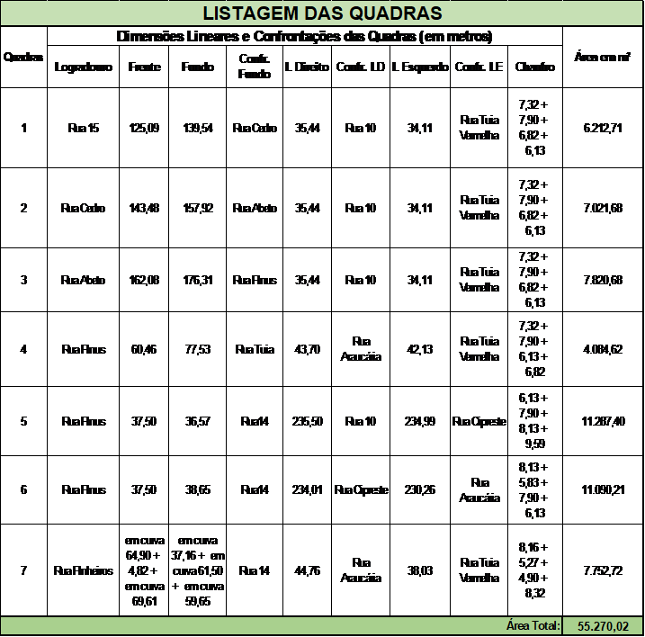
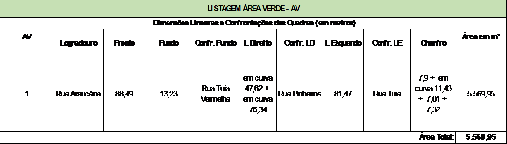
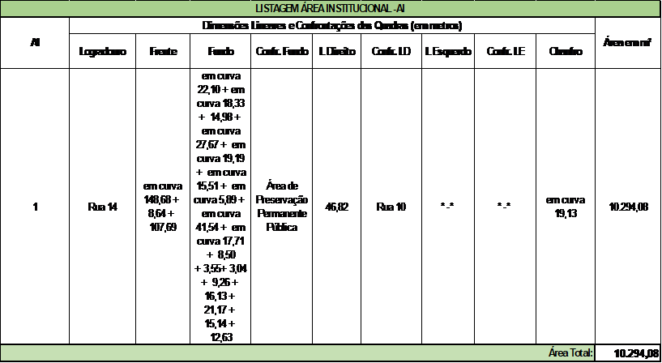

DECRETO “N” Nº 1004, DE 21 DE NOVEMBRO DE 2024.

Dispõe sobre aprovação do Parcelamento de Solo Loteamento Recanto Pinheiros, neste Município, e dá outras providências.

O PREFEITO MUNICIPAL DE APARECIDA DE GOIÂNIA, no uso de suas atribuições legais e,

CONSIDERANDO que o loteamento foi aprovado conforme a Lei Complementar nº 124 de 14 dezembro de 2016, que institui o Plano Diretor e Lei Complementar nº 152, de 09 de outubro de 2018 que instituiu os instrumentos de Controle de Uso e Ocupação do Solo; Lei Complementar nº 176 de 05 de agosto de 2020 que altera a Lei Complementar nº 124/2016 e 152/2018 e os critérios urbanísticos.

CONSIDERANDO os documentos acostados ao processo administrativo nº 2019.014.411, especialmente o Parecer Técnico de Avaliação do Projeto de Loteamento, emitido pela Secretaria Municipal de Planejamento e Regulação Urbana e,

CONSIDERANDO a nota devolutiva /exigência nº 707.327 do Cartório de Registro de Imóveis e Tabelionato de Notas – Aparecida de Goiânia.

**DECRETA:**

Art. 1º Fica aprovado o Parcelamento de Solo Loteamento Recanto Pinheiros, neste Município, de propriedade da sociedade SPE RECANTO PINHEIROS LTDA, pessoa jurídica de direito privado, com sede e foro na Rua 22, nº 287, Setor Sul, na cidade de Goiânia/GO, devidamente inscrita no CNPJ/MF sob nº 30.747.659/0001-77, conforme abaixo:

I. IDENTIFICAÇÃO DA ÁREA DO IMÓVEL:

O imóvel onde será implantado o loteamento está cadastrado perante o 1° Cartório de Registro de Imóveis de Aparecida de Goiânia sob a matrícula de número 117.162, com os seguintes limites e confrontações: UMA GLEBA SEM DENOMINAÇÃO do loteamento "VILA OLIVEIRA", neste município, com a área de 117.140,49 metros quadrados, começa do marco M1 cravado à margem esquerda do córrego Santo Antônio, M1,(8.142.015,0283; E=682.228,1393) deste segue confrontando com herdeiros de Pedro Joaquim, até marco M2, Azimute 21°48’45’’NE, distância 118,99 metros mais um raio com desenvolvimento 16,01 metros, soma igual a 135,00 metros até o marco M2, do M2(N= 8.142.140,9360, E = 682.271,5836), deste segue confrontando Com Rua Platão, Azimute 329°45’53’’NW, distância 440,00 metros, até o marco M3, Do marco M3 (N= 8.142.525,5618; E= 682.057,9405, deste segue confrontando Com Avenida das Nações/Rua - 15, Azimute 256°22’27’’SW, distância 152,00 até o marco M4, Do marco M4 (N= 8.142.489,7539; E= 681.910,2185, deste segue confrontando Álvaro Borges, Azimute 349°52’50’’NW, distância 420,00 metros, até o marco M5, Do marco M5 (N= 8.142.076,2742; E= 681.984,0143 cravado na margem esquerda do córrego Santo Antônio, descendo por este contornando suas curvas até o marco ponto de partida marco M1.

O loteamento Recanto Pinheiros será de uso comercial e residencial de forma que o mesmo será de acesso aberto/convencional, seu zoneamento foi realizado conforme Lei Complementar nº 124, de 14 de dezembro de 2016, Lei Complementar nº 152, 09 de outubro de 2018 e demais Leis complementares.

II – CLASSIFICAÇÃO E DISTRIBUIÇÃO DE ÁREAS

| **RECANTO PINHEIROS** |
| --- |
| **QUADRO DE ÁREAS** |
| --- |
| **MATRICULA Nº. 117.162 - Cartório de Registro de Imóveis e Tabelionato 1º de Notas** |
| --- |
| Gleba in loco |   |   | 117.140,49 |   |
| Área de Preservação Permanente area non aedificandi |   |   | 15.874,81 | 13,55% |
| **Área Urbanizável** |   |   | **101.265,68** | **100,00%** |
|   |
| **Área Institucional (AI)** |   |   | **10.294,08** | **10,17%** |
| **Área Verde (AV)** |   |   | **5.569,95** | **5,50%** |
| **TOTAL APM (AI, AV)** |   |   | **15.864,03** | **15,67%** |
| **Sistema Viário** |   |   | **30.131,63** | **29,76%** |
| **Quadras** |   |   | **55.270,02** | **54,58%** |
|   |   | **Área Total** | **Área não alienável** | **Área Alienável** |   |
|   | nº lotes |   |   |   |
| Quadra 01 | 29 | 6.212,71 |   | 6.212,71 |   |
| Quadra 02 | 33 | 7.021,68 |   | 7.021,68 |   |
| Quadra 03 | 37 | 7.820,68 |   | 7.820,68 |   |
| Quadra 04 | 16 | 4.084,62 |   | 4.084,62 |   |
| Quadra 05 | 52 | 11.287,40 |   | 11.287,40 |   |
| Quadra 06 | 50 | 11.090,21 |   | 11.090,21 |   |
| Quadra 07 | 27 | 7.752,72 |   | 7.752,72 |   |
| **Total** | **244** |   |   |   |   |

III. TABELA DE COMPOSIÇÃO E DESCRIÇÃO DAS QUADRAS

IV- ÁREAS INSTITUCIONAIS E ÁREAS VERDES

V - ÁREA DE PRESERVAÇÃO PERMANENTE PÚBLICA

Art. 2º Como garantia de implantação para aprovação do Loteamento e de toda a infraestrutura correspondente, o loteador apresenta o Termo de Caução e Termo de Compromisso de Implantação do Loteamento (anexos), ambos assinados entre as partes, conforme demonstrativo de lotes abaixo:

<table><tbody><tr><td rowspan="2">**N° da Quadra**</td><td rowspan="2">**N° do Lote**</td><td rowspan="2">**Área do Lote (m²)**</td><td rowspan="2">**Valor do Imóvel**</td></tr><tr></tr><tr><td>1</td><td>1</td><td>289,05</td><td>&nbsp;R$&nbsp;&nbsp;&nbsp;&nbsp;&nbsp;&nbsp;&nbsp;&nbsp; 93.941,25</td></tr><tr><td>1</td><td>2</td><td>307,68</td><td>&nbsp;R$&nbsp;&nbsp;&nbsp;&nbsp;&nbsp;&nbsp;&nbsp;&nbsp; 99.996,00</td></tr><tr><td>1</td><td>3</td><td>316,92</td><td>&nbsp;R$&nbsp;&nbsp;&nbsp;&nbsp;&nbsp; 102.999,00</td></tr><tr><td>1</td><td>4</td><td>198,00</td><td>&nbsp;R$&nbsp;&nbsp;&nbsp;&nbsp;&nbsp;&nbsp;&nbsp;&nbsp; 64.350,00</td></tr><tr><td>1</td><td>5</td><td>198,00</td><td>&nbsp;R$&nbsp;&nbsp;&nbsp;&nbsp;&nbsp;&nbsp;&nbsp;&nbsp; 64.350,00</td></tr><tr><td>1</td><td>6</td><td>198,00</td><td>&nbsp;R$&nbsp;&nbsp;&nbsp;&nbsp;&nbsp;&nbsp;&nbsp;&nbsp; 64.350,00</td></tr><tr><td>1</td><td>7</td><td>198,00</td><td>&nbsp;R$&nbsp;&nbsp;&nbsp;&nbsp;&nbsp;&nbsp;&nbsp;&nbsp; 64.350,00</td></tr><tr><td>1</td><td>8</td><td>198,00</td><td>&nbsp;R$&nbsp;&nbsp;&nbsp;&nbsp;&nbsp;&nbsp;&nbsp;&nbsp; 64.350,00</td></tr><tr><td>1</td><td>9</td><td>198,00</td><td>&nbsp;R$&nbsp;&nbsp;&nbsp;&nbsp;&nbsp;&nbsp;&nbsp;&nbsp; 64.350,00</td></tr><tr><td>1</td><td>10</td><td>198,00</td><td>&nbsp;R$&nbsp;&nbsp;&nbsp;&nbsp;&nbsp;&nbsp;&nbsp;&nbsp; 64.350,00</td></tr><tr><td>1</td><td>11</td><td>198,00</td><td>&nbsp;R$&nbsp;&nbsp;&nbsp;&nbsp;&nbsp;&nbsp;&nbsp;&nbsp; 64.350,00</td></tr><tr><td>1</td><td>12</td><td>198,00</td><td>&nbsp;R$&nbsp;&nbsp;&nbsp;&nbsp;&nbsp;&nbsp;&nbsp;&nbsp; 64.350,00</td></tr><tr><td>1</td><td>13</td><td>198,00</td><td>&nbsp;R$&nbsp;&nbsp;&nbsp;&nbsp;&nbsp;&nbsp;&nbsp;&nbsp; 64.350,00</td></tr><tr><td>1</td><td>14</td><td>198,00</td><td>&nbsp;R$&nbsp;&nbsp;&nbsp;&nbsp;&nbsp;&nbsp;&nbsp;&nbsp; 64.350,00</td></tr><tr><td>1</td><td>15</td><td>198,00</td><td>&nbsp;R$&nbsp;&nbsp;&nbsp;&nbsp;&nbsp;&nbsp;&nbsp;&nbsp; 64.350,00</td></tr><tr><td>1</td><td>16</td><td>290,61</td><td>&nbsp;R$&nbsp;&nbsp;&nbsp;&nbsp;&nbsp;&nbsp;&nbsp;&nbsp; 94.448,25</td></tr><tr><td>1</td><td>17</td><td>256,45</td><td>&nbsp;R$&nbsp;&nbsp;&nbsp;&nbsp;&nbsp;&nbsp;&nbsp;&nbsp; 83.346,25</td></tr><tr><td>1</td><td>18</td><td>198,00</td><td>&nbsp;R$&nbsp;&nbsp;&nbsp;&nbsp;&nbsp;&nbsp;&nbsp;&nbsp; 64.350,00</td></tr><tr><td>1</td><td>19</td><td>198,00</td><td>&nbsp;R$&nbsp;&nbsp;&nbsp;&nbsp;&nbsp;&nbsp;&nbsp;&nbsp; 64.350,00</td></tr><tr><td>1</td><td>20</td><td>198,00</td><td>&nbsp;R$&nbsp;&nbsp;&nbsp;&nbsp;&nbsp;&nbsp;&nbsp;&nbsp; 64.350,00</td></tr><tr><td>1</td><td>21</td><td>198,00</td><td>&nbsp;R$&nbsp;&nbsp;&nbsp;&nbsp;&nbsp;&nbsp;&nbsp;&nbsp; 64.350,00</td></tr><tr><td>1</td><td>22</td><td>198,00</td><td>&nbsp;R$&nbsp;&nbsp;&nbsp;&nbsp;&nbsp;&nbsp;&nbsp;&nbsp; 64.350,00</td></tr><tr><td>1</td><td>23</td><td>198,00</td><td>&nbsp;R$&nbsp;&nbsp;&nbsp;&nbsp;&nbsp;&nbsp;&nbsp;&nbsp; 64.350,00</td></tr><tr><td>1</td><td>24</td><td>198,00</td><td>&nbsp;R$&nbsp;&nbsp;&nbsp;&nbsp;&nbsp;&nbsp;&nbsp;&nbsp; 64.350,00</td></tr><tr><td>1</td><td>25</td><td>198,00</td><td>&nbsp;R$&nbsp;&nbsp;&nbsp;&nbsp;&nbsp;&nbsp;&nbsp;&nbsp; 64.350,00</td></tr><tr><td>1</td><td>26</td><td>198,00</td><td>&nbsp;R$&nbsp;&nbsp;&nbsp;&nbsp;&nbsp;&nbsp;&nbsp;&nbsp; 64.350,00</td></tr><tr><td>1</td><td>27</td><td>198,00</td><td>&nbsp;R$&nbsp;&nbsp;&nbsp;&nbsp;&nbsp;&nbsp;&nbsp;&nbsp; 64.350,00</td></tr><tr><td>1</td><td>28</td><td>198,00</td><td>&nbsp;R$&nbsp;&nbsp;&nbsp;&nbsp;&nbsp;&nbsp;&nbsp;&nbsp; 64.350,00</td></tr><tr><td>1</td><td>29</td><td>198,00</td><td>&nbsp;R$&nbsp;&nbsp;&nbsp;&nbsp;&nbsp;&nbsp;&nbsp;&nbsp; 64.350,00</td></tr><tr><td>4</td><td>3</td><td>201,88</td><td>&nbsp;R$&nbsp;&nbsp;&nbsp;&nbsp;&nbsp;&nbsp;&nbsp;&nbsp; 65.611,00</td></tr><tr><td>4</td><td>4</td><td>332,67</td><td>&nbsp;R$&nbsp;&nbsp;&nbsp;&nbsp;&nbsp; 108.117,75</td></tr><tr><td>4</td><td>5</td><td>234,00</td><td>&nbsp;R$&nbsp;&nbsp;&nbsp;&nbsp;&nbsp;&nbsp;&nbsp;&nbsp; 76.050,00</td></tr><tr><td>4</td><td>6</td><td>234,00</td><td>&nbsp;R$&nbsp;&nbsp;&nbsp;&nbsp;&nbsp;&nbsp;&nbsp;&nbsp; 76.050,00</td></tr><tr><td>4</td><td>7</td><td>234,00</td><td>&nbsp;R$&nbsp;&nbsp;&nbsp;&nbsp;&nbsp;&nbsp;&nbsp;&nbsp; 76.050,00</td></tr><tr><td>4</td><td>8</td><td>234,00</td><td>&nbsp;R$&nbsp;&nbsp;&nbsp;&nbsp;&nbsp;&nbsp;&nbsp;&nbsp; 76.050,00</td></tr><tr><td>4</td><td>9</td><td>234,00</td><td>&nbsp;R$&nbsp;&nbsp;&nbsp;&nbsp;&nbsp;&nbsp;&nbsp;&nbsp; 76.050,00</td></tr><tr><td>4</td><td>10</td><td>349,39</td><td>&nbsp;R$&nbsp;&nbsp;&nbsp;&nbsp;&nbsp; 113.551,75</td></tr><tr><td>5</td><td>23</td><td>207,00</td><td>&nbsp;R$&nbsp;&nbsp;&nbsp;&nbsp;&nbsp;&nbsp;&nbsp;&nbsp; 67.275,00</td></tr><tr><td>5</td><td>24</td><td>305,49</td><td>&nbsp;R$&nbsp;&nbsp;&nbsp;&nbsp;&nbsp;&nbsp;&nbsp;&nbsp; 99.284,25</td></tr><tr><td>5</td><td>25</td><td>356,65</td><td>&nbsp;R$&nbsp;&nbsp;&nbsp;&nbsp;&nbsp; 115.911,25</td></tr><tr><td>5</td><td>26</td><td>245,86</td><td>&nbsp;R$&nbsp;&nbsp;&nbsp;&nbsp;&nbsp;&nbsp;&nbsp;&nbsp; 79.904,50</td></tr><tr><td>5</td><td>27</td><td>257,07</td><td>&nbsp;R$&nbsp;&nbsp;&nbsp;&nbsp;&nbsp;&nbsp;&nbsp;&nbsp; 83.547,75</td></tr><tr><td>5</td><td>28</td><td>207,00</td><td>&nbsp;R$&nbsp;&nbsp;&nbsp;&nbsp;&nbsp;&nbsp;&nbsp;&nbsp; 67.275,00</td></tr><tr><td>5</td><td>29</td><td>207,00</td><td>&nbsp;R$&nbsp;&nbsp;&nbsp;&nbsp;&nbsp;&nbsp;&nbsp;&nbsp; 67.275,00</td></tr><tr><td>5</td><td>30</td><td>207,00</td><td>&nbsp;R$&nbsp;&nbsp;&nbsp;&nbsp;&nbsp;&nbsp;&nbsp;&nbsp; 67.275,00</td></tr><tr><td>5</td><td>31</td><td>207,00</td><td>&nbsp;R$&nbsp;&nbsp;&nbsp;&nbsp;&nbsp;&nbsp;&nbsp;&nbsp; 67.275,00</td></tr><tr><td>5</td><td>32</td><td>207,00</td><td>&nbsp;R$&nbsp;&nbsp;&nbsp;&nbsp;&nbsp;&nbsp;&nbsp;&nbsp; 67.275,00</td></tr><tr><td>5</td><td>33</td><td>207,00</td><td>&nbsp;R$&nbsp;&nbsp;&nbsp;&nbsp;&nbsp;&nbsp;&nbsp;&nbsp; 67.275,00</td></tr><tr><td>5</td><td>34</td><td>207,00</td><td>&nbsp;R$&nbsp;&nbsp;&nbsp;&nbsp;&nbsp;&nbsp;&nbsp;&nbsp; 67.275,00</td></tr><tr><td>5</td><td>35</td><td>207,00</td><td>&nbsp;R$&nbsp;&nbsp;&nbsp;&nbsp;&nbsp;&nbsp;&nbsp;&nbsp; 67.275,00</td></tr><tr><td>5</td><td>36</td><td>207,00</td><td>&nbsp;R$&nbsp;&nbsp;&nbsp;&nbsp;&nbsp;&nbsp;&nbsp;&nbsp; 67.275,00</td></tr><tr><td>5</td><td>37</td><td>207,00</td><td>&nbsp;R$&nbsp;&nbsp;&nbsp;&nbsp;&nbsp;&nbsp;&nbsp;&nbsp; 67.275,00</td></tr><tr><td>5</td><td>38</td><td>207,00</td><td>&nbsp;R$&nbsp;&nbsp;&nbsp;&nbsp;&nbsp;&nbsp;&nbsp;&nbsp; 67.275,00</td></tr><tr><td>5</td><td>39</td><td>207,00</td><td>&nbsp;R$&nbsp;&nbsp;&nbsp;&nbsp;&nbsp;&nbsp;&nbsp;&nbsp; 67.275,00</td></tr><tr><td>5</td><td>40</td><td>207,00</td><td>&nbsp;R$&nbsp;&nbsp;&nbsp;&nbsp;&nbsp;&nbsp;&nbsp;&nbsp; 67.275,00</td></tr><tr><td>5</td><td>41</td><td>207,00</td><td>&nbsp;R$&nbsp;&nbsp;&nbsp;&nbsp;&nbsp;&nbsp;&nbsp;&nbsp; 67.275,00</td></tr><tr><td>5</td><td>42</td><td>207,00</td><td>&nbsp;R$&nbsp;&nbsp;&nbsp;&nbsp;&nbsp;&nbsp;&nbsp;&nbsp; 67.275,00</td></tr><tr><td>5</td><td>43</td><td>207,00</td><td>&nbsp;R$&nbsp;&nbsp;&nbsp;&nbsp;&nbsp;&nbsp;&nbsp;&nbsp; 67.275,00</td></tr><tr><td>5</td><td>44</td><td>207,00</td><td>&nbsp;R$&nbsp;&nbsp;&nbsp;&nbsp;&nbsp;&nbsp;&nbsp;&nbsp; 67.275,00</td></tr><tr><td>5</td><td>45</td><td>207,00</td><td>&nbsp;R$&nbsp;&nbsp;&nbsp;&nbsp;&nbsp;&nbsp;&nbsp;&nbsp; 67.275,00</td></tr><tr><td>6</td><td>1</td><td>425,72</td><td>&nbsp;R$&nbsp;&nbsp;&nbsp;&nbsp;&nbsp; 138.359,00</td></tr><tr><td>6</td><td>2</td><td>207,00</td><td>&nbsp;R$&nbsp;&nbsp;&nbsp;&nbsp;&nbsp;&nbsp;&nbsp;&nbsp; 67.275,00</td></tr><tr><td>6</td><td>3</td><td>207,00</td><td>&nbsp;R$&nbsp;&nbsp;&nbsp;&nbsp;&nbsp;&nbsp;&nbsp;&nbsp; 67.275,00</td></tr><tr><td>6</td><td>4</td><td>207,00</td><td>&nbsp;R$&nbsp;&nbsp;&nbsp;&nbsp;&nbsp;&nbsp;&nbsp;&nbsp; 67.275,00</td></tr><tr><td>6</td><td>5</td><td>207,00</td><td>&nbsp;R$&nbsp;&nbsp;&nbsp;&nbsp;&nbsp;&nbsp;&nbsp;&nbsp; 67.275,00</td></tr><tr><td>6</td><td>6</td><td>207,00</td><td>&nbsp;R$&nbsp;&nbsp;&nbsp;&nbsp;&nbsp;&nbsp;&nbsp;&nbsp; 67.275,00</td></tr><tr><td>6</td><td>7</td><td>207,00</td><td>&nbsp;R$&nbsp;&nbsp;&nbsp;&nbsp;&nbsp;&nbsp;&nbsp;&nbsp; 67.275,00</td></tr><tr><td>6</td><td>8</td><td>207,00</td><td>&nbsp;R$&nbsp;&nbsp;&nbsp;&nbsp;&nbsp;&nbsp;&nbsp;&nbsp; 67.275,00</td></tr><tr><td>6</td><td>9</td><td>207,00</td><td>&nbsp;R$&nbsp;&nbsp;&nbsp;&nbsp;&nbsp;&nbsp;&nbsp;&nbsp; 67.275,00</td></tr><tr><td>6</td><td>10</td><td>207,00</td><td>&nbsp;R$&nbsp;&nbsp;&nbsp;&nbsp;&nbsp;&nbsp;&nbsp;&nbsp; 67.275,00</td></tr><tr><td>6</td><td>11</td><td>207,00</td><td>&nbsp;R$&nbsp;&nbsp;&nbsp;&nbsp;&nbsp;&nbsp;&nbsp;&nbsp; 67.275,00</td></tr><tr><td>6</td><td>12</td><td>207,00</td><td>&nbsp;R$&nbsp;&nbsp;&nbsp;&nbsp;&nbsp;&nbsp;&nbsp;&nbsp; 67.275,00</td></tr><tr><td>6</td><td>13</td><td>207,00</td><td>&nbsp;R$&nbsp;&nbsp;&nbsp;&nbsp;&nbsp;&nbsp;&nbsp;&nbsp; 67.275,00</td></tr><tr><td>6</td><td>14</td><td>207,00</td><td>&nbsp;R$&nbsp;&nbsp;&nbsp;&nbsp;&nbsp;&nbsp;&nbsp;&nbsp; 67.275,00</td></tr><tr><td>6</td><td>15</td><td>207,00</td><td>&nbsp;R$&nbsp;&nbsp;&nbsp;&nbsp;&nbsp;&nbsp;&nbsp;&nbsp; 67.275,00</td></tr><tr><td>6</td><td>16</td><td>207,00</td><td>&nbsp;R$&nbsp;&nbsp;&nbsp;&nbsp;&nbsp;&nbsp;&nbsp;&nbsp; 67.275,00</td></tr><tr><td>6</td><td>17</td><td>207,00</td><td>&nbsp;R$&nbsp;&nbsp;&nbsp;&nbsp;&nbsp;&nbsp;&nbsp;&nbsp; 67.275,00</td></tr><tr><td>6</td><td>18</td><td>207,00</td><td>&nbsp;R$&nbsp;&nbsp;&nbsp;&nbsp;&nbsp;&nbsp;&nbsp;&nbsp; 67.275,00</td></tr><tr><td>6</td><td>19</td><td>207,00</td><td>&nbsp;R$&nbsp;&nbsp;&nbsp;&nbsp;&nbsp;&nbsp;&nbsp;&nbsp; 67.275,00</td></tr><tr><td>6</td><td>20</td><td>207,00</td><td>&nbsp;R$&nbsp;&nbsp;&nbsp;&nbsp;&nbsp;&nbsp;&nbsp;&nbsp; 67.275,00</td></tr><tr><td>6</td><td>21</td><td>207,00</td><td>&nbsp;R$&nbsp;&nbsp;&nbsp;&nbsp;&nbsp;&nbsp;&nbsp;&nbsp; 67.275,00</td></tr><tr><td>6</td><td>22</td><td>207,00</td><td>&nbsp;R$&nbsp;&nbsp;&nbsp;&nbsp;&nbsp;&nbsp;&nbsp;&nbsp; 67.275,00</td></tr><tr><td>6</td><td>23</td><td>207,00</td><td>&nbsp;R$&nbsp;&nbsp;&nbsp;&nbsp;&nbsp;&nbsp;&nbsp;&nbsp; 67.275,00</td></tr><tr><td>6</td><td>24</td><td>348,65</td><td>&nbsp;R$&nbsp;&nbsp;&nbsp;&nbsp;&nbsp; 113.311,25</td></tr><tr><td>6</td><td>25</td><td>364,98</td><td>&nbsp;R$&nbsp;&nbsp;&nbsp;&nbsp;&nbsp; 118.618,50</td></tr><tr><td>6</td><td>26</td><td>280,80</td><td>&nbsp;R$&nbsp;&nbsp;&nbsp;&nbsp;&nbsp;&nbsp;&nbsp;&nbsp; 91.260,00</td></tr><tr><td>6</td><td>27</td><td>207,00</td><td>&nbsp;R$&nbsp;&nbsp;&nbsp;&nbsp;&nbsp;&nbsp;&nbsp;&nbsp; 67.275,00</td></tr><tr><td>6</td><td>28</td><td>207,00</td><td>&nbsp;R$&nbsp;&nbsp;&nbsp;&nbsp;&nbsp;&nbsp;&nbsp;&nbsp; 67.275,00</td></tr><tr><td>6</td><td>29</td><td>207,00</td><td>&nbsp;R$&nbsp;&nbsp;&nbsp;&nbsp;&nbsp;&nbsp;&nbsp;&nbsp; 67.275,00</td></tr><tr><td>6</td><td>30</td><td>207,00</td><td>&nbsp;R$&nbsp;&nbsp;&nbsp;&nbsp;&nbsp;&nbsp;&nbsp;&nbsp; 67.275,00</td></tr><tr><td>6</td><td>31</td><td>207,00</td><td>&nbsp;R$&nbsp;&nbsp;&nbsp;&nbsp;&nbsp;&nbsp;&nbsp;&nbsp; 67.275,00</td></tr><tr><td>6</td><td>32</td><td>207,00</td><td>&nbsp;R$&nbsp;&nbsp;&nbsp;&nbsp;&nbsp;&nbsp;&nbsp;&nbsp; 67.275,00</td></tr><tr><td>6</td><td>33</td><td>207,00</td><td>&nbsp;R$&nbsp;&nbsp;&nbsp;&nbsp;&nbsp;&nbsp;&nbsp;&nbsp; 67.275,00</td></tr><tr><td>6</td><td>34</td><td>207,00</td><td>&nbsp;R$&nbsp;&nbsp;&nbsp;&nbsp;&nbsp;&nbsp;&nbsp;&nbsp; 67.275,00</td></tr><tr><td>6</td><td>35</td><td>207,00</td><td>&nbsp;R$&nbsp;&nbsp;&nbsp;&nbsp;&nbsp;&nbsp;&nbsp;&nbsp; 67.275,00</td></tr><tr><td>6</td><td>36</td><td>207,00</td><td>&nbsp;R$&nbsp;&nbsp;&nbsp;&nbsp;&nbsp;&nbsp;&nbsp;&nbsp; 67.275,00</td></tr><tr><td>6</td><td>37</td><td>207,00</td><td>&nbsp;R$&nbsp;&nbsp;&nbsp;&nbsp;&nbsp;&nbsp;&nbsp;&nbsp; 67.275,00</td></tr><tr><td>6</td><td>38</td><td>207,00</td><td>&nbsp;R$&nbsp;&nbsp;&nbsp;&nbsp;&nbsp;&nbsp;&nbsp;&nbsp; 67.275,00</td></tr><tr><td>6</td><td>39</td><td>207,00</td><td>&nbsp;R$&nbsp;&nbsp;&nbsp;&nbsp;&nbsp;&nbsp;&nbsp;&nbsp; 67.275,00</td></tr><tr><td>6</td><td>40</td><td>207,00</td><td>&nbsp;R$&nbsp;&nbsp;&nbsp;&nbsp;&nbsp;&nbsp;&nbsp;&nbsp; 67.275,00</td></tr><tr><td>6</td><td>41</td><td>207,00</td><td>&nbsp;R$&nbsp;&nbsp;&nbsp;&nbsp;&nbsp;&nbsp;&nbsp;&nbsp; 67.275,00</td></tr><tr><td>6</td><td>42</td><td>207,00</td><td>&nbsp;R$&nbsp;&nbsp;&nbsp;&nbsp;&nbsp;&nbsp;&nbsp;&nbsp; 67.275,00</td></tr><tr><td>6</td><td>43</td><td>207,00</td><td>&nbsp;R$&nbsp;&nbsp;&nbsp;&nbsp;&nbsp;&nbsp;&nbsp;&nbsp; 67.275,00</td></tr><tr><td>6</td><td>44</td><td>207,00</td><td>&nbsp;R$&nbsp;&nbsp;&nbsp;&nbsp;&nbsp;&nbsp;&nbsp;&nbsp; 67.275,00</td></tr><tr><td>6</td><td>45</td><td>207,00</td><td>&nbsp;R$&nbsp;&nbsp;&nbsp;&nbsp;&nbsp;&nbsp;&nbsp;&nbsp; 67.275,00</td></tr><tr><td>6</td><td>46</td><td>207,00</td><td>&nbsp;R$&nbsp;&nbsp;&nbsp;&nbsp;&nbsp;&nbsp;&nbsp;&nbsp; 67.275,00</td></tr><tr><td>6</td><td>47</td><td>207,00</td><td>&nbsp;R$&nbsp;&nbsp;&nbsp;&nbsp;&nbsp;&nbsp;&nbsp;&nbsp; 67.275,00</td></tr><tr><td>6</td><td>48</td><td>207,00</td><td>&nbsp;R$&nbsp;&nbsp;&nbsp;&nbsp;&nbsp;&nbsp;&nbsp;&nbsp; 67.275,00</td></tr><tr><td>6</td><td>49</td><td>207,00</td><td>&nbsp;R$&nbsp;&nbsp;&nbsp;&nbsp;&nbsp;&nbsp;&nbsp;&nbsp; 67.275,00</td></tr><tr><td>6</td><td>50</td><td>355,06</td><td>&nbsp;R$&nbsp;&nbsp;&nbsp;&nbsp;&nbsp; 115.394,50</td></tr><tr><td>7</td><td>1</td><td>397,32</td><td>&nbsp;R$&nbsp;&nbsp;&nbsp;&nbsp;&nbsp; 129.129,00</td></tr><tr><td>7</td><td>2</td><td>275,88</td><td>&nbsp;R$&nbsp;&nbsp;&nbsp;&nbsp;&nbsp;&nbsp;&nbsp;&nbsp; 89.661,00</td></tr><tr><td>7</td><td>3</td><td>287,33</td><td>&nbsp;R$&nbsp;&nbsp;&nbsp;&nbsp;&nbsp;&nbsp;&nbsp;&nbsp; 93.382,25</td></tr><tr><td>7</td><td>4</td><td>287,23</td><td>&nbsp;R$&nbsp;&nbsp;&nbsp;&nbsp;&nbsp;&nbsp;&nbsp;&nbsp; 93.349,75</td></tr><tr><td>7</td><td>5</td><td>250,82</td><td>&nbsp;R$&nbsp;&nbsp;&nbsp;&nbsp;&nbsp;&nbsp;&nbsp;&nbsp; 81.516,50</td></tr><tr><td>7</td><td>6</td><td>258,11</td><td>&nbsp;R$&nbsp;&nbsp;&nbsp;&nbsp;&nbsp;&nbsp;&nbsp;&nbsp; 83.885,75</td></tr><tr><td>7</td><td>7</td><td>255,45</td><td>&nbsp;R$&nbsp;&nbsp;&nbsp;&nbsp;&nbsp;&nbsp;&nbsp;&nbsp; 83.021,25</td></tr><tr><td>7</td><td>8</td><td>253,53</td><td>&nbsp;R$&nbsp;&nbsp;&nbsp;&nbsp;&nbsp;&nbsp;&nbsp;&nbsp; 82.397,25</td></tr><tr><td>7</td><td>9</td><td>241,29</td><td>&nbsp;R$&nbsp;&nbsp;&nbsp;&nbsp;&nbsp;&nbsp;&nbsp;&nbsp; 78.419,25</td></tr><tr><td>7</td><td>10</td><td>241,68</td><td>&nbsp;R$&nbsp;&nbsp;&nbsp;&nbsp;&nbsp;&nbsp;&nbsp;&nbsp; 78.546,00</td></tr><tr><td>7</td><td>11</td><td>240,69</td><td>&nbsp;R$&nbsp;&nbsp;&nbsp;&nbsp;&nbsp;&nbsp;&nbsp;&nbsp; 78.224,25</td></tr><tr><td>7</td><td>12</td><td>422,41</td><td>&nbsp;R$&nbsp;&nbsp;&nbsp;&nbsp;&nbsp; 132.127,57</td></tr><tr><td>7</td><td>13</td><td>260,73</td><td>&nbsp;R$&nbsp;&nbsp;&nbsp;&nbsp;&nbsp;&nbsp;&nbsp;&nbsp; 84.737,25</td></tr><tr><td>7</td><td>14</td><td>455,42</td><td>&nbsp;R$&nbsp;&nbsp;&nbsp;&nbsp;&nbsp; 148.011,50</td></tr><tr><td>7</td><td>15</td><td>253,56</td><td>&nbsp;R$&nbsp;&nbsp;&nbsp;&nbsp;&nbsp;&nbsp;&nbsp;&nbsp; 82.407,00</td></tr><tr><td>7</td><td>16</td><td>285,92</td><td>&nbsp;R$&nbsp;&nbsp;&nbsp;&nbsp;&nbsp;&nbsp;&nbsp;&nbsp; 92.924,00</td></tr><tr><td>7</td><td>17</td><td>286,2</td><td>&nbsp;R$&nbsp;&nbsp;&nbsp;&nbsp;&nbsp;&nbsp;&nbsp;&nbsp; 93.015,00</td></tr><tr><td>7</td><td>18</td><td>286,09</td><td>&nbsp;R$&nbsp;&nbsp;&nbsp;&nbsp;&nbsp;&nbsp;&nbsp;&nbsp; 92.979,25</td></tr><tr><td>7</td><td>19</td><td>302,38</td><td>&nbsp;R$&nbsp;&nbsp;&nbsp;&nbsp;&nbsp;&nbsp;&nbsp;&nbsp; 98.273,50</td></tr><tr><td>7</td><td>20</td><td>308,07</td><td>&nbsp;R$&nbsp;&nbsp;&nbsp;&nbsp;&nbsp; 100.122,75</td></tr><tr><td>7</td><td>21</td><td>316,45</td><td>&nbsp;R$&nbsp;&nbsp;&nbsp;&nbsp;&nbsp; 102.846,25</td></tr><tr><td>7</td><td>22</td><td>262,46</td><td>&nbsp;R$&nbsp;&nbsp;&nbsp;&nbsp;&nbsp;&nbsp;&nbsp;&nbsp; 85.299,50</td></tr><tr><td>7</td><td>23</td><td>252,36</td><td>&nbsp;R$&nbsp;&nbsp;&nbsp;&nbsp;&nbsp;&nbsp;&nbsp;&nbsp; 82.017,00</td></tr><tr><td>7</td><td>24</td><td>253,97</td><td>&nbsp;R$&nbsp;&nbsp;&nbsp;&nbsp;&nbsp;&nbsp;&nbsp;&nbsp; 82.540,25</td></tr><tr><td>7</td><td>25</td><td>253,16</td><td>&nbsp;R$&nbsp;&nbsp;&nbsp;&nbsp;&nbsp;&nbsp;&nbsp;&nbsp; 82.277,00</td></tr><tr><td>7</td><td>26</td><td>299,89</td><td>&nbsp;R$&nbsp;&nbsp;&nbsp;&nbsp;&nbsp;&nbsp;&nbsp;&nbsp; 97.464,25</td></tr><tr><td>7</td><td>27</td><td>264,32</td><td>&nbsp;R$&nbsp;&nbsp;&nbsp;&nbsp;&nbsp;&nbsp;&nbsp;&nbsp; 85.904,00</td></tr><tr><td>**&nbsp;**</td><td>**&nbsp;**</td><td>**TOTAL**</td><td>**&nbsp;R$ 10.462.330,57**</td></tr></tbody></table>

Art. 3º O loteador registrará na matrícula de todos imóveis discriminados no Termo de Caução a informação de caucionamento, no ato do registro do loteamento.

Art. 4º As despesas das transferências dos imóveis para o Município de Aparecida de Goiânia serão suportadas pelo loteador, não gerando quaisquer custos ao ente público, sejam eles de ordem tributária, registral, cartorial, dentre outros.

Art. 5º O descumprimento de quaisquer obrigações ou condições previstas no Termo de Compromisso e neste Decreto para a conclusão das transferências das Áreas Institucionais ao ente público implicará em incidência de multa de 10% (dez por cento) sob o valor total dos imóveis a serem transferidos, além da rescisão dos termos acordados e revogação imediata deste Decreto, sem a necessidade de qualquer notificação prévia.

Art. 6º O Alvará de implantação será expedido após a conclusão das transferências das Áreas Institucionais ao ente público.

Art. 7º Este Decreto entrará em vigor na data de sua publicação, revogando o Decreto “N” nº 76, de 08 de fevereiro de 2024.

MUNICÍPIO DE APARECIDA DE GOIÂNIA-GO, aos 21 de novembro de 2024.

VILMAR MARIANO DA SILVA

Prefeito

ALANNA RITIELLE P. DE ARAÚJO FRANÇA

Secretária de Governo

JÚLIO CÉSAR CHAGAS MENDES

Secretário de Planejamento e Regulação Urbana
