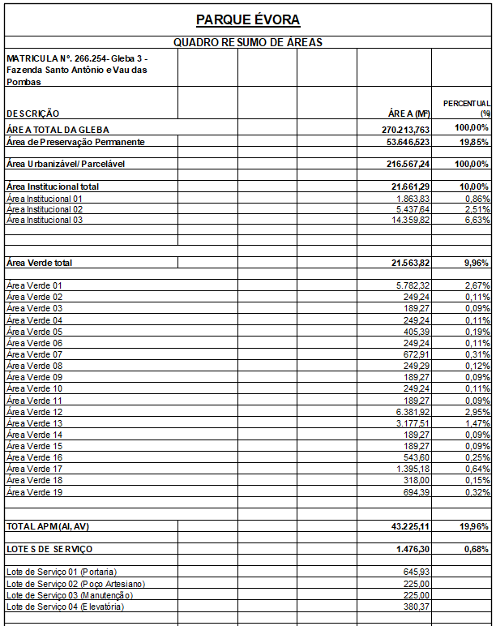
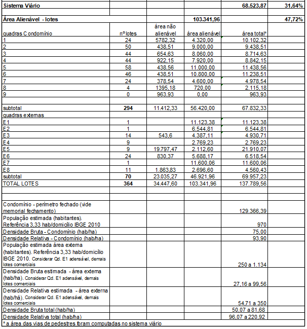

DECRETO "N" N° 150, DE 13 DE MARÇO DE 2023

(Revogado pelo Decreto "N" Nº 274, de 24 de abril de 2023).

~~Dispõe sobre aprovação do Loteamento Parque Évora neste Município, e dá outras providências.~~

~~O PREFEITO MUNICIPAL DE APARECIDA DE GOIÂNIA, no uso de suas atribuições legais, e~~

~~CONSIDERANDO que o loteamento foi aprovado conforme a Lei Complementar nº 124 de 14 Dezembro de 2016, que institui o Plano Diretor e Lei Complementar nº 152 de 09 de Outubro de 2018 que instituiu os instrumentos de Controle de Uso e Ocupação do Solo; Lei Complementar nº 176 de 05 de Agosto de 2020 que altera a Lei Complementar nº 124/2016 e 152/2018 e os critérios urbanísticos.~~

~~CONSIDERANDO os documentos acostados aos autos dos processos administrativo nº 2019.075.585 e 2022.189.834, especialmente o Parecer Técnico de Aprovação de Loteamento nº 443/2022/SPRU/DU, emitido pela Secretaria Municipal de Planejamento e Regulação Urbana.~~

~~**DECRETA:**~~

~~Art. 1º Fica aprovado o Loteamento PARQUE ÉVORA, neste Município, de propriedade da EA3 7 URBANISMO LTDA, pessoa jurídica de direito privado, inscrita no CNPJ sob nº 17.436.249/0001-47, com sede no endereço Rua T-55, nº 930, sala 1703 (parte) Ed. Walk Business, St. Bueno, CEP: 74.215-170, Goiânia-GO, conforme abaixo:~~

~~I - IDENTIFICAÇÃO DA ÁREA DO IMÓVEL: O imóvel onde será implantado o loteamento está cadastrado perante o 1° Cartório de Registro de Imóveis de Aparecida de Goiânia sob a matrícula de número 266.254, com os seguintes limites e confrontações:~~

~~Inicia-se a descrição deste perímetro no vértice AY4-P-27.834, de coordenadas N 8.146.857,749m e E 691.917,613m; situado na divisa da Fazenda Santo Antônio e Vau das Pombas – Gleba 02 – Matrícula nº 259.230 com a Avenida Bela Vista; deste, segue confrontando com a Avenida Bela Vista com os seguintes azimutes e distâncias: 136°12'12" e 419,24 m até o vértice AY4-M-H773, de coordenadas N 8.146.555,141 metros e E 692.207,769 metros; 127°44'33" e 11,99 metros até o vértice AY4-M-H772, de coordenadas N 8.146.547,802 metros e E 692.217,250 metros; 134°27'41" e 20,02 metros até o vértice AY4-V-0100, de coordenadas N 8.146.533,782 metros e E 692.231,536 metros; situado na divisa da Avenida Bela Vista com a Fazenda Santo Antônio e Vau das Pombas – Matrícula nº Av. 16-250.804 – Remanescente; deste, segue confrontando com a Matrícula nº Av. 16-250.804 – Remanescente, com os seguintes azimutes e distâncias: 224°58'52" e 143,10 metros até o vértice AY4-V-0101, de coordenadas N 8.146.432,564 metros e E 692.130,384 metros; situado na proximidade da nascente de uma vertente; deste, segue por esta vertente, à jusante, com os seguintes azimutes e distâncias: 243°18'43" e 49,42 metros até o vértice AY4-V-0102, de coordenadas N 8.146.410,367 metros e E 692.086,227 metros; 225°52'36" e 111,42 metros até o vértice AY4-V-0103, de coordenadas N 8.146.332,797 metros e E 692.006,246 metros; 242°57'44" e 117,86 metros até o vértice AY4-V-0104, de coordenadas N 8.146.279,222 metros e E 691.901,270 metros; 155°43'29" e 20,25 metros até o vértice AY4-V-0105, de coordenadas N 8.146.260,763 metros e E 691.909,595 metros; 228°34'40" e 27,57 metros até o vértice AY4-V-0106, de coordenadas N 8.146.242,523 metros e E 691.888,922 metros; 233°56'07" e 34,49 metros até o vértice AY4-V-0107, de coordenadas N 8.146.222,220 metros e E 691.861,044 metros; 339°19'01" e 55,63 metros até o vértice AY4-V-0108, de coordenadas N 8.146.274,263 metros e E 691.841,396 metros; 245°33'02" e 23,01 metros até o vértice AY4-V-0109, de coordenadas N 8.146.264,738 metros e E 691.820,445 metros; 230°25'42" e 31,90 metros até o vértice AY4-V-0110, de coordenadas N 8.146.244,418 metros e E 691.795,858 metros; 256°14'27" e 34,34 metros até o vértice AY4-V-0111, de coordenadas N 8.146.236,250 metros e E 691.762,501 metros; 267°26'00" e 37,99 metros até o vértice AY4-V-0112, de coordenadas N 8.146.234,549 metros e E 691.724,549 metros; deste, segue confrontando com a Fazenda Santo Antônio e Vau das Pombas – Matrícula nº Av.16-250.804 – Remanescente, com os seguintes azimutes e distâncias: 270°27'27" e 115,66 metros até o vértice AY4-V-0113, de coordenadas N 8.146.235,472 metros e E 691.608,895 metros; 343°12'33" e 196,15 metros até o vértice AY4-V-0114, de coordenadas N 8.146.423,261 metros e E 691.552,231 metros; Situado na divisa da Fazenda Santo Antônio e Vau das Pombas – Matrícula nº AV. 16-250.804 – Remanescente com a Rua Crisólito; deste, segue pela Rua Crisólito, com o azimute e distância de 37°43'27" e 84,57 metros até o vértice AY4-M-H770, de coordenadas N 8.146.490,154 metros e E 691.603,977 metros; deste, segue pela Rua Sardônica, com o azimute e distância de 330°24'06" e 156,78 metros até o vértice AY4-P-27.835, de coordenadas N 8.146.626,471 metros e E 691.526,543 metros; situado na divisa da Rua Sardônica com a Fazenda Santo Antônio e Vau das Pombas – Gleba 02 – Matrícula nº 259.230; deste, segue confrontando com a Fazenda Santo Antônio e Vau das Pomba –n Gleba 02 – Matrícula nº 259.230, com o seguinte azimute e distância 59°24' e 454,34 metros até o vértice AY4-P-27.834, ponto inicial da descrição deste perímetro.~~

~~II- CARACTERIZAÇÃO DO LOTEAMENTO~~

~~Loteamento residencial, sendo parte parcelamento de acesso restrito e parte loteamento convencional, com lotes comerciais/residenciais junto à Avenida Bela Vista. O trecho de parcelamento restrito contempla área de 129.366,39m² com 294 lotes de 180,00m² a 250,00m² e lotes de serviço destinados a equipamentos/instalações de uso privativo do parcelamento de acesso restrito. São 70 lotes externos com área de 200,00m² a 11.600,06m². O total de lotes é de 368 terrenos, sendo 364 alienáveis e 04 lotes de serviço. Os terrenos do loteamento apresentarão zoneamento conforme Lei n. 124, de 14 de dezembro de 2016.~~

~~III-CLASSIFICAÇÃO E DISTRIBUIÇÃO DE AREAS~~

~~IV - TABELA DE DISTRIBUIÇÃO DAS QUADRAS – ÁREA VENDÁVEL~~

| ~~**QUADRAS**~~ | ~~**INTERNAS(RESIDENCIAIS)**~~ | ~~**EXTERNAS(RESIDENCIAIS / COMERCIAIS)**~~ | ~~**LOTES DE SERVIÇO / PORTARIA/ EQUIPAMENTO**~~ | ~~**A.P.M.S**~~ | ~~**ÁREA TOTAL DA QUADRA (m²)**~~ | ~~**%**~~ |
| --- | --- | --- | --- | --- | --- | --- |
| ~~**Nº DE LOTE**~~ | ~~**ÁREA LOTES**~~ | ~~**Nº DE LOTE**~~ | ~~**ÁREA LOTES**~~ | ~~**Nº DE LOTE**~~ | ~~**ÁREA LOTES**~~ | ~~**Nº DE A.P.M.**~~ | ~~**ÁREA A.P.M.**~~ |
| --- | --- | --- | --- | --- | --- | --- | --- |
| ~~QUADRA 01~~ | ~~24~~ | ~~4.320,00~~ | ~~0~~ | ~~0,00~~ | ~~0~~ | ~~0,00~~ | ~~1~~ | ~~5.782,32~~ | ~~10.102,32~~ | ~~4,665%~~ |
| ~~QUADRA 02~~ | ~~50~~ | ~~9.000,00~~ | ~~0~~ | ~~0,00~~ | ~~0~~ | ~~0,00~~ | ~~2~~ | ~~438,51~~ | ~~9.438,51~~ | ~~4,358%~~ |
| ~~QUADRA 03~~ | ~~44~~ | ~~8.060,00~~ | ~~0~~ | ~~0,00~~ | ~~0~~ | ~~0,00~~ | ~~2~~ | ~~654,63~~ | ~~8.714,63~~ | ~~4,024%~~ |
| ~~QUADRA 04~~ | ~~44~~ | ~~7.920,00~~ | ~~0~~ | ~~0,00~~ | ~~0~~ | ~~0,00~~ | ~~2~~ | ~~922,15~~ | ~~8.842,15~~ | ~~4,083%~~ |
| ~~QUADRA 05~~ | ~~58~~ | ~~11.000,00~~ | ~~0~~ | ~~0,00~~ | ~~0~~ | ~~0,00~~ | ~~2~~ | ~~438,56~~ | ~~11.438,56~~ | ~~5,282%~~ |
| ~~QUADRA 06~~ | ~~46~~ | ~~10.800,00~~ | ~~0~~ | ~~0,00~~ | ~~0~~ | ~~0,00~~ | ~~2~~ | ~~438,51~~ | ~~11.238,51~~ | ~~5,189%~~ |
| ~~QUADRA 07~~ | ~~24~~ | ~~4.600,00~~ | ~~0~~ | ~~0,00~~ | ~~0~~ | ~~0,00~~ | ~~2~~ | ~~378,54~~ | ~~4.978,54~~ | ~~2,299%~~ |
| ~~QUADRA 08~~ | ~~4~~ | ~~720,00~~ | ~~0~~ | ~~0,00~~ | ~~0~~ | ~~0,00~~ | ~~1~~ | ~~1.395,18~~ | ~~2.115,18~~ | ~~0,977%~~ |
| ~~QUADRA 09~~ | ~~2~~ | ~~0,00~~ | ~~0~~ | ~~0,00~~ | ~~1~~ | ~~645,93~~ | ~~1~~ | ~~318,00~~ | ~~963,93~~ | ~~0,445%~~ |
| ~~QUADRA E1~~ | ~~0~~ | ~~0,00~~ | ~~1~~ | ~~11.123,38~~ | ~~0~~ | ~~0,00~~ | ~~0~~ | ~~0,00~~ | ~~11.123,38~~ | ~~5,136%~~ |
| ~~QUADRA E2~~ | ~~0~~ | ~~0,00~~ | ~~1~~ | ~~6.544,81~~ | ~~0~~ | ~~0,00~~ | ~~0~~ | ~~0,00~~ | ~~6.544,81~~ | ~~3,022%~~ |
| ~~QUADRA E3~~ | ~~0~~ | ~~0,00~~ | ~~14~~ | ~~4.387,11~~ | ~~0~~ | ~~0,00~~ | ~~1~~ | ~~543,60~~ | ~~4.930,71~~ | ~~2,277%~~ |
| ~~QUADRA E4~~ | ~~0~~ | ~~0,00~~ | ~~9~~ | ~~2.769,23~~ | ~~0~~ | ~~0,00~~ | ~~0~~ | ~~0,00~~ | ~~2.769,23~~ | ~~1,278%~~ |
| ~~QUADRA E5~~ | ~~0~~ | ~~0,00~~ | ~~9~~ | ~~2.112,60~~ | ~~0~~ | ~~0,00~~ | ~~2~~ | ~~19.797,47~~ | ~~21.910,07~~ | ~~10,117%~~ |
| ~~QUADRA E6~~ | ~~0~~ | ~~0,00~~ | ~~24~~ | ~~5.688,17~~ | ~~3~~ | ~~830,37~~ | ~~0~~ | ~~0,00~~ | ~~6.518,54~~ | ~~3,010%~~ |
| ~~QUADRA E7~~ | ~~0~~ | ~~0,00~~ | ~~1~~ | ~~11.600,06~~ | ~~0~~ | ~~0,00~~ | ~~0~~ | ~~0,00~~ | ~~11.600,06~~ | ~~5,356%~~ |
| ~~QUADRA E8~~ | ~~0~~ | ~~0,00~~ | ~~11~~ | ~~2.696,60~~ | ~~0~~ | ~~0,00~~ | ~~1~~ | ~~1.863,83~~ | ~~4.560,43~~ | ~~2,106%~~ |
| ~~**TOTAL**~~ | ~~**296**~~ | ~~**56.420,00**~~ | ~~**70**~~ | ~~**46.921,96**~~ | ~~**4**~~ | ~~**1.476,30**~~ | ~~**19**~~ | ~~**32.971,30**~~ | ~~**137.789,56**~~ | ~~**63,624%**~~ |
| ~~**%**~~ | ~~**26,052%**~~ | ~~**21,666%**~~ | ~~**0,682%**~~ | ~~**15,224%**~~ |

~~V- TABELA DE DISTRIBUIÇÃO DAS ÁREAS INSTITUCIONAIS~~

| ~~**ÁREAS PÚBLICAS MUNICIPAIS (\*)**~~ |
| --- |
| ~~**ÁREAS DESTINADAS A ÁREAS INSTITUCIONAIS E ÁREAS VERDES/PRAÇAS**~~ |
| --- |
| ~~**DISCRIMINAÇÃO**~~ | ~~**ÁREAS INSTITUCIONAIS**~~ | ~~**ÁREAS VERDES/ PRAÇAS**~~ |
| --- | --- | --- |
| ~~**ÁREA (m²)**~~ | ~~**%**~~ | ~~**ÁREA (m²)**~~ | ~~**%**~~ |
| ~~ÁREA INSTITUCIONAL 01~~ |   | ~~1.863,83~~ | ~~0,86%~~ | ~~\-~~ | ~~\-~~ |
| ~~ÁREA INSTITUCIONAL 02~~ |   |   |   | ~~5.437,64~~ | ~~2,51%~~ | ~~\-~~ | ~~\-~~ |
| ~~ÁREA INSTITUCIONAL 03~~ |   | ~~14.359,82~~ | ~~6,63%~~ | ~~\-~~ | ~~\-~~ |
| ~~ÁREA VERDE 01~~ | ~~\-~~ | ~~\-~~ | ~~5.782,32~~ | ~~2,67%~~ |
| ~~ÁREA VERDE 02~~ | ~~\-~~ | ~~\-~~ | ~~249,24~~ | ~~0,11%~~ |
| ~~ÁREA VERDE 03~~ | ~~\-~~ | ~~\-~~ | ~~189,27~~ | ~~0,09%~~ |
| ~~ÁREA VERDE 04~~ | ~~\-~~ | ~~\-~~ | ~~249,24~~ | ~~0,11%~~ |
| ~~ÁREA VERDE 05~~ | ~~\-~~ | ~~\-~~ | ~~405,39~~ | ~~0,19%~~ |
| ~~ÁREA VERDE 06~~ | ~~\-~~ | ~~\-~~ | ~~249,24~~ | ~~0,11%~~ |
| ~~ÁREA VERDE 07~~ | ~~\-~~ | ~~\-~~ | ~~672,91~~ | ~~0,31%~~ |
| ~~ÁREA VERDE 08~~ | ~~\-~~ | ~~\-~~ | ~~249,29~~ | ~~0,12%~~ |
| ~~ÁREA VERDE 09~~ |   |   |   | ~~189,27~~ | ~~0,09%~~ |
| ~~ÁREA VERDE 10~~ |   |   |   | ~~249,24~~ | ~~0,11%~~ |
| ~~ÁREA VERDE 11~~ |   |   |   | ~~189,27~~ | ~~0,09%~~ |
| ~~ÁREA VERDE 12~~ |   |   |   | ~~6.381,92~~ | ~~2,95%~~ |
| ~~ÁREA VERDE 13~~ |   |   |   | ~~3.177,51~~ | ~~1,47%~~ |
| ~~ÁREA VERDE 14~~ |   |   |   | ~~189,27~~ | ~~0,09%~~ |
| ~~ÁREA VERDE 15~~ |   |   |   | ~~189,27~~ | ~~0,09%~~ |
| ~~ÁREA VERDE 16~~ |   |   |   | ~~543,60~~ | ~~0,25%~~ |
| ~~ÁREA VERDE 17~~ |   |   |   | ~~1.395,18~~ | ~~0,64%~~ |
| ~~ÁREA VERDE 18~~ |   |   |   | ~~318,00~~ | ~~0,15%~~ |
| ~~ÁREA VERDE 19~~ |   |   |   | ~~694,39~~ | ~~0,32%~~ |
| ~~**TOTAL DAS ÁREAS INSTITUCIONAIS**~~ | ~~**21.661,29**~~ | ~~**10,00%**~~ | ~~\-~~ | ~~\-~~ |
| ~~**TOTAL DAS ÁREAS VERDES/ LAZER / PRAÇAS**~~ | ~~**21.563,82**~~ | ~~**9,96%**~~ |
| ~~**TOTAL DAS ÁREAS PÚBLICAS MUNICIPAIS (\*)**~~ | ~~**43.225,11**~~ | ~~**19,96%**~~ |

~~VI – TABELA DE DISTRIBUIÇAÕ DAS ÁREAS VERDES~~

<table><tbody><tr><td colspan="11"><s>**LISTAGEM DAS ÁREAS VERDES**</s></td></tr><tr><td rowspan="3"><s>**ÁREA**</s></td><td colspan="9"><s>**Dimensões Lineares e Confrontações dos Lotes (em metros)**</s></td><td rowspan="3"><s>**Área&nbsp;&nbsp;&nbsp;&nbsp;&nbsp;&nbsp;&nbsp;&nbsp;&nbsp;&nbsp;&nbsp;&nbsp;&nbsp;&nbsp;&nbsp;&nbsp; (m²)**</s></td></tr><tr><td rowspan="2"><s>**Logradouro**</s></td><td rowspan="2"><s>**Frente**</s></td><td rowspan="2"><s>**Fundo**</s></td><td rowspan="2"><s>**Confr. Fundo**</s></td><td rowspan="2"><s>**L Direito**</s></td><td rowspan="2"><s>**Confr. LD**</s></td><td rowspan="2"><s>**L Esquerdo**</s></td><td rowspan="2"><s>**Confr. LE**</s></td><td rowspan="2"><s>**Chanfro**</s></td></tr><tr></tr><tr><td><s>Área Verde 01</s></td><td><s>Avenida Crisolito</s></td><td><s>103,44 + D=93,29 + 65,90</s></td><td><s>D=28,38 + 20,00 +216,00 + 20,00 + 17,96 + D=26,70 + 30,03 + D=19,29 + D=7,39 +&nbsp; 9,33</s></td><td><s>Rua da Moeda, Lote 01 até o Lote 24,Rua dos Penedos e Rua dos Segueiros</s></td><td><s>43,71 + D=3,91 + D=1,83 + 5,00 + D=28,20 + 5,00 + D=4,39 + D=5,96 + 34,93 + D=4,96 + D=4,99</s></td><td><s>Rua da República, Rua do Velasco e Avenida dos Castelos</s></td><td><s>38,93</s></td><td><s>Lote 01, Lote 03 e Lote 04 da Quadra E6</s></td><td><s>D=2,67 + D=6,13</s></td><td><s>5.782,32</s></td></tr><tr><td><s>Área Verde 02</s></td><td><s>Rua da Trindade</s></td><td><s>30,15</s></td><td><s>40,00</s></td><td><s>Lote 01 e&nbsp;&nbsp; Lote 50</s></td><td><s>2,96</s></td><td><s>Rua da Moeda</s></td><td><s>* - *</s></td><td><s>* - *</s></td><td><s>D=8,35 + D=7,36</s></td><td><s>249,24</s></td></tr><tr><td><s>Área Verde 03</s></td><td><s>Rua dos Penedos</s></td><td><s>30,00</s></td><td><s>40,00</s></td><td><s>Lote 25 e&nbsp;&nbsp;&nbsp; Lote 26</s></td><td><s>* - *</s></td><td><s>* - *</s></td><td><s>* - *</s></td><td><s>* - *</s></td><td><s>D=7,85 + D=7,85</s></td><td><s>189,27</s></td></tr><tr><td><s>Área Verde 04</s></td><td><s>Rua da Trindade</s></td><td><s>30,15</s></td><td><s>40,00</s></td><td><s>Lote 01 e&nbsp;&nbsp;&nbsp; Lote 44</s></td><td><s>2,96</s></td><td><s>Rua dos Mercadores</s></td><td><s>* - *</s></td><td><s>* - *</s></td><td><s>D=8,35 + D=7,36</s></td><td><s>249,24</s></td></tr><tr><td><s>Área Verde 05</s></td><td><s>Rua dos Segueiros e Avenida dos Castelos</s></td><td><s>15,18 + D=6,07 + D=16,01</s></td><td><s>40,00</s></td><td><s>Lote 22 e&nbsp;&nbsp;&nbsp; Lote 23</s></td><td><s>* - *</s></td><td><s>* - *</s></td><td><s>5,03</s></td><td><s>Rua dos Mercadores</s></td><td><s>D=6,14 + D=6,47</s></td><td><s>405,39</s></td></tr><tr><td><s>Área Verde 06</s></td><td><s>Rua da Trindade</s></td><td><s>30,15</s></td><td><s>40,00</s></td><td><s>Lote 01 e&nbsp;&nbsp;&nbsp; Lote 44</s></td><td><s>2,96</s></td><td><s>Avenida dos Salesianos</s></td><td><s>* - *</s></td><td><s>* - *</s></td><td><s>D=8,35 + D=7,36</s></td><td><s>249,24</s></td></tr><tr><td><s>Área Verde 07</s></td><td><s>Rua dos Touros e Avenida dos Castelos</s></td><td><s>D=21,40 + D=6,10 + 13,20</s></td><td><s>40,00</s></td><td><s>Lote 22 e&nbsp;&nbsp;&nbsp; Lote 23</s></td><td><s>18,11</s></td><td><s>Rua das Fontes</s></td><td><s>* - *</s></td><td><s>* - *</s></td><td><s>D=5,72 + D=7,85</s></td><td><s>672,91</s></td></tr><tr><td><s>Área Verde 08</s></td><td><s>Rua da Trindade</s></td><td><s>30,15</s></td><td><s>40,00</s></td><td><s>Lote 01 e&nbsp;&nbsp;&nbsp;&nbsp;&nbsp; Lote 58</s></td><td><s>2,96</s></td><td><s>Rua dos Fontes</s></td><td><s>* - *</s></td><td><s>* - *</s></td><td><s>D=8,35 + D=7,36</s></td><td><s>249,29</s></td></tr><tr><td><s>Área Verde 09</s></td><td><s>Rua do Cenáculo</s></td><td><s>30,00</s></td><td><s>40,00</s></td><td><s>Lote 29 e&nbsp;&nbsp;&nbsp;&nbsp; Lote 30</s></td><td><s>* - *</s></td><td><s>* - *</s></td><td><s>* - *</s></td><td><s>* - *</s></td><td><s>D=7,85 + D=7,85</s></td><td><s>189,27</s></td></tr><tr><td><s>Área Verde 10</s></td><td><s>Rua da Trindade</s></td><td><s>30,15</s></td><td><s>40,00</s></td><td><s>Lote 01 e&nbsp;&nbsp;&nbsp; Lote 46</s></td><td><s>2,96</s></td><td><s>Rua das Alcaçárias</s></td><td><s>* - *</s></td><td><s>* - *</s></td><td><s>D=8,35 + D=7,36</s></td><td><s>249,24</s></td></tr><tr><td><s>Área Verde 11</s></td><td><s>Rua do Cenáculo</s></td><td><s>30,00</s></td><td><s>40,00</s></td><td><s>Lote 23&nbsp; e&nbsp;&nbsp; Lote 24</s></td><td><s>* - *</s></td><td><s>* - *</s></td><td><s>* - *</s></td><td><s>* - *</s></td><td><s>D=7,85 + D=7,85</s></td><td><s>189,27</s></td></tr><tr><td><s>Área Verde 12</s></td><td><s>Avenida Lisboa e Rua da Trindade</s></td><td><s>16,62 + 223,38</s></td><td><s>Sem Medida Conven-cionada</s></td><td><s>A.P.P</s></td><td><s>* - *</s></td><td><s>* - *</s></td><td><s>7,45</s></td><td><s>Lote 27 (Lote de Serviço 04) da Quadra E6</s></td><td><s>D=25,03</s></td><td><s>6.381,92</s></td></tr><tr><td><s>Área Verde 13</s></td><td><s>Avenida Lisboa</s></td><td><s>109,53</s></td><td><s>9,94</s></td><td><s>Fazenda Santo Antônio</s></td><td><s>105,24</s></td><td><s>Rua de Timor</s></td><td><s>A.P.P</s></td><td><s>Sem medida convencio-nada</s></td><td><s>* - *</s></td><td><s>3.177,51</s></td></tr><tr><td><s>Área Verde 14</s></td><td><s>Avenida Lisboa</s></td><td><s>30,00</s></td><td><s>40,00</s></td><td><s>Lote 01&nbsp; e&nbsp;&nbsp; Lote 24</s></td><td><s>* - *</s></td><td><s>* - *</s></td><td><s>* - *</s></td><td><s>* - *</s></td><td><s>D=7,85 + D=7,85</s></td><td><s>189,27</s></td></tr><tr><td><s>Área Verde 15</s></td><td><s>Rua de Viana</s></td><td><s>30,00</s></td><td><s>40,00</s></td><td><s>Lote 12 e&nbsp;&nbsp;&nbsp; Lote 13</s></td><td><s>* - *</s></td><td><s>* - *</s></td><td><s>* - *</s></td><td><s>* - *</s></td><td><s>D=7,85 + D=7,85</s></td><td><s>189,27</s></td></tr><tr><td><s>Área Verde 16</s></td><td><s>Rua da República</s></td><td><s>35,65</s></td><td><s>5,04 + D=3,13 +&nbsp; 9,60 + 20,00</s></td><td><s>Estaciona-mento Rua do Velasco</s></td><td><s>31,61</s></td><td><s>Rua de Viana e Lote 14</s></td><td><s>D=14,04</s></td><td><s>Rua do Velasco</s></td><td><s>D= 3,91</s></td><td><s>543,60</s></td></tr><tr><td><s>Área Verde 17</s></td><td><s>Rua de Burgos</s></td><td><s>19,89 + D=12,83 + 41,69</s></td><td><s>6,59 + 20,00 + 36,00 + 20,00 + D=7,85 + 10,96 + D=26,70 + 7,68</s></td><td><s>Rua das Fontes, Rua do Cenáculo, Rua de Viana e Lote 01 até o Lote 04</s></td><td><s>D=6,46 + 6,42 + D=3,15 + 4,40 + 20,00</s></td><td><s>Rua do Velasco e Estaciona-mento</s></td><td><s>13,19 + D=6,10 + D=6,71</s></td><td><s>Rua dos Touros e Avenida dos Castelos</s></td><td><s>D=7,85 + D=2,97 +D=5,63</s></td><td><s>1.395,18</s></td></tr><tr><td><s>Área Verde 18</s></td><td><s>Avenida dos Castelos</s></td><td><s>9,01</s></td><td><s>10,34</s></td><td><s>Rua de Burgos</s></td><td><s>D=11,86</s></td><td><s>Rua do Velasco</s></td><td><s>22,50</s></td><td><s>Lote de Serviço 01 (Portaria)</s></td><td><s>D=7,69 + D=8,74</s></td><td><s>318,00</s></td></tr><tr><td><s>Área Verde 19</s></td><td><s>Rua da República</s></td><td><s>60,59</s></td><td><s>D=65,68</s></td><td><s>Rua do Velasco</s></td><td><s>* - *</s></td><td><s>* - *</s></td><td><s>* - *</s></td><td><s>* - *</s></td><td><s>D=8,02 + D=8,02</s></td><td><s>694,39</s></td></tr><tr><td><s>&nbsp;</s></td><td><s>&nbsp;</s></td><td><s>&nbsp;</s></td><td><s>&nbsp;</s></td><td><s>&nbsp;</s></td><td><s>&nbsp;</s></td><td><s>&nbsp;</s></td><td><s>&nbsp;</s></td><td><s>&nbsp;</s></td><td><s>**Área**</s></td><td><s>**21.563,82**</s></td></tr></tbody></table>

~~VII – TABELA DE DISTRIBUIÇÃO DOS LOTES DE SERVIÇOS~~

<table><tbody><tr><td colspan="11"><s>**LISTAGEM DOS LOTES DE SERVIÇO**</s></td></tr><tr><td rowspan="3"><s>**Lote**</s></td><td colspan="9"><s>**Dimensões Lineares e Confrontações dos Lotes (em metros)**</s></td><td rowspan="3"><s>**Área&nbsp;&nbsp;&nbsp;&nbsp;&nbsp;&nbsp;&nbsp;&nbsp;&nbsp;&nbsp;&nbsp;&nbsp;&nbsp;&nbsp;&nbsp;&nbsp; (m²)**</s></td></tr><tr><td rowspan="2"><s>**Logradouro**</s></td><td rowspan="2"><s>**Frente**</s></td><td rowspan="2"><s>**Fundo**</s></td><td rowspan="2"><s>**Confr. Fundo**</s></td><td rowspan="2"><s>**L Direito**</s></td><td rowspan="2"><s>**Confr. LD**</s></td><td rowspan="2"><s>**L Esquerdo**</s></td><td rowspan="2"><s>**Confr. LE**</s></td><td rowspan="2"><s>**Chanfro**</s></td></tr><tr></tr><tr><td><s>Lote de Serviço 01(Por-taria)</s></td><td><s>Avenida dos Castelos</s></td><td><s>20,04</s></td><td><s>23,80</s></td><td><s>Rua de Burgos</s></td><td><s>22,50</s></td><td><s>Área Verde 18</s></td><td><s>D=9,81 + D=8,55 + 5,74</s></td><td><s>Rua de Burgos e Avenida dos Castelos</s></td><td><s>D=4,96 + D=4,01</s></td><td><s>645,93</s></td></tr><tr><td><s>Lote 17 (Lote de Serviço 02- Poço Artesiano)</s></td><td><s>Beco dos Açúcares</s></td><td><s>9,00</s></td><td><s>9,00</s></td><td><s>Rua da Trindade</s></td><td><s>25,00</s></td><td><s>Lote 16</s></td><td><s>25,00</s></td><td><s>Lote 18</s></td><td><s>* - *</s></td><td><s>225,00</s></td></tr><tr><td><s>Lote 26 (Lote de Serviço 03-Manu-tenção)</s></td><td><s>Rua da Trindade</s></td><td><s>9,00</s></td><td><s>9,00</s></td><td><s>Beco dos Açúcares</s></td><td><s>25,00</s></td><td><s>Lote 27 (Lote de Serviço 04-Elevatória)</s></td><td><s>25,00</s></td><td><s>Lote 25</s></td><td><s>* - *</s></td><td><s>225,00</s></td></tr><tr><td><s>Lote 27 (Lote de Serviço 04-Elevatória)</s></td><td><s>Beco dos Açúcares</s></td><td><s>15,61</s></td><td><s>15,00</s></td><td><s>Rua da Trindade</s></td><td><s>25,00</s></td><td><s>Lote 26 (Lote de Serviço 03-Manutenção)</s></td><td><s>17,56 +&nbsp;&nbsp;&nbsp;&nbsp;&nbsp;&nbsp;&nbsp; 7,45</s></td><td><s>A.P.P e Área Verde 12</s></td><td><s>* - *</s></td><td><s>380,37</s></td></tr><tr><td><s>&nbsp;</s></td><td><s>&nbsp;</s></td><td><s>&nbsp;</s></td><td><s>&nbsp;</s></td><td><s>&nbsp;</s></td><td><s>&nbsp;</s></td><td><s>&nbsp;</s></td><td><s>&nbsp;</s></td><td><s>&nbsp;</s></td><td><s>**Área**</s></td><td><s>**1.476,30**</s></td></tr></tbody></table>

~~Art. 2º - O empreendedor terá o prazo de até 180 (cento e oitenta) dias após a publicação deste Decreto para (registrar) o loteamento.~~

~~Art. 3º. Fica a EA3 7 URBANISMO LTDA, além de se comprometer com a infraestrutura do loteamento, assume o compromisso de executar as infraestruturas: Pavimentação asfáltica das vias de circulação, guias e sarjetas; Implantação do sistema de drenagem pluvial; Implantação de sistema individual de esgotamento sanitário; Implantação de rede de distribuição de água potável; Implantação de rede de iluminação pública e distribuição de energia elétrica; Sinalização viária; Medidas mitigadoras apresentadas e aprovadas no Estudo de Impacto de Trânsito (EIT).~~

~~Art. 4º. O orçamento apresentado, no valor de R$ 8.467.945,03 (oito milhões, quatrocentos e sessenta e sete mil, novecentos e quarenta e cinco reais e três centavos) para execução das obras complementares, o qual está sendo utilizado nos Termos Caução e Compromisso, poderá ter o seu valor atualizado até a apresentação do orçamento detalhado, podendo os documentos supracitados sofrerem alterações até o final do processo.~~

~~Art. 5º. O Alvará de implantação deverá ser expedido após o empreendedor cumprir os requisitos do art. 303 da Lei Complementar nº 124, de 14 de dezembro de 2016.~~

~~Art. 6º. Como garantia de implantação do loteamento e de toda a infraestrutura correspondente, o loteador apresenta alguns lotes, conforme Termo de Caução e Termo de Compromisso de Implantação do Loteamento, ambos assinados entre as partes, quais sejam:~~

<table><thead></thead><tbody><tr><td><s>Nº da quadra</s></td><td><s>Nº do lote</s></td><td><s>Área do lote (m2)</s></td><td><s>Valor venal</s></td></tr><tr><td><s>E1</s></td><td><s>1</s></td><td><s>11.123,38</s></td><td><s>R$ 4.449.352,00</s></td></tr><tr><td><s>E6</s></td><td><s>4</s></td><td><s>225,00</s></td><td><s>R$ 90.000,00</s></td></tr><tr><td><s>E6</s></td><td><s>5</s></td><td><s>225,00</s></td><td><s>R$ 90.000,00</s></td></tr><tr><td><s>E6</s></td><td><s>6</s></td><td><s>225,00</s></td><td><s>R$ 90.000,00</s></td></tr><tr><td><s>E6</s></td><td><s>7</s></td><td><s>225,00</s></td><td><s>R$ 90.000,00</s></td></tr><tr><td><s>E6</s></td><td><s>8</s></td><td><s>225,00</s></td><td><s>R$ 90.000,00</s></td></tr><tr><td><s>E6</s></td><td><s>9</s></td><td><s>225,00</s></td><td><s>R$ 90.000,00</s></td></tr><tr><td><s>E6</s></td><td><s>10</s></td><td><s>225,00</s></td><td><s>R$ 90.000,00</s></td></tr><tr><td><s>E6</s></td><td><s>11</s></td><td><s>225,00</s></td><td><s>R$ 90.000,00</s></td></tr><tr><td><s>E6</s></td><td><s>12</s></td><td><s>225,00</s></td><td><s>R$ 90.000,00</s></td></tr><tr><td><s>E6</s></td><td><s>13</s></td><td><s>225,00</s></td><td><s>R$ 90.000,00</s></td></tr><tr><td><s>E6</s></td><td><s>14</s></td><td><s>225,00</s></td><td><s>R$ 90.000,00</s></td></tr><tr><td><s>E6</s></td><td><s>15</s></td><td><s>225,00</s></td><td><s>R$ 90.000,00</s></td></tr><tr><td><s>E6</s></td><td><s>16</s></td><td><s>225,00</s></td><td><s>R$ 90.000,00</s></td></tr><tr><td><s>E6</s></td><td><s>18</s></td><td><s>237,50</s></td><td><s>R$ 95.000,00</s></td></tr><tr><td><s>E6</s></td><td><s>19</s></td><td><s>237,50</s></td><td><s>R$ 95.000,00</s></td></tr><tr><td><s>E6</s></td><td><s>20</s></td><td><s>237,50</s></td><td><s>R$ 95.000,00</s></td></tr><tr><td><s>E6</s></td><td><s>21</s></td><td><s>237,50</s></td><td><s>R$ 95.000,00</s></td></tr><tr><td><s>E6</s></td><td><s>22</s></td><td><s>237,50</s></td><td><s>R$ 95.000,00</s></td></tr><tr><td><s>E6</s></td><td><s>23</s></td><td><s>237,50</s></td><td><s>R$ 95.000,00</s></td></tr><tr><td><s>E6</s></td><td><s>24</s></td><td><s>237,50</s></td><td><s>R$ 95.000,00</s></td></tr><tr><td><s>E6</s></td><td><s>25</s></td><td><s>237,50</s></td><td><s>R$ 95.000,00</s></td></tr><tr><td><s>E7</s></td><td><s>1</s></td><td><s>11.600,06</s></td><td><s>R$ 4.640.024,00</s></td></tr><tr><td colspan="2"><s>TOTAL</s></td><td><s>27.548,44</s></td><td><s>R$ 11.019.376,00</s></td></tr></tbody></table>

~~§1º Esses lotes não poderão ser comercializados até que sejam liberados pela Prefeitura, através de aditamento a este Termo.~~

~~§2º O LOTEADOR se compromete a complementar o valor caucionado, seja em lotes ou fiança bancária, ou outra modalidade, caso o valor do orçamento apresentado sofra alteração durante a análise final de aprovação dos projetos complementares pelos respectivos órgãos competentes.~~

~~Art. 7º. A aprovação do parcelamento do solo objeto deste Decreto está em conformidade com os documentos acostados ao processo administrativo nº 2019.075.585 e 2022.189.834, especialmente o Parecer Técnico de Avaliação do Projeto de Loteamento, emitido pela Secretaria Municipal de Planejamento e Regulação Urbana, cuja planta de situação (mapa) é parte integrante deste.~~

~~Art. 8º. O descumprimento de quaisquer obrigações ou condições previstas no Termo de Compromisso e neste Decreto e demais normas implicará na rescisão dos termos acordados e revogação imediata deste Decreto, sem a necessidade de qualquer notificação prévia.~~

~~Art. 9º Este Decreto entrará em vigor na data de sua publicação.~~

~~MUNICÍPIO DE APARECIDA DE GOIÂNIA-GO, 13 de março de 2023.~~

~~VILMAR MARIANO

Prefeito Municipal~~

~~FÁBIO PASSAGLIA

Secretário de Governo~~

~~JÚLIO CÉSAR CHAGAS MENDES

Secretário de Planejamento e Regulação Urbana~~
