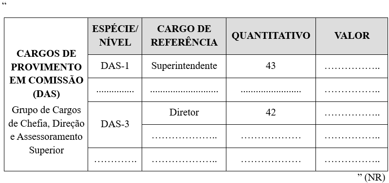
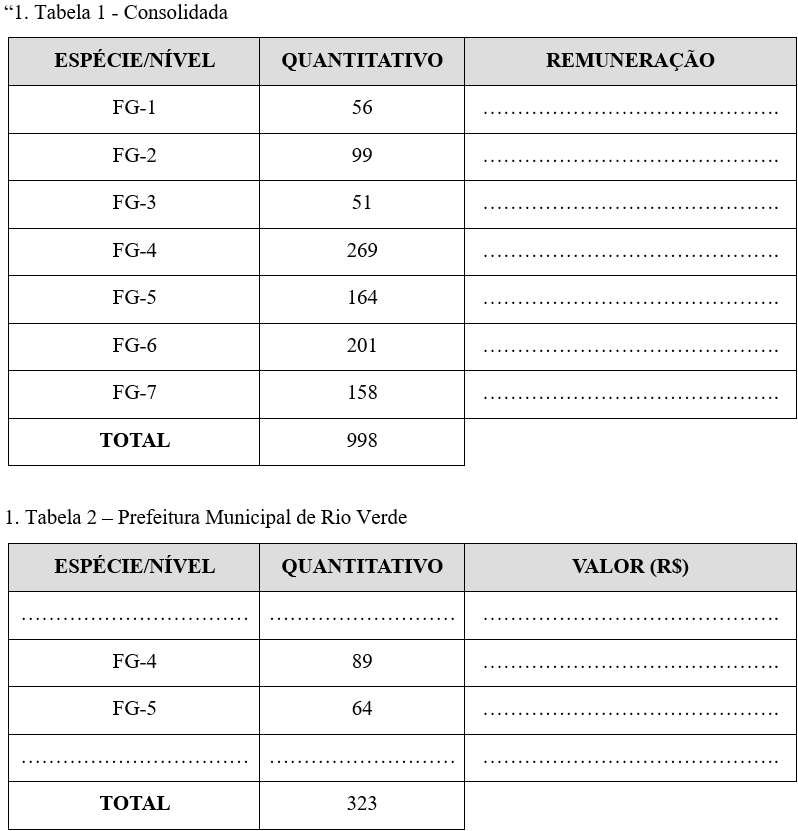
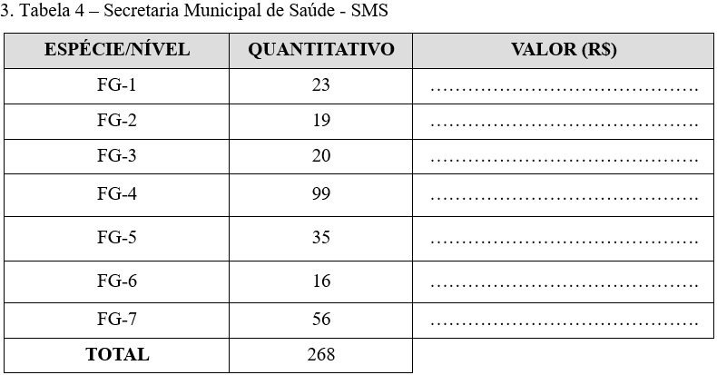
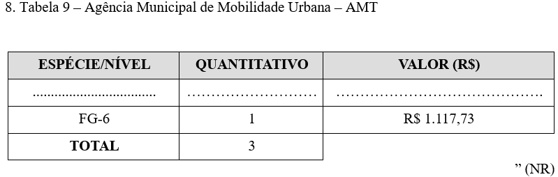
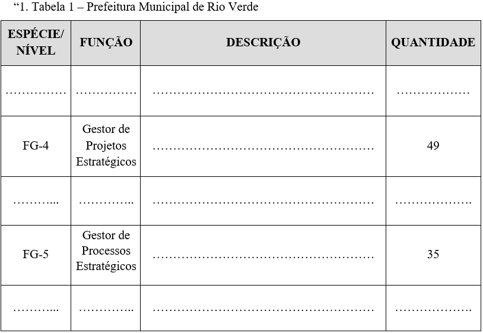
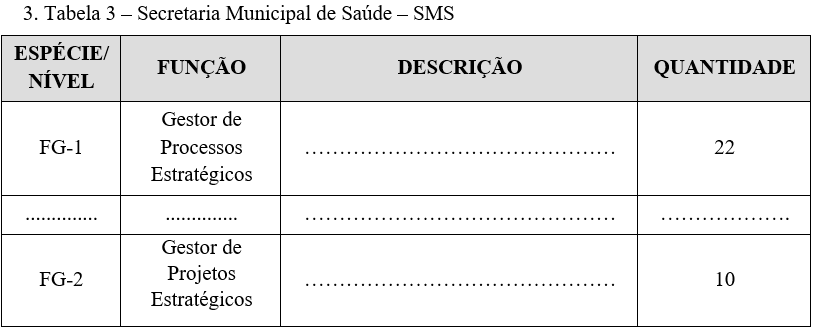
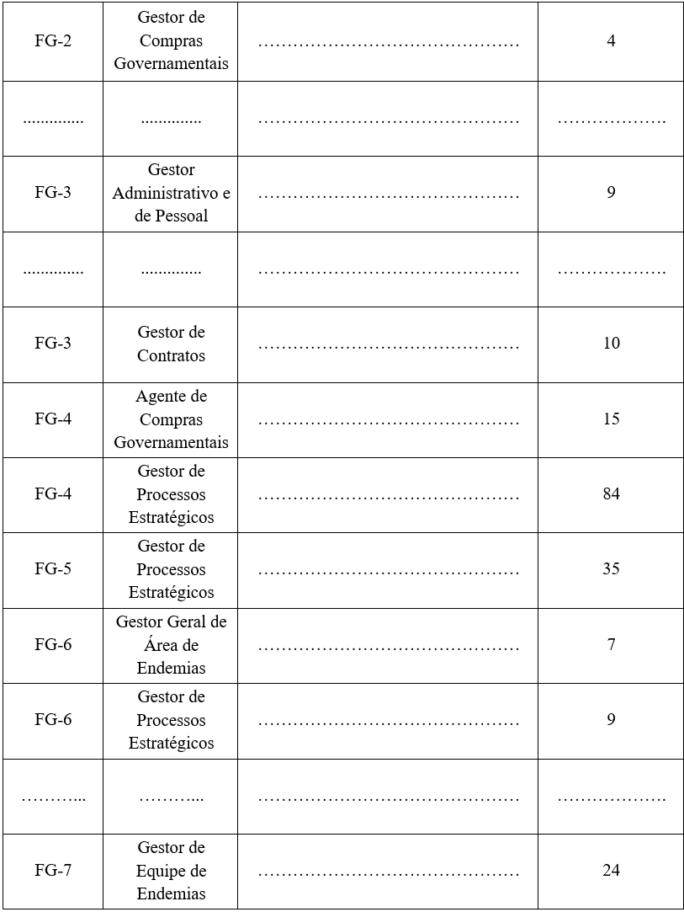
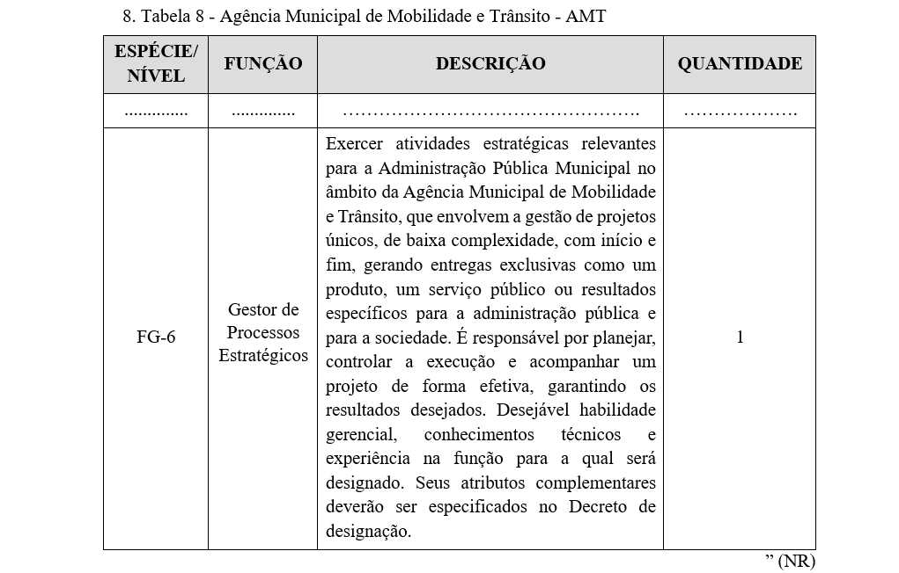
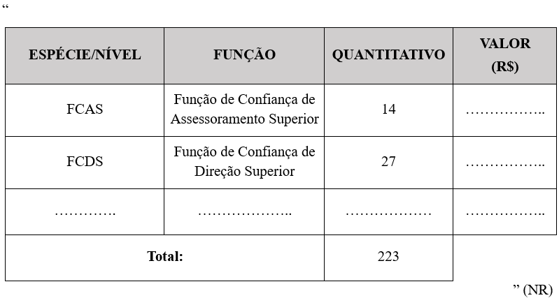
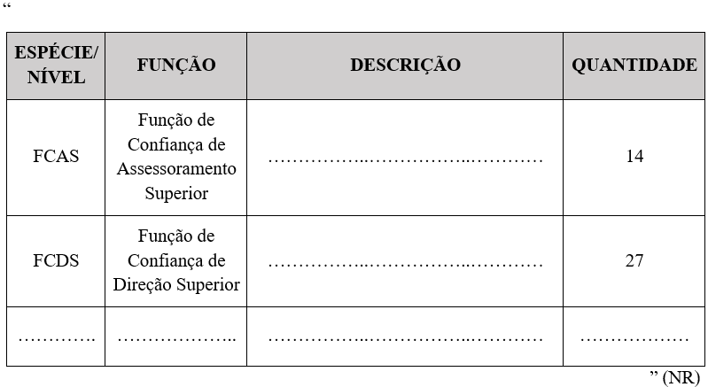

LEI COMPLEMENTAR Nº 452, DE 23 DE MARÇO DE 2026.

Altera a Lei Complementar nº 182, de 06 de maio de 2020, que dispõe sobre a Estrutura Orgânica Básica da Administração Pública Municipal.

**A CÂMARA MUNICIPAL DE RIO VERDE – GO APROVA E EU SANCIONO A SEGUINTE LEI:**

Art. 1º Fica alterada a Lei Complementar nº 182, de 06 de maio de 2020, para:

I - aumentar:

a) 03 (três) unidades o número de vagas do cargo de Superintendente (DAS-1);

b) 03 (três) unidades o número de vagas do cargo de Diretor (DAS-3);

c) 03 (três) unidades o número de vagas da Função de Confiança de Assessoramento Superior (FCAS);

d) 03 (três) unidades o número de vagas da Função de Confiança de Direção Superior (FCDS);

e) 05 (cinco) unidades o número de vagas da Função Gratificada de Gestor de Projetos Estratégicos (FG-4) da Prefeitura Municipal de Rio Verde;

f) 05 (cinco) unidades o número de vagas da Função Gratificada de Gestor de Processos Estratégicos (FG-5) da Prefeitura Municipal de Rio Verde;

g) 05 (cinco) unidades o número de vagas da Função Gratificada de Gestor de Processos Estratégicos (FG-1) da Secretaria Municipal de Saúde;

h) 05 (cinco) unidades o número de vagas da Função Gratificada de Gestor de Processos Estratégicos (FG-5) da Secretaria Municipal de Saúde;

i) 05 (cinco) unidades o número de vagas da Função Gratificada de Gestor de Projetos Estratégicos (FG-2) da Secretaria Municipal de Saúde;

j) 02 (duas) unidades o número de vagas da Função Gratificada de Gestor de Compras Governamentais (FG-2) da Secretaria Municipal de Saúde;

k) 03 (três) unidades o número de vagas da Função Gratificada de Gestor Administrativo e de Pessoal (FG-3) da Secretaria Municipal de Saúde;

l) 05 (cinco) unidades o número de vagas da Função Gratificada de Gestor de Contratos (FG-3) da Secretaria Municipal de Saúde;

m) 10 (dez) unidades o número de vagas da Função Gratificada de Gestor de Processos Estratégicos (FG-4) da Secretaria Municipal de Saúde;

n) 05 (cinco) unidades o número de vagas da Função Gratificada de Agente de Compras Governamentais (FG-4) da Secretaria Municipal de Saúde;

o) 03 (três) unidades o número de vagas da Função Gratificada de Gestor Geral de Área de Endemias (FG-6) da Secretaria Municipal de Saúde;

p) 05 (cinco) unidades o número de vagas da Função Gratificada de Gestor de Processos Estratégicos (FG-6) da Secretaria Municipal de Saúde;

q) 10 (dez) unidades o número de vagas da Função Gratificada de Gestor de Equipe de Endemias (FG-7) da Secretaria Municipal de Saúde;

II - criar a Função Gratificada de Gestor de Processos Estratégicos (FG-6) no quantitativo de 01 (uma) unidade, da Agência Municipal de Mobilidade e Trânsito - AMT.

Art. 3º Os Anexos II (Quadro de Classificação, Quantitativo e Valores dos Cargos de Provimento em Comissão (DAS); Anexo V (Quadro de Classificação, Quantitativo e Valores das Funções Gratificadas (FG), Anexo VI (Descrição das Funções Gratificadas (FG) e Anexo XVII (Quadro de Símbolos, Quantitativo e Valores das Funções de Confiança (FC) e Anexo XVIII (Descrição das Funções de Confiança (FC) da Lei Complementar nº 182, de 06 de maio de 2020, passa a vigorar conforme os Anexos I, II, III, IV e V desta Lei.

Art. 4º Esta Lei Complementar entrará em vigor em 01 de abril de 2026.

Gabinete do Prefeito de Rio Verde, aos 23 de março de 2026.

WELLINGTON SOARES CARRIJO FILHO

Prefeito de Rio Verde

VINÍCIUS FONSÊCA CAMPOS

Procurador-Geral

ÁLVARO CÉSAR DE SOUZA COSTA

Secretário de Planejamento e Gestão

**ANEXO I**

**(Alteração no Anexo II da Lei Complementar nº 182/2020 – QUADRO DE CLASSIFICAÇÃO, QUANTITATIVO E VALORES DOS CARGOS DE PROVIMENTO EM COMISSÃO (DAS)**

**ANEXO II**

**(Alteração no Anexo V daLei Complementar nº 182/2020 – QUADRO DE CLASSIFICAÇÃO, QUANTITATIVO E VALORES DAS FUNÇÕES GRATIFICADAS (FG)**

                         ...................................................................................................

                         ...................................................................................................

**ANEXO III

(Alteração no Anexo VI da Lei Complementar nº 182/2020 – DESCRIÇÃO DAS FUNÇÕES GRATIFICADAS (FG)**

                         ...................................................................................................

                         ...................................................................................................

**ANEXO IV

(Alteração no Anexo XVII da Lei Complementar nº 182/2020 – QUADRO DE SÍMBOLOS, QUANTITATIVO E VALORES DAS FUNÇÕES DE CONFIANÇA (FC)**

**ANEXO V

(Alteração no Anexo XVIII da Lei Complementar nº 182/2020 – DESCRIÇÃO DAS FUNÇÕES DE CONFIANÇA (FC)**

