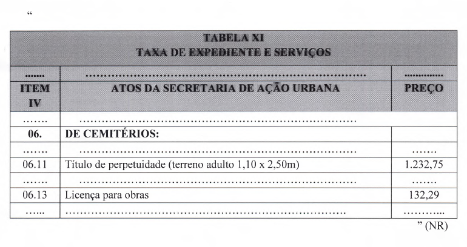

LEI COMPLEMENTAR Nº 441, DE 19 DE FEVEREIRO DE 2026.

Altera a Lei Complementar nº 5.727, de 11 de dezembro de 2009 - Código Tributário do Município de Rio Verde.

**A CÂMARA MUNICIPAL DE RIO VERDE - GO APROVA E EU SANCIONO A SEGUINTE LEI:**

Art. 1º Fica alterada a TABELA XI - TAXA DE EXPEDIENTE E SERVIÇOS anexa à Lei Complementar nº 5.727, de 11 de dezembro de 2009, que passará a vigorar conforme o Anexo Único desta lei.

Art. 2º Esta lei entrará em vigor na data de sua publicação.

Gabinete do Prefeito de Rio Verde, aos 19 de fevereiro de 2026.

WELLINGTON SOARES CARRIJO FILHO

Prefeito de Rio Verde

VINÍCIUS FONSÊCA CAMPOS

Procurador-Geral

ENIO FREITAS DE SENE

Secretário da Fazenda

**ANEXO ÚNICO**

**(Alteração da Tabela XI da Lei Complementar nº 5.727, de 11 de dezembro de 2009)**

