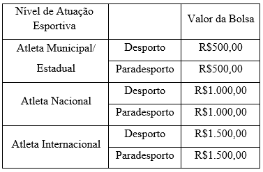

LEI Nº 7.789, DE 15 DE DEZEMBRO DE 2025.

Institui o Programa Orgulho Rio-verdense (Bolsa-Atleta) no Município de Rio Verde - Goiás e dá outras providências.

**A CÂMARA MUNICIPAL DE RIO VERDE-GO APROVA E EU SANCIONO A SEGUINTE LEI:**

Art. 1º Fica instituído o Programa Orgulho Rio-verdense (Bolsa-Atleta), destinado a apoiar e incentivar atletas e paratletas, não profissionais, que representem o Município de Rio Verde em competições oficiais, em âmbito municipal, regional, estadual, nacional e internacional, mediante concessão de auxílio financeiro mensal.

Art. 2º Compete à gestão do Programa Orgulho Rio-verdense (Bolsa-Atleta) selecionar atletas e paratletas aptos a receberem o benefício, mediante o cumprimento dos requisitos estabelecidos nesta lei e em edital, além da observância plena das condições previstas no Termo de Compromisso que será firmado obrigatoriamente entre os beneficiários e a Secretaria Municipal de Esporte e Lazer.

Parágrafo único. O Termo de Compromisso é o instrumento a ser formalizado entre o beneficiário e a Secretaria Municipal de Esporte e Lazer, que estabelecerá as obrigações, as metas esportivas a serem alcançadas, as responsabilidades do atleta e do paratleta e as formas e os prazos para a apresentação da prestação de contas dos recursos recebidos, requisito indispensável para a concessão e manutenção da Bolsa-Atleta.

Art. 3º A seleção dos beneficiários será realizada exclusivamente por meio de edital, que conterá as etapas do processo seletivo.

Art. 4º O beneficiário selecionado deverá cumprir integralmente todas as disposições e obrigações expressas no edital e no Termo de Compromisso, especialmente quanto à utilização dos recursos financeiros e à apresentação da prestação de contas durante o período de vigência da Bolsa-Atleta.

Art. 5º O quantitativo total de vagas a ser oferecido no âmbito do Programa será definido em edital, conforme disponibilidade orçamentária, e será distribuído entre as modalidades esportivas e categorias.

§ 1º Do quantitativo total de bolsas, ao menos 20% (vinte por cento) das vagas deverão ser reservadas de forma exclusiva para paratletas.

§ 2º Caso as vagas previstas para determinada categoria ou modalidade não venham a ser integralmente preenchidas, o quantitativo excedente, verificado por meio de ausência de candidatos habilitados que atendam aos requisitos mínimos previstos no edital, poderá ser remanejado para as demais categorias ou modalidades cujas vagas tenham sido totalmente preenchidas e que ainda possuam demanda comprovada de candidatos habilitados, seguindo critérios de proporcionalidade e prioridade estabelecidos no edital.

Art. 6º A Bolsa-Atleta será concedida pelo prazo 12 (doze) meses, admitida a prorrogação por igual período, mediante avaliação positiva de desempenho e apresentação de novo calendário esportivo, observada a disponibilidade orçamentária e a manutenção do cumprimento de todos os requisitos previstos na presente Lei e no respectivo edital.

**CAPÍTULO I**

**DAS CATEGORIAS DO PROGRAMA**

Art. 7º Para os fins de classificação e enquadramento dos candidatos, são categorias do Programa Orgulho Rio-verdense (Bolsa-Atleta) quanto ao nível de atuação esportiva:

I - Atleta Municipal/Estadual: que participa de competições esportivas municipais, regionais ou estaduais, dentro do Estado de Goiás;

II - Atleta Nacional: que compete em eventos de nível nacional, como campeonatos brasileiros, copas nacionais ou competições organizadas por confederações nacionais;

III - Atleta Internacional: que participa de competições em âmbito nacional e internacional.

Art. 8º Quanto à natureza da modalidade esportiva praticada, o Programa Orgulho Rio-verdense (Bolsa-Atleta) compreende as seguintes categorias:

I - Categoria Individual: destinada a atletas e paratletas não profissionais que disputam modalidades individuais em nível municipal, estadual, nacional ou internacional, comprovando participação e desempenho por meio de resultados oficiais, rankings, declarações formais das entidades de administração da modalidade ou quaisquer documentos equivalentes;

II - Categoria Coletiva: destinada a atletas e paratletas não profissionais que integrem equipes em competições oficiais reconhecidas pelas entidades de administração da modalidade, comprovando participação e desempenho por meio de súmulas de jogos, atas, declarações de participação ou documentos equivalentes que atestem sua inscrição e atuação efetiva na equipe, bem como mediante comprovação de convocação para seleções estaduais ou nacionais.

§ 1º A Bolsa-Atleta possui caráter estritamente individual, não sendo permitida a concessão coletiva ou em favor de equipes esportivas, ainda que o beneficiário atue em modalidade coletiva.

§ 2º Na categoria coletiva, a concessão do benefício e a subsequente avaliação de desempenho serão individuais, ainda que o resultado esportivo, ranking ou classificação tenham sido obtidos pelo conjunto da equipe.

**CAPÍTULO II**

**REQUISITOS PARA CONCESSÃO DO BENEFÍCIO**

Art. 9º Para pleitear o benefício do Programa Orgulho Rio-verdense (Bolsa-Atleta), o interessado deverá cumprir os seguintes requisitos:

I - residir no Município de Rio Verde há, no mínimo, 01 (um) ano;

II - não receber outra bolsa de incentivo ou auxílio financeiro similar destinado ao esporte, seja de origem municipal, estadual, federal ou privada, excetuando-se patrocínios que não configurem bolsas de auxílio financeiro diretamente vinculadas a desempenho esportivo ou renda social;

III - apresentar currículo esportivo referente ao ano anterior ao da inscrição no Programa, acompanhado de comprovação de participação em competição esportiva em âmbito municipal, estadual, nacional ou internacional, juntamente com o calendário anual detalhado de competições previstas para o período de vigência da bolsa;

IV - no caso de atleta estudante, seja no nível fundamental, médio ou superior, comprovar matrícula regular, frequência, rendimento escolar satisfatório, conforme edital, e boa conduta disciplinar;

V - apresentar autorização do responsável legal, no caso de menores de 18 (dezoito) anos;

VI - não estar cumprindo punição imposta por Tribunal de Justiça Desportiva, Liga, Federação ou Confederação, se o caso;

VII - apresentar Certidão Criminal Negativa das esferas estadual e federal, devidamente atualizada;

VIII - ceder ao Município de Rio Verde os direitos de imagem e se comprometer a utilizar, de maneira obrigatória, o brasão oficial do Município em seu uniforme, salvo nas situações de modalidades coletivas ou quando o atleta estiver representando seleções estaduais ou nacionais que vedem o uso do brasão oficial do Município;

IX - apresentar projeto esportivo contendo documentação e especificações das competições e etapas previstas em seu calendário oficial para o período da concessão;

X – outros critérios definidos em edital.

Parágrafo único. Na hipótese de haver mais interessados do que a quantidade de bolsas disponíveis, os critérios de seleção serão definidos em edital.

**CAPÍTULO III**

**DA CONTRAPARTIDA SOCIAL**

Art. 10. Para a concessão e manutenção da Bolsa-Atleta poderá ser exigida contrapartida social por parte do beneficiário consistente na participação em atividades esportivas de interesse público, tais como participação em escolinhas municipais, oficinas, clínicas esportivas, palestras ou quaisquer outras ações definidas pela Secretaria Municipal de Esporte e Lazer ou previamente estabelecidas de modo específico no edital.

§ 1º O beneficiário do Programa poderá sugerir alternativas de contrapartida social, que será submetida à devida avaliação técnica e aprovação final, na forma do edital, desde que haja pertinência e razoabilidade com a finalidade pública e comunitária da exigência.

§ 2º A contrapartida terá caráter educativo, comunitário e formativo, devendo guardar liame com a modalidade praticada pelo atleta, não gerando, em qualquer hipótese, vínculo empregatício, funcional, administrativo ou estatutário de qualquer natureza com o Município de Rio Verde.

**CAPÍTULO IV**

**RECURSOS FINANCEIROS E TABELA DE VALOREs**

Art. 11. O Poder Executivo concederá número limitado de bolsas, conforme disponibilidade orçamentária e financeira, sendo a distribuição determinada conforme as modalidades esportivas, as categorias e os critérios objetivos a serem definidos em edital.

Art. 12. As bolsas oferecidas no âmbito do Programa Orgulho Rio-verdense contemplarão os seguintes valores mensais, diferenciados em função do Nível de Atuação Esportiva comprovado pelo atleta:

Parágrafo único. Os valores dispostos neste artigo poderão ser objeto de reajuste periódico no mês de janeiro de cada ano, adotado como índice oficial de atualização o Índice Nacional de Preços ao Consumidor Amplo (IPCA), ou outro índice oficial que legalmente o substitua, por ato do Chefe do Poder Executivo.

**CAPÍTULO V

UTILIZAÇÃO DE RECURSOS**

Art. 13. Os recursos financeiros concedidos por meio do Programa Orgulho Rio-verdense (Bolsa-Atleta) somente poderão ser utilizados para despesas diretamente relacionadas à formação, à preparação física, técnica e psicológica, e à participação efetiva do beneficiário em competições oficiais, compreendendo, mas não se limitando, às seguintes categorias de gastos:

I - educação;

II - alimentação;

III - saúde;

IV - inscrições em competições;

V - hospedagem; 

VI – transporte urbano e para competições;

VII - aquisição de material esportivo;

VIII - cursos, capacitações e formação técnica;

IX - participação em congressos e simpósios;

X - taxas de exames de faixa e de registro em federações;

XI - uniformes de competição de pódio e banners;

XII - aquisição de equipamentos de treinamento.

Art. 14. O beneficiário deverá apresentar prestação de contas dos gastos efetivamente realizados com os recursos provenientes da Bolsa-Atleta nos prazos e na forma estabelecidos em edital e no Termo de Compromisso.

Art. 15. A prática de conduta incompatível com a finalidade da Bolsa-Atleta, inclusive aquela que comprometa sua idoneidade ou sua capacidade de representar o Município em competições, ou ainda quando constatada a indevida manutenção do benefício em razão de fraude ou descumprimento dos requisitos essenciais, implicará na obrigação de restituição dos valores recebidos, mediante processo administrativo próprio, assegurados o contraditório e a ampla defesa.

**CAPÍTULO VI

SUSPENSÃO E DESLIGAMENTO DO PROGRAMA**

Art. 16. Constatado o abandono ou, por qualquer razão, a interrupção da prática esportiva, ou, ainda, a ausência de participação nas competições do calendário apresentado quando da concessão do benefício sem a devida justificação previamente aceita pela Administração Municipal, o auxílio financeiro será suspenso pelo prazo de 90 (noventa) dias.

Art. 17. Será desligado do Programa Orgulho Rio-verdense (Bolsa-Atleta) beneficiário que incorrer em qualquer das seguintes hipóteses, apuradas em regular processo administrativo:

I - descumprir qualquer requisito estabelecido nesta lei, no Decreto Regulamentador ou no edital de seleção e Termo de Compromisso; 

II - transferir sua residência para outro município, estado ou país;

III - deixar de comprovar participação nas competições constantes do calendário oficial apresentado na inscrição sem justificativa prévia e aceita pela Comissão de Avaliação;

IV - apresentar documentos, declarações, inscrições ou quaisquer comprovações exigidas em edital que se revelem falsas ou fraudulentas;

V - deixar de ceder os direitos de uso de imagem ao Município de Rio Verde ou se apresentar em competições oficiais sem o uniforme contendo o brasão municipal, nas situações em que tal exigência for aplicável;

VI - durante a vigência da Bolsa, estiver cumprindo punição imposta por Tribunal de Justiça Desportiva, Liga, Federação ou Confederação da respectiva modalidade, ou for condenado por crime;

VII – o transcurso do prazo previsto no caput do art. 16 desta lei sem a retomada da prática esportiva.

Parágrafo único. O beneficiário desligado do Programa não terá direito a participação no Programa Orgulho Rio-verdense (Bolsa Atleta) subsequente ao que foi beneficiado, sem prejuízo de outras medidas cabíveis.

**CAPÍTULO VII

DISPOSIÇÕES FINAIS**

Art. 18. O beneficiário da Bolsa-Atleta deverá manter conduta social e esportiva compatível com os princípios éticos, legais e disciplinares exigidos pelo Programa Orgulho Rio-verdense.

Art. 19. O Programa Orgulho Rio-verdense (Bolsa-Atleta) possui natureza exclusivamente esportiva, não se caracterizando como benefício social, assistencial ou de transferência de renda, nem gerando direito subjetivo à continuidade do recebimento.

Art. 20. As despesas decorrentes da execução do Programa Bolsa-Atleta correrão à conta de dotações orçamentárias próprias, podendo ser suplementadas por emendas parlamentares municipais, estaduais e federais, bem como por recursos vinculados ao Fundo Municipal de Esporte e Lazer. 

Art. 21. O Poder Executivo regulamentará esta lei no prazo de 90 (noventa) dias após sua publicação.

Art. 22. Esta Lei entrará em vigor na data de sua publicação.

Gabinete do Prefeito de Rio Verde, aos 15 de dezembro de 2025.

WELLINGTON SOARES CARRIJO FILHO

Prefeito de Rio Verde

VINÍCIUS FONSÊCA CAMPOS

Procurador-Geral
