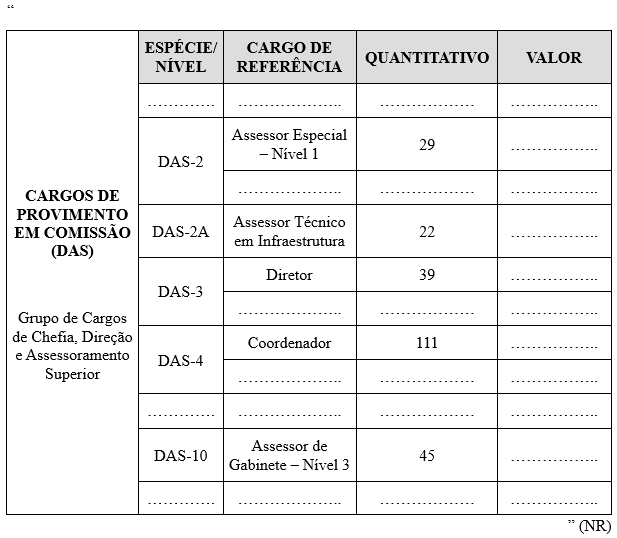
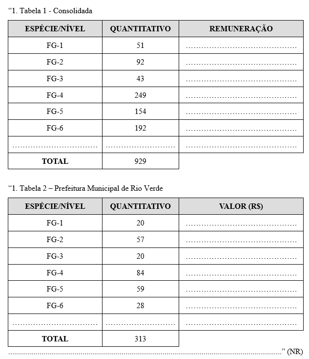
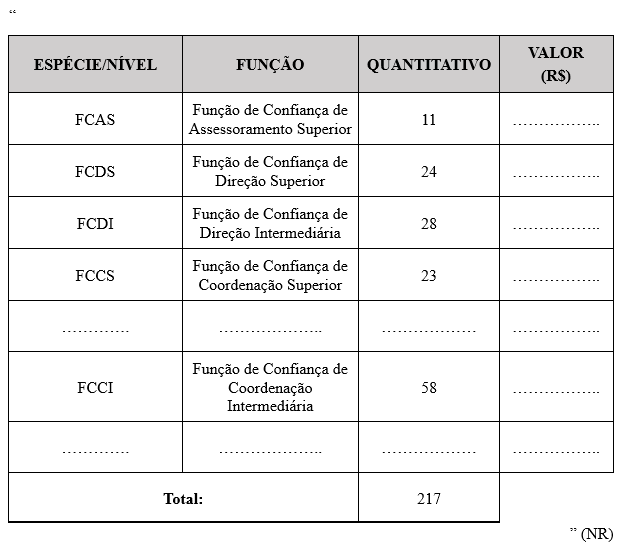
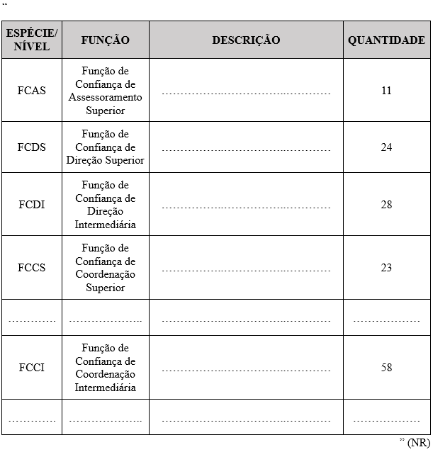

LEI COMPLEMENTAR Nº 439, DE 15 DE DEZEMBRO DE 2025.

Altera a Lei Complementar nº 182, de 06 de maio de 2020, que dispõe sobre a Estrutura Orgânica Básica da Administração Pública Municipal.

**A CÂMARA MUNICIPAL DE RIO VERDE-GO aprova E EU SANCIONO A SEGUINTE LEI:**

Art. 1º A Lei Complementar nº 182, de 06 de maio de 2020, passa a vigorar com as seguintes alterações:

“Art. 38. .....................................................................................

I - ...............................................................................................

...................................................................................................

h) Defesa Civil Municipal.

..........................................................................................” (NR)

**“TÍTULO III**

**DAS COMPETÊNCIAS DOS ÓRGÃOS E ENTIDADES DA ADMINISTRAÇÃO PÚBLICA MUNICIPAL**

**CAPÍTULO I**

**DA GOVERNADORIA DO MUNICÍPIO E SUAS COMPETÊNCIAS**

...................................................................................................

**Seção VI**

**Da Defesa Civil Municipal**

Art. 52-B. A Defesa Civil Municipal tem as seguintes atribuições:

I - articular, coordenar e gerenciar ações de proteção e defesa civil, em âmbito municipal;

II - promover a ampla participação da comunidade nas ações de proteção e de defesa, especialmente nas atividades de planejamento e nas ações de respostas a desastres e reconstrução;

III - elaborar e implementar planos de contingências e planos de operações de proteção e defesa civil, plano de implantação de obras e serviços para a redução de riscos de desastre, bem como projetos e programas relacionados com o assunto;

IV - elaborar o Plano ou Programa de Ação Plurianual, objetivando o atendimento de ações em tempo de normalidade, bem como em situações emergenciais;

V - capacitar recursos humanos para as ações de proteção e defesa civil;

VI - solicitar aos órgãos competentes vistorias e intervenções nas edificações e áreas de risco, bem como o isolamento e a evacuação da população das áreas de risco intensificado e das edificações vulneráveis;

VII - promover a identificação e a avaliação das ameaças, suscetibilidades e vulnerabilidades a desastres, de modo a evitar ou reduzir sua ocorrência, analisando e recomendando a inclusão de áreas de riscos no Plano Diretor Municipal;

VIII - implantar banco de dados e elaborar mapas temáticos sobre ameaças múltiplas no território local, nível de riscos e sobre recursos disponíveis para apoio às operações;

IX - manter os órgãos estaduais e federal de proteção e defesa civil informados sobre a ocorrência de desastres e sobre as atividades de proteção e defesa civil desenvolvidas no Município;

X - realizar exercícios simulados, com a participação da população, para treinamento das equipes e aperfeiçoamento dos planos de contingências;

XI - proceder e solicitar à avaliação de danos e prejuízos das áreas atingidas por desastres, e ao preenchimento dos formulários do Sistema Integrado de Informações sobre Desastres;

XII - realizar o monitoramento meteorológico, hidrológico e geológico das áreas de risco, bem como dos riscos biológicos, nucleares e químicos, e produzir alertas sobre a possibilidade de ocorrência de desastres;

XIII - identificar e mapear as áreas de risco de desastres;

XIV - organizar e administrar abrigos provisórios para assistência à população em situação de desastre;

XV- promover a coleta, a distribuição e o controle de suprimentos em situações de desastre;

XVI - prover solução de moradia temporária às famílias atingidas por desastres;

XVII - promover a inclusão dos princípios de defesa civil nos currículos escolares da rede municipal, proporcionando apoio à comunidade docente no desenvolvimento de material didático-pedagógico para esse fim;

XVIII - estimular a participação de entidades privadas, associações de voluntários, clubes de serviços, organizações não governamentais e associações de classe e comunitárias nas ações do SIMPDEC-RV e promover o treinamento de associações de voluntários para atuação conjunta com as comunidades apoiadas;

XIX - propor à autoridade competente a Declaração de Situação de Emergência ou de Estado de Calamidade Pública, de acordo com os critérios estabelecidos na legislação;

XX - convocar Secretarias Municipais, Coordenadorias ou outros órgãos públicos ou privados que compõem o Conselho Municipal de Proteção e Defesa Civil - COMPDEC para atuar sob sua coordenação na remoção e realocação de pessoas afetadas por desastres, serviços de resposta e reconstrução, coleta, distribuição e o controle de suprimentos em situações de desastres, montagem, manutenção e administração de abrigos provisórios para assistência à população em situação de desastres, avaliação, elaboração de laudos sobre causas e danos decorrentes de eventos adversos.

Art. 52-C. A Defesa Civil Municipal será gerida por servidor nomeado pelo Chefe do Poder Executivo Municipal, que terá por atribuição organizar as atividades de proteção e defesa civil no Município.

Art. 52-D. Os servidores a serviço da Defesa Civil Municipal poderão trabalhar em regime e carga horária diferenciados, em decorrência da necessidade de ações de preparação e atendimento de urgências e emergências provocadas por desastres ou por convocação do Prefeito Municipal.

Art. 52-E. Os servidores integrantes da Defesa Civil Municipal poderão ser indicados ou solicitados mediante designação do quadro de pessoal do Município, ainda que de forma temporária, ou mediante novas contratações, de acordo com critérios de conveniência e oportunidade da administração pública.

Art. 52-F. Compete ao gestor da Defesa Civil Municipal:

I - dirigir os trabalhos da Defesa Civil Municipal, desenvolvendo as políticas públicas previstas no Sistema Municipal de Proteção e Defesa Civil de Rio Verde - SIMPDEC-RV, de acordo com a legislação vigente, articulando a elaboração de projetos, ações e atividades de prevenção, mitigação, preparação, resposta e reconstrução dentro da Política Nacional de Proteção e Defesa Civil;

II - administrar, articular e gerenciar o Sistema Municipal de Proteção e Defesa Civil de Rio Verde - SIMPDEC-RV, respondendo administrativamente pela Defesa Civil Municipal e pelo Conselho Municipal de Proteção e Defesa Civil;

III - assessorar diretamente o Prefeito Municipal quanto à promoção de políticas públicas de proteção e defesa civil, através de estudos, pareceres e relatórios;

IV - promover a articulação do órgão municipal no Sistema Estadual e Nacional de Proteção e Defesa Civil;

V - promover a ampla participação da comunidade nas ações de proteção e de defesa, especialmente nas atividades de planejamento e nas ações de respostas a desastres e reconstrução;

VI - convocar Secretarias, Coordenadorias e órgãos públicos e privados para atuação em Proteção e Defesa Civil.

Art. 52-G. Fica estabelecida a vinculação da Defesa Civil Municipal ao Gabinete do Prefeito.”

Art. 2º Fica alterada a Lei Complementar nº 182, de 06 de maio de 2020, para:

I - aumentar em:

a) 06 (seis) unidades o número de vagas do cargo de Assessor Especial – Nível 1 (DAS-2);

b) 12 (doze) unidades o número de vagas do cargo de Assessor Técnico em Infraestrutura (DAS-2A);

c) 01 (uma) unidade o número de vagas do cargo de Diretor (DAS-3).

d) 03 (três) unidades o número de vagas do cargo de Coordenador (DAS-4);

e) 05 (cinco) unidades o número de vagas do cargo de Assessor de Gabinete – Nível 3 (DAS-10);

f) 02 (duas) unidades o número de vagas da função gratificada de Gestor de Processos Estratégicos (FG-1) da Prefeitura Municipal de Rio Verde;

g) 04 (quatro) unidades o número de vagas da função gratificada de Gestor de Projetos Estratégicos (FG-4) da Prefeitura Municipal de Rio Verde;

h) 01 (uma) unidade o número de vagas da função gratificada de Gestor de Processos Estratégicos (FG-5) da Prefeitura Municipal de Rio Verde;

i) 01 (uma) unidade o quantitativo da Função de Confiança de Assessoramento Superior (FCAS).

j) 04 (quatro) unidades o quantitativo da Função de Confiança de Direção Superior (FCDS);

k) 02 (duas) unidades o quantitativo da Função de Confiança de Coordenação Superior (FCCS).

II - extinguir:

a) 10 (dez) unidades do número de vagas da função gratificada de Gestor de Contratos (FG-3) da Prefeitura Municipal de Rio Verde;

b) 05 (cinco) unidades do número de vagas da função gratificada de Gestor de Projetos Estratégicos (FG-6) da Prefeitura Municipal de Rio Verde;

c) a função gratificada de Gestor de Pessoas, Pagamento e Carreiras (FG-1) da Prefeitura Municipal de Rio Verde;

d) a função gratificada de Gestor de Pessoas e Folha de Pagamento – Nível I (FG-2) da Prefeitura Municipal de Rio Verde;

e) a função gratificada de Presidente da Comissão Especial de Licitação (FG-2) da Prefeitura Municipal de Rio Verde;

f) a função gratificada de Gestor de Compras Governamentais (FG-2) da Prefeitura Municipal de Rio Verde;

g) a função gratificada de Gestor de Pessoas e Folha de Pagamento – Nível II (FG-4) da Prefeitura Municipal de Rio Verde;

h) a função gratificada de Agente de Compras Governamentais – Nível I (FG-4) da Prefeitura Municipal de Rio Verde;

i) a função gratificada de Agente de Compras Governamentais – Nível II (FG-5) da Prefeitura Municipal de Rio Verde;

j) 10 (dez) unidades do número de vagas da Função de Confiança de Direção Intermediária (FCDI);

k) 10 (dez) unidades do número de vagas da Função de Confiança de Coordenação Intermediária (FCCI).

III - criar:

a) a função gratificada de Gestor de Pessoas, Pagamento e Carreiras – Nível I (FG-1) na Prefeitura Municipal de Rio Verde;

b) a função gratificada de Gestor de Pessoas, Pagamento e Carreiras – Nível II (FG-2) na Prefeitura Municipal de Rio Verde;

c) a função gratificada de Gestor de Pessoas, Pagamento e Carreiras – Nível III (FG-3) na Prefeitura Municipal de Rio Verde;

d) criar a função gratificada de Gestor de Pessoas, Pagamento e Carreiras – Nível IV (FG-4) na Prefeitura Municipal de Rio Verde;

e) criar a função gratificada de Gestor de Compras, Contratos e Licitações – Nível I (FG-2) na Prefeitura Municipal de Rio Verde;

f) criar a função gratificada de Gestor de Compras, Contratos e Licitações – Nível II (FG-3) na Prefeitura Municipal de Rio Verde;

g) criar a função gratificada de Gestor de Compras, Contratos e Licitações – Nível III (FG-4) na Prefeitura Municipal de Rio Verde;

h) criar a função gratificada de Gestor de Compras, Contratos e Licitações – Nível IV (FG-5) na Prefeitura Municipal de Rio Verde.

Art. 3º Os Anexos II (Quadro de Classificação, Quantitativo e Valores dos Cargos de Provimento em Comissão (DAS); Anexo V (Quadro de Classificação, Quantitativo e Valores das Funções Gratificadas (FG), Anexo VI (Descrição das Funções Gratificadas (FG) e Anexo XVII (Quadro de Símbolos, Quantitativo e Valores das Funções de Confiança (FC) e Anexo XVIII (Descrição das Funções de Confiança (FC) da Lei Complementar nº 182, de 06 de maio de 2020, passa a vigorar conforme os Anexos I, II, III, IV e V desta lei.

Art. 4º Esta Lei Complementar entrará em vigor em 01 de janeiro de 2026.

Gabinete do Prefeito de Rio Verde, aos 15 de dezembro de 2025.

WELLINGTON SOARES CARRIJO FILHO

Prefeito de Rio Verde

VINÍCIUS FONSÊCA CAMPOS

Procurador-Geral

ÁLVARO CÉSAR DE SOUZA COSTA

Secretário de Planejamento e Gestão

**ANEXO I

(Alteração no Anexo II da Lei Complementar nº 182/2020 – QUADRO DE CLASSIFICAÇÃO, QUANTITATIVO E VALORES DOS CARGOS DE PROVIMENTO EM COMISSÃO (DAS)**

 

**ANEXO II**

**(Alteração no Anexo V da Lei Complementar nº 182/2020 – QUADRO DE CLASSIFICAÇÃO, QUANTITATIVO E VALORES DAS FUNÇÕES GRATIFICADAS (FG)**

                                   

**ANEXO III**

**(Alteração no Anexo VI da Lei Complementar nº 182/2020 – DESCRIÇÃO DAS FUNÇÕES GRATIFICADAS (FG)**

                      “1. Tabela 1 - Prefeitura Municipal de Rio Verde

| ESPÉCIE/NÍVEL | FUNÇÃO | DESCRIÇÃO | QUANTIDADE |
| --- | --- | --- | --- |
| …………… | …………… | ………………………… | ……………… |
| FG-1 | Gestor de Processos Estratégicos | ………………………… | 14 |
| FG-1 | Gestor de Pessoas, Pagamento e Carreiras – Nível I | Planejar, coordenar e executar atividades de alta complexidade na gestão de pessoas, admissão, pagamento e carreiras no órgão central de pessoal, alinhando as competências dos servidores às estratégias organizacionais do município. Administrar processos de remuneração, benefícios, folha de pagamento, encargos sociais, legislação estatutária e prestação de contas. Implementar políticas e programas de carreira, progressão, reconhecimento e desenvolvimento de talentos. Liderar equipes e frentes de trabalho, acompanhando indicadores de desempenho, clima organizacional, rotatividade e absenteísmo, contribuindo para uma cultura ética, positiva e orientada ao bom funcionamento dos serviços públicos. É atribuída a Servidores Públicos Municipais com nível superior de escolaridade. Desejáveis experiência na área, conhecimentos em informática e legislação estatutária local, e habilidades de liderança, comunicação, negociação e resolução de problemas. Requer comprovação de experiência mínima de 2 (dois) anos em Gestão de Pessoas. Seus atributos complementares deverão ser especificados no Decreto de designação. | 5 |
| ………... | ………….. | ……………………………………………………... | ………………. |
| FG-2 | Gestor de Pessoas, Pagamento e Carreiras – Nível II | Planejar, coordenar e executar atividades de alta complexidade na gestão de pessoas, admissão, pagamento e carreiras no órgão central de pessoal, alinhando as competências dos servidores às estratégias organizacionais do município. Administrar processos de remuneração, benefícios, folha de pagamento, encargos sociais, legislação estatutária e prestação de contas. Implementar políticas e programas de carreira, progressão, reconhecimento e desenvolvimento de talentos. Liderar equipes e frentes de trabalho, acompanhando indicadores de desempenho, clima organizacional, rotatividade e absenteísmo, contribuindo para uma cultura ética, positiva e orientada ao bom funcionamento dos serviços públicos. É atribuída a Servidores Públicos Municipais com nível superior de escolaridade. Desejáveis experiência na área, conhecimentos em informática e legislação estatutária local, e habilidades de liderança, comunicação, negociação e resolução de problemas. Requer comprovação de experiência mínima de 1 (um) ano e 6 (meses) em Gestão de Pessoas. Seus atributos complementares deverão ser especificados no Decreto de designação. | 16 |
| FG-2 | Gestor de Compras, Contratos e Licitações Nível I | Exercer atividades estratégicas relevantes para a Administração Pública, que envolvem a gestão de processos de compras, licitações e contratos de alta complexidade. É responsável por supervisionar a condução de cotações, aquisições e licitações, zelando pelo desempenho e pela melhoria contínua dos processos. Atua conforme as diretrizes técnicas da Secretária Municipal de Planejamento e Gestão e gerencia o desempenho por meio de indicadores. É atribuída aos Servidores Públicos Municipais com nível superior de escolaridade, com conhecimentos técnicos e experiência na função. Requer comprovação de experiência mínima de 2 (dois anos) na área de compras, contratos ou licitações. | 8 |
| ………... | ………….. | ……………………………………………………... | ………………. |
| FG-3 | Gestor de Contratos | ……………………………………………………... | 6 |
| FG-3 | Gestor de Pessoas, Pagamento e Carreiras – Nível III | Planejar, coordenar e executar atividades de alta complexidade na gestão de pessoas, admissão, pagamento e carreiras no órgão central de pessoal, alinhando as competências dos servidores às estratégias organizacionais do município. Administrar processos de remuneração, benefícios, folha de pagamento, encargos sociais, legislação estatutária e prestação de contas. Implementar políticas e programas de carreira, progressão, reconhecimento e desenvolvimento de talentos. Liderar equipes e frentes de trabalho, acompanhando indicadores de desempenho, clima organizacional, rotatividade e absenteísmo, contribuindo para uma cultura ética, positiva e orientada ao bom funcionamento dos serviços públicos. É atribuída a Servidores Públicos Municipais com nível técnico de escolaridade, no mínimo. Desejáveis experiência na área, conhecimentos em informática e legislação estatutária local, e habilidades de liderança, comunicação, negociação e resolução de problemas. Requer comprovação de experiência mínima de 1 (um) ano em Gestão de Pessoas. Seus atributos complementares deverão ser especificados no Decreto de designação. | 2 |
| FG-3 | Gestor de Compras, Contratos e Licitações Nível II | Exercer atividades estratégicas relevantes para a Administração Pública, que envolvem a gestão de processos de compras, licitações e contratos de alta complexidade. É responsável por supervisionar a condução de cotações, aquisições e licitações, zelando pelo desempenho e pela melhoria contínua dos processos. Atua conforme as diretrizes técnicas da Secretária Municipal de Planejamento e Gestão e gerencia o desempenho por meio de indicadores. É atribuída aos Servidores Públicos Municipais com nível superior de escolaridade, com conhecimentos técnicos e experiência na função. Requer comprovação de experiência mínima de 1 (um) ano e 6 (seis) meses na área de compras, contratos ou licitações. | 6 |
| ………... | ………….. | ……………………………………………………... | ………………. |
| FG-4 | Gestor de Projetos Estratégicos | …………………………………………………... | 44 |
| ………... | ………….. | ……………………………………………………... | ………………. |
| FG-4 | Gestor de Compras, Contratos e Licitações– Nível III | Exercer atividades estratégicas relevantes para a Administração Pública, que envolvem a gestão de processos de compras, licitações e contratos de média complexidade. É responsável pela execução da cotação e aquisição de produtos e serviços específicos, bem como pela instrução e organização dos processos correspondentes. É atribuída aos Servidores Públicos Municipais com nível médio ou técnico profissionalizante de escolaridade, com conhecimentos técnicos e experiência na função. Requer comprovação de experiência mínima de 1 (um) ano na área de compras, contratos ou licitações. | 14 |
| FG-4 | Gestor de Pessoas, Pagamento e Carreiras – Nível IV | Planejar, coordenar e executar atividades de alta complexidade na gestão de pessoas, admissão, pagamento e carreiras no órgão central de pessoal, alinhando as competências dos servidores às estratégias organizacionais do município. Administrar processos de remuneração, benefícios, folha de pagamento, encargos sociais, legislação estatutária e prestação de contas. Implementar políticas e programas de carreira, progressão, reconhecimento e desenvolvimento de talentos. Liderar equipes e frentes de trabalho, acompanhando indicadores de desempenho, clima organizacional, rotatividade e absenteísmo, contribuindo para uma cultura ética, positiva e orientada ao bom funcionamento dos serviços públicos. É atribuída a Servidores Públicos Municipais com nível médio de escolaridade. Desejáveis experiência na área, conhecimentos em informática e legislação estatutária local, e habilidades de liderança, comunicação, negociação e resolução de problemas. Requer comprovação de experiência mínima de 6 (seis) meses em Gestão de Pessoas. Seus atributos complementares deverão ser especificados no Decreto de designação. | 18 |
| ………... | ………….. | ……………………………………………………... | ………………. |
| FG-5 | Gestor de Compras, Contratos e Licitações – Nível IV | Exercer atividades estratégicas relevantes para a Administração Pública, que envolvem a gestão de processos de compras, licitações e contratos de baixa complexidade. É responsável pelo apoio à cotação e aquisição de produtos e serviços, além da organização e instrução de processos. É atribuída aos Servidores Públicos Municipais com nível médio ou técnico profissionalizante de escolaridade, com conhecimentos técnicos e experiência na função. Requer comprovação de experiência mínima de 6 (seis) meses na área de compras, contratos ou licitações. | 12 |
| FG-5 | Gestor de Processos Estratégicos | ……………………………………………………... | 30 |
| ………... | ………….. | ……………………………………………………... | ………………. |
| FG-6 | Gestor de Projetos Estratégicos | ……………………………………………………... | 24 |
| ………... | ………….. | ……………………………………………………... | ………………. |

                                                                                                                                                                             ”(NR)

**ANEXO IV**

**(Alteração no Anexo XVII da Lei Complementar nº 182/2020 – QUADRO DE SÍMBOLOS, QUANTITATIVO E VALORES DAS FUNÇÕES DE CONFIANÇA (FC)**

**ANEXO V**

**(Alteração no Anexo XVIII da Lei Complementar nº 182/2020 – DESCRIÇÃO DAS FUNÇÕES DE CONFIANÇA (FC)**

