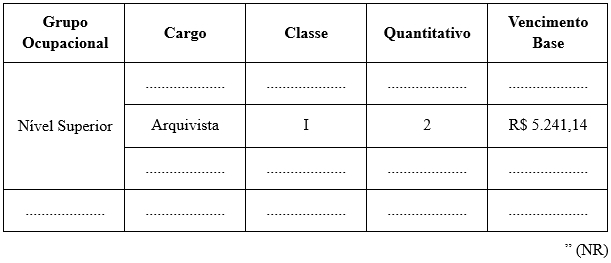

LEI Nº 7.778, DE 12 DE DEZEMBRO DE 2025.

Altera o § 4º, do art.17, e os Anexos I e VIII, da Lei 7.435/2023, e dá outras providências.

**A CÂMARA MUNICIPAL DE RIO VERDE – GOIÁS APROVA E EU SANCIONO A SEGUINTE LEI**

Art. 1º Altera o § 4º do art. 17 da Lei Municipal nº 7.435, de 20 de outubro de 2023, que passa a vigorar com a seguinte redação:

“Art. 17. .....................................................................................

...................................................................................................

§ 4º A Carga Horária dos servidores efetivos será de 8 (oito) horas diárias e 40 (quarenta) horas semanais, exceto os Cargos de Ouvidor, Tradutor e Intérprete de Libras, Assistente Social e Procurador Jurídico que terão jornada de 6 (seis) horas diárias e 30 (trinta) horas semanais.

..........................................................................................” (NR)

Art. 2º Altera o Anexo VIII da Lei 7.435/2023, referente ao cargo de Tradutor e Intérprete da Língua Brasileira de Sinais – LIBRAS, que passará a viger com a seguinte redação:

Anexo VIII - Ensino superior em pedagogia, letras, letras libras, com pós graduação em língua brasileira de sinais – LIBRAS.

Art. 3º Altera os Anexos I, que cria o cargo de arquivista, e VIII, que altera os requisitos e atribuições do cargo de Técnico de Informática, e altera o artigo 17 da Lei 7.435/2025, que passarão a viger com a seguinte redação:

“Art. 17. ......................................................................................

| CARGO | QUANTITATIVO |
| --- | --- |
| .................. | ............... |
| Arquivista | 02 |
| .................. | ............... |

..........................................................................................” (NR)

**“ANEXO I** 

**“ANEXO VIII**

| Cargo | Atribuições | Pré-requisito |
| --- | --- | --- |
| .................... | ......................................... | ....................... |
| Arquivista | I - Gestão Documental: Cria e implementa sistemas de organização, classificação e catalogação de documentos; II - Preservação: Desenvolve técnicas para conservar documentos (prevenção e restauração), protegendo-os contra danos físicos ou digitais; III -Avaliação e Seleção: Decide quais documentos possuem valor permanente para serem guardados e quais podem ser eliminados, seguindo normas legais; IV - Acesso e Disseminação: Facilita a pesquisa, organiza exposições e torna a informação acessível ao público e pesquisadores; V - Tecnologia: Atua na gestão de documentos eletrônicos e no gerenciamento de arquivos digitais; VI - Planejamento: Elabora projetos para sistemas arquivísticos e participa de comissões técnicas. | Diploma de conclusão de curso de graduação de nível superior em Arquivologia, devidamente registrado e fornecido por instituição de ensino superior reconhecida pelo Ministério da Educação. |
| .................... | ......................................... | ....................... |
| Técnico de Informática | I - Será responsável por planejar, executar e supervisionar tarefas de suporte técnico, manutenção de hardware e software, e gestão operacional dos recursos de tecnologia da informação do órgão; II - Suporte Técnico e Operacional: Prestar Suporte Técnico (Nível III): Atender e solucionar problemas de hardware, software, rede e sistemas operacionais para os usuários da instituição, seja presencialmente ou remotamente; III - Treinamento: Conduzir sessões de orientação e treinamento para usuários sobre a utilização correta de softwares, sistemas e equipamentos; IV - Monitoramento: Acompanhar e monitorar o desempenho e a performance dos sistemas e aplicações em uso, identificando e comunicando anomalias; V - Homologação: Auxiliar na implantação e homologação (validação final) de novos sistemas e aplicativos junto aos usuários; VI - Manutenção e Infraestrutura Instalação e Configuração: Realizar a instalação, configuração e manutenção de sistemas operacionais, aplicativos e softwares diversos em estações de trabalho; VII - Monitoramento: Acompanhar e monitorar o desempenho e a performance dos sistemas e aplicações em uso, identificando e comunicando anomalias; VIII - Homologação: Auxiliar na implantação e homologação (validação final) de novos sistemas e aplicativos junto aos usuários; IX - Hardware: Executar a montagem, desmontagem, manutenção preventiva e corretiva de computadores e equipamentos periféricos (impressoras, scanners, monitores, etc.); X - Gestão de Rede: Instalar, configurar e manter a rede local (cabeamento, roteadores e pontos de acesso), garantindo a conectividade dos equipamentos; XI - Segurança e Backup: Implementar rotinas básicas de segurança, como instalação e atualização de antivírus e firewalls em estações de trabalho, e realizar rotinas de backup e recuperação de dados; XII - Especificação de Hardware: Auxiliar na especificação técnica de máquinas, equipamentos, ferramentas e suprimentos de informática para fins de aquisição; XIII - Gestão e Procedimentos Planejamento de Tarefas: Colaborar no planejamento de etapas e ações de trabalho, e auxiliar na definição de cronogramas e distribuição de tarefas da equipe técnica; XIV - Padronização: Definir e implementar padronizações operacionais de sistemas e configurações de estações de trabalho; XV - Execução de Outras Tarefas: Executar outras tarefas de mesma natureza e nível de complexidade, associadas ao ambiente organizacional; XVI - Documentação: Manter e atualizar a documentação técnica dos sistemas, aplicações, procedimentos operacionais e inventário de equipamentos; XVII - Desenvolvimento e Documentação Codificação e Manutenção: Desenvolver e codificar programas ou rotinas simples, bem como realizar a manutenção e pequenas alterações em sistemas e aplicações existentes; XVIII - Banco de Dados: Participar da montagem da estrutura de banco de dados e auxiliar na manipulação e manutenção de dados; XIX - Hardware: Executar a montagem, desmontagem, manutenção preventiva e corretiva de computadores e equipamentos periféricos (impressoras, scanners, monitores, etc.); XX - Gestão de Rede: Instalar, configurar e manter a rede local (cabeamento, roteadores e pontos de acesso), garantindo a conectividade dos equipamentos; XXI - Segurança e Backup: Implementar rotinas básicas de segurança, como instalação e atualização de antivírus e firewalls em estações de trabalho, e realizar rotinas de backup e recuperação de dados; XXII - Especificação de Hardware: Auxiliar na especificação técnica de máquinas, equipamentos, ferramentas e suprimentos de informática para fins de aquisição; XXIII - Gestão e Procedimentos Planejamento de Tarefas: Colaborar no planejamento de etapas e ações de trabalho, e auxiliar na definição de cronogramas e distribuição de tarefas da equipe técnica; XXIV - Padronização: Definir e implementar padronizações operacionais de sistemas e configurações de estações de trabalho; XXV - Execução de Outras Tarefas: Executar outras tarefas de mesma natureza e nível de complexidade, associadas ao ambiente organizacional; XXVI - Documentação: Manter e atualizar a documentação técnica dos sistemas, aplicações, procedimentos operacionais e inventário de equipamentos; XXVII - Desenvolvimento e Documentação Codificação e Manutenção: Desenvolver e codificar programas ou rotinas simples, bem como realizar a manutenção e pequenas alterações em sistemas e aplicações existentes; XXVIII - Banco de Dados: Participar da montagem da estrutura de banco de dados e auxiliar na manipulação e manutenção de dados. | Nível Superior em Ciências da Computação, Análise e Desenvolvimentos de Sistemas, Engenharia da Computação e áreas afins. |
| .................... | ......................................... | .................... |

                                                                                                                                                                             ”(NR)

Art. 4º Extingue o cargo de Técnico da Arquivo, inserido pela Lei nº 7.674, de 27 de junho de 2025.

Art. 5º Esta Lei entrará em vigência na data de sua publicação, revogando as disposições em contrário. 

Gabinete do Prefeito de Rio Verde, aos 12 de dezembro de 2025.

WELLINGTON SOARES CARRIJO FILHO

Prefeito de Rio Verde

VINÍCIUS FONSÊCA CAMPOS

Procurador-Geral
