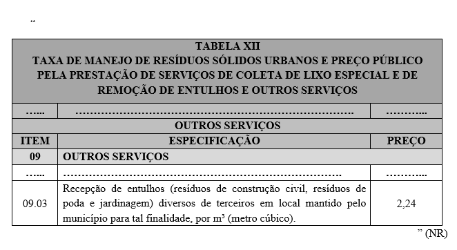

LEI COMPLEMENTAR Nº 437, DE 15 DE DEZEMBRO DE 2025.

Altera a Lei Complementar nº 5.727, de 11 de dezembro de 2009 - Código Tributário do Município de Rio Verde.

**A CÂMARA MUNICIPAL DE RIO VERDE-GO APROVA E EU SANCIONO A SEGUINTE LEI:**

Art. 1º A Lei Complementar nº 5.727, de 11 de dezembro de 2009 – Código Tributário do Município de Rio Verde, passa a vigorar com as seguintes alterações:

“Art. 55. .....................................................................................

...................................................................................................

3\. ...............................................................................................

3.01 (Revogado).

3.02. Cessão de direito de uso de marcas e de sinais de propaganda.

3.03. Exploração de salões de festas, centro de convenções, escritórios virtuais, stands, quadras esportivas, estádios, ginásios, auditórios, casas de espetáculos, parques de diversões, canchas e congêneres, para realização de eventos ou negócios de qualquer natureza.

3.04. Locação, sublocação, arrendamento, direito de passagem ou permissão de uso, compartilhado ou não, de ferrovia, rodovia, postes, cabos, dutos e condutos de qualquer natureza.

3.05. Cessão de andaimes, palcos, coberturas e outras estruturas de uso temporário.

...................................................................................................

4\. ...............................................................................................

...................................................................................................

4.23. Outros planos de saúde que se cumpram através de serviços de terceiros contratados, credenciados, cooperados ou apenas pagos pelo operador do plano mediante indicação do beneficiário.

...................................................................................................

7\. ...............................................................................................

...................................................................................................

7.14. (Revogado).

7.15. (Revogado).

...................................................................................................

7.17. Escoramento, contenção de encostas e serviços congêneres.

7.18. Limpeza e dragagem de rios, portos, canais, baías, lagos, lagoas, represas, açudes e congêneres.

7.19. Acompanhamento e fiscalização da execução de obras de engenharia, arquitetura e urbanismo.

7.20. Aerofotogrametria (inclusive interpretação), cartografia, mapeamento, levantamentos topográficos, batimétricos, geográficos, geodésicos, geológicos, geofísicos e congêneres.

7.21. Pesquisa, perfuração, cimentação, mergulho, perfilagem, concretação, testemunhagem, pescaria, estimulação e outros serviços relacionados com a exploração e explotação de petróleo, gás natural e de outros recursos minerais.

7.22. Nucleação e bombardeamento de nuvens e congêneres.

...................................................................................................

13\. .............................................................................................

13.01. (Revogado).

13.02. Fonografia ou gravação de sons, inclusive trucagem, dublagem, mixagem e congêneres.

13.03. Fotografia e cinematografia, inclusive revelação, ampliação, cópia, reprodução, trucagem e congêneres.

13.04. Reprografia, microfilmagem e digitalização.

...................................................................................................

17\. .............................................................................................

...................................................................................................

17.07 (Revogado).

17.08. Franquia (franchising).

17.09. Perícias, laudos, exames técnicos e análises técnicas.

17.10. Planejamento, organização e administração de feiras, exposições, congressos e congêneres.

17.11. Organização de festas e recepções; bufê (exceto o fornecimento de alimentação e bebidas, que fica sujeito ao ICMS).

17.12. Administração em geral, inclusive de bens e negócios de terceiros.

17.13. Leilão e congêneres.

17.14. Advocacia.

17.15. Arbitragem de qualquer espécie, inclusive jurídica.

17.16. Auditoria.

17.17. Análise de Organização e Métodos.

17.18. Atuária e cálculos técnicos de qualquer natureza.

17.19. Contabilidade, inclusive serviços técnicos e auxiliares.

17.20. Consultoria e assessoria econômica ou financeira.

17.21. Estatística.

17.22. Cobrança em geral.

17.23. Assessoria, análise, avaliação, atendimento, consulta, cadastro, seleção, gerenciamento de informações, administração de contas a receber ou a pagar e em geral, relacionados a operações de faturização (factoring).

17.24. Apresentação de palestras, conferências, seminários e congêneres.

...................................................................................................” (NR)

“Art. 76. .....................................................................................

...................................................................................................

II - ..............................................................................................

...................................................................................................

c) 03% (três por cento): itens “01” (um) - “06” (seis), exceto o subitem “6.05” - “08” (oito) - “11” (onze) - “16” (dezesseis) - “17” (dezessete), exceto os subitens “17.05, 17.08, 17.11, 17.22 e 17.23” - “20” (vinte) - “24” (vinte e quatro) - “27” (vinte e sete) - “29” (vinte e nove) - “30” (trinta) - “33” (trinta e três) - “35” (trinta e cinco) - “36” (trinta e seis) - “37” (trinta e sete) - “38” (trinta e oito) - “39” (trinta e nove) e “40” (quarenta); subitens “12.01, 12.02 e 12.08”;

...................................................................................................” (NR)

Art. 2º Fica alterada a TABELA XII - TAXA DE MANEJO DE RESÍDUOS SÓLIDOS URBANOS E PREÇO PÚBLICO PELA PRESTAÇÃO DE SERVIÇOS DE COLETA DE LIXO ESPECIAL E DE REMOÇÃO DE ENTULHOS E OUTROS SERVIÇOS, anexa à Lei Complementar nº 5.727, de 11 de dezembro de 2009, que passará a vigorar conforme o Anexo Único desta lei

Art. 3º Ficam revogados os subitens “3.01”, “7.14”, “7.15”, “13.01”, “17.07” do art. 55, todos da Lei Complementar nº 5.727, de 11 de dezembro de 2009.

Art. 4º Esta Lei Complementar entrará em vigor na data de sua publicação.

Gabinete do Prefeito de Rio Verde, aos 15 de dezembro de 2025.

WELLINGTON SOARES CARRIJO FILHO

Prefeito de Rio Verde

VINÍCIUS FONSÊCA CAMPOS

Procurador-Geral

ENIO FREITAS DE SENE

Secretário da Fazenda

**ANEXO ÚNICO**

**(Alteração da Tabela XII da Lei Complementar nº 5.727, de 11 de dezembro de 2009)**

                                                                                                                                    
