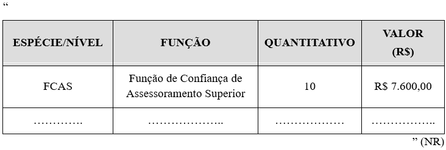
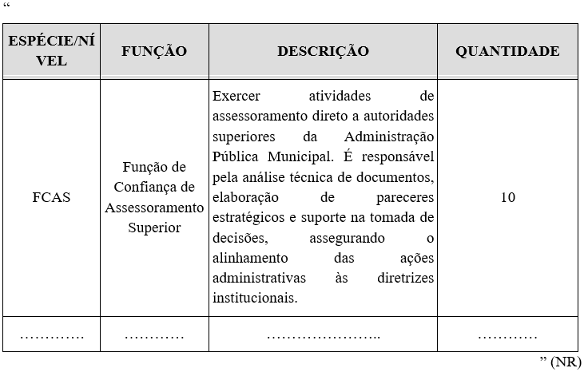

LEI COMPLEMENTAR Nº 433, DE 17 DE NOVEMBRO DE 2025.

Altera a Lei Complementar nº 182, de 06 de maio de 2020, que dispõe sobre a Estrutura Orgânica Básica da Administração Pública Municipal.

**A CÂMARA MUNICIPAL DE RIO VERDE-GO APROVA E EU SANCIONO A SEGUINTE LEI:**

Art. 1º Ficam alterados os Anexos XVII e XVIII da Lei Complementar nº 182, de 06 de maio de 2020, que passarão a viger conforme os Anexos I e II desta lei para aumentar em 01 (uma) unidade o número de vaga da Função de Confiança de Assessoramento Superior (FCAS).

Art. 2º Esta Lei entrará em vigor na data de sua publicação.

Gabinete do Prefeito de Rio Verde, aos 17 de novembro de 2025.

WELLINGTON SOARES CARRIJO FILHO

Prefeito de Rio Verde

VINÍCIUS FONSÊCA CAMPOS

Procurador-Geral

ÁLVARO CÉSAR DE SOUZA COSTA

Secretário de Planejamento e Gestão

 

**ANEXO I**

**(Alteração no Anexo XVII da Lei Complementar nº 182/2020 – QUADRO DE SÍMBOLOS, QUANTITATIVO E VALORES DAS FUNÇÕES DE CONFIANÇA (FC))**

**ANEXO II

(Alteração no Anexo XVIII da Lei Complementar nº 182/2020 – DESCRIÇÃO DAS FUNÇÕES DE CONFIANÇA (FC))**

