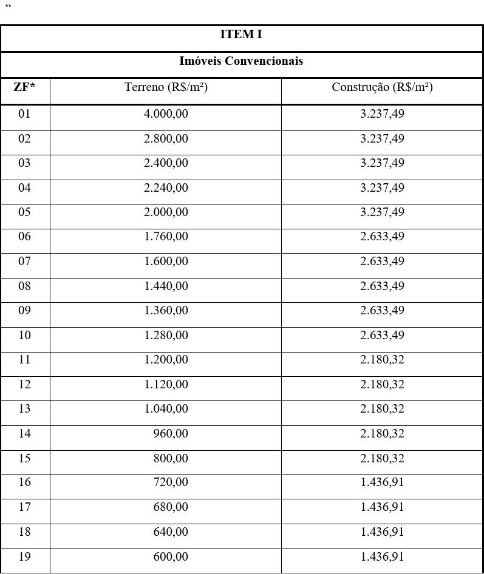
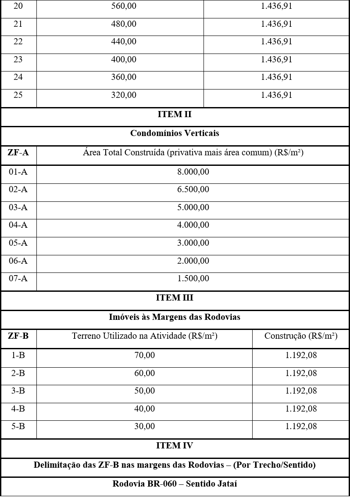
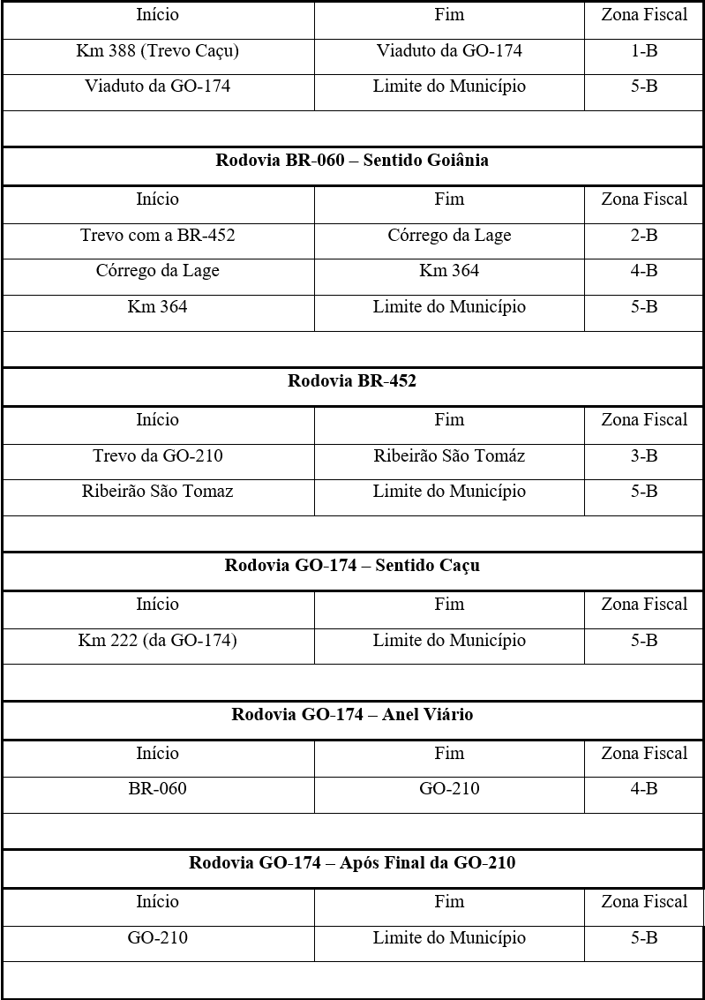
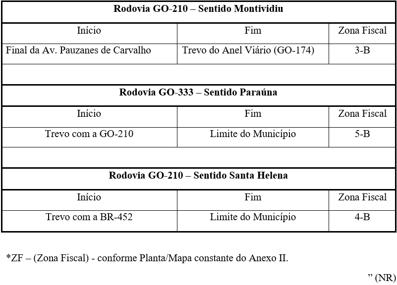
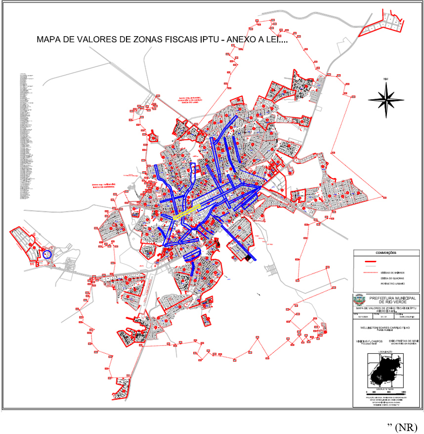

LEI COMPLEMENTAR Nº 432, DE 17 DE NOVEMBRO DE 2025.

Altera a Lei nº 6.335/2013, que dispõe sobre a Planta de Valores Genéricos dos Terrenos e Tabela de Preços de Construções, e dá outras providências.

**A CÂMARA MUNICIPAL DE RIO VERDE-GO APROVA E EU SANCIONO A SEGUINTE LEI:**

Art. 1º A Lei nº 6.335, de 21 de outubro de 2013, passa a vigorar com a seguinte redação:

“Art. 1º ......................................................................................

Anexo I - Pauta de Valores Genéricos dos Terrenos e Tabela de Preços de Construções;

Anexo II - Planta/Mapa de delimitação das Zonas Fiscais (ZF);

...................................................................................................

§ 1º A reclassificação de um imóvel, de um grupo de imóveis, de bairros ou de localidades específicas para outra Zona Fiscal, em razão de valorização ou desvalorização, poderá ser realizada por ato do Poder Executivo, mediante estudo apresentado por Comissão designada para o fim específico, nos termos do inciso III do § 1º do art. 156 da Constituição Federal.

§ 2º Os imóveis lançados no Cadastro Imobiliário do Município após o início da vigência desta lei serão enquadrados pelo setor competente da Secretaria da Fazenda, segundo o seu valor venal, nas respectivas Zonas Fiscais de que trata o Anexo I desta Lei, na forma do regulamento.” (NR)

Art. 2º Os Anexos I e II da Lei nº 6.335, de 21 de outubro de 2013, passam a vigorar conforme Anexos I e II desta lei.

Art. 3º Ficam revogados os itens “2” a “5” da tabela referente aos fatores correcionais dos terrenos, quanto a situação, topografia, pedologia, acesso, localização e grandeza em área (gleba), constantes do Anexo III da Lei nº 6.335, de 21 de outubro de 2013.

Art. 4º Esta Lei entrará em vigor na data da sua publicação, produzindo efeitos a partir de 1º e janeiro de 2026.

Gabinete do Prefeito de Rio Verde, aos 17 de novembro de 2025.

WELLINGTON SOARES CARRIJO FILHO

Prefeito de Rio Verde

VINÍCIUS FONSÊCA CAMPOS

Procurador-Geral

enio freitas de sene

Secretário da Fazenda

**ANEXO I 

(Alteração no Anexo I da Lei nº 6.335/2013 - Pauta de Valores Genéricos dos Terrenos e Tabela de Preços de Construções)**

**ANEXO II

(Alteração no Anexo II da Lei nº 6.335/2013 – Zoneamento de IPTU)

“Planta/Mapa de Delimitação das ZF\* (Zonas Fiscais)**

 

