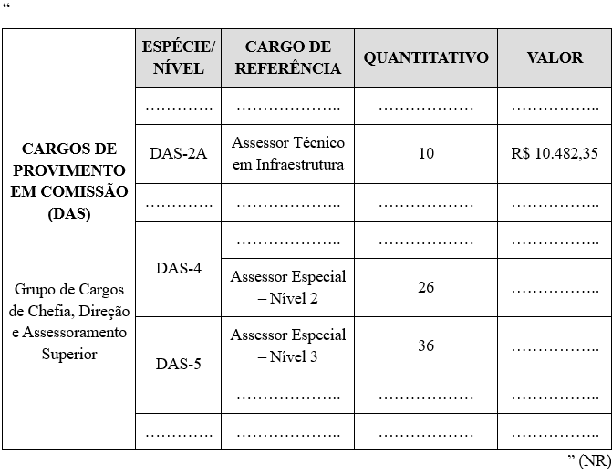
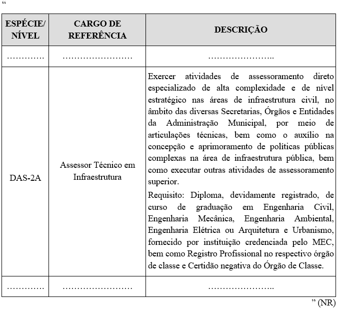

LEI COMPLEMENTAR Nº 428, DE 17 DE NOVEMBRO DE 2025.

Altera a Lei Complementar nº 182, de 06 de maio de 2020, que dispõe sobre a Estrutura Orgânica Básica da Administração Pública Municipal.

**A CÂMARA MUNICIPAL DE RIO VERDE-GO APROVA E EU SANCIONO A SEGUINTE LEI:**

Art. 1º Ficam alterados os Anexos II e IV da Lei Complementar nº 182, de 06 de maio de 2020, que passarão a viger conforme os Anexos I e II desta lei para:

I - criar o cargo de Assessor Técnico em Infraestrutura (DAS-2A) no quantitativo de 10 (dez) unidades, conforme atribuições e requisitos dispostos no Anexo II desta lei;

II - aumentar 02 (duas) unidades o número de vagas do cargo de Assessor Especial – Nível 2 (DAS-4) e 02 (duas) unidades o número de vagas do cargo de Assessor Especial – Nível 3 (DAS-5).

Art. 2º Esta lei entrará em vigor em 1º de dezembro de 2025.

Gabinete do Prefeito de Rio Verde, aos 17 de novembro de 2025.

WELLINGTON SOARES CARRIJO FILHO

Prefeito de Rio Verde

VINÍCIUS FONSÊCA CAMPOS

Procurador-Geral

ÁLVARO CÉSAR DE SOUZA COSTA

Secretário de Planejamento e Gestão

 

**ANEXO I**

**(Alteração no Anexo II da Lei Complementar nº 182/2020 – QUADRO DE CLASSIFICAÇÃO, QUANTITATIVO E VALORES DOS CARGOS DE PROVIMENTO EM COMISSÃO (DAS)**

**ANEXO II

(Alteração no Anexo IV da Lei Complementar nº 182/2020 – DESCRIÇÃO DOS CARGOS DE PROVIMENTO EM COMISSÃO (DAS))**

